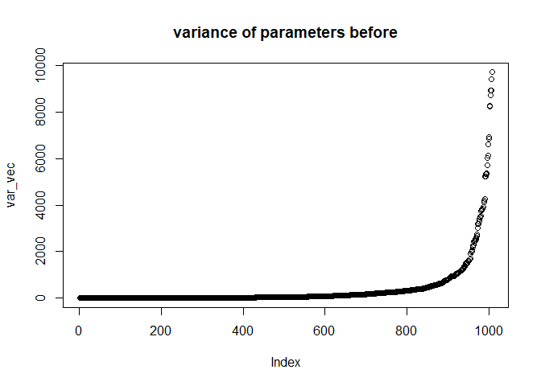
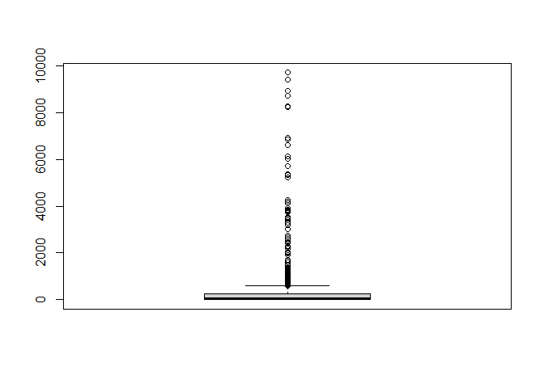
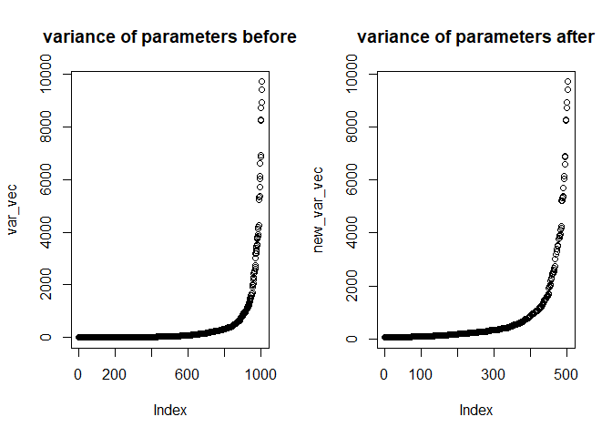
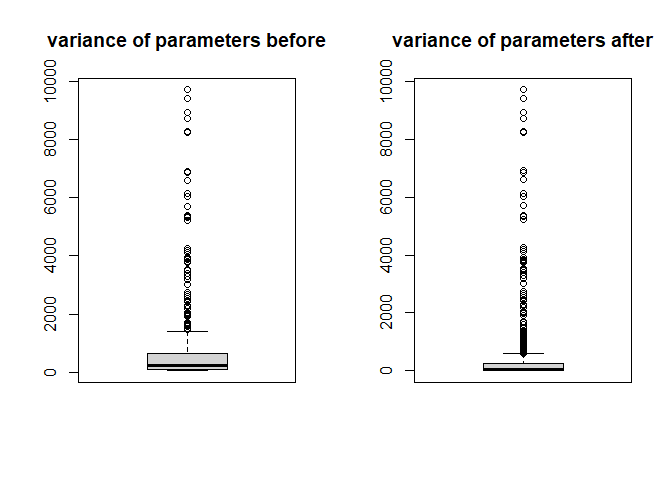
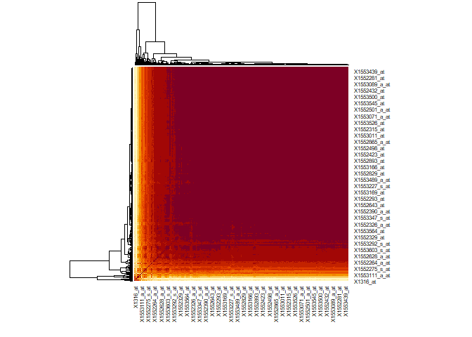
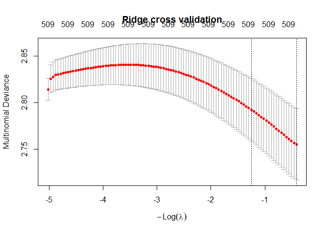
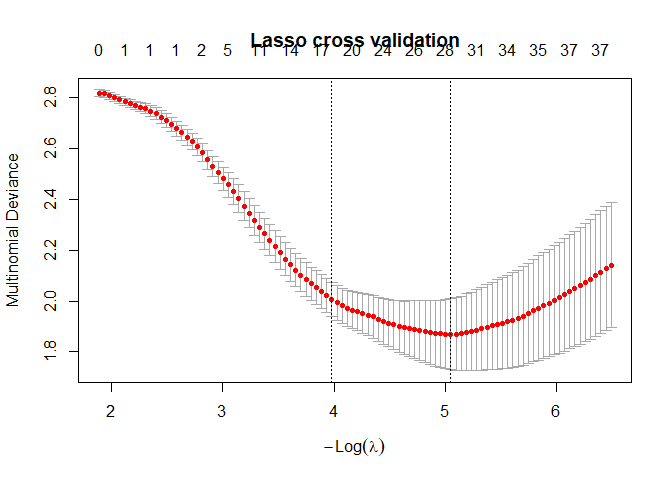
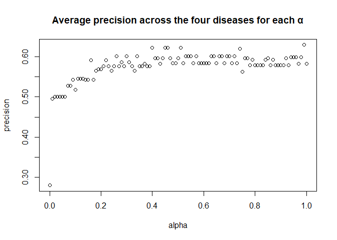
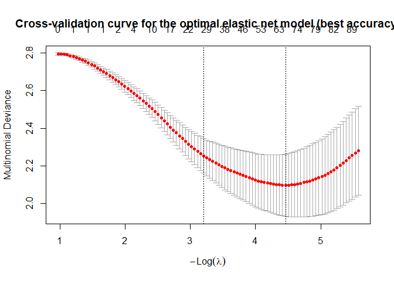
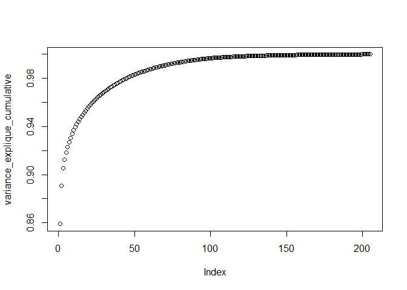

Projet
================
Sara HADOUANI & Alicia WANG
2025-11-10

## I- Data pre-processing

``` r
set.seed(123)
data <- read.table(file = "GSE53987_first1000genes.csv", header = T, sep=",")
dim(data)
```

    ## [1]  205 1041

``` r
print(head(data))
```

    ##   X     Sample          title geo_accession                status
    ## 1 0 GSM1304852 bipolar_hip_10    GSM1304852 Public on Jan 11 2014
    ## 2 1 GSM1304853 bipolar_hip_11    GSM1304853 Public on Jan 11 2014
    ## 3 2 GSM1304854 bipolar_hip_12    GSM1304854 Public on Jan 11 2014
    ## 4 3 GSM1304855 bipolar_hip_13    GSM1304855 Public on Jan 11 2014
    ## 5 4 GSM1304856 bipolar_hip_14    GSM1304856 Public on Jan 11 2014
    ## 6 5 GSM1304857 bipolar_hip_15    GSM1304857 Public on Jan 11 2014
    ##   submission_date last_update_date type channel_count
    ## 1     Jan 10 2014      Jan 11 2014  RNA             1
    ## 2     Jan 10 2014      Jan 11 2014  RNA             1
    ## 3     Jan 10 2014      Jan 11 2014  RNA             1
    ## 4     Jan 10 2014      Jan 11 2014  RNA             1
    ## 5     Jan 10 2014      Jan 11 2014  RNA             1
    ## 6     Jan 10 2014      Jan 11 2014  RNA             1
    ##                 source_name_ch1 organism_ch1 taxid_ch1 X0.age X1.gender X2.race
    ## 1 hippocampus, bipolar disorder Homo sapiens      9606     52         M       W
    ## 2 hippocampus, bipolar disorder Homo sapiens      9606     50         F       W
    ## 3 hippocampus, bipolar disorder Homo sapiens      9606     28         F       W
    ## 4 hippocampus, bipolar disorder Homo sapiens      9606     55         F       W
    ## 5 hippocampus, bipolar disorder Homo sapiens      9606     58         M       W
    ## 6 hippocampus, bipolar disorder Homo sapiens      9606     28         M       W
    ##   X3.pmi X4.ph X5.rin   X6.tissue X7.disease.state molecule_ch1
    ## 1   23.5   6.7    6.3 hippocampus bipolar disorder    total RNA
    ## 2   11.7   6.4    6.8 hippocampus bipolar disorder    total RNA
    ## 3   22.3   6.3    7.7 hippocampus bipolar disorder    total RNA
    ## 4   17.5   6.4    7.6 hippocampus bipolar disorder    total RNA
    ## 5   27.7   6.8    7.0 hippocampus bipolar disorder    total RNA
    ## 6   27.4   6.2    7.7 hippocampus bipolar disorder    total RNA
    ##                            extract_protocol_ch1 label_ch1
    ## 1 Trizol extraction of total RNA was performed.    biotin
    ## 2 Trizol extraction of total RNA was performed.    biotin
    ## 3 Trizol extraction of total RNA was performed.    biotin
    ## 4 Trizol extraction of total RNA was performed.    biotin
    ## 5 Trizol extraction of total RNA was performed.    biotin
    ## 6 Trizol extraction of total RNA was performed.    biotin
    ##                                                               label_protocol_ch1
    ## 1 Biotinylated cRNA were prepared according to the standard Affymetrix protocol.
    ## 2 Biotinylated cRNA were prepared according to the standard Affymetrix protocol.
    ## 3 Biotinylated cRNA were prepared according to the standard Affymetrix protocol.
    ## 4 Biotinylated cRNA were prepared according to the standard Affymetrix protocol.
    ## 5 Biotinylated cRNA were prepared according to the standard Affymetrix protocol.
    ## 6 Biotinylated cRNA were prepared according to the standard Affymetrix protocol.
    ##                                                                                                                                                                                                                               hyb_protocol
    ## 1 Five (5) ug of fragmented, biotin-labeled cDNA was hybridized to Affymetrix Human Genome U133_Plus 2 Gene Chips for 18 hours, then washed/stained according to manufacturer's recommendations using the Affymetrix 450 fluidics station.
    ## 2 Five (5) ug of fragmented, biotin-labeled cDNA was hybridized to Affymetrix Human Genome U133_Plus 2 Gene Chips for 18 hours, then washed/stained according to manufacturer's recommendations using the Affymetrix 450 fluidics station.
    ## 3 Five (5) ug of fragmented, biotin-labeled cDNA was hybridized to Affymetrix Human Genome U133_Plus 2 Gene Chips for 18 hours, then washed/stained according to manufacturer's recommendations using the Affymetrix 450 fluidics station.
    ## 4 Five (5) ug of fragmented, biotin-labeled cDNA was hybridized to Affymetrix Human Genome U133_Plus 2 Gene Chips for 18 hours, then washed/stained according to manufacturer's recommendations using the Affymetrix 450 fluidics station.
    ## 5 Five (5) ug of fragmented, biotin-labeled cDNA was hybridized to Affymetrix Human Genome U133_Plus 2 Gene Chips for 18 hours, then washed/stained according to manufacturer's recommendations using the Affymetrix 450 fluidics station.
    ## 6 Five (5) ug of fragmented, biotin-labeled cDNA was hybridized to Affymetrix Human Genome U133_Plus 2 Gene Chips for 18 hours, then washed/stained according to manufacturer's recommendations using the Affymetrix 450 fluidics station.
    ##                                                     scan_protocol
    ## 1 Gene chips were scanned using an Affymetrix 3000 array scanner.
    ## 2 Gene chips were scanned using an Affymetrix 3000 array scanner.
    ## 3 Gene chips were scanned using an Affymetrix 3000 array scanner.
    ## 4 Gene chips were scanned using an Affymetrix 3000 array scanner.
    ## 5 Gene chips were scanned using an Affymetrix 3000 array scanner.
    ## 6 Gene chips were scanned using an Affymetrix 3000 array scanner.
    ##                                                                                                                                               data_processing
    ## 1 R/Bioconductor was used to apply the Robust Multi-Array Average (RMA) methodology to generate expression values.  Brain regions were normalized separately.
    ## 2 R/Bioconductor was used to apply the Robust Multi-Array Average (RMA) methodology to generate expression values.  Brain regions were normalized separately.
    ## 3 R/Bioconductor was used to apply the Robust Multi-Array Average (RMA) methodology to generate expression values.  Brain regions were normalized separately.
    ## 4 R/Bioconductor was used to apply the Robust Multi-Array Average (RMA) methodology to generate expression values.  Brain regions were normalized separately.
    ## 5 R/Bioconductor was used to apply the Robust Multi-Array Average (RMA) methodology to generate expression values.  Brain regions were normalized separately.
    ## 6 R/Bioconductor was used to apply the Robust Multi-Array Average (RMA) methodology to generate expression values.  Brain regions were normalized separately.
    ##   platform_id  contact_name            contact_email contact_phone
    ## 1      GPL570 Thomas,A,Lanz thomas.a.lanz@pfizer.com  860-441-3551
    ## 2      GPL570 Thomas,A,Lanz thomas.a.lanz@pfizer.com  860-441-3551
    ## 3      GPL570 Thomas,A,Lanz thomas.a.lanz@pfizer.com  860-441-3551
    ## 4      GPL570 Thomas,A,Lanz thomas.a.lanz@pfizer.com  860-441-3551
    ## 5      GPL570 Thomas,A,Lanz thomas.a.lanz@pfizer.com  860-441-3551
    ## 6      GPL570 Thomas,A,Lanz thomas.a.lanz@pfizer.com  860-441-3551
    ##         contact_department contact_institute  contact_address contact_city
    ## 1 Multi-Omics & Biomarkers            Pfizer Eastern Point Rd       Groton
    ## 2 Multi-Omics & Biomarkers            Pfizer Eastern Point Rd       Groton
    ## 3 Multi-Omics & Biomarkers            Pfizer Eastern Point Rd       Groton
    ## 4 Multi-Omics & Biomarkers            Pfizer Eastern Point Rd       Groton
    ## 5 Multi-Omics & Biomarkers            Pfizer Eastern Point Rd       Groton
    ## 6 Multi-Omics & Biomarkers            Pfizer Eastern Point Rd       Groton
    ##   contact_state contact_zip.postal_code contact_country
    ## 1            CT                    6340             USA
    ## 2            CT                    6340             USA
    ## 3            CT                    6340             USA
    ## 4            CT                    6340             USA
    ## 5            CT                    6340             USA
    ## 6            CT                    6340             USA
    ##                                                                               supplementary_file
    ## 1 ftp://ftp.ncbi.nlm.nih.gov/geo/samples/GSM1304nnn/GSM1304852/suppl/GSM1304852_10_BP_HPC.CEL.gz
    ## 2 ftp://ftp.ncbi.nlm.nih.gov/geo/samples/GSM1304nnn/GSM1304853/suppl/GSM1304853_11_BP_HPC.CEL.gz
    ## 3 ftp://ftp.ncbi.nlm.nih.gov/geo/samples/GSM1304nnn/GSM1304854/suppl/GSM1304854_12_BP_HPC.CEL.gz
    ## 4 ftp://ftp.ncbi.nlm.nih.gov/geo/samples/GSM1304nnn/GSM1304855/suppl/GSM1304855_13_BP_HPC.CEL.gz
    ## 5 ftp://ftp.ncbi.nlm.nih.gov/geo/samples/GSM1304nnn/GSM1304856/suppl/GSM1304856_14_BP_HPC.CEL.gz
    ## 6 ftp://ftp.ncbi.nlm.nih.gov/geo/samples/GSM1304nnn/GSM1304857/suppl/GSM1304857_15_BP_HPC.CEL.gz
    ##   series_id data_row_count    X1007_s_at     X1053_at  X117_at      X121_at
    ## 1  GSE53987          54675           Inf 4.598230e+15  7053950 4.855901e+52
    ## 2  GSE53987          54675           Inf 3.037757e+14  1578366 2.905708e+68
    ## 3  GSE53987          54675           Inf 1.047959e+22  5650707 1.054269e+59
    ## 4  GSE53987          54675 4.748977e+245 5.969383e+22   159147 3.595625e+59
    ## 5  GSE53987          54675           Inf 4.099063e+18 94906266 1.276352e+56
    ## 6  GSE53987          54675           Inf 2.942134e+12 17857168 5.405074e+60
    ##     X1255_g_at     X1294_at     X1316_at  X1320_at X1405_i_at  X1431_at
    ## 1 2.814048e+09 1.502351e+17 5.160287e+48  1552.094  3125.7789  265803.4
    ## 2 2.175095e+15 3.167547e+19 8.575549e+31 15825.901   519.1473 1229806.6
    ## 3 2.373248e+12 8.451166e+16 1.298074e+33 14664.091   770.6863  305327.9
    ## 4 4.699956e+09 9.994113e+15 1.204689e+37  3769.089   393.4400  450135.6
    ## 5 4.097021e+08 7.398447e+17 8.011971e+30 19483.969 29944.4290  231395.3
    ## 6 2.069311e+16 7.533740e+19 1.493834e+42  4389.984  5955.4714  211456.3
    ##       X1438_at     X1487_at   X1494_f_at X1552256_a_at X1552257_a_at
    ## 1 4.995812e+10 5.087976e+43 5.280663e+10  5.939980e+62  3.864009e+57
    ## 2 1.257953e+15 2.997158e+50 3.342017e+10  4.776265e+54  7.434905e+60
    ## 3 5.453651e+17 2.420866e+49 3.161741e+10  2.988143e+73  9.514307e+57
    ## 4 8.592076e+14 1.370938e+44 2.806537e+11  3.888595e+73  3.575563e+58
    ## 5 7.163770e+10 8.736721e+43 2.677189e+10  4.531845e+57  1.948045e+56
    ## 6 9.233406e+12 2.377392e+47 4.184151e+13  5.284973e+82  9.450087e+88
    ##   X1552258_at X1552261_at X1552263_at X1552264_a_at X1552266_at X1552269_at
    ## 1   1458.2274    3213.656  10369.0780  7.661261e+22    359.5379   1260.6919
    ## 2    729.1137   59475.175    929.2996  5.345411e+32    560.2784    312.9959
    ## 3    533.7425   51063.330   1910.8516  1.913538e+59    455.0875    380.0380
    ## 4    630.3459   81245.484   5256.9125  8.363375e+29   1408.5548    739.2917
    ## 5    935.7634   38431.456    643.5908  2.609414e+24   1067.4849   4705.0685
    ## 6   1128.3508  175364.840    300.2457  8.857275e+12    625.9918    319.5726
    ##    X1552271_at X1552272_a_at  X1552274_at X1552275_s_at X1552276_a_at
    ## 1    947795125  3.157518e+11 3.111933e+53  5.963844e+59     243610318
    ## 2 413759075363  2.767898e+11 3.374500e+65  2.777823e+55    9270499961
    ## 3   1756431296  8.626593e+11 2.131202e+51  3.837319e+57      18744968
    ## 4 317948026979  8.401920e+10 1.192471e+55  2.431804e+56     436074685
    ## 5 244323215802  2.245229e+12 9.476237e+60  3.689015e+45      11538881
    ## 6   1732249988  3.020809e+13 2.075508e+76  2.725900e+38       4282435
    ##   X1552277_a_at X1552278_a_at X1552279_a_at X1552280_at  X1552281_at
    ## 1  5.498431e+42       2986450  1.747938e+23    194.0117 4.020075e+17
    ## 2  1.048742e+37       1956712  3.065268e+28    515.5612 2.660685e+25
    ## 3  3.430764e+63       1997827  2.835741e+24    694.5814 3.221164e+22
    ## 4  1.484995e+62       8388608  6.345148e+23    337.7940 1.511157e+23
    ## 5  3.005929e+53     563562353  5.191003e+28   2538.9214 2.598325e+22
    ## 6  1.310156e+52       4653872  3.564564e+24    694.5814 1.521668e+23
    ##   X1552283_s_at  X1552286_at X1552287_s_at X1552288_at X1552289_a_at
    ## 1  9.639041e+68 8.288314e+15  3.906870e+28   37122.339      40342.14
    ## 2  1.946237e+93 6.423529e+19  1.743272e+25   91405.921    1727195.55
    ## 3  5.569128e+48 1.899072e+18  1.465911e+25    4608.240      80684.28
    ## 4  7.423125e+56 8.392790e+16  2.710015e+32   59888.858      77397.54
    ## 5  2.251393e+67 7.626804e+15  1.167745e+24    2836.704     236257.40
    ## 6  4.806655e+70 6.788095e+14  1.807162e+24   22536.877     687023.54
    ##    X1552291_at X1552293_at X1552295_a_at X1552296_at X1552299_at X1552301_a_at
    ## 1 2.144956e+41    160253.9  1.443079e+16    497.9993   6956836.6  6.860439e+32
    ## 2 3.981289e+45    489178.0  1.095112e+15    744.4339    845825.2  1.436459e+35
    ## 3 1.139318e+58  22446699.6  2.305843e+18    739.2917  14809298.8  1.210543e+23
    ## 4 3.569009e+49    149522.2  5.529781e+17   1782.8876   2232146.1  8.158483e+32
    ## 5 1.929424e+58    912838.4  2.160071e+15   2856.4350 200635269.9  1.444158e+31
    ## 6 4.085715e+36  36212890.5  5.491584e+17    639.1452   6357376.1  5.422733e+42
    ##   X1552302_at X1552303_a_at X1552304_at X1552306_at X1552307_a_at X1552309_a_at
    ## 1    916.5057     1622739.5    87.42658    385.3432     112083603  9.736250e+19
    ## 2    564.1754     2599855.5    66.71781    367.0925      25079409  8.306356e+03
    ## 3    254.2317      181549.1   357.05438    218.2745   15164722005  3.945914e+05
    ## 4    194.0117      150562.2   261.37910    222.8609    9531129190  5.510899e+04
    ## 5   3691.5219     9569419.6   401.70706    556.4082      12539704  1.238361e+06
    ## 6    159.7863      135694.2   132.51391    362.0387     232072446  2.969787e+05
    ##    X1552310_at X1552311_a_at X1552312_a_at X1552314_a_at X1552315_at
    ## 1 9.813748e+39  8.840238e+29      826.0012      5752.606 10144649715
    ## 2 4.380052e+41  4.514120e+34      820.2956     46340.950   224167206
    ## 3 2.015235e+41  8.642437e+20   153725.8225      6080.609    44893399
    ## 4 2.290279e+49  2.428170e+26      968.7630     11190.602   808123194
    ## 5 6.734950e+51  1.996651e+22     1112.8165      7332.045    89166596
    ## 6 2.501020e+35  1.879812e+36     1398.8252     34159.518   221081030
    ##   X1552316_a_at X1552318_at X1552319_a_at X1552320_a_at X1552321_a_at
    ## 1  1.901137e+12 131455567.1      173.6454      97.68059     54728.322
    ## 2  2.304694e+08   2097152.0      584.0710     398.93226      3541.144
    ## 3  6.108080e+10   1634026.6      163.1438     133.43562      4803.932
    ## 4  2.449771e+09   4051430.6      167.7304     106.15290      2778.326
    ## 5  6.447728e+11    887876.8      639.1452     504.95114   8330663.652
    ## 6  1.539314e+04    197295.7      910.1749     357.05438     20882.401
    ##   X1552322_at X1552323_s_at X1552325_at X1552326_a_at  X1552327_at  X1552329_at
    ## 1   105.41965    7152419.87    212.3058  3.931105e+13    101718017 1.115138e+17
    ## 2   181.01934    6226543.15    121.9377  2.946068e+11   2238678175 1.718415e+15
    ## 3    56.88593     456419.21    121.9377  1.405145e+10    110540515 6.093294e+17
    ## 4    71.50638     176584.60    121.9377  6.065889e+10    243610318 2.245229e+12
    ## 5    59.71411      15393.14    328.5570  1.459318e+18     19813769 4.289231e+10
    ## 6   110.66077    5022589.72    205.0739  3.412240e+10 343138488456 3.552392e+11
    ##    X1552330_at  X1552332_at X1552334_at X1552335_at X1552337_s_at X1552338_at
    ## 1 2.847133e+21 7.481700e+19  134756.935    123145.1     20594.907   2936.7403
    ## 2 6.762618e+22 3.691188e+29   24491.610    201441.3     14868.794   2241.1135
    ## 3 5.996353e+29 2.727505e+22    2778.326    110218.0     14868.794    885.2861
    ## 4 4.017708e+33 4.054461e+21    2033.853    236257.4      9345.136   1924.1426
    ## 5 1.173021e+31 4.801104e+19    6888.623    105728.1     85877.942   6122.9025
    ## 6 4.636405e+14 2.408177e+27    2120.223   1715264.9     32316.873   7858.2917
    ##   X1552340_at X1552343_s_at X1552344_s_at  X1552347_at  X1552348_at
    ## 1    318293.9    6581568.44  2.297969e+05 2.819409e+75 4.629059e+10
    ## 2   3754007.2    1155431.26  1.497595e+09 8.841642e+60 3.469998e+13
    ## 3    992013.3      95287.54  3.247097e+16 3.503169e+37 2.787151e+11
    ## 4    214408.1   12028888.47  8.709846e+09 1.812738e+58 2.251239e+10
    ## 5    805765.2     585780.24  3.062214e+08 3.424475e+54 9.978279e+11
    ## 6 430071115.8   43969506.36  4.293897e+04 4.962091e+41 5.217527e+19
    ##   X1552349_a_at X1552354_at X1552355_s_at X1552359_at X1552360_a_at
    ## 1      467.8817    357.0544       5534417    198.0883     150562.19
    ## 2     3061.4513    873.0981  475284369234    168.8970      24154.43
    ## 3     1016.9267    572.0510    2699415667    128.8903      30573.63
    ## 4     2683.6857    797.8645    1756431296    102.5369      13969.57
    ## 5      680.2871   1499.2238      22602829    174.8532     118128.70
    ## 6     1260.6919  62432.0838   66378639084    148.0561     138545.47
    ##   X1552362_a_at X1552364_s_at  X1552365_at X1552367_a_at X1552368_at
    ## 1   132369912.9    1048576.00 1.171560e+06    10884.5942   184.82294
    ## 2     2442623.4     711251.37 2.631971e+02      222.8609   112.20553
    ## 3      721180.1     577715.63 2.852620e+04      584.0710   165.42116
    ## 4      475801.4      21618.82 4.945594e+02      321.7954   153.27727
    ## 5     4223477.7     845825.19 3.478418e+06     4389.9841    88.03468
    ## 6     2310862.5      17198.56 8.386518e+01      168.8970   393.44005
    ##    X1552370_at X1552372_at X1552373_s_at X1552375_at X1552377_s_at
    ## 1 4.277782e+12    89.88447     109.89638    894052.5  1.210543e+23
    ## 2 4.313297e+11    51.26847      77.70847   1864038.2  9.419522e+23
    ## 3 1.441152e+17    50.21338     108.38340   2599855.5  9.983253e+21
    ## 4 3.617354e+13    38.05463      82.71058   1179709.3  4.929489e+20
    ## 5 6.475245e+13    94.35323      67.18187    200049.8  1.651441e+24
    ## 6 1.456643e+09    47.17661      68.59350     19083.0  6.660608e+23
    ##   X1552378_s_at X1552379_at X1552381_at  X1552383_at X1552384_a_at X1552386_at
    ## 1      8422.308    37.27147     4953442 5.260844e+18      35857.82   112.20553
    ## 2     10734.743    37.53072     4223478 5.175857e+25      39786.74   158.68259
    ## 3     17079.759    55.33038   525822268 3.465363e+14      13034.07    71.50638
    ## 4      3444.312    81.57188   155248060 2.010538e+22      73222.53   129.78681
    ## 5     52864.074    61.39290 58592623609 2.548256e+21      37640.55   136.23938
    ## 6      2452.436   101.12529    43064627 1.814874e+26      10734.74    89.88447
    ##    X1552388_at X1552389_at X1552390_a_at X1552391_at X1552393_at X1552394_a_at
    ## 1 7.066905e+15    112.2055     165.42116    206.5003    61.81993     178.52719
    ## 2 7.275300e+14    117.7840     117.78402    362.0387    47.50475      74.54295
    ## 3 5.644567e+12    127.1158     115.36006    477.7129    85.62736     112.20553
    ## 4 3.233298e+14    252.4756     803.41412    286.0255    46.20573     115.36006
    ## 5 6.630651e+16    374.8059      78.24898    261.3791    69.55103      79.89316
    ## 6 1.504361e+16    139.1021     195.36118   1031.1225   106.89125      88.03468
    ##    X1552395_at X1552396_at X1552398_a_at X1552399_a_at X1552400_a_at
    ## 1 8.074462e+19   11746.961     141.04385      12416.75  6.288200e+09
    ## 2 1.231033e+26  121449.750      73.51669      21173.91  1.467140e+14
    ## 3 1.469468e+18   11993.790      85.62736      31000.42  4.899543e+09
    ## 4 4.561505e+21    2721.149     140.06959      11993.79  7.428169e+14
    ## 5 7.876649e+22  485799.002      45.56961      14462.21  2.470726e+13
    ## 6 3.069368e+27   55878.280      81.00842      81245.48  1.223555e+15
    ##   X1552401_a_at X1552402_at X1552405_at X1552408_at X1552409_a_at X1552410_at
    ## 1      250.7316   1234.7472   122294.50    147.0334  4.361834e+13    1924.143
    ## 2      445.7219    608.8740 11145824.45    183.5463  1.304057e+14  151609.434
    ## 3      240.5178    903.8879    82952.62    259.5736  5.445010e+13   47314.672
    ## 4      427.5650    352.1387   731247.37    176.0694  1.673660e+14    9345.136
    ## 5      760.0761    312.9959  1187914.85    117.7840  5.216227e+14   17318.184
    ## 6      390.7224   3396.8929  1179709.33    689.7836  1.238978e+16    4938.989
    ##    X1552411_at X1552412_a_at X1552414_at X1552415_a_at X1552417_a_at
    ## 1 2.211361e+13      319.5726    247.2797     2320.1462     88906.421
    ## 2 8.630894e+21      734.1851   2435.4962     6746.8576     34877.282
    ## 3 3.755879e+16      319.5726   1160.0731     1833.0113    309590.140
    ## 4 6.760933e+17      333.1435   1734.1344      689.7836     10734.743
    ## 5 2.334909e+19      233.9409    439.5855      580.0365      5404.704
    ## 6 4.314372e+16      263.1971    765.3628     1675.0634    305327.921
    ##   X1552418_at X1552419_s_at X1552421_a_at X1552422_at X1552423_at X1552424_at
    ## 1    13777.25  6.106558e+05      99.04416    33689.23   117312.73    580.0365
    ## 2    30362.44  8.377405e+07     151.16706  1916443.45    57848.82    820.2956
    ## 3    46987.85  2.636148e+06     116.97043    42938.97    67378.47    867.0672
    ## 4    10586.95  2.310863e+06     123.63985    80126.95    15935.98    522.7582
    ## 5    64633.75  1.296458e+08     149.08590    42347.82   175364.84   6427.3129
    ## 6    46020.85  1.569950e+10     186.10848    96617.71  2710260.32    377.4129
    ##   X1552425_a_at X1552426_a_at X1552427_at  X1552430_at  X1552432_at
    ## 1     561917.97 3.132092e+266    533.7425 2.893883e+14 1.432754e+11
    ## 2      74761.09           Inf   1243.3356 2.810990e+15 3.754943e+11
    ## 3      31216.04           Inf   2048.0000 9.142870e+09 5.143132e+09
    ## 4     179049.63           Inf   2062.2450 8.849855e+23 5.907907e+09
    ## 5     176584.60           Inf    198.0883 7.479836e+14 1.166873e+09
    ## 6      52864.07 7.867742e+194    592.2244 8.624444e+06 6.091776e+12
    ##   X1552436_a_at X1552438_a_at X1552439_s_at X1552440_at X1552445_a_at
    ## 1    3100814336      165.4212  4.884363e+58   13400.507      464.6498
    ## 2    1387653286      385.3432  1.190582e+51   14362.308      292.0355
    ## 3      22602829      310.8339  1.078227e+37    1418.352      248.9997
    ## 4      57219359      467.8817  2.611365e+39    1024.000     3191.4581
    ## 5     107517779      382.6814  1.675595e+65    1128.351      786.8801
    ## 6  340768257782      328.5570  4.717235e+27    3848.285      296.1122
    ##   X1552448_a_at X1552449_a_at X1552450_a_at X1552452_at X1552453_a_at
    ## 1     102126.66      252.4756  3.370603e+14    181.0193      648.0674
    ## 2      52136.28      820.2956  9.901053e+22    467.8817      413.0006
    ## 3      21027.65      439.5855  5.837272e+18    530.0556     1389.1628
    ## 4      17318.18      294.0668  7.408341e+16    560.2784      374.8059
    ## 5   14107900.79      374.8059  2.233259e+16    304.4370      278.2041
    ## 6      10734.74     2005.8528  6.705265e+18    910.1749     1418.3521
    ##    X1552455_at X1552456_a_at X1552457_a_at X1552458_at X1552459_a_at
    ## 1 5.638433e+18      1152.060      337.7940    344.8918      560.2784
    ## 2 5.073589e+14     40905.295      484.3815    359.5379    24661.9627
    ## 3 1.296781e+13     14664.091      754.8258    156.4980      982.2865
    ## 4 1.568244e+16      3213.656      257.7806    418.7659     7486.1072
    ## 5 3.188785e+14     27939.140      512.0000    270.5966     2288.2041
    ## 6 4.337497e+12     21027.650     2592.2695    377.4129     6165.4907
    ##   X1552461_at X1552463_at X1552466_x_at  X1552467_at X1552468_a_at
    ## 1    83.86518   113.77186      70.03480 2.162960e+14      33689.23
    ## 2   135.29831   165.42116      71.50638 5.551997e+14     520666.48
    ## 3   111.43047   252.47557      42.22425 8.368301e+13      66450.85
    ## 4    69.07061    91.13921      60.96883 1.338928e+15     153725.82
    ## 5    95.00951   182.27843      98.36001 1.059223e+14      81810.59
    ## 6    70.52193   205.07389      99.73307 1.101256e+16     741455.20
    ##   X1552470_a_at X1552472_a_at  X1552473_at X1552474_a_at X1552476_s_at
    ## 1      714.1088     29532.175 8.193301e+34  2.135648e+65  4.694848e+15
    ## 2      359.5379    417090.232 3.793673e+50  3.691774e+60  1.666548e+12
    ## 3      319.5726    925581.177 5.050313e+33  7.478483e+66  2.327516e+11
    ## 4      484.3815      9607.864 4.108639e+37  6.977672e+66  7.667684e+11
    ## 5     1192.6872     22536.877 9.469155e+45  1.030072e+66  1.542141e+13
    ## 6      843.3572      8480.890 1.228053e+33  4.185479e+75  1.756869e+14
    ##   X1552477_a_at X1552478_a_at X1552480_s_at X1552481_s_at X1552482_at
    ## 1     1136.1991      141.0439      40.22443     1428.2175   242899.50
    ## 2     1305.1501      442.6431      64.89341      968.7630   200049.85
    ## 3      354.5880      166.5718      46.52712     5330.2962   184083.40
    ## 4      364.5569      250.7316      32.22258    25180.1630    57848.82
    ## 5      477.7129      216.7668      53.81737      242.1908   120610.84
    ## 6      929.2996      141.0439      63.11889     1217.7481 28808675.55
    ##    X1552484_at  X1552485_at X1552486_s_at X1552487_a_at X1552489_s_at
    ## 1 1.909251e+14    3806411.2  2.921083e+07      76.63864     102.53694
    ## 2 1.183751e+19   41597687.7  3.832887e+06     207.93661     126.23779
    ## 3 1.650618e+14 2995189216.6  2.085971e+10     116.97043     224.41106
    ## 4 4.934851e+14   20943511.3  1.510028e+08      61.81993     100.42676
    ## 5 1.949368e+14   14404337.8  4.223478e+06     103.96831      93.70148
    ## 6 1.340719e+14     402882.6  2.059491e+04     504.95114     196.72002
    ##   X1552490_at X1552491_at X1552493_s_at X1552494_at X1552496_a_at X1552497_a_at
    ## 1    268.7275  18875349.2      739.2917    2336.284  3.354304e+28  1.359096e+09
    ## 2    724.0773 451452825.4     3769.0886   22381.204  7.503595e+22  1.011757e+12
    ## 3   1710.2601    456419.2      321.7954    8248.980  2.050553e+28  6.116249e+09
    ## 4    382.6814 168713479.2      685.0189    1924.143  2.657794e+31  2.301616e+09
    ## 5    572.0510   3601084.4      922.8805    2120.223  5.130682e+16  2.336866e+08
    ## 6   1260.6919 145859084.2     7332.0454    6746.858  6.857021e+22  2.177461e+09
    ##   X1552498_at X1552499_a_at X1552501_a_at X1552502_s_at X1552503_at
    ## 1    81245.48     36611.265  1.557024e+11    389158.947  24906172.6
    ## 2  1813065.98     35610.128  1.501977e+12      3061.451  10766156.8
    ## 3   114104.80      5184.539  4.892999e+10     12944.037    303218.9
    ## 4    32541.65      2005.853  7.993298e+11   1703416.738   3007222.1
    ## 5    49667.00     13124.729  1.666548e+12     16384.000    273276.1
    ## 6  1851162.35      5595.301  6.593656e+15     35610.128  76026550.6
    ##   X1552504_a_at X1552506_at X1552507_at  X1552508_at X1552509_a_at  X1552510_at
    ## 1 7.573269e+124  33322654.6    721180.1    706338.40      181.0193 8.362619e+55
    ## 2 3.411856e+119  43969506.4  68045668.8     90774.53      955.4258 4.308904e+74
    ## 3 4.144723e+129    736333.6   2729111.7  77087841.68      206.5003 7.647739e+70
    ## 4 4.749511e+136    985161.0    614903.3     54728.32      158.6826 2.210961e+65
    ## 5 7.276294e+128   3478418.3    783731.5     62432.08      261.3791 2.966763e+68
    ## 6 5.295882e+179   2691539.2 225726412.7 718294386.53      212.3058 7.862747e+70
    ##   X1552511_a_at X1552514_at X1552515_at X1552516_a_at X1552518_s_at
    ## 1      49.52208    7181.154    321.7954     11746.961      922.8805
    ## 2      73.00888   92681.900   1884.5443      6888.623      879.1710
    ## 3     101.12529    9410.137    533.7425      7696.570      207.9366
    ## 4     106.15290    4904.873    497.9993     10085.535     1160.0731
    ## 5      47.50475    3565.775    935.7634    906532.992      544.9575
    ## 6      71.50638   27939.140   1618.0046    200049.847      916.5057
    ##     X1552519_at  X1552520_at X1552521_a_at X1552522_at X1552523_a_at
    ## 1 2.609770e+138 1.560661e+30  1.882966e+14    66.71781      1746.196
    ## 2  5.316431e+62 1.707821e+30  1.826587e+16    95.00951      1698.446
    ## 3 1.388063e+154 6.366889e+36  6.584850e+16   121.93766     14362.308
    ## 4 1.328958e+171 3.651024e+32  1.040461e+17    53.81737      4299.640
    ## 5 3.897240e+201 1.978059e+29  1.806261e+14    58.08123      3769.089
    ## 6  8.733754e+64 2.193700e+19  7.508014e+06    58.48521      7434.397
    ##    X1552524_at X1552526_at  X1552528_at X1552531_a_at X1552532_a_at
    ## 1 2.141751e+11  22226.6053 7.008718e+16      1478.583      300.2457
    ## 2 9.108556e+17  30362.4376 1.888476e+17      1520.152      349.7063
    ## 3 3.247097e+16   2033.8534 7.766273e+17      2817.110      245.5716
    ## 4 7.541935e+13    596.3436 8.521330e+15     10513.825     1978.2376
    ## 5 3.347320e+14  13777.2469 1.917877e+21      3236.009      150.1229
    ## 6 2.914012e+14   4420.5189 1.492346e+22     29944.429      186.1085
    ##    X1552535_at X1552536_at X1552538_a_at X1552540_s_at  X1552541_at
    ## 1     27635129   234625.45  1.238978e+16   53916208663 4.303928e+23
    ## 2 232751579177   817013.28  6.509953e+09   31399009542 5.577080e+21
    ## 3    299919482    29944.43  4.324841e+09   18930585744 3.877950e+18
    ## 4    555803624  2617938.91  1.618408e+08     351756051 9.983253e+21
    ## 5     61326191   751805.53  1.073742e+09  413759075363 3.013496e+20
    ## 6    409702087   450135.56  1.818372e+09   93225139520 1.775151e+27
    ##   X1552542_s_at X1552543_a_at X1552544_at X1552546_a_at X1552548_at
    ## 1      596.3436      6517.035    1978.238     43538.377    903.8879
    ## 2      415.8732     15825.901    3492.393    129267.493   2062.2450
    ## 3      268.7275      4973.342    1488.868     20031.738   1052.7886
    ## 4      294.0668     25355.305    1226.218      8964.454   1002.9264
    ## 5     5113.1619      3492.393    1136.199     17805.064    975.5013
    ## 6     1807.7757      6793.786    1478.583     50360.326    754.8258
    ##   X1552549_a_at X1552552_s_at X1552553_a_at X1552554_a_at X1552555_at
    ## 1  3.791181e+09     3147.5204      537.4549      891.4438   6357376.1
    ## 2  2.094873e+12      257.7806      608.8740     1226.2182   1221311.7
    ## 3  4.289231e+10      153.2773     1845.7609      765.3628   1916443.5
    ## 4  2.658696e+10      404.5012     1097.4960     1287.1817   1956712.0
    ## 5  1.659466e+10      634.7303     1897.6524      286.0255    691802.2
    ## 6  1.122615e+12      474.4131     1734.1344     1468.3702 122652381.0
    ##   X1552557_a_at X1552558_a_at X1552559_a_at X1552562_at X1552563_a_at
    ## 1     3615.5515  7.416400e+10      661.6846    25079409    16205722.4
    ## 2     1067.4849  5.482883e+13    11505.2124 10357810370    10766156.8
    ## 3    12330.9814  7.294772e+12     2503.9673   116843319     1970322.0
    ## 4     3691.5219  3.703247e+11      685.0189   836621597      389158.9
    ## 5     1924.1426  3.264502e+12     2336.2841  3662038976     2924989.5
    ## 6      541.1932  1.620976e+12     3326.9858     9372484  2045774523.3
    ##   X1552564_at X1552566_at X1552568_at X1552569_a_at X1552570_at X1552572_a_at
    ## 1   38967.939   1770.5722    47643.77      1595.729    120.2589      47.50475
    ## 2  190575.086    786.8801 15653696.03      3590.577    369.6459      40.78594
    ## 3    3956.475    661.6846   115697.65      3468.269    448.8221      78.79324
    ## 4   27554.494    276.2824    67847.12      1584.707    205.0739      72.50457
    ## 5   52498.915   3236.0092   894052.48     11425.740    165.4212      56.49299
    ## 6   42642.370   8079.2183    81810.59     70728.302    390.7224     109.13727
    ##   X1552573_s_at X1552575_a_at X1552576_at X1552578_a_at X1552579_a_at
    ## 1      596.3436     1746.1963 20149151002      97.68059      1323.369
    ## 2      195.3612     1686.7144 10872766352     167.73036      2401.966
    ## 3      300.2457      694.5814   325932957      84.44851      5832.910
    ## 4      263.1971      760.0761 35571431925     151.16706     18561.170
    ## 5      401.7071      410.1478  5550613142     263.19714      2592.270
    ## 6      891.4438     1991.9973 61080803950     130.68955      7750.104
    ##   X1552580_at X1552582_at X1552583_s_at X1552584_at X1552585_s_at  X1552586_at
    ## 1    13777.25    191.3407      734.1851   711251.37      165.4212     195932.9
    ## 2    30152.71    352.1387     1509.6517  1567463.05      153.2773  103137947.5
    ## 3    37640.55    164.2785      396.1766   156955.93      146.0178    3454391.1
    ## 4    32541.65    147.0334      302.3341    39511.91      138.1412     220435.9
    ## 5    67378.47    328.5570      393.4400   124001.67      150.1229    2748094.1
    ## 6  4282435.24    393.4400      407.3147    89524.81      205.0739 1051644536.8
    ##   X1552587_at X1552588_a_at X1552590_a_at X1552592_at  X1552594_at  X1552596_at
    ## 1    451.9439     106.89125      106.8913   174.85315 4.491578e+17 1.083196e+18
    ## 2   1951.0026     178.52719     1360.5743   101.12529 1.438869e+13 3.320587e+20
    ## 3    467.8817     126.23779      714.1088   117.78402 1.761571e+12 2.692881e+16
    ## 4    300.2457     154.34340      200.8535    71.01245 1.364896e+11 1.160941e+18
    ## 5    474.4131     210.83930      337.7940    92.41147 7.616618e+16 2.136567e+18
    ## 6    704.2774      98.36001      734.1851    79.89316 6.648398e+14 8.224167e+26
    ##   X1552598_at X1552599_at X1552602_at X1552604_at X1552605_s_at X1552607_at
    ## 1    91405.92    145.0091    59888.86    3191.458      1820.350    96617.71
    ## 2   881743.80    797.8645  1393228.06   69272.734      3125.779    15500.21
    ## 3   311743.51    873.0981  1108363.75    7538.177      1686.714    30573.63
    ## 4   139509.13    401.7071   296978.71    4182.066      3082.745    17318.18
    ## 5  4342215.81    221.3215    64633.75   10513.825     34159.518    71220.26
    ## 6   174153.51    885.2861 12453086.30  122294.500      1897.652   294927.33
    ##   X1552608_at X1552609_s_at X1552610_a_at X1552611_a_at  X1552612_at
    ## 1   10513.825     42938.971  3.347018e+40  6.768751e+68 2.690625e+27
    ## 2   96617.707    109456.644  2.419660e+39  4.825199e+36 7.051555e+27
    ## 3    3169.413      7231.103  8.017238e+71  1.608832e+28 4.267040e+45
    ## 4    4389.984     18561.170  1.457237e+45  1.444388e+62 4.655771e+42
    ## 5    4770.749     16612.712  2.252719e+51  2.108537e+59 7.983890e+43
    ## 6   12503.115    117312.726  2.110496e+22  2.782483e+33 3.362443e+21
    ##   X1552613_s_at  X1552615_at X1552616_a_at X1552617_a_at  X1552618_at
    ## 1  1.769530e+19 4.658092e+52     604011175  9.240311e+27 3.336420e+32
    ## 2  7.155986e+16 1.725437e+69  282605776771  1.347783e+36 2.844748e+32
    ## 3  8.256460e+49 2.136373e+44      72425781  2.821070e+59 3.807964e+42
    ## 4  6.525160e+28 6.112096e+51    1022887262  9.593297e+56 8.531954e+40
    ## 5  6.021943e+31 6.299179e+44    1340384721  2.961592e+33 1.587473e+38
    ## 6  1.788996e+16 1.038107e+55   15059971618  6.443933e+27 1.321482e+30
    ##   X1552619_a_at  X1552620_at   X1552621_at X1552622_s_at X1552623_at
    ## 1 1.212135e+105 5.752086e+29 1.298693e+126  3.694535e+75   1991.9973
    ## 2  1.468837e+65 1.363289e+43  4.421523e+91  4.505437e+51   1184.4487
    ## 3 3.076748e+103 1.078227e+37  1.419156e+70  1.831767e+45   1024.0000
    ## 4  4.994456e+88 2.775747e+40 8.285882e+176 3.348081e+102    873.0981
    ## 5  1.340476e+66 1.720129e+35 1.151356e+102  1.353076e+59   2288.2041
    ## 6  2.036205e+54 1.302522e+46  1.655975e+79  7.947982e+36   1438.1516
    ##   X1552625_a_at X1552626_a_at X1552627_a_at X1552628_a_at X1552629_a_at
    ## 1  8.665568e+18  3.322242e+30  1.891473e+21  6.374251e+87      1552.094
    ## 2  2.035375e+18  2.478349e+47  3.240044e+28  2.897689e+96      1710.260
    ## 3  1.939942e+28  4.077856e+53  8.892054e+35  2.092218e+70      1782.888
    ## 4  5.239794e+21  2.304852e+65  2.601800e+21  3.547890e+69      1663.493
    ## 5  2.895326e+24  9.990720e+36  5.608371e+22  8.592663e+71      2401.966
    ## 6  2.726146e+12  9.691583e+38  6.584850e+16  9.421017e+54      6841.040
    ##   X1552630_a_at X1552631_a_at X1552632_a_at X1552633_at X1552634_a_at
    ## 1     321445742     2476721.1      4299.640   155248060     21920.605
    ## 2  226386975004     8330663.7      3104.188    70445294      3082.745
    ## 3     377002801      233004.8     55492.301    55654693     19349.384
    ## 4    1831019488      945029.6      5873.481    91040175     67847.122
    ## 5    2177461403    15016028.9     16270.827    56824116     27175.143
    ## 6  160079765198    18232385.5     20882.401    78707621   1318074.056
    ##   X1552637_at  X1552639_at X1552641_s_at  X1552643_at X1552644_a_at
    ## 1    165.4212  10074575501  2.783428e+12 5.974388e+11      891.4438
    ## 2    608.8740 850782852569  1.636620e+10 1.010406e+13      467.8817
    ## 3    145.0091   1908775123  1.171852e+11 1.243955e+13      156.4980
    ## 4    380.0380  15483365050  8.709846e+09 1.411142e+12      455.0875
    ## 5    407.3147  45970840738  4.989139e+11 3.324199e+14    16844.6169
    ## 6    182.2784   4235837212  2.339992e+07 1.368549e+09     1217.7481
    ##    X1552646_at X1552648_a_at X1552649_a_at X1552651_a_at  X1552652_at
    ## 1    335096180    443938.406     176584.60  1.305801e+13 1.963906e+24
    ## 2 984090472636    193235.415      14562.80  1.818372e+09 4.268490e+24
    ## 3    369244195      6338.826     142440.51  4.502477e+10 1.123454e+27
    ## 4   2333745347    489178.001     535304.41  2.327516e+11 1.653650e+23
    ## 5   5436383176     33456.525      33456.53  1.959817e+10 4.542121e+19
    ## 6  27908779828    262144.000      59064.35  6.833606e+09 3.570221e+28
    ##   X1552656_s_at X1552657_a_at X1552658_a_at X1552660_a_at X1552661_at
    ## 1  5.420521e+06      711251.4  2.376799e+42  9.462934e+04    37.79177
    ## 2  4.206578e+09     2581897.0  1.840960e+62  7.645311e+08    41.64294
    ## 3  6.997613e+12      305327.9  2.493893e+89  2.387158e+18    45.56961
    ## 4  2.848810e+05     1545883.3  1.241760e+61  8.449061e+11    67.64915
    ## 5  9.582217e+05     9569419.6  4.376383e+52  8.113698e+05    43.11147
    ## 6  6.149033e+05    16661327.3  1.099412e+38  5.435029e+04    30.27384
    ##   X1552662_a_at X1552663_a_at  X1552664_at X1552665_at X1552666_a_at
    ## 1      4705.068  1.245929e+17 6.776727e+36   159146.95  1.657663e+16
    ## 2     37122.339  2.157724e+21 2.063414e+70   682277.92  3.973001e+31
    ## 3     21920.605  8.702549e+20 1.719545e+56   279018.26  3.371138e+45
    ## 4      1845.761  9.312384e+16 5.873882e+60    80684.28  1.017088e+34
    ## 5      4737.795  1.293319e+15 5.250250e+61   133826.10  6.630651e+16
    ## 6      3396.893  4.338578e+17 1.990149e+40  3091766.64  2.801139e+28
    ##   X1552667_a_at X1552669_at X1552670_a_at X1552671_a_at X1552672_a_at
    ## 1  2.950744e+15    1360.574     100317635      53974.86     10960.303
    ## 2  1.419059e+13    2336.284       3601084     201441.30    132901.697
    ## 3  1.720713e+14    1924.143       1956712     641015.63     15393.141
    ## 4  3.797197e+13    1323.369       6056278    1147450.11      9345.136
    ## 5  1.583379e+14    3615.551       5849979      81810.59     32093.644
    ## 6  1.144672e+13   10155.685    8770427377      55878.28    329518.514
    ##   X1552673_at X1552674_at X1552675_at  X1552676_at X1552677_a_at X1552678_a_at
    ## 1   154.34340    88.64701   136.23938  17909425400  8.392790e+16  4.907318e+13
    ## 2   127.11584    56.49299    93.05424 531029112672  9.882902e+13  2.550392e+10
    ## 3   202.25058    99.73307    77.70847   7173350606  1.385800e+10  2.100480e+10
    ## 4   200.85353    76.10926    60.12946   1582984518  1.282670e+16  9.480313e+13
    ## 5    60.54769    98.36001    61.39290   1037166236  1.383949e+11  9.118465e+11
    ## 6   276.28243    93.05424   212.30580  60658888018  1.655036e+12  1.485264e+10
    ##   X1552680_a_at X1552682_a_at X1552684_a_at X1552685_a_at X1552686_at
    ## 1      290.0183      442.6431      831.7465      174153.5    38812015
    ## 2      382.6814      439.5855     1722.1559     3968053.4    68045669
    ## 3      186.1085      207.9366    14868.7938      191900.6    32863892
    ## 4      326.2875      337.7940     4482.2270     1229806.6     1055869
    ## 5      150.1229      714.1088    25180.1630     2924989.5     2581897
    ## 6     1067.4849      224.4111     1782.8876      154795.1  1407024204
    ##   X1552687_a_at   X1552689_at X1552690_a_at X1552691_at X1552693_at X1552694_at
    ## 1      739.2917 3.945652e+254      1991.997    58.89201   121.09538    116.9704
    ## 2    12416.7501 1.422183e+224      2105.577    84.44851    68.11969    184.8229
    ## 3     1438.1516 8.416979e+185      5367.371    82.13926    60.96883    458.2528
    ## 4      744.4339 3.850908e+267      4211.154    79.34129   129.78681    372.2170
    ## 5      501.4632 1.381790e+230      1341.843   123.63985   205.07389   2836.7042
    ## 6     4211.1542 2.271271e+299     51776.147    69.07061   186.10848    105.4197
    ##   X1552695_a_at X1552696_at  X1552698_at X1552701_a_at X1552703_s_at
    ## 1  5.818789e+10   839982.65 1.466276e+30      6122.903    645474.242
    ## 2  7.830750e+16    31216.04 4.984960e+22      4067.707      2683.686
    ## 3  6.035052e+19 43064627.01 5.408747e+18      1795.289     11910.943
    ## 4  1.680803e+16  2232146.06 3.270497e+21      1144.102      5518.269
    ## 5  3.715010e+19    43538.38 3.861471e+16   1155431.259    443938.406
    ## 6  9.994113e+15    19083.00 5.203600e+21      4576.408      1978.238
    ##    X1552705_at X1552708_a_at X1552711_a_at X1552712_a_at X1552713_a_at
    ## 1 1.713828e+17      130.6896  2.818962e+44  1.350810e+81     1038.2945
    ## 2 6.423529e+19      501.4632  5.309811e+37  2.175244e+72     2876.3031
    ## 3 7.851709e+14      765.3628  8.835034e+45  1.543924e+64      512.0000
    ## 4 8.040150e+17       70.0348  5.639328e+49  8.880785e+93      770.6863
    ## 5 2.967299e+16      689.7836  2.427346e+47  2.814942e+71      625.9918
    ## 6 1.075714e+18      418.7659  9.676228e+34  1.694873e+72      625.9918
    ##     X1552714_at X1552715_a_at X1552716_at X1552717_s_at X1552718_at
    ## 1 2.305584e+127      155.4169   450135.56  1.085554e+06    2896.309
    ## 2 1.046441e+132      304.4370    17559.94  8.113698e+05    8719.321
    ## 3 8.268449e+245      809.0023    12245.81  6.919746e+10    2998.448
    ## 4 6.744729e+247      398.9323   581733.96  1.211256e+07   60305.418
    ## 5 3.037349e+206      704.2774  3859546.74  2.326936e+06    4153.178
    ## 6 6.931674e+128      170.0718    11910.94  1.093105e+06    3213.656
    ##    X1552719_at X1552721_a_at X1552722_at  X1552724_at X1552725_s_at X1552726_at
    ## 1 3.815303e+25 3.852301e+163   146.01776 4.740157e+13      6472.018  5572912.22
    ## 2 3.181065e+21 1.591543e+145   207.93661 7.095296e+12    256749.154   184083.40
    ## 3 8.906970e+13 7.193533e+121  1722.15586 7.993298e+11     60305.418  1691650.38
    ## 4 3.329474e+18 1.213756e+104  3956.47520 3.075283e+10     18561.170    66450.85
    ## 5 3.793071e+19 1.344826e+131    50.56264 2.257827e+13     21920.605    70239.75
    ## 6 9.035809e+23 6.162703e+133    92.41147 1.699293e+13     23010.425 13722119.50
    ##   X1552727_s_at  X1552729_at X1552730_at X1552731_at X1552732_at  X1552733_at
    ## 1   97184015999 3.017526e+19    2759.134    364.5569   121.09538 6.765990e+32
    ## 2      14206029 4.197441e+21    1530.726    115.3601    67.64915 1.840042e+52
    ## 3    8126573306 3.144884e+14    2998.448    188.7065    59.71411 3.728668e+37
    ## 4       4023445 1.944165e+16    1978.238    132.5139    74.02804 3.702913e+37
    ## 5      28215802 9.312384e+16    1964.573    202.2506   135.29831 7.023339e+30
    ## 6  452773950009 6.733880e+20    5042.768    362.0387    53.44563 1.470934e+38
    ##   X1552734_at  X1552735_at X1552736_a_at X1552737_s_at X1552738_a_at
    ## 1   11746.961 1.441152e+17  1.426537e+35      995.9987      1002.926
    ## 2   51418.503 1.124396e+16  8.314640e+23     1758.3420      1858.599
    ## 3   37640.548 7.594394e+13  1.251133e+45   228209.6069      6700.254
    ## 4    5873.481 1.211557e+12  1.722859e+39      719.0758      1782.888
    ## 5   40063.477 3.941626e+11  3.282224e+65     1562.8894      2435.496
    ## 6    8192.000 1.198374e+15  1.832389e+24   104272.5580      2574.363
    ##   X1552739_s_at X1552740_at  X1552742_at X1552743_at X1552745_at X1552747_a_at
    ## 1    5512272257    910.1749 4.285638e+21    1052.789   165.42116      91.77314
    ## 2     854200795   2503.9673 8.290379e+20    1552.094   786.88009      54.94819
    ## 3    4415715262   1640.5911 1.156007e+16    4938.989    92.41147      77.70847
    ## 4    7273486849   2105.5771 8.702549e+20    1686.714   198.08832      59.71411
    ## 5   23961513733   9809.7455 5.732444e+16    1217.748   445.72189      75.58353
    ## 6  292571847966   1168.1420 1.116250e+37    5480.151   200.85353      86.82268
    ##   X1552749_a_at X1552750_at X1552751_a_at X1552752_a_at X1552754_a_at
    ## 1  6.484934e+43    290.0183  5.778596e+10  8.394882e+21 2.278792e+115
    ## 2  1.114659e+64   1002.9264  5.731016e+11  2.434669e+24 1.679206e+136
    ## 3  5.187947e+44    194.0117  2.901629e+12  1.170765e+48 2.011133e+167
    ## 4  3.450325e+38    261.3791  3.662039e+09  4.440089e+36 8.631293e+161
    ## 5  3.047131e+48    364.5569  1.180003e+11  1.883904e+24 2.686972e+111
    ## 6  1.087080e+62    439.5855  2.950008e+10  1.272743e+27 3.425563e+116
    ##   X1552755_at X1552757_s_at X1552758_at X1552760_at  X1552761_at X1552763_at
    ## 1    347.2907      270.5966    729.1137    5873.481 2.536795e+14   137.18700
    ## 2    617.3736      248.9997   1686.7144    3902.005 1.427021e+14   115.36006
    ## 3    430.5390      182.2784    526.3943    9741.985 4.894219e+15    76.10926
    ## 4    191.3407      132.5139   8192.0000 2201415.442 1.051907e+14   141.04385
    ## 5   1897.6524      257.7806   1782.8876  212927.092 4.386307e+14   116.97043
    ## 6    588.1336      134.3637   1991.9973    4451.266 1.725749e+17    97.68059
    ##   X1552765_x_at  X1552766_at X1552767_a_at  X1552768_at X1552769_at
    ## 1     240.51782     290.0183  1.617566e+81 1.006112e+11    5712.870
    ## 2     199.46613  313911.8575 1.320288e+290 2.066547e+17    1584.707
    ## 3      72.00374 1825676.8549 1.645207e+115 1.522944e+12    2740.076
    ## 4      55.71524   65083.3098 3.663452e+128 2.802788e+12    7131.550
    ## 5     170.07178     266.8712  3.057571e+61 8.674995e+12    4544.797
    ## 6     270.59662     634.7303 2.240303e+107 2.730472e+16   11828.668
    ##   X1552770_s_at X1552771_a_at X1552772_at X1552773_at X1552774_a_at X1552775_at
    ## 1  4.559232e+11      170.0718   1379.5672    1438.152  1.512047e+07    95566391
    ## 2  3.708200e+10      294.0668   1120.5568    9946.684  1.935421e+09     6673444
    ## 3  1.235055e+08      243.8753    491.1432    7281.399  3.518437e+13    16661327
    ## 4  1.636620e+10      418.7659   1951.0026    2957.167  2.121280e+13    27827346
    ## 5  1.186624e+12      247.2797    247.2797    2164.773  1.320166e+10     4885247
    ## 6  1.069445e+12      694.5814   1509.6517   10734.743  1.846221e+08   312655791
    ##   X1552777_a_at X1552779_a_at X1552782_at X1552783_at X1552785_at X1552787_at
    ## 1     11585.238     1595.7291   5572912.2   786.88009    70445294   40905.295
    ## 2     19082.995     1652.0023    649963.9   160.89771    60064116    1618.005
    ## 3      3590.577      576.0299    397336.0    72.50457   247010992    2149.820
    ## 4     19483.969    11346.8168 775203584.1   229.12642   285714695    5955.471
    ## 5      4973.342     1184.4487   1877003.6   143.01275     1545883    7131.550
    ## 6     89524.814     1951.0026   3268053.1   119.42822     1131653    5914.334
    ##   X1552788_a_at  X1552789_at X1552790_a_at X1552791_a_at X1552792_at
    ## 1     988043966 5.789209e+19 3.052936e+114      75.06144    200.8535
    ## 2      33787822 1.986005e+26 8.454428e+135      71.50638    101.1253
    ## 3     153110714 3.210674e+40 1.300312e+151     200.85353    117.7840
    ## 4      20512500 5.028852e+31 4.565541e+150     101.12529    134.3637
    ## 5    1768648242 2.169830e+22 1.815286e+114      97.68059    230.7201
    ## 6      44893399 2.730472e+16 3.622687e+126      79.34129    116.9704
    ##   X1552793_at X1552794_a_at X1552796_a_at X1552797_s_at X1552798_a_at
    ## 1  3113271.58    269513.871      724.0773     3848.2852  8.005983e+15
    ## 2  3430529.88     50360.326     2225.6330      415.8732  4.259603e+10
    ## 3    19349.38     44453.211      484.3815     1002.9264  2.506465e+23
    ## 4   155871.75      6841.040      533.7425      458.2528  3.122382e+09
    ## 5  1264381.15      1341.843      814.6294      689.7836  8.161255e+11
    ## 6   682277.92      6608.009     2288.2041      398.9323  8.578462e+10
    ##   X1552799_at  X1552800_at X1552801_at X1552803_a_at X1552804_a_at
    ## 1   13587.571 2.608764e+19   2352.5342      849.2232       9116193
    ## 2   73731.833 6.746248e+29   4640.2924      347.2907    1466774557
    ## 3  327242.363 1.461634e+22    576.0299     2665.1481      24225112
    ## 4   91405.921 6.789786e+19    714.1088     3565.7751      15762576
    ## 5    2005.853 4.243617e+18    982.2865     2194.9921     786025023
    ## 6 2945334.380 1.258267e+20   1499.2238    18432.9582      34737726
    ##   X1552806_a_at X1552807_a_at X1552808_at X1552809_at  X1552811_at
    ## 1     4211.1542  1.398002e+19    95.00951   3565.7751 1.914361e+12
    ## 2    44453.2106  4.423825e+18   134.36374   2876.3031 2.857859e+13
    ## 3     2225.6330  9.096391e+18    81.57188   8964.4540 2.767898e+11
    ## 4     2610.3002  1.071143e+16   114.56321    445.7219 1.862013e+12
    ## 5      989.1188  7.317943e+20   141.04385   2896.3094 9.285211e+13
    ## 6     3104.1875  2.730472e+16    87.42658    584.0710 1.181876e+15
    ##   X1552812_a_at X1552813_at X1552814_a_at X1552816_at X1552818_a_at X1552819_at
    ## 1      1305.150    649963.9     174153.51    93.05424      54.94819   41189.814
    ## 2      2401.966  15016028.9     358099.26   317.36517     182.27843  132901.697
    ## 3      3444.312  16431945.9      13587.57    72.50457      95.00951   40342.140
    ## 4      2105.577  14107900.8      34877.28   154.34340     164.27851    9280.585
    ## 5      1584.707  25429504.2      14362.31   120.25891     150.12287  131072.000
    ## 6     22536.877  15872213.5      38165.99   141.04385      99.73307   60305.418
    ##   X1552822_at X1552825_at X1552826_at X1552827_s_at X1552828_at X1552829_at
    ## 1    634.7303    56.88593    44.01734      491.1432    2452.436   262911134
    ## 2    354.5880    97.00586    43.11147      861.0779    7131.550   642891484
    ## 3    367.0925   103.96831    43.11147      312.9959   16497.960   218037342
    ## 4    385.3432    77.70847    65.34478      354.5880    1024.000   427100398
    ## 5    242.1908    93.05424    60.96883      666.2870    4240.445    33092478
    ## 6    250.7316   410.14778    69.07061     3541.1445   13124.729   928289784
    ##   X1552830_at X1552833_at  X1552834_at X1552835_at  X1552836_at X1552837_at
    ## 1    200.8535    7538.177 3.508171e+10      696614   4372418.31    37.01402
    ## 2    155.4169  453266.496 6.466597e+14    10185405 909185856.16    26.17287
    ## 3    210.8393   35364.151 5.214927e+09     2216727 848300399.24    30.06473
    ## 4    252.4756   17079.759 1.213178e+11   346913321   5572912.22    47.17661
    ## 5    177.2940   86475.270 4.349107e+10     2425751     36865.92    39.67065
    ## 6    152.2185   39786.738 8.310497e+13    12892243  49126563.93    45.25483
    ##   X1552839_at X1552841_s_at X1552842_at X1552843_at X1552845_at X1552846_s_at
    ## 1   1686.7144      233.9409    16158.44   3902.0052  8709845610  2.337449e+13
    ## 2  19755.9554     1082.3865  3200797.55   2401.9660  8892857981  4.760386e+15
    ## 3    837.5317      129.7868  1019902.63   1770.5722   988043966  1.173712e+15
    ## 4   1722.1559      481.0356   408506.64    639.1452    80361436  5.289043e+14
    ## 5    526.3943      418.7659   691802.16   4211.1542   123505496  1.077152e+17
    ## 6   2538.9214      335.4607  6673443.71   1243.3356   608212405  5.583147e+15
    ##   X1552848_a_at X1552849_at X1552851_at X1552852_a_at X1552853_at X1552854_a_at
    ## 1  3.723689e+38   105.41965   174.85315      410.1478    709.1760     14766.088
    ## 2  4.087103e+15   107.63474   158.68259      195.3612    820.2956    111756.561
    ## 3  9.656083e+20   135.29831   219.79275      290.0183    202.2506     12854.626
    ## 4  4.917556e+27   106.89125    81.00842      131.5986    436.5491      7967.989
    ## 5  7.971962e+13    94.35323   167.73036      216.7668    576.0299     61572.563
    ## 6  6.577694e+22   119.42822   216.76680      256.0000    319.5726     29737.588
    ##   X1552856_at X1552857_a_at X1552858_at X1552860_at X1552862_at X1552863_a_at
    ## 1    146.0178      2048.000    99.73307    315.1730   6719861.2  1.389037e+29
    ## 2    310.8339     38698.768    52.34573    256.0000    102837.0  5.165901e+42
    ## 3    372.2170      6517.035    56.10277    147.0334    386470.8  8.755740e+31
    ## 4    312.9959      5792.619    74.02804    256.0000    239555.4  1.953922e+33
    ## 5    418.7659      9541.498    70.03480    302.3341   4589800.4  7.261306e+31
    ## 6    803.4141    174153.507    59.71411    364.5569   4558096.4  1.131833e+37
    ##   X1552865_a_at  X1552867_at  X1552868_at X1552870_s_at X1552872_at
    ## 1      21532314 1.658489e+26 4.047028e+12      47.50475    33787822
    ## 2  115571923291 1.384294e+16 1.503986e+11      54.56863   981219048
    ## 3     470624113 4.359660e+03 2.593562e+13      43.11147    33322655
    ## 4     954387562 2.938937e+18 2.040314e+11      43.71329    14504528
    ## 5     128750251 5.011680e+18 4.616703e+12      39.67065   791492259
    ## 6    1066324947 1.142574e+04 9.940829e+19      51.26847  7959330845
    ##   X1552873_s_at X1552875_a_at X1552876_at X1552877_s_at X1552878_at
    ## 1  3.937343e+17      39.94658   102.53694      23493.92    16893911
    ## 2  2.255373e+19      72.50457    88.03468      53231.77   473897563
    ## 3  1.862477e+17      80.44886   118.60327      67378.47    20798844
    ## 4  8.475898e+19      46.85074   112.98598      57052.40   147895201
    ## 5  5.174567e+20      77.17170    95.00951     145433.49 54291225551
    ## 6  4.059883e+20      64.89341   112.20553     269513.87    19006638
    ##   X1552879_a_at X1552880_at X1552882_a_at X1552884_at X1552885_a_at X1552887_at
    ## 1  2.523898e+23    194.0117      61147.25    520666.5  1.259636e+14   3178688.0
    ## 2  3.018278e+24    160.8977     535304.41  47453132.8  6.769975e+16  79806338.5
    ## 3  2.154305e+17    352.1387    3406833.48   7881288.1  9.145149e+14    932019.1
    ## 4  1.466642e+35    580.0365     275176.93   5163793.9  7.787059e+15   2672947.4
    ## 5  6.267723e+27    268.7275     992013.34    627823.7  3.046647e+17   1402918.7
    ## 6  1.023397e+19   1060.1113     542776.98   5308967.9  7.459870e+16   5128125.0
    ##   X1552889_a_at X1552890_a_at  X1552892_at X1552893_at X1552895_a_at
    ## 1  3.929414e+60     42642.370 3.319759e+15 24464996072     1970322.0
    ## 2  8.579048e+67    309590.140 1.293642e+20  3791180501      290867.0
    ## 3  5.929091e+53      4672.568 1.026136e+17    37750698     1204497.5
    ## 4  3.382689e+58     64633.747 3.729935e+16  3791180501      365623.7
    ## 5  7.633720e+61    125732.667 9.272810e+14  1051644537     2201415.4
    ## 6  7.196627e+74   4372418.311 1.197072e+21  1895590251      231395.3
    ##   X1552897_a_at X1552898_a_at X1552899_at X1552900_a_at X1552902_a_at
    ## 1  1.003676e+18      491.1432   186.10848      568.0996     3956.4752
    ## 2  7.541935e+13      458.2528   259.57363     1024.0000     5442.2971
    ## 3  3.147236e+29     2556.5810   125.36580      596.3436      596.3436
    ## 4  2.042348e+31      461.4402    84.44851      451.9439     6562.3644
    ## 5  4.096650e+34      157.5865   347.29071      891.4438      415.8732
    ## 6  1.024510e+13      390.7224   354.58802     1573.7602    20882.4013
    ##   X1552903_at X1552904_at X1552906_at X1552908_at X1552910_at X1552911_at
    ## 1    5752.606  881743.800    89.26359    85.62736   2401.9660   10884.594
    ## 2   68319.036    1418.352    49.52208   242.19076    873.0981    5184.539
    ## 3   10809.409   47643.771    46.52712   163.14376   1408.5548   11505.212
    ## 4    7804.010   20311.371    59.71411   138.14121   1323.3693    9674.692
    ## 5   92041.699  389158.947    68.59350   150.12287    719.0758   22851.480
    ## 6   22536.877    1509.652    93.05424   135.29831   1520.1521    2538.921
    ##   X1552912_a_at X1552913_at X1552914_a_at X1552915_at X1552917_at X1552919_at
    ## 1      96.33579    51.62507      7804.010    661.6846    2352.534    141.0439
    ## 2      49.18001    32.89964     23010.425  52136.2790   32768.000    148.0561
    ## 3     111.43047    90.50967     11585.238   1910.8516    2740.076   1448.1547
    ## 4      97.68059    68.11969      4513.403   1758.3420    8841.038    141.0439
    ## 5      93.05424    59.30164      7967.989   7332.0454    9877.978    385.3432
    ## 6     141.04385    80.44886      3691.522   6608.0093   16158.437    390.7224
    ##   X1552921_a_at X1552922_at X1552923_a_at X1552924_a_at X1552925_at X1552927_at
    ## 1  4.154213e+08  3070410.25  1.165024e+05  7.127352e+19    9216.479    205.0739
    ## 2  4.720013e+11 38812015.01  1.073742e+09  1.791835e+20  248003.336   1332.5741
    ## 3  2.214871e+17   154795.07  3.775070e+07  1.195771e+27   70239.746   5367.3714
    ## 4  1.191688e+14   706338.40  7.686291e+04  5.358383e+25  116502.388    533.7425
    ## 5  1.420957e+12    69272.73  3.095901e+05  1.781838e+19   94629.344    481.0356
    ## 6  1.487250e+09  3336721.86  9.179601e+06  6.435326e+28  136638.072    968.7630
    ##   X1552928_s_at X1552929_at  X1552930_at X1552931_a_at X1552932_at X1552933_at
    ## 1      67.64915    522.7582 2.360595e+16  1.799931e+27   1629.2587    272.4788
    ## 2     100.42676    467.8817 3.466227e+19  4.298179e+24   1858.5992    153.2773
    ## 3     177.29401    474.4131 8.264129e+12  1.614892e+20    484.3815    433.5336
    ## 4     125.36580    471.1361 7.428169e+14  1.873393e+23    630.3459    284.0498
    ## 5      65.79928   2225.6330 3.765931e+14  4.290300e+15   2105.5771    352.1387
    ## 6     216.76680   1499.2238 3.577101e+11  1.597321e+23   2665.1481    294.0668
    ##    X1552935_at X1552937_s_at X1552938_at X1552939_at X1552940_at X1552942_at
    ## 1 7.529986e+09      81483239    7696.570    32.89964    233.9409    33923.56
    ## 2 4.343298e+11     374398652   38967.939    47.17661   1045.5164  7991306.73
    ## 3 3.333096e+12      56431603    9026.807    79.89316    254.2317    49667.00
    ## 4 1.882496e+09      14809299    1060.111    54.19170    560.2784    74761.09
    ## 5 7.839269e+10      36464771    2817.110    50.91433    455.0875    28329.16
    ## 6 2.301616e+09    8240016041   11993.790   119.42822   2256.7017  3028139.00
    ##    X1552943_at X1552944_a_at X1552946_at X1552947_x_at X1552948_at X1552950_at
    ## 1 6.804567e+07  6.388704e+49  138545.469   332781501.7    23077762    188.7065
    ## 2 1.585497e+13  3.733317e+62    7590.609     4784709.8  2699415667    330.8423
    ## 3 4.100085e+23  3.961050e+54    3350.127     3832886.9   171068632    130.6896
    ## 4 7.221445e+04  6.559543e+50   16497.960      475801.4     9975792    192.6716
    ## 5 5.201007e+11  4.929043e+46  687023.537   356666382.4    40460197  16961.7805
    ## 6 9.838453e+06  1.409002e+65  875653.150    33787821.5    51212761    290.0183
    ##   X1552952_at X1552953_a_at X1552954_at X1552955_at X1552957_at X1552960_at
    ## 1    474.4131 8.508991e+125    377.4129   2610.3002    225.9720   6627346.9
    ## 2    572.0510  2.860451e+59   2033.8534  40063.4766    385.3432    405684.9
    ## 3    168.8970  1.186007e+85    404.5012    484.3815    105.4197    226633.2
    ## 4    112.9860 1.053553e+101    261.3791   2179.8301    680.2871   3070410.2
    ## 5    254.2317  1.049432e+78    568.0996   2721.1485    205.0739    299044.4
    ## 6    252.4756 3.239165e+106    467.8817    709.1760   1200.9830   2216727.5
    ##   X1552961_at  X1552964_at X1552965_a_at X1552967_at X1552969_a_at
    ## 1   256749.15   8744836.62     318293.90    21920.61      548.7480
    ## 2    32316.87 395746129.61      23821.89    52136.28      803.4141
    ## 3   108700.57    489178.00       4269.94    84695.64     1991.9973
    ## 4    21618.82     50360.33     123145.13    80684.28     1278.2905
    ## 5   117312.73   1026996.62      87682.42    14868.79      530.0556
    ## 6   610655.84   1273175.62      30573.63    71220.26     1833.0113
    ##   X1552970_s_at X1552971_at X1552972_at X1552973_at X1552974_at X1552975_x_at
    ## 1      167.7304    160.8977    42.51795    5148.727    95.00951      69.55103
    ## 2      259.5736    272.4788    32.67239   59475.175    44.63180      40.22443
    ## 3     1097.4960    238.8564    55.71524    1314.228    36.00187      68.59350
    ## 4      439.5855    369.6459    45.25483    1067.485   103.25015      68.59350
    ## 5      109.8964    128.8903    43.41134    1584.707    44.63180      86.82268
    ## 6      143.0128    200.8535    63.55792    4389.984    81.00842     109.89638
    ##   X1552976_at X1552977_a_at X1552978_a_at X1552979_at X1552980_at X1552982_a_at
    ## 1    85284.74  4.196395e+16  3.354304e+28    809.0023   1031.1225      501.4632
    ## 2  1100707.72  6.958570e+11  5.951427e+45    831.7465   6793.7857      849.2232
    ## 3   134756.94  8.665568e+18  3.728923e+94    227.5437   1152.0599      820.2956
    ## 4   134756.94  7.215396e+15  9.585261e+67    630.3459   1168.1420      560.2784
    ## 5  1163467.92  3.637650e+14  1.439097e+44   1734.1344   2683.6857      333.1435
    ## 6 14912305.65  1.165314e+10  9.392037e+20    935.7634    588.1336      393.4400
    ##   X1552985_at  X1552986_at X1552987_a_at X1552988_at X1552990_at X1552991_at
    ## 1   2646.7386 1096303422.2      54.94819   103.25015    203.6573    709.1760
    ## 2   8719.3205   30663095.3      89.26359   108.38340    173.6454   3147.5204
    ## 3  15393.1407     113316.6      61.81993    44.94224    209.3829   1200.9830
    ## 4   2610.3002 7273486849.3      49.52208    66.25696    242.1908    190.0190
    ## 5    891.4438  200635269.9      60.54769    82.13926    134.3637   1629.2587
    ## 6   4124.4899  860142231.5      88.64701    61.81993    232.3249    604.6682
    ##   X1552993_at  X1552995_at X1552997_a_at X1552998_at X1552999_a_at X1553002_at
    ## 1    164.2785 3.360768e+11  1.059223e+14    910.1749      1937.526    5256.912
    ## 2    107.6347 1.949368e+14  1.342512e+13   4389.9841      1573.760   10155.685
    ## 3    121.9377 7.677939e+10  1.117844e+10   1052.7886      1305.150    1640.591
    ## 4    112.9860 5.778596e+10  1.173420e+10    427.5650      1184.449    1217.748
    ## 5    196.7200 1.033016e+12  8.027411e+13   1770.5722      4039.609    2288.204
    ## 6    158.6826 3.024848e+12  6.099923e+11   7643.4063      1606.828   68794.233
    ##   X1553003_at X1553004_at X1553006_at X1553007_a_at X1553009_s_at X1553011_at
    ## 1    4124.490    133.4356   1478.5835     1478.5835       2610.30  2088760595
    ## 2   45073.754    215.2695   2091.0328      418.7659       5220.60   404061597
    ## 3   37380.545    172.4459    455.0875      975.5013      18305.63    49468266
    ## 4    3061.451    165.4212   1074.9099     8135.4137      14362.31     7005225
    ## 5    3929.146    209.3829   2836.7042      962.0713      75804.72    81483239
    ## 6    4973.342   2401.9660    929.2996     2179.8301      14362.31    18486900
    ##    X1553013_at X1553015_a_at  X1553016_at  X1553019_at X1553020_at
    ## 1 4.630213e+15  1.904154e+16   7375020942 3.189579e+19   3191.4581
    ## 2 2.283803e+20  4.157320e+23 455923241882 7.897730e+20   1120.5568
    ## 3 4.916331e+22  3.288028e+17    612442857 6.724887e+21    385.3432
    ## 4 9.078895e+35  1.957687e+16    599838965 3.394893e+19    608.8740
    ## 5 1.421311e+17  1.211859e+17   2416044699 1.779458e+20    380.0380
    ## 6 2.283803e+20  2.206008e+20  66840339031 1.146775e+22   2352.5342
    ##   X1553021_s_at X1553022_at X1553023_a_at X1553024_at X1553025_at X1553027_a_at
    ## 1      6427.313   115.36006      1807.776    43.11147    484.3815  7.044529e+07
    ## 2      2019.805   156.49796      3875.052    76.10926    352.1387  3.962754e+07
    ## 3      7858.292    79.89316     14972.214    60.12946    401.7071  3.435974e+10
    ## 4      3125.779   133.43562      4211.154    86.82268    219.7928  5.265255e+07
    ## 5      3396.893   155.41695      2225.633    51.98415    227.5437  4.464292e+06
    ## 6      6936.538   187.40297      2665.148   106.89125    910.1749  2.313953e+05
    ##   X1553028_at X1553030_a_at X1553031_at X1553032_at X1553033_at  X1553034_at
    ## 1    3929.146      53387550    1251.984   150.12287   12944.037 1.870425e+19
    ## 2    5404.704       5809570   82952.624   257.78062    2469.494 1.122894e+17
    ## 3    1136.199    1976087933   13682.080   340.14357  499456.671 5.110152e+19
    ## 4    2683.686       3601084    8248.980    94.35323   18053.613 5.733873e+21
    ## 5    2721.149       8564870   16384.000   186.10848  117312.726 2.666477e+13
    ## 6    3717.198      28020901    1031.122   975.50131   40622.742 6.658948e+18
    ##   X1553036_at X1553037_a_at X1553039_a_at X1553041_at X1553042_a_at
    ## 1   1488.8679  1.265011e+16  3.022315e+23    13400.51     215035558
    ## 2    948.8262  3.092537e+11  2.812392e+25    50012.46      26144425
    ## 3    238.8564  1.265642e+26  1.597321e+23    23331.64      21089185
    ## 4    968.7630  1.302964e+25  1.417870e+24    70239.75       2729112
    ## 5    421.6786  2.847843e+26  1.220897e+27    59064.35     738488390
    ## 6    134.3637  6.288200e+09  5.336942e+28    40622.74      14809299
    ##   X1553043_a_at X1553044_at X1553045_at X1553046_s_at  X1553047_at
    ## 1      3565.775   4482.2270   11190.602  2.040314e+11 1.834382e+18
    ## 2    614903.290  82379.6285   18820.274  1.245619e+12 1.275832e+20
    ## 3    288857.815   9741.9847    5148.727  2.129802e+10 1.872460e+13
    ## 4     15393.141  23987.5800    6841.040  6.456351e+10 3.114824e+16
    ## 5    336442.398    962.0713    6888.623  1.692072e+11 3.683503e+15
    ## 6     24322.434  65083.3098   18053.613  1.522944e+12 4.405026e+16
    ##   X1553048_a_at X1553051_s_at X1553052_at X1553053_at X1553055_a_at X1553057_at
    ## 1     135151286     1234.7472   11113.303    20031.74     8779.9682    945029.6
    ## 2      68045669     5442.2971    8719.321    76862.91      445.7219  48450224.0
    ## 3  160079765198     1176.2671   19215.728    22226.61      613.1091   7353501.8
    ## 4       3430530      613.1091   11268.439    34636.37      155.4169  11699957.9
    ## 5       1567463      608.8740    8079.218   123145.13     2556.5810   2263305.7
    ## 6     227296464     1370.0378   71715.632    13034.07      831.7465 222618770.5
    ##   X1553058_at X1553059_at X1553060_at X1553061_at X1553062_at X1553063_at
    ## 1    3444.312    286.0255   103137948    31871.96   128750251  9838452.64
    ## 2   13307.943    424.6116  1818371712  1462494.73  2536162429 17129740.97
    ## 3    1509.652    326.2875    14107901   269513.87    23238281  2141217.62
    ## 4    5996.895    508.4634   255721815   138545.47   151002794    69754.56
    ## 5    2574.363    342.5095     5769441   466009.55  1119339088 73436807.17
    ## 6    1686.714    393.4400    16205722    45073.75    33092478  3859546.74
    ##   X1553064_at X1553066_at X1553067_a_at X1553069_at X1553070_a_at X1553071_a_at
    ## 1    5256.912    233.9409      45073.75    643.5908       274.374      53974.86
    ## 2   18690.273    935.7634     338782.54   2304.1198      1251.984     389158.95
    ## 3    2628.456   1584.7066      48983.22   1120.5568      1675.063      33923.56
    ## 4   11910.943    380.0380      92681.90   2005.8528       666.287      82952.62
    ## 5    3236.009    282.0877     668236.84   1060.1113      1052.789      51063.33
    ## 6    7643.406   2368.8974    6956836.58   1112.8165      2702.352     389158.95
    ##   X1553072_at X1553074_at X1553075_a_at X1553076_at X1553077_at X1553078_at
    ## 1    541.1932    430.5390      79.89316    382.6814    484.3815    53231.77
    ## 2   1398.8252    467.8817      40.50421    497.9993    349.7063   101421.22
    ## 3    256.0000    224.4111      64.89341   5042.7675    685.0189    87682.42
    ## 4    415.8732    831.7465      85.62736    372.2170    238.8564   292890.12
    ## 5   2033.8534    232.3249      64.00000    404.5012    134.3637   132901.70
    ## 6    377.4129   1112.8165      83.86518    484.3815    304.4370    56266.94
    ##   X1553079_at X1553080_at  X1553081_at X1553082_at X1553083_at X1553084_at
    ## 1    467.8817   102.53694 3.854392e+07    13777.25   2359418.7    165.4212
    ## 2   1618.0046   203.65734 2.321303e+13    14562.80 480512926.1    147.0334
    ## 3   1287.1817   156.49796 1.741969e+10    19893.37   7404649.4    194.0117
    ## 4   1562.8894    86.82268 4.514528e+08    37122.34   1970322.0    160.8977
    ## 5   1734.1344   179.76894 1.106883e+07    44762.41    900271.1    153.2773
    ## 6    995.9987   442.64306 3.532572e+10    78477.96   3028139.0    719.0758
    ##   X1553086_at X1553087_at X1553088_a_at X1553089_a_at X1553093_a_at X1553094_at
    ## 1    69.07061   1845.7609  7.843177e+20      1192.687      315.1730 2126427.151
    ## 2   471.13608  14263.1004  3.130456e+33     23170.475      572.0510  869604.572
    ## 3   781.44471    494.5594  1.253232e+23      3983.995      326.2875    8964.454
    ## 4   138.14121   8659.0918  2.161148e+25      5442.297      689.7836 4621725.035
    ## 5   158.68259   1820.3498  2.682774e+24      2368.897      515.5612   96617.707
    ## 6    77.17170    666.2870  2.326146e+27      5792.619     1305.1501 3359930.592
    ##   X1553096_s_at  X1553099_at X1553101_a_at X1553102_a_at  X1553103_at
    ## 1     928289784 1.871824e+34  1.252381e+65     341138.96 6.167449e+65
    ## 2      90411315 3.089947e+22  1.544694e+74      52136.28 5.000342e+56
    ## 3     608212405 2.090323e+24  8.390513e+94     182811.84 4.751984e+63
    ## 4     158510152 1.850073e+22  9.150333e+81     887876.81 4.165616e+63
    ## 5      45205657 8.042154e+22  1.325560e+64     469250.90 3.182363e+57
    ## 6     728321402 8.550527e+28  4.297402e+76     282913.21 1.832680e+55
    ##   X1553105_s_at  X1553106_at X1553107_s_at  X1553108_at X1553111_a_at
    ## 1      130.6896 9.159662e+18  8.692307e+52    5809570.2  3.176242e+74
    ## 2      324.0337 4.402831e+06  2.792965e+25   87939012.7  6.347163e+85
    ## 3      382.6814 3.791181e+09  1.101805e+26 1744298739.2  6.804417e+90
    ## 4      176.0694 1.614892e+20  1.266904e+46   29210829.7  2.226139e+91
    ## 5    11113.3027 6.014444e+06  5.875877e+39     303218.9  1.517710e+82
    ## 6      144.0075 2.514653e+05  1.485499e+41     269513.9  7.660568e+48
    ##   X1553112_s_at X1553113_s_at X1553114_a_at  X1553115_at X1553117_a_at
    ## 1  3.013496e+20  5.217527e+19   11334486647    299919482  1.960306e+15
    ## 2  3.255788e+14  6.576055e+17  355239241119  80039882599  1.278928e+13
    ## 3  3.392895e+35  2.565980e+21     268435456    518583118  1.909251e+14
    ## 4  5.523772e+23  3.111439e+22    2643862496     74979871  1.079766e+10
    ## 5  3.220361e+17  3.216060e+18    5287724992      4558096  3.870841e+09
    ## 6  8.139469e+13  2.419879e+13    1088730701 362703572709  3.435974e+10
    ##    X1553118_at X1553120_at X1553122_s_at X1553123_at X1553125_x_at
    ## 1 1.280957e+17    112.2055     3147.5204   144428.91    217401.143
    ## 2 2.016422e+25    467.8817      995.9987    27746.15     67378.468
    ## 3 3.909171e+12    512.0000     5792.6188    25180.16      7434.397
    ## 4 5.617271e+26    544.9575  7665773.8140   110984.60    145433.490
    ## 5 1.003927e+23    200.8535      230.7201    51063.33    172950.541
    ## 6 2.258389e+18    229.1264      770.6863   124864.17   1622739.511
    ##   X1553126_a_at X1553127_a_at X1553129_at  X1553130_at X1553131_a_at
    ## 1  4.026090e+47     1663.4929  39511.9109 6.762618e+22      9946.684
    ## 2 5.966145e+178      515.5612    202.2506 1.023652e+24     23493.923
    ## 3  3.061384e+86     2896.3094    625.9918 2.277707e+22     34877.282
    ## 4  3.347018e+40      661.6846    809.0023 1.822165e+23      4870.992
    ## 5           Inf      385.3432    254.2317 1.126181e+20    482443.343
    ## 6  2.071704e+67     2628.4562    312.9959 2.997429e+24     81810.591
    ##   X1553132_a_at  X1553133_at X1553134_s_at  X1553136_at X1553137_s_at
    ## 1      62.24992 1.620976e+12      364.5569 7.001101e+22     188.70646
    ## 2      74.02804 4.235837e+09      282.0877 3.181858e+26     418.76585
    ## 3      87.42658 1.478952e+08      369.6459 5.041055e+24      77.70847
    ## 4      53.81737 7.074593e+09      592.2244 6.904715e+22      98.36001
    ## 5      79.89316 1.366721e+10     1287.1817 4.400239e+22     242.19076
    ## 6      53.07645 1.072308e+10      709.1760 1.599457e+22     187.40297
    ##   X1553138_a_at X1553139_s_at X1553140_at X1553141_at X1553142_at  X1553145_at
    ## 1      272.4788       4402831   6793.7857  691802.164   11746.961 1.136946e+44
    ## 2      198.0883      19813769    298.1718    9541.498    2916.455 5.259058e+39
    ## 3      145.0091     507910832   9475.5896   10085.535    1323.369 9.553394e+28
    ## 4      300.2457       2025715   2179.8301   23170.475    3191.458 2.665571e+34
    ## 5      709.1760       1100708   1097.4960  275176.930    1978.238 5.898013e+31
    ## 6      306.5545      16431946   8079.2183   51418.503    8192.000 5.703303e+25
    ##   X1553146_at  X1553147_at X1553148_a_at X1553150_at X1553151_at X1553153_at
    ## 1    484.3815 5.338755e+07  3.229785e+20  45073.7543   855.13003     1788105
    ## 2    471.1361 1.335021e+12  1.827498e+26   3326.9858   216.76680  2589452593
    ## 3    167.7304 1.078593e+16  6.279234e+36  76862.9112   369.64587  1191391149
    ## 4    367.0925 3.483070e+05  8.536980e+24   7332.0454    95.00951     6014444
    ## 5    689.7836 1.454335e+05  7.931435e+22    903.8879   131.59857    48115554
    ## 6    903.8879 2.880868e+07  3.693362e+13   1067.4849   421.67860     9770493
    ##   X1553155_x_at X1553156_at X1553157_at  X1553158_at X1553159_at X1553162_x_at
    ## 1      34022834   179049.63   11746.961 2.413419e+15    794672.0  1.574545e+13
    ## 2     202030799  7202168.89   42347.818 2.049021e+13   2564062.5  1.003676e+18
    ## 3      12626925    39511.91    5404.704 2.516534e+20    167059.2  1.289546e+12
    ## 4       7612822   303218.87    3061.451 2.583184e+16    971598.0  4.447537e+14
    ## 5      89166596   286862.53  109456.644 5.046539e+18    358099.3  9.094125e+13
    ## 6       1422503  6908782.20   25531.665 9.155097e+08   1238360.6  2.196634e+18
    ##    X1553163_at X1553165_at  X1553166_at X1553167_a_at  X1553168_at X1553169_at
    ## 1 2.480651e+10  2186209.16 1.228470e+12     188.70646   7375020942     6140820
    ## 2 5.958440e+13   114104.80 9.427419e+12     296.11218  69678764883  8126573306
    ## 3 1.598660e+12     2048.00 1.062058e+12     494.55940   5948999867    12453086
    ## 4 2.292406e+12    11036.54 3.175234e+12     188.70646   3254976542    10617936
    ## 5 1.611932e+11   577715.63 2.814750e+14    1128.35084  13762275704   480512926
    ## 6 3.219558e+12    70728.30 1.238978e+16      97.68059 137438953472   156327896
    ##   X1553171_x_at  X1553172_at  X1553174_at X1553175_s_at X1553176_at X1553177_at
    ## 1      290.0183 1.074545e+24 4.667491e+09      3615.551    302.3341    424.6116
    ## 2      390.7224 5.686661e+22 1.102729e+15      7332.045    433.5336  14164.5780
    ## 3      284.0498 2.258952e+23 1.228470e+12      6122.903    519.1473   7181.1541
    ## 4      152.2185 4.835703e+24 5.818789e+10      2556.581    337.7940  11665.8192
    ## 5      310.8339 2.145685e+20 3.498806e+12      7590.609    237.2065    522.7582
    ## 6      252.4756 1.597719e+28 6.306602e+12     14066.736    415.8732  43237.6352
    ##   X1553178_a_at X1553179_at X1553180_at X1553181_at X1553183_at   X1553185_at
    ## 1  8.048896e+11   440871.90   187.40297     2247672  1924.14259           Inf
    ## 2  4.058871e+15   128374.58    93.70148     5890669   282.08771           Inf
    ## 3  5.023842e+11   165905.25   165.42116     1800542   308.68680 5.467885e+264
    ## 4  1.017434e+13 14107900.79  1845.76095      794672   491.14323           Inf
    ## 5  4.373508e+11    43237.64   141.04385    14605415    97.00586           Inf
    ## 6  1.076884e+12  1048576.00   170.07178     3478418   243.87533           Inf
    ##   X1553186_x_at X1553188_s_at X1553190_s_at X1553191_at X1553192_at X1553193_at
    ## 1           Inf     2134.9699  9.106287e+12    814.6294    6700.254    328.5570
    ## 2           Inf     1209.3365  1.233713e+14    265.0278    3169.413    515.5612
    ## 3 5.825260e+227      233.9409  8.014692e+09    145.0091  546552.289    604.6682
    ## 4           Inf      781.4447  4.941451e+13    280.1392   14972.214    407.3147
    ## 5 1.016422e+299      855.1300  1.916921e+11    179.7689    3468.269    464.6498
    ## 6           Inf      401.7071  5.491584e+17    393.4400    1160.073    377.4129
    ##    X1553194_at X1553196_a_at X1553197_at X1553199_at  X1553202_at X1553204_at
    ## 1 1.280638e+12      112.2055    149.0859    54.94819 6.511576e+14  12803190.2
    ## 2 1.485264e+10     1009.9023    153.2773    68.11969 4.826839e+15 212075099.8
    ## 3 5.342748e+22      242.1908    560.2784    38.05463 3.132300e+17  12892243.4
    ## 4 6.923196e+20      229.1264    302.3341    47.17661 2.282665e+10 961025852.2
    ## 5 1.916921e+11      639.1452    155.4169   126.23779 1.104204e+14    108700.6
    ## 6 7.333873e+08      548.7480    512.0000   126.23779 1.316642e+12  70445294.2
    ##    X1553205_at  X1553207_at X1553208_s_at X1553209_at X1553211_at X1553212_at
    ## 1 6.041617e+13 1.634434e+11      6700.254    3373.429 4051430.608   30152.709
    ## 2 4.624029e+16 3.450637e+12     21769.188   59888.858  320507.813   39786.738
    ## 3 9.772929e+11 1.464816e+10     11585.238   41476.312    5367.371   29125.597
    ## 4 3.114048e+11 3.892559e+10     29532.175   12765.832    3717.198   32316.873
    ## 5 1.359435e+14 8.275182e+11      7383.044   20738.156   10884.594    6888.623
    ## 6 2.652260e+17 8.368301e+13      8480.890   14972.214  140479.491   73731.833
    ##   X1553213_a_at X1553214_a_at X1553215_s_at X1553216_at X1553217_s_at
    ## 1      147.0334     2452.4364    24393611.0  164759.257  372900558080
    ## 2      625.9918      929.2996      113316.6   32316.873     167548090
    ## 3      347.2907      212.3058      149522.2  805765.215   12064089621
    ## 4      172.4459      522.7582      150562.2   39786.738  455923241882
    ## 5      312.9959      580.0365      113316.6    2225.633     204851043
    ## 6      310.8339      330.8423    15225644.9    1332.574      36212890
    ##   X1553218_a_at X1553219_a_at X1553220_at  X1553221_at  X1553222_at X1553224_at
    ## 1  3.609170e+51      1448.155   20031.738 1.800991e+11 9.321671e+36   2610.3002
    ## 2  3.629420e+52      2225.633    4938.989 1.380255e+13 3.799693e+54   2876.3031
    ## 3  6.175697e+64      1105.130   39511.911 7.246189e+17 2.467203e+40    765.3628
    ## 4  1.328446e+52      2194.992    6427.313 1.491974e+17 1.247483e+42   1438.1516
    ## 5  8.534081e+45      2401.966    2091.033 1.124116e+11 3.484491e+41   2105.5771
    ## 6  1.612590e+47      1468.370    2856.435 9.442380e+16 8.060940e+41   3615.5515
    ##   X1553225_s_at X1553226_at X1553227_s_at X1553228_at X1553229_at X1553232_at
    ## 1     772941.66    2368.897  1.491602e+12    760.0761   2033.8534    59475.18
    ## 2      48644.87  322737.121  7.657444e+12    148.0561   3902.0052  3728076.41
    ## 3    2442623.37    4938.989  2.211361e+13    765.3628   1478.5835   131072.00
    ## 4     958221.73   25709.252  2.037589e+12    288.0150    310.8339    53231.77
    ## 5     443938.41    3061.451  1.664322e+13    112.9860    364.5569   550353.86
    ## 6     348307.01   20738.156  1.325800e+12    290.0183   1509.6517  2786456.11
    ##   X1553234_at X1553235_at X1553237_x_at X1553238_a_at  X1553239_at X1553241_at
    ## 1   363098.14   28526.201      13777.25  1.453117e+16 2.028930e+10    7332.045
    ## 2  3290784.22  641015.626    2425750.94  4.031839e+20 2.962598e+12    2418.673
    ## 3   175364.84   20311.371    6269852.18  8.220069e+16 1.846221e+08    4211.154
    ## 4   286862.53    2778.326     205674.01  2.926448e+16 3.979665e+09    1924.143
    ## 5  1838375.44   10734.743     279018.26  3.543793e+18 9.465293e+09    7696.570
    ## 6    34877.28   11190.602     242899.50  9.392037e+20 9.584605e+10    5184.539
    ##    X1553243_at X1553244_at X1553246_a_at X1553247_a_at  X1553248_at X1553249_at
    ## 1 1.370597e+39    61.39290       1100708     1758.3420 1.224886e+09    272.4788
    ## 2 1.811999e+22    77.17170       1472667     1871.5268 1.343972e+07   2418.6730
    ## 3 1.098317e+18    53.81737       4107986     5914.3340 8.768242e+04    347.2907
    ## 4 4.233344e+25    42.81368       1703417     3040.3043 5.272296e+06    359.5379
    ## 5 5.929627e+27    61.81993       1493225     8779.9682 4.402831e+06    248.9997
    ## 6 2.007353e+18   390.72236       8046891      685.0189 5.301877e+07    814.6294
    ##   X1553252_a_at  X1553253_at X1553254_at X1553255_at  X1553257_at X1553258_at
    ## 1  8.667728e+23 3.895471e+25  4120008021    200.8535 4.225583e+16   24661.963
    ## 2  5.941055e+10 1.389383e+34 10723077764    995.9987 4.548196e+18   37640.548
    ## 3  2.551028e+15 1.907651e+25   525822268    209.3829 1.256587e+21    9216.479
    ## 4  8.489348e+23 1.129476e+23   140890588    206.5003 3.803223e+17  126607.207
    ## 5  1.949368e+14 6.605765e+24   642891484    367.0925 1.109193e+21   17682.075
    ## 6  2.458778e+27 3.595054e+28   928289784    608.8740 4.696019e+20   39511.911
    ##   X1553260_s_at X1553261_x_at X1553262_a_at  X1553263_at X1553264_a_at
    ## 1      504.9511      70.03480  2.292199e+38 8.800478e+22  1.312563e+61
    ## 2      145.0091      36.75835  2.822028e+38 2.258952e+23  9.639041e+68
    ## 3      310.8339      50.91433  2.208208e+40 5.320044e+20 4.905543e+117
    ## 4      105.4197      85.03589  1.110022e+36 1.413733e+21  1.398446e+81
    ## 5      544.9575      52.34573  3.876633e+39 4.676063e+18  2.986384e+89
    ## 6      617.3736      60.96883  9.326318e+46 3.030404e+21  4.125800e+65
    ##   X1553265_at X1553266_at X1553267_a_at  X1553268_at X1553269_at X1553271_at
    ## 1    670.9214    42.81368     248.99967 2.341158e+17  296978.713   25355.305
    ## 2    724.0773    42.51795     106.15290 2.540820e+18   11665.819   15076.354
    ## 3    982.2865    46.20573     122.78581 7.157769e+21    1160.073    8248.980
    ## 4   2091.0328    47.17661      85.62736 1.531870e+18  171755.884   31871.957
    ## 5    464.6498    55.71524     120.25891 2.302190e+14    2817.110    3821.703
    ## 6   3666.0227    49.52208     215.26948 5.231492e+17    1052.789    2091.033
    ##    X1553272_at X1553274_a_at X1553275_s_at X1553276_at X1553277_at  X1553279_at
    ## 1 1.021521e+10  3.067838e+17      404.5012    49.18001    70.52193 3.325027e+19
    ## 2 6.091776e+12  1.940601e+07      209.3829    76.10926    41.93259 2.465359e+25
    ## 3 3.708200e+10  5.383078e+06      101.1253   107.63474    49.52208 1.671842e+20
    ## 4 5.429123e+10  2.126957e+11      265.0278   109.13727    59.30164 2.035882e+23
    ## 5 3.738986e+09  1.567854e+11      159.7863    46.85074    95.67035 5.305843e+22
    ## 6 4.324841e+09  1.233405e+09      922.8805   111.43047    58.08123 2.828876e+31
    ##   X1553280_at X1553281_at X1553282_at X1553284_s_at X1553285_s_at  X1553286_at
    ## 1   2304.1198  17611323.5   4451.2660      1663.493      596.3436   2699415667
    ## 2    592.2244  10916446.7   4011.7055      1520.152      172.4459 269221001419
    ## 3    259.5736    726196.3    749.6119      1686.714      188.7065  42596032223
    ## 4    396.1766    104272.6    962.0713      1758.342      337.7940   3122382206
    ## 5    263.1971   1589344.0   1296.1348      4973.342      179.7689  25503920744
    ## 6   1379.5672   2425750.9   6608.0093       879.171      168.8970    364160701
    ##   X1553288_a_at X1553292_s_at X1553293_at X1553295_at  X1553296_at
    ## 1  3.058887e+14  1.970635e+37    216.7668    62.24992 1.262378e+02
    ## 2  2.890738e+20  1.112716e+29    227.5437    32.44670 1.039683e+02
    ## 3  1.245817e+43  1.244576e+23    359.5379    55.71524 1.896535e+19
    ## 4  1.504736e+21  9.932502e+30    187.4030    76.10926 8.167358e+26
    ## 5  2.705047e+23  4.958382e+26    385.3432    40.22443 1.688970e+02
    ## 6  1.127304e+40  2.215975e+27   1351.1761    52.70983 2.036573e+02
    ##   X1553297_a_at X1553298_at X1553299_at X1553300_a_at X1553301_a_at X1553303_at
    ## 1  1.991321e+24    80.44886   364.55685     17438.641      2452.436    53387550
    ## 2  4.505845e+25    46.85074   477.71289     40342.140      3373.429   398498762
    ## 3  2.465973e+30    77.17170   568.09957   5849978.939    174153.507     2546351
    ## 4  2.769278e+21    83.86518   455.08745   1299927.741     90147.509     8744837
    ## 5  4.159393e+33    38.31932    93.05424      4705.068     10734.743    22137669
    ## 6  3.956117e+29    63.55792   600.49149   5022589.721      4182.066     7826848
    ##   X1553304_at X1553306_at X1553310_at X1553311_at X1553313_s_at X1553314_a_at
    ## 1  1582984518   220435.95    929.2996   342.50945  7.818343e+12      8422.308
    ## 2 22985420369   992013.34    248.9997    56.49299  1.141332e+10      4359.660
    ## 3   374398652    16497.96    146.0178    77.70847  9.104018e+07      2702.352
    ## 4   203436034   299044.36    127.1158    58.89201  1.778572e+10      1652.002
    ## 5    78707621  2186209.16    192.6716    89.88447  1.453117e+16      1618.005
    ## 6   477193781    40063.48    522.7582    85.03589  5.361539e+09      3191.458
    ##   X1553315_at X1553316_at X1553317_s_at X1553318_at X1553319_at X1553320_s_at
    ## 1    195.3612    484.3815     111.43047    55108.99   1520.1521      44.32350
    ## 2    109.8964    321.7954     178.52719  4402830.88    352.1387      61.39290
    ## 3    149.0859    333.1435      97.00586   783731.52   1418.3521      94.35323
    ## 4    328.5570    372.2170      97.68059   141456.60    831.7465      74.54295
    ## 5    168.8970    955.4258     256.00000   233004.78   2288.2041      89.26359
    ## 6    227.5437   2957.1670     102.53694   469250.90   1710.2601      52.70983
    ##   X1553321_a_at X1553322_s_at X1553323_a_at X1553325_at X1553326_at
    ## 1    43364165.2      699.4126       5611675    3104.188    65.79928
    ## 2      107204.1    11665.8192      37750698    4837.346   280.13919
    ## 3   559669543.8      515.5612       8388608    4544.797   439.58550
    ## 4      149522.2     3373.4288       1422503   16612.712   153.27727
    ## 5  3016022405.2      380.0380       2263306    3236.009    87.42658
    ## 6      964886.7     8964.4540      22291649    3104.188   436.54906
    ##   X1553327_a_at X1553328_a_at X1553329_at X1553330_at X1553333_at X1553335_x_at
    ## 1     15393.141      873.0981    98.36001    93.70148   123.63985  34979346.484
    ## 2      7131.550      935.7634    66.71781   192.67158   117.78402     80684.280
    ## 3      2721.149     1089.9151    62.24992    90.50967    96.33579      3350.127
    ## 4      2797.650     1845.7609    54.19170   170.07178   125.36580   8046890.665
    ## 5      1016.927     1520.1521   107.63474    65.79928    97.00586     38967.939
    ## 6      9216.479     4359.6603   112.20553    81.57188    77.17170     42938.971
    ##   X1553336_a_at X1553338_at X1553340_s_at X1553341_at X1553344_at X1553346_a_at
    ## 1      508.4634   14664.091  8.869120e+11    2418.673   209.38293      95287.54
    ## 2      843.3572    8599.279  1.594392e+14    2076.589   153.27727     182811.84
    ## 3      508.4634  215899.444  3.865672e+10    1418.352   210.83930    3178688.03
    ## 4      929.2996    5634.219  6.901275e+12    1924.143   109.89638     585780.24
    ## 5     1722.1559  121449.750  1.114860e+12    2120.223    68.11969      15825.90
    ## 6      433.5336    2320.146  1.683051e+15    1734.134   826.00116     459593.86
    ##   X1553347_s_at X1553348_a_at  X1553349_at X1553350_at  X1553351_at
    ## 1     126977708   106037549.9 745801116160    72425781 4.957147e+21
    ## 2    1518500250     7202168.9   1708401590    20512500 3.915375e+16
    ## 3  121317776037   270302572.3      2459613  2060004010 1.755835e+30
    ## 4     571429391   137991101.9     29824611  4477356350 4.775507e+23
    ## 5      21235872  4091549046.5    325932957   544365351 6.820462e+26
    ## 6      52288850      691802.2 593311997530 55817559655 9.211054e+19
    ##   X1553352_x_at X1553354_a_at X1553355_at X1553356_at   X1553357_at
    ## 1      861.0779      35714337    7434.397    99.04416  2.888056e+57
    ## 2     4299.6395   15376413635  104997.831   101.82867  2.208359e+97
    ## 3      533.7425  258254046830     879.171   122.78581 1.522635e+147
    ## 4      344.8918      25963832    2896.309   168.89701 1.046702e+137
    ## 5      781.4447     629660969    1209.336   150.12287  8.185697e+71
    ## 6     5256.9125   38389693746    3541.144   205.07389 1.340447e+149
    ##    X1553359_at X1553361_x_at X1553362_at X1553363_at X1553364_at X1553365_at
    ## 1 2.939403e+49  1.468603e+34    53.44563   2005.8528    83.86518    257.7806
    ## 2 2.006490e+65  4.218507e+38    70.03480   3019.3034   135.29831    410.1478
    ## 3 1.840501e+57  4.886022e+37    46.52712    484.3815   138.14121    212.3058
    ## 4 9.330968e+56  3.227884e+36    61.81993    580.0365   243.87533    205.0739
    ## 5 4.061540e+56  1.338474e+36    93.05424    826.0012    76.10926    263.1971
    ## 6 3.370833e+71  7.226193e+45    69.07061   2721.1485   266.87123    643.5908
    ##   X1553366_s_at X1553367_a_at X1553369_at X1553371_at X1553372_at X1553373_at
    ## 1  2.695810e+10  5.436383e+09    30152.71   15935.979    929.2996    302.3341
    ## 2  3.422225e+13  1.497968e+14   585780.24    4039.609 111756.5605   1468.3702
    ## 3  7.375021e+09  4.415715e+09   265803.39    6517.035   4329.5459    699.4126
    ## 4  1.485264e+10  9.258119e+10   122294.50   35119.873   2665.1481    995.9987
    ## 5  1.046038e+13  2.100480e+10   112533.89 1116073.028  25006.2309    497.9993
    ## 6  1.296781e+13  9.814636e+13   358099.26   15286.813  21173.9088   1052.7886
    ##   X1553374_at X1553375_at X1553376_a_at X1553378_a_at X1553380_at X1553383_at
    ## 1    76.10926    1160.073     181.01934      75.58353   126.23779    72.50457
    ## 2    58.08123    1105.130     105.41965     109.89638    56.10277    63.11889
    ## 3    78.79324  109456.644      74.54295     182.27843    67.64915    49.86653
    ## 4    81.00842    4269.940     321.79542     190.01902   359.53789    76.10926
    ## 5    60.54769    1209.336      85.03589     263.19714   183.54627    82.71058
    ## 6   102.53694   10660.592      93.05424     312.99591   147.03339   127.11584
    ##   X1553385_at X1553386_at X1553387_at X1553388_at X1553389_at X1553390_at
    ## 1  2254249413    7696.570   234625.45    357.0544   2538.9214    474.4131
    ## 2  5628096814   42347.818  3178688.03   1499.2238   4938.9889    445.7219
    ## 3   467373275    4705.068    32316.87   1045.5164    464.6498    222.8609
    ## 4    12367067   13307.943   654484.73    481.0356   3691.5219   1323.3693
    ## 5   178333191   51063.330    93326.55    477.7129   1606.8282    522.7582
    ## 6   157415242   35857.816    29125.60    580.0365    617.3736    442.6431
    ##   X1553391_at X1553392_at X1553394_a_at X1553395_a_at X1553396_a_at
    ## 1    221.3215    172.4459      93.05424      2556.581  1.896063e+14
    ## 2    154.3434    133.4356     144.00749      6841.040  2.565980e+21
    ## 3    232.3249    184.8229      79.89316      7033.368  7.862209e+13
    ## 4    174.8532    101.8287     143.01275      1978.238  8.869120e+11
    ## 5    150.1229    187.4030      69.07061      1082.386  6.316610e+16
    ## 6    652.5750   2797.6504     330.84232      3956.475  1.445009e+15
    ##    X1553397_at X1553398_at X1553399_a_at X1553400_a_at X1553401_at
    ## 1 1.760534e+28    238.8564  5.847992e+27  5.978856e+26    90.50967
    ## 2 2.346627e+36    200.8535  1.025532e+33  1.298839e+17    92.41147
    ## 3 1.422374e+32    178.5272  4.309683e+22  2.039113e+27    64.89341
    ## 4 8.561962e+27    199.4661  6.523534e+23  6.338253e+29    93.70148
    ## 5 6.418148e+30    170.0718  1.103554e+30  2.743492e+28    61.39290
    ## 6 1.636064e+31    421.6786  1.059751e+24  4.250351e+22   125.36580
    ##   X1553402_a_at X1553403_at X1553405_a_at  X1553407_at X1553409_at
    ## 1     272.47877   48308.854      2076.589 2.197181e+23   221.32153
    ## 2      85.03589   12765.832      6338.826 8.196084e+13   116.16245
    ## 3      91.77314    7332.045    164759.257 5.949000e+09   163.14376
    ## 4      89.26359    4608.240     60305.418 6.930727e+14   172.44590
    ## 5     131.59857    9152.816     17928.908 1.183751e+19   328.55703
    ## 6      86.82268   16612.712     20031.738 1.002336e+19    97.00586
    ##   X1553410_a_at X1553411_s_at  X1553412_at X1553413_at X1553415_at X1553417_at
    ## 1  9.152816e+03   10948392422 9.854065e+10   11993.790    335.4607   1398.8252
    ## 2  6.967876e+10    1001836546 2.861681e+12   17682.075    202.2506    699.4126
    ## 3  1.561580e+14   21004800030 2.703026e+08   11585.238   4211.1542   1910.8516
    ## 4  4.791109e+05      16093781 8.649682e+09    2418.673    344.8918   1269.4607
    ## 5  8.034141e+02    4324841156 3.974350e+10    1782.888   1530.7256   3468.2688
    ## 6  9.091859e+08       1238361 1.305801e+13   40063.477    424.6116   1951.0026
    ##   X1553418_a_at X1553420_at X1553422_s_at X1553423_a_at X1553424_at X1553425_at
    ## 1      16612.71    74.02804  7.64983e+298     105.41965   195.36118    632190.6
    ## 2      52136.28   282.08771           Inf      95.67035   266.87123    964886.7
    ## 3      65083.31   117.78402           Inf     118.60327   162.01684    998913.3
    ## 4      39786.74   230.72012           Inf      78.79324   184.82294    619180.3
    ## 5     146445.06   216.76680           Inf      70.52193    80.44886   1503611.1
    ## 6     502930.67   401.70706           Inf     172.44590   170.07178    971598.0
    ##    X1553426_at X1553427_at  X1553428_at X1553429_at X1553430_a_at X1553432_s_at
    ## 1 1.550794e+14    269513.9 8.057652e+05    25006.23      2486.671      3258.517
    ## 2 2.488531e+18    925581.2 2.639674e+05    32093.64     28526.201    109456.644
    ## 3 6.703594e+13   8388608.0 5.305843e+22    58251.19     57449.233      4011.706
    ## 4 1.957687e+16   3336721.9 3.177609e+27   225067.78      2164.773      9152.816
    ## 5 5.498928e+16  16093781.3 1.636212e+05   462790.59      1360.574      8539.880
    ## 6 2.130863e+20   3113271.6 1.823239e+07    20594.91    231395.294     18179.186
    ##   X1553433_at X1553434_at X1553435_at X1553436_at X1553437_at  X1553438_at
    ## 1   111.43047    141.0439    4705.068    181.0193   701459.36 2.464745e+20
    ## 2   130.68955    137.1870   17079.759   1520.1521  1838375.44 5.284612e+25
    ## 3   148.05609    162.0168   21027.650    354.5880  2825353.59 1.779902e+25
    ## 4   111.43047    229.1264  134756.935    369.6459    60305.42 5.262155e+23
    ## 5    97.00586    209.3829  459593.860    286.0255  1432397.03 7.029228e+19
    ## 6   393.44005   2538.9214   63743.915    497.9993 23399915.75 1.094195e+26
    ##   X1553439_at  X1553440_at X1553441_at X1553442_a_at X1553443_at X1553444_a_at
    ## 1   200635270 1.378412e+14   124.49983  129127023415    3565.775  4.610537e+13
    ## 2  9799085704 2.349392e+04    56.10277       6536106    4096.000  2.780404e+18
    ## 3  1183161609 4.825636e+10    73.00888    3897765093    2592.270  1.791389e+15
    ## 4  5512272257 1.765846e+05    55.33038     713332765    6472.018  6.306602e+12
    ## 5   103137948 2.442623e+06    91.13921      14404338    4240.445  4.447537e+14
    ## 6 15164722005 5.177615e+04    69.07061       3651354    8779.968  5.599486e+18
    ##   X1553446_at X1553447_at X1553448_at X1553449_at X1553450_s_at X1553451_at
    ## 1    230.7201    1897.652   421.67860    3983.995     167.73036    8719.321
    ## 2    621.6678   25709.252   202.25058    3350.127     155.41695   61147.250
    ## 3    224.4111    1606.828   111.43047    1184.449     123.63985    9674.692
    ## 4    393.4400    5330.296   150.12287    2574.363     100.42676   25006.231
    ## 5    203.6573    3769.089    93.70148    3666.023     101.82867   25180.163
    ## 6    494.5594    7332.045   141.04385   93975.691      92.41147   29328.182
    ##   X1553452_at X1553453_at X1553454_at X1553456_at  X1553457_at X1553458_at
    ## 1    282.0877    3191.458   108.38340   13777.247 7.396603e+12   218913.29
    ## 2    916.5057    3875.052    82.13926    2272.398 5.289043e+14  1085553.95
    ## 3    278.2041    2179.830   115.36006    3902.005 1.831476e+14    26249.46
    ## 4    955.4258    1389.163    71.01245    2646.739 6.901275e+12   789182.81
    ## 5    522.7582    1509.652   106.15290    1226.218 5.407399e+13   209995.66
    ## 6    396.1766   12416.750   855.13003    4096.000 1.047698e+17   102126.66
    ##   X1553459_at X1553460_at X1553461_at X1553462_at  X1553464_at X1553465_a_at
    ## 1   11505.212    6517.035    357.0544   148.05609 2.623401e+20      477.7129
    ## 2    8306.356   53231.773    831.7465    89.26359 1.305032e+29     3169.4131
    ## 3    1573.760    4096.000   5832.9096    62.24992 1.586287e+23      867.0672
    ## 4    5556.651   54728.322    776.0469   163.14376 5.004987e+19     2610.3002
    ## 5    7033.368    5673.408   1082.3865    57.68003 4.003989e+20     6382.9162
    ## 6   16046.822    4608.240    393.4400   121.09538 7.669595e+16     1060.1113
    ##   X1553466_at X1553467_at X1553468_at X1553470_at X1553471_at X1553472_at
    ## 1   133826.10    222.8609    154.3434    666.2870    165.4212    1595.729
    ## 2  1545883.32    617.3736    160.8977    224.4111    121.9377    3743.054
    ## 3   162490.97   1052.7886    116.9704    129.7868    250.7316    1226.218
    ## 4    70728.30    504.9511    112.2055    282.0877    132.5139    1820.350
    ## 5    70239.75    326.2875    364.5569    300.2457    250.7316    1734.134
    ## 6    46663.28   4359.6603    797.8645    421.6786    198.0883   32768.000
    ##   X1553474_at X1553475_at X1553478_at  X1553479_at X1553482_at  X1553483_at
    ## 1    82.13926    284.0498   21920.605 8.838035e+24   122.78581 8.968923e+13
    ## 2    52.34573   7750.1042  951602.806 4.991627e+21    67.18187 4.184151e+13
    ## 3    79.34129   1782.8876   21920.605 1.857968e+24    58.89201 4.681150e+12
    ## 4    97.68059    797.8645    2538.921 3.645239e+28    93.05424 1.594392e+14
    ## 5    70.03480   1734.1344    7538.177 1.492346e+22   206.50029 8.117742e+15
    ## 6    89.88447   1269.4607    9345.136 1.647033e+26    94.35323 3.389514e+15
    ##   X1553484_at X1553485_at X1553486_a_at  X1553488_at X1553489_a_at X1553491_at
    ## 1    165.4212    158.6826      248.9997 1.565760e+12     2581897.0   1675.0634
    ## 2    222.8609    274.3740      442.6431 1.957200e+11      951602.8    962.0713
    ## 3    121.9377   1746.1963      196.7200 9.116193e+06      482443.3   3444.3117
    ## 4    121.0954   1845.7609      210.8393 7.016342e+10     2924989.5   3373.4288
    ## 5    143.0128    451.9439     1562.8894 6.986526e+08      120610.8   2628.4562
    ## 6    183.5463   1097.4960      820.2956 6.288200e+09     7719093.5   5330.2962
    ##   X1553492_a_at X1553493_a_at X1553494_at X1553497_at X1553498_at X1553499_s_at
    ## 1      310.8339      30876374   427.56501    63.55792    4803.932  3.079395e+09
    ## 2     1045.5164       4372418    86.82268    94.35323    7912.950  1.607629e+13
    ## 3     1438.1516       2617939   225.97197    41.64294    1770.572  8.747016e+11
    ## 4      584.0710       7826848    99.73307   132.51391    5220.600  9.949164e+08
    ## 5     4329.5459       1171560   315.17297   210.83930    6251.558  2.849520e+10
    ## 6     1418.3521  378106055884    88.64701   133.43562    6472.018  4.674898e+13
    ##   X1553500_at X1553502_a_at X1553504_at X1553505_at X1553506_at X1553507_a_at
    ## 1    2592.270      5873.481   3350.1268   21618.818   41476.312  1.605082e+09
    ## 2    2665.148      5007.935   2120.2226    1226.218   22073.075  1.652826e+13
    ## 3    1807.776     15393.141    867.0672    2033.853   45387.267  3.936362e+12
    ## 4    1758.342     62866.333   2977.7357    2665.148    4513.403  1.085825e+11
    ## 5    1002.926     13873.075   1722.1559    5442.297   22851.480  1.616246e+09
    ## 6    6653.972      5673.408   4124.4899    2592.270   60724.875  1.727626e+11
    ##   X1553508_at X1553510_s_at  X1553511_at X1553512_at X1553513_at X1553514_a_at
    ## 1    2503.967  2.319936e+29 8.048896e+11    4451.266    149.0859     174.85315
    ## 2    2134.970  3.538740e+45 1.280638e+12    1360.574    109.1373      93.05424
    ## 3    2797.650  7.238809e+80 1.131935e+11    2998.448    151.1671     166.57176
    ## 4    1478.583  8.986822e+53 1.432754e+11    1226.218    178.5272      88.03468
    ## 5    1226.218  3.140400e+41 9.258119e+10    4938.989    109.1373     173.64535
    ## 6    1640.591  9.560539e+43 1.327573e+11    7912.950    312.9959     128.89031
    ##   X1553515_at X1553517_at X1553518_at X1553519_at X1553521_at X1553523_at
    ## 1    1686.714    15393.14    16844.62  1200.98299    885.2861    53231.77
    ## 2   15181.219   711251.37   391865.76   215.26948   3420.5201    85877.94
    ## 3    5042.768    52498.92    41189.81   680.28714   1089.9151    26987.43
    ## 4   31433.167    20594.91    18820.27  1305.15008   1458.2274    87682.42
    ## 5    9741.985    22693.63    25006.23    59.71411   1629.2587    95950.32
    ## 6    6793.786    82379.63    17198.56  2778.32566   6562.3644   389158.95
    ##   X1553524_at X1553525_at X1553526_at X1553527_at X1553528_a_at X1553529_at
    ## 1  233004.776   751805.53    61147.25    2721.149  3.250629e+10    7696.570
    ## 2   30786.281  2767208.65   363098.14    3516.684  9.799086e+09   11036.537
    ## 3    6208.375 60902579.57    60724.88   12416.750  8.115720e+10    9280.585
    ## 4    9809.746    45702.96    67378.47   47314.672  7.448051e+12    4067.707
    ## 5    4067.707    82952.62   153725.82   10015.869  2.088761e+09   36107.227
    ## 6   11190.602  2053993.24   925581.18    1052.789  3.832887e+06   52136.279
    ##   X1553530_a_at X1553531_at X1553532_a_at X1553533_at X1553534_at X1553535_a_at
    ## 1  2.127633e+73   1845.7609       7404649    12416.75    335.4607  4.336024e+33
    ## 2  1.255847e+37   4389.9841     364160701    18179.19   1438.1516  7.336865e+44
    ## 3  5.654422e+47    467.8817     518583118    91405.92    670.9214  8.214487e+58
    ## 4  1.441022e+43    580.0365     287701998    40342.14    398.9323  6.670574e+53
    ## 5  3.953789e+45   5556.6513      54509336     1152.06    117.7840  3.765591e+40
    ## 6  4.415316e+35   2957.1670     427100398    20738.16   1332.5741  8.541236e+34
    ##   X1553536_at X1553537_at X1553538_s_at X1553539_at X1553540_a_at X1553541_at
    ## 1    820.2956    60.96883           Inf    3516.684      26801.01    116.9704
    ## 2  24154.4269   178.52719           Inf  249728.335    1063213.58    724.0773
    ## 3    576.0299   530.05564           Inf   11585.238     258534.99    274.3740
    ## 4   9345.1364    80.44886           Inf   42642.370      53231.77    315.1730
    ## 5    552.5649    80.44886           Inf   57449.233      32995.92   1226.2182
    ## 6    556.4082   263.19714           Inf    9809.746      47643.77    130.6896
    ##    X1553542_at  X1553544_at X1553545_at X1553546_at X1553547_at X1553549_at
    ## 1 3.941626e+11    2156111.0   2503.9673    98.36001    218.2745   1910.8516
    ## 2 9.002711e+05 7025725185.7   5914.3340    49.18001    377.4129   4938.9889
    ## 3 1.412677e+06  902905650.7    592.2244    47.83518    182.2784   2401.9660
    ## 4 6.600829e+09  252201217.6   1052.7886    68.11969    330.8423    274.3740
    ## 5 3.493263e+08    2343121.0    797.8645    40.50421   1296.1348    497.9993
    ## 6 1.039942e+07     919187.7   5955.4714    79.34129    903.8879   5955.4714
    ##   X1553550_at X1553551_s_at X1553552_at X1553553_at X1553555_at X1553556_at
    ## 1   1052.7886           Inf    60902580    342.5095    8422.308    87.42658
    ## 2   6608.0093           Inf   608212405    729.1137  360590.034    96.33579
    ## 3    995.9987           Inf    35222647    760.0761   51776.147   153.27727
    ## 4    477.7129           Inf    43665787    218.2745   14766.088    86.82268
    ## 5    263.1971           Inf     9703004    424.6116    4451.266    69.55103
    ## 6    989.1188           Inf   436074685   1964.5729    2401.966   141.04385
    ##   X1553558_at X1553559_at X1553560_at X1553561_at  X1553562_at X1553564_at
    ## 1    1746.196    120610.8   1478.5835    357.0544  26958104331    6122.903
    ## 2   47975.160   1005861.3   7967.9893    203.6573    412551790  171755.884
    ## 3    6208.375    440871.9    390.7224    200.8535   5072324858   84695.635
    ## 4    6382.916   4589800.4   2005.8528    680.2871   1756431296   38431.456
    ## 5    3492.393   2425750.9    588.1336    541.1932    285714695   53602.029
    ## 6    5480.151  31091136.1    699.4126    155.4169 756212111768   26987.430
    ##   X1553565_s_at  X1553566_at X1553567_s_at X1553568_a_at X1553569_at
    ## 1     437826.58 9.334981e+09           Inf     277090.94         Inf
    ## 2    6861059.75 4.539858e+09           Inf     682277.92         Inf
    ## 3  247010991.60 1.078324e+11           Inf     311743.51         Inf
    ## 4      36358.37 3.914399e+11           Inf      50012.46         Inf
    ## 5      39238.98 2.349978e+09           Inf     288857.81         Inf
    ## 6     267652.20 1.678140e+12           Inf     336442.40         Inf
    ##   X1553570_x_at X1553572_a_at X1553573_s_at X1553574_at   X1553575_at
    ## 1           Inf  5.620580e+10      504.9511    105.4197  1.651704e+55
    ## 2           Inf  1.193282e+13      776.0469    179.7689 4.276914e+147
    ## 3           Inf  1.225191e+14      352.1387    151.1671  1.664436e+70
    ## 4           Inf  1.943680e+11      396.1766    218.2745  1.318164e+63
    ## 5           Inf  1.611932e+11      564.1754    152.2185  5.042656e+86
    ## 6           Inf  1.215103e+15      714.1088    497.9993  9.598947e+40
    ##   X1553579_a_at X1553581_s_at X1553582_a_at X1553583_a_at X1553584_at
    ## 1     144.00749  8.446192e+32      596.3436     19082.995    23657.34
    ## 2      89.26359  6.399421e+27     8599.2791     12416.750   875653.15
    ## 3     141.04385  2.388348e+28      885.2861      3795.305    42938.97
    ## 4     227.54373  7.737125e+25     5404.7044      2521.384    34877.28
    ## 5      70.03480  1.446090e+30    13682.0805     10586.954    10441.20
    ## 6      79.34129  3.939306e+27     4182.0657     73222.530   139509.13
    ##   X1553585_a_at X1553586_at X1553587_a_at X1553588_at X1553589_a_at X1553590_at
    ## 1     2062.2450      258535  2.819664e+49         Inf      298.1718 42178369.80
    ## 2     1184.4487     2216727  2.757948e+50         Inf     2646.7386    25180.16
    ## 3      576.0299     1229807  1.801114e+68         Inf      704.2774    39786.74
    ## 4      643.5908      262144  1.823818e+69         Inf     1060.1113   292890.12
    ## 5      861.0779     3754007  3.501979e+58         Inf     1097.4960   513498.31
    ## 6     6295.0407     3383301  1.594645e+45         Inf     1807.7757   144428.91
    ##   X1553591_at X1553592_x_at X1553593_a_at X1553594_a_at X1553599_a_at
    ## 1    18432.96     33456.525      55492.30  7.582361e+09      385.3432
    ## 2    64633.75     34159.518      75804.72  1.790943e+10      113.7719
    ## 3    26615.89     12245.805      37640.55  6.023989e+10      359.5379
    ## 4    25355.30      9946.684      14972.21  2.995189e+09      282.0877
    ## 5    88906.42    229796.930      12077.21  2.100480e+10      153.2773
    ## 6    33689.23    186653.107     133826.10  3.903951e+13      296.1122
    ##   X1553600_at X1553601_a_at X1553602_at X1553603_s_at X1553604_at X1553605_a_at
    ## 1  2017609741  8.983156e+17    8079.218  3.421373e+08    69.07061     143.01275
    ## 2  2501246331  1.759219e+13  239555.432  1.927196e+07    43.11147      45.88657
    ## 3    19676905  8.869120e+11   21027.650  1.598660e+12    53.44563     117.78402
    ## 4    92311049  7.753968e+13    5873.481  9.142870e+09    53.07645     247.27970
    ## 5  5002492662  4.368756e+17   13034.070  2.710260e+06    72.50457    2385.37439
    ## 6    12714752  2.787845e+16    8841.038  5.534417e+06    67.18187     102.53694
    ##   X1553607_at X1553608_a_at X1553611_s_at X1553612_at X1553613_s_at
    ## 1    91.77314      165.4212  3.423078e+18  1456642805 5.438973e+102
    ## 2    51.26847      137.1870  4.826839e+15  4508498826  2.453437e+39
    ## 3    46.20573      152.2185  3.333927e+17  5361538882  1.771295e+39
    ## 4    56.49299      218.2745  1.203788e+22  2699415667  8.285499e+36
    ## 5    77.70847      298.1718  6.641173e+20   477193781  6.324918e+98
    ## 6   243.87533      315.1730  1.331790e+19  1303731830  2.990918e+36
    ##   X1553614_a_at X1553618_at X1553619_a_at X1553620_at X1553622_a_at X1553623_at
    ## 1      206.5003    8135.414      729.1137    95.00951      910.1749   12677.652
    ## 2      474.4131   14766.088     1951.0026   165.42116      734.1851    3743.054
    ## 3      263.1971    2856.435     5673.4084   114.56321      560.2784    3326.986
    ## 4      481.0356    3743.054     5042.7675    96.33579      891.4438    5873.481
    ## 5      196.7200  218913.288      704.2774   159.78631     1897.6524   15716.583
    ## 6      139.1021   43538.377      962.0713   209.38293      455.0875   21173.909

On va associer des nombres liés au degré de sévérité des maladies: de 0
à 3,0 si le patient n’a pas de trouble psychiatrique et 3 étant le cas
où le patient est atteint du cas le plus grave : la schizophrénie.

``` r
row<- dim(data)[1]
#data$new_title<- numeric(length = row)
for (i in 1:length(data$X7.disease.state)){
  if (data$X7.disease.state[i]=="bipolar disorder") data$X7.disease.state[i]=2
  else if (data$X7.disease.state[i]=="control") data$X7.disease.state[i]=0
  else if (data$X7.disease.state[i]=="major depressive disorder") data$X7.disease.state[i]=1
  else if (data$X7.disease.state[i]=="schizophrenia") data$X7.disease.state[i]=3
}

data$X7.disease.state = as.numeric(data$X7.disease.state)
Y=as.factor(data$X7.disease.state)

data = data[-which(names(data)=="title")]
head(data,20)
```

    ##     X     Sample geo_accession                status submission_date
    ## 1   0 GSM1304852    GSM1304852 Public on Jan 11 2014     Jan 10 2014
    ## 2   1 GSM1304853    GSM1304853 Public on Jan 11 2014     Jan 10 2014
    ## 3   2 GSM1304854    GSM1304854 Public on Jan 11 2014     Jan 10 2014
    ## 4   3 GSM1304855    GSM1304855 Public on Jan 11 2014     Jan 10 2014
    ## 5   4 GSM1304856    GSM1304856 Public on Jan 11 2014     Jan 10 2014
    ## 6   5 GSM1304857    GSM1304857 Public on Jan 11 2014     Jan 10 2014
    ## 7   6 GSM1304858    GSM1304858 Public on Jan 11 2014     Jan 10 2014
    ## 8   7 GSM1304859    GSM1304859 Public on Jan 11 2014     Jan 10 2014
    ## 9   8 GSM1304860    GSM1304860 Public on Jan 11 2014     Jan 10 2014
    ## 10  9 GSM1304861    GSM1304861 Public on Jan 11 2014     Jan 10 2014
    ## 11 10 GSM1304862    GSM1304862 Public on Jan 11 2014     Jan 10 2014
    ## 12 11 GSM1304863    GSM1304863 Public on Jan 11 2014     Jan 10 2014
    ## 13 12 GSM1304864    GSM1304864 Public on Jan 11 2014     Jan 10 2014
    ## 14 13 GSM1304865    GSM1304865 Public on Jan 11 2014     Jan 10 2014
    ## 15 14 GSM1304866    GSM1304866 Public on Jan 11 2014     Jan 10 2014
    ## 16 15 GSM1304867    GSM1304867 Public on Jan 11 2014     Jan 10 2014
    ## 17 16 GSM1304868    GSM1304868 Public on Jan 11 2014     Jan 10 2014
    ## 18 17 GSM1304869    GSM1304869 Public on Jan 11 2014     Jan 10 2014
    ## 19 18 GSM1304870    GSM1304870 Public on Jan 11 2014     Jan 10 2014
    ## 20 19 GSM1304871    GSM1304871 Public on Jan 11 2014     Jan 10 2014
    ##    last_update_date type channel_count               source_name_ch1
    ## 1       Jan 11 2014  RNA             1 hippocampus, bipolar disorder
    ## 2       Jan 11 2014  RNA             1 hippocampus, bipolar disorder
    ## 3       Jan 11 2014  RNA             1 hippocampus, bipolar disorder
    ## 4       Jan 11 2014  RNA             1 hippocampus, bipolar disorder
    ## 5       Jan 11 2014  RNA             1 hippocampus, bipolar disorder
    ## 6       Jan 11 2014  RNA             1 hippocampus, bipolar disorder
    ## 7       Jan 11 2014  RNA             1 hippocampus, bipolar disorder
    ## 8       Jan 11 2014  RNA             1 hippocampus, bipolar disorder
    ## 9       Jan 11 2014  RNA             1 hippocampus, bipolar disorder
    ## 10      Jan 11 2014  RNA             1 hippocampus, bipolar disorder
    ## 11      Jan 11 2014  RNA             1 hippocampus, bipolar disorder
    ## 12      Jan 11 2014  RNA             1 hippocampus, bipolar disorder
    ## 13      Jan 11 2014  RNA             1 hippocampus, bipolar disorder
    ## 14      Jan 11 2014  RNA             1 hippocampus, bipolar disorder
    ## 15      Jan 11 2014  RNA             1 hippocampus, bipolar disorder
    ## 16      Jan 11 2014  RNA             1 hippocampus, bipolar disorder
    ## 17      Jan 11 2014  RNA             1 hippocampus, bipolar disorder
    ## 18      Jan 11 2014  RNA             1 hippocampus, bipolar disorder
    ## 19      Jan 11 2014  RNA             1          hippocampus, control
    ## 20      Jan 11 2014  RNA             1          hippocampus, control
    ##    organism_ch1 taxid_ch1 X0.age X1.gender X2.race X3.pmi X4.ph X5.rin
    ## 1  Homo sapiens      9606     52         M       W   23.5   6.7    6.3
    ## 2  Homo sapiens      9606     50         F       W   11.7   6.4    6.8
    ## 3  Homo sapiens      9606     28         F       W   22.3   6.3    7.7
    ## 4  Homo sapiens      9606     55         F       W   17.5   6.4    7.6
    ## 5  Homo sapiens      9606     58         M       W   27.7   6.8    7.0
    ## 6  Homo sapiens      9606     28         M       W   27.4   6.2    7.7
    ## 7  Homo sapiens      9606     49         F       W   21.5   6.7    8.2
    ## 8  Homo sapiens      9606     42         F       W   31.2   6.5    5.6
    ## 9  Homo sapiens      9606     43         F       W   31.9   6.7    6.3
    ## 10 Homo sapiens      9606     50         M       W   12.1   6.7    7.4
    ## 11 Homo sapiens      9606     40         M       W   18.5   6.4    6.5
    ## 12 Homo sapiens      9606     39         F       W   22.2   6.7    7.9
    ## 13 Homo sapiens      9606     45         M       W   27.2   7.1    8.1
    ## 14 Homo sapiens      9606     42         M       W   12.5   6.7    8.2
    ## 15 Homo sapiens      9606     65         M       W    8.9   6.7    6.6
    ## 16 Homo sapiens      9606     51         F       W   21.5   6.7    7.0
    ## 17 Homo sapiens      9606     39         M       W   24.2   6.6    7.8
    ## 18 Homo sapiens      9606     48         M       W   18.1   6.9    7.0
    ## 19 Homo sapiens      9606     51         M       W   24.2   6.6    7.8
    ## 20 Homo sapiens      9606     51         F       W    7.8   6.6    7.2
    ##      X6.tissue X7.disease.state molecule_ch1
    ## 1  hippocampus                2    total RNA
    ## 2  hippocampus                2    total RNA
    ## 3  hippocampus                2    total RNA
    ## 4  hippocampus                2    total RNA
    ## 5  hippocampus                2    total RNA
    ## 6  hippocampus                2    total RNA
    ## 7  hippocampus                2    total RNA
    ## 8  hippocampus                2    total RNA
    ## 9  hippocampus                2    total RNA
    ## 10 hippocampus                2    total RNA
    ## 11 hippocampus                2    total RNA
    ## 12 hippocampus                2    total RNA
    ## 13 hippocampus                2    total RNA
    ## 14 hippocampus                2    total RNA
    ## 15 hippocampus                2    total RNA
    ## 16 hippocampus                2    total RNA
    ## 17 hippocampus                2    total RNA
    ## 18 hippocampus                2    total RNA
    ## 19 hippocampus                0    total RNA
    ## 20 hippocampus                0    total RNA
    ##                             extract_protocol_ch1 label_ch1
    ## 1  Trizol extraction of total RNA was performed.    biotin
    ## 2  Trizol extraction of total RNA was performed.    biotin
    ## 3  Trizol extraction of total RNA was performed.    biotin
    ## 4  Trizol extraction of total RNA was performed.    biotin
    ## 5  Trizol extraction of total RNA was performed.    biotin
    ## 6  Trizol extraction of total RNA was performed.    biotin
    ## 7  Trizol extraction of total RNA was performed.    biotin
    ## 8  Trizol extraction of total RNA was performed.    biotin
    ## 9  Trizol extraction of total RNA was performed.    biotin
    ## 10 Trizol extraction of total RNA was performed.    biotin
    ## 11 Trizol extraction of total RNA was performed.    biotin
    ## 12 Trizol extraction of total RNA was performed.    biotin
    ## 13 Trizol extraction of total RNA was performed.    biotin
    ## 14 Trizol extraction of total RNA was performed.    biotin
    ## 15 Trizol extraction of total RNA was performed.    biotin
    ## 16 Trizol extraction of total RNA was performed.    biotin
    ## 17 Trizol extraction of total RNA was performed.    biotin
    ## 18 Trizol extraction of total RNA was performed.    biotin
    ## 19 Trizol extraction of total RNA was performed.    biotin
    ## 20 Trizol extraction of total RNA was performed.    biotin
    ##                                                                label_protocol_ch1
    ## 1  Biotinylated cRNA were prepared according to the standard Affymetrix protocol.
    ## 2  Biotinylated cRNA were prepared according to the standard Affymetrix protocol.
    ## 3  Biotinylated cRNA were prepared according to the standard Affymetrix protocol.
    ## 4  Biotinylated cRNA were prepared according to the standard Affymetrix protocol.
    ## 5  Biotinylated cRNA were prepared according to the standard Affymetrix protocol.
    ## 6  Biotinylated cRNA were prepared according to the standard Affymetrix protocol.
    ## 7  Biotinylated cRNA were prepared according to the standard Affymetrix protocol.
    ## 8  Biotinylated cRNA were prepared according to the standard Affymetrix protocol.
    ## 9  Biotinylated cRNA were prepared according to the standard Affymetrix protocol.
    ## 10 Biotinylated cRNA were prepared according to the standard Affymetrix protocol.
    ## 11 Biotinylated cRNA were prepared according to the standard Affymetrix protocol.
    ## 12 Biotinylated cRNA were prepared according to the standard Affymetrix protocol.
    ## 13 Biotinylated cRNA were prepared according to the standard Affymetrix protocol.
    ## 14 Biotinylated cRNA were prepared according to the standard Affymetrix protocol.
    ## 15 Biotinylated cRNA were prepared according to the standard Affymetrix protocol.
    ## 16 Biotinylated cRNA were prepared according to the standard Affymetrix protocol.
    ## 17 Biotinylated cRNA were prepared according to the standard Affymetrix protocol.
    ## 18 Biotinylated cRNA were prepared according to the standard Affymetrix protocol.
    ## 19 Biotinylated cRNA were prepared according to the standard Affymetrix protocol.
    ## 20 Biotinylated cRNA were prepared according to the standard Affymetrix protocol.
    ##                                                                                                                                                                                                                                hyb_protocol
    ## 1  Five (5) ug of fragmented, biotin-labeled cDNA was hybridized to Affymetrix Human Genome U133_Plus 2 Gene Chips for 18 hours, then washed/stained according to manufacturer's recommendations using the Affymetrix 450 fluidics station.
    ## 2  Five (5) ug of fragmented, biotin-labeled cDNA was hybridized to Affymetrix Human Genome U133_Plus 2 Gene Chips for 18 hours, then washed/stained according to manufacturer's recommendations using the Affymetrix 450 fluidics station.
    ## 3  Five (5) ug of fragmented, biotin-labeled cDNA was hybridized to Affymetrix Human Genome U133_Plus 2 Gene Chips for 18 hours, then washed/stained according to manufacturer's recommendations using the Affymetrix 450 fluidics station.
    ## 4  Five (5) ug of fragmented, biotin-labeled cDNA was hybridized to Affymetrix Human Genome U133_Plus 2 Gene Chips for 18 hours, then washed/stained according to manufacturer's recommendations using the Affymetrix 450 fluidics station.
    ## 5  Five (5) ug of fragmented, biotin-labeled cDNA was hybridized to Affymetrix Human Genome U133_Plus 2 Gene Chips for 18 hours, then washed/stained according to manufacturer's recommendations using the Affymetrix 450 fluidics station.
    ## 6  Five (5) ug of fragmented, biotin-labeled cDNA was hybridized to Affymetrix Human Genome U133_Plus 2 Gene Chips for 18 hours, then washed/stained according to manufacturer's recommendations using the Affymetrix 450 fluidics station.
    ## 7  Five (5) ug of fragmented, biotin-labeled cDNA was hybridized to Affymetrix Human Genome U133_Plus 2 Gene Chips for 18 hours, then washed/stained according to manufacturer's recommendations using the Affymetrix 450 fluidics station.
    ## 8  Five (5) ug of fragmented, biotin-labeled cDNA was hybridized to Affymetrix Human Genome U133_Plus 2 Gene Chips for 18 hours, then washed/stained according to manufacturer's recommendations using the Affymetrix 450 fluidics station.
    ## 9  Five (5) ug of fragmented, biotin-labeled cDNA was hybridized to Affymetrix Human Genome U133_Plus 2 Gene Chips for 18 hours, then washed/stained according to manufacturer's recommendations using the Affymetrix 450 fluidics station.
    ## 10 Five (5) ug of fragmented, biotin-labeled cDNA was hybridized to Affymetrix Human Genome U133_Plus 2 Gene Chips for 18 hours, then washed/stained according to manufacturer's recommendations using the Affymetrix 450 fluidics station.
    ## 11 Five (5) ug of fragmented, biotin-labeled cDNA was hybridized to Affymetrix Human Genome U133_Plus 2 Gene Chips for 18 hours, then washed/stained according to manufacturer's recommendations using the Affymetrix 450 fluidics station.
    ## 12 Five (5) ug of fragmented, biotin-labeled cDNA was hybridized to Affymetrix Human Genome U133_Plus 2 Gene Chips for 18 hours, then washed/stained according to manufacturer's recommendations using the Affymetrix 450 fluidics station.
    ## 13 Five (5) ug of fragmented, biotin-labeled cDNA was hybridized to Affymetrix Human Genome U133_Plus 2 Gene Chips for 18 hours, then washed/stained according to manufacturer's recommendations using the Affymetrix 450 fluidics station.
    ## 14 Five (5) ug of fragmented, biotin-labeled cDNA was hybridized to Affymetrix Human Genome U133_Plus 2 Gene Chips for 18 hours, then washed/stained according to manufacturer's recommendations using the Affymetrix 450 fluidics station.
    ## 15 Five (5) ug of fragmented, biotin-labeled cDNA was hybridized to Affymetrix Human Genome U133_Plus 2 Gene Chips for 18 hours, then washed/stained according to manufacturer's recommendations using the Affymetrix 450 fluidics station.
    ## 16 Five (5) ug of fragmented, biotin-labeled cDNA was hybridized to Affymetrix Human Genome U133_Plus 2 Gene Chips for 18 hours, then washed/stained according to manufacturer's recommendations using the Affymetrix 450 fluidics station.
    ## 17 Five (5) ug of fragmented, biotin-labeled cDNA was hybridized to Affymetrix Human Genome U133_Plus 2 Gene Chips for 18 hours, then washed/stained according to manufacturer's recommendations using the Affymetrix 450 fluidics station.
    ## 18 Five (5) ug of fragmented, biotin-labeled cDNA was hybridized to Affymetrix Human Genome U133_Plus 2 Gene Chips for 18 hours, then washed/stained according to manufacturer's recommendations using the Affymetrix 450 fluidics station.
    ## 19 Five (5) ug of fragmented, biotin-labeled cDNA was hybridized to Affymetrix Human Genome U133_Plus 2 Gene Chips for 18 hours, then washed/stained according to manufacturer's recommendations using the Affymetrix 450 fluidics station.
    ## 20 Five (5) ug of fragmented, biotin-labeled cDNA was hybridized to Affymetrix Human Genome U133_Plus 2 Gene Chips for 18 hours, then washed/stained according to manufacturer's recommendations using the Affymetrix 450 fluidics station.
    ##                                                      scan_protocol
    ## 1  Gene chips were scanned using an Affymetrix 3000 array scanner.
    ## 2  Gene chips were scanned using an Affymetrix 3000 array scanner.
    ## 3  Gene chips were scanned using an Affymetrix 3000 array scanner.
    ## 4  Gene chips were scanned using an Affymetrix 3000 array scanner.
    ## 5  Gene chips were scanned using an Affymetrix 3000 array scanner.
    ## 6  Gene chips were scanned using an Affymetrix 3000 array scanner.
    ## 7  Gene chips were scanned using an Affymetrix 3000 array scanner.
    ## 8  Gene chips were scanned using an Affymetrix 3000 array scanner.
    ## 9  Gene chips were scanned using an Affymetrix 3000 array scanner.
    ## 10 Gene chips were scanned using an Affymetrix 3000 array scanner.
    ## 11 Gene chips were scanned using an Affymetrix 3000 array scanner.
    ## 12 Gene chips were scanned using an Affymetrix 3000 array scanner.
    ## 13 Gene chips were scanned using an Affymetrix 3000 array scanner.
    ## 14 Gene chips were scanned using an Affymetrix 3000 array scanner.
    ## 15 Gene chips were scanned using an Affymetrix 3000 array scanner.
    ## 16 Gene chips were scanned using an Affymetrix 3000 array scanner.
    ## 17 Gene chips were scanned using an Affymetrix 3000 array scanner.
    ## 18 Gene chips were scanned using an Affymetrix 3000 array scanner.
    ## 19 Gene chips were scanned using an Affymetrix 3000 array scanner.
    ## 20 Gene chips were scanned using an Affymetrix 3000 array scanner.
    ##                                                                                                                                                data_processing
    ## 1  R/Bioconductor was used to apply the Robust Multi-Array Average (RMA) methodology to generate expression values.  Brain regions were normalized separately.
    ## 2  R/Bioconductor was used to apply the Robust Multi-Array Average (RMA) methodology to generate expression values.  Brain regions were normalized separately.
    ## 3  R/Bioconductor was used to apply the Robust Multi-Array Average (RMA) methodology to generate expression values.  Brain regions were normalized separately.
    ## 4  R/Bioconductor was used to apply the Robust Multi-Array Average (RMA) methodology to generate expression values.  Brain regions were normalized separately.
    ## 5  R/Bioconductor was used to apply the Robust Multi-Array Average (RMA) methodology to generate expression values.  Brain regions were normalized separately.
    ## 6  R/Bioconductor was used to apply the Robust Multi-Array Average (RMA) methodology to generate expression values.  Brain regions were normalized separately.
    ## 7  R/Bioconductor was used to apply the Robust Multi-Array Average (RMA) methodology to generate expression values.  Brain regions were normalized separately.
    ## 8  R/Bioconductor was used to apply the Robust Multi-Array Average (RMA) methodology to generate expression values.  Brain regions were normalized separately.
    ## 9  R/Bioconductor was used to apply the Robust Multi-Array Average (RMA) methodology to generate expression values.  Brain regions were normalized separately.
    ## 10 R/Bioconductor was used to apply the Robust Multi-Array Average (RMA) methodology to generate expression values.  Brain regions were normalized separately.
    ## 11 R/Bioconductor was used to apply the Robust Multi-Array Average (RMA) methodology to generate expression values.  Brain regions were normalized separately.
    ## 12 R/Bioconductor was used to apply the Robust Multi-Array Average (RMA) methodology to generate expression values.  Brain regions were normalized separately.
    ## 13 R/Bioconductor was used to apply the Robust Multi-Array Average (RMA) methodology to generate expression values.  Brain regions were normalized separately.
    ## 14 R/Bioconductor was used to apply the Robust Multi-Array Average (RMA) methodology to generate expression values.  Brain regions were normalized separately.
    ## 15 R/Bioconductor was used to apply the Robust Multi-Array Average (RMA) methodology to generate expression values.  Brain regions were normalized separately.
    ## 16 R/Bioconductor was used to apply the Robust Multi-Array Average (RMA) methodology to generate expression values.  Brain regions were normalized separately.
    ## 17 R/Bioconductor was used to apply the Robust Multi-Array Average (RMA) methodology to generate expression values.  Brain regions were normalized separately.
    ## 18 R/Bioconductor was used to apply the Robust Multi-Array Average (RMA) methodology to generate expression values.  Brain regions were normalized separately.
    ## 19 R/Bioconductor was used to apply the Robust Multi-Array Average (RMA) methodology to generate expression values.  Brain regions were normalized separately.
    ## 20 R/Bioconductor was used to apply the Robust Multi-Array Average (RMA) methodology to generate expression values.  Brain regions were normalized separately.
    ##    platform_id  contact_name            contact_email contact_phone
    ## 1       GPL570 Thomas,A,Lanz thomas.a.lanz@pfizer.com  860-441-3551
    ## 2       GPL570 Thomas,A,Lanz thomas.a.lanz@pfizer.com  860-441-3551
    ## 3       GPL570 Thomas,A,Lanz thomas.a.lanz@pfizer.com  860-441-3551
    ## 4       GPL570 Thomas,A,Lanz thomas.a.lanz@pfizer.com  860-441-3551
    ## 5       GPL570 Thomas,A,Lanz thomas.a.lanz@pfizer.com  860-441-3551
    ## 6       GPL570 Thomas,A,Lanz thomas.a.lanz@pfizer.com  860-441-3551
    ## 7       GPL570 Thomas,A,Lanz thomas.a.lanz@pfizer.com  860-441-3551
    ## 8       GPL570 Thomas,A,Lanz thomas.a.lanz@pfizer.com  860-441-3551
    ## 9       GPL570 Thomas,A,Lanz thomas.a.lanz@pfizer.com  860-441-3551
    ## 10      GPL570 Thomas,A,Lanz thomas.a.lanz@pfizer.com  860-441-3551
    ## 11      GPL570 Thomas,A,Lanz thomas.a.lanz@pfizer.com  860-441-3551
    ## 12      GPL570 Thomas,A,Lanz thomas.a.lanz@pfizer.com  860-441-3551
    ## 13      GPL570 Thomas,A,Lanz thomas.a.lanz@pfizer.com  860-441-3551
    ## 14      GPL570 Thomas,A,Lanz thomas.a.lanz@pfizer.com  860-441-3551
    ## 15      GPL570 Thomas,A,Lanz thomas.a.lanz@pfizer.com  860-441-3551
    ## 16      GPL570 Thomas,A,Lanz thomas.a.lanz@pfizer.com  860-441-3551
    ## 17      GPL570 Thomas,A,Lanz thomas.a.lanz@pfizer.com  860-441-3551
    ## 18      GPL570 Thomas,A,Lanz thomas.a.lanz@pfizer.com  860-441-3551
    ## 19      GPL570 Thomas,A,Lanz thomas.a.lanz@pfizer.com  860-441-3551
    ## 20      GPL570 Thomas,A,Lanz thomas.a.lanz@pfizer.com  860-441-3551
    ##          contact_department contact_institute  contact_address contact_city
    ## 1  Multi-Omics & Biomarkers            Pfizer Eastern Point Rd       Groton
    ## 2  Multi-Omics & Biomarkers            Pfizer Eastern Point Rd       Groton
    ## 3  Multi-Omics & Biomarkers            Pfizer Eastern Point Rd       Groton
    ## 4  Multi-Omics & Biomarkers            Pfizer Eastern Point Rd       Groton
    ## 5  Multi-Omics & Biomarkers            Pfizer Eastern Point Rd       Groton
    ## 6  Multi-Omics & Biomarkers            Pfizer Eastern Point Rd       Groton
    ## 7  Multi-Omics & Biomarkers            Pfizer Eastern Point Rd       Groton
    ## 8  Multi-Omics & Biomarkers            Pfizer Eastern Point Rd       Groton
    ## 9  Multi-Omics & Biomarkers            Pfizer Eastern Point Rd       Groton
    ## 10 Multi-Omics & Biomarkers            Pfizer Eastern Point Rd       Groton
    ## 11 Multi-Omics & Biomarkers            Pfizer Eastern Point Rd       Groton
    ## 12 Multi-Omics & Biomarkers            Pfizer Eastern Point Rd       Groton
    ## 13 Multi-Omics & Biomarkers            Pfizer Eastern Point Rd       Groton
    ## 14 Multi-Omics & Biomarkers            Pfizer Eastern Point Rd       Groton
    ## 15 Multi-Omics & Biomarkers            Pfizer Eastern Point Rd       Groton
    ## 16 Multi-Omics & Biomarkers            Pfizer Eastern Point Rd       Groton
    ## 17 Multi-Omics & Biomarkers            Pfizer Eastern Point Rd       Groton
    ## 18 Multi-Omics & Biomarkers            Pfizer Eastern Point Rd       Groton
    ## 19 Multi-Omics & Biomarkers            Pfizer Eastern Point Rd       Groton
    ## 20 Multi-Omics & Biomarkers            Pfizer Eastern Point Rd       Groton
    ##    contact_state contact_zip.postal_code contact_country
    ## 1             CT                    6340             USA
    ## 2             CT                    6340             USA
    ## 3             CT                    6340             USA
    ## 4             CT                    6340             USA
    ## 5             CT                    6340             USA
    ## 6             CT                    6340             USA
    ## 7             CT                    6340             USA
    ## 8             CT                    6340             USA
    ## 9             CT                    6340             USA
    ## 10            CT                    6340             USA
    ## 11            CT                    6340             USA
    ## 12            CT                    6340             USA
    ## 13            CT                    6340             USA
    ## 14            CT                    6340             USA
    ## 15            CT                    6340             USA
    ## 16            CT                    6340             USA
    ## 17            CT                    6340             USA
    ## 18            CT                    6340             USA
    ## 19            CT                    6340             USA
    ## 20            CT                    6340             USA
    ##                                                                                supplementary_file
    ## 1  ftp://ftp.ncbi.nlm.nih.gov/geo/samples/GSM1304nnn/GSM1304852/suppl/GSM1304852_10_BP_HPC.CEL.gz
    ## 2  ftp://ftp.ncbi.nlm.nih.gov/geo/samples/GSM1304nnn/GSM1304853/suppl/GSM1304853_11_BP_HPC.CEL.gz
    ## 3  ftp://ftp.ncbi.nlm.nih.gov/geo/samples/GSM1304nnn/GSM1304854/suppl/GSM1304854_12_BP_HPC.CEL.gz
    ## 4  ftp://ftp.ncbi.nlm.nih.gov/geo/samples/GSM1304nnn/GSM1304855/suppl/GSM1304855_13_BP_HPC.CEL.gz
    ## 5  ftp://ftp.ncbi.nlm.nih.gov/geo/samples/GSM1304nnn/GSM1304856/suppl/GSM1304856_14_BP_HPC.CEL.gz
    ## 6  ftp://ftp.ncbi.nlm.nih.gov/geo/samples/GSM1304nnn/GSM1304857/suppl/GSM1304857_15_BP_HPC.CEL.gz
    ## 7  ftp://ftp.ncbi.nlm.nih.gov/geo/samples/GSM1304nnn/GSM1304858/suppl/GSM1304858_16_BP_HPC.CEL.gz
    ## 8  ftp://ftp.ncbi.nlm.nih.gov/geo/samples/GSM1304nnn/GSM1304859/suppl/GSM1304859_18_BP_HPC.CEL.gz
    ## 9  ftp://ftp.ncbi.nlm.nih.gov/geo/samples/GSM1304nnn/GSM1304860/suppl/GSM1304860_19_BP_HPC.CEL.gz
    ## 10  ftp://ftp.ncbi.nlm.nih.gov/geo/samples/GSM1304nnn/GSM1304861/suppl/GSM1304861_1_BP_HPC.CEL.gz
    ## 11  ftp://ftp.ncbi.nlm.nih.gov/geo/samples/GSM1304nnn/GSM1304862/suppl/GSM1304862_2_BP_HPC.CEL.gz
    ## 12  ftp://ftp.ncbi.nlm.nih.gov/geo/samples/GSM1304nnn/GSM1304863/suppl/GSM1304863_3_BP_HPC.CEL.gz
    ## 13  ftp://ftp.ncbi.nlm.nih.gov/geo/samples/GSM1304nnn/GSM1304864/suppl/GSM1304864_4_BP_HPC.CEL.gz
    ## 14  ftp://ftp.ncbi.nlm.nih.gov/geo/samples/GSM1304nnn/GSM1304865/suppl/GSM1304865_5_BP_HPC.CEL.gz
    ## 15  ftp://ftp.ncbi.nlm.nih.gov/geo/samples/GSM1304nnn/GSM1304866/suppl/GSM1304866_6_BP_HPC.CEL.gz
    ## 16  ftp://ftp.ncbi.nlm.nih.gov/geo/samples/GSM1304nnn/GSM1304867/suppl/GSM1304867_7_BP_HPC.CEL.gz
    ## 17  ftp://ftp.ncbi.nlm.nih.gov/geo/samples/GSM1304nnn/GSM1304868/suppl/GSM1304868_8_BP_HPC.CEL.gz
    ## 18  ftp://ftp.ncbi.nlm.nih.gov/geo/samples/GSM1304nnn/GSM1304869/suppl/GSM1304869_9_BP_HPC.CEL.gz
    ## 19  ftp://ftp.ncbi.nlm.nih.gov/geo/samples/GSM1304nnn/GSM1304870/suppl/GSM1304870_10_C_HPC.CEL.gz
    ## 20  ftp://ftp.ncbi.nlm.nih.gov/geo/samples/GSM1304nnn/GSM1304871/suppl/GSM1304871_11_C_HPC.CEL.gz
    ##    series_id data_row_count    X1007_s_at     X1053_at       X117_at
    ## 1   GSE53987          54675           Inf 4.598230e+15  7.053950e+06
    ## 2   GSE53987          54675           Inf 3.037757e+14  1.578366e+06
    ## 3   GSE53987          54675           Inf 1.047959e+22  5.650707e+06
    ## 4   GSE53987          54675 4.748977e+245 5.969383e+22  1.591470e+05
    ## 5   GSE53987          54675           Inf 4.099063e+18  9.490627e+07
    ## 6   GSE53987          54675           Inf 2.942134e+12  1.785717e+07
    ## 7   GSE53987          54675 4.948965e+266 1.185335e+18  4.712535e+07
    ## 8   GSE53987          54675           Inf 1.059223e+14  5.390277e+05
    ## 9   GSE53987          54675 5.491717e+240 1.438869e+13  3.473773e+07
    ## 10  GSE53987          54675           Inf 1.847602e+23  5.980887e+05
    ## 11  GSE53987          54675 2.242997e+298 1.824147e+17  1.422503e+06
    ## 12  GSE53987          54675           Inf 1.599457e+22 3.377255e+137
    ## 13  GSE53987          54675 1.513969e+255 3.275687e+25  4.000997e+05
    ## 14  GSE53987          54675           Inf 6.345148e+23  2.672947e+06
    ## 15  GSE53987          54675           Inf 1.157553e+15  4.653872e+06
    ## 16  GSE53987          54675 2.294541e+281 7.010464e+21  2.141218e+06
    ## 17  GSE53987          54675 4.087481e+295 2.166392e+18  1.044191e+61
    ## 18  GSE53987          54675 2.589281e+258 4.088122e+20  9.385018e+05
    ## 19  GSE53987          54675           Inf 1.551180e+19  2.156111e+06
    ## 20  GSE53987          54675 4.669086e+294 3.751797e+22  3.601084e+06
    ##         X121_at   X1255_g_at     X1294_at     X1316_at  X1320_at X1405_i_at
    ## 1  4.855901e+52 2.814048e+09 1.502351e+17 5.160287e+48  1552.094  3125.7789
    ## 2  2.905708e+68 2.175095e+15 3.167547e+19 8.575549e+31 15825.901   519.1473
    ## 3  1.054269e+59 2.373248e+12 8.451166e+16 1.298074e+33 14664.091   770.6863
    ## 4  3.595625e+59 4.699956e+09 9.994113e+15 1.204689e+37  3769.089   393.4400
    ## 5  1.276352e+56 4.097021e+08 7.398447e+17 8.011971e+30 19483.969 29944.4290
    ## 6  5.405074e+60 2.069311e+16 7.533740e+19 1.493834e+42  4389.984  5955.4714
    ## 7  2.763702e+64 2.532775e+10 6.807959e+17 1.479556e+44 46340.950   304.4370
    ## 8  5.679968e+54 1.687135e+08 1.274128e+21 7.740982e+35  8779.968   797.8645
    ## 9  1.280087e+59 3.642515e+13 3.408532e+16 1.288875e+85  9541.498   467.8817
    ## 10 2.358404e+53 3.268868e+11 5.408747e+18 1.325350e+33  4359.660  1260.6919
    ## 11 4.872539e+65 2.058278e+20 4.092569e+14 1.487115e+35  2721.149 33689.2339
    ## 12 5.946442e+56 3.910146e+17 1.335354e+17 3.256599e+19 22226.605   484.3815
    ## 13 7.512950e+47 2.802788e+12 1.928157e+17 3.612196e+40 13777.247   333.1435
    ## 14 1.377132e+51 9.546254e+13 3.719979e+18 3.457836e+26  8539.880  1782.8876
    ## 15 1.086809e+57 1.218052e+08 5.554764e+24 2.271627e+24 12944.037   333.1435
    ## 16 4.850624e+58 3.867599e+20 1.559883e+20 3.170706e+39  1562.889  1782.8876
    ## 17 6.097300e+58 5.999885e+13 1.062323e+17 2.437925e+23  8306.356  1120.5568
    ## 18 2.362735e+62 4.681150e+12 5.253818e+19 2.621203e+31 23493.923   254.2317
    ## 19 1.156767e+57 6.056278e+06 7.068667e+20 1.530206e+24 11190.602   948.8262
    ## 20 4.524665e+53 6.815365e+11 1.789442e+21 1.027416e+42 12245.805  1448.1547
    ##       X1431_at     X1438_at     X1487_at   X1494_f_at X1552256_a_at
    ## 1    265803.39 4.995812e+10 5.087976e+43 5.280663e+10  5.939980e+62
    ## 2   1229806.58 1.257953e+15 2.997158e+50 3.342017e+10  4.776265e+54
    ## 3    305327.92 5.453651e+17 2.420866e+49 3.161741e+10  2.988143e+73
    ## 4    450135.56 8.592076e+14 1.370938e+44 2.806537e+11  3.888595e+73
    ## 5    231395.29 7.163770e+10 8.736721e+43 2.677189e+10  4.531845e+57
    ## 6    211456.30 9.233406e+12 2.377392e+47 4.184151e+13  5.284973e+82
    ## 7   1034139.94 3.812452e+10 2.305060e+39 4.086085e+10  4.346153e+52
    ## 8    271388.49 2.515280e+10 6.589178e+57 4.502477e+10  5.387472e+78
    ## 9    539027.74 1.010406e+13 2.397129e+46 2.171649e+11  1.464916e+67
    ## 10  3626131.97 1.225191e+14 7.575324e+46 1.627488e+09  5.590996e+71
    ## 11   431798.89 6.015943e+11 7.245533e+43 2.220245e+10  4.910100e+80
    ## 12    13873.08 1.026136e+17 9.378645e+47 9.142870e+09  2.977939e+60
    ## 13   489178.00 5.787766e+14 1.596778e+44 6.977195e+09  6.360980e+73
    ## 14   358099.26 2.276572e+12 3.122100e+35 4.300711e+08  8.907579e+70
    ## 15  1229806.58 1.051907e+14 1.165499e+41 1.100982e+11  1.553361e+75
    ## 16  2097152.00 3.003954e+12 5.590108e+40 4.496464e+11  4.202294e+72
    ## 17   280958.98 5.151294e+13 9.195628e+41 2.849520e+10  5.323060e+87
    ## 18 28609679.50 1.634841e+16 1.313008e+40 1.544203e+12  8.051453e+73
    ## 19    44453.21 4.598230e+15 3.220070e+43 1.815943e+10  2.153915e+69
    ## 20    46663.28 9.679515e+13 2.393331e+42 5.287725e+09  8.359779e+76
    ##    X1552257_a_at X1552258_at X1552261_at X1552263_at X1552264_a_at X1552266_at
    ## 1   3.864009e+57   1458.2274    3213.656  10369.0780  7.661261e+22    359.5379
    ## 2   7.434905e+60    729.1137   59475.175    929.2996  5.345411e+32    560.2784
    ## 3   9.514307e+57    533.7425   51063.330   1910.8516  1.913538e+59    455.0875
    ## 4   3.575563e+58    630.3459   81245.484   5256.9125  8.363375e+29   1408.5548
    ## 5   1.948045e+56    935.7634   38431.456    643.5908  2.609414e+24   1067.4849
    ## 6   9.450087e+88   1128.3508  175364.840    300.2457  8.857275e+12    625.9918
    ## 7   5.038888e+71    639.1452   54728.322   1488.8679  1.265212e+47    247.2797
    ## 8   2.463071e+62    222.8609  133826.101    786.8801  1.443079e+16    648.0674
    ## 9   3.804775e+53   4067.7069   68319.036    724.0773  9.835112e+27   1287.1817
    ## 10  1.283194e+52    719.0758   96617.707   2076.5890  4.528458e+42   3691.5219
    ## 11  3.055010e+72   2797.6504  159146.952    820.2956  2.050042e+23    885.2861
    ## 12  9.979863e+42   2628.4562   47975.160  18820.2738  5.618163e+57    257.7806
    ## 13  1.314318e+60    982.2865   12765.832   2352.5342  2.282252e+62    342.5095
    ## 14  3.279771e+50   1663.4929   22226.605   9280.5848  3.699476e+74    689.7836
    ## 15  3.665360e+55    809.0023   23331.638   7332.0454  8.589158e+35    781.4447
    ## 16  4.124772e+60   1074.9099    4153.178   1074.9099  6.356801e+32   1552.0938
    ## 17  1.019972e+63   2105.5771  172950.541   2740.0756  1.093278e+37    326.2875
    ## 18  1.036110e+72   4737.7948  375902.765    643.5908  5.461812e+47   2019.8046
    ## 19  5.383446e+63    781.4447  275176.930   2120.2226  7.358336e+47    252.4756
    ## 20  2.826955e+73    634.7303   19619.491   1082.3865  3.897413e+35    317.3652
    ##    X1552269_at  X1552271_at X1552272_a_at  X1552274_at X1552275_s_at
    ## 1   1260.69188 9.477951e+08  3.157518e+11 3.111933e+53  5.963844e+59
    ## 2    312.99591 4.137591e+11  2.767898e+11 3.374500e+65  2.777823e+55
    ## 3    380.03803 1.756431e+09  8.626593e+11 2.131202e+51  3.837319e+57
    ## 4    739.29175 3.179480e+11  8.401920e+10 1.192471e+55  2.431804e+56
    ## 5   4705.06846 2.443232e+11  2.245229e+12 9.476237e+60  3.689015e+45
    ## 6    319.57262 1.732250e+09  3.020809e+13 2.075508e+76  2.725900e+38
    ## 7    584.07102 8.115720e+10  1.838834e+11 2.094494e+64  1.472034e+53
    ## 8    200.85353 1.181581e+10  1.194878e+12 1.081015e+61  4.073425e+59
    ## 9    129.78681 1.862013e+12  9.827762e+12 2.075179e+45  1.086637e+26
    ## 10   407.31468 1.717987e+10  4.120008e+09 6.852365e+64  2.756762e+97
    ## 11    78.24898 3.586675e+09  4.019073e+12 1.973762e+41  9.681052e+44
    ## 12  2503.96729 3.662039e+09  1.162204e+12 7.005704e+63  1.654175e+85
    ## 13   689.78359 2.589453e+09  3.058125e+09 1.027067e+63  3.041270e+65
    ## 14  1897.65235 2.833622e+09  3.118212e+10 2.868821e+62  8.191819e+86
    ## 15   250.73160 7.355335e+11  8.027411e+13 3.655245e+83 2.964009e+105
    ## 16   530.05564 1.051645e+09  4.879938e+12 7.351507e+84  6.773813e+83
    ## 17  3350.12683 2.699416e+09  2.950008e+10 2.531457e+83 2.709280e+110
    ## 18   284.04978 4.927033e+10  2.034867e+13 1.300341e+68  9.141217e+61
    ## 19   369.64587 2.017610e+09  3.118212e+10 3.646726e+64  3.739242e+66
    ## 20   625.99182 8.104881e+11  6.279802e+10 9.483324e+75  8.261888e+90
    ##    X1552276_a_at X1552277_a_at X1552278_a_at X1552279_a_at X1552280_at
    ## 1    243610318.3  5.498431e+42    2986449.72  1.747938e+23    194.0117
    ## 2   9270499961.4  1.048742e+37    1956712.00  3.065268e+28    515.5612
    ## 3     18744967.6  3.430764e+63    1997826.68  2.835741e+24    694.5814
    ## 4    436074684.8  1.484995e+62    8388608.00  6.345148e+23    337.7940
    ## 5     11538881.1  3.005929e+53  563562353.28  5.191003e+28   2538.9214
    ## 6      4282435.2  1.310156e+52    4653871.67  3.564564e+24    694.5814
    ## 7     99624690.4  7.882539e+37   12803190.21  5.953449e+24    526.3943
    ## 8     17981374.9  2.246146e+48    3995653.37  1.794679e+24    501.4632
    ## 9     52652547.5  1.912584e+49    6581568.44  8.268249e+22    508.4634
    ## 10      365623.7  1.882156e+61    1026996.62  2.746476e+22    160.8977
    ## 11    12539704.4  1.121293e+44     900271.11  1.231033e+26    280.1392
    ## 12    43364165.2  6.670574e+53  775203584.06  3.634603e+25    873.0981
    ## 13    33092478.2  1.717676e+62  299919482.39  3.307300e+23    584.0710
    ## 14     2945334.4  4.267040e+45   93599663.02  3.565453e+29    216.7668
    ## 15     1691650.4  2.619007e+42      91405.92  2.445059e+26    433.5336
    ## 16   122652381.0  2.995394e+66   19951584.64  3.186113e+25    263.1971
    ## 17     5572912.2  1.437533e+50   20943511.26  1.421665e+22    436.5491
    ## 18   743624983.4  8.650273e+66     828418.36  4.582114e+28    897.6443
    ## 19    14010450.4  1.482273e+53     127487.83  1.912757e+23    484.3815
    ## 20   169886974.2  1.046986e+59    5690010.96  5.554764e+24    367.0925
    ##     X1552281_at X1552283_s_at  X1552286_at X1552287_s_at X1552288_at
    ## 1  4.020075e+17  9.639041e+68 8.288314e+15  3.906870e+28   37122.339
    ## 2  2.660685e+25  1.946237e+93 6.423529e+19  1.743272e+25   91405.921
    ## 3  3.221164e+22  5.569128e+48 1.899072e+18  1.465911e+25    4608.240
    ## 4  1.511157e+23  7.423125e+56 8.392790e+16  2.710015e+32   59888.858
    ## 5  2.598325e+22  2.251393e+67 7.626804e+15  1.167745e+24    2836.704
    ## 6  1.521668e+23  4.806655e+70 6.788095e+14  1.807162e+24   22536.877
    ## 7  9.419522e+23 2.335439e+107 1.247596e+16  3.609497e+25  389158.947
    ## 8  1.690655e+22  6.172061e+80 5.223203e+13  1.287707e+39   77397.535
    ## 9  9.135211e+20  1.317179e+48 3.963741e+12  3.960421e+23  154795.070
    ## 10 1.077152e+17 2.092361e+127 7.511757e+16  3.006201e+27    2538.921
    ## 11 3.302060e+19 1.024743e+101 2.220799e+15  1.955560e+22   17928.908
    ## 12 2.233259e+16  8.274433e+37 1.872927e+18  7.908292e+19    1332.574
    ## 13 4.273133e+18  1.565087e+59 5.430476e+15  5.178437e+35   10441.201
    ## 14 4.037231e+19  9.017614e+66 5.742972e+25  2.852362e+30    7434.397
    ## 15 9.198752e+20  4.415618e+92 2.190224e+15  1.919789e+41   64633.747
    ## 16 3.992306e+17  2.083658e+99 1.639625e+19  8.963643e+29   23493.923
    ## 17 1.867927e+20 6.084471e+127 8.665568e+18  1.814874e+26    3615.551
    ## 18 1.229083e+22  5.213513e+87 8.085261e+18  3.594158e+23   26987.430
    ## 19 2.464745e+20  1.703533e+63 1.401744e+17  1.089545e+24   48308.854
    ## 20 2.488531e+18 3.079538e+149 6.272978e+16  1.118680e+25    3875.052
    ##    X1552289_a_at  X1552291_at X1552293_at X1552295_a_at X1552296_at X1552299_at
    ## 1       40342.14 2.144956e+41   160253.91  1.443079e+16    497.9993   6956836.6
    ## 2     1727195.55 3.981289e+45   489178.00  1.095112e+15    744.4339    845825.2
    ## 3       80684.28 1.139318e+58 22446699.58  2.305843e+18    739.2917  14809298.8
    ## 4       77397.54 3.569009e+49   149522.18  5.529781e+17   1782.8876   2232146.1
    ## 5      236257.40 1.929424e+58   912838.43  2.160071e+15   2856.4350 200635269.9
    ## 6      687023.54 4.085715e+36 36212890.47  5.491584e+17    639.1452   6357376.1
    ## 7      118128.70 1.504600e+47    73731.83  4.248233e+12  18561.1696    485799.0
    ## 8      288857.81 3.227884e+36   176584.60  3.866635e+15    897.6443    169391.3
    ## 9      114104.80 1.669042e+42  1903205.61  2.286287e+14   6793.7857    649963.9
    ## 10       8539.88 8.511300e+47   234625.45  1.479689e+18  10660.5925    726196.3
    ## 11      43841.21 1.735274e+44   336442.40  5.223203e+13    206.5003    164759.3
    ## 12     459593.86 1.065601e+51   248003.34  8.521330e+15    995.9987  63050304.4
    ## 13      54350.29 3.933689e+54    58656.36  1.240635e+15   8599.2791  37230973.4
    ## 14      29737.59 2.129609e+36  4464292.11  7.984612e+17   1136.1991 138950906.0
    ## 15     115697.65 2.481664e+46    28133.47  1.553255e+18   1152.0599    244589.0
    ## 16       8248.98 3.899356e+45   174153.51  7.388566e+18   4153.1780  43969506.4
    ## 17      71220.26 1.130321e+38   146445.06  3.297650e+20    849.2232   8102861.2
    ## 18     123145.13 3.127834e+44  8159221.07  7.155986e+16   2256.7017   2986449.7
    ## 19      54728.32 2.815197e+45   345901.08  2.674280e+16    621.6678    945029.6
    ## 20      44453.21 1.483885e+47   736333.60  2.363752e+15    657.1141    184083.4
    ##    X1552301_a_at X1552302_at X1552303_a_at X1552304_at X1552306_at
    ## 1   6.860439e+32    916.5057    1622739.51    87.42658    385.3432
    ## 2   1.436459e+35    564.1754    2599855.48    66.71781    367.0925
    ## 3   1.210543e+23    254.2317     181549.07   357.05438    218.2745
    ## 4   8.158483e+32    194.0117     150562.19   261.37910    222.8609
    ## 5   1.444158e+31   3691.5219    9569419.63   401.70706    556.4082
    ## 6   5.422733e+42    159.7863     135694.24   132.51391    362.0387
    ## 7   8.573412e+26    519.1473     746612.43   158.68259    714.1088
    ## 8   1.143325e+45    530.0556     462790.59   209.38293    600.4915
    ## 9   1.798871e+43    424.6116    1535205.12   372.21696    235.5680
    ## 10  4.257096e+26   1305.1501   12281640.98   210.83930    786.8801
    ## 11  1.088904e+40    154.3434     265803.39   442.64306    280.1392
    ## 12  4.644920e+23    312.9959      62000.83   158.68259    975.5013
    ## 13  1.174590e+30    282.0877     736333.60   194.01172    292.0355
    ## 14  2.255373e+19    580.0365    3049201.37   183.54627   1379.5672
    ## 15  3.291307e+37   6562.3644  175878025.45   213.78251    210.8393
    ## 16  3.420211e+29    714.1088    2767208.65   421.67860    187.4030
    ## 17  1.423921e+26    210.8393   10185404.92    86.22295    232.3249
    ## 18  2.362360e+31    288.0150    2310862.52   109.13727    263.1971
    ## 19  3.665691e+29    897.6443     265803.39   132.51391    968.7630
    ## 20  2.389539e+38    274.3740    1703416.74   102.53694    121.0954
    ##    X1552307_a_at X1552309_a_at  X1552310_at X1552311_a_at X1552312_a_at
    ## 1   1.120836e+08  9.736250e+19 9.813748e+39  8.840238e+29      826.0012
    ## 2   2.507941e+07  8.306356e+03 4.380052e+41  4.514120e+34      820.2956
    ## 3   1.516472e+10  3.945914e+05 2.015235e+41  8.642437e+20   153725.8225
    ## 4   9.531129e+09  5.510899e+04 2.290279e+49  2.428170e+26      968.7630
    ## 5   1.253970e+07  1.238361e+06 6.734950e+51  1.996651e+22     1112.8165
    ## 6   2.320724e+08  2.969787e+05 2.501020e+35  1.879812e+36     1398.8252
    ## 7   5.923720e+07  7.837315e+05 1.183055e+35  2.120559e+34    81245.4838
    ## 8   3.272424e+05  7.560237e+06 2.106436e+39  1.720129e+35      467.8817
    ## 9   8.483004e+08  2.263306e+06 8.868318e+37  4.705816e+34      666.2870
    ## 10  7.487973e+08  2.483350e+04 2.237158e+51  1.255221e+27    46020.8497
    ## 11  1.775754e+06  2.546351e+06 1.584563e+29  3.258223e+29      776.0469
    ## 12  6.305030e+07  4.595939e+05 2.654905e+37  2.886878e+21  6536106.2263
    ## 13  8.014692e+09  9.437675e+06 2.020629e+39  1.507123e+25    11828.6680
    ## 14  2.684355e+08  2.395554e+05 6.371651e+51  5.686661e+22    13034.0697
    ## 15  4.131035e+07  2.266332e+05 1.456511e+35  2.385159e+29    21027.6499
    ## 16  4.046020e+07  2.428995e+05 1.894947e+30  2.131394e+25     3420.5201
    ## 17  1.336807e+11  6.759249e+12 1.180191e+42  1.145243e+23     9877.9777
    ## 18  1.898125e+08  4.532665e+05 3.440258e+35  1.601995e+26     5220.6003
    ## 19  4.771938e+08  9.462934e+04 2.199372e+43  1.834839e+23     6427.3129
    ## 20  1.127125e+09  2.640331e+10 1.348119e+41  7.453621e+27     7281.3992
    ##    X1552314_a_at X1552315_at X1552316_a_at  X1552318_at X1552319_a_at
    ## 1       5752.606 10144649715  1.901137e+12 131455567.10     173.64535
    ## 2      46340.950   224167206  2.304694e+08   2097152.00     584.07102
    ## 3       6080.609    44893399  6.108080e+10   1634026.56     163.14376
    ## 4      11190.602   808123194  2.449771e+09   4051430.61     167.73036
    ## 5       7332.045    89166596  6.447728e+11    887876.81     639.14524
    ## 6      34159.518   221081030  1.539314e+04    197295.70     910.17491
    ## 7      39786.738  1407024204  2.480033e+05   1171560.48     445.72189
    ## 8      70728.302 16480032083  2.877737e+13   7302707.42     187.40297
    ## 9      34877.282   177101354  2.356268e+07   1943196.01     183.54627
    ## 10      3541.144  2416044699  2.921811e+12 620992240.19     128.00000
    ## 11     12161.217    67575643  3.962754e+07  10045179.44     541.19324
    ## 12     84695.635    39081974  6.022488e+05     24661.96     100.42676
    ## 13     12590.081   390297776  5.338755e+07   1645392.11     195.36118
    ## 14      6746.858  1976087933  1.166873e+09 551964407.76     139.10206
    ## 15      5442.297 90675893177  2.487911e+13  76555357.06     427.56501
    ## 16      2702.352     9243450  5.801811e+07     34877.28      88.03468
    ## 17     20594.907   786025023  5.510899e+04    155871.75     152.21851
    ## 18     27175.143   166390751  4.366579e+07    762300.34     317.36517
    ## 19     10660.592    56431603  5.550613e+09    341138.96     206.50029
    ## 20      1379.567   187199326  6.664531e+07   2232146.06     177.29401
    ##    X1552320_a_at X1552321_a_at X1552322_at X1552323_s_at X1552325_at
    ## 1       97.68059     54728.322   105.41965    7152419.87   212.30580
    ## 2      398.93226      3541.144   181.01934    6226543.15   121.93766
    ## 3      133.43562      4803.932    56.88593     456419.21   121.93766
    ## 4      106.15290      2778.326    71.50638     176584.60   121.93766
    ## 5      504.95114   8330663.652    59.71411      15393.14   328.55703
    ## 6      357.05438     20882.401   110.66077    5022589.72   205.07389
    ## 7      135.29831     29532.175    54.94819     368166.80  1168.14205
    ## 8      203.65734     84695.635    81.57188     233004.78   357.05438
    ## 9      188.70646      4451.266   107.63474     360590.03   116.97043
    ## 10     205.07389    136638.072   134.36374    3245479.02   288.01497
    ## 11     119.42822      6080.609   114.56321    3028139.00    94.35323
    ## 12     176.06935     23331.638    93.05424  105305095.04    54.19170
    ## 13     254.23168   7612822.446    70.52193      86475.27   210.83930
    ## 14     250.73160      3666.023    79.89316    5572912.22   164.27851
    ## 15     203.65734      6208.375    68.59350    2279048.19   177.29401
    ## 16     233.94085      6338.826   121.93766     256749.15   122.78581
    ## 17     178.52719     52498.915    67.64915     381150.17   156.49796
    ## 18     270.59662      2105.577    76.63864    2097152.00   173.64535
    ## 19     212.30580      7643.406    81.57188      76331.98    78.24898
    ## 20     125.36580      3565.775   123.63985   43364165.18   134.36374
    ##    X1552326_a_at  X1552327_at  X1552329_at  X1552330_at  X1552332_at
    ## 1   3.931105e+13 1.017180e+08 1.115138e+17 2.847133e+21 7.481700e+19
    ## 2   2.946068e+11 2.238678e+09 1.718415e+15 6.762618e+22 3.691188e+29
    ## 3   1.405145e+10 1.105405e+08 6.093294e+17 5.996353e+29 2.727505e+22
    ## 4   6.065889e+10 2.436103e+08 2.245229e+12 4.017708e+33 4.054461e+21
    ## 5   1.459318e+18 1.981377e+07 4.289231e+10 1.173021e+31 4.801104e+19
    ## 6   3.412240e+10 3.431385e+11 3.552392e+11 4.636405e+14 2.408177e+27
    ## 7   2.841914e+12 5.308968e+06 4.122062e+19 5.870023e+19 2.572848e+19
    ## 8   1.896063e+14 6.967876e+10 7.076356e+14 7.079884e+24 8.489348e+23
    ## 9   3.586675e+09 2.449771e+09 2.363163e+10 3.530493e+26 7.768208e+22
    ## 10  1.185335e+18 1.399174e+08 2.630422e+18 8.001270e+31 1.006614e+21
    ## 11  1.230113e+11 3.241144e+07 1.771455e+13 4.992871e+26 5.600881e+23
    ## 12  1.116629e+16 7.221445e+04 1.269346e+29 3.133081e+22 1.068550e+23
    ## 13  1.289546e+12 1.150808e+09 1.448877e+13 5.126384e+27 1.829486e+20
    ## 14  5.804704e+17 3.388670e+10 2.534038e+20 9.474733e+29 4.208675e+19
    ## 15  4.496464e+11 2.790878e+10 3.915375e+16 6.166470e+34 3.391204e+25
    ## 16  9.746841e+13 3.075283e+10 1.000748e+15 1.556495e+32 1.396135e+20
    ## 17  3.911120e+22 1.574152e+08 1.083196e+18 6.943456e+23 1.443439e+21
    ## 18  1.209638e+08 1.631844e+07 7.144648e+12 6.598587e+30 2.319358e+24
    ## 19  1.395439e+10 2.153231e+07 1.344642e+17 6.112649e+25 2.087011e+20
    ## 20  7.647217e+13 1.763927e+11 1.634841e+16 1.100060e+22 5.507655e+20
    ##    X1552334_at X1552335_at X1552337_s_at X1552338_at X1552340_at X1552343_s_at
    ## 1   134756.935  123145.126     20594.907   2936.7403    318293.9  6.581568e+06
    ## 2    24491.610  201441.304     14868.794   2241.1135   3754007.2  1.155431e+06
    ## 3     2778.326  110217.975     14868.794    885.2861    992013.3  9.528754e+04
    ## 4     2033.853  236257.401      9345.136   1924.1426    214408.1  1.202889e+07
    ## 5     6888.623  105728.149     85877.942   6122.9025    805765.2  5.857802e+05
    ## 6     2120.223 1715264.938     32316.873   7858.2917 430071115.8  4.396951e+07
    ## 7     1686.714   16961.781     15181.219  11190.6018    265803.4  8.070439e+09
    ## 8     3061.451   73222.530     14868.794   1584.7066    365623.7  5.761735e+07
    ## 9     1552.094  350729.681   2111738.846   9809.7455   3178688.0  1.285783e+09
    ## 10   29532.175    8599.279      2740.076    442.6431   1715264.9  9.920133e+05
    ## 11    3492.393   62866.333     23170.475   7033.3681    322737.1  7.343681e+07
    ## 12  137588.465  128374.577      3373.429   1807.7757    672884.8  2.023010e+07
    ## 13    7804.010   41189.814      6562.364   1478.5835    428816.2  1.106883e+07
    ## 14   22536.877   69754.564      6251.558   8248.9799    800199.4  2.189133e+05
    ## 15  242899.501  329518.514     10155.685   2574.3634   4558096.4  3.241144e+07
    ## 16    2936.740   28133.472     17079.759    643.5908    654484.7  5.682412e+07
    ## 17    4451.266    5480.151     21618.818    652.5750   4252854.3  8.446955e+06
    ## 18    2469.494  277090.937     35857.816   5518.2687   6627346.9  8.517084e+05
    ## 19    3821.703  150562.191      5595.301   5367.3714   9243450.1  1.622740e+06
    ## 20    2521.384  110984.602     15608.021    337.7940   1668360.9  5.235878e+06
    ##    X1552344_s_at  X1552347_at  X1552348_at X1552349_a_at X1552354_at
    ## 1   2.297969e+05 2.819409e+75 4.629059e+10      467.8817    357.0544
    ## 2   1.497595e+09 8.841642e+60 3.469998e+13     3061.4513    873.0981
    ## 3   3.247097e+16 3.503169e+37 2.787151e+11     1016.9267    572.0510
    ## 4   8.709846e+09 1.812738e+58 2.251239e+10     2683.6857    797.8645
    ## 5   3.062214e+08 3.424475e+54 9.978279e+11      680.2871   1499.2238
    ## 6   4.293897e+04 4.962091e+41 5.217527e+19     1260.6919  62432.0838
    ## 7   7.959331e+09 4.268104e+50 7.114286e+10     1038.2945   5955.4714
    ## 8   6.064377e+05 7.156475e+73 3.277617e+09    10734.7428    270.5966
    ## 9   3.200798e+06 3.188496e+40 2.124116e+12     1845.7609    541.1932
    ## 10  2.343705e+11 5.428141e+62 8.793901e+07      424.6116    227.5437
    ## 11  3.681668e+05 3.722424e+59 1.512424e+12     2076.5890    280.1392
    ## 12  1.115138e+17 1.136946e+44 7.948701e+10     1924.1426    955.4258
    ## 13  1.465181e+15 2.391326e+53 1.166873e+09     1552.0938    430.5390
    ## 14  3.059649e+19 2.588339e+56 4.057860e+10     1520.1521   1408.5548
    ## 15  1.105405e+08 5.350259e+78 3.601982e+11     1509.6517    548.7480
    ## 16  3.260142e+13 3.689935e+50 2.174553e+10     3040.3043   1629.2587
    ## 17  1.171852e+11 1.522669e+64 1.076884e+12     6427.3129    781.4447
    ## 18  2.748779e+11 1.177040e+44 4.720013e+11     5480.1513    843.3572
    ## 19  3.925854e+14 1.595043e+50 6.938266e+08     3125.7789    975.5013
    ## 20  1.478952e+08 8.492813e+59 2.585994e+10      849.2232    826.0012
    ##    X1552355_s_at X1552359_at X1552360_a_at X1552362_a_at X1552364_s_at
    ## 1        5534417   198.08832    150562.191   132369912.9   1048576.000
    ## 2   475284369234   168.89701     24154.427     2442623.4    711251.370
    ## 3     2699415667   128.89031     30573.625      721180.1    577715.629
    ## 4     1756431296   102.53694     13969.570      475801.4     21618.818
    ## 5       22602829   174.85315    118128.701     4223477.7    845825.189
    ## 6    66378639084   148.05609    138545.469     2310862.5     17198.558
    ## 7        8046891    53.81737    150562.191     1679965.3     41476.312
    ## 8     3232492776   120.25891     15181.219   173456660.7      8364.131
    ## 9     1321931248    96.33579     45073.754      198668.0     36865.916
    ## 10       1364556   164.27851     21027.650    26693774.8    402882.608
    ## 11     206275895   203.65734      3983.995     9770493.5     14766.088
    ## 12    7635100494   401.70706    148489.357     8805661.8    119777.716
    ## 13      25079409    69.55103      6841.040     9635980.2    263967.356
    ## 14       2767209    74.02804     25709.252     3091766.6    244589.001
    ## 15    2060004010   163.14376     13873.075    70935279.9     10734.743
    ## 16     225726413   184.82294     31651.802    54132812.1    273276.144
    ## 17      27254668   179.76894      2062.245  1650207160.4     46340.950
    ## 18    5361538882   115.36006     38431.456    38277678.5     20171.070
    ## 19       8215973    63.11889    623487.020     2310862.5     57449.233
    ## 20    1696600798   134.36374     19619.491     4953442.2     41764.803
    ##     X1552365_at X1552367_a_at X1552368_at  X1552370_at X1552372_at
    ## 1  1.171560e+06  1.088459e+04   184.82294 4.277782e+12    89.88447
    ## 2  2.631971e+02  2.228609e+02   112.20553 4.313297e+11    51.26847
    ## 3  2.852620e+04  5.840710e+02   165.42116 1.441152e+17    50.21338
    ## 4  4.945594e+02  3.217954e+02   153.27727 3.617354e+13    38.05463
    ## 5  3.478418e+06  4.389984e+03    88.03468 6.475245e+13    94.35323
    ## 6  8.386518e+01  1.688970e+02   393.44005 1.456643e+09    47.17661
    ## 7  8.328588e+01  1.400696e+02   153.27727 1.438869e+13    28.84001
    ## 8  1.362394e+02  6.391452e+02   221.32153 1.946280e+10   126.23779
    ## 9  6.224992e+01  6.435908e+02   508.46336 1.440434e+07    84.44851
    ## 10 7.665774e+06  8.841038e+03   172.44590 7.509886e+11    61.39290
    ## 11 1.631438e+02  1.430128e+02   328.55703 2.589453e+09    58.08123
    ## 12 5.549230e+04  1.606828e+03   151.16706 6.723211e+16    34.05985
    ## 13 9.370148e+01  2.762824e+02   317.36517 7.883252e+11    55.71524
    ## 14 2.395554e+05  1.932354e+05   250.73160 4.042630e+18    60.12946
    ## 15 3.051482e+21  2.339992e+07   186.10848 2.699416e+09    81.00842
    ## 16 2.880150e+02  3.108339e+02   152.21851 3.123160e+14    46.52712
    ## 17 1.395091e+05  7.804010e+03   153.27727 9.057736e+16    73.51669
    ## 18 4.711361e+02  2.065003e+02   115.36006 1.813518e+11    49.86653
    ## 19 2.556581e+03  1.016927e+03   117.78402 2.791574e+15    58.48521
    ## 20 2.957167e+03  1.234747e+03   229.12642 8.207045e+12    49.52208
    ##    X1552373_s_at X1552375_at X1552377_s_at X1552378_s_at X1552379_at
    ## 1      109.89638   894052.48  1.210543e+23      8422.308    37.27147
    ## 2       77.70847  1864038.21  9.419522e+23     10734.743    37.53072
    ## 3      108.38340  2599855.48  9.983253e+21     17079.759    55.33038
    ## 4       82.71058  1179709.33  4.929489e+20      3444.312    81.57188
    ## 5       67.18187   200049.85  1.651441e+24     52864.074    61.39290
    ## 6       68.59350    19083.00  6.660608e+23      2452.436   101.12529
    ## 7      139.10206   345901.08  4.631367e+20    126607.207    72.50457
    ## 8       75.58353   900271.11  1.791835e+20     11828.668    57.68003
    ## 9      221.32153   489178.00  1.547425e+26      8599.279    81.57188
    ## 10     157.58648   184083.40  1.198673e+20     58656.363    51.62507
    ## 11      91.13921   978356.00  7.108327e+21      2574.363    45.25483
    ## 12      73.51669    77397.54  2.027736e+26    265803.394    50.21338
    ## 13      89.88447  1055869.42  4.244674e+23      7231.103    51.26847
    ## 14      75.58353   932019.10  4.381540e+20      7912.950    33.59093
    ## 15      45.88657  3406833.48  4.978302e+23      2574.363    46.20573
    ## 16      91.13921 11223349.79  5.019633e+22      4705.068    73.51669
    ## 17      47.50475   158047.64  9.137488e+25      3541.144   101.12529
    ## 18     138.14121   217401.14  2.084743e+26      3125.779    61.39290
    ## 19      47.17661 15545568.06  3.048166e+27      6984.785    36.25228
    ## 20     317.36517   951602.81  1.388691e+24     15393.141    55.33038
    ##     X1552381_at  X1552383_at X1552384_a_at X1552386_at  X1552388_at X1552389_at
    ## 1  4.953442e+06 5.260844e+18     35857.816   112.20553 7.066905e+15   112.20553
    ## 2  4.223478e+06 5.175857e+25     39786.738   158.68259 7.275300e+14   117.78402
    ## 3  5.258223e+08 3.465363e+14     13034.070    71.50638 5.644567e+12   127.11584
    ## 4  1.552481e+08 2.010538e+22     73222.530   129.78681 3.233298e+14   252.47557
    ## 5  5.859262e+10 2.548256e+21     37640.548   136.23938 6.630651e+16   374.80594
    ## 6  4.306463e+07 1.814874e+26     10734.743    89.88447 1.504361e+16   139.10206
    ## 7  2.068280e+06 8.292446e+25   1155431.259    89.88447 4.949293e+17   588.13356
    ## 8  1.035523e+05 1.283310e+26      3590.577   144.00749 4.098042e+13   130.68955
    ## 9  6.757564e+07 1.067388e+29    363098.136    94.35323 2.334327e+14   349.70631
    ## 10 2.817812e+08 1.291914e+21     43841.210   118.60327 1.467140e+14   102.53694
    ## 11 8.388608e+06 9.640784e+16     21920.605    91.13921 1.550794e+14    76.10926
    ## 12 1.843755e+09 2.608764e+19      7332.045   147.03339 3.498806e+12   212.30580
    ## 13 1.087277e+10 8.323685e+17     12765.832    64.89341 1.075446e+13   135.29831
    ## 14 1.813518e+11 3.101587e+14     14066.736   233.94085 1.135247e+14    47.50475
    ## 15 9.372484e+06 8.536980e+24     39511.911   151.16706 8.521330e+15   130.68955
    ## 16 1.021521e+10 6.604119e+19     40063.477   129.78681 5.770878e+11   179.76894
    ## 17 4.319065e+10 9.561403e+17     23987.580   152.21851 1.896063e+14   103.96831
    ## 18 5.114436e+08 5.562193e+23     97289.737   156.49796 8.231062e+15    78.24898
    ## 19 1.687135e+08 1.608030e+18      6841.040    73.00888 6.712559e+12   121.09538
    ## 20 4.981235e+07 1.098317e+18     40622.742    64.00000 1.872460e+13   130.68955
    ##    X1552390_a_at X1552391_at X1552393_at X1552394_a_at  X1552395_at X1552396_at
    ## 1      165.42116    206.5003    61.81993     178.52719 8.074462e+19   11746.961
    ## 2      117.78402    362.0387    47.50475      74.54295 1.231033e+26  121449.750
    ## 3      115.36006    477.7129    85.62736     112.20553 1.469468e+18   11993.790
    ## 4      803.41412    286.0255    46.20573     115.36006 4.561505e+21    2721.149
    ## 5       78.24898    261.3791    69.55103      79.89316 7.876649e+22  485799.002
    ## 6      195.36118   1031.1225   106.89125      88.03468 3.069368e+27   55878.280
    ## 7     1278.29048   3125.7789   104.69146     111.43047 2.667141e+18  214408.117
    ## 8      242.19076    501.4632   101.82867      83.86518 4.150733e+19 1093104.578
    ## 9      230.72012   1573.7602    70.52193      56.10277 1.797079e+23   14664.091
    ## 10     694.58142    227.5437    63.11889      79.34129 2.619244e+16    7434.397
    ## 11      55.71524    274.3740   109.89638      47.83518 3.705094e+21   83529.605
    ## 12     515.56124    268.7275    74.02804      46.85074 8.997412e+21   80684.280
    ## 13     508.46336    296.1122    45.56961      88.64701 4.302855e+18   44762.407
    ## 14     156.49796    194.0117   116.16245      54.19170 4.285638e+21   47643.771
    ## 15     205.07389    382.6814    38.31932      67.64915 9.764742e+22   62866.333
    ## 16     159.78631    333.1435    78.79324      59.30164 3.123939e+19   56266.944
    ## 17     321.79542    242.1908    93.70148      83.28588 1.544973e+22   41764.803
    ## 18     177.29401    415.8732   103.96831     119.42822 4.588242e+27   45387.267
    ## 19     109.13727    215.2695    51.26847      59.71411 2.239794e+19    9089.593
    ## 20     867.06720    310.8339    49.86653      72.50457 1.662514e+19   57052.402
    ##    X1552398_a_at X1552399_a_at X1552400_a_at X1552401_a_at X1552402_at
    ## 1      141.04385     12416.750  6.288200e+09      250.7316   1234.7472
    ## 2       73.51669     21173.909  1.467140e+14      445.7219    608.8740
    ## 3       85.62736     31000.417  4.899543e+09      240.5178    903.8879
    ## 4      140.06959     11993.790  7.428169e+14      427.5650    352.1387
    ## 5       45.56961     14462.206  2.470726e+13      760.0761    312.9959
    ## 6       81.00842     81245.484  1.223555e+15      390.7224   3396.8929
    ## 7      213.78251    191900.640  7.916895e+13     1710.2601   1200.9830
    ## 8      146.01776     21920.605  3.175234e+12     1016.9267    675.5881
    ## 9      103.96831     44762.407  2.107152e+18      296.1122   6472.0184
    ## 10      82.13926     14462.206  2.593562e+13      415.8732   1858.5992
    ## 11      64.89341      5955.471  1.050502e+15      319.5726    699.4126
    ## 12      54.94819     16270.827  4.200960e+10      156.4980    464.6498
    ## 13      60.12946     99334.001  2.670043e+12      770.6863   1045.5164
    ## 14      76.10926  15438186.975  3.489467e+14      261.3791    497.9993
    ## 15      49.86653     50360.326  1.771455e+13      390.7224    580.0365
    ## 16      46.85074   2359418.651  1.075446e+13      474.4131    873.0981
    ## 17      77.70847    117312.726  1.833925e+13      458.2528    781.4447
    ## 18      92.41147    649963.871  4.913881e+12      491.1432   3691.5219
    ## 19      58.08123     30786.281  2.168749e+12      284.0498    401.7071
    ## 20      62.24992    558036.514  1.699293e+13      286.0255    288.0150
    ##    X1552405_at X1552408_at X1552409_a_at X1552410_at  X1552411_at X1552412_a_at
    ## 1    122294.50   147.03339  4.361834e+13    1924.143 2.211361e+13      319.5726
    ## 2  11145824.45   183.54627  1.304057e+14  151609.434 8.630894e+21      734.1851
    ## 3     82952.62   259.57363  5.445010e+13   47314.672 3.755879e+16      319.5726
    ## 4    731247.37   176.06935  1.673660e+14    9345.136 6.760933e+17      333.1435
    ## 5   1187914.85   117.78402  5.216227e+14   17318.184 2.334909e+19      233.9409
    ## 6   1179709.33   689.78359  1.238978e+16    4938.989 4.314372e+16      263.1971
    ## 7    202842.44   321.79542  3.132300e+17    6382.916 3.985981e+13      477.7129
    ## 8   1727195.55   117.78402  2.834328e+14   19483.969 2.098197e+16      401.7071
    ## 9    363098.14   481.03565  1.367062e+15    3169.413 4.410917e+15      324.0337
    ## 10  1034139.94   144.00749  7.818343e+12    4451.266 7.647217e+13      200.8535
    ## 11   158047.64   487.75065  4.422723e+13   10960.303 3.588463e+19      135.2983
    ## 12  1775753.63   324.03369  4.155249e+13  190575.086 2.797397e+29      202.2506
    ## 13   113316.62    77.70847  2.260846e+12   10015.869 2.858571e+18      306.5545
    ## 14    27746.15    99.73307  2.841914e+12   38698.768 1.225496e+19      298.1718
    ## 15  1187914.85   308.68680  1.148022e+16    5367.371 6.705265e+18      367.0925
    ## 16    42642.37   247.27970  2.211361e+13    1341.843 4.219940e+17      112.9860
    ## 17    16158.44   146.01776  1.859526e+13   29328.182 7.008718e+16      319.5726
    ## 18   593957.43   198.08832  2.046794e+19   17438.641 4.998302e+20      259.5736
    ## 19   131072.00   194.01172  5.513646e+14   10015.869 6.316610e+16      232.3249
    ## 20    80126.95   122.78581  9.814636e+13    4420.519 2.118446e+14      225.9720
    ##    X1552414_at X1552415_a_at X1552417_a_at X1552418_at X1552419_s_at
    ## 1     247.2797     2320.1462     88906.421   13777.247  6.106558e+05
    ## 2    2435.4962     6746.8576     34877.282   30362.438  8.377405e+07
    ## 3    1160.0731     1833.0113    309590.140   46987.846  2.636148e+06
    ## 4    1734.1344      689.7836     10734.743   10586.954  2.310863e+06
    ## 5     439.5855      580.0365      5404.704   64633.747  1.296458e+08
    ## 6     765.3628     1675.0634    305327.921   46020.850  1.569950e+10
    ## 7     421.6786      910.1749      7281.399   34877.282  2.171108e+06
    ## 8     230.7201     2019.8046      8192.000   56658.312  3.214457e+08
    ## 9     319.5726     3821.7031      6122.903  817013.278  1.395439e+10
    ## 10    148.0561      455.0875     87682.420   13969.570  1.432397e+06
    ## 11   2062.2450     1045.5164     59064.350    7538.177  7.232905e+08
    ## 12    413.0006     1351.1761     48308.854   57052.402  1.543819e+07
    ## 13    374.8059     1438.1516     23331.638   16844.617  8.940525e+05
    ## 14    390.7224      648.0674   6269852.183   32093.644  1.299928e+06
    ## 15   1509.6517     1305.1501     91405.921  174153.507  3.806411e+06
    ## 16    519.1473     1562.8894      6038.607    3743.054  3.160953e+05
    ## 17   1120.5568      873.0981      2977.736   15935.979  1.123836e+06
    ## 18    689.7836     2916.4548      6793.786   52864.074  3.616453e+08
    ## 19    497.9993      855.1300    373306.214    6653.972  7.826848e+06
    ## 20    584.0710     1251.9836     44453.211   36611.265  2.553803e+09
    ##    X1552421_a_at X1552422_at X1552423_at X1552424_at X1552425_a_at
    ## 1       99.04416   33689.234  117312.726    580.0365     561917.97
    ## 2      151.16706 1916443.454   57848.824    820.2956      74761.09
    ## 3      116.97043   42938.971   67378.468    867.0672      31216.04
    ## 4      123.63985   80126.953   15935.979    522.7582     179049.63
    ## 5      149.08590   42347.818  175364.840   6427.3129     176584.60
    ## 6      186.10848   96617.707 2710260.323    377.4129      52864.07
    ## 7      131.59857  112533.889   40905.295    335.4607     358099.26
    ## 8      243.87533  202842.439  589854.663    765.3628      52136.28
    ## 9      205.07389   21173.909  313911.858    675.5881     558036.51
    ## 10     165.42116   11505.212   28724.616    776.0469      21920.61
    ## 11      91.13921    5712.870 6098402.745    145.0091      25709.25
    ## 12     112.98598  107204.059  139509.129    170.0718     131072.00
    ## 13     104.69146   13493.715   97966.440   2194.9921      70239.75
    ## 14     107.63474    2352.534    8135.414    962.0713      29328.18
    ## 15     140.06959  181549.068  223513.121    410.1478     341138.96
    ## 16     153.27727  126607.207   47314.672    797.8645      20738.16
    ## 17      74.02804   44762.407  141456.603   2977.7357      17318.18
    ## 18     101.12529   28526.201 1383604.327    770.6863     131072.00
    ## 19     120.25891   20452.648  408506.639    861.0779      91405.92
    ## 20      97.00586   34159.518 1041332.956    604.6682      27746.15
    ##    X1552426_a_at X1552427_at  X1552430_at  X1552432_at X1552436_a_at
    ## 1  3.132092e+266    533.7425 2.893883e+14 1.432754e+11    3100814336
    ## 2            Inf   1243.3356 2.810990e+15 3.754943e+11    1387653286
    ## 3            Inf   2048.0000 9.142870e+09 5.143132e+09      22602829
    ## 4            Inf   2062.2450 8.849855e+23 5.907907e+09      57219359
    ## 5            Inf    198.0883 7.479836e+14 1.166873e+09     107517779
    ## 6  7.867742e+194    592.2244 8.624444e+06 6.091776e+12  340768257782
    ## 7            Inf    765.3628 4.083679e+26 2.845715e+11   11178441420
    ## 8  1.827376e+275    849.2232 4.207627e+14 2.129802e+10     448334413
    ## 9  4.075554e+292    142.0249 3.325027e+19 1.634434e+11   23145296611
    ## 10           Inf   5404.7044 2.013227e+21 5.949000e+09       9838453
    ## 11 3.666362e+283    910.1749 2.619897e+21 8.831431e+09     328200000
    ## 12           Inf    803.4141 2.626254e+14 8.747016e+11     250459137
    ## 13           Inf    749.6119 1.439227e+18 5.398831e+09     390297776
    ## 14           Inf   3040.3043 5.780036e+15 7.324078e+09       6536106
    ## 15           Inf   2778.3257 3.617354e+13 4.496464e+11   21150899968
    ## 16           Inf   3640.6996 4.997057e+15 4.265300e+09     483855158
    ## 17 5.386260e+296   1314.2281 4.144157e+15 2.251239e+10    1818371712
    ## 18           Inf    648.0674 9.427419e+12 1.136766e+13    1922051704
    ## 19           Inf    265.0278 3.106509e+18 2.320724e+08      21235872
    ## 20           Inf    497.9993 8.686596e+11 1.973449e+10     427100398
    ##    X1552438_a_at X1552439_s_at X1552440_at X1552445_a_at X1552448_a_at
    ## 1       165.4212  4.884363e+58   13400.507      464.6498    102126.660
    ## 2       385.3432  1.190582e+51   14362.308      292.0355     52136.279
    ## 3       310.8339  1.078227e+37    1418.352      248.9997     21027.650
    ## 4       467.8817  2.611365e+39    1024.000     3191.4581     17318.184
    ## 5       382.6814  1.675595e+65    1128.351      786.8801  14107900.792
    ## 6       328.5570  4.717235e+27    3848.285      296.1122     10734.743
    ## 7       237.2065  6.225980e+32    5752.606      776.0469     21027.650
    ## 8       203.6573  3.537858e+40    6122.903      274.3740  16893910.766
    ## 9       519.1473  2.508339e+38   10809.409      448.8221      5996.895
    ## 10      225.9720  1.021174e+31   21469.486      315.1730     31871.957
    ## 11      205.0739  1.315092e+44    2320.146      337.7940     38165.990
    ## 12      184.8229  1.132961e+57    1379.567      433.5336  92953122.921
    ## 13      243.8753  5.684730e+43    1686.714      390.7224    386470.830
    ## 14      179.7689  6.919120e+36     855.130      910.1749      6080.609
    ## 15      652.5750  1.705541e+31   15286.813      548.7480     13777.247
    ## 16      194.0117  6.414370e+46    2538.921      530.0556    172950.541
    ## 17      484.3815  3.610070e+56    2797.650      364.5569      3615.551
    ## 18      270.5966  1.735274e+44    9089.593      474.4131      2683.686
    ## 19      548.7480  7.002846e+27   20171.070      304.4370      6888.623
    ## 20      227.5437  1.946104e+36   14972.214      357.0544      7967.989
    ##    X1552449_a_at X1552450_a_at X1552452_at X1552453_a_at  X1552455_at
    ## 1       252.4756  3.370603e+14    181.0193      648.0674 5.638433e+18
    ## 2       820.2956  9.901053e+22    467.8817      413.0006 5.073589e+14
    ## 3       439.5855  5.837272e+18    530.0556     1389.1628 1.296781e+13
    ## 4       294.0668  7.408341e+16    560.2784      374.8059 1.568244e+16
    ## 5       374.8059  2.233259e+16    304.4370      278.2041 3.188785e+14
    ## 6      2005.8528  6.705265e+18    910.1749     1418.3521 4.337497e+12
    ## 7      1105.1297  1.130705e+17    639.1452     1509.6517 7.057467e+16
    ## 8       229.1264  2.471341e+18    962.0713      436.5491 3.123160e+14
    ## 9       820.2956  7.961315e+14    436.5491     1067.4849 6.655630e+08
    ## 10      948.8262  2.814750e+14    526.3943      548.7480 1.769971e+24
    ## 11      359.5379  1.297427e+23    604.6682     1168.1420 6.261478e+07
    ## 12      109.8964  2.488531e+18    266.8712      648.0674 5.057067e+32
    ## 13      427.5650  3.637650e+14   1097.4960      461.4402 1.179015e+22
    ## 14      310.8339  4.760386e+15    230.7201      617.3736 3.782003e+16
    ## 15      474.4131  5.341417e+17    685.0189      670.9214 1.168036e+29
    ## 16      749.6119  2.630422e+18    154.3434      617.3736 6.719254e+32
    ## 17      439.5855  7.255879e+16    471.1361     1871.5268 2.195341e+34
    ## 18      245.5716  4.677228e+23   1884.5443      436.5491 9.749271e+18
    ## 19      415.8732  9.429769e+17    393.4400      613.1091 9.045639e+17
    ## 20      504.9511  2.315107e+15    243.8753      359.5379 3.858236e+27
    ##    X1552456_a_at X1552457_a_at X1552458_at X1552459_a_at X1552461_at
    ## 1       1152.060      337.7940    344.8918      560.2784    83.86518
    ## 2      40905.295      484.3815    359.5379    24661.9627   135.29831
    ## 3      14664.091      754.8258    156.4980      982.2865   111.43047
    ## 4       3213.656      257.7806    418.7659     7486.1072    69.07061
    ## 5      27939.140      512.0000    270.5966     2288.2041    95.00951
    ## 6      21027.650     2592.2695    377.4129     6165.4907    70.52193
    ## 7       3373.429      312.9959    225.9720     2778.3257   227.54373
    ## 8      28526.201      404.5012    464.6498     9877.9777    92.41147
    ## 9      73222.530      421.6786    186.1085    13216.0186    82.71058
    ## 10      1176.267      464.6498    121.9377     1082.3865   187.40297
    ## 11     57449.233      487.7507    374.8059     3956.4752   215.26948
    ## 12      1105.130      282.0877    245.5716     1552.0938   101.82867
    ## 13      6208.375      548.7480    230.7201     3104.1875    62.24992
    ## 14      4359.660     1144.1020    162.0168   475801.4029   164.27851
    ## 15      3795.305      268.7275    461.4402    14263.1004   101.12529
    ## 16     11746.961      487.7507    160.8977     3795.3047   166.57176
    ## 17      6936.538      424.6116    138.1412     3082.7453   156.49796
    ## 18      4269.940      393.4400    515.5612    26615.8865   106.15290
    ## 19     54350.286      163.1438    282.0877      995.9987   150.12287
    ## 20      8135.414     1323.3693    167.7304     2836.7042   116.16245
    ##    X1552463_at X1552466_x_at  X1552467_at X1552468_a_at X1552470_a_at
    ## 1    113.77186      70.03480 2.162960e+14      33689.23      714.1088
    ## 2    165.42116      71.50638 5.551997e+14     520666.48      359.5379
    ## 3    252.47557      42.22425 8.368301e+13      66450.85      319.5726
    ## 4     91.13921      60.96883 1.338928e+15     153725.82      484.3815
    ## 5    182.27843      98.36001 1.059223e+14      81810.59     1192.6872
    ## 6    205.07389      99.73307 1.101256e+16     741455.20      843.3572
    ## 7    173.64535     120.25891 2.267462e+15      37902.36      548.7480
    ## 8    296.11218      47.83518 2.834328e+14      75281.10      418.7659
    ## 9     79.34129      66.25696 5.430476e+15     233004.78      491.1432
    ## 10   158.68259      66.71781 6.574417e+12     309590.14     2256.7017
    ## 11   167.73036      55.71524 2.366913e+14     682277.92      401.7071
    ## 12   282.08771      63.55792 5.073589e+14      42938.97    10155.6855
    ## 13   162.01684      64.00000 3.037757e+14      92041.70     1038.2945
    ## 14   276.28243      54.56863 2.651599e+12      77397.54     7434.3969
    ## 15   146.01776      68.11969 3.460735e+15      87076.75      572.0510
    ## 16    91.13921      54.56863 1.960306e+15      66450.85      792.3533
    ## 17   190.01902      78.24898 3.662952e+14    1589344.01    21173.9088
    ## 18   330.84232      60.54769 4.030835e+15     313911.86     4269.9398
    ## 19   192.67158      58.48521 7.647217e+13     225067.78     2503.9673
    ## 20   242.19076      60.54769 2.370078e+13      63303.60     1698.4464
    ##    X1552472_a_at  X1552473_at X1552474_a_at X1552476_s_at X1552477_a_at
    ## 1      29532.175 8.193301e+34  2.135648e+65  4.694848e+15     1136.1991
    ## 2     417090.232 3.793673e+50  3.691774e+60  1.666548e+12     1305.1501
    ## 3     925581.177 5.050313e+33  7.478483e+66  2.327516e+11      354.5880
    ## 4       9607.864 4.108639e+37  6.977672e+66  7.667684e+11      364.5569
    ## 5      22536.877 9.469155e+45  1.030072e+66  1.542141e+13      477.7129
    ## 6       8480.890 1.228053e+33  4.185479e+75  1.756869e+14      929.2996
    ## 7      17318.184 5.422733e+42  3.886658e+63  2.026220e+11     1269.4607
    ## 8   15762576.100 1.346654e+47  2.476890e+63  3.037757e+14      776.0469
    ## 9      83529.605 6.557908e+45  5.889603e+58  8.401920e+10     5792.6188
    ## 10     29328.182 1.312354e+30  2.045405e+61  2.579091e+12      694.5814
    ## 11     20882.401 4.390681e+34  4.255650e+47  4.253914e+11     1160.0731
    ## 12    479110.863 4.680726e+38  1.572549e+71  4.356008e+14    17805.0640
    ## 13    100024.924 8.552658e+33  2.636328e+63  3.210164e+09      508.4634
    ## 14   4686241.912 3.907844e+33  1.046986e+59  1.506373e+15      891.4438
    ## 15    365623.684 6.289199e+40  1.236791e+64  4.629059e+10      580.0365
    ## 16    126607.207 5.486984e+28  9.031924e+70  1.531489e+13      814.6294
    ## 17    343511.768 3.131236e+38  2.449939e+66  6.986526e+08     5873.4807
    ## 18     39238.982 1.864334e+37  1.467240e+71  5.958440e+13     1002.9264
    ## 19    117312.726 4.469858e+31  2.210410e+60  1.044641e+14      439.5855
    ## 20    133826.101 8.069709e+35  3.260365e+70  1.054722e+12     1332.5741
    ##    X1552478_a_at X1552480_s_at X1552481_s_at  X1552482_at  X1552484_at
    ## 1       141.0439      40.22443     1428.2175   242899.501 1.909251e+14
    ## 2       442.6431      64.89341      968.7630   200049.847 1.183751e+19
    ## 3       166.5718      46.52712     5330.2962   184083.399 1.650618e+14
    ## 4       250.7316      32.22258    25180.1630    57848.824 4.934851e+14
    ## 5       216.7668      53.81737      242.1908   120610.836 1.949368e+14
    ## 6       141.0439      63.11889     1217.7481 28808675.555 1.340719e+14
    ## 7       222.8609      68.11969    80684.2803     6888.623 1.116629e+16
    ## 8       247.2797      60.96883      995.9987  1472667.190 8.381581e+17
    ## 9       136.2394      37.53072    11746.9614  2263305.655 4.361834e+13
    ## 10      112.9860      39.94658   136638.0722    73731.833 1.401394e+12
    ## 11      749.6119      41.06963    36611.2649 20655175.750 7.144648e+12
    ## 12      617.3736      28.24650    13682.0805    21173.909 4.900764e+14
    ## 13      719.0758      36.25228    87682.4202    10734.743 1.025881e+12
    ## 14      222.8609      58.48521     5914.3340   207104.590 7.355335e+11
    ## 15      141.0439      45.88657     5480.1513   506428.826 5.318718e+15
    ## 16      154.3434     248.99967   207104.5897   249728.335 4.825636e+10
    ## 17      163.1438      81.57188     1884.5443   254975.659 7.184734e+13
    ## 18      186.1085      33.82458     1176.2671   209995.662 2.914738e+19
    ## 19      215.2695      30.48442    17805.0640   156955.929 1.917399e+16
    ## 20      245.5716      42.81368  3576209.9371  1472667.190 3.188785e+14
    ##     X1552485_at X1552486_s_at X1552487_a_at X1552489_s_at X1552490_at
    ## 1  3.806411e+06  2.921083e+07      76.63864     102.53694    268.7275
    ## 2  4.159769e+07  3.832887e+06     207.93661     126.23779    724.0773
    ## 3  2.995189e+09  2.085971e+10     116.97043     224.41106   1710.2601
    ## 4  2.094351e+07  1.510028e+08      61.81993     100.42676    382.6814
    ## 5  1.440434e+07  4.223478e+06     103.96831      93.70148    572.0510
    ## 6  4.028826e+05  2.059491e+04     504.95114     196.72002   1260.6919
    ## 7  3.323371e+09  1.145918e+07      67.18187     151.16706    922.8805
    ## 8  2.192061e+04  3.707276e+05     227.54373     147.03339    487.7507
    ## 9  1.905751e+05  5.390277e+05     222.86094     137.18700    797.8645
    ## 10 1.454697e+10  1.428573e+08     109.13727      61.81993    439.5855
    ## 11 1.336474e+06  9.582217e+05     916.50567      85.62736    455.0875
    ## 12 9.130659e+10  5.173277e+15      93.05424     174.85315   1038.2945
    ## 13 8.904751e+08  1.360913e+08     116.97043      99.04416   1698.4464
    ## 14 9.218776e+08  3.503486e+11     108.38340     335.46071   1120.5568
    ## 15 1.038553e+08  2.023010e+07      77.70847      85.03589    584.0710
    ## 16 9.029057e+08  1.574152e+08     183.54627     187.40297    714.1088
    ## 17 5.778596e+10  3.388670e+10     187.40297     410.14778    410.1478
    ## 18 9.399911e+09  1.652414e+08     101.12529     184.82294    572.0510
    ## 19 4.583670e+07  7.456153e+06      57.28160     129.78681   1758.3420
    ## 20 4.046020e+07  4.170902e+05     199.46613     133.43562    252.4756
    ##    X1552491_at X1552493_s_at X1552494_at X1552496_a_at X1552497_a_at
    ## 1   18875349.2      739.2917    2336.284  3.354304e+28  1.359096e+09
    ## 2  451452825.4     3769.0886   22381.204  7.503595e+22  1.011757e+12
    ## 3     456419.2      321.7954    8248.980  2.050553e+28  6.116249e+09
    ## 4  168713479.2      685.0189    1924.143  2.657794e+31  2.301616e+09
    ## 5    3601084.4      922.8805    2120.223  5.130682e+16  2.336866e+08
    ## 6  145859084.2     7332.0454    6746.858  6.857021e+22  2.177461e+09
    ## 7     746612.4     2336.2841   13034.070  2.064302e+23  6.899555e+07
    ## 8    4079610.5     4705.0685    4938.989  6.292903e+24  2.336866e+08
    ## 9   10471755.6     1458.2274    5955.471  2.351735e+24  5.398831e+09
    ## 10   3478418.3     1243.3356    9741.985  9.800642e+40  6.490958e+06
    ## 11   2025715.3     1468.3702    3236.009  1.339262e+20  4.578690e+13
    ## 12    721180.1      820.2956    5077.843  2.901366e+38  9.718402e+10
    ## 13   7508014.5     2149.8198    4153.178  3.249525e+31  1.798137e+07
    ## 14 253955415.8     1160.0731    8135.414  1.216315e+35  4.738976e+08
    ## 15  20655175.7     3281.1822   30362.438  1.289108e+33  1.166873e+09
    ## 16   8990687.4     1160.0731    2452.436  7.626114e+41  6.313462e+06
    ## 17   2216727.5     5595.3009    2610.300  4.005985e+30  1.965063e+08
    ## 18 222618770.5      955.4258   26987.430  4.251410e+27  8.229011e+10
    ## 19   1589344.0     2091.0328    4640.292  7.803305e+29  3.232493e+09
    ## 20   9053222.6     1341.8428    7804.010  3.062701e+39  1.389509e+08
    ##    X1552498_at X1552499_a_at X1552501_a_at X1552502_s_at X1552503_at
    ## 1     81245.48     36611.265  1.557024e+11  3.891589e+05  24906172.6
    ## 2   1813065.98     35610.128  1.501977e+12  3.061451e+03  10766156.8
    ## 3    114104.80      5184.539  4.892999e+10  1.294404e+04    303218.9
    ## 4     32541.65      2005.853  7.993298e+11  1.703417e+06   3007222.1
    ## 5     49667.00     13124.729  1.666548e+12  1.638400e+04    273276.1
    ## 6   1851162.35      5595.301  6.593656e+15  3.561013e+04  76026550.6
    ## 7     14164.58      8480.890  1.557024e+11  2.658034e+05   4312221.9
    ## 8   4558096.38    110217.975  1.038812e+13  4.872206e+08    233004.8
    ## 9     81245.48     53602.029  9.169626e+12  3.468269e+03   7991306.7
    ## 10    28526.20      3213.656  2.043042e+10  2.416045e+09    284881.0
    ## 11   794672.01      1209.336  3.067074e+12  1.096030e+04  57617351.1
    ## 12    17079.76      2916.455  4.143124e+10  3.290784e+06   2904785.1
    ## 13    25006.23     11113.303  6.628999e+11  1.780506e+04    589854.7
    ## 14    22073.07      3615.551  1.035781e+10  1.543819e+07    195932.9
    ## 15   706338.40      9410.137  1.594392e+14  1.817919e+04    636587.8
    ## 16    46340.95      8902.532  5.867098e+09  1.482910e+06    932019.1
    ## 17    84110.60      3147.520  4.667491e+09  3.897765e+09    778317.9
    ## 18  2011722.67     19349.384  2.703699e+13  1.693913e+05   6056278.0
    ## 19   149522.18      2225.633  1.426666e+09  6.114725e+04   4079610.5
    ## 20    31651.80      4389.984  6.786403e+09  4.912656e+07    338782.5
    ##    X1552504_a_at  X1552506_at  X1552507_at  X1552508_at X1552509_a_at
    ## 1  7.573269e+124  33322654.61 7.211801e+05    706338.40      181.0193
    ## 2  3.411856e+119  43969506.36 6.804567e+07     90774.53      955.4258
    ## 3  4.144723e+129    736333.60 2.729112e+06  77087841.68      206.5003
    ## 4  4.749511e+136    985161.01 6.149033e+05     54728.32      158.6826
    ## 5  7.276294e+128   3478418.29 7.837315e+05     62432.08      261.3791
    ## 6  5.295882e+179   2691539.19 2.257264e+08 718294386.53      212.3058
    ## 7  4.956589e+130    619180.28 4.564192e+05  21235871.78      347.2907
    ## 8  1.156925e+171    610655.84 7.602655e+07     38165.99      268.7275
    ## 9  1.014167e+171     93975.69 3.095901e+05    177812.84      639.1452
    ## 10 1.778815e+124    482443.34 7.261963e+05     25180.16      183.5463
    ## 11 1.070392e+141     55492.30 8.102861e+06    176584.60      497.9993
    ## 12  7.414388e+88   4342215.81 6.908782e+06 563562353.28      213.7825
    ## 13 1.259494e+123     15076.35 5.279347e+05     30362.44      209.3829
    ## 14 3.264948e+126   8684431.62 2.313953e+05    211456.30      191.3407
    ## 15 2.869017e+119   2216727.50 2.294900e+06    194579.47      396.1766
    ## 16 2.154062e+126    226633.25 8.855068e+07   1229806.58      225.9720
    ## 17 1.008600e+144    167059.21 1.706120e+10   1462494.73      317.3652
    ## 18 8.936483e+135    322737.12 8.805662e+06     44146.15      306.5545
    ## 19 7.771909e+115 116843318.71 5.436383e+09   2186209.16      141.0439
    ## 20 3.635099e+139    428816.23 3.459011e+05     68319.04      162.0168
    ##     X1552510_at X1552511_a_at  X1552514_at X1552515_at X1552516_a_at
    ## 1  8.362619e+55      49.52208    7181.1541    321.7954     11746.961
    ## 2  4.308904e+74      73.00888   92681.9000   1884.5443      6888.623
    ## 3  7.647739e+70     101.12529    9410.1369    533.7425      7696.570
    ## 4  2.210961e+65     106.15290    4904.8728    497.9993     10085.535
    ## 5  2.966763e+68      47.50475    3565.7751    935.7634    906532.992
    ## 6  7.862747e+70      71.50638   27939.1401   1618.0046    200049.847
    ## 7  6.898307e+59      58.08123    1074.9099    404.5012    131983.678
    ## 8  5.497934e+68      53.81737   80684.2803   1448.1547      2876.303
    ## 9  1.295137e+71      69.55103    1323.3693    770.6863     34877.282
    ## 10 7.243073e+64     123.63985    4544.7966    512.0000      1951.003
    ## 11 1.227942e+59      76.63864    5442.2971   1379.5672     94629.344
    ## 12 8.834235e+71     103.25015   38967.9387    809.0023     25709.252
    ## 13 3.994931e+58      94.35323     975.5013    630.3459     12503.115
    ## 14 5.116061e+70     206.50029 1255647.4302    770.6863     80684.280
    ## 15 1.031707e+70      61.39290 2599855.4823    481.0356      4451.266
    ## 16 9.153442e+60      67.64915    2091.0328    352.1387      2998.448
    ## 17 1.858726e+60      88.64701    3236.0092   3147.5204     30786.281
    ## 18 1.251332e+76      51.62507    9280.5848   2503.9673     15935.979
    ## 19 5.603167e+59      44.94224   11190.6018    471.1361     82379.629
    ## 20 3.497302e+59      60.54769    1871.5268    694.5814      8306.356
    ##    X1552518_s_at   X1552519_at  X1552520_at X1552521_a_at X1552522_at
    ## 1       922.8805 2.609770e+138 1.560661e+30  1.882966e+14    66.71781
    ## 2       879.1710  5.316431e+62 1.707821e+30  1.826587e+16    95.00951
    ## 3       207.9366 1.388063e+154 6.366889e+36  6.584850e+16   121.93766
    ## 4      1160.0731 1.328958e+171 3.651024e+32  1.040461e+17    53.81737
    ## 5       544.9575 3.897240e+201 1.978059e+29  1.806261e+14    58.08123
    ## 6       916.5057  8.733754e+64 2.193700e+19  7.508014e+06    58.48521
    ## 7      1269.4607 1.410504e+142 6.005868e+33  2.914012e+14    66.71781
    ## 8       689.7836  1.386711e+51 5.986852e+25  1.499971e+13    42.22425
    ## 9       491.1432  1.734096e+86 2.892900e+35  7.906322e+14    55.71524
    ## 10      922.8805 8.874754e+135 4.786662e+42  2.087011e+20    58.08123
    ## 11      724.0773  7.637525e+71 1.316523e+38  2.544852e+22    90.50967
    ## 12      235.5680  2.851136e+77 6.814749e+37  2.063273e+13    83.28588
    ## 13      724.0773 1.464153e+140 1.295255e+45  1.533919e+17    56.49299
    ## 14      471.1361 1.661762e+149 9.366120e+48  2.983948e+17    36.75835
    ## 15      393.4400 2.969453e+114 6.840422e+29  4.392173e+13    72.00374
    ## 16      744.4339  1.233378e+92 2.491013e+38  1.749839e+17    48.50293
    ## 17      515.5612  3.595625e+59 4.740909e+44  3.548532e+17    48.50293
    ## 18     1438.1516 1.749484e+152 1.734410e+34  8.460360e+10   118.60327
    ## 19      364.5569 3.926659e+185 2.201765e+37  1.671842e+20    69.07061
    ## 20     1530.7256 6.465869e+123 2.521784e+34  8.381581e+17   106.15290
    ##    X1552523_a_at  X1552524_at X1552526_at  X1552528_at X1552531_a_at
    ## 1      1746.1963 2.141751e+11  22226.6053 7.008718e+16     1478.5835
    ## 2      1698.4464 9.108556e+17  30362.4376 1.888476e+17     1520.1521
    ## 3     14362.3081 3.247097e+16   2033.8534 7.766273e+17     2817.1096
    ## 4      4299.6395 7.541935e+13    596.3436 8.521330e+15    10513.8250
    ## 5      3769.0886 3.347320e+14  13777.2469 1.917877e+21     3236.0092
    ## 6      7434.3969 2.914012e+14   4420.5189 1.492346e+22    29944.4290
    ## 7      5077.8427 3.850204e+13   3125.7789 8.130625e+19      519.1473
    ## 8       613.1091 4.900764e+14  41189.8143 1.628300e+19     1858.5992
    ## 9      1758.3420 7.036874e+13   6122.9025 3.937343e+17      219.7928
    ## 10     1251.9836 5.266567e+12   5042.7675 8.005983e+15      374.8059
    ## 11     5673.4084 1.075714e+18   5077.8427 5.868561e+14     1234.7472
    ## 12     5712.8701 2.893883e+14   5595.3009 3.499678e+17     1675.0634
    ## 13    20882.4013 7.184734e+13   9026.8067 6.556867e+14      427.5650
    ## 14     6122.9025 1.389855e+13   3213.6565 1.232065e+15      765.3628
    ## 15     4389.9841 7.085820e+13   3691.5219 8.462469e+15     3061.4513
    ## 16     4240.4451 1.304057e+14   1584.7066 6.009406e+17      349.7063
    ## 17     3213.6565 2.557856e+13   2452.4364 9.954124e+18     1323.3693
    ## 18     1370.0378 1.720713e+14  25355.3049 1.674077e+19      699.4126
    ## 19     2740.0756 1.771455e+13   2019.8046 1.893530e+15      184.8229
    ## 20     2778.3257 7.499856e+12   3902.0052 2.172190e+16      481.0356
    ##    X1552532_a_at  X1552535_at  X1552536_at X1552538_a_at X1552540_s_at
    ## 1       300.2457 2.763513e+07 2.346255e+05  1.238978e+16  5.391621e+10
    ## 2       349.7063 2.327516e+11 8.170133e+05  6.509953e+09  3.139901e+10
    ## 3       245.5716 2.999195e+08 2.994443e+04  4.324841e+09  1.893059e+10
    ## 4      1978.2376 5.558036e+08 2.617939e+06  1.618408e+08  3.517561e+08
    ## 5       150.1229 6.132619e+07 7.518055e+05  1.073742e+09  4.137591e+11
    ## 6       186.1085 4.097021e+08 4.501356e+05  1.818372e+09  9.322514e+10
    ## 7       326.2875 8.758714e+10 5.177615e+04  5.115711e+13  5.377229e+12
    ## 8       600.4915 2.165312e+08 1.097770e+08  2.091554e+08  1.247285e+11
    ## 9       369.6459 2.150356e+08 1.155431e+06  4.967938e+09  1.003426e+13
    ## 10      948.8262 1.323699e+08 1.830563e+04  3.881202e+07  5.466885e+10
    ## 11      324.0337 2.900906e+07 8.589935e+09  8.698213e+10  7.426318e+09
    ## 12      222.8609 2.575005e+08 8.659092e+03  6.236424e+10  7.624903e+10
    ## 13      461.4402 3.323371e+09 2.085451e+05  1.245309e+07  1.108640e+11
    ## 14      192.6716 8.092039e+07 3.526975e+06  6.420329e+09  8.148324e+07
    ## 15      388.0234 5.221901e+08 9.116193e+06  6.340406e+08  3.611623e+09
    ## 16    14868.7938 5.294797e+08 6.966140e+05  9.029057e+08  7.731343e+10
    ## 17      321.7954 3.397739e+08 1.800542e+06  1.243645e+08  4.422723e+13
    ## 18      178.5272 1.440793e+12 7.023975e+04  1.212875e+06  3.724025e+12
    ## 19      349.7063 1.323699e+08 6.499639e+05  6.986526e+08  6.209922e+08
    ## 20      168.8970 3.935381e+07 2.365734e+04  5.221901e+08  1.727626e+11
    ##     X1552541_at X1552542_s_at X1552543_a_at X1552544_at X1552546_a_at
    ## 1  4.303928e+23      596.3436      6517.035   1978.2376     43538.377
    ## 2  5.577080e+21      415.8732     15825.901   3492.3925    129267.493
    ## 3  3.877950e+18      268.7275      4973.342   1488.8679     20031.738
    ## 4  9.983253e+21      294.0668     25355.305   1226.2182      8964.454
    ## 5  3.013496e+20     5113.1619      3492.393   1136.1991     17805.064
    ## 6  1.775151e+27     1807.7757      6793.786   1478.5835     50360.326
    ## 7  1.306126e+18      166.5718     16728.263   1278.2905      1209.336
    ## 8  6.941725e+18     1038.2945      5955.471   1618.0046      6251.558
    ## 9  1.801889e+21      634.7303     16384.000    455.0875     12590.081
    ## 10 1.637436e+20     1478.5835     13587.571    270.5966      5518.269
    ## 11 2.024018e+17     1606.8282      9674.692    879.1710     53974.861
    ## 12 4.393267e+18     1031.1225     57449.233    879.1710     18820.274
    ## 13 5.694266e+21      274.3740      7082.289   1192.6872     16728.263
    ## 14 4.256035e+21      744.4339     80684.280    916.5057      6984.785
    ## 15 1.210543e+23      734.1851     33225.424    625.9918     18179.186
    ## 16 6.137206e+22      359.5379      5556.651   1438.1516      2503.967
    ## 17 5.026346e+21     2336.2841      3420.520    312.9959      4513.403
    ## 18 6.963775e+26      749.6119     26987.430   1341.8428     32316.873
    ## 19 1.781838e+19      694.5814     16844.617    744.4339      9410.137
    ## 20 7.317943e+20     2134.9699     84110.600   1192.6872     19082.995
    ##    X1552548_at X1552549_a_at X1552552_s_at X1552553_a_at X1552554_a_at
    ## 1     903.8879  3.791181e+09    3147.52037      537.4549      891.4438
    ## 2    2062.2450  2.094873e+12     257.78062      608.8740     1226.2182
    ## 3    1052.7886  4.289231e+10     153.27727     1845.7609      765.3628
    ## 4    1002.9264  2.658696e+10     404.50115     1097.4960     1287.1817
    ## 5     975.5013  1.659466e+10     634.73034     1897.6524      286.0255
    ## 6     754.8258  1.122615e+12     474.41309     1734.1344     1468.3702
    ## 7     634.7303  6.279802e+10    1160.07310      873.0981      617.3736
    ## 8    2702.3522  8.332740e+11     530.05564     2876.3031     1520.1521
    ## 9    1978.2376  1.216728e+14     704.27741      352.1387     5996.8950
    ## 10    552.5649  1.887535e+07     613.10910     1200.9830     2452.4364
    ## 11   1052.7886  1.213178e+11     199.46613      390.7224      357.0544
    ## 12    630.3459  8.240016e+09     364.55685      541.1932      621.6678
    ## 13    522.7582  4.154213e+08     284.04978     3019.3034      968.7630
    ## 14    144.0075  1.158812e+09      92.41147     1060.1113      357.0544
    ## 15   2091.0328  9.427419e+12     439.58550      643.5908      576.0299
    ## 16   1351.1761  1.287503e+08     188.70646      897.6443      982.2865
    ## 17    396.1766  2.210810e+08     147.03339     1458.2274      272.4788
    ## 18  15076.3545  7.438103e+13     749.61188      617.3736     1428.2175
    ## 19   1038.2945  2.647398e+08     170.07178     3061.4513     1016.9267
    ## 20   1314.2281  3.228176e+10     330.84232     1618.0046      504.9511
    ##     X1552555_at X1552557_a_at X1552558_a_at X1552559_a_at X1552562_at
    ## 1  6.357376e+06     3615.5515  7.416400e+10      661.6846    25079409
    ## 2  1.221312e+06     1067.4849  5.482883e+13    11505.2124 10357810370
    ## 3  1.916443e+06    12330.9814  7.294772e+12     2503.9673   116843319
    ## 4  1.956712e+06     3691.5219  3.703247e+11      685.0189   836621597
    ## 5  6.918022e+05     1924.1426  3.264502e+12     2336.2841  3662038976
    ## 6  1.226524e+08      541.1932  1.620976e+12     3326.9858     9372484
    ## 7  7.816395e+07    10441.2007  1.028626e+10     2304.1198    10045179
    ## 8  3.070410e+06     1398.8252  2.979220e+13     3304.0046     1691650
    ## 9  3.228176e+10     3541.1445  9.055479e+11     1260.6919   591580804
    ## 10 9.975792e+06     1675.0634  3.079395e+09      526.3943     2097152
    ## 11 7.292954e+07      962.0713  3.860509e+11     6608.0093     9703004
    ## 12 5.199711e+06     9475.5896  9.571805e+11     7538.1772 26771891103
    ## 13 6.090258e+07     2105.5771  3.291604e+11     1478.5835   723290519
    ## 14 1.019903e+06      820.2956  2.260846e+12      572.0510  1446581038
    ## 15 9.635980e+06     9541.4975  1.219985e+12     2401.9660  1831019488
    ## 16 2.511295e+06     1269.4607  6.824480e+10      929.2996   141870560
    ## 17 2.359419e+06     2646.7386  1.600798e+11     1924.1426  2718191588
    ## 18 2.020308e+08     1209.3365  1.059223e+14     7383.0438   748797304
    ## 19 1.160362e+08    57449.2326  9.004955e+10     4737.7948  1627488271
    ## 20 1.381756e+07      548.7480  1.706120e+10     1160.0731    26509387
    ##    X1552563_a_at X1552564_at X1552566_at X1552568_at X1552569_a_at X1552570_at
    ## 1   1.620572e+07   38967.939   1770.5722    47643.77     1595.7291    120.2589
    ## 2   1.076616e+07  190575.086    786.8801 15653696.03     3590.5770    369.6459
    ## 3   1.970322e+06    3956.475    661.6846   115697.65     3468.2688    448.8221
    ## 4   3.891589e+05   27554.494    276.2824    67847.12     1584.7066    205.0739
    ## 5   2.924989e+06   52498.915   3236.0092   894052.48    11425.7401    165.4212
    ## 6   2.045775e+09   42642.370   8079.2183    81810.59    70728.3017    390.7224
    ## 7   2.068280e+06  136638.072    292.0355   128374.58    12677.6524    398.9323
    ## 8   2.150356e+08    3213.656    879.1710   253214.41    17318.1836    310.8339
    ## 9   7.860250e+08 2011722.666    515.5612   162490.97     7231.1029    362.0387
    ## 10  4.898322e+04   28526.201    284.0498    44762.41      512.0000    118.6033
    ## 11  2.982461e+07   23170.475    347.2907   757034.75    10226.3239    342.5095
    ## 12  4.791109e+05    3875.052   3104.1875   118128.70     5220.6003    140.0696
    ## 13  9.179601e+06   62432.084    388.0234    64633.75     2149.8198    326.2875
    ## 14  1.364556e+06    3281.182    219.7928    27746.15     9410.1369    296.1122
    ## 15  4.532665e+05    6038.607    670.9214   185363.80     3769.0886    306.5545
    ## 16  6.482289e+07    8779.968   1807.7757    62866.33     1060.1113    308.6868
    ## 17  1.720284e+09   20738.156   3666.0227   124864.17      935.7634    145.0091
    ## 18  7.612822e+06   10369.078    754.8258  1212875.47     3666.0227    380.0380
    ## 19  4.023445e+06    4770.749    580.0365  1452392.55      770.6863    198.0883
    ## 20  6.393045e+07   40622.742    415.8732    42642.37     5113.1619    110.6608
    ##    X1552572_a_at X1552573_s_at X1552575_a_at  X1552576_at X1552578_a_at
    ## 1       47.50475      596.3436     1746.1963 2.014915e+10      97.68059
    ## 2       40.78594      195.3612     1686.7144 1.087277e+10     167.73036
    ## 3       78.79324      300.2457      694.5814 3.259330e+08      84.44851
    ## 4       72.50457      263.1971      760.0761 3.557143e+10     151.16706
    ## 5       56.49299      401.7071      410.1478 5.550613e+09     263.19714
    ## 6      109.13727      891.4438     1991.9973 6.108080e+10     130.68955
    ## 7       51.62507      613.1091     2556.5810 1.749403e+12      82.71058
    ## 8       56.88593      242.1908      335.4607 3.440569e+09     142.02489
    ## 9      159.78631      232.3249     2368.8974 1.800991e+11     265.02782
    ## 10      97.00586     1082.3865      296.1122 3.483938e+10      74.54295
    ## 11      44.32350      308.6868     8306.3561 4.143124e+10     198.08832
    ## 12      85.62736      380.0380     2401.9660 5.221901e+08     154.34340
    ## 13      78.79324      166.5718      266.8712 9.231105e+07      97.68059
    ## 14      77.70847      508.4634      474.4131 2.553803e+09     186.10848
    ## 15      56.49299      310.8339     1379.5672 3.016022e+09     216.76680
    ## 16      85.03589      233.9409      326.2875 3.692442e+08     165.42116
    ## 17      77.17170      430.5390     1136.1991 7.343681e+07     154.34340
    ## 18     126.23779      584.0710     1160.0731 4.330625e+08     159.78631
    ## 19      67.18187      250.7316      968.7630 2.195539e+08     159.78631
    ## 20      64.00000      401.7071      694.5814 3.118212e+10      81.57188
    ##    X1552579_a_at X1552580_at X1552582_at X1552583_s_at X1552584_at
    ## 1       1323.369   13777.247   191.34070      734.1851   711251.37
    ## 2       2401.966   30152.709   352.13871     1509.6517  1567463.05
    ## 3       5832.910   37640.548   164.27851      396.1766   156955.93
    ## 4      18561.170   32541.655   147.03339      302.3341    39511.91
    ## 5       2592.270   67378.468   328.55703      393.4400   124001.67
    ## 6       7750.104 4282435.243   393.44005      407.3147    89524.81
    ## 7       1052.789  267652.203    88.64701     1509.6517   189258.69
    ## 8       4705.068   17318.184   200.85353      282.0877   229796.93
    ## 9      10015.869 2111738.846   235.56804     1675.0634    63743.91
    ## 10      3104.188    6608.009   315.17297      803.4141   632190.57
    ## 11      2352.534   13587.571   592.22435      948.8262   194579.47
    ## 12     17928.908   14562.798   274.37401      474.4131   143431.26
    ## 13     88906.421   11828.668   147.03339      298.1718   414209.18
    ## 14      6251.558    3821.703   367.09254      317.3652   148489.36
    ## 15      2062.245   70239.746   167.73036     1428.2175   857632.47
    ## 16     10085.535   10155.685   105.41965      630.3459   102126.66
    ## 17      2797.650    6793.786   138.14121      410.1478   211456.30
    ## 18      5293.477   22381.204   198.08832      792.3533    69272.73
    ## 19      4770.749    2210.259   374.80594      458.2528   355625.68
    ## 20      3795.305   83529.605   165.42116      248.9997    63303.60
    ##    X1552585_s_at  X1552586_at X1552587_at X1552588_a_at X1552590_a_at
    ## 1      165.42116     195932.9    451.9439     106.89125      106.8913
    ## 2      153.27727  103137947.5   1951.0026     178.52719     1360.5743
    ## 3      146.01776    3454391.1    467.8817     126.23779      714.1088
    ## 4      138.14121     220435.9    300.2457     154.34340      200.8535
    ## 5      150.12287    2748094.1    474.4131     210.83930      337.7940
    ## 6      205.07389 1051644536.8    704.2774      98.36001      734.1851
    ## 7       95.67035    1679965.3    398.9323      85.62736      198.0883
    ## 8      196.72002    1903205.6    302.3341      88.64701      142.0249
    ## 9      179.76894   13533203.0   1074.9099     132.51391      245.5716
    ## 10     183.54627    2924989.5    415.8732     104.69146      240.5178
    ## 11     227.54373    6766601.5    202.2506     146.01776      982.2865
    ## 12     152.21851    1578365.6    330.8423     195.36118      526.3943
    ## 13     136.23938     331810.5    308.6868     103.96831      222.8609
    ## 14      73.51669     215899.4    643.5908     156.49796      407.3147
    ## 15     290.01827    6719861.2    354.5880      65.79928      243.8753
    ## 16      90.50967     161368.6    349.7063     154.34340      230.7201
    ## 17     232.32490    2326935.8    820.2956     129.78681      600.4915
    ## 18     227.54373   17611323.5   1438.1516      95.00951     4153.1780
    ## 19     233.94085     938501.8    160.8977     396.17664      729.1137
    ## 20     125.36580    1318074.1    167.7304      97.68059      114.5632
    ##    X1552592_at  X1552594_at  X1552596_at X1552598_at X1552599_at X1552602_at
    ## 1    174.85315 4.491578e+17 1.083196e+18   91405.921    145.0091    59888.86
    ## 2    101.12529 1.438869e+13 3.320587e+20  881743.800    797.8645  1393228.06
    ## 3    117.78402 1.761571e+12 2.692881e+16  311743.510    873.0981  1108363.75
    ## 4     71.01245 1.364896e+11 1.160941e+18  139509.129    401.7071   296978.71
    ## 5     92.41147 7.616618e+16 2.136567e+18 4342215.811    221.3215    64633.75
    ## 6     79.89316 6.648398e+14 8.224167e+26  174153.507    885.2861 12453086.30
    ## 7     73.00888 1.976580e+14 5.424575e+21 1788104.969    497.9993   565826.41
    ## 8     34.05985 3.703247e+11 1.781838e+19  101421.219    497.9993  2216727.50
    ## 9     49.52208 5.659674e+10 1.614892e+20 1432397.028    235.5680  1813065.98
    ## 10   101.82867 5.543200e+10 1.415271e+15    4870.992    290.0183    31871.96
    ## 11   100.42676 5.990378e+09 4.249292e+17   39786.738    464.6498   381150.17
    ## 12    64.44516 6.403191e+11 1.713828e+17  619180.280    364.5569   148489.36
    ## 13   109.13727 3.412240e+10 3.085051e+18  248003.336    910.1749    56266.94
    ## 14    60.96883 3.403131e+12 2.344289e+16    8964.454    173.6454    51418.50
    ## 15    51.98415 9.169626e+12 2.641648e+20  197295.702    310.8339   524288.00
    ## 16    65.34478 2.938204e+13 1.646212e+16  139509.129    333.1435   260333.24
    ## 17    78.24898 1.266388e+10 6.760933e+17  239555.432    215.2695    44146.15
    ## 18    83.86518 8.638130e+10 4.649973e+17  260333.239    326.2875  2279048.19
    ## 19   112.98598 1.068017e+13 6.602474e+14   26801.015    433.5336    24833.50
    ## 20    66.25696 4.446429e+09 2.787845e+16  389158.947    292.0355   121449.75
    ##    X1552604_at X1552605_s_at X1552607_at X1552608_at X1552609_s_at
    ## 1     3191.458      1820.350   96617.707   10513.825     42938.971
    ## 2    69272.734      3125.779   15500.208   96617.707    109456.644
    ## 3     7538.177      1686.714   30573.625    3169.413      7231.103
    ## 4     4182.066      3082.745   17318.184    4389.984     18561.170
    ## 5    10513.825     34159.518   71220.256    4770.749     16612.712
    ## 6   122294.500      1897.652  294927.331   12503.115    117312.726
    ## 7    74761.091      1845.761  165905.248    2225.633     23987.580
    ## 8    40342.140      6080.609   22226.605    3691.522      7486.107
    ## 9    84110.600     12330.981   50710.610    8079.218    677565.081
    ## 10   13777.247      2005.853  126607.207    5873.481      7643.406
    ## 11  111756.561      9345.136    9152.816   10960.303     33689.234
    ## 12   41476.312      1314.228   11190.602   17079.759     19349.384
    ## 13   10586.954      2556.581    7486.107    5518.269     18432.958
    ## 14    1217.748      2401.966   11665.819    7696.570     14562.798
    ## 15   56266.944      3590.577    3769.089    3373.429     87682.420
    ## 16    4153.178      1200.983    3590.577    7912.950      8364.131
    ## 17    4837.346      1722.156   17438.641   10809.409     17079.759
    ## 18  279018.257      4705.068   24661.963   26432.037    160253.906
    ## 19    6700.254      3444.312   64187.289   25355.305     15825.901
    ## 20   49323.925      4904.873   15608.021    1897.652     10441.201
    ##    X1552610_a_at X1552611_a_at  X1552612_at X1552613_s_at  X1552615_at
    ## 1   3.347018e+40  6.768751e+68 2.690625e+27  1.769530e+19 4.658092e+52
    ## 2   2.419660e+39  4.825199e+36 7.051555e+27  7.155986e+16 1.725437e+69
    ## 3   8.017238e+71  1.608832e+28 4.267040e+45  8.256460e+49 2.136373e+44
    ## 4   1.457237e+45  1.444388e+62 4.655771e+42  6.525160e+28 6.112096e+51
    ## 5   2.252719e+51  2.108537e+59 7.983890e+43  6.021943e+31 6.299179e+44
    ## 6   2.110496e+22  2.782483e+33 3.362443e+21  1.788996e+16 1.038107e+55
    ## 7   4.711683e+59  5.530159e+74 4.622459e+37  5.895074e+21 3.258740e+60
    ## 8   1.042112e+21  1.505486e+31 3.202393e+16  3.483938e+10 4.414917e+61
    ## 9   2.675613e+26  2.915201e+50 3.206676e+15  1.085825e+11 6.647195e+66
    ## 10  2.510215e+53  1.341266e+50 1.074180e+45  2.668471e+28 7.742912e+40
    ## 11  4.531126e+26  1.405018e+36 2.758197e+24  3.328644e+13 5.032613e+46
    ## 12  2.330788e+67  2.216527e+32 3.661377e+61  6.873039e+41 3.922211e+51
    ## 13  7.035602e+65  5.464534e+57 6.647195e+66  2.692637e+42 1.754801e+46
    ## 14  8.453850e+78  3.968683e+37 6.224854e+84  1.888305e+43 4.416416e+40
    ## 15  4.553866e+43  1.289108e+33 2.833365e+35  5.829476e+19 5.469116e+46
    ## 16  1.354210e+48  7.132038e+60 1.831767e+45  1.438380e+34 7.800655e+50
    ## 17  1.210131e+44  1.153784e+33 4.098693e+44  7.652936e+28 1.218549e+44
    ## 18  5.201833e+42  6.976564e+35 2.377984e+52  1.911155e+34 1.992133e+60
    ## 19  7.241268e+59  5.861653e+46 7.748703e+55  2.192409e+35 4.989932e+42
    ## 20  1.382320e+43  2.731586e+52 5.877342e+44  1.118680e+25 5.741022e+46
    ##    X1552616_a_at X1552617_a_at  X1552618_at X1552619_a_at  X1552620_at
    ## 1      604011175  9.240311e+27 3.336420e+32 1.212135e+105 5.752086e+29
    ## 2   282605776771  1.347783e+36 2.844748e+32  1.468837e+65 1.363289e+43
    ## 3       72425781  2.821070e+59 3.807964e+42 3.076748e+103 1.078227e+37
    ## 4     1022887262  9.593297e+56 8.531954e+40  4.994456e+88 2.775747e+40
    ## 5     1340384721  2.961592e+33 1.587473e+38  1.340476e+66 1.720129e+35
    ## 6    15059971618  6.443933e+27 1.321482e+30  2.036205e+54 1.302522e+46
    ## 7       18359202  9.711802e+52 3.693949e+44  1.357373e+67 3.304529e+34
    ## 8   149359702207  9.576577e+21 3.155659e+27  4.509523e+97 3.382995e+32
    ## 9     2238678175  1.085456e+32 4.825199e+36  5.123366e+43 1.540326e+45
    ## 10     149959741  1.976223e+66 9.758994e+38 1.186786e+126 2.517789e+30
    ## 11     404061597  8.457487e+31 3.799090e+23  1.883734e+50 1.363629e+48
    ## 12     525822268  5.119074e+54 4.350881e+46 1.414279e+140 1.776036e+37
    ## 13     451452825  3.627284e+68 1.475238e+41  2.067719e+84 4.389587e+29
    ## 14    1051644537  7.385389e+65 8.771820e+40 1.337323e+130 5.486984e+28
    ## 15   27145612776  2.137438e+54 3.411931e+36 1.481132e+121 2.768338e+42
    ## 16     227296464  2.035698e+49 1.401268e+38  4.160714e+95 2.872918e+35
    ## 17    1793337652  3.335287e+53 1.057713e+41 3.914580e+151 1.332786e+34
    ## 18    1756431296  4.977852e+49 3.871456e+40  7.192391e+90 1.016489e+50
    ## 19     275982204  6.150986e+67 1.630736e+49  2.096061e+79 1.677570e+33
    ## 20    1268081214  1.062492e+48 4.859972e+41  4.355912e+97 6.182974e+32
    ##      X1552621_at X1552622_s_at X1552623_at X1552625_a_at X1552626_a_at
    ## 1  1.298693e+126  3.694535e+75   1991.9973  8.665568e+18  3.322242e+30
    ## 2   4.421523e+91  4.505437e+51   1184.4487  2.035375e+18  2.478349e+47
    ## 3   1.419156e+70  1.831767e+45   1024.0000  1.939942e+28  4.077856e+53
    ## 4  8.285882e+176 3.348081e+102    873.0981  5.239794e+21  2.304852e+65
    ## 5  1.151356e+102  1.353076e+59   2288.2041  2.895326e+24  9.990720e+36
    ## 6   1.655975e+79  7.947982e+36   1438.1516  2.726146e+12  9.691583e+38
    ## 7  1.456710e+149  7.731172e+93   2120.2226  1.315539e+23  1.982679e+48
    ## 8  1.800625e+146  5.310174e+94   1379.5672  1.664322e+13  2.476497e+32
    ## 9  2.235437e+119  1.836503e+69   4513.4034  3.432240e+16  8.071720e+40
    ## 10 7.009042e+156 4.549229e+106    430.5390  2.329257e+26  2.671132e+48
    ## 11 4.201534e+124  2.208009e+66    580.0365  9.033558e+18  2.714070e+62
    ## 12  1.711656e+75  2.593327e+39    942.2722  6.928373e+35  1.055415e+53
    ## 13 2.714010e+145  2.747349e+84    564.1754  2.986180e+32  2.532317e+62
    ## 14 1.095262e+129  2.391706e+84   1606.8282  7.880575e+32  4.121689e+45
    ## 15 2.354403e+158  5.950351e+97    792.3533  6.001380e+18  3.492947e+34
    ## 16 3.072849e+161 1.692878e+104   1488.8679  2.731833e+26  1.134194e+51
    ## 17 4.523029e+157  4.614300e+85   1871.5268  1.207612e+30  6.527823e+64
    ## 18 2.347957e+103  2.313534e+57   2817.1096  3.976332e+20  3.841493e+51
    ## 19 1.106007e+158  6.069328e+77   1120.5568  7.380537e+24  5.926137e+43
    ## 20 1.185201e+127  2.720410e+81    666.2870  9.135211e+20  1.238137e+58
    ##    X1552627_a_at X1552628_a_at X1552629_a_at X1552630_a_at X1552631_a_at
    ## 1   1.891473e+21  6.374251e+87     1552.0938  3.214457e+08    2476721.12
    ## 2   3.240044e+28  2.897689e+96     1710.2601  2.263870e+11    8330663.65
    ## 3   8.892054e+35  2.092218e+70     1782.8876  3.770028e+08     233004.78
    ## 4   2.601800e+21  3.547890e+69     1663.4929  1.831019e+09     945029.61
    ## 5   5.608371e+22  8.592663e+71     2401.9660  2.177461e+09   15016028.94
    ## 6   6.584850e+16  9.421017e+54     6841.0402  1.600798e+11   18232385.52
    ## 7   1.566540e+22  1.564555e+80     2418.6730  2.272965e+08  281781176.64
    ## 8   2.133713e+19  3.912362e+84     1305.1501  3.232493e+09    2654483.97
    ## 9   2.854042e+14  4.410119e+67     1370.0378  3.719052e+13     887876.81
    ## 10  2.300261e+25  4.571334e+92      451.9439  1.181581e+10    1611530.43
    ## 11  1.664737e+18  1.308614e+84     3326.9858  1.161914e+07    5849978.94
    ## 12  2.654244e+32  7.188807e+80     8422.3085  2.880868e+07    7053950.40
    ## 13  6.309746e+22  5.174920e+77     3717.1985  3.165969e+09    1412676.80
    ## 14  8.265442e+43  5.697495e+88      689.7836  7.467985e+10      95287.54
    ## 15  5.945498e+25  1.475840e+77     1360.5743  6.108080e+10     845825.19
    ## 16  6.432120e+18  2.093261e+80      873.0981  7.065144e+10    2767208.65
    ## 17  9.123011e+21  2.853268e+92     3565.7751  6.331938e+09    4495343.72
    ## 18  1.355806e+16  1.696294e+61     1152.0599  6.881138e+09    2171107.91
    ## 19  9.517539e+36  3.930394e+65      843.3572  7.635100e+09     189258.69
    ## 20  1.599058e+17  6.077444e+76     2149.8198  3.662039e+09    3601084.44
    ##    X1552632_a_at X1552633_at X1552634_a_at X1552637_at  X1552639_at
    ## 1      4299.6395   155248060     21920.605   165.42116  10074575501
    ## 2      3104.1875    70445294      3082.745   608.87404 850782852569
    ## 3     55492.3008    55654693     19349.384   145.00914   1908775123
    ## 4      5873.4807    91040175     67847.122   380.03803  15483365050
    ## 5     16270.8274    56824116     27175.143   407.31468  45970840738
    ## 6     20882.4013    78707621   1318074.056   182.27843   4235837212
    ## 7     14462.2059  6116249018     42347.818   259.57363   2953953562
    ## 8     40063.4766   155248060     46340.950   541.19324  43793569689
    ## 9       995.9987    27444239     36358.372   310.83389    522190149
    ## 10    44453.2106 10429854639    919187.721   321.79542    575403996
    ## 11    29944.4290 91306593891     25006.231   210.83930    179573597
    ## 12   149522.1818    32411445     25531.665   537.45494  14750041884
    ## 13   353169.1988    85534316    241221.671    82.13926 362703572709
    ## 14    53974.8609    17248888     32541.655   274.37401    342137263
    ## 15     4420.5189     5972899     12590.081   382.68141    780595551
    ## 16    12503.1154  2483968961     68319.036   179.76894     97574444
    ## 17    69272.7343   679547897    381150.172   243.87533    127860908
    ## 18    59064.3503    15016029    365623.684   744.43393   4206578147
    ## 19   296978.7132    68995551    365623.684   188.70646     49468266
    ## 20    25006.2309    12714752     62866.333   164.27851    188501400
    ##    X1552641_s_at  X1552643_at X1552644_a_at  X1552646_at X1552648_a_at
    ## 1   2.783428e+12 5.974388e+11      891.4438 3.350962e+08    443938.406
    ## 2   1.636620e+10 1.010406e+13      467.8817 9.840905e+11    193235.415
    ## 3   1.171852e+11 1.243955e+13      156.4980 3.692442e+08      6338.826
    ## 4   8.709846e+09 1.411142e+12      455.0875 2.333745e+09    489178.001
    ## 5   4.989139e+11 3.324199e+14    16844.6169 5.436383e+09     33456.525
    ## 6   2.339992e+07 1.368549e+09     1217.7481 2.790878e+10    262144.000
    ## 7   1.578759e+11 6.694641e+14     5148.7268 1.818372e+09     13034.070
    ## 8   5.100784e+10 2.810290e+10     3516.6840 2.311438e+11      7033.368
    ## 9   4.188702e+07 1.270094e+13     1722.1559 1.414919e+10    654484.727
    ## 10  1.259636e+14 4.860412e+15      491.1432 3.646477e+07    711251.370
    ## 11  1.887535e+07 7.677939e+10     2916.4548 5.628097e+09     14664.091
    ## 12  2.242231e+13 1.568244e+16     4451.2660 1.625315e+10    118128.701
    ## 13  1.382101e+12 1.198076e+10     2503.9673 1.184744e+08   1108363.749
    ## 14  2.901629e+12 4.350190e+15     6382.9162 1.938009e+08     27746.150
    ## 15  1.454697e+10 2.373248e+12     1160.0731 4.409818e+10    180295.017
    ## 16  1.194878e+12 9.978279e+11     1031.1225 2.607464e+09     46663.277
    ## 17  9.019245e+14 6.315036e+11      948.8262 3.924876e+09    554181.874
    ## 18  5.490216e+12 1.493597e+11      588.1336 2.308351e+12    383801.281
    ## 19  1.228470e+12 2.810290e+10      484.3815 8.831431e+09     49323.925
    ## 20  7.509886e+11 1.237015e+12     1260.6919 4.967938e+09     21769.188
    ##    X1552649_a_at X1552651_a_at  X1552652_at X1552656_s_at X1552657_a_at
    ## 1     176584.599  1.305801e+13 1.963906e+24  5.420521e+06     711251.37
    ## 2      14562.798  1.818372e+09 4.268490e+24  4.206578e+09    2581896.97
    ## 3     142440.512  4.502477e+10 1.123454e+27  6.997613e+12     305327.92
    ## 4     535304.405  2.327516e+11 1.653650e+23  2.848810e+05    1545883.32
    ## 5      33456.525  1.959817e+10 4.542121e+19  9.582217e+05    9569419.63
    ## 6      59064.350  6.833606e+09 3.570221e+28  6.149033e+05   16661327.30
    ## 7     135694.244  1.235055e+08 4.829245e+25  2.158994e+05    1890059.21
    ## 8       4211.154  2.453048e+08 7.901668e+30  1.064635e+05    7719093.49
    ## 9       6382.916  4.673733e+08 1.681641e+26  5.338755e+07     632190.57
    ## 10     30362.438  7.807901e+13 3.448606e+28  3.811502e+05      13124.73
    ## 11      2665.148  3.566664e+08 8.478010e+24  4.974582e+08   11699957.88
    ## 12    945029.605  1.357281e+10 1.721571e+24  1.559106e+10     345901.08
    ## 13    121449.750  1.625315e+10 1.511157e+23  6.209922e+08     834180.46
    ## 14     60724.875  1.851624e+11 2.007853e+23  4.171942e+10      88292.30
    ## 15      4770.749  2.449771e+09 2.448329e+25  1.156976e+05    4953442.24
    ## 16     42938.971  2.266897e+10 1.686562e+29  3.273239e+10     440871.90
    ## 17     61572.563  4.792303e+10 6.886284e+24  1.028626e+10    2672947.37
    ## 18   1246974.040  3.865672e+10 1.279565e+23  6.618496e+07    5769440.55
    ## 19     13307.943  3.537296e+09 1.586287e+23  1.018794e+12     863597.77
    ## 20     17559.936  3.333096e+12 2.948272e+26  1.100708e+06     265803.39
    ##    X1552658_a_at X1552660_a_at X1552661_at X1552662_a_at X1552663_a_at
    ## 1   2.376799e+42  9.462934e+04    37.79177     4705.0685  1.245929e+17
    ## 2   1.840960e+62  7.645311e+08    41.64294    37122.3392  2.157724e+21
    ## 3   2.493893e+89  2.387158e+18    45.56961    21920.6051  8.702549e+20
    ## 4   1.241760e+61  8.449061e+11    67.64915     1845.7609  9.312384e+16
    ## 5   4.376383e+52  8.113698e+05    43.11147     4737.7948  1.293319e+15
    ## 6   1.099412e+38  5.435029e+04    30.27384     3396.8929  4.338578e+17
    ## 7   2.274253e+75  1.135247e+14    53.81737     2721.1485  1.367403e+20
    ## 8   7.901668e+30  3.015271e+04    37.53072     1606.8282  7.604550e+12
    ## 9   1.134579e+30  1.338261e+05    44.32350    44453.2106  2.299688e+20
    ## 10  7.864706e+75  7.479836e+14    50.91433     1448.1547  3.504359e+16
    ## 11  9.807971e+55  1.391367e+07    34.77552     2062.2450  3.871806e+14
    ## 12  8.652429e+71  1.605882e+19    54.94819    21618.8176  7.408341e+16
    ## 13  1.406292e+82  6.494194e+16    37.79177     4705.0685  6.372227e+25
    ## 14  8.171989e+93  1.274128e+21    70.52193    10586.9544  9.723247e+20
    ## 15  2.665330e+60  3.591472e+08    38.85424      621.6678  3.955132e+24
    ## 16  5.481892e+65  1.957200e+11    62.68290     6295.0407  1.247907e+21
    ## 17  3.782261e+73  9.297629e+12    35.26096     3769.0886  2.831248e+20
    ## 18  2.020446e+65  2.707315e+12    54.94819    19349.3838  1.400220e+23
    ## 19  3.658310e+72  3.149090e+13    41.06963     4904.8728  7.649123e+18
    ## 20  3.492631e+60  4.798712e+09    66.71781     4705.0685  5.732444e+16
    ##     X1552664_at  X1552665_at X1552666_a_at X1552667_a_at X1552669_at
    ## 1  6.776727e+36    159146.95  1.657663e+16  2.950744e+15   1360.5743
    ## 2  2.063414e+70    682277.92  3.973001e+31  1.419059e+13   2336.2841
    ## 3  1.719545e+56    279018.26  3.371138e+45  1.720713e+14   1924.1426
    ## 4  5.873882e+60     80684.28  1.017088e+34  3.797197e+13   1323.3693
    ## 5  5.250250e+61    133826.10  6.630651e+16  1.583379e+14   3615.5515
    ## 6  1.990149e+40   3091766.64  2.801139e+28  1.144672e+13  10155.6855
    ## 7  4.785037e+63   6269852.18  1.188103e+37  6.873660e+15    861.0779
    ## 8  4.393568e+75    845825.19  2.810990e+15  7.614720e+11    340.1436
    ## 9  1.018264e+85   1355130.16  1.075349e+39  4.064299e+14   2957.1670
    ## 10 3.910413e+74   2082665.91  9.436821e+32  9.705422e+11   1379.5672
    ## 11 6.677227e+73   1452392.55  8.518436e+36  9.531129e+09   4973.3422
    ## 12 1.651292e+50 121805159.14  3.891238e+31  6.797173e+13   1389.1628
    ## 13 2.222812e+61    129267.49  8.258518e+54  2.703699e+13   4803.9320
    ## 14 2.192210e+61  13254693.74  1.754801e+46  6.864480e+16   3666.0227
    ## 15 5.815762e+83    353169.20  3.922566e+25  7.552021e+12   1002.9264
    ## 16 1.172225e+73   1775753.63  5.422733e+42  1.031637e+13   2272.3983
    ## 17 1.460641e+64    971598.00  6.300749e+49  3.597171e+12    826.0012
    ## 18 2.235841e+67   2845005.48  2.409378e+37  1.477345e+14   7181.1541
    ## 19 4.029101e+62   2691539.19  1.954896e+43  1.720284e+09   1964.5729
    ## 20 6.841508e+60   1903205.61  4.206198e+35  1.592263e+15   5792.6188
    ##    X1552670_a_at X1552671_a_at X1552672_a_at X1552673_at X1552674_at
    ## 1      100317635     53974.861     10960.303   154.34340    88.64701
    ## 2        3601084    201441.304    132901.697   127.11584    56.49299
    ## 3        1956712    641015.626     15393.141   202.25058    99.73307
    ## 4        6056278   1147450.112      9345.136   200.85353    76.10926
    ## 5        5849979     81810.591     32093.644    60.54769    98.36001
    ## 6     8770427377     55878.280    329518.514   276.28243    93.05424
    ## 7       56431603    687023.537     41189.814   100.42676    56.10277
    ## 8        5022590      5293.477     77397.535   347.29071   112.20553
    ## 9        8928584    104272.558     18820.274   213.78251    89.88447
    ## 10      11538881   9635980.210      4904.873   191.34070   142.02489
    ## 11     536870912    275176.930     19082.995   280.13919   140.06959
    ## 12      84356740      5955.471     39238.982   178.52719    76.63864
    ## 13       5272296  19951584.637     15608.021   104.69146    97.68059
    ## 14       7404649     14972.214     33225.424   648.06738    68.11969
    ## 15      37489935     12161.217     87682.420   148.05609   101.82867
    ## 16       1775754   5496188.295      1991.997   168.89701    52.34573
    ## 17    1285782968      6038.607      7912.950   935.76341    89.26359
    ## 18       4621725     44762.407     40063.477   134.36374    50.91433
    ## 19      10916447     62000.834    200049.847   347.29071    50.56264
    ## 20       7252264    118128.701     14562.798   203.65734   115.36006
    ##    X1552675_at  X1552676_at X1552677_a_at X1552678_a_at X1552680_a_at
    ## 1    136.23938 1.790943e+10  8.392790e+16  4.907318e+13      290.0183
    ## 2     93.05424 5.310291e+11  9.882902e+13  2.550392e+10      382.6814
    ## 3     77.70847 7.173351e+09  1.385800e+10  2.100480e+10      186.1085
    ## 4     60.12946 1.582985e+09  1.282670e+16  9.480313e+13      326.2875
    ## 5     61.39290 1.037166e+09  1.383949e+11  9.118465e+11      150.1229
    ## 6    212.30580 6.065889e+10  1.655036e+12  1.485264e+10     1067.4849
    ## 7    333.14351 1.638808e+09  2.340575e+12  4.622877e+11      111.4305
    ## 8     90.50967 3.953161e+14  1.866996e+10  3.641607e+08      136.2394
    ## 9    151.16706 2.526014e+12  6.449335e+16  6.350468e+12      177.2940
    ## 10    86.22295 2.470110e+08  4.528868e+16  7.893795e+10      430.5390
    ## 11    77.17170 5.002493e+09  3.647386e+12  2.991189e+10      369.6459
    ## 12    58.89201 2.026220e+11  3.527854e+11  1.186624e+12      233.9409
    ## 13    75.58353 1.438510e+08  4.866912e+14  1.701566e+12      148.0561
    ## 14   112.98598 1.142859e+09  7.982623e+12  4.207627e+14     1038.2945
    ## 15    63.55792 1.854100e+10  6.059297e+16  1.763927e+11      152.2185
    ## 16   216.76680 8.966688e+08  3.288028e+17  2.615746e+17      121.9377
    ## 17   124.49983 1.022887e+09  1.013110e+11  2.643862e+09      167.7304
    ## 18    77.70847 1.432754e+11  3.118212e+10  1.085825e+11      164.2785
    ## 19    69.07061 1.650207e+09  9.882902e+13  7.006971e+11      138.1412
    ## 20   198.08832 4.667491e+09  2.608114e+14  1.919485e+10      172.4459
    ##    X1552682_a_at X1552684_a_at X1552685_a_at  X1552686_at X1552687_a_at
    ## 1       442.6431      831.7465      174153.5   38812015.0      739.2917
    ## 2       439.5855     1722.1559     3968053.4   68045668.8    12416.7501
    ## 3       207.9366    14868.7938      191900.6   32863891.8     1438.1516
    ## 4       337.7940     4482.2270     1229806.6    1055869.4      744.4339
    ## 5       714.1088    25180.1630     2924989.5    2581897.0      501.4632
    ## 6       224.4111     1782.8876      154795.1 1407024203.6     4211.1542
    ## 7       592.2244     1323.3693    68995551.0   24057776.9     2646.7386
    ## 8       497.9993      675.5881      383801.3  189812531.2      544.9575
    ## 9       630.3459      739.2917     3156731.2  310496120.1     4389.9841
    ## 10      421.6786    22851.4802     1589344.0    9770493.5      278.2041
    ## 11     1379.5672    22851.4802     2247671.9  216531248.5      367.0925
    ## 12      344.8918     2856.4350     4589800.4   20512500.0      699.4126
    ## 13      248.9997     5220.6003    20798843.9     527934.7      340.1436
    ## 14      461.4402     2592.2695      146445.1     121449.8      982.2865
    ## 15      398.9323     1478.5835     6908782.2   28609679.5     2120.2226
    ## 16      190.0190    18432.9582    10617935.9    1514069.5      424.6116
    ## 17      136.2394     3373.4288     1984026.7    8046890.7      719.0758
    ## 18      401.7071    10660.5925     1622739.5  723290519.1     1897.6524
    ## 19      357.0544     6936.5376     3526975.2    3156731.2     1209.3365
    ## 20      232.3249     5113.1619      428816.2    1282031.3     1562.8894
    ##      X1552689_at X1552690_a_at X1552691_at X1552693_at X1552694_at
    ## 1  3.945652e+254     1991.9973    58.89201   121.09538   116.97043
    ## 2  1.422183e+224     2105.5771    84.44851    68.11969   184.82294
    ## 3  8.416979e+185     5367.3714    82.13926    60.96883   458.25284
    ## 4  3.850908e+267     4211.1542    79.34129   129.78681   372.21696
    ## 5  1.381790e+230     1341.8428   123.63985   205.07389  2836.70419
    ## 6  2.271271e+299    51776.1474    69.07061   186.10848   105.41965
    ## 7  2.281789e+197    22226.6053   116.16245    84.44851  5367.37138
    ## 8            Inf     7082.2890    54.94819    71.50638   229.12642
    ## 9            Inf    17928.9080   106.15290   123.63985   294.06678
    ## 10 2.648782e+241     1184.4487   109.13727    67.64915   903.88787
    ## 11 3.969768e+265     4451.2660    59.30164    81.57188    49.86653
    ## 12 1.079009e+135     1675.0634    59.71411    79.34129   145.00914
    ## 13 2.017841e+206     1710.2601    85.03589    59.30164   666.28703
    ## 14 3.797975e+184      424.6116   123.63985   129.78681   209.38293
    ## 15 2.506978e+194     9410.1369    93.70148    64.89341   104.69146
    ## 16 7.882730e+260      786.8801    60.96883    64.44516   421.67860
    ## 17 5.404835e+226     8779.9682   205.07389    87.42658  1112.81650
    ## 18 1.095685e+248     2418.6730    67.18187    81.00842   477.71289
    ## 19 3.928262e+221     4211.1542    57.68003   123.63985   306.55455
    ## 20 4.573411e+268     4182.0657    89.88447   116.16245   390.72236
    ##    X1552695_a_at  X1552696_at  X1552698_at X1552701_a_at X1552703_s_at
    ## 1   5.818789e+10 8.399826e+05 1.466276e+30     6122.9025   645474.2422
    ## 2   7.830750e+16 3.121604e+04 4.984960e+22     4067.7069     2683.6857
    ## 3   6.035052e+19 4.306463e+07 5.408747e+18     1795.2885    11910.9429
    ## 4   1.680803e+16 2.232146e+06 3.270497e+21     1144.1020     5518.2687
    ## 5   3.715010e+19 4.353838e+04 3.861471e+16  1155431.2588   443938.4063
    ## 6   9.994113e+15 1.908300e+04 5.203600e+21     4576.4081     1978.2376
    ## 7   1.807162e+24 3.697380e+07 1.072842e+20      666.2870     2368.8974
    ## 8   4.492697e+22 7.957348e+04 7.975936e+23     1243.3356     2272.3983
    ## 9   9.196460e+15 2.969787e+05 1.009811e+29      749.6119     2957.1670
    ## 10  1.874964e+12 5.721936e+07 9.327162e+20   139509.1286    19619.4911
    ## 11  2.193153e+14 1.843296e+04 1.433826e+26     9607.8639    33225.4242
    ## 12  2.433456e+14 5.192766e+07 4.025451e+16    48983.2202   108700.5715
    ## 13  3.136489e+16 6.236424e+10 1.521289e+18     2256.7017     5752.6062
    ## 14  1.007458e+10 1.273493e+11 4.617853e+17     2556.5810    13493.7152
    ## 15  1.405145e+10 4.476241e+04 8.702549e+20     5293.4772    14562.7985
    ## 16  3.612523e+14 1.778572e+10 3.593262e+18     1937.5261     3373.4288
    ## 17  4.921679e+16 1.828574e+10 1.033531e+22      326.2875      995.9987
    ## 18  3.305652e+13 7.112514e+05 2.468041e+19     1418.3521     3147.5204
    ## 19  7.155986e+16 1.715265e+06 2.001995e+20     2896.3094     1595.7291
    ## 20  1.794232e+19 1.420603e+07 1.080305e+20     1438.1516     1389.1628
    ##     X1552705_at X1552708_a_at X1552711_a_at X1552712_a_at X1552713_a_at
    ## 1  1.713828e+17     130.68955  2.818962e+44  1.350810e+81     1038.2945
    ## 2  6.423529e+19     501.46319  5.309811e+37  2.175244e+72     2876.3031
    ## 3  7.851709e+14     765.36282  8.835034e+45  1.543924e+64      512.0000
    ## 4  8.040150e+17      70.03480  5.639328e+49  8.880785e+93      770.6863
    ## 5  2.967299e+16     689.78359  2.427346e+47  2.814942e+71      625.9918
    ## 6  1.075714e+18     418.76585  9.676228e+34  1.694873e+72      625.9918
    ## 7  1.056396e+16     369.64587  1.272628e+53  3.630901e+88      552.5649
    ## 8  6.282933e+20      95.67035  1.314764e+39  8.322180e+69      704.2774
    ## 9  1.259950e+19      48.16790  2.460004e+37 1.252892e+101     1217.7481
    ## 10 1.453117e+16     630.34594  1.113826e+49  2.561451e+69      580.0365
    ## 11 1.933799e+20     132.51391  7.583565e+40  4.128885e+80     1795.2885
    ## 12 4.290300e+15     826.00116  2.773422e+51  3.767468e+50     2033.8534
    ## 13 2.026725e+16     657.11406  2.164381e+55  4.390981e+91      186.1085
    ## 14 4.441597e+15     661.68465  5.441313e+55  1.573476e+55     1278.2905
    ## 15 1.066857e+19     160.89771  4.894996e+46  4.455302e+49      648.0674
    ## 16 1.357619e+15     290.01827  7.511078e+42 2.361720e+109      172.4459
    ## 17 7.596286e+18    4039.60916  4.110687e+47  2.289501e+70      442.6431
    ## 18 1.098043e+13     308.68680  2.089092e+40  1.443538e+78      430.5390
    ## 19 4.702299e+19     445.72189  2.506863e+54  2.336444e+60      600.4915
    ## 20 3.310073e+12     123.63985  2.023331e+38  2.613082e+80      729.1137
    ##      X1552714_at X1552715_a_at  X1552716_at X1552717_s_at X1552718_at
    ## 1  2.305584e+127     155.41695 4.501356e+05  1.085554e+06   2896.3094
    ## 2  1.046441e+132     304.43702 1.755994e+04  8.113698e+05   8719.3205
    ## 3  8.268449e+245     809.00230 1.224581e+04  6.919746e+10   2998.4475
    ## 4  6.744729e+247     398.93226 5.817340e+05  1.211256e+07  60305.4179
    ## 5  3.037349e+206     704.27741 3.859547e+06  2.326936e+06   4153.1780
    ## 6  6.931674e+128     170.07178 1.191094e+04  1.093105e+06   3213.6565
    ## 7  6.773976e+306     362.03867 3.406833e+06  4.102500e+07    955.4258
    ## 8   2.865445e+94     225.97197 5.077843e+03  2.174011e+05   5914.3340
    ## 9  1.428381e+200      83.28588 1.454335e+05  5.890669e+06   2836.7042
    ## 10 1.289489e+178     328.55703 5.420521e+06  1.045777e+08   2521.3838
    ## 11 1.096057e+227     354.58802 6.888623e+03  9.191877e+05  28924.4118
    ## 12 2.319675e+138     714.10876 1.906226e+10  4.434560e+11   5712.8701
    ## 13           Inf     321.79542 1.057545e+10  1.266388e+10   2401.9660
    ## 14 4.655144e+234     276.28243 1.602539e+05  9.801528e+14   2876.3031
    ## 15 4.692302e+171     152.21851 2.949273e+05  4.102500e+07   1833.0113
    ## 16 2.123638e+230    1686.71440 4.090530e+04  2.168208e+07   1200.9830
    ## 17 4.070569e+184     181.01934 2.330048e+05  3.148305e+08   2149.8198
    ## 18 2.984764e+245     250.73160 1.560802e+04  4.878722e+07  15076.3545
    ## 19 8.925768e+250     184.82294 8.068428e+04  3.416803e+09   5792.6188
    ## 20 9.697526e+245     362.03867 5.665831e+04  4.981235e+07   2856.4350
    ##     X1552719_at X1552721_a_at X1552722_at  X1552724_at X1552725_s_at
    ## 1  3.815303e+25 3.852301e+163   146.01776 4.740157e+13  6.472018e+03
    ## 2  3.181065e+21 1.591543e+145   207.93661 7.095296e+12  2.567492e+05
    ## 3  8.906970e+13 7.193533e+121  1722.15586 7.993298e+11  6.030542e+04
    ## 4  3.329474e+18 1.213756e+104  3956.47520 3.075283e+10  1.856117e+04
    ## 5  3.793071e+19 1.344826e+131    50.56264 2.257827e+13  2.192061e+04
    ## 6  9.035809e+23 6.162703e+133    92.41147 1.699293e+13  2.301042e+04
    ## 7  3.136489e+16 2.172684e+104   765.36282 5.294797e+08  1.314556e+08
    ## 8  8.145557e+28 2.625067e+144    51.98415 1.025881e+12  2.698743e+04
    ## 9  3.695203e+23 4.088031e+103   243.87533 4.496464e+11  1.593598e+04
    ## 10 3.466227e+19 4.110596e+130   576.02994 2.925718e+11  5.634219e+03
    ## 11 8.336894e+21  7.200215e+84   121.93766 2.330628e+10  1.743864e+04
    ## 12 4.428637e+12 4.076750e+131 10513.82495 2.083185e+11  1.866531e+05
    ## 13 2.850230e+15  4.118890e+87  6793.78572 3.708200e+10  2.588807e+04
    ## 14 2.196634e+18 1.693300e+109 18561.16958 1.280638e+12  8.952481e+04
    ## 15 4.274198e+23 3.028279e+146   685.01891 2.150892e+13  1.166582e+04
    ## 16 6.875374e+20 1.845553e+112  2164.77295 2.241672e+08  1.908300e+04
    ## 17 4.924132e+26 1.290043e+131    94.35323 5.023842e+11  2.892441e+04
    ## 18 5.958440e+13  8.341620e+88  2759.13437 3.601982e+11  4.293897e+04
    ## 19 2.357442e+17 1.123888e+146  4640.29239 3.914399e+11  1.416458e+04
    ## 20 2.443841e+16 1.113801e+132   138.14121 3.523143e+12  1.817919e+04
    ##    X1552726_at X1552727_s_at  X1552729_at X1552730_at X1552731_at X1552732_at
    ## 1   5572912.22  9.718402e+10 3.017526e+19   2759.1344   364.55685   121.09538
    ## 2    184083.40  1.420603e+07 4.197441e+21   1530.7256   115.36006    67.64915
    ## 3   1691650.38  8.126573e+09 3.144884e+14   2998.4475   188.70646    59.71411
    ## 4     66450.85  4.023445e+06 1.944165e+16   1978.2376   132.51391    74.02804
    ## 5     70239.75  2.821580e+07 9.312384e+16   1964.5729   202.25058   135.29831
    ## 6  13722119.50  4.527740e+11 6.733880e+20   5042.7675   362.03867    53.44563
    ## 7    279018.26  1.336474e+06 4.243617e+18   1176.2671   222.86094    93.05424
    ## 8   3754007.24  2.245789e+17 1.794232e+19   2896.3094   221.32153   124.49983
    ## 9    711251.37  1.397305e+09 4.026454e+21  21618.8176   427.56501    67.18187
    ## 10   167059.21  1.652414e+08 2.181460e+18    797.8645   192.67158   106.89125
    ## 11   226633.25  4.183108e+08 1.742838e+20    734.1851   433.53360   145.00914
    ## 12   405684.88  2.596383e+07 4.656192e+16   1897.6524    91.77314   219.79275
    ## 13  3113271.58  1.261006e+08 5.017132e+12   1082.3865   248.99967    77.17170
    ## 14   370727.60  3.473773e+07 6.511576e+14    415.8732   141.04385    64.00000
    ## 15   428816.23  2.108918e+07 1.544588e+17   1458.2274    97.68059    76.10926
    ## 16   336442.40  1.522564e+07 6.430517e+13   2778.3257   205.07389    70.52193
    ## 17 15331547.63  5.867098e+09 5.575691e+16    670.9214   367.09254    57.28160
    ## 18   794672.01  7.292954e+07 5.951966e+19   2091.0328   176.06935    96.33579
    ## 19   951602.81  6.340406e+08 5.975877e+16   1305.1501   330.84232    64.44516
    ## 20  6140820.49  3.733993e+10 7.940063e+16   1795.2885   157.58648   164.27851
    ##     X1552733_at  X1552734_at  X1552735_at X1552736_a_at X1552737_s_at
    ## 1  6.765990e+32   11746.9614 1.441152e+17  1.426537e+35      995.9987
    ## 2  1.840042e+52   51418.5034 1.124396e+16  8.314640e+23     1758.3420
    ## 3  3.728668e+37   37640.5477 7.594394e+13  1.251133e+45   228209.6069
    ## 4  3.702913e+37    5873.4807 1.211557e+12  1.722859e+39      719.0758
    ## 5  7.023339e+30   40063.4766 3.941626e+11  3.282224e+65     1562.8894
    ## 6  1.470934e+38    8192.0000 1.198374e+15  1.832389e+24   104272.5580
    ## 7  2.410797e+21   34159.5181 1.062058e+12  3.047131e+48      831.7465
    ## 8  4.879497e+38    3615.5515 2.410196e+16  9.250363e+21      436.5491
    ## 9  1.537119e+31     194.0117 5.668656e+14  3.680418e+26      604.6682
    ## 10 1.444878e+41 1775753.6253 3.153301e+12  3.183444e+36     2256.7017
    ## 11 7.916179e+39    5148.7268 1.423212e+16  2.072595e+20    10809.4088
    ## 12 7.699711e+39    5518.2687 1.025881e+12  1.545744e+32     9607.8639
    ## 13 1.514687e+42   52498.9155 1.247285e+11  3.206386e+41    12765.8325
    ## 14 1.273695e+42   42055.2998 2.443232e+11  4.490053e+38   839982.6480
    ## 15 8.584102e+51   18179.1862 4.179604e+19  3.639463e+24     8719.3205
    ## 16 9.860543e+51   92041.6994 1.903680e+11  1.238557e+37     5595.3009
    ## 17 9.676228e+34   90147.5086 1.173420e+10  8.239271e+35     5480.1513
    ## 18 1.668626e+37    6038.6067 1.607629e+13  1.294609e+35    32316.8733
    ## 19 7.132683e+34    2916.4548 4.277782e+12  1.194770e+38   305327.9213
    ## 20 1.883265e+45  363098.1364 8.332740e+11  1.289108e+33     1209.3365
    ##    X1552738_a_at X1552739_s_at X1552740_at  X1552742_at X1552743_at X1552745_at
    ## 1       1002.926  5.512272e+09    910.1749 4.285638e+21   1052.7886   165.42116
    ## 2       1858.599  8.542008e+08   2503.9673 8.290379e+20   1552.0938   786.88009
    ## 3       6700.254  4.415715e+09   1640.5911 1.156007e+16   4938.9889    92.41147
    ## 4       1782.888  7.273487e+09   2105.5771 8.702549e+20   1686.7144   198.08832
    ## 5       2435.496  2.396151e+10   9809.7455 5.732444e+16   1217.7481   445.72189
    ## 6       2574.363  2.925718e+11   1168.1420 1.116250e+37   5480.1513   200.85353
    ## 7       1067.485  3.473773e+07  18179.1862 1.327904e+16   9089.5931   436.54906
    ## 8       4608.240  9.029057e+08   3191.4581 1.458096e+29    724.0773   504.95114
    ## 9       1991.997  5.519644e+08   1160.0731 7.133328e+08   5404.7044   207.93661
    ## 10      1937.526  8.379492e+12  28526.2009 4.960854e+36    326.2875   216.76680
    ## 11      2352.534  3.636743e+09  42938.9711 1.350044e+14   1418.3521   584.07102
    ## 12     25709.252  2.097675e+11   6038.6067 1.319060e+21   1937.5261   174.85315
    ## 13      3281.182  1.473034e+11   5007.9346 5.387104e+21   1287.1817   210.83930
    ## 14     59475.175  6.421929e+14   1038.2945 3.864359e+31   1541.3727    68.59350
    ## 15     40622.742  9.840905e+11   2368.8974 6.852984e+38   4770.7488   218.27453
    ## 16      2134.970  2.330628e+10   3743.0536 3.785775e+36   1067.4849   240.51782
    ## 17      9280.585  5.974388e+11   3875.0521 2.669136e+33   2916.4548   209.38293
    ## 18     10734.743  1.257640e+10   2241.1135 3.274871e+20   1458.2274   259.57363
    ## 19      2194.992  5.072325e+09   3902.0052 2.136567e+18    922.8805   163.14376
    ## 20     30362.438  4.720013e+11   7332.0454 4.934405e+40    548.7480   326.28752
    ##    X1552747_a_at X1552749_a_at X1552750_at X1552751_a_at X1552752_a_at
    ## 1       91.77314  6.484934e+43    290.0183  5.778596e+10  8.394882e+21
    ## 2       54.94819  1.114659e+64   1002.9264  5.731016e+11  2.434669e+24
    ## 3       77.70847  5.187947e+44    194.0117  2.901629e+12  1.170765e+48
    ## 4       59.71411  3.450325e+38    261.3791  3.662039e+09  4.440089e+36
    ## 5       75.58353  3.047131e+48    364.5569  1.180003e+11  1.883904e+24
    ## 6       86.82268  1.087080e+62    439.5855  2.950008e+10  1.272743e+27
    ## 7       56.88593  7.918152e+44    173.6454  1.237015e+12  7.356502e+42
    ## 8       64.44516  3.290189e+58    176.0694  6.768288e+11  3.190374e+24
    ## 9       88.64701  4.581700e+54    213.7825  1.503986e+11  4.351275e+20
    ## 10      73.51669  4.653451e+32    357.0544  1.877471e+11  4.826402e+41
    ## 11     116.16245  5.538056e+47    233.9409  1.682631e+10  1.297751e+28
    ## 12      48.16790  2.236043e+41    560.2784  6.420329e+09  3.083235e+34
    ## 13      76.63864  6.322910e+36    153.2773  4.933622e+09  1.764647e+47
    ## 14      57.68003  1.775593e+32    186.1085  1.376228e+10  3.593833e+49
    ## 15      73.00888  3.472279e+54    306.5545  1.091917e+12  3.870491e+35
    ## 16      99.73307  2.132457e+35    134.3637  5.361539e+09  8.554790e+38
    ## 17      85.03589  1.967513e+33    207.9366  3.666936e+08  6.351476e+43
    ## 18      63.55792  9.261896e+46    487.7507  2.376422e+11  5.434537e+30
    ## 19      71.50638  1.801726e+47    188.7065  4.354923e+09  1.424986e+41
    ## 20      55.33038  1.987986e+46    176.0694  6.929000e+09  6.106006e+31
    ##    X1552754_a_at  X1552755_at X1552757_s_at X1552758_at  X1552760_at
    ## 1  2.278792e+115 3.472907e+02      270.5966    729.1137     5873.481
    ## 2  1.679206e+136 6.173736e+02      248.9997   1686.7144     3902.005
    ## 3  2.011133e+167 4.305390e+02      182.2784    526.3943     9741.985
    ## 4  8.631293e+161 1.913407e+02      132.5139   8192.0000  2201415.442
    ## 5  2.686972e+111 1.897652e+03      257.7806   1782.8876   212927.092
    ## 6  3.425563e+116 5.881336e+02      134.3637   1991.9973     4451.266
    ## 7  2.906566e+213 2.595736e+02      455.0875   2241.1135    71715.632
    ## 8  1.104255e+154 2.421908e+02      184.8229   2759.1344     2778.326
    ## 9  9.981227e+156 2.940668e+02      199.4661    948.8262     1722.156
    ## 10 2.021226e+184 1.202589e+02      162.0168    765.3628 16431945.887
    ## 11 1.853262e+140 4.365491e+02      157.5865   3169.4131     3125.779
    ## 12 9.753033e+137 1.487250e+09      564.1754   1552.0938 10992376.591
    ## 13 1.116302e+177 1.269461e+03      256.0000    699.4126 28609679.497
    ## 14 8.651456e+180 4.216786e+02      704.2774    337.7940   391865.761
    ## 15 4.500035e+166 2.339409e+02      308.6868   3147.5204  1123835.930
    ## 16 9.600259e+154 1.470334e+02      145.0091   3420.5201 43969506.363
    ## 17 3.982826e+164 2.339409e+02      330.8423    477.7129     7281.399
    ## 18 1.722235e+143 5.487480e+02      588.1336   1468.3702   177812.842
    ## 19 4.367474e+178 1.994661e+02      140.0696   1448.1547   136638.072
    ## 20 2.799175e+153 2.065003e+02      306.5545   1024.0000    28724.616
    ##     X1552761_at X1552763_at X1552765_x_at  X1552766_at X1552767_a_at
    ## 1  2.536795e+14   137.18700     240.51782 2.900183e+02  1.617566e+81
    ## 2  1.427021e+14   115.36006     199.46613 3.139119e+05 1.320288e+290
    ## 3  4.894219e+15    76.10926      72.00374 1.825677e+06 1.645207e+115
    ## 4  1.051907e+14   141.04385      55.71524 6.508331e+04 3.663452e+128
    ## 5  4.386307e+14   116.97043     170.07178 2.668712e+02  3.057571e+61
    ## 6  1.725749e+17    97.68059     270.59662 6.347303e+02 2.240303e+107
    ## 7  8.784345e+13   100.42676      64.44516 5.580365e+05 7.427333e+123
    ## 8  4.572574e+14   200.85353      74.02804 1.145632e+02 1.428413e+117
    ## 9  1.998823e+16   103.96831     128.89031 1.398825e+03 3.651523e+146
    ## 10 1.245619e+12   101.12529     237.20654 8.319538e+07  2.706581e+90
    ## 11 2.484588e+14    98.36001     102.53694 9.728974e+04 9.036845e+220
    ## 12 7.438103e+13    77.17170     135.29831 6.306602e+12 1.315034e+210
    ## 13 1.033016e+12   106.89125     107.63474 6.757564e+07 2.203562e+109
    ## 14 4.508499e+09    76.63864     256.00000 4.230180e+10 2.580730e+136
    ## 15 6.475245e+13    75.06144     115.36006 6.072488e+04 1.473970e+135
    ## 16 1.152634e+13   126.23779     177.29401 6.861060e+06 5.714558e+148
    ## 17 7.304528e+11   108.38340     235.56804 4.705068e+03 1.646437e+130
    ## 18 4.833294e+14   181.01934     116.16245 6.365878e+05 1.560097e+134
    ## 19 3.135707e+11    94.35323     138.14121 4.966700e+04  4.058782e+98
    ## 20 2.681438e+14   131.59857     170.07178 2.462903e+05 2.110784e+136
    ##     X1552768_at X1552769_at X1552770_s_at X1552771_a_at X1552772_at X1552773_at
    ## 1  1.006112e+11    5712.870  4.559232e+11      170.0718   1379.5672    1438.152
    ## 2  2.066547e+17    1584.707  3.708200e+10      294.0668   1120.5568    9946.684
    ## 3  1.522944e+12    2740.076  1.235055e+08      243.8753    491.1432    7281.399
    ## 4  2.802788e+12    7131.550  1.636620e+10      418.7659   1951.0026    2957.167
    ## 5  8.674995e+12    4544.797  1.186624e+12      247.2797    247.2797    2164.773
    ## 6  2.730472e+16   11828.668  1.069445e+12      694.5814   1509.6517   10734.743
    ## 7  1.221921e+16   14263.100  1.238669e+11      245.5716   2876.3031    2778.326
    ## 8  9.495358e+17    3492.393  1.896063e+14      321.7954    388.0234    2019.805
    ## 9  6.960305e+16   24154.427  2.138891e+12      344.8918    820.2956   10734.743
    ## 10 1.181581e+10    1663.493  1.788551e+11      302.3341    242.1908    5367.371
    ## 11 2.481270e+15    3666.023  6.041617e+13      178.5272    347.2907    5480.151
    ## 12 1.180003e+11    2876.303  3.551507e+06      515.5612    548.7480    1243.336
    ## 13 1.380255e+13    2628.456  6.795479e+08      120.2589    855.1300    3666.023
    ## 14 4.995812e+10    1845.761  3.822656e+08      209.3829   1795.2885    6984.785
    ## 15 1.037425e+14    4096.000  1.357281e+10      242.1908    910.1749    1833.011
    ## 16 1.255960e+11    3743.054  5.436383e+09      263.1971    342.5095    5595.301
    ## 17 1.154176e+12    2120.223  2.673614e+11      156.4980    910.1749   12245.805
    ## 18 5.325831e+14   13587.571  1.783332e+08      140.0696    910.1749    6208.375
    ## 19 3.887361e+11    6122.903  5.998390e+08      448.8221    369.6459    1351.176
    ## 20 1.168724e+13    5256.912  7.959331e+09      146.0178    481.0356   11665.819
    ##    X1552774_a_at  X1552775_at X1552777_a_at X1552779_a_at X1552782_at
    ## 1   1.512047e+07 9.556639e+07     11585.238     1595.7291   5572912.2
    ## 2   1.935421e+09 6.673444e+06     19082.995     1652.0023    649963.9
    ## 3   3.518437e+13 1.666133e+07      3590.577      576.0299    397336.0
    ## 4   2.121280e+13 2.782735e+07     19483.969    11346.8168 775203584.1
    ## 5   1.320166e+10 4.885247e+06      4973.342     1184.4487   1877003.6
    ## 6   1.846221e+08 3.126558e+08     89524.814     1951.0026   3268053.1
    ## 7   1.510404e+13 5.572912e+06     24322.434      982.2865   7404649.4
    ## 8   9.065330e+05 9.516028e+05      5832.910      891.4438   5690011.0
    ## 9   6.646741e+09 2.103289e+09    134756.935      867.0672   8744836.6
    ## 10  3.441426e+14 4.817990e+06      1884.544      820.2956  18359201.8
    ## 11  1.518500e+09 2.266897e+10      1499.224     1758.3420  11619140.4
    ## 12  6.969613e+15 3.430530e+06      3396.893      515.5612    746612.4
    ## 13  5.951966e+19 6.719861e+06      2486.671     2320.1462  83195375.4
    ## 14  7.918868e+18 7.005225e+06      4770.749      625.9918   4372418.3
    ## 15  7.635100e+09 2.339992e+07     34159.518      385.3432 477193780.9
    ## 16  5.095241e+16 2.632627e+07    103552.295      491.1432  30032057.9
    ## 17  9.118465e+11 4.558096e+06     16961.781     1964.5729   2263305.7
    ## 18  2.583184e+16 5.121276e+07      7750.104     1296.1348    881743.8
    ## 19  4.805129e+08 1.245309e+07     26432.037     1924.1426   1229806.6
    ## 20  2.074849e+14 9.556639e+07     10015.869     1217.7481 215035557.9
    ##    X1552783_at  X1552785_at X1552787_at X1552788_a_at  X1552789_at
    ## 1    786.88009 7.044529e+07  40905.2954     988043966 5.789209e+19
    ## 2    160.89771 6.006412e+07   1618.0046      33787822 1.986005e+26
    ## 3     72.50457 2.470110e+08   2149.8198     153110714 3.210674e+40
    ## 4    229.12642 2.857147e+08   5955.4714      20512500 5.028852e+31
    ## 5    143.01275 1.545883e+06   7131.5502    1768648242 2.169830e+22
    ## 6    119.42822 1.131653e+06   5914.3340      44893399 2.730472e+16
    ## 7    212.30580 5.294797e+08  10809.4088      94250700 1.799931e+27
    ## 8    401.70706 2.821580e+07    367.0925      30876374 1.040720e+22
    ## 9   1323.36930 7.292954e+07  40342.1401    3952175866 2.437318e+18
    ## 10   128.00000 7.142867e+07 303218.8673     152053101 2.598973e+27
    ## 11   123.63985 1.111607e+09 158047.6436    2737098106 1.566540e+22
    ## 12   139.10206 2.123587e+07   2759.1344      53758889 1.032923e+38
    ## 13   165.42116 1.176560e+08  29125.5970     103137948 6.832988e+35
    ## 14    73.51669 3.178688e+06   1016.9267     130547537 9.540635e+29
    ## 15   112.98598 3.148305e+08   4011.7055     207710657 1.736297e+28
    ## 16   333.14351 1.027253e+11 938501.8088   13667212722 2.134245e+24
    ## 17   481.03565 2.226188e+08  75281.0954     915509744 2.538059e+24
    ## 18   181.01934 9.703004e+06   3666.0227    2794610355 2.785510e+27
    ## 19   116.16245 2.680769e+09   4904.8728       9838453 9.164228e+28
    ## 20   118.60327 8.878768e+05   2977.7357      86728330 4.129632e+28
    ##    X1552790_a_at X1552791_a_at X1552792_at X1552793_at X1552794_a_at
    ## 1  3.052936e+114      75.06144   200.85353  3113271.58    269513.871
    ## 2  8.454428e+135      71.50638   101.12529  3430529.88     50360.326
    ## 3  1.300312e+151     200.85353   117.78402    19349.38     44453.211
    ## 4  4.565541e+150     101.12529   134.36374   155871.75      6841.040
    ## 5  1.815286e+114      97.68059   230.72012  1264381.15      1341.843
    ## 6  3.622687e+126      79.34129   116.97043   682277.92      6608.009
    ## 7  1.065046e+124     113.77186   134.36374   154795.07      5220.600
    ## 8  5.005218e+159     151.16706    93.05424  3526975.20     22851.480
    ## 9  1.140248e+130      95.67035    86.22295 98936532.40     85284.740
    ## 10 5.885072e+126      70.52193   263.19714   978356.00     27939.140
    ## 11 3.365723e+124     176.06935    74.54295   716198.51    327242.363
    ## 12 1.151826e+138     159.78631   617.37361   343511.77    135694.244
    ## 13 3.138482e+140      44.01734   194.01172   205674.01     12590.081
    ## 14 1.622815e+146      64.89341   237.20654    23170.48      1128.351
    ## 15 2.848232e+140      60.12946   183.54627  2654483.97      2702.352
    ## 16 1.264869e+125      85.62736   181.01934   311743.51      1991.997
    ## 17 5.502422e+140     120.25891    93.05424   207104.59     11746.961
    ## 18 3.413557e+129     178.52719   140.06959  1093104.58      2721.149
    ## 19 1.161678e+142     103.96831   142.02489   145433.49    701459.362
    ## 20 9.054460e+120     101.82867    71.50638   117312.73      2916.455
    ##    X1552796_a_at X1552797_s_at X1552798_a_at  X1552799_at  X1552800_at
    ## 1       724.0773     3848.2852  8.005983e+15 1.358757e+04 2.608764e+19
    ## 2      2225.6330      415.8732  4.259603e+10 7.373183e+04 6.746248e+29
    ## 3       484.3815     1002.9264  2.506465e+23 3.272424e+05 1.461634e+22
    ## 4       533.7425      458.2528  3.122382e+09 9.140592e+04 6.789786e+19
    ## 5       814.6294      689.7836  8.161255e+11 2.005853e+03 4.243617e+18
    ## 6      2288.2041      398.9323  8.578462e+10 2.945334e+06 1.258267e+20
    ## 7      1770.5722      177.2940  1.477345e+14 1.682212e+05 3.932084e+18
    ## 8      1573.7602      942.2722  1.333238e+13 1.989337e+04 5.895074e+21
    ## 9      1287.1817      501.4632  3.503486e+11 5.435029e+04 1.445369e+20
    ## 10      317.3652      413.0006  1.016075e+14 3.635837e+04 2.406977e+17
    ## 11      302.3341      537.4549  3.770028e+08 6.463375e+04 1.457732e+24
    ## 12      809.0023      243.8753  5.531159e+22 3.121604e+04 3.471728e+23
    ## 13      418.7659      504.9511  4.948060e+12 1.466409e+04 6.990009e+18
    ## 14      225.9720     1845.7609  1.925582e+18 1.571658e+04 8.849855e+23
    ## 15     1152.0599      608.8740  1.089002e+14 4.666328e+04 1.672258e+25
    ## 16      227.5437     1370.0378  1.027253e+11 5.996895e+03 1.849612e+17
    ## 17      451.9439      729.1137  4.242559e+13 4.507375e+04 8.534852e+19
    ## 18     2876.3031      328.5570  8.332740e+11 4.838552e+08 1.012514e+27
    ## 19      252.4756      694.5814  6.630651e+16 1.456280e+04 4.250351e+22
    ## 20      564.1754     1746.1963  1.493597e+11 1.158524e+04 3.539060e+19
    ##    X1552801_at X1552803_a_at X1552804_a_at X1552806_a_at X1552807_a_at
    ## 1    2352.5342      849.2232     9116192.8     4211.1542  1.398002e+19
    ## 2    4640.2924      347.2907  1466774556.9    44453.2106  4.423825e+18
    ## 3     576.0299     2665.1481    24225112.0     2225.6330  9.096391e+18
    ## 4     714.1088     3565.7751    15762576.1     2610.3002  1.071143e+16
    ## 5     982.2865     2194.9921   786025022.8      989.1188  7.317943e+20
    ## 6    1499.2238    18432.9582    34737726.5     3104.1875  2.730472e+16
    ## 7    1629.2587      484.3815     6581568.4    29328.1815  4.662419e+15
    ## 8    1468.3702     2977.7357     1715264.9    11268.4386  8.323685e+17
    ## 9    3541.1445      548.7480   112083603.2     8902.5320  5.033068e+20
    ## 10    494.5594     1408.5548      282913.2     7750.1042  2.819919e+23
    ## 11    461.4402      699.4126     3156731.2     4803.9320  3.662952e+14
    ## 12   1370.0378     1520.1521      822696.1     4182.0657  2.187844e+21
    ## 13    491.1432     2062.2450     5383078.4     7434.3969  3.004703e+17
    ## 14    530.0556     4299.6395    19006637.6     9741.9847  6.687366e+20
    ## 15    385.3432     1629.2587     1715264.9     5712.8701  7.535617e+24
    ## 16    382.6814     5330.2962    46799831.5     5367.3714  2.727505e+22
    ## 17    467.8817      657.1141    68995551.0    19483.9694  1.811547e+17
    ## 18  15608.0210     2876.3031    43969506.4     2610.3002  3.399433e+18
    ## 19    630.3459      694.5814     1578365.6      533.7425  5.679067e+23
    ## 20    648.0674     5556.6513    32863891.8     2740.0756  1.346776e+21
    ##    X1552808_at X1552809_at  X1552811_at X1552812_a_at X1552813_at X1552814_a_at
    ## 1     95.00951   3565.7751 1.914361e+12      1305.150    649963.9    174153.507
    ## 2    134.36374   2876.3031 2.857859e+13      2401.966  15016028.9    358099.257
    ## 3     81.57188   8964.4540 2.767898e+11      3444.312  16431945.9     13587.571
    ## 4    114.56321    445.7219 1.862013e+12      2105.577  14107900.8     34877.282
    ## 5    141.04385   2896.3094 9.285211e+13      1584.707  25429504.2     14362.308
    ## 6     87.42658    584.0710 1.181876e+15     22536.877  15872213.5     38165.990
    ## 7    116.16245   3516.6840 7.076356e+14      6936.538  15225644.9     31433.167
    ## 8     41.64294   2368.8974 5.158183e+12      9216.479  27827346.3     97966.440
    ## 9    288.01497    657.1141 1.382101e+12      1807.776  14304839.7     88292.300
    ## 10   110.66077    335.4607 2.622093e+10      3373.429    482443.3     28724.616
    ## 11   103.25015   6653.9716 7.993298e+11       512.000    971598.0    107204.059
    ## 12   153.27727 373306.2145 3.855353e+12      3640.700    992013.3      8539.880
    ## 13   188.70646   1458.2274 3.914399e+11      5256.912   1041333.0     21920.605
    ## 14   157.58648   3061.4513 1.273493e+11     22536.877   4433455.0     14664.091
    ## 15    76.10926   2778.3257 2.700088e+14      3147.520   6357376.1     11190.602
    ## 16   129.78681   1951.0026 7.114286e+10      1530.726   1813066.0     19893.369
    ## 17   148.05609    867.0672 7.065144e+10     12416.750  76555357.1      4011.706
    ## 18   151.16706    724.0773 8.185138e+14      2164.773  41597687.7     37902.358
    ## 19    57.68003   1278.2905 1.687555e+13      4329.546   6056278.0     24322.434
    ## 20   242.19076    955.4258 1.514447e+11      1251.984   5128125.0     10884.594
    ##    X1552816_at X1552818_a_at X1552819_at X1552822_at X1552825_at X1552826_at
    ## 1     93.05424      54.94819   41189.814    634.7303    56.88593    44.01734
    ## 2    317.36517     182.27843  132901.697    354.5880    97.00586    43.11147
    ## 3     72.50457      95.00951   40342.140    367.0925   103.96831    43.11147
    ## 4    154.34340     164.27851    9280.585    385.3432    77.70847    65.34478
    ## 5    120.25891     150.12287  131072.000    242.1908    93.05424    60.96883
    ## 6    141.04385      99.73307   60305.418    250.7316   410.14778    69.07061
    ## 7    127.11584     129.78681    2062.245    312.9959   111.43047    46.20573
    ## 8    560.27838     124.49983 1273175.615    132.5139    75.06144    62.24992
    ## 9    112.98598     248.99967   66450.848    455.0875   401.70706    69.07061
    ## 10    86.82268      67.18187   22536.877   2304.1198   139.10206    39.39662
    ## 11    80.44886      75.06144   61147.250    666.2870   101.82867    83.86518
    ## 12    60.12946     171.25473   38967.939    515.5612   494.55940    73.51669
    ## 13    59.30164      66.71781    5595.301    995.9987   183.54627    78.79324
    ## 14    48.16790      47.83518    9809.746    982.2865   151.16706    44.63180
    ## 15   127.11584     106.15290  176584.599    254.2317   199.46613    35.26096
    ## 16   154.34340     184.82294    4153.178    512.0000   154.34340    50.91433
    ## 17   125.36580      81.57188   12161.217    278.2041   209.38293    55.33038
    ## 18    89.26359      97.68059   16046.822    580.0365   221.32153    48.84029
    ## 19   111.43047     163.14376   10015.869    749.6119   187.40297    38.05463
    ## 20    91.13921      97.68059   77935.877   1663.4929   138.14121    32.00000
    ##    X1552827_s_at X1552828_at X1552829_at X1552830_at X1552833_at  X1552834_at
    ## 1       491.1432    2452.436   262911134   200.85353    7538.177 3.508171e+10
    ## 2       861.0779    7131.550   642891484   155.41695  453266.496 6.466597e+14
    ## 3       312.9959   16497.960   218037342   210.83930   35364.151 5.214927e+09
    ## 4       354.5880    1024.000   427100398   252.47557   17079.759 1.213178e+11
    ## 5       666.2870    4240.445    33092478   177.29401   86475.270 4.349107e+10
    ## 6      3541.1445   13124.729   928289784   152.21851   39786.738 8.310497e+13
    ## 7       519.1473    4544.797    37489935   222.86094   21618.818 1.557024e+11
    ## 8       714.1088    1332.574    19813769    67.64915   23010.425 7.225045e+14
    ## 9      2210.2594   12944.037   634040607   121.93766   10884.594 1.256273e+16
    ## 10      186.1085   11113.303  2207857631   150.12287    4240.445 8.104881e+11
    ## 11      306.5545   25006.231   202030799   146.01776    7643.406 8.343884e+10
    ## 12      304.4370    4737.795     1634027   147.03339   29532.175 1.987175e+10
    ## 13      203.6573    9089.593 26958104331   280.13919    4973.342 7.016342e+10
    ## 14      278.2041   15608.021      978356   148.05609   16497.960 3.412240e+10
    ## 15     1038.2945    1722.156    33322655   282.08771   21618.818 2.748779e+11
    ## 16      221.3215    3040.304   139917386   300.24575    5113.162 2.369488e+08
    ## 17     1031.1225    2592.270   314830484   155.41695   53231.773 1.157265e+10
    ## 18      564.1754    4182.066  1022887262   302.33412  234625.452 4.779510e+12
    ## 19     1002.9264    3213.656    68995551   168.89701    6562.364 1.544203e+12
    ## 20      504.9511    5404.704   145859084   427.56501  228209.607 3.435974e+10
    ##     X1552835_at  X1552836_at X1552837_at X1552839_at X1552841_s_at  X1552842_at
    ## 1  6.966140e+05   4372418.31    37.01402   1686.7144     233.94085 1.615844e+04
    ## 2  1.018540e+07 909185856.16    26.17287  19755.9554    1082.38647 3.200798e+06
    ## 3  2.216727e+06 848300399.24    30.06473    837.5317     129.78681 1.019903e+06
    ## 4  3.469133e+08   5572912.22    47.17661   1722.1559     481.03565 4.085066e+05
    ## 5  2.425751e+06     36865.92    39.67065    526.3943     418.76585 6.918022e+05
    ## 6  1.289224e+07  49126563.93    45.25483   2538.9214     335.46071 6.673444e+06
    ## 7  1.838375e+06  10544592.45    51.98415    354.5880     202.25058 5.072325e+09
    ## 8  2.330048e+05 106037549.90    48.84029   1052.7886     377.41292 1.895118e+04
    ## 9  3.087637e+07  72425780.95    38.31932   1595.7291     352.13871 4.142092e+05
    ## 10 3.908197e+07   2232146.06    37.27147   2646.7386     181.01934 1.202889e+07
    ## 11 6.321906e+05  42471743.56    95.67035   1734.1344     171.25473 2.459613e+06
    ## 12 1.978731e+08   1567463.05    35.75319   1398.8252     144.00749 5.316068e+05
    ## 13 2.490617e+07   9906884.49    53.44563    519.1473      97.00586 2.409595e+11
    ## 14 4.028826e+05   4558096.38    88.64701    891.4438     213.78251 4.464292e+06
    ## 15 8.890642e+04 187199326.04    33.35890   4011.7055     207.93661 4.904873e+03
    ## 16 1.285783e+09   1751306.30    48.84029   1978.2376      95.00951 4.583670e+07
    ## 17 4.495344e+06    881743.80   106.89125   2005.8528      62.68290 1.169996e+07
    ## 18 1.543819e+07  18615486.70    36.75835   3902.0052     352.13871 4.699956e+09
    ## 19 4.288162e+05  14809298.83    53.81737   1379.5672     306.55455 4.170902e+05
    ## 20 3.838013e+05  55654692.61    50.21338   1278.2905      72.50457 5.465523e+05
    ##    X1552843_at  X1552845_at X1552846_s_at X1552848_a_at X1552849_at X1552851_at
    ## 1    3902.0052   8709845610  2.337449e+13  3.723689e+38   105.41965   174.85315
    ## 2    2401.9660   8892857981  4.760386e+15  4.087103e+15   107.63474   158.68259
    ## 3    1770.5722    988043966  1.173712e+15  9.656083e+20   135.29831   219.79275
    ## 4     639.1452     80361436  5.289043e+14  4.917556e+27   106.89125    81.00842
    ## 5    4211.1542    123505496  1.077152e+17  7.971962e+13    94.35323   167.73036
    ## 6    1243.3356    608212405  5.583147e+15  6.577694e+22   119.42822   216.76680
    ## 7    2401.9660    819404173  1.786607e+17  2.983948e+17   188.70646   141.04385
    ## 8    2401.9660  13385945551  8.580600e+15  1.524463e+32    88.03468   107.63474
    ## 9     968.7630     11459176  3.909171e+12  2.647159e+34   132.51391    78.24898
    ## 10    584.0710    994916356  2.557856e+13  1.367743e+25    99.04416   108.38340
    ## 11    885.2861    483855158  1.338928e+15  1.797079e+23   158.68259   179.76894
    ## 12    515.5612    830842629  8.061669e+15  2.492480e+22   140.06959   141.04385
    ## 13    572.0510    104577700  1.427021e+14  5.174567e+20   229.12642   101.82867
    ## 14   1351.1761   1378068064  5.590614e+14  1.367743e+25   107.63474   352.13871
    ## 15   2503.9673  43793569689  1.056396e+16  3.250335e+36   206.50029    78.79324
    ## 16   1509.6517   1096303422  3.637650e+14  2.745792e+17   134.36374    83.86518
    ## 17    522.7582    612442857  1.973941e+15  1.520910e+13   219.79275   141.04385
    ## 18   1234.7472 177619620559  3.739918e+14  1.360112e+24   124.49983    99.73307
    ## 19   1260.6919   3346486388  4.962539e+15  7.889148e+26   216.76680   172.44590
    ## 20   2076.5890   1793337652  5.180196e+14  5.146978e+24   141.04385   393.44005
    ##    X1552852_a_at X1552853_at X1552854_a_at X1552856_at X1552857_a_at
    ## 1       410.1478   709.17605     14766.088    146.0178      2048.000
    ## 2       195.3612   820.29555    111756.561    310.8339     38698.768
    ## 3       290.0183   202.25058     12854.626    372.2170      6517.035
    ## 4       131.5986   436.54906      7967.989    312.9959      5792.619
    ## 5       216.7668   576.02994     61572.563    418.7659      9541.498
    ## 6       256.0000   319.57262     29737.588    803.4141    174153.507
    ## 7       191.3407  1105.12971      3281.182    879.1710     59888.858
    ## 8       154.3434   689.78359      8964.454    212.3058     77397.535
    ## 9       282.0877   548.74801     14664.091    487.7507    191900.640
    ## 10      178.5272   257.78062      7434.397    584.0710      1978.238
    ## 11      254.2317   219.79275     16497.960    491.1432     42055.300
    ## 12      724.0773   418.76585     18053.613    133.4356     15393.141
    ## 13      272.4788    95.67035     17079.759    186.1085      3848.285
    ## 14     1209.3365    66.71781     76862.911    330.8423      2288.204
    ## 15      184.8229   198.08832     22693.634    310.8339     13493.715
    ## 16      261.3791   256.00000     11190.602    256.0000      4153.178
    ## 17      247.2797   321.79542      8902.532   1074.9099     35119.873
    ## 18      304.4370   643.59085     41189.814    481.0356     37902.358
    ## 19      147.0334   286.02551      9475.590    252.4756      9946.684
    ## 20      481.0356   344.89180     12765.832    232.3249      2304.120
    ##    X1552858_at X1552860_at X1552862_at X1552863_a_at X1552865_a_at  X1552867_at
    ## 1     99.73307   315.17297  6719861.18  1.389037e+29      21532314 1.658489e+26
    ## 2     52.34573   256.00000   102837.01  5.165901e+42  115571923291 1.384294e+16
    ## 3     56.10277   147.03339   386470.83  8.755740e+31     470624113 4.359660e+03
    ## 4     74.02804   256.00000   239555.43  1.953922e+33     954387562 2.938937e+18
    ## 5     70.03480   302.33412  4589800.45  7.261306e+31     128750251 5.011680e+18
    ## 6     59.71411   364.55685  4558096.38  1.131833e+37    1066324947 1.142574e+04
    ## 7    112.98598   237.20654    29328.18  5.204897e+26      20512500 1.235671e+18
    ## 8     35.75319  1314.22812 29009055.74  1.091274e+28      79255076 3.589358e+24
    ## 9     51.62507   477.71289  4402830.88  1.639069e+40      10115049 1.002336e+19
    ## 10   128.89031   282.08771  1775753.63  4.280981e+27      14010450 1.258267e+20
    ## 11    81.57188   126.23779  9372483.82  1.618665e+39     151002794 4.762759e+25
    ## 12    59.30164   145.00914   663620.99  3.837666e+31     670192360 2.346839e+10
    ## 13   116.97043   179.76894  5199710.96  5.449083e+28     164100000 1.906701e+15
    ## 14    68.11969   188.70646 17011417.21  1.736297e+28     183346820 1.051907e+14
    ## 15    45.56961   596.34360  1070608.81  7.893081e+36   14446490411 1.686142e+24
    ## 16    36.50444   154.34340   343511.77  1.686562e+29     529479652 2.199571e+17
    ## 17    41.35529   317.36517   195932.88  2.059304e+30     133290618 1.492346e+22
    ## 18    39.12449   186.10848   602248.76  8.151649e+43   51719884420 3.406833e+06
    ## 19    83.86518   210.83930   209995.66  4.323373e+30   15483365050 3.688430e+14
    ## 20    62.24992    85.62736  5022589.72  4.444919e+30      46799832 2.829132e+05
    ##     X1552868_at X1552870_s_at X1552872_at X1552873_s_at X1552875_a_at
    ## 1  4.047028e+12      47.50475    33787822  3.937343e+17      39.94658
    ## 2  1.503986e+11      54.56863   981219048  2.255373e+19      72.50457
    ## 3  2.593562e+13      43.11147    33322655  1.862477e+17      80.44886
    ## 4  2.040314e+11      43.71329    14504528  8.475898e+19      46.85074
    ## 5  4.616703e+12      39.67065   791492259  5.174567e+20      77.17170
    ## 6  9.940829e+19      51.26847  7959330845  4.059883e+20      64.89341
    ## 7  1.522944e+12      48.50293    68995551  3.782946e+21      91.77314
    ## 8  3.682586e+10      91.13921   813744135  1.809128e+18      52.34573
    ## 9  3.850204e+13      61.39290   151002794  6.423529e+19      88.03468
    ## 10 1.932836e+10      56.88593    11945799  9.171911e+17      47.83518
    ## 11 1.066591e+14      43.41134     5235878  1.346441e+16     103.96831
    ## 12 2.497906e+10      53.44563     6490958  3.252250e+20     266.87123
    ## 13 1.727626e+11      78.24898     6861060  1.439227e+18      86.82268
    ## 14 2.327516e+11      54.56863    11301414  6.440722e+17      86.22295
    ## 15 5.392965e+15      39.94658     7252264  2.894604e+19      67.18187
    ## 16 5.787766e+14      74.02804    26144425  8.244124e+19      77.17170
    ## 17 6.759249e+12      82.13926    16893911  1.531870e+18      78.24898
    ## 18 3.997645e+16      64.00000    13722120  2.227853e+23     173.64535
    ## 19 1.266388e+10     108.38340    48450224  1.630477e+18      95.00951
    ## 20 1.893059e+10      63.11889    11945799  1.512801e+17      34.53530
    ##    X1552876_at X1552877_s_at  X1552878_at X1552879_a_at X1552880_at
    ## 1    102.53694     23493.923 1.689391e+07  2.523898e+23    194.0117
    ## 2     88.03468     53231.773 4.738976e+08  3.018278e+24    160.8977
    ## 3    118.60327     67378.468 2.079884e+07  2.154305e+17    352.1387
    ## 4    112.98598     57052.402 1.478952e+08  1.466642e+35    580.0365
    ## 5     95.00951    145433.490 5.429123e+10  6.267723e+27    268.7275
    ## 6    112.20553    269513.871 1.900664e+07  1.023397e+19   1060.1113
    ## 7    109.13727    154795.070 2.207858e+09  2.839533e+23   1097.4960
    ## 8    160.89771     63743.915 4.056849e+05  6.988267e+13    328.5570
    ## 9    176.06935   2581896.969 3.095901e+05  2.807236e+16    724.0773
    ## 10    72.50457     14664.091 1.229807e+06  7.940063e+16    306.5545
    ## 11   109.13727     52498.915 8.647527e+04  2.788540e+21  11036.5375
    ## 12   157.58648     16046.822 4.040616e+08  1.674912e+29    382.6814
    ## 13   116.97043    711251.370 1.976088e+09  8.999654e+26    526.3943
    ## 14    85.62736      5595.301 3.449778e+07  1.315539e+23    357.0544
    ## 15    83.86518     74244.678 2.232146e+06  1.436947e+14    282.0877
    ## 16    72.50457     18951.179 7.753968e+13  3.475190e+43    560.2784
    ## 17   156.49796    102126.660 1.375885e+05  1.644014e+17   1144.1020
    ## 18   290.01827    307451.645 3.546764e+07  4.741338e+18   1105.1297
    ## 19   165.42116     17079.759 1.060375e+08  3.729935e+16    247.2797
    ## 20    47.50475     59475.175 3.957461e+08  2.391543e+27   1136.1991
    ##    X1552882_a_at  X1552884_at X1552885_a_at X1552887_at X1552889_a_at
    ## 1       61147.25    520666.48  1.259636e+14   3178688.0  3.929414e+60
    ## 2      535304.41  47453132.81  6.769975e+16  79806338.5  8.579048e+67
    ## 3     3406833.48   7881288.05  9.145149e+14    932019.1  5.929091e+53
    ## 4      275176.93   5163793.94  7.787059e+15   2672947.4  3.382689e+58
    ## 5      992013.34    627823.72  3.046647e+17   1402918.7  7.633720e+61
    ## 6      542776.98   5308967.95  7.459870e+16   5128125.0  7.196627e+74
    ## 7       65991.84   1567463.05  6.630651e+16  12803190.2  3.715600e+50
    ## 8    11538881.10  37750698.42  7.690123e+14   2691539.2  2.095016e+69
    ## 9     5128125.01  53387549.70  1.322590e+19  27066406.1  3.557386e+67
    ## 10      15716.58     37122.34  3.403131e+12    267652.2  7.358336e+47
    ## 11     116502.39  15225644.89  5.123829e+17   4051430.6  1.173207e+62
    ## 12      42347.82  10256250.01  3.693362e+13    209995.7  9.476237e+60
    ## 13      79573.48    181549.07  8.437776e+12     99334.0  4.809487e+54
    ## 14      14164.58     95287.54  1.605482e+14    102837.0  3.679168e+47
    ## 15     116502.39   7103014.50  2.393548e+16   1123835.9  2.720656e+55
    ## 16      29944.43    348307.01  8.663409e+13   1929773.4  1.894303e+51
    ## 17      27175.14  19271960.42  1.673660e+14    122294.5  3.523702e+43
    ## 18     721180.07 283741119.72  8.487233e+18   6183533.3  1.295137e+71
    ## 19     341138.96  57617351.11  5.137543e+15    254975.7  1.192471e+55
    ## 20      23657.34   3313673.43  2.018113e+14    610655.8  6.138180e+53
    ##    X1552890_a_at  X1552892_at  X1552893_at X1552895_a_at X1552897_a_at
    ## 1      42642.370 3.319759e+15  24464996072   1970322.013  1.003676e+18
    ## 2     309590.140 1.293642e+20   3791180501    290866.980  7.541935e+13
    ## 3       4672.568 1.026136e+17     37750698   1204497.526  3.147236e+29
    ## 4      64633.747 3.729935e+16   3791180501    365623.684  2.042348e+31
    ## 5     125732.667 9.272810e+14   1051644537   2201415.442  4.096650e+34
    ## 6    4372418.311 1.197072e+21   1895590251    231395.294  1.024510e+13
    ## 7    1578365.613 3.480152e+16   1661685259    171755.884  8.704718e+25
    ## 8     191900.640 1.279247e+18    390297776     51063.330  1.094839e+10
    ## 9     345901.082 2.764891e+17   1174988915   5931641.602  1.599058e+17
    ## 10   1775753.625 1.164048e+16      9906884   1524600.686  8.559829e+22
    ## 11     27554.494 4.761573e+20   7324077951      7643.406  1.557800e+21
    ## 12     39238.982 1.857505e+19   7074592969     46663.277  2.922539e+17
    ## 13     30786.281 5.318718e+15 100611202922   1864038.206  3.253060e+25
    ## 14    212927.092 1.599058e+17     43969506    165905.248  1.637844e+25
    ## 15     95950.320 5.018382e+17    470624113     30362.438  4.688578e+16
    ## 16     53602.029 3.771907e+18   2974499933  70935279.930  7.543815e+18
    ## 17     17318.184 6.153632e+20     21532314     52864.074  4.624029e+16
    ## 18   1019902.634 4.722366e+21 290550906592   2011722.666  5.624784e+25
    ## 19     25180.163 2.049532e+18  15270200988    133826.101  1.089817e+29
    ## 20    184083.399 1.577043e+17    165241406   1116073.028  6.817064e+16
    ##    X1552898_a_at X1552899_at X1552900_a_at X1552902_a_at X1552903_at
    ## 1       491.1432   186.10848      568.0996     3956.4752   5752.6062
    ## 2       458.2528   259.57363     1024.0000     5442.2971  68319.0361
    ## 3      2556.5810   125.36580      596.3436      596.3436  10809.4088
    ## 4       461.4402    84.44851      451.9439     6562.3644   7804.0105
    ## 5       157.5865   347.29071      891.4438      415.8732  92041.6994
    ## 6       390.7224   354.58802     1573.7602    20882.4013  22536.8771
    ## 7       814.6294    83.28588      312.9959     8480.8903  37380.5454
    ## 8       183.5463   141.04385      229.1264     1663.4929  19349.3838
    ## 9      1314.2281   324.03369      639.1452    31000.4170  63743.9146
    ## 10      184.8229   114.56321      319.5726     2817.1096    837.5317
    ## 11      530.0556   163.14376     1807.7757     2120.2226  32541.6549
    ## 12      464.6498   139.10206      390.7224     1698.4464  11585.2375
    ## 13      369.6459    62.24992      357.0544     1144.1020   2149.8198
    ## 14      274.3740   112.98598      512.0000      634.7303   4240.4451
    ## 15      342.5095   205.07389      604.6682     4359.6603   7804.0105
    ## 16      324.0337    83.28588     1652.0023     4608.2396  41764.8026
    ## 17      145.0091    79.34129      487.7507      639.1452   6517.0349
    ## 18      221.3215   210.83930      596.3436     5955.4714  26615.8865
    ## 19      247.2797   215.26948      484.3815      989.1188   5712.8701
    ## 20      298.1718    78.24898      407.3147     1398.8252  10586.9544
    ##    X1552904_at X1552906_at X1552908_at X1552910_at X1552911_at X1552912_a_at
    ## 1  881743.7995    89.26359    85.62736   2401.9660   10884.594      96.33579
    ## 2    1418.3521    49.52208   242.19076    873.0981    5184.539      49.18001
    ## 3   47643.7714    46.52712   163.14376   1408.5548   11505.212     111.43047
    ## 4   20311.3710    59.71411   138.14121   1323.3693    9674.692      97.68059
    ## 5  389158.9469    68.59350   150.12287    719.0758   22851.480      93.05424
    ## 6    1509.6517    93.05424   135.29831   1520.1521    2538.921     141.04385
    ## 7  208545.1160    66.25696   133.43562   4672.5682    2916.455      58.89201
    ## 8    3590.5770    74.54295    88.03468   3191.4581    4770.749      89.26359
    ## 9    3191.4581    75.58353   259.57363    873.0981   14263.100     102.53694
    ## 10  10960.3025    71.50638   160.89771   1937.5261    4240.445     101.82867
    ## 11    891.4438   128.00000   120.25891    989.1188    1499.224      64.00000
    ## 12   4269.9398    50.21338    73.00888   2592.2695    1448.155     115.36006
    ## 13   4904.8728    83.86518    76.10926   1097.4960    4904.873     123.63985
    ## 14  53231.7730    53.44563   256.00000   2740.0756    2368.897     113.77186
    ## 15    600.4915    55.33038   116.16245   1686.7144    8023.411      89.26359
    ## 16   1807.7757   190.01902   111.43047    526.3943    2702.352      73.51669
    ## 17   1991.9973   106.89125   190.01902   1858.5992    1379.567     238.85645
    ## 18   2778.3257    81.00842   121.09538   2019.8046   24661.963      87.42658
    ## 19   3396.8929    63.11889   252.47557    891.4438    3281.182      93.70148
    ## 20   5220.6003    40.50421   109.13727   1509.6517    1758.342     259.57363
    ##    X1552913_at X1552914_a_at X1552915_at X1552917_at X1552919_at X1552921_a_at
    ## 1     51.62507      7804.010    661.6846   2352.5342    141.0439  4.154213e+08
    ## 2     32.89964     23010.425  52136.2790  32768.0000    148.0561  4.720013e+11
    ## 3     90.50967     11585.238   1910.8516   2740.0756   1448.1547  2.214871e+17
    ## 4     68.11969      4513.403   1758.3420   8841.0377    141.0439  1.191688e+14
    ## 5     59.30164      7967.989   7332.0454   9877.9777    385.3432  1.420957e+12
    ## 6     80.44886      3691.522   6608.0093  16158.4366    390.7224  1.487250e+09
    ## 7    147.03339      4299.640   1269.4607  18179.1862    138.1412  3.480152e+16
    ## 8     38.85424      7643.406   3191.4581   8779.9682    168.8970  6.132619e+07
    ## 9     50.21338     10155.685   2033.8534  21469.4855    153.2773  2.806537e+11
    ## 10   166.57176      3902.005    617.3736   2817.1096   1478.5835  2.565341e+16
    ## 11    83.28588     13682.080  24833.5002   2368.8974    105.4197  8.942753e+10
    ## 12    90.50967     15076.354   1002.9264  11190.6018    124.4998  6.520284e+13
    ## 13    43.41134      3848.285    467.8817   2062.2450    430.5390  1.706545e+15
    ## 14    67.18187      2210.259   2721.1485    184.8229    310.8339  5.187124e+13
    ## 15    65.79928     10660.592   1370.0378  10226.3239    347.2907  9.638382e+11
    ## 16    59.30164      7486.107   1136.1991    792.3533    319.5726  2.850230e+15
    ## 17   110.66077     15716.583   4269.9398   4389.9841    410.1478  2.575647e+13
    ## 18    46.20573     13400.507   1910.8516  28526.2009    106.1529  5.080374e+13
    ## 19    45.56961      1618.005   5184.5390  19215.7278    128.8903  1.102729e+15
    ## 20    83.28588      9410.137   1251.9836   5220.6003    442.6431  1.152634e+13
    ##     X1552922_at X1552923_a_at X1552924_a_at X1552925_at X1552927_at
    ## 1  3.070410e+06  1.165024e+05  7.127352e+19    9216.479    205.0739
    ## 2  3.881202e+07  1.073742e+09  1.791835e+20  248003.336   1332.5741
    ## 3  1.547951e+05  3.775070e+07  1.195771e+27   70239.746   5367.3714
    ## 4  7.063384e+05  7.686291e+04  5.358383e+25  116502.388    533.7425
    ## 5  6.927273e+04  3.095901e+05  1.781838e+19   94629.344    481.0356
    ## 6  3.336722e+06  9.179601e+06  6.435326e+28  136638.072    968.7630
    ## 7  4.234782e+04  7.302707e+06  7.683681e+25   52864.074    719.0758
    ## 8  1.329348e+10  1.000249e+05  1.699717e+18   13873.075   4269.9398
    ## 9  5.697620e+05  4.564192e+05  3.098989e+25   32541.655    342.5095
    ## 10 1.604682e+04  1.715265e+06  1.389037e+29   10960.303   1845.7609
    ## 11 8.990687e+06  4.495344e+06  9.009444e+20  492580.503    861.0779
    ## 12 2.105577e+03  6.226543e+06  1.588408e+22 1763487.599    445.7219
    ## 13 3.561013e+04  4.621725e+06  1.726609e+27   96617.707    219.7928
    ## 14 3.692442e+08  4.641449e+08  1.285346e+30   18305.632   2005.8528
    ## 15 3.070410e+06  7.570348e+05  4.943915e+23  143431.264    347.2907
    ## 16 1.853638e+05  2.809590e+05  6.355217e+27    8659.092   5113.1619
    ## 17 4.194304e+06  1.558718e+05  1.311700e+20   34636.367   1663.4929
    ## 18 1.753648e+05  7.881288e+06  7.857581e+29  290866.980    477.7129
    ## 19 1.383604e+06  1.679965e+06  5.855813e+26   35364.151   1341.8428
    ## 20 1.727196e+06  5.817340e+05  1.586287e+23  711251.370    218.2745
    ##    X1552928_s_at X1552929_at  X1552930_at X1552931_a_at X1552932_at X1552933_at
    ## 1       67.64915    522.7582 2.360595e+16  1.799931e+27   1629.2587    272.4788
    ## 2      100.42676    467.8817 3.466227e+19  4.298179e+24   1858.5992    153.2773
    ## 3      177.29401    474.4131 8.264129e+12  1.614892e+20    484.3815    433.5336
    ## 4      125.36580    471.1361 7.428169e+14  1.873393e+23    630.3459    284.0498
    ## 5       65.79928   2225.6330 3.765931e+14  4.290300e+15   2105.5771    352.1387
    ## 6      216.76680   1499.2238 3.577101e+11  1.597321e+23   2665.1481    294.0668
    ## 7      265.02782    200.8535 3.000690e+18  2.424323e+22  15935.9787    122.7858
    ## 8      135.29831    467.8817 4.839758e+13  2.534669e+25   3640.6996    105.4197
    ## 9      109.89638    407.3147 2.439969e+12  2.757510e+19    734.1851    324.0337
    ## 10     474.41309    259.5736 1.485264e+10  2.929366e+36    604.6682    182.2784
    ## 11     207.93661   1144.1020 1.553255e+18  5.068076e+20   2778.3257    666.2870
    ## 12     552.56486    284.0498 4.301783e+13  1.281596e+27   1323.3693    187.4030
    ## 13     263.19714    837.5317 4.367667e+12  3.939306e+27    948.8262    222.8609
    ## 14    1341.84285    274.3740 1.544588e+17  3.716862e+29    744.4339    139.1021
    ## 15      93.70148    372.2170 5.311615e+16  2.964814e+27    617.3736    105.4197
    ## 16     556.40825    398.9323 2.983204e+12  6.719254e+32    770.6863    477.7129
    ## 17     227.54373    304.4370 1.149557e+15  1.499088e+29   1251.9836    202.2506
    ## 18     148.05609    630.3459 4.636405e+14  2.293549e+22   1370.0378    666.2870
    ## 19      87.42658    781.4447 1.298515e+12  8.336894e+21   7231.1029    474.4131
    ## 20     173.64535   1031.1225 4.024448e+11  7.861498e+39    530.0556    372.2170
    ##     X1552935_at X1552937_s_at X1552938_at X1552939_at X1552940_at X1552942_at
    ## 1  7.529986e+09    81483239.4    7696.570    32.89964    233.9409    33923.56
    ## 2  4.343298e+11   374398652.1   38967.939    47.17661   1045.5164  7991306.73
    ## 3  3.333096e+12    56431603.2    9026.807    79.89316    254.2317    49667.00
    ## 4  1.882496e+09    14809298.8    1060.111    54.19170    560.2784    74761.09
    ## 5  7.839269e+10    36464771.0    2817.110    50.91433    455.0875    28329.16
    ## 6  2.301616e+09  8240016041.5   11993.790   119.42822   2256.7017  3028139.00
    ## 7  1.959817e+10      509951.3    1323.369    44.94224   1478.5835    45073.75
    ## 8  5.859262e+10     1691650.4    9607.864    52.70983    474.4131   114104.80
    ## 9  7.123801e+09    58828014.1    7082.289    43.41134   2179.8301    85284.74
    ## 10 1.120836e+08   349326294.4    5007.935    43.11147    319.5726    11505.21
    ## 11 3.342017e+10   107517778.9   23821.886    47.83518    158.6826   158047.64
    ## 12 1.378068e+09    47125350.1   39238.982    51.26847    451.9439   925581.18
    ## 13 3.323371e+09    31091136.1    3468.269    57.28160    207.9366    25180.16
    ## 14 2.235688e+10     8446955.4    7131.550   110.66077    257.7806    35119.87
    ## 15 1.110123e+10    12028888.5   13969.570    88.03468    382.6814    19215.73
    ## 16 8.205000e+07    11145824.4    2977.736    88.03468    257.7806    37902.36
    ## 17 4.277782e+12   460938808.9    2740.076   140.06959    652.5750    15393.14
    ## 18 5.504910e+10   583436336.7    5077.843    59.71411   1176.2671  2310862.52
    ## 19 8.494349e+07  3924876192.8    9946.684    58.89201    257.7806    34877.28
    ## 20 1.798586e+12    92953122.9    2368.897    62.24992    206.5003   195932.88
    ##     X1552943_at X1552944_a_at X1552946_at X1552947_x_at X1552948_at X1552950_at
    ## 1  6.804567e+07  6.388704e+49  138545.469  3.327815e+08    23077762    188.7065
    ## 2  1.585497e+13  3.733317e+62    7590.609  4.784710e+06  2699415667    330.8423
    ## 3  4.100085e+23  3.961050e+54    3350.127  3.832887e+06   171068632    130.6896
    ## 4  7.221445e+04  6.559543e+50   16497.960  4.758014e+05     9975792    192.6716
    ## 5  5.201007e+11  4.929043e+46  687023.537  3.566664e+08    40460197  16961.7805
    ## 6  9.838453e+06  1.409002e+65  875653.150  3.378782e+07    51212761    290.0183
    ## 7  1.698870e+08  6.533296e+53    2241.114  9.783560e+05 12576400365    122.7858
    ## 8  1.084104e+07  3.529294e+47 1877003.618  3.537296e+09   342137263    451.9439
    ## 9  2.330048e+05  2.559537e+54   11910.943  6.149033e+05    99624690    202.2506
    ## 10 5.497558e+11  1.222115e+47   11993.790  6.879423e+04    57219359    167.7304
    ## 11 1.111607e+09  2.077954e+44   52864.074  2.056740e+05   120963789    143.0128
    ## 12 7.776659e+16  4.896216e+51   10369.078  3.707276e+05     3178688  12765.8325
    ## 13 7.497987e+07  1.799320e+48    1341.843  2.346255e+05     4194304   1089.9151
    ## 14 1.864967e+16  7.441138e+49    5480.151  1.138002e+07    11619140    544.9575
    ## 15 7.292954e+07  6.781795e+51  100024.924  1.128632e+08   406872068    134.3637
    ## 16 1.289224e+07  1.560520e+56    3492.393  1.556636e+06     4987896    105.4197
    ## 17 3.770028e+08  1.568884e+52    1795.289  1.273176e+06    10256250    324.0337
    ## 18 7.590609e+03  1.752894e+52    8306.356  2.928901e+05    33092478    183.5463
    ## 19 7.244383e+12  1.338019e+57   10226.324  4.811555e+07     7252264    133.4356
    ## 20 1.153888e+07  2.414404e+51    4451.266  3.832887e+06    23238281    263.1971
    ##    X1552952_at X1552953_a_at  X1552954_at X1552955_at X1552957_at X1552960_at
    ## 1     474.4131 8.508991e+125     377.4129   2610.3002    225.9720  6627346.87
    ## 2     572.0510  2.860451e+59    2033.8534  40063.4766    385.3432   405684.88
    ## 3     168.8970  1.186007e+85     404.5012    484.3815    105.4197   226633.25
    ## 4     112.9860 1.053553e+101     261.3791   2179.8301    680.2871  3070410.25
    ## 5     254.2317  1.049432e+78     568.0996   2721.1485    205.0739   299044.36
    ## 6     252.4756 3.239165e+106     467.8817    709.1760   1200.9830  2216727.50
    ## 7     340.1436  9.830883e+74    3104.1875  34159.5181    544.9575   731247.37
    ## 8     333.1435 6.328071e+108    1478.5835   1408.5548    135.2983   663620.99
    ## 9     312.9959 9.165481e+142 7508014.4702   5955.4714    127.1158 30451289.79
    ## 10    648.0674  1.926193e+80     541.1932    382.6814    278.2041    89524.81
    ## 11    548.7480  2.072220e+72     324.0337   2091.0328    288.0150   131072.00
    ## 12    497.9993  2.947271e+47     734.1851   3040.3043    227.5437   102837.01
    ## 13    240.5178  2.485997e+81     458.2528    781.4447    292.0355   577715.63
    ## 14    304.4370  9.606126e+55     337.7940   1152.0599    135.2983   119777.72
    ## 15    359.5379  6.293333e+81    1379.5672   2164.7729    367.0925   971598.00
    ## 16    181.0193  3.504598e+73     765.3628    625.9918   1305.1501   636587.81
    ## 17    537.4549 1.819691e+107     776.0469   9809.7455    268.7275    79023.82
    ## 18    781.4447  1.358050e+77    1488.8679   1991.9973    210.8393  1308969.45
    ## 19    709.1760  5.894008e+73 2126427.1510   1112.8165    162.0168    53231.77
    ## 20    248.9997 3.792987e+102     639.1452   1663.4929    491.1432   716198.51
    ##    X1552961_at  X1552964_at X1552965_a_at X1552967_at X1552969_a_at
    ## 1    256749.15   8744836.62    318293.904   21920.605      548.7480
    ## 2     32316.87 395746129.61     23821.886   52136.279      803.4141
    ## 3    108700.57    489178.00      4269.940   84695.635     1991.9973
    ## 4     21618.82     50360.33    123145.126   80684.280     1278.2905
    ## 5    117312.73   1026996.62     87682.420   14868.794      530.0556
    ## 6    610655.84   1273175.62     30573.625   71220.256     1833.0113
    ## 7  68045668.83  12112556.00     23493.923  176584.599     5220.6003
    ## 8    133826.10   4402830.88     13493.715   12765.832      680.2871
    ## 9     89524.81   1763487.60    292890.120  320507.813      903.8879
    ## 10   152663.96    627823.72      8306.356   39238.982     2556.5810
    ## 11    26432.04    677565.08      4938.989   15608.021      357.0544
    ## 12    38431.46    741455.20      3169.413   31216.042      699.4126
    ## 13    12077.21    370727.60     16844.617   23331.638    16384.0000
    ## 14    10660.59    307451.64      5518.269    4973.342      588.1336
    ## 15    13777.25    425854.18     10015.869  163621.182     2091.0328
    ## 16    31000.42    143431.26    456419.214   25006.231      916.5057
    ## 17    93326.55   2511294.86    546552.289   76331.980      354.5880
    ## 18    20452.65   4194304.00     26068.139 1093104.578     6936.5376
    ## 19    34397.12    565826.41     23493.923   12503.115     1418.3521
    ## 20    14766.09     61572.56     48983.220   32316.873      625.9918
    ##    X1552970_s_at X1552971_at X1552972_at X1552973_at X1552974_at X1552975_x_at
    ## 1       167.7304    160.8977    42.51795   5148.7268    95.00951      69.55103
    ## 2       259.5736    272.4788    32.67239  59475.1754    44.63180      40.22443
    ## 3      1097.4960    238.8564    55.71524   1314.2281    36.00187      68.59350
    ## 4       439.5855    369.6459    45.25483   1067.4849   103.25015      68.59350
    ## 5       109.8964    128.8903    43.41134   1584.7066    44.63180      86.82268
    ## 6       143.0128    200.8535    63.55792   4389.9841    81.00842     109.89638
    ## 7       749.6119   2797.6504    41.35529 189258.6875    37.27147     240.51782
    ## 8       160.8977    415.8732    31.77896   2368.8974    43.11147     131.59857
    ## 9       487.7507    418.7659    66.71781  72214.4537    54.19170     186.10848
    ## 10    12416.7501    349.7063    61.81993   5113.1619    40.50421     142.02489
    ## 11      195.3612    146.0178    54.56863   3281.1822    36.75835      91.13921
    ## 12      685.0189    232.3249    49.86653   1398.8252    46.85074      58.48521
    ## 13     4329.5459    207.9366    91.13921   1136.1991    70.52193      97.68059
    ## 14      302.3341    145.0091    58.08123   1606.8282    73.51669      37.53072
    ## 15      178.5272    282.0877    38.31932   1978.2376    32.67239      95.67035
    ## 16     1067.4849    430.5390    86.82268    797.8645    62.24992     105.41965
    ## 17      268.7275    317.3652    47.50475   1530.7256    47.50475      99.73307
    ## 18      515.5612    229.1264    43.11147  43237.6352    92.41147      88.03468
    ## 19     7181.1541    202.2506    77.17170    388.0234    37.27147      97.68059
    ## 20      436.5491    248.9997    51.62507   2164.7729    55.33038      82.71058
    ##    X1552976_at X1552977_a_at X1552978_a_at X1552979_at X1552980_at
    ## 1     85284.74  4.196395e+16  3.354304e+28    809.0023   1031.1225
    ## 2   1100707.72  6.958570e+11  5.951427e+45    831.7465   6793.7857
    ## 3    134756.94  8.665568e+18  3.728923e+94    227.5437   1152.0599
    ## 4    134756.94  7.215396e+15  9.585261e+67    630.3459   1168.1420
    ## 5   1163467.92  3.637650e+14  1.439097e+44   1734.1344   2683.6857
    ## 6  14912305.65  1.165314e+10  9.392037e+20    935.7634    588.1336
    ## 7    329518.51  3.797197e+13  8.359779e+76    315.1730   1428.2175
    ## 8    131072.00  4.641449e+08  6.155165e+25   1341.8428   1168.1420
    ## 9   1048576.00  1.673243e+09  1.543294e+28    685.0189    448.8221
    ## 10    36358.37  9.723247e+20  2.941336e+90    393.4400    286.0255
    ## 11   828418.36  4.154213e+08  1.494206e+47    158.6826    719.0758
    ## 12   912838.43  2.587928e+25 3.083167e+117    290.0183    910.1749
    ## 13   156955.93  1.342846e+18 3.491129e+107    891.4438    724.0773
    ## 14   117312.73  3.381309e+22 3.011655e+119    487.7507    837.5317
    ## 15   524288.00  8.498583e+17  5.512649e+66    357.0544    962.0713
    ## 16   645474.24  2.324987e+17  6.327066e+77    526.3943    861.0779
    ## 17   381150.17  4.921679e+16  3.595625e+59    352.1387   1002.9264
    ## 18  4107986.47  1.000748e+15  9.375460e+68   1243.3356  11746.9614
    ## 19    95950.32  1.502351e+17  1.574510e+96    652.5750   1833.0113
    ## 20   100720.65  3.877950e+18  1.191176e+61    248.9997   1488.8679
    ##    X1552982_a_at X1552985_at  X1552986_at X1552987_a_at X1552988_at X1552990_at
    ## 1       501.4632   2646.7386 1.096303e+09      54.94819   103.25015    203.6573
    ## 2       849.2232   8719.3205 3.066310e+07      89.26359   108.38340    173.6454
    ## 3       820.2956  15393.1407 1.133166e+05      61.81993    44.94224    209.3829
    ## 4       560.2784   2610.3002 7.273487e+09      49.52208    66.25696    242.1908
    ## 5       333.1435    891.4438 2.006353e+08      60.54769    82.13926    134.3637
    ## 6       393.4400   4124.4899 8.601422e+08      88.64701    61.81993    232.3249
    ## 7      1234.7472   1287.1817 2.497906e+10      75.06144   455.08745    330.8423
    ## 8       729.1137   3258.5174 1.241984e+09     114.56321   154.34340    114.5632
    ## 9      1024.0000   1052.7886 1.403268e+11      60.12946   168.89701    298.1718
    ## 10      576.0299  10884.5942 1.776196e+11      51.98415   278.20412    142.0249
    ## 11      286.0255   1009.9023 6.437513e+07      54.94819    47.17661    367.0925
    ## 12      458.2528   1488.8679 2.725467e+07      61.39290   203.65734    116.1625
    ## 13      280.1392   2272.3983 6.710886e+07      41.06963   106.89125    139.1021
    ## 14      572.0510    652.5750 4.342216e+06      78.79324    58.48521    149.0859
    ## 15      903.8879   1192.6872 2.336866e+08      29.65082    75.06144    164.2785
    ## 16      433.5336   1128.3508 2.379600e+10      33.59093   106.15290    203.6573
    ## 17      648.0674   1845.7609 9.825313e+07      91.13921    66.25696    105.4197
    ## 18     5955.4714   1351.1761 7.044529e+07      56.10277   124.49983    221.3215
    ## 19      286.0255   1009.9023 2.060004e+09      43.11147    60.54769    203.6573
    ## 20      266.8712   3236.0092 3.713159e+09      35.01740   238.85645    439.5855
    ##    X1552991_at X1552993_at  X1552995_at X1552997_a_at X1552998_at X1552999_a_at
    ## 1     709.1760   164.27851 3.360768e+11  1.059223e+14    910.1749     1937.5261
    ## 2    3147.5204   107.63474 1.949368e+14  1.342512e+13   4389.9841     1573.7602
    ## 3    1200.9830   121.93766 7.677939e+10  1.117844e+10   1052.7886     1305.1501
    ## 4     190.0190   112.98598 5.778596e+10  1.173420e+10    427.5650     1184.4487
    ## 5    1629.2587   196.72002 1.033016e+12  8.027411e+13   1770.5722     4039.6092
    ## 6     604.6682   158.68259 3.024848e+12  6.099923e+11   7643.4063     1606.8282
    ## 7     272.4788   245.57161 1.946765e+15  2.023514e+12   1192.6872     7538.1772
    ## 8    1128.3508   126.23779 8.139469e+13  6.977195e+09   2435.4962     1710.2601
    ## 9     467.8817   149.08590 4.337497e+12  1.327573e+11   2797.6504      797.8645
    ## 10    184.8229   173.64535 3.677667e+11  1.984521e+11    377.4129      568.0996
    ## 11   2048.0000    83.86518 1.116351e+11  5.310291e+11   1152.0599     1152.0599
    ## 12    604.6682    86.22295 4.434560e+11  8.564870e+06    398.9323      372.2170
    ## 13    380.0380    96.33579 5.818789e+10  2.043042e+10    439.5855      814.6294
    ## 14    873.0981    99.04416 3.347320e+14  3.067074e+12    364.5569      885.2861
    ## 15    552.5649   103.25015 1.542141e+13  8.578462e+10   1234.7472     1082.3865
    ## 16    477.7129   198.08832 4.259603e+10  2.849520e+10    240.5178     1060.1113
    ## 17    213.7825   410.14778 1.544203e+12  1.473034e+11    962.0713     1296.1348
    ## 18    617.3736   101.12529 1.293319e+15  3.733993e+10   1176.2671     2665.1481
    ## 19   1562.8894    47.17661 4.132065e+12  1.836378e+12   3743.0536      564.1754
    ## 20    487.7507   122.78581 4.661257e+10  2.057253e+10    867.0672     3191.4581
    ##    X1553002_at X1553003_at X1553004_at X1553006_at X1553007_a_at X1553009_s_at
    ## 1    5256.9125   4124.4899    133.4356   1478.5835     1478.5835      2610.300
    ## 2   10155.6855  45073.7543    215.2695   2091.0328      418.7659      5220.600
    ## 3    1640.5911  37380.5454    172.4459    455.0875      975.5013     18305.632
    ## 4    1217.7481   3061.4513    165.4212   1074.9099     8135.4137     14362.308
    ## 5    2288.2041   3929.1458    209.3829   2836.7042      962.0713     75804.717
    ## 6   68794.2326   4973.3422   2401.9660    929.2996     2179.8301     14362.308
    ## 7    1710.2601   1924.1426    124.4998    885.2861     2797.6504      9809.746
    ## 8    1260.6919  10960.3025    168.8970   1595.7291     3492.3925     78477.964
    ## 9  127487.8293   3444.3117    177.2940   1152.0599     8841.0377    117312.726
    ## 10   1379.5672   2091.0328    100.4268    572.0510      648.0674      4420.519
    ## 11  54728.3219   6080.6085    183.5463   1323.3693     1360.5743      4124.490
    ## 12    885.2861 114898.4651    194.0117    826.0012     4640.2924      4153.178
    ## 13   2320.1462   3258.5174    172.4459    300.2457     9089.5931      2998.448
    ## 14    413.0006   2435.4962    174.8532   3061.4513     2194.9921      1924.143
    ## 15   2105.5771   7967.9893    296.1122  12503.1154     2019.8046     25180.163
    ## 16   2469.4944    873.0981    157.5865    270.5966     2538.9214      1428.218
    ## 17    544.9575  18690.2727    172.4459   1584.7066      749.6119      1991.997
    ## 18   3615.5515 105728.1487    222.8609   1217.7481     4973.3422    389158.947
    ## 19   5007.9346   6295.0407    131.5986    689.7836      608.8740     11190.602
    ## 20   1296.1348   3821.7031    104.6915    274.3740     1251.9836      3492.393
    ##     X1553011_at  X1553013_at X1553015_a_at  X1553016_at  X1553019_at
    ## 1  2.088761e+09 4.630213e+15  1.904154e+16 7.375021e+09 3.189579e+19
    ## 2  4.040616e+08 2.283803e+20  4.157320e+23 4.559232e+11 7.897730e+20
    ## 3  4.946827e+07 4.916331e+22  3.288028e+17 6.124429e+08 6.724887e+21
    ## 4  7.005225e+06 9.078895e+35  1.957687e+16 5.998390e+08 3.394893e+19
    ## 5  8.148324e+07 1.421311e+17  1.211859e+17 2.416045e+09 1.779458e+20
    ## 6  1.848690e+07 2.283803e+20  2.206008e+20 6.684034e+10 1.146775e+22
    ## 7  6.995869e+07 2.896047e+29  5.606974e+17 1.235055e+08 1.138853e+22
    ## 8  2.571566e+09 1.121115e+13  4.479588e+19 1.650207e+09 3.030404e+21
    ## 9  2.011723e+06 4.042265e+44  6.067401e+15 2.901629e+12 8.899509e+24
    ## 10 1.368549e+09 5.745835e+35  1.409257e+13 2.756136e+09 1.870425e+19
    ## 11 4.533795e+10 4.029466e+36  1.259636e+14 3.118212e+10 4.339660e+22
    ## 12 7.665774e+06 1.190393e+20  3.384987e+16 1.935421e+09 1.089273e+19
    ## 13 2.802090e+07 7.682986e+51  1.506373e+15 5.907907e+09 1.200575e+24
    ## 14 1.236707e+07 4.310758e+27  5.452292e+12 1.487250e+09 2.441185e+22
    ## 15 2.339992e+07 6.263039e+12  8.737511e+17 2.085971e+10 4.203054e+20
    ## 16 3.156731e+06 2.001814e+46  5.575691e+16 5.009183e+08 4.219940e+17
    ## 17 2.459613e+06 1.381976e+38  2.826762e+16 5.834363e+08 1.494342e+21
    ## 18 2.763513e+07 2.837155e+34  1.357957e+20 4.035219e+09 9.996604e+20
    ## 19 4.946827e+07 1.213783e+21  6.556867e+14 2.982461e+07 4.191835e+22
    ## 20 7.518055e+05 7.307508e+47  2.193153e+14 5.002493e+09 6.026992e+20
    ##    X1553020_at X1553021_s_at X1553022_at X1553023_a_at X1553024_at X1553025_at
    ## 1    3191.4581      6427.313   115.36006      1807.776    43.11147    484.3815
    ## 2    1120.5568      2019.805   156.49796      3875.052    76.10926    352.1387
    ## 3     385.3432      7858.292    79.89316     14972.214    60.12946    401.7071
    ## 4     608.8740      3125.779   133.43562      4211.154    86.82268    219.7928
    ## 5     380.0380      3396.893   155.41695      2225.633    51.98415    227.5437
    ## 6    2352.5342      6936.538   187.40297      2665.148   106.89125    910.1749
    ## 7    2134.9699     25709.252    50.21338     28724.616    99.73307    344.8918
    ## 8    1152.0599      3191.458   101.82867      1795.289    79.34129    497.9993
    ## 9    4451.2660      1398.825   112.98598      6608.009    82.13926    729.1137
    ## 10   1652.0023     20882.401    75.58353      1398.825   165.42116    134.3637
    ## 11   4359.6603      3191.458   111.43047      1016.927   135.29831    765.3628
    ## 12    648.0674      9026.807    91.13921     28924.412    62.24992    282.0877
    ## 13    218.2745      4576.408    94.35323      4329.546    90.50967    225.9720
    ## 14    410.1478      4837.346   140.06959      1128.351    91.77314    248.9997
    ## 15   3691.5219      3615.551    72.00374     26068.139    89.88447    962.0713
    ## 16   1278.2905      2401.966    58.48521      1833.011    90.50967    310.8339
    ## 17    312.9959      6038.607   182.27843      3640.700    83.86518    321.7954
    ## 18   2134.9699     18179.186   112.98598     21920.605    62.24992    491.1432
    ## 19   1618.0046      8079.218   100.42676      4269.940    63.55792    179.7689
    ## 20   1871.5268      6165.491   143.01275      3082.745    68.11969    232.3249
    ##    X1553027_a_at X1553028_at X1553030_a_at X1553031_at X1553032_at  X1553033_at
    ## 1   7.044529e+07   3929.1458    53387549.7    1251.984   150.12287 1.294404e+04
    ## 2   3.962754e+07   5404.7044     5809570.2   82952.624   257.78062 2.469494e+03
    ## 3   3.435974e+10   1136.1991  1976087932.8   13682.080   340.14357 4.994567e+05
    ## 4   5.265255e+07   2683.6857     3601084.4    8248.980    94.35323 1.805361e+04
    ## 5   4.464292e+06   2721.1485     8564870.5   16384.000   186.10848 1.173127e+05
    ## 6   2.313953e+05   3717.1985    28020900.8    1031.122   975.50131 4.062274e+04
    ## 7   1.919485e+10   5832.9096      731247.4  233004.776   112.20553 5.213628e+04
    ## 8   7.870762e+07   2628.4562      453266.5    6165.491   354.58802 7.082289e+03
    ## 9   6.609656e+08  17682.0754     3178688.0    1499.224   290.01827 2.797650e+03
    ## 10  2.383376e+14   2435.4962    50158817.5    2592.270   195.36118 1.919006e+05
    ## 11  6.881138e+09    744.4339        5220.6    7643.406   364.55685 9.674692e+03
    ## 12  9.653677e+15   3191.4581  2607463659.7   21173.909   198.08832 2.497283e+05
    ## 13  2.346839e+10   5042.7675   308351366.7    1243.336    95.00951 1.547951e+05
    ## 14  7.916895e+13    968.7630   332781501.7   31216.042   125.36580 1.380255e+13
    ## 15  2.359419e+06   8135.4137    10256250.0    8023.411   233.94085 3.790236e+04
    ## 16  2.141751e+11   1746.1963    18615486.7    1734.134   191.34070 1.064635e+05
    ## 17  4.132065e+12   2452.4364   160722871.1   31871.957    89.88447 1.240017e+05
    ## 18  3.844103e+09   6427.3129     5890668.8   19349.384   108.38340 1.929773e+06
    ## 19  7.333873e+08    975.5013    11699957.9   16384.000   106.89125 1.028370e+05
    ## 20  8.286248e+10   1234.7472     4885246.7   12330.981   107.63474 5.744923e+04
    ##     X1553034_at X1553036_at X1553037_a_at X1553039_a_at X1553041_at
    ## 1  1.870425e+19   1488.8679  1.265011e+16  3.022315e+23    13400.51
    ## 2  1.122894e+17    948.8262  3.092537e+11  2.812392e+25    50012.46
    ## 3  5.110152e+19    238.8564  1.265642e+26  1.597321e+23    23331.64
    ## 4  5.733873e+21    968.7630  1.302964e+25  1.417870e+24    70239.75
    ## 5  2.666477e+13    421.6786  2.847843e+26  1.220897e+27    59064.35
    ## 6  6.658948e+18    134.3637  6.288200e+09  5.336942e+28    40622.74
    ## 7  2.587928e+25    497.9993  1.855487e+25  3.584564e+25   137588.47
    ## 8  2.780404e+18   1200.9830  4.102500e+07  7.368843e+20    84695.64
    ## 9  3.867599e+20    433.5336  1.231758e+10  5.485617e+23   155871.75
    ## 10 3.145668e+19    274.3740  2.161148e+25  6.798867e+18    23493.92
    ## 11 2.211912e+18    300.2457  1.833468e+08  2.686362e+23   198668.00
    ## 12 2.357442e+17    183.5463  1.976580e+14  3.960421e+23    85284.74
    ## 13 8.323685e+17    321.7954  5.928150e+22  4.742520e+23    53602.03
    ## 14 3.342850e+15    837.5317  5.888668e+27  1.902085e+22    23170.48
    ## 15 6.941725e+18    266.8712  1.013110e+11  2.445059e+26    10155.69
    ## 16 1.631290e+28    242.1908  4.260665e+15  3.846020e+19    46987.85
    ## 17 1.170579e+17    445.7219  2.877020e+08  1.814422e+21    11268.44
    ## 18 1.603738e+20    474.4131  1.089817e+29  5.688079e+27    66913.05
    ## 19 4.787095e+16    537.4549  1.103279e+25  1.740510e+21   246290.25
    ## 20 1.095658e+25    344.8918  1.793785e+14  1.225802e+24    19083.00
    ##    X1553042_a_at X1553043_a_at X1553044_at X1553045_at X1553046_s_at
    ## 1    215035557.9      3565.775   4482.2270   11190.602  2.040314e+11
    ## 2     26144424.9    614903.290  82379.6285   18820.274  1.245619e+12
    ## 3     21089184.9    288857.815   9741.9847    5148.727  2.129802e+10
    ## 4      2729111.7     15393.141  23987.5800    6841.040  6.456351e+10
    ## 5    738488390.4    336442.398    962.0713    6888.623  1.692072e+11
    ## 6     14809298.8     24322.434  65083.3098   18053.613  1.522944e+12
    ## 7    457754871.9     16612.712   6746.8576   41476.312  2.023514e+12
    ## 8      4851501.9     59064.350   7082.2890    3541.144  1.093377e+11
    ## 9    202030798.5     81245.484  37640.5477    6841.040  3.201595e+11
    ## 10    16893910.8      4672.568   2225.6330    5556.651  1.620976e+12
    ## 11     6719861.2     67847.122   1698.4464    5367.371  4.720013e+11
    ## 12   371812491.7     35364.151   6984.7850    8023.411  1.895590e+09
    ## 13     5199711.0      8248.980  22073.0749   16612.712  4.832089e+09
    ## 14      115697.6      2759.134   5404.7044   15076.354  2.974500e+09
    ## 15    42178369.8    239555.432  20031.7383   36107.227  2.745108e+12
    ## 16    10841041.3      9877.978   1082.3865    2592.270  4.533795e+10
    ## 17    58421659.4      2538.921   6746.8576   16384.000  1.520910e+13
    ## 18    14605414.8     80684.280  98647.8508   10369.078  5.543200e+10
    ## 19    19406007.5    241221.671  10085.5350   10660.592  3.703247e+11
    ## 20   379625062.5    313911.858   6936.5376   39238.982  5.990378e+09
    ##     X1553047_at X1553048_a_at X1553051_s_at X1553052_at X1553053_at
    ## 1  1.834382e+18     135151286     1234.7472   11113.303   20031.738
    ## 2  1.275832e+20      68045669     5442.2971    8719.321   76862.911
    ## 3  1.872460e+13  160079765198     1176.2671   19215.728   22226.605
    ## 4  3.114824e+16       3430530      613.1091   11268.439   34636.367
    ## 5  3.683503e+15       1567463      608.8740    8079.218  123145.126
    ## 6  4.405026e+16     227296464     1370.0378   71715.632   13034.070
    ## 7  3.834798e+16    1696600798      548.7480  112533.889   36358.372
    ## 8  1.849612e+17      33787822      541.1932    9809.746   33225.424
    ## 9  3.384987e+16    4035219482      803.4141   23657.336  182811.842
    ## 10 4.779510e+12      13817564      770.6863   29737.588    4482.227
    ## 11 7.679852e+15      35222647      989.1188    9152.816   53231.773
    ## 12 1.599058e+17      72425781     8364.1313   13216.019    7750.104
    ## 13 2.834328e+14      45205657     1871.5268    4973.342   34159.518
    ## 14 2.276572e+12      72929542      372.2170    5184.539   21618.818
    ## 15 1.007960e+20       1336474     1278.2905   18179.186   24322.434
    ## 16 3.255788e+14    1935420631     1698.4464    9541.498   16961.781
    ## 17 2.353707e+13     337426958      209.3829    3396.893    7486.107
    ## 18 3.470863e+18     351756051      803.4141  102126.660   51063.330
    ## 19 1.854562e+15     117656028      867.0672    8902.532   17805.064
    ## 20 1.060640e+13      80361436      530.0556   12330.981   64187.289
    ##    X1553055_a_at X1553057_at  X1553058_at X1553059_at X1553060_at X1553061_at
    ## 1      8779.9682    945029.6    3444.3117    286.0255   103137948   31871.957
    ## 2       445.7219  48450224.0   13307.9433    424.6116  1818371712 1462494.735
    ## 3       613.1091   7353501.8    1509.6517    326.2875    14107901  269513.871
    ## 4       155.4169  11699957.9    5996.8950    508.4634   255721815  138545.469
    ## 5      2556.5810   2263305.7    2574.3634    342.5095     5769441  466009.552
    ## 6       831.7465 222618770.5    1686.7144    393.4400    16205722   45073.754
    ## 7       803.4141   7302707.4    9946.6845    481.0356  6646741036    9345.136
    ## 8       467.8817 842440760.4    4240.4451    272.4788    11538881  355625.685
    ## 9       680.2871  60481894.7 1535205.1227    754.8258  1233405467   58251.194
    ## 10      576.0299   2805837.4    1675.0634    680.2871    47783195    3396.893
    ## 11      344.8918  21235871.8    8023.4111    484.3815    26326274   46663.277
    ## 12      580.0365  25079408.7     643.5908    326.2875    18615487   12503.115
    ## 13      150.1229    437826.6    3848.2852    184.8229   319225354   10586.954
    ## 14      424.6116  10544592.4     608.8740    112.9860   252201218   55878.280
    ## 15      131.5986  54132812.1   16046.8222    685.0189   139917386   24833.500
    ## 16     2610.3002   5496188.3    1951.0026    278.2041    13533203  189258.688
    ## 17      130.6896  15762576.1     491.1432   2120.2226     6908782   62432.084
    ## 18      382.6814   5308967.9   11665.8192   1234.7472    68045669  561917.965
    ## 19      362.0387  10841041.3    2556.5810    192.6716   127860908  147463.666
    ## 20     1278.2905    869604.6    2977.7357    424.6116    13072212    4039.609
    ##    X1553062_at  X1553063_at X1553064_at X1553066_at X1553067_a_at X1553069_at
    ## 1    128750251 9.838453e+06   5256.9125    233.9409      45073.75    643.5908
    ## 2   2536162429 1.712974e+07  18690.2727    935.7634     338782.54   2304.1198
    ## 3     23238281 2.141218e+06   2628.4562   1584.7066      48983.22   1120.5568
    ## 4    151002794 6.975456e+04  11910.9429    380.0380      92681.90   2005.8528
    ## 5   1119339088 7.343681e+07   3236.0092    282.0877     668236.84   1060.1113
    ## 6     33092478 3.859547e+06   7643.4063   2368.8974    6956836.58   1112.8165
    ## 7     20943511 1.166873e+09  24661.9627    643.5908     663620.99   3169.4131
    ## 8    171068632 4.142092e+05  42347.8176    588.1336     212927.09    929.2996
    ## 9    961025852 2.111739e+06  16384.0000   1128.3508    2232146.06    481.0356
    ## 10    14912306 9.516028e+05   3350.1268    247.2797      34636.37    319.5726
    ## 11  1673243194 3.864708e+05  14972.2145   2048.0000     172950.54    699.4126
    ## 12     1679965 9.179601e+06   3169.4131   1871.5268     207104.59   3326.9858
    ## 13    74461947 5.817340e+05   3373.4288   5996.8950     226633.25    430.5390
    ## 14     7826848 3.290784e+06   3147.5204   8779.9682      42642.37    760.0761
    ## 15   377002801 7.655536e+07  39238.9822   1278.2905     158047.64    797.8645
    ## 16 13954389914 1.763488e+06  10734.7428   2452.4364      46020.85    903.8879
    ## 17    12028888 1.825677e+06    962.0713    421.6786      80684.28    885.2861
    ## 18   104577700 1.656837e+06  13124.7289   1722.1559    1355130.16   3213.6565
    ## 19    19406008 8.805662e+06   4299.6395    770.6863     108700.57    335.4607
    ## 20   723290519 2.362574e+05   2896.3094    522.7582      90774.53    576.0299
    ##    X1553070_a_at X1553071_a_at X1553072_at X1553074_at X1553075_a_at
    ## 1       274.3740     53974.861    541.1932    430.5390      79.89316
    ## 2      1251.9836    389158.947   1398.8252    467.8817      40.50421
    ## 3      1675.0634     33923.561    256.0000    224.4111      64.89341
    ## 4       666.2870     82952.624    415.8732    831.7465      85.62736
    ## 5      1052.7886     51063.330   2033.8534    232.3249      64.00000
    ## 6      2702.3522    389158.947    377.4129   1112.8165      83.86518
    ## 7       592.2244     99334.001    537.4549    464.6498      91.77314
    ## 8       352.1387     23493.923    308.6868    436.5491      73.00888
    ## 9       415.8732     50710.610    294.0668    436.5491      57.68003
    ## 10      280.1392     13587.571    652.5750    294.0668      61.39290
    ## 11      955.4258     21920.605   2256.7017    153.2773      38.85424
    ## 12      613.1091     17079.759    497.9993    198.0883      58.08123
    ## 13      461.4402      7590.609    188.7065    232.3249      86.22295
    ## 14     1448.1547      2778.326   1795.2885    584.0710     200.85353
    ## 15      657.1141     30786.281    471.1361    292.0355      76.10926
    ## 16      474.4131     14766.088    294.0668    324.0337      41.64294
    ## 17      519.1473      5184.539    855.1300    163.1438     407.31468
    ## 18     1341.8428     74761.091   1045.5164    415.8732      65.79928
    ## 19      625.9918      9152.816   1269.4607    300.2457      64.89341
    ## 20      410.1478     44146.150    652.5750    501.4632      68.11969
    ##    X1553076_at X1553077_at X1553078_at X1553079_at X1553080_at  X1553081_at
    ## 1     382.6814    484.3815   53231.773    467.8817   102.53694 3.854392e+07
    ## 2     497.9993    349.7063  101421.219   1618.0046   203.65734 2.321303e+13
    ## 3    5042.7675    685.0189   87682.420   1287.1817   156.49796 1.741969e+10
    ## 4     372.2170    238.8564  292890.120   1562.8894    86.82268 4.514528e+08
    ## 5     404.5012    134.3637  132901.697   1734.1344   179.76894 1.106883e+07
    ## 6     484.3815    304.4370   56266.944    995.9987   442.64306 3.532572e+10
    ## 7     584.0710    230.7201   42642.370   6653.9716   128.89031 2.494570e+11
    ## 8     837.5317    675.5881   57449.233   4096.0000   207.93661 2.144616e+10
    ## 9     501.4632    424.6116   38967.939   2033.8534   153.27727 6.701924e+08
    ## 10    526.3943    328.5570    7750.104    418.7659    64.89341 9.757444e+07
    ## 11    803.4141    209.3829  158047.644    424.6116   215.26948 6.271415e+11
    ## 12    243.8753    154.3434   52136.279    873.0981   137.18700 2.585994e+10
    ## 13    491.1432    319.5726    3666.023    797.8645    90.50967 2.703026e+08
    ## 14    364.5569    648.0674   79023.822    337.7940   203.65734 3.062214e+08
    ## 15    458.2528    617.3736  123145.126   1184.4487   119.42822 1.347905e+10
    ## 16   1360.5743    319.5726    5404.704    526.3943    64.44516 9.962469e+07
    ## 17    315.1730   1097.4960   33225.424    364.5569   105.41965 3.214457e+08
    ## 18    321.7954    222.8609   57052.402   2336.2841   294.06678 3.897765e+09
    ## 19    252.4756    247.2797  150562.191    564.1754    86.82268 6.032045e+09
    ## 20    203.6573    385.3432   19349.384    372.2170    97.68059 1.476977e+09
    ##    X1553082_at  X1553083_at X1553084_at X1553086_at X1553087_at X1553088_a_at
    ## 1     13777.25   2359418.65   165.42116    69.07061   1845.7609  7.843177e+20
    ## 2     14562.80 480512926.09   147.03339   471.13608  14263.1004  3.130456e+33
    ## 3     19893.37   7404649.42   194.01172   781.44471    494.5594  1.253232e+23
    ## 4     37122.34   1970322.01   160.89771   138.14121   8659.0918  2.161148e+25
    ## 5     44762.41    900271.11   153.27727   158.68259   1820.3498  2.682774e+24
    ## 6     78477.96   3028139.00   719.07578    77.17170    666.2870  2.326146e+27
    ## 7     59888.86    919187.72    78.79324   212.30580   1269.4607  4.376779e+26
    ## 8    160253.91   5383078.38   123.63985   153.27727  21173.9088  1.388691e+24
    ## 9     67847.12   3940644.03    95.00951   259.57363   2665.1481  1.115694e+27
    ## 10    15393.14     86475.27   160.89771   123.63985   1168.1420  1.059751e+24
    ## 11   431798.89  89166595.60   159.78631   424.61161   1562.8894  3.999638e+26
    ## 12    13777.25   4686241.91   103.96831   160.89771   5220.6003  5.830929e+24
    ## 13    20031.74   7881288.05   259.57363   639.14524   1192.6872  1.923489e+24
    ## 14    66913.05    182811.84   166.57176   229.12642   4299.6395  1.039589e+28
    ## 15    20882.40 207710657.37    77.70847   139.10206   4705.0685  1.013868e+26
    ## 16    72214.45   1402918.72   168.89701   218.27453   1287.1817  2.839533e+23
    ## 17    49323.93   3913424.01   248.99967   127.11584    929.2996  3.428510e+22
    ## 18    45702.96 250459136.55   171.25473   149.08590   7750.1042  1.111230e+30
    ## 19    14362.31   6357376.06   123.63985   165.42116   1120.5568  1.590929e+26
    ## 20    63303.60    348307.01    97.00586   111.43047   1097.4960  3.261767e+23
    ##    X1553089_a_at X1553093_a_at  X1553094_at X1553096_s_at  X1553099_at
    ## 1       1192.687      315.1730 2.126427e+06     928289784 1.871824e+34
    ## 2      23170.475      572.0510 8.696046e+05      90411315 3.089947e+22
    ## 3       3983.995      326.2875 8.964454e+03     608212405 2.090323e+24
    ## 4       5442.297      689.7836 4.621725e+06     158510152 1.850073e+22
    ## 5       2368.897      515.5612 9.661771e+04      45205657 8.042154e+22
    ## 6       5792.619     1305.1501 3.359931e+06     728321402 8.550527e+28
    ## 7      21469.486     1606.8282 2.794610e+09      18486900 1.046559e+23
    ## 8      16844.617     1260.6919 2.805837e+06    6600828642 2.310078e+27
    ## 9       5518.269      349.7063 2.223214e+09     173456661 2.813093e+30
    ## 10      1052.789      340.1436 6.553600e+04     442162061 2.329257e+26
    ## 11      3169.413      445.7219 1.729505e+05   37861171488 7.280741e+29
    ## 12     12944.037      182.2784 8.779968e+03      13072212 3.530493e+26
    ## 13      6122.903      230.7201 1.778128e+05      70935280 1.441152e+17
    ## 14      3396.893      118.6033 4.420519e+03     166390751 1.873393e+23
    ## 15      2452.436      319.5726 2.232146e+06     361645260 2.728865e+32
    ## 16      1478.583      398.9323 2.204359e+05       3526975 1.253232e+23
    ## 17      4904.873      617.3736 9.541498e+03     551964408 1.029396e+25
    ## 18      3104.188      685.0189 8.719321e+03    1793337652 1.148308e+21
    ## 19      3590.577      588.1336 5.792619e+03     306221428 4.511871e+24
    ## 20      2320.146      219.7928 4.211154e+03     304106202 1.832846e+29
    ##    X1553101_a_at X1553102_a_at  X1553103_at X1553105_s_at  X1553106_at
    ## 1   1.252381e+65     341138.96 6.167449e+65     130.68955 9.159662e+18
    ## 2   1.544694e+74      52136.28 5.000342e+56     324.03369 4.402831e+06
    ## 3   8.390513e+94     182811.84 4.751984e+63     382.68141 3.791181e+09
    ## 4   9.150333e+81     887876.81 4.165616e+63     176.06935 1.614892e+20
    ## 5   1.325560e+64     469250.90 3.182363e+57   11113.30265 6.014444e+06
    ## 6   4.297402e+76     282913.21 1.832680e+55     144.00749 2.514653e+05
    ## 7   1.193661e+75     134756.94 4.602399e+61     254.23168 5.661085e+15
    ## 8   9.293631e+59     524288.00 3.892825e+67     357.05438 1.179709e+06
    ## 9   2.941602e+64     550353.86 2.459168e+58     294.06678 6.382339e+29
    ## 10  1.841252e+93     677565.08 2.106771e+70     160.89771 5.647381e+22
    ## 11  2.305426e+70     260333.24 7.122512e+61     256.00000 5.550613e+09
    ## 12  6.719713e+89     606437.73 6.347737e+59  269513.87097 9.465293e+09
    ## 13  2.643804e+92      63743.91 1.434768e+67    1573.76019 6.849570e+28
    ## 14  2.189630e+93     152663.96 6.677227e+73     689.78359 2.603981e+10
    ## 15  6.678891e+78     239555.43 8.993543e+68     292.03551 1.070609e+06
    ## 16  6.532705e+79     912838.43 5.008277e+60      77.70847 4.215354e+23
    ## 17  2.807174e+99     375902.76 1.032572e+59     123.63985 2.937472e+08
    ## 18  1.188185e+94      82952.62 3.410773e+57     140.06959 7.582361e+09
    ## 19  5.627972e+92      49323.93 1.637139e+72     135.29831 8.992928e+11
    ## 20  2.533580e+72     517069.97 1.405241e+67     150.12287 8.187178e+19
    ##    X1553107_s_at  X1553108_at X1553111_a_at X1553112_s_at X1553113_s_at
    ## 1   8.692307e+52 5.809570e+06  3.176242e+74  3.013496e+20  5.217527e+19
    ## 2   2.792965e+25 8.793901e+07  6.347163e+85  3.255788e+14  6.576055e+17
    ## 3   1.101805e+26 1.744299e+09  6.804417e+90  3.392895e+35  2.565980e+21
    ## 4   1.266904e+46 2.921083e+07  2.226139e+91  5.523772e+23  3.111439e+22
    ## 5   5.875877e+39 3.032189e+05  1.517710e+82  3.220361e+17  3.216060e+18
    ## 6   1.485499e+41 2.695139e+05  7.660568e+48  8.139469e+13  2.419879e+13
    ## 7   3.855965e+43 4.471377e+10  4.270910e+91  1.126461e+25  5.039799e+19
    ## 8   1.854857e+46 2.884720e+06  1.831601e+71  1.570733e+20  4.156284e+18
    ## 9   6.295471e+60 1.997827e+06  2.926648e+73  1.857042e+14  1.922531e+14
    ## 10  1.003336e+39 1.097770e+08  1.273147e+89  5.744404e+30  2.128017e+21
    ## 11  5.312458e+47 2.921083e+07  3.095833e+88  2.353707e+13  1.072575e+15
    ## 12  1.626125e+20 3.743987e+08  1.351942e+70  5.921708e+28  5.312938e+21
    ## 13  6.519694e+39 7.035121e+08  1.506339e+98  6.553007e+30  1.373238e+22
    ## 14  2.069827e+21 1.387653e+09  5.281862e+98  1.111507e+35  4.094609e+24
    ## 15  3.298471e+25 2.581897e+06  1.169387e+80  2.035882e+23  1.423212e+16
    ## 16  2.983678e+43 7.969975e+08  2.018754e+76  4.060895e+25  5.424575e+21
    ## 17  5.648788e+27 4.686242e+06  8.180878e+87  1.915315e+22  2.630422e+18
    ## 18  5.849450e+32 1.698870e+08  1.317388e+79  8.937489e+26  5.066813e+15
    ## 19  2.388348e+28 1.596127e+08  1.306867e+85  3.917327e+26  1.185630e+23
    ## 20  2.878194e+44 2.687944e+07  1.728605e+78  2.542087e+28  1.304382e+19
    ##    X1553114_a_at  X1553115_at X1553117_a_at  X1553118_at X1553120_at
    ## 1    11334486647 2.999195e+08  1.960306e+15 1.280957e+17    112.2055
    ## 2   355239241119 8.003988e+10  1.278928e+13 2.016422e+25    467.8817
    ## 3      268435456 5.185831e+08  1.909251e+14 3.909171e+12    512.0000
    ## 4     2643862496 7.497987e+07  1.079766e+10 5.617271e+26    544.9575
    ## 5     5287724992 4.558096e+06  3.870841e+09 1.003927e+23    200.8535
    ## 6     1088730701 3.627036e+11  3.435974e+10 2.258389e+18    229.1264
    ## 7      228877436 3.083514e+08  1.231758e+10 4.048037e+17   1360.5743
    ## 8    11101226285 2.419276e+08  3.346486e+09 1.809128e+18    176.0694
    ## 9   538442002838 1.657250e+11  7.055708e+11 1.883904e+24    119.4282
    ## 10    1466774557 6.218227e+07  2.171649e+11 2.885178e+37    254.2317
    ## 11  667510696889 4.366579e+07  8.709846e+09 2.341742e+22    362.0387
    ## 12    1908775123 3.616453e+08  2.051761e+12 8.728016e+23    427.5650
    ## 13    2177461403 2.845005e+06  3.538178e+14 1.762889e+27    749.6119
    ## 14     245304762 4.824433e+05  5.574301e+11 1.670025e+26    109.1373
    ## 15   75722342976 4.940220e+08  2.124116e+12 5.531159e+22    158.6826
    ## 16     718294387 1.565370e+07  5.843622e+12 5.041055e+24    108.3834
    ## 17    1233405467 2.518644e+09  5.239794e+21 4.364008e+23    154.3434
    ## 18    4265299790 1.329348e+10  2.416045e+09 1.897008e+24    222.8609
    ## 19    4324841156 5.450934e+07  7.667684e+11 5.545963e+20    319.5726
    ## 20     988043966 5.185831e+08  6.298179e+13 1.224470e+30    398.9323
    ##    X1553122_s_at  X1553123_at X1553125_x_at X1553126_a_at X1553127_a_at
    ## 1   3.147520e+03   144428.907    217401.143  4.026090e+47     1663.4929
    ## 2   9.959987e+02    27746.150     67378.468 5.966145e+178      515.5612
    ## 3   5.792619e+03    25180.163      7434.397  3.061384e+86     2896.3094
    ## 4   7.665774e+06   110984.602    145433.490  3.347018e+40      661.6846
    ## 5   2.307201e+02    51063.330    172950.541           Inf      385.3432
    ## 6   7.706863e+02   124864.168   1622739.511  2.071704e+67     2628.4562
    ## 7   1.269461e+03  2845005.479  42178369.798  3.483308e+62    29125.5970
    ## 8   6.435908e+02    26432.037     45387.267  1.186302e+90      588.1336
    ## 9   7.590609e+03 14912305.652  56431603.169  5.295637e+39    14972.2145
    ## 10  1.404795e+05    18820.274     17805.064  8.081784e+65      292.0355
    ## 11  4.211154e+03    32541.655     72716.745  1.432982e+42     5873.4807
    ## 12  5.480151e+03     8779.968     15076.354           Inf      308.6868
    ## 13  4.981235e+07     7858.292      3821.703 5.825787e+201      596.3436
    ## 14  1.606828e+03    29125.597     11346.817  2.429766e+67      337.7940
    ## 15  1.022632e+04    42055.300     17438.641  2.603275e+88     1287.1817
    ## 16  3.435118e+05   244589.001    164759.257  6.404207e+42     1016.9267
    ## 17  1.389163e+03    21769.188     49323.925  1.929905e+63      372.2170
    ## 18  5.014632e+02   135694.244    217401.143  2.629529e+39     1160.0731
    ## 19  4.705068e+03    12416.750     10660.592  6.142215e+94      342.5095
    ## 20  4.608240e+03     8719.321     15825.901  3.912716e+58     1710.2601
    ##    X1553129_at  X1553130_at X1553131_a_at X1553132_a_at  X1553133_at
    ## 1   39511.9109 6.762618e+22      9946.684      62.24992 1.620976e+12
    ## 2     202.2506 1.023652e+24     23493.923      74.02804 4.235837e+09
    ## 3     625.9918 2.277707e+22     34877.282      87.42658 1.478952e+08
    ## 4     809.0023 1.822165e+23      4870.992      53.81737 7.074593e+09
    ## 5     254.2317 1.126181e+20    482443.343      79.89316 1.366721e+10
    ## 6     312.9959 2.997429e+24     81810.591      53.07645 1.072308e+10
    ## 7     172.4459 1.145243e+23      6080.609      64.89341 7.353502e+06
    ## 8    2817.1096 2.631078e+23     16728.263      71.50638 4.057860e+10
    ## 9     215.2695 5.019633e+22     10015.869      56.49299 2.039805e+06
    ## 10   1082.3865 1.112161e+19      3147.520      68.11969 2.334327e+14
    ## 11    390.7224 5.758343e+23     11346.817      74.54295 1.372212e+07
    ## 12    232.3249 1.174005e+20      5330.296     118.60327 3.777893e+22
    ## 13   1978.2376 1.156295e+21      2385.374     104.69146 3.941626e+11
    ## 14   1243.3356 3.461598e+20      2778.326      84.44851 1.040461e+17
    ## 15    206.5003 6.838717e+24      6165.491      72.50457 2.798348e+08
    ## 16   5556.6513 1.646623e+21      1833.011      53.81737 1.457006e+14
    ## 17   3691.5219 6.077029e+19      7332.045      40.50421 1.946765e+15
    ## 18    464.6498 1.794679e+24     13493.715      50.21338 7.353502e+06
    ## 19    270.5966 6.343567e+18     15935.979      76.63864 2.633284e+12
    ## 20   1509.6517 5.961411e+23      6295.041      40.78594 2.392951e+11
    ##    X1553134_s_at  X1553136_at X1553137_s_at X1553138_a_at X1553139_s_at
    ## 1       364.5569 7.001101e+22     188.70646      272.4788     4402830.9
    ## 2       282.0877 3.181858e+26     418.76585      198.0883    19813769.0
    ## 3       369.6459 5.041055e+24      77.70847      145.0091   507910831.6
    ## 4       592.2244 6.904715e+22      98.36001      300.2457     2025715.3
    ## 5      1287.1817 4.400239e+22     242.19076      709.1760     1100707.7
    ## 6       709.1760 1.599457e+22     187.40297      306.5545    16431945.9
    ## 7       168.8970 1.470201e+28     296.11218     1176.2671     1255647.4
    ## 8       685.0189 2.939669e+23     224.41106      415.8732     2359418.7
    ## 9       968.7630 2.044570e+25     237.20654      324.0337      887876.8
    ## 10     1910.8516 4.736186e+24      94.35323      206.5003   247010991.6
    ## 11      192.6716 1.436101e+30     198.08832     1052.7886     1041333.0
    ## 12     2164.7729 1.252920e+18     174.85315      364.5569    79806338.5
    ## 13     2076.5890 2.194247e+24     163.14376      424.6116   457754871.9
    ## 14      335.4607 3.981649e+19     240.51782      215.2695    55654692.6
    ## 15      319.5726 3.056324e+25     207.93661      198.0883   988043966.4
    ## 16      982.2865 2.093118e+23     194.01172      843.3572     2767208.7
    ## 17      347.2907 3.654085e+21     576.02994     6038.6067    79806338.5
    ## 18      820.2956 1.920920e+25    1278.29048      229.1264    36973800.3
    ## 19      837.5317 6.188158e+21     218.27453      117.7840    29824611.3
    ## 20      929.2996 5.239794e+21     504.95114      164.2785    34979346.5
    ##    X1553140_at  X1553141_at X1553142_at  X1553145_at X1553146_at  X1553147_at
    ## 1    6793.7857   691802.164  11746.9614 1.136946e+44    484.3815 5.338755e+07
    ## 2     298.1718     9541.498   2916.4548 5.259058e+39    471.1361 1.335021e+12
    ## 3    9475.5896    10085.535   1323.3693 9.553394e+28    167.7304 1.078593e+16
    ## 4    2179.8301    23170.475   3191.4581 2.665571e+34    367.0925 3.483070e+05
    ## 5    1097.4960   275176.930   1978.2376 5.898013e+31    689.7836 1.454335e+05
    ## 6    8079.2183    51418.503   8192.0000 5.703303e+25    903.8879 2.880868e+07
    ## 7    8306.3561    12503.115   3769.0886 9.606995e+29    352.1387 7.655536e+07
    ## 8   10809.4088     1305.150   1698.4464 2.058092e+46    173.6454 7.891828e+05
    ## 9    2556.5810   138545.469   2210.2594 3.240851e+33    132.5139 1.997827e+06
    ## 10   1509.6517     1675.063   9026.8067 2.331580e+46    104.6915 1.381756e+07
    ## 11    433.5336   402882.608   1595.7291 1.824437e+48    192.6716 4.906095e+08
    ## 12    897.6443 24734133.101   9607.8639 1.784221e+18    194.0117 9.825313e+07
    ## 13   7967.9893     9216.479   3615.5515 9.555775e+33    136.2394 2.037081e+07
    ## 14   7967.9893  1336473.684   9280.5848 1.014626e+41    126.2378 4.661257e+10
    ## 15   1541.3727    18305.632   2164.7729 5.554262e+50    568.0996 1.522564e+07
    ## 16  11036.5375  3223060.860 358099.2571 2.582951e+42    209.3829 3.178688e+06
    ## 17   3902.0052 29210829.679    885.2861 2.034176e+34    340.1436 8.446955e+06
    ## 18    354.5880   383801.281   4039.6092 1.439945e+28    652.5750 1.229807e+06
    ## 19   3848.2852    19755.955   1184.4487 8.248234e+29    265.0278 6.842745e+08
    ## 20   1686.7144    47314.672   5007.9346 1.238249e+32    240.5178 7.686291e+04
    ##    X1553148_a_at X1553150_at X1553151_at X1553153_at X1553155_x_at  X1553156_at
    ## 1   3.229785e+20  45073.7543   855.13003     1788105    34022834.4    179049.63
    ## 2   1.827498e+26   3326.9858   216.76680  2589452593   202030798.5   7202168.89
    ## 3   6.279234e+36  76862.9112   369.64587  1191391149    12626924.9     39511.91
    ## 4   8.536980e+24   7332.0454    95.00951     6014444     7612822.4    303218.87
    ## 5   7.931435e+22    903.8879   131.59857    48115554    89166595.6    286862.53
    ## 6   3.693362e+13   1067.4849   421.67860     9770493     1422502.7   6908782.20
    ## 7   2.128548e+26    604.6682   119.42822    32863892    11863283.2 110540515.14
    ## 8   1.007960e+20    233.9409   116.16245    14404338     6140820.5    581733.96
    ## 9   2.854042e+14    572.0510    72.00374    20943511   708405415.4   2564062.50
    ## 10  1.511911e+33   5634.2193   156.49796     9179601      482443.3    453266.50
    ## 11  8.824032e+20   5634.2193   302.33412  5002492662     3454391.1   1005861.33
    ## 12  9.074371e+25   8306.3561   105.41965   116843319     5534417.3    233004.78
    ## 13  1.041758e+42   7804.0105   333.14351   121805159    52288849.8    288857.81
    ## 14  2.198277e+33   8539.8795   106.15290    16205722      645474.2     23987.58
    ## 15  1.799931e+27  17928.9080   172.44590   141870560    31307392.1    475801.40
    ## 16  1.305032e+29   2368.8974   165.42116     4372418     3806411.2    184083.40
    ## 17  1.316195e+33   5184.5390   552.56486    12714752    37750698.4    106463.55
    ## 18  1.052169e+19   2876.3031   340.14357   171068632    14107900.8    363098.14
    ## 19  1.750712e+27   5077.8427    91.13921    14504528    20943511.3     70728.30
    ## 20  3.321414e+25  39511.9109   152.21851    11538881     7103014.5    236257.40
    ##    X1553157_at  X1553158_at X1553159_at X1553162_x_at  X1553163_at  X1553165_at
    ## 1    11746.961 2.413419e+15   794672.01  1.574545e+13 2.480651e+10  2186209.155
    ## 2    42347.818 2.049021e+13  2564062.50  1.003676e+18 5.958440e+13   114104.803
    ## 3     5404.704 2.516534e+20   167059.21  1.289546e+12 1.598660e+12     2048.000
    ## 4     3061.451 2.583184e+16   971598.00  4.447537e+14 2.292406e+12    11036.537
    ## 5   109456.644 5.046539e+18   358099.26  9.094125e+13 1.611932e+11   577715.629
    ## 6    25531.665 9.155097e+08  1238360.56  2.196634e+18 3.219558e+12    70728.302
    ## 7   236257.401 1.188507e+16   189258.69  4.740157e+13 1.442720e+11 55270257.569
    ## 8   168221.199 3.144100e+09   472514.80  5.528403e+12 7.386724e+13   301124.382
    ## 9    29328.182 1.866996e+10   906532.99  2.417249e+19 1.181876e+15   408506.639
    ## 10    7912.950 8.268249e+22  3780118.42  1.841293e+10 5.207962e+10  3313673.435
    ## 11   11993.790 1.324029e+13  1383604.33  8.275182e+11 3.703247e+11   172950.541
    ## 12   12677.652 1.535970e+16   100720.65  3.969042e+11 1.552868e+13    25006.231
    ## 13    5792.619 3.603778e+21  1327241.99  1.808677e+13 2.511921e+11    23657.336
    ## 14   11425.740 7.555786e+22   402882.61  1.155719e+11 9.004955e+10    27554.494
    ## 15   44453.211 1.074009e+14   299044.36  1.395787e+15 8.942753e+10   851708.369
    ## 16   15716.583 1.049360e+21  2864794.06  6.741206e+14 7.314296e+10  1139524.095
    ## 17    4672.568 3.851163e+18  1656836.72  5.982378e+10 3.210164e+09    50710.610
    ## 18   66450.848 1.322590e+19  1838375.44  2.289915e+18 9.692460e+12    23657.336
    ## 19   53602.029 5.692848e+16    50360.33  2.193153e+14 3.642515e+13     8841.038
    ## 20   11268.439 5.613074e+11  1196177.45  1.465181e+15 3.776011e+12    81245.484
    ##     X1553166_at X1553167_a_at  X1553168_at X1553169_at X1553171_x_at
    ## 1  1.228470e+12     188.70646 7.375021e+09     6140820      290.0183
    ## 2  9.427419e+12     296.11218 6.967876e+10  8126573306      390.7224
    ## 3  1.062058e+12     494.55940 5.949000e+09    12453086      284.0498
    ## 4  3.175234e+12     188.70646 3.254977e+09    10617936      152.2185
    ## 5  2.814750e+14    1128.35084 1.376228e+10   480512926      310.8339
    ## 6  1.238978e+16      97.68059 1.374390e+11   156327896      252.4756
    ## 7  5.414630e+12     212.30580 7.254071e+11    10185405     1305.1501
    ## 8  4.301783e+13     106.15290 3.517561e+08   599838965      304.4370
    ## 9  2.987939e+16     115.36006 1.223250e+10     7665774     1243.3356
    ## 10 1.131935e+11     477.71289 2.610951e+08     2786456      286.0255
    ## 11 1.104204e+14     393.44005 2.446500e+10   112863206      135.2983
    ## 12 5.280663e+10    1128.35084 1.833468e+08    52288850      250.7316
    ## 13 5.414630e+12     388.02344 1.294726e+09   167548090      352.1387
    ## 14 2.810290e+10     146.01776 1.250623e+09     7826848      206.5003
    ## 15 1.170287e+12     433.53360 1.856580e+09    22137669      349.7063
    ## 16 2.363163e+10    2062.24497 5.915808e+08     1970322      288.0150
    ## 17 6.768288e+11     232.32490 1.989833e+09  5072324858      198.0883
    ## 18 2.795307e+14    1260.69188 1.911804e+13   161840787      552.5649
    ## 19 2.845715e+11     410.14778 1.938009e+08    21383579      215.2695
    ## 20 1.144672e+13     714.10876 2.020308e+08      280959      243.8753
    ##     X1553172_at  X1553174_at X1553175_s_at X1553176_at  X1553177_at
    ## 1  1.074545e+24 4.667491e+09     3615.5515    302.3341     424.6116
    ## 2  5.686661e+22 1.102729e+15     7332.0454    433.5336   14164.5780
    ## 3  2.258952e+23 1.228470e+12     6122.9025    519.1473    7181.1541
    ## 4  4.835703e+24 5.818789e+10     2556.5810    337.7940   11665.8192
    ## 5  2.145685e+20 3.498806e+12     7590.6094    237.2065     522.7582
    ## 6  1.597719e+28 6.306602e+12    14066.7361    415.8732   43237.6352
    ## 7  2.693552e+21 2.145150e+15     2134.9699   1016.9267    4299.6395
    ## 8  1.343516e+28 2.685024e+13     7332.0454    564.1754     867.0672
    ## 9  9.540635e+29 1.506373e+15      724.0773    512.0000   13216.0186
    ## 10 8.548396e+23 5.466885e+10     1251.9836    135.2983     398.9323
    ## 11 1.150417e+30 1.015822e+09     4544.7966    286.0255    5595.3009
    ## 12 1.286424e+19 1.481299e+12     5042.7675    826.0012 1600398.7763
    ## 13 1.208926e+24 5.535797e+11     2336.2841    227.5437    2076.5890
    ## 14 4.345463e+21 5.998390e+08    20882.4013    207.9366    2194.9921
    ## 15 1.667379e+22 1.469102e+13     3468.2688    154.3434    4039.6092
    ## 16 1.762889e+27 1.505997e+10     7033.3681    240.5178    8192.0000
    ## 17 5.679067e+23 4.933622e+09     5556.6513    229.1264    1209.3365
    ## 18 2.119503e+24 1.225191e+14     3396.8929   1884.5443  171755.8842
    ## 19 8.997412e+21 2.942134e+12      714.1088    229.1264    1296.1348
    ## 20 2.674946e+21 8.674995e+12     3492.3925    192.6716   41189.8143
    ##    X1553178_a_at  X1553179_at X1553180_at X1553181_at X1553183_at   X1553185_at
    ## 1   8.048896e+11 4.408719e+05   187.40297   2247671.9  1924.14259           Inf
    ## 2   4.058871e+15 1.283746e+05    93.70148   5890668.8   282.08771           Inf
    ## 3   5.023842e+11 1.659052e+05   165.42116   1800542.2   308.68680 5.467885e+264
    ## 4   1.017434e+13 1.410790e+07  1845.76095    794672.0   491.14323           Inf
    ## 5   4.373508e+11 4.323764e+04   141.04385  14605414.8    97.00586           Inf
    ## 6   1.076884e+12 1.048576e+06   170.07178   3478418.3   243.87533           Inf
    ## 7   7.743612e+14 3.896794e+04   181.01934 268435456.0   326.28752           Inf
    ## 8   7.254071e+11 2.588807e+04    49.18001  76026550.6   141.04385           Inf
    ## 9   2.885439e+11 2.557218e+08   235.56804  34979346.5   319.57262           Inf
    ## 10  1.173420e+10 3.364424e+05   106.15290   1503611.1   224.41106           Inf
    ## 11  2.004172e+14 5.988886e+04   118.60327    869604.6   206.50029           Inf
    ## 12  1.877471e+11 4.698785e+04    70.52193   2546351.2   315.17297 4.208109e+211
    ## 13  1.395439e+10 2.266332e+05   328.55703   3336721.9   321.79542           Inf
    ## 14  9.978279e+11 7.772784e+06   142.02489    466009.6   274.37401           Inf
    ## 15  7.872724e+12 1.155431e+06   137.18700  78163947.9   203.65734           Inf
    ## 16  2.406377e+12 9.216479e+03    64.89341   2511294.9   286.02551           Inf
    ## 17  1.440793e+12 4.824433e+05   670.92142 387601792.0   238.85645           Inf
    ## 18  1.438869e+13 9.014751e+04   248.99967  14206029.0   290.01827           Inf
    ## 19  1.851624e+11 1.474637e+05   153.27727  63930453.9   233.94085           Inf
    ## 20  1.916921e+11 6.330360e+04   123.63985   3478418.3   393.44005           Inf
    ##    X1553186_x_at X1553188_s_at X1553190_s_at X1553191_at X1553192_at
    ## 1            Inf     2134.9699  9.106287e+12    814.6294    6700.254
    ## 2            Inf     1209.3365  1.233713e+14    265.0278    3169.413
    ## 3  5.825260e+227      233.9409  8.014692e+09    145.0091  546552.289
    ## 4            Inf      781.4447  4.941451e+13    280.1392   14972.214
    ## 5  1.016422e+299      855.1300  1.916921e+11    179.7689    3468.269
    ## 6            Inf      401.7071  5.491584e+17    393.4400    1160.073
    ## 7            Inf      989.1188  9.922606e+10   4299.6395   48983.220
    ## 8            Inf     1016.9267  4.806327e+13    786.8801    3350.127
    ## 9            Inf      556.4082  1.846681e+13    374.8059    8659.092
    ## 10           Inf      891.4438  1.815943e+10    170.0718   40905.295
    ## 11           Inf      537.4549  1.053313e+13    826.0012    1428.218
    ## 12 9.216072e+169      560.2784  3.153301e+12    308.6868  817013.278
    ## 13           Inf      564.1754  2.012224e+11    935.7634   33225.424
    ## 14           Inf      530.0556  1.347905e+10   2740.0756  100024.924
    ## 15           Inf      418.7659  3.538178e+14    418.7659    5330.296
    ## 16           Inf      227.5437  6.768288e+11   1120.5568  102837.007
    ## 17           Inf      709.1760  2.199023e+12    229.1264   17079.759
    ## 18 4.857229e+280      302.3341  1.286103e+14    224.4111    4608.240
    ## 19 5.831996e+278     2452.4364  7.499856e+12    257.7806   26987.430
    ## 20           Inf      670.9214  2.109444e+12    820.2956   10960.303
    ##    X1553193_at  X1553194_at X1553196_a_at X1553197_at X1553199_at  X1553202_at
    ## 1     328.5570 1.280638e+12     112.20553    149.0859    54.94819 6.511576e+14
    ## 2     515.5612 1.485264e+10    1009.90229    153.2773    68.11969 4.826839e+15
    ## 3     604.6682 5.342748e+22     242.19076    560.2784    38.05463 3.132300e+17
    ## 4     407.3147 6.923196e+20     229.12642    302.3341    47.17661 2.282665e+10
    ## 5     464.6498 1.916921e+11     639.14524    155.4169   126.23779 1.104204e+14
    ## 6     377.4129 7.333873e+08     548.74801    512.0000   126.23779 1.316642e+12
    ## 7     588.1336 3.965718e+22     484.38152    191.3407   190.01902 2.292978e+17
    ## 8     809.0023 8.817438e+05     533.74247    843.3572   390.72236 2.651599e+12
    ## 9     202.2506 3.638556e+19     278.20412    298.1718    93.05424 1.085825e+11
    ## 10    176.0694 1.216012e+30     248.99967    276.2824    44.01734 3.210964e+14
    ## 11    467.8817 3.898737e+14     178.52719    115.3601    73.51669 3.612523e+14
    ## 12    290.0183 3.598068e+17      97.00586    238.8564    60.12946 2.350564e+14
    ## 13    270.5966 1.957998e+47     205.07389    324.0337   129.78681 6.492576e+11
    ## 14    240.5178 1.599855e+27     138.14121    401.7071    60.54769 6.152098e+15
    ## 15    278.2041 2.340575e+12     315.17297    274.3740    48.84029 1.235363e+13
    ## 16    127.1158 7.412034e+26     127.11584    195.3612   157.58648 6.007909e+12
    ## 17    173.6454 6.193346e+10     349.70631    181.0193    64.44516 2.133181e+14
    ## 18    272.4788 8.255149e+18     415.87323    552.5649    32.22258 1.574152e+08
    ## 19    826.0012 5.011680e+18      90.50967    111.4305    65.34478 2.681438e+14
    ## 20    861.0779 4.362921e+18      72.50457    203.6573   219.79275 2.189678e+10
    ##     X1553204_at  X1553205_at  X1553207_at X1553208_s_at X1553209_at X1553211_at
    ## 1    12803190.2 6.041617e+13 1.634434e+11      6700.254    3373.429 4051430.608
    ## 2   212075099.8 4.624029e+16 3.450637e+12     21769.188   59888.858  320507.813
    ## 3    12892243.4 9.772929e+11 1.464816e+10     11585.238   41476.312    5367.371
    ## 4   961025852.2 3.114048e+11 3.892559e+10     29532.175   12765.832    3717.198
    ## 5      108700.6 1.359435e+14 8.275182e+11      7383.044   20738.156   10884.594
    ## 6    70445294.2 2.652260e+17 8.368301e+13      8480.890   14972.214  140479.491
    ## 7   120963789.5 3.215259e+13 2.063273e+13     11910.943   46020.850   57848.824
    ## 8   159612677.1 3.637650e+14 3.109889e+12     11910.943    9089.593 6956836.577
    ## 9    67108864.0 2.169289e+17 1.841752e+15     38431.456    6165.491    4803.932
    ## 10     425854.2 2.201964e+11 1.620976e+12     45702.960   13124.729 6908782.196
    ## 11     706338.4 3.622192e+12 9.772929e+11    151609.434   85284.740  585780.239
    ## 12    7508014.5 8.615072e+12 2.692210e+11     31433.167   22851.480   12677.652
    ## 13  264739825.8 8.807856e+11 1.347905e+10      4576.408    8079.218   12765.832
    ## 14    2845005.5 1.196476e+11 2.317625e+09      3875.052   12944.037 3940644.025
    ## 15    1813066.0 6.298179e+13 4.509623e+14     42938.971    3147.520   83529.605
    ## 16  571429390.6 2.764202e+12 1.409257e+13     21321.185    5914.334  365623.684
    ## 17    2025715.3 1.657250e+11 2.402565e+08    462790.589    3147.520  153725.822
    ## 18    6269852.2 1.259636e+14 1.542141e+13    137588.465   37902.358  263967.356
    ## 19    1171560.5 1.836378e+12 7.721017e+11      7750.104    3213.656 3651353.710
    ## 20 3210164317.7 3.356279e+12 3.682586e+10     13777.247    8135.414    5184.539
    ##    X1553212_at X1553213_a_at X1553214_a_at X1553215_s_at  X1553216_at
    ## 1    30152.709      147.0334     2452.4364  24393610.981   164759.257
    ## 2    39786.738      625.9918      929.2996    113316.624    32316.873
    ## 3    29125.597      347.2907      212.3058    149522.182   805765.215
    ## 4    32316.873      172.4459      522.7582    150562.191    39786.738
    ## 5     6888.623      312.9959      580.0365    113316.624     2225.633
    ## 6    73731.833      310.8339      330.8423  15225644.893     1332.574
    ## 7    18179.186      344.8918     8480.8903    546552.289  2343120.956
    ## 8     7858.292      156.4980      474.4131    106463.546    11268.439
    ## 9    46340.950      455.0875     2033.8534   2310862.518     5220.600
    ## 10   17318.184      288.0150     1097.4960    139509.129  3968053.372
    ## 11    6122.903      519.1473      568.0996    485799.002    16961.781
    ## 12   35610.128      427.5650      195.3612      5442.297   311743.510
    ## 13   90774.534      261.3791      714.1088    129267.493 12981916.085
    ## 14    9089.593      164.2785      247.2797     25888.074  9243450.070
    ## 15   10586.954      128.0000      491.1432    284881.024    76331.980
    ## 16   30786.281      272.4788     2076.5890  10617935.890   389158.947
    ## 17    9410.137      123.6399      652.5750     75281.095  5650707.180
    ## 18   37902.358      530.0556      235.5680     59475.175    38165.990
    ## 19   26615.887      467.8817      282.0877     80684.280    94629.344
    ## 20    5996.895      240.5178      625.9918     51418.503   329518.514
    ##    X1553217_s_at X1553218_a_at X1553219_a_at X1553220_at  X1553221_at
    ## 1   3.729006e+11  3.609170e+51     1448.1547   20031.738 1.800991e+11
    ## 2   1.675481e+08  3.629420e+52     2225.6330    4938.989 1.380255e+13
    ## 3   1.206409e+10  6.175697e+64     1105.1297   39511.911 7.246189e+17
    ## 4   4.559232e+11  1.328446e+52     2194.9921    6427.313 1.491974e+17
    ## 5   2.048510e+08  8.534081e+45     2401.9660    2091.033 1.124116e+11
    ## 6   3.621289e+07  1.612590e+47     1468.3702    2856.435 9.442380e+16
    ## 7   5.287725e+09  1.225691e+50     7033.3681    6472.018 2.822987e+17
    ## 8   7.969975e+08  5.383933e+37      194.0117   11190.602 1.639217e+14
    ## 9   1.572050e+09  6.573822e+38     3983.9947   67378.468 4.859201e+10
    ## 10  1.749403e+12  1.042537e+57    14066.7361    1770.572 1.639217e+14
    ## 11  4.471377e+10  6.818146e+47      837.5317   48308.854 4.202007e+15
    ## 12  1.943680e+11  1.684577e+61      837.5317   10297.454 7.895762e+15
    ## 13  1.146203e+12  2.307934e+64     4269.9398    3875.052 2.440577e+17
    ## 14  2.551028e+15  1.244040e+70      369.6459    7434.397 7.205759e+16
    ## 15  2.518644e+09  7.989862e+58     1370.0378    7804.010 2.383376e+14
    ## 16  1.737319e+12  2.182894e+59     1128.3508   31871.957 4.662419e+15
    ## 17  9.909354e+11  6.207252e+55      250.7316   77397.535 1.852085e+16
    ## 18  4.063287e+09  1.432138e+58     4329.5459    5330.296 2.866222e+16
    ## 19  1.206409e+10  6.215554e+54      820.2956  113316.624 1.779458e+20
    ## 20  1.213178e+11  9.136662e+51      427.5650   10513.825 1.069445e+12
    ##     X1553222_at X1553224_at X1553225_s_at X1553226_at X1553227_s_at X1553228_at
    ## 1  9.321671e+36   2610.3002     772941.66   2368.8974  1.491602e+12    760.0761
    ## 2  3.799693e+54   2876.3031      48644.87 322737.1211  7.657444e+12    148.0561
    ## 3  2.467203e+40    765.3628    2442623.37   4938.9889  2.211361e+13    765.3628
    ## 4  1.247483e+42   1438.1516     958221.73  25709.2517  2.037589e+12    288.0150
    ## 5  3.484491e+41   2105.5771     443938.41   3061.4513  1.664322e+13    112.9860
    ## 6  8.060940e+41   3615.5515     348307.01  20738.1560  1.325800e+12    290.0183
    ## 7  4.772696e+39    630.3459    3502612.60   2241.1135  1.072575e+15    153.2773
    ## 8  5.089244e+48   1389.1628     159146.95   8248.9799  4.948060e+12    194.0117
    ## 9  4.955464e+42   1663.4929     857632.47   7033.3681  9.465293e+09    165.4212
    ## 10 1.409130e+39   1722.1559  109776956.03    861.0779  2.160071e+15    630.3459
    ## 11 5.128939e+37    739.2917     565826.41  23170.4750  1.959817e+10    252.4756
    ## 12 8.380823e+43    263.1971     593957.43   5518.2687  6.041617e+13    560.2784
    ## 13 9.428916e+43    430.5390   41310351.50   3191.4581  1.506373e+15    362.0387
    ## 14 4.878281e+33    474.4131   32863891.77   5556.6513  2.715238e+15    357.0544
    ## 15 1.725593e+43   1710.2601     174153.51   9607.8639  1.309622e+16    439.5855
    ## 16 4.941004e+39    265.0278   44893399.16   2665.1481  1.363413e+17   1782.8876
    ## 17 1.151278e+45   1897.6524     299044.36    849.2232  1.327573e+11    254.2317
    ## 18 5.747268e+40   2179.8301    3178688.03  13400.5073  5.843622e+12    333.1435
    ## 19 6.674503e+37   2091.0328     135694.24  12677.6524  3.460735e+15    776.0469
    ## 20 5.924660e+38   7967.9893    1739209.14   2120.2226  1.186624e+12    442.6431
    ##    X1553229_at X1553232_at X1553234_at X1553235_at X1553237_x_at X1553238_a_at
    ## 1    2033.8534   59475.175   363098.14   28526.201      13777.25  1.453117e+16
    ## 2    3902.0052 3728076.413  3290784.22  641015.626    2425750.94  4.031839e+20
    ## 3    1478.5835  131072.000   175364.84   20311.371    6269852.18  8.220069e+16
    ## 4     310.8339   53231.773   286862.53    2778.326     205674.01  2.926448e+16
    ## 5     364.5569  550353.861  1838375.44   10734.743     279018.26  3.543793e+18
    ## 6    1509.6517 2786456.112    34877.28   11190.602     242899.50  9.392037e+20
    ## 7     153.2773 1318074.056  2884720.27  131983.678     169391.27  8.737511e+17
    ## 8  254975.6585   21173.909   118128.70    2352.534    1727195.55  2.551664e+20
    ## 9     588.1336  811369.755  1155431.26   34159.518    8505708.60  1.628300e+19
    ## 10    879.1710   39238.982   149522.18 1100707.721      67378.47  2.718869e+14
    ## 11   4544.7966   12077.213   117312.73    1562.889    2294900.22  2.544218e+17
    ## 12 153725.8225   15716.583   296978.71   16961.781      36107.23  1.302315e+15
    ## 13    749.6119   18432.958   226633.25   19483.969      77935.88  7.669595e+16
    ## 14   1379.5672    4451.266   839982.65    4973.342     101421.22  9.666587e+14
    ## 15   1770.5722   79573.476   211456.30   20031.738      62432.08  5.334283e+18
    ## 16    248.9997  437826.575   108700.57    6936.538      26987.43  5.195355e+17
    ## 17    544.9575   19483.969   408506.64   12330.981      77397.54  4.787095e+16
    ## 18   5673.4084  453266.496   691802.16   34397.116      80126.95  1.002336e+19
    ## 19   8841.0377  103552.295    99334.00   10884.594    1355130.16  4.278848e+17
    ## 20    430.5390   18432.958    66450.85   79023.822      99334.00  1.901611e+17
    ##     X1553239_at X1553241_at  X1553243_at X1553244_at X1553246_a_at
    ## 1  2.028930e+10   7332.0454 1.370597e+39    61.39290    1100707.72
    ## 2  2.962598e+12   2418.6730 1.811999e+22    77.17170    1472667.19
    ## 3  1.846221e+08   4211.1542 1.098317e+18    53.81737    4107986.47
    ## 4  3.979665e+09   1924.1426 4.233344e+25    42.81368    1703416.74
    ## 5  9.465293e+09   7696.5704 5.929627e+27    61.81993    1493224.86
    ## 6  9.584605e+10   5184.5390 2.007353e+18   390.72236    8046890.67
    ## 7  1.054722e+12   6562.3644 3.529613e+21    83.28588     104272.56
    ## 8  6.777340e+10   4299.6395 1.381287e+28    99.04416   12112556.00
    ## 9  3.703247e+11  10960.3025 5.562193e+23    55.33038     136638.07
    ## 10 1.158812e+09   2538.9214 1.807162e+24    59.30164      12077.21
    ## 11 4.354923e+09  29737.5877 2.634596e+22    95.67035      94629.34
    ## 12 4.040616e+08   5077.8427 1.439227e+18   124.49983    6357376.06
    ## 13 2.171649e+11   6984.7850 5.492953e+22    50.91433     286862.53
    ## 14 4.063287e+09    494.5594 1.505111e+26    85.62736    1055869.42
    ## 15 7.163770e+10   2418.6730 1.022540e+30   134.36374      85877.94
    ## 16 5.466885e+10   7912.9504 6.469821e+24   122.78581     383801.28
    ## 17 3.586675e+09   2610.3002 2.605279e+20   140.06959    4526611.31
    ## 18 1.589740e+11  19349.3838 8.200170e+23   102.53694  126977707.90
    ## 19 1.044380e+09  13124.7289 2.374431e+22    78.24898   14404337.78
    ## 20 8.229011e+10   4737.7948 1.559883e+20   165.42116     881743.80
    ##    X1553247_a_at  X1553248_at X1553249_at X1553252_a_at  X1553253_at
    ## 1      1758.3420 1.224886e+09    272.4788  8.667728e+23 3.895471e+25
    ## 2      1871.5268 1.343972e+07   2418.6730  5.941055e+10 1.389383e+34
    ## 3      5914.3340 8.768242e+04    347.2907  2.551028e+15 1.907651e+25
    ## 4      3040.3043 5.272296e+06    359.5379  8.489348e+23 1.129476e+23
    ## 5      8779.9682 4.402831e+06    248.9997  1.949368e+14 6.605765e+24
    ## 6       685.0189 5.301877e+07    814.6294  2.458778e+27 3.595054e+28
    ## 7      5832.9096 2.737098e+09    369.6459  1.651441e+24 1.246551e+27
    ## 8      3420.5201 8.240016e+09    413.0006  1.062323e+17 3.147236e+29
    ## 9      2721.1485 2.412818e+10    222.8609  2.424323e+22 5.954933e+29
    ## 10     3743.0536 3.263688e+07    198.0883  1.757307e+19 2.517161e+25
    ## 11      861.0779 4.342216e+06    382.6814  2.363752e+15 1.410311e+28
    ## 12     2194.9921 9.741985e+03    282.0877  4.961303e+10 3.196234e+33
    ## 13     4803.9320 9.715980e+05    134.3637  2.424323e+22 2.555713e+24
    ## 14     4576.4081 2.395554e+05    340.1436  1.533919e+17 8.644591e+25
    ## 15     8079.2183 1.602938e+10    154.3434  3.598068e+17 1.537119e+31
    ## 16     2288.2041 5.794062e+08    310.8339  1.521668e+23 6.586491e+21
    ## 17     9089.5931 1.470700e+07    359.5379  8.723667e+13 8.500702e+22
    ## 18     4153.1780 4.372418e+06    261.3791  1.107435e+17 1.478450e+29
    ## 19     1795.2885 8.102861e+06    130.6896  1.242604e+19 3.868563e+25
    ## 20     1217.7481 7.881288e+06    380.0380  1.888476e+17 2.652921e+22
    ##     X1553254_at X1553255_at  X1553257_at X1553258_at X1553260_s_at
    ## 1    4120008021   200.85353 4.225583e+16   24661.963      504.9511
    ## 2   10723077764   995.99867 4.548196e+18   37640.548      145.0091
    ## 3     525822268   209.38293 1.256587e+21    9216.479      310.8339
    ## 4     140890588   206.50029 3.803223e+17  126607.207      105.4197
    ## 5     642891484   367.09254 1.109193e+21   17682.075      544.9575
    ## 6     928289784   608.87404 4.696019e+20   39511.911      617.3736
    ## 7     642891484   250.73160 2.660022e+20  131072.000      349.7063
    ## 8       2082666   568.09957 7.574122e+15   68794.233      188.7065
    ## 9     109018671   418.76585 8.677157e+17   70239.746      643.5908
    ## 10   3144100091   113.77186 5.724788e+17   21920.605      382.6814
    ## 11   2432849619   152.21851 5.217527e+19  408506.639      254.2317
    ## 12    218037342   233.94085 4.048037e+17   15500.208      101.1253
    ## 13     57617351   128.00000 8.441983e+22    8779.968      436.5491
    ## 14    928289784    96.33579 1.279247e+18    1845.761      487.7507
    ## 15    647363148   225.97197 2.199023e+12   32316.873      172.4459
    ## 16     95566391    83.28588 5.575691e+16   36107.227      276.2824
    ## 17   1696600798   170.07178 1.419413e+18   39238.982      229.1264
    ## 18   7173350606   205.07389 3.804171e+22   47314.672      861.0779
    ## 19 545958373095   142.02489 2.193153e+14   63743.915      186.1085
    ## 20    103137948   184.82294 5.018382e+17   17559.936      177.2940
    ##    X1553261_x_at X1553262_a_at  X1553263_at X1553264_a_at X1553265_at
    ## 1       70.03480  2.292199e+38 8.800478e+22  1.312563e+61    670.9214
    ## 2       36.75835  2.822028e+38 2.258952e+23  9.639041e+68    724.0773
    ## 3       50.91433  2.208208e+40 5.320044e+20 4.905543e+117    982.2865
    ## 4       85.03589  1.110022e+36 1.413733e+21  1.398446e+81   2091.0328
    ## 5       52.34573  3.876633e+39 4.676063e+18  2.986384e+89    464.6498
    ## 6       60.96883  9.326318e+46 3.030404e+21  4.125800e+65   3666.0227
    ## 7       46.20573  3.282521e+39 2.645181e+19 9.829994e+100   7281.3992
    ## 8       56.88593  2.254607e+40 6.396233e+17  3.748655e+33   3396.8929
    ## 9       43.71329  5.193591e+38 6.532259e+22  8.166620e+52   5996.8950
    ## 10      51.98415  1.652265e+34 2.130863e+20  1.769210e+71   1168.1420
    ## 11      47.83518  2.036897e+33 1.891473e+21  1.174191e+51   1379.5672
    ## 12      42.81368  8.095341e+43 2.271061e+19  1.495189e+88    359.5379
    ## 13      37.27147  4.920007e+37 2.139424e+17 6.138600e+110    310.8339
    ## 14      75.58353  3.656817e+36 4.683483e+22 1.051526e+118   1002.9264
    ## 15      47.83518  4.516370e+44 5.232796e+22  4.254205e+68    613.1091
    ## 16      39.67065  8.459595e+36 5.123829e+17  3.415025e+82    855.1300
    ## 17      46.20573  5.891604e+37 7.853666e+19  6.110020e+72    326.2875
    ## 18      69.55103  1.893831e+46 3.814352e+20 6.954321e+110    916.5057
    ## 19      67.18187  6.843832e+39 4.406124e+21  3.832802e+89    294.0668
    ## 20      74.54295  1.268283e+40 5.231492e+17  2.924196e+84    268.7275
    ##    X1553266_at X1553267_a_at  X1553268_at  X1553269_at X1553271_at  X1553272_at
    ## 1     42.81368     248.99967 2.341158e+17  296978.7132   25355.305 1.021521e+10
    ## 2     42.51795     106.15290 2.540820e+18   11665.8192   15076.354 6.091776e+12
    ## 3     46.20573     122.78581 7.157769e+21    1160.0731    8248.980 3.708200e+10
    ## 4     47.17661      85.62736 1.531870e+18  171755.8842   31871.957 5.429123e+10
    ## 5     55.71524     120.25891 2.302190e+14    2817.1096    3821.703 3.738986e+09
    ## 6     49.52208     215.26948 5.231492e+17    1052.7886    2091.033 4.324841e+09
    ## 7     68.11969     104.69146 5.917282e+13    2241.1135    4737.795 1.625315e+10
    ## 8     64.89341     136.23938 1.313454e+19     576.0299   97966.440 8.626593e+11
    ## 9    100.42676     149.08590 6.893775e+18    1897.6524    1278.290 9.245754e+11
    ## 10    86.22295      84.44851 9.442380e+16   22851.4802   92681.900 2.129802e+10
    ## 11    33.35890     205.07389 1.561580e+14     195.3612    3666.023 3.713159e+09
    ## 12    42.51795      85.62736 1.568244e+16   37122.3392    4182.066 5.214927e+09
    ## 13    93.05424     481.03565 4.510746e+19    4039.6092   97289.737 1.616246e+09
    ## 14   128.89031     108.38340 3.025602e+17 2408995.0526 5163793.937 7.074593e+09
    ## 15    41.64294      76.10926 6.595299e+20   66913.0507 9243450.070 5.528403e+12
    ## 16    52.70983     162.01684 5.944016e+20    1951.0026  402882.608 1.485264e+10
    ## 17    48.50293     117.78402 1.647444e+31    9026.8067 1393228.056 1.650207e+09
    ## 18    56.10277     155.41695 7.820292e+17   38431.4556    1884.544 4.521692e+12
    ## 19    83.86518     137.18700 4.942683e+18    2759.1344    4269.940 2.640331e+10
    ## 20    43.11147     109.89638 2.572848e+19     393.4400    6653.972 7.123801e+09
    ##    X1553274_a_at X1553275_s_at X1553276_at X1553277_at  X1553279_at X1553280_at
    ## 1   3.067838e+17      404.5012    49.18001    70.52193 3.325027e+19   2304.1198
    ## 2   1.940601e+07      209.3829    76.10926    41.93259 2.465359e+25    592.2244
    ## 3   5.383078e+06      101.1253   107.63474    49.52208 1.671842e+20    259.5736
    ## 4   2.126957e+11      265.0278   109.13727    59.30164 2.035882e+23    396.1766
    ## 5   1.567854e+11      159.7863    46.85074    95.67035 5.305843e+22    263.1971
    ## 6   1.233405e+09      922.8805   111.43047    58.08123 2.828876e+31   1379.5672
    ## 7   1.458591e+08      212.3058   119.42822    46.85074 4.328076e+24    765.3628
    ## 8   1.630071e+13      433.5336    39.12449    53.44563 4.728682e+20   1360.5743
    ## 9   4.391078e+08      205.0739    62.68290   115.36006 1.591722e+36   1595.7291
    ## 10  3.865672e+10      170.0718    50.56264   103.96831 1.374732e+16    206.5003
    ## 11  6.234870e+05      210.8393    89.26359    61.81993 4.644920e+23    699.4126
    ## 12  1.763488e+06      187.4030   126.23779    93.05424 2.190770e+20   1710.2601
    ## 13  6.938266e+08      290.0183    82.71058    39.12449 1.227135e+18    430.5390
    ## 14  1.069179e+07      216.7668    72.00374    95.67035 5.138824e+20    335.4607
    ## 15  3.503486e+11      265.0278    51.62507    46.85074 3.168337e+24    689.7836
    ## 16  6.447728e+11      203.6573    95.00951    72.50457 3.948865e+20    352.1387
    ## 17  1.090187e+08     1152.0599    99.04416    81.57188 2.835034e+19   1478.5835
    ## 18  6.090258e+07      294.0668    83.28588    43.11147 7.400291e+22    989.1188
    ## 19  7.302707e+06      184.8229    66.71781    77.17170 3.500551e+22    922.8805
    ## 20  2.814048e+09      259.5736    57.68003    52.34573 1.373238e+22   1082.3865
    ##    X1553281_at X1553282_at X1553284_s_at X1553285_s_at  X1553286_at
    ## 1  17611323.54   4451.2660     1663.4929      596.3436 2.699416e+09
    ## 2  10916446.70   4011.7055     1520.1521      172.4459 2.692210e+11
    ## 3    726196.27    749.6119     1686.7144      188.7065 4.259603e+10
    ## 4    104272.56    962.0713     1758.3420      337.7940 3.122382e+09
    ## 5   1589344.01   1296.1348     4973.3422      179.7689 2.550392e+10
    ## 6   2425750.94   6608.0093      879.1710      168.8970 3.641607e+08
    ## 7    104272.56   8135.4137     6793.7857      165.4212 1.557024e+11
    ## 8    405684.88   5673.4084      530.0556      130.6896 3.522265e+07
    ## 9   2201415.44  12765.8325      689.7836      519.1473 8.747016e+11
    ## 10  1751306.30   5293.4772     2149.8198      744.4339 1.240326e+10
    ## 11 57617351.11   4544.7966      415.8732      196.7200 4.940220e+08
    ## 12    93975.69   6608.0093     6888.6234      148.0561 1.018794e+12
    ## 13   299044.36   2385.3744     1833.0113      326.2875 7.752036e+08
    ## 14    38165.99    689.7836     8659.0918      501.4632 2.263870e+11
    ## 15 12981916.09  31651.8016     1884.5443      138.1412 7.333873e+08
    ## 16   397336.00   2091.0328      455.0875      268.7275 1.946280e+10
    ## 17   100720.65   1991.9973     1448.1547      101.8287 4.603232e+09
    ## 18  1535205.12  38698.7675    49667.0005      600.4915 1.841293e+10
    ## 19    67847.12   2957.1670     4124.4899      126.2378 1.238669e+11
    ## 20   391865.76   4803.9320     1217.7481      176.0694 1.893059e+10
    ##    X1553288_a_at X1553292_s_at X1553293_at X1553295_at  X1553296_at
    ## 1   3.058887e+14  1.970635e+37    216.7668    62.24992 1.262378e+02
    ## 2   2.890738e+20  1.112716e+29    227.5437    32.44670 1.039683e+02
    ## 3   1.245817e+43  1.244576e+23    359.5379    55.71524 1.896535e+19
    ## 4   1.504736e+21  9.932502e+30    187.4030    76.10926 8.167358e+26
    ## 5   2.705047e+23  4.958382e+26    385.3432    40.22443 1.688970e+02
    ## 6   1.127304e+40  2.215975e+27   1351.1761    52.70983 2.036573e+02
    ## 7   6.301319e+23  2.903799e+27    385.3432    35.75319 7.934129e+01
    ## 8   1.282670e+16  3.411931e+36    224.4111   112.98598 1.325139e+02
    ## 9   2.075884e+24  7.352837e+32    173.6454    68.11969 1.400696e+02
    ## 10  8.833632e+14  3.231395e+30    537.4549    58.48521 9.435323e+01
    ## 11  6.487137e+22  2.675613e+26    115.3601    57.68003 1.219377e+02
    ## 12  1.023397e+19  3.520191e+23    210.8393   121.93766 1.343637e+02
    ## 13  4.456816e+28  1.635656e+26    128.0000    31.34145 1.054197e+02
    ## 14  6.204720e+19  1.243533e+34    415.8732    58.08123 1.018287e+02
    ## 15  1.109193e+21  6.483318e+38    232.3249    31.12496 1.543434e+02
    ## 16  5.153862e+23  1.055774e+32    243.8753    51.98415 9.241147e+01
    ## 17  1.883904e+24  5.285929e+30    235.5680    88.64701 1.391021e+02
    ## 18  1.583236e+40  1.547039e+21    221.3215    36.00187 2.065003e+02
    ## 19  7.638907e+19  4.776697e+28    256.0000    74.02804 6.400000e+01
    ## 20  2.151428e+18  1.722000e+29    118.6033    38.31932 1.748532e+02
    ##    X1553297_a_at X1553298_at X1553299_at X1553300_a_at X1553301_a_at
    ## 1   1.991321e+24    80.44886   364.55685  1.743864e+04     2452.4364
    ## 2   4.505845e+25    46.85074   477.71289  4.034214e+04     3373.4288
    ## 3   2.465973e+30    77.17170   568.09957  5.849979e+06   174153.5070
    ## 4   2.769278e+21    83.86518   455.08745  1.299928e+06    90147.5086
    ## 5   4.159393e+33    38.31932    93.05424  4.705068e+03    10734.7428
    ## 6   3.956117e+29    63.55792   600.49149  5.022590e+06     4182.0657
    ## 7   2.187299e+16    40.78594   765.36282  1.823239e+07    13216.0186
    ## 8   7.813740e+28    57.28160   494.55940  5.744923e+04      803.4141
    ## 9   2.454882e+23    93.70148   240.51782  3.355443e+07     1686.7144
    ## 10  3.650114e+27    94.35323   600.49149  5.242880e+05    36358.3725
    ## 11  7.157769e+21    48.84029   948.82618  1.100708e+06     2076.5890
    ## 12  4.402433e+32    39.67065  2164.77295  7.612822e+06    10297.4536
    ## 13  2.634596e+22    40.50421   135.29831  1.900664e+07     5518.2687
    ## 14  5.049055e+28    40.78594   809.00230  1.255647e+06     7434.3969
    ## 15  1.051549e+35    46.52712   233.94085  2.398758e+04     5404.7044
    ## 16  4.162880e+22    45.25483  5148.72678  2.767209e+06    24833.5002
    ## 17  1.555719e+22    55.71524 14562.79849  4.765565e+09     9345.1364
    ## 18  2.864535e+32    39.39662   675.58805  6.938266e+08     6746.8576
    ## 19  1.174590e+30    45.56961   831.74645  1.545883e+06     6746.8576
    ## 20  8.011971e+30    44.32350   803.41412  3.945914e+05     7082.2890
    ##    X1553303_at  X1553304_at X1553306_at X1553310_at X1553311_at X1553313_s_at
    ## 1     53387550   1582984518   220435.95   929.29962   342.50945  7.818343e+12
    ## 2    398498762  22985420369   992013.34   248.99967    56.49299  1.141332e+10
    ## 3      2546351    374398652    16497.96   146.01776    77.70847  9.104018e+07
    ## 4      8744837    203436034   299044.36   127.11584    58.89201  1.778572e+10
    ## 5     22137669     78707621  2186209.16   192.67158    89.88447  1.453117e+16
    ## 6      7826848    477193781    40063.48   522.75821    85.03589  5.361539e+09
    ## 7     10841041 269221001419   150562.19   227.54373    82.71058  3.210164e+09
    ## 8    464144892    337426958   301124.38   153.27727    81.57188  3.984988e+08
    ## 9      8046891  15591060370   839982.65   242.19076   173.64535  1.213480e+16
    ## 10     1775754    507910832   102126.66    93.05424   600.49149  6.305030e+07
    ## 11   497458178    764531127   258534.99   222.86094    83.28588  3.488597e+09
    ## 12    91040175      7302707    70239.75   167.73036    57.28160  5.165081e+11
    ## 13    67108864   7477972398    34159.52   218.27453   137.18700  4.887682e+16
    ## 14    11068835      4023445    40622.74   148.05609   250.73160  1.197777e+05
    ## 15     4558096    240256463    56266.94   131.59857   233.94085  4.526611e+06
    ## 16     3134926    356666382   182811.84   240.51782   216.76680  6.065889e+10
    ## 17   111309385     35222647   343511.77   372.21696   105.41965  4.464292e+06
    ## 18    44275338     69475453    33923.56   474.41309   178.52719  2.198475e+07
    ## 19      985161    404061597   225067.78   184.82294    72.50457  1.053051e+08
    ## 20     4372418    112083603    79023.82   151.16706    82.71058  1.682631e+10
    ##    X1553314_a_at X1553315_at X1553316_at X1553317_s_at X1553318_at X1553319_at
    ## 1       8422.308   195.36118    484.3815     111.43047    55108.99   1520.1521
    ## 2       4359.660   109.89638    321.7954     178.52719  4402830.88    352.1387
    ## 3       2702.352   149.08590    333.1435      97.00586   783731.52   1418.3521
    ## 4       1652.002   328.55703    372.2170      97.68059   141456.60    831.7465
    ## 5       1618.005   168.89701    955.4258     256.00000   233004.78   2288.2041
    ## 6       3191.458   227.54373   2957.1670     102.53694   469250.90   1710.2601
    ## 7      17438.641   219.79275    729.1137      83.86518   153725.82   3061.4513
    ## 8       3191.458   132.51391   1031.1225     124.49983   131072.00   2385.3744
    ## 9       3373.429   304.43702   1287.1817     116.97043   839982.65    797.8645
    ## 10     10226.324   146.01776    873.0981      96.33579    20171.07   7967.9893
    ## 11      4067.707   359.53789    625.9918     127.11584   731247.37   1105.1297
    ## 12      5007.935    87.42658    843.3572      81.57188   472514.80    427.5650
    ## 13      3640.700   274.37401    739.2917      65.34478   148489.36    310.8339
    ## 14      3929.146   167.73036    891.4438      74.02804    30573.63   1351.1761
    ## 15     21321.185   148.05609    975.5013     133.43562   531606.79    604.6682
    ## 16     32541.655    57.28160    209.3829     179.76894    18951.18   3191.4581
    ## 17     17928.908   157.58648   1488.8679     121.93766   408506.64    458.2528
    ## 18      2469.494   247.27970    855.1300      72.00374   253214.41   1168.1420
    ## 19      4067.707   149.08590    867.0672     121.09538   103552.29   3104.1875
    ## 20     14868.794   145.00914    867.0672     116.16245    66450.85    760.0761
    ##    X1553320_s_at X1553321_a_at X1553322_s_at X1553323_a_at X1553325_at
    ## 1       44.32350  4.336417e+07      699.4126     5611674.9    3104.188
    ## 2       61.39290  1.072041e+05    11665.8192    37750698.4    4837.346
    ## 3       94.35323  5.596695e+08      515.5612     8388608.0    4544.797
    ## 4       74.54295  1.495222e+05     3373.4288     1422502.7   16612.712
    ## 5       89.26359  3.016022e+09      380.0380     2263305.7    3236.009
    ## 6       52.70983  9.648867e+05     8964.4540    22291648.9    3104.188
    ## 7       66.25696  5.134983e+05     6517.0349     1838375.4    1269.461
    ## 8       35.75319  1.589344e+06     2721.1485    11538881.1    6251.558
    ## 9       55.33038  5.744923e+04     1584.7066     3200797.6    3258.517
    ## 10      56.49299  1.381756e+07     4482.2270      985161.0    1067.485
    ## 11      59.30164  1.890059e+06     8599.2791    25429504.2   10015.869
    ## 12      37.53072  6.040112e+08     2033.8534     1997826.7    3565.775
    ## 13      53.44563  4.079611e+06    19215.7278    29210829.7   13777.247
    ## 14      66.25696  6.520284e+13     2401.9660     4464292.1    2856.435
    ## 15      54.56863  1.533155e+07      491.1432      502930.7    3019.303
    ## 16      55.33038  1.788105e+06     1305.1501     5496188.3    3691.522
    ## 17      93.05424  8.172169e+10     1629.2587    24906172.6   16497.960
    ## 18     101.12529  4.932393e+04    10586.9544    12028888.5    5184.539
    ## 19      60.96883  2.957904e+08     9741.9847      229796.9   17928.908
    ## 20      43.11147  1.929773e+06      820.2956     6140820.5    7383.044
    ##    X1553326_at X1553327_a_at X1553328_a_at X1553329_at X1553330_at X1553333_at
    ## 1     65.79928    15393.1407      873.0981    98.36001    93.70148   123.63985
    ## 2    280.13919     7131.5502      935.7634    66.71781   192.67158   117.78402
    ## 3    439.58550     2721.1485     1089.9151    62.24992    90.50967    96.33579
    ## 4    153.27727     2797.6504     1845.7609    54.19170   170.07178   125.36580
    ## 5     87.42658     1016.9267     1520.1521   107.63474    65.79928    97.00586
    ## 6    436.54906     9216.4791     4359.6603   112.20553    81.57188    77.17170
    ## 7    224.41106    11993.7900     1269.4607    91.13921   257.78062   182.27843
    ## 8    174.85315     2574.3634     1795.2885    92.41147   235.56804   481.03565
    ## 9    221.32153     7967.9893     1652.0023    97.68059    86.22295   680.28714
    ## 10    93.05424     1438.1516     3258.5174   108.38340    96.33579   203.65734
    ## 11  1002.92638     1314.2281     6517.0349   142.02489    82.13926   178.52719
    ## 12   156.49796      891.4438     8306.3561    56.10277    93.05424    78.79324
    ## 13    88.64701     3169.4131     1024.0000    37.27147   121.09538    77.70847
    ## 14   156.49796     2336.2841      388.0234    39.39662    64.89341   333.14351
    ## 15   158.68259     3420.5201      519.1473    97.00586    47.50475    88.64701
    ## 16    75.58353     3929.1458      714.1088    40.22443    69.07061    95.00951
    ## 17   261.37910      410.1478      477.7129   130.68955   171.25473    79.34129
    ## 18   433.53360    12854.6259      879.1710    64.44516   200.85353   109.13727
    ## 19   124.49983     5404.7044     1031.1225   142.02489    64.44516    81.57188
    ## 20   107.63474     1686.7144      962.0713    45.25483   128.00000    92.41147
    ##    X1553335_x_at X1553336_a_at  X1553338_at X1553340_s_at X1553341_at
    ## 1   3.497935e+07      508.4634    14664.091  8.869120e+11   2418.6730
    ## 2   8.068428e+04      843.3572     8599.279  1.594392e+14   2076.5890
    ## 3   3.350127e+03      508.4634   215899.444  3.865672e+10   1418.3521
    ## 4   8.046891e+06      929.2996     5634.219  6.901275e+12   1924.1426
    ## 5   3.896794e+04     1722.1559   121449.750  1.114860e+12   2120.2226
    ## 6   4.293897e+04      433.5336     2320.146  1.683051e+15   1734.1344
    ## 7   1.042726e+05      948.8262     6338.826  4.547062e+13   4705.0685
    ## 8   1.196177e+06      657.1141     5293.477  3.479285e+11   7750.1042
    ## 9   5.818789e+10     1595.7291     5996.895  2.165852e+13  11505.2124
    ## 10  1.703417e+06      256.0000     3795.305  7.074593e+09   1710.2601
    ## 11  8.855068e+07      122.7858     2019.805  2.001496e+15   2936.7403
    ## 12  8.976443e+02     1418.3521 34497775.485  3.260142e+13   1618.0046
    ## 13  3.121604e+04      809.0023    95287.543  4.337497e+12   1552.0938
    ## 14  1.416458e+04     3565.7751 11699957.877  1.995656e+12   1305.1501
    ## 15  2.349392e+04      544.9575    16612.712  3.498806e+12   1168.1420
    ## 16  6.553600e+04      652.5750   163621.182  7.667684e+11   1074.9099
    ## 17  2.336284e+03     2272.3983    88292.300  2.526014e+12    903.8879
    ## 18  3.769089e+03      393.4400    10884.594  1.520910e+13   1807.7757
    ## 19  1.036908e+04      661.6846     5518.269  4.149699e+14   3147.5204
    ## 20  4.211154e+03     2998.4475     5752.606  9.692460e+12   1052.7886
    ##    X1553344_at X1553346_a_at X1553347_s_at X1553348_a_at  X1553349_at
    ## 1    209.38293      95287.54  1.269777e+08  1.060375e+08 7.458011e+11
    ## 2    153.27727     182811.84  1.518500e+09  7.202169e+06 1.708402e+09
    ## 3    210.83930    3178688.03  1.213178e+11  2.703026e+08 2.459613e+06
    ## 4    109.89638     585780.24  5.714294e+08  1.379911e+08 2.982461e+07
    ## 5     68.11969      15825.90  2.123587e+07  4.091549e+09 3.259330e+08
    ## 6    826.00116     459593.86  5.228885e+07  6.918022e+05 5.933120e+11
    ## 7    117.78402      16046.82  3.218756e+07  6.158791e+09 9.372484e+06
    ## 8    160.89771     124864.17  6.766602e+06  1.607229e+08 3.592367e+13
    ## 9    126.23779    4686241.91  5.294797e+08  1.919485e+10 5.265255e+07
    ## 10    77.70847      51418.50  3.780118e+06  1.422857e+11 4.403928e+11
    ## 11    95.67035      65536.00  1.843755e+09  4.217837e+07 4.019073e+12
    ## 12   200.85353     757034.75  1.659466e+10  3.323371e+09 5.228885e+07
    ## 13    59.30164    1212875.47  1.422857e+11  6.296610e+08 7.223245e+09
    ## 14   163.14376    1877003.62  7.700407e+13  3.157518e+11 1.324029e+13
    ## 15    58.08123     211456.30  5.714294e+08  8.770427e+09 1.245619e+12
    ## 16    84.44851     220435.95  1.347905e+10  1.552481e+08 1.020157e+11
    ## 17    70.03480     517069.97  5.150010e+08  5.251200e+09 1.068017e+13
    ## 18   179.76894     469250.90  1.518500e+09  4.946827e+07 1.478952e+08
    ## 19    71.01245    6401595.11  1.744299e+09  1.820804e+08 6.986526e+08
    ## 20   187.40297      61147.25  6.947545e+07  1.720284e+09 1.727626e+11
    ##     X1553350_at  X1553351_at X1553352_x_at X1553354_a_at X1553355_at
    ## 1  7.242578e+07 4.957147e+21      861.0779      35714337   7434.3969
    ## 2  2.051250e+07 3.915375e+16     4299.6395   15376413635 104997.8310
    ## 3  2.060004e+09 1.755835e+30      533.7425  258254046830    879.1710
    ## 4  4.477356e+09 4.775507e+23      344.8918      25963832   2896.3094
    ## 5  5.443654e+08 6.820462e+26      781.4447     629660969   1209.3365
    ## 6  5.581756e+10 9.211054e+19     5256.9125   38389693746   3541.1445
    ## 7  1.158812e+09 5.562193e+23      608.8740     233686637   2304.1198
    ## 8  6.006412e+07 8.174206e+15     2702.3522       1929773   1389.1628
    ## 9  5.590614e+14 9.221074e+13      639.1452      57617351   5220.6003
    ## 10 1.066325e+09 5.020884e+27      729.1137       3780118    621.6678
    ## 11 4.421621e+08 1.179015e+22     1184.4487   11897999734   2957.1670
    ## 12 9.155097e+08 1.453841e+26     1067.4849      25079409   1978.2376
    ## 13 1.527020e+10 1.724303e+28      430.5390      28020901   2091.0328
    ## 14 2.034360e+08 1.042631e+31      312.9959       8990687   4299.6395
    ## 15 2.320724e+08 6.343567e+18     1499.2238      61752748   2916.4548
    ## 16 1.627488e+09 6.073452e+35     1448.1547     395746130   4182.0657
    ## 17 8.978680e+07 4.578276e+39      410.1478     109776956   1192.6872
    ## 18 4.571435e+09 4.251410e+27     2836.7042     412551790   1734.1344
    ## 19 1.010154e+08 1.683890e+25      955.4258      20230098   7858.2917
    ## 20 3.464500e+09 3.128896e+23     2876.3031      50859008   2435.4962
    ##    X1553356_at   X1553357_at  X1553359_at X1553361_x_at X1553362_at X1553363_at
    ## 1     99.04416  2.888056e+57 2.939403e+49  1.468603e+34    53.44563   2005.8528
    ## 2    101.82867  2.208359e+97 2.006490e+65  4.218507e+38    70.03480   3019.3034
    ## 3    122.78581 1.522635e+147 1.840501e+57  4.886022e+37    46.52712    484.3815
    ## 4    168.89701 1.046702e+137 9.330968e+56  3.227884e+36    61.81993    580.0365
    ## 5    150.12287  8.185697e+71 4.061540e+56  1.338474e+36    93.05424    826.0012
    ## 6    205.07389 1.340447e+149 3.370833e+71  7.226193e+45    69.07061   2721.1485
    ## 7    141.04385  6.539220e+99 5.524649e+54  6.557908e+45   119.42822   1640.5911
    ## 8    333.14351  1.019626e+84 4.931501e+56  4.453082e+39    79.89316   3191.4581
    ## 9    278.20412  1.826547e+99 4.241792e+65  1.842044e+46    61.39290    418.7659
    ## 10   995.99867 6.701169e+117 1.960617e+46  1.061433e+28    74.02804    174.8532
    ## 11   124.49983 4.206773e+149 6.974195e+56  4.171565e+36   119.42822   1884.5443
    ## 12   179.76894  3.392281e+87 1.291797e+47  1.846054e+34    48.50293    719.0758
    ## 13   124.49983 1.890318e+120 1.677000e+54  2.385753e+34    41.35529    739.2917
    ## 14   276.28243  8.721301e+91 1.356359e+52  1.537119e+31   132.51391    321.7954
    ## 15   317.36517 2.984626e+105 3.144315e+66  6.920845e+41    47.50475    328.5570
    ## 16   292.03551 3.013157e+129 5.853825e+47  2.511068e+32    89.26359    388.0234
    ## 17    69.07061 2.832341e+139 1.955871e+53  1.331006e+35   120.25891   1176.2671
    ## 18   224.41106 1.222891e+171 1.791958e+77  2.130140e+41    53.44563    608.8740
    ## 19   181.01934 2.030909e+113 1.669874e+52  3.697046e+33    46.20573    572.0510
    ## 20   164.27851 3.736703e+108 1.117642e+62  8.927777e+32    50.91433   1144.1020
    ##    X1553364_at X1553365_at X1553366_s_at X1553367_a_at X1553369_at  X1553371_at
    ## 1     83.86518    257.7806  2.695810e+10  5.436383e+09   30152.709   15935.9787
    ## 2    135.29831    410.1478  3.422225e+13  1.497968e+14  585780.239    4039.6092
    ## 3    138.14121    212.3058  7.375021e+09  4.415715e+09  265803.394    6517.0349
    ## 4    243.87533    205.0739  1.485264e+10  9.258119e+10  122294.500   35119.8728
    ## 5     76.10926    263.1971  1.046038e+13  2.100480e+10  112533.889 1116073.0284
    ## 6    266.87123    643.5908  1.296781e+13  9.814636e+13  358099.257   15286.8125
    ## 7     89.26359   1833.0113  4.785902e+11  1.879982e+10 5650707.180    9216.4791
    ## 8    110.66077   1152.0599  1.806261e+14  4.603232e+09  217401.143     814.6294
    ## 9    296.11218    418.7659  1.713401e+12  1.028626e+10 1264381.149    7383.0438
    ## 10   290.01827    337.7940  1.223250e+10  9.181889e+11   17559.936    1226.2182
    ## 11   194.01172    398.9323  2.703699e+13  3.296006e+10  296978.713   13587.5714
    ## 12   103.96831    219.7928  1.147736e+11  7.365171e+10  155871.755   19082.9951
    ## 13   159.78631    170.0718  1.383949e+11  9.543876e+08   19215.728   15076.3545
    ## 14    65.79928    116.1625  2.045775e+09  6.509953e+09  149522.182     891.4438
    ## 15   100.42676   1067.4849  1.493597e+11  3.088407e+12 2141217.621     903.8879
    ## 16    55.71524    401.7071  8.542008e+08  8.530600e+09    8135.414   10884.5942
    ## 17   192.67158    504.9511  1.849151e+12  2.062759e+08   42055.300   28133.4722
    ## 18   134.36374    252.4756  7.927483e+12  6.125955e+13 1085553.953  159146.9519
    ## 19    81.57188    227.5437  5.659674e+10  1.703841e+11  535304.405   68319.0361
    ## 20   128.00000    312.9959  1.602938e+10  8.014692e+09  159146.952   15076.3545
    ##    X1553372_at X1553373_at X1553374_at X1553375_at X1553376_a_at X1553378_a_at
    ## 1     929.2996    302.3341    76.10926    1160.073     181.01934      75.58353
    ## 2  111756.5605   1468.3702    58.08123    1105.130     105.41965     109.89638
    ## 3    4329.5459    699.4126    78.79324  109456.644      74.54295     182.27843
    ## 4    2665.1481    995.9987    81.00842    4269.940     321.79542     190.01902
    ## 5   25006.2309    497.9993    60.54769    1209.336      85.03589     263.19714
    ## 6   21173.9088   1052.7886   102.53694   10660.592      93.05424     312.99591
    ## 7   12503.1154    792.3533    82.71058   61572.563      70.03480     125.36580
    ## 8   40063.4766   1488.8679   135.29831    1478.583      69.07061     274.37401
    ## 9   17928.9080   1418.3521    88.64701    3061.451      89.88447     617.37361
    ## 10   3640.6996    685.0189   192.67158    2592.270     167.73036      85.03589
    ## 11  10734.7428    481.0356    95.67035    3902.005      74.54295     191.34070
    ## 12   3795.3047   1089.9151    75.06144    9607.864      62.68290     121.09538
    ## 13   4870.9923   2683.6857   148.05609    9946.684     195.36118     225.97197
    ## 14   1209.3365    424.6116    70.03480   36358.372     139.10206     106.89125
    ## 15   2304.1198   1458.2274    73.51669    8306.356      64.89341      60.12946
    ## 16  16844.6169    689.7836   154.34340    5367.371     191.34070     302.33412
    ## 17   4420.5189   2091.0328   144.00749   18690.273     135.29831     100.42676
    ## 18  21618.8176    556.4082   354.58802   12077.213     104.69146     115.36006
    ## 19   6295.0407   1031.1225    98.36001    7858.292      68.11969     177.29401
    ## 20  24491.6101    367.0925   112.98598   16384.000      77.70847     192.67158
    ##    X1553380_at X1553383_at  X1553385_at X1553386_at X1553387_at X1553388_at
    ## 1    126.23779    72.50457 2.254249e+09    7696.570   234625.45    357.0544
    ## 2     56.10277    63.11889 5.628097e+09   42347.818  3178688.03   1499.2238
    ## 3     67.64915    49.86653 4.673733e+08    4705.068    32316.87   1045.5164
    ## 4    359.53789    76.10926 1.236707e+07   13307.943   654484.73    481.0356
    ## 5    183.54627    82.71058 1.783332e+08   51063.330    93326.55    477.7129
    ## 6    147.03339   127.11584 1.574152e+08   35857.816    29125.60    580.0365
    ## 7    237.20654   235.56804 1.323699e+08   89524.814   358099.26    247.2797
    ## 8     93.05424   192.67158 1.305475e+08   15935.979  1048576.00    739.2917
    ## 9     58.89201   105.41965 1.340385e+09  485799.002  2924989.47   2336.2841
    ## 10    96.33579    91.13921 6.365878e+05  353169.199   112533.89   1067.4849
    ## 11   134.36374    65.79928 7.252264e+06    8779.968   443938.41    891.4438
    ## 12    51.62507   124.49983 5.301877e+07    6700.254     4608.24    955.4258
    ## 13   166.57176   108.38340 1.011505e+07   28526.201   550353.86    203.6573
    ## 14   156.49796    64.89341 4.051431e+06    4608.240  2247671.86    724.0773
    ## 15    42.51795    64.89341 3.241144e+07   33689.234   290866.98    304.4370
    ## 16   128.00000    82.71058 2.094351e+07    7383.044    55108.99    424.6116
    ## 17   128.00000    66.71781 3.692442e+08   66913.051    29125.60    675.5881
    ## 18   121.09538   187.40297 2.710936e+11    7538.177    61147.25   1052.7886
    ## 19   116.16245   142.02489 3.621289e+07    1418.352    33923.56    652.5750
    ## 20   167.73036    99.73307 2.982461e+07  175364.840   263967.36    548.7480
    ##    X1553389_at X1553390_at X1553391_at X1553392_at X1553394_a_at X1553395_a_at
    ## 1    2538.9214    474.4131   221.32153   172.44590      93.05424     2556.5810
    ## 2    4938.9889    445.7219   154.34340   133.43562     144.00749     6841.0402
    ## 3     464.6498    222.8609   232.32490   184.82294      79.89316     7033.3681
    ## 4    3691.5219   1323.3693   174.85315   101.82867     143.01275     1978.2376
    ## 5    1606.8282    522.7582   150.12287   187.40297      69.07061     1082.3865
    ## 6     617.3736    442.6431   652.57504  2797.65045     330.84232     3956.4752
    ## 7    1031.1225   1951.0026   165.42116   268.72747     367.09254      280.1392
    ## 8    2998.4475   1144.1020    88.03468    96.33579     120.25891     3061.4513
    ## 9    1910.8516   2610.3002   247.27970   116.97043     192.67158     5113.1619
    ## 10    481.0356    430.5390   219.79275   106.89125     158.68259      689.7836
    ## 11   2320.1462    321.7954   171.25473   109.89638      63.11889    18305.6325
    ## 12   2936.7403    298.1718   382.68141   105.41965      61.39290      891.4438
    ## 13    572.0510    278.2041   144.00749   179.76894      75.06144     1675.0634
    ## 14   2304.1198    445.7219   252.47557   183.54627      47.83518      484.3815
    ## 15  14263.1004    326.2875   187.40297   115.36006      93.70148     1629.2587
    ## 16   1389.1628    134.3637   177.29401    91.77314      64.00000      910.1749
    ## 17    792.3533    290.0183  1112.81650   326.28752      54.19170      685.0189
    ## 18   2435.4962    613.1091   354.58802    91.77314     120.25891     1418.3521
    ## 19   1112.8165    491.1432   263.19714   196.72002      84.44851     3396.8929
    ## 20    508.4634    164.2785   238.85645   114.56321     132.51391     1209.3365
    ##    X1553396_a_at  X1553397_at X1553398_at X1553399_a_at X1553400_a_at
    ## 1   1.896063e+14 1.760534e+28   238.85645  5.847992e+27  5.978856e+26
    ## 2   2.565980e+21 2.346627e+36   200.85353  1.025532e+33  1.298839e+17
    ## 3   7.862209e+13 1.422374e+32   178.52719  4.309683e+22  2.039113e+27
    ## 4   8.869120e+11 8.561962e+27   199.46613  6.523534e+23  6.338253e+29
    ## 5   6.316610e+16 6.418148e+30   170.07178  1.103554e+30  2.743492e+28
    ## 6   1.445009e+15 1.636064e+31   421.67860  1.059751e+24  4.250351e+22
    ## 7   4.651132e+22 1.214388e+31   178.52719  2.160952e+51  2.517161e+25
    ## 8   1.214085e+26 1.604537e+30   477.71289  2.278842e+32  4.431949e+27
    ## 9   4.352359e+25 2.669136e+33   526.39428  8.781362e+34  5.305843e+22
    ## 10  2.439969e+12 2.620550e+26   240.51782  7.119607e+25  1.232372e+20
    ## 11  1.160941e+18 6.401016e+32   133.43562  3.208275e+25  1.251558e+24
    ## 12  2.220799e+15 6.338253e+29   192.67158  8.475898e+19  7.690123e+14
    ## 13  4.668654e+14 2.789930e+31    80.44886  1.030772e+24  1.455785e+25
    ## 14  7.893795e+10 7.463589e+26    74.54295  9.599815e+14  2.107677e+23
    ## 15  4.197441e+21 8.589158e+35   699.41261  3.031914e+31  6.576055e+17
    ## 16  5.421872e+11 9.835112e+27   849.22321  8.441983e+22  1.519636e+24
    ## 17  2.375830e+06 1.902559e+27   439.58550  2.772982e+20  3.654995e+26
    ## 18  5.407399e+13 1.278493e+34   548.74801  9.673817e+29  6.623446e+22
    ## 19  9.991623e+10 1.719700e+30   191.34070  2.870771e+20  4.186236e+23
    ## 20  2.239236e+14 1.480427e+28   136.23938  6.858730e+27  5.910852e+19
    ##    X1553401_at X1553402_a_at X1553403_at X1553405_a_at  X1553407_at X1553409_at
    ## 1     90.50967     272.47877   48308.854     2076.5890 2.197181e+23   221.32153
    ## 2     92.41147      85.03589   12765.832     6338.8262 8.196084e+13   116.16245
    ## 3     64.89341      91.77314    7332.045   164759.2570 5.949000e+09   163.14376
    ## 4     93.70148      89.26359    4608.240    60305.4179 6.930727e+14   172.44590
    ## 5     61.39290     131.59857    9152.816    17928.9080 1.183751e+19   328.55703
    ## 6    125.36580      86.82268   16612.712    20031.7383 1.002336e+19    97.00586
    ## 7     94.35323     106.15290    5077.843  7508014.4702 7.918868e+18    90.50967
    ## 8     52.70983     192.67158    3082.745     7082.2890 9.845811e+21   195.36118
    ## 9     88.64701     232.32490   28924.412   405684.8777 2.742125e+18   165.42116
    ## 10    95.67035     118.60327   14868.794     8248.9799 4.052440e+11   200.85353
    ## 11    85.62736     245.57161   12245.805   101421.2194 4.314372e+16   164.27851
    ## 12    85.62736     191.34070   36611.265     6165.4907 6.305030e+07   319.57262
    ## 13    82.13926     125.36580    8719.321   614903.2899 8.059660e+10   122.78581
    ## 14   190.01902      83.86518   89524.814      424.6116 1.198374e+15   254.23168
    ## 15    56.88593     254.23168   11346.817     1488.8679 1.372896e+17   178.52719
    ## 16   145.00914     114.56321    6746.858   716198.5141 5.252509e+14   247.27970
    ## 17    46.20573     209.38293   26249.458     9280.5848 9.470012e+19   166.57176
    ## 18    75.58353     164.27851   19215.728    75281.0954 6.032045e+09   760.07607
    ## 19   111.43047      66.25696    5113.162    15716.5833 4.713710e+12   256.00000
    ## 20    46.85074     116.16245    2628.456    83529.6053 3.698302e+12   138.14121
    ##    X1553410_a_at X1553411_s_at  X1553412_at X1553413_at X1553415_at X1553417_at
    ## 1   9.152816e+03   10948392422 9.854065e+10   11993.790    335.4607   1398.8252
    ## 2   6.967876e+10    1001836546 2.861681e+12   17682.075    202.2506    699.4126
    ## 3   1.561580e+14   21004800030 2.703026e+08   11585.238   4211.1542   1910.8516
    ## 4   4.791109e+05      16093781 8.649682e+09    2418.673    344.8918   1269.4607
    ## 5   8.034141e+02    4324841156 3.974350e+10    1782.888   1530.7256   3468.2688
    ## 6   9.091859e+08       1238361 1.305801e+13   40063.477    424.6116   1951.0026
    ## 7   1.450453e+07      17733820 2.314530e+10   62432.084    765.3628   1260.6919
    ## 8   1.329017e+05      82620703 5.370047e+13    2005.853   1269.4607    643.5908
    ## 9   4.851502e+06       5092702 4.655032e+11   11190.602    404.5012   1251.9836
    ## 10  1.554557e+07     158510152 1.527020e+10    3104.188   1978.2376    308.6868
    ## 11  1.487250e+09   30329444009 1.248953e+10    3444.312    165.4212   1478.5835
    ## 12  9.840905e+11    6555233388 2.564063e+06    2896.309    374.8059   2418.6730
    ## 13  6.394639e+12      92953123 3.682586e+10  322737.121   1710.2601    477.7129
    ## 14  6.263039e+12     188501400 7.242578e+07    2896.309    744.4339    843.3572
    ## 15  4.938989e+03    2814048407 4.732646e+09    2503.967   2134.9699   3590.5770
    ## 16  1.611932e+11     174663147 2.480651e+10    4153.178   3350.1268    760.0761
    ## 17  1.419413e+18    1638808347 3.844103e+09   10960.303    288.0150    396.1766
    ## 18  2.360595e+16     120963789 1.366721e+10   20031.738  10734.7428   3125.7789
    ## 19  9.450296e+05      64822890 7.044529e+07    1584.707    410.1478    729.1137
    ## 20  4.533795e+10      11223350 4.041623e+13    8248.980    504.9511   1136.1991
    ##    X1553418_a_at X1553420_at X1553422_s_at X1553423_a_at X1553424_at
    ## 1       16612.71    74.02804  7.64983e+298     105.41965   195.36118
    ## 2       52136.28   282.08771           Inf      95.67035   266.87123
    ## 3       65083.31   117.78402           Inf     118.60327   162.01684
    ## 4       39786.74   230.72012           Inf      78.79324   184.82294
    ## 5      146445.06   216.76680           Inf      70.52193    80.44886
    ## 6      502930.67   401.70706           Inf     172.44590   170.07178
    ## 7       71715.63   153.27727           Inf     111.43047   153.27727
    ## 8     2408995.05   137.18700           Inf     206.50029   222.86094
    ## 9       69272.73   306.55455           Inf      59.30164   172.44590
    ## 10     236257.40   274.37401           Inf     137.18700   122.78581
    ## 11     378517.38   163.14376           Inf      68.59350   209.38293
    ## 12     120610.84   162.01684           Inf     306.55455   200.85353
    ## 13    1273175.62   184.82294           Inf      65.79928   124.49983
    ## 14    6140820.49   138.14121           Inf     142.02489   138.14121
    ## 15     117312.73   112.20553           Inf      62.68290   362.03867
    ## 16    8505708.60    84.44851           Inf     177.29401   126.23779
    ## 17      74244.68   439.58550           Inf      83.28588   110.66077
    ## 18     131983.68   115.36006           Inf     107.63474   340.14357
    ## 19      32316.87   129.78681           Inf      63.55792   110.66077
    ## 20      25006.23   163.14376           Inf      93.70148   203.65734
    ##    X1553425_at  X1553426_at X1553427_at  X1553428_at X1553429_at X1553430_a_at
    ## 1    632190.57 1.550794e+14    269513.9 8.057652e+05    25006.23     2486.6711
    ## 2    964886.69 2.488531e+18    925581.2 2.639674e+05    32093.64    28526.2009
    ## 3    998913.34 6.703594e+13   8388608.0 5.305843e+22    58251.19    57449.2326
    ## 4    619180.28 1.957687e+16   3336721.9 3.177609e+27   225067.78     2164.7729
    ## 5   1503611.06 5.498928e+16  16093781.3 1.636212e+05   462790.59     1360.5743
    ## 6    971598.00 2.130863e+20   3113271.6 1.823239e+07    20594.91   231395.2943
    ## 7    716198.51 2.737780e+14  24393611.0 9.508057e+16   659037.03      826.0012
    ## 8    360590.03 1.618811e+13   5496188.3 2.097152e+06    31433.17    18951.1792
    ## 9  22291648.90 7.213598e+10  14912305.7 9.705422e+11   144428.91     2538.9214
    ## 10   619180.28 1.946765e+15    482443.3 2.505840e+18    85877.94      442.6431
    ## 11  2408995.05 9.638382e+11   2408995.1 2.395554e+05    62432.08    19082.9951
    ## 12 13072212.45 4.212204e+08  13072212.5 3.104961e+08    16046.82    17079.7590
    ## 13   731247.37 1.411142e+12    313911.9 1.086095e+16    26249.46     1209.3365
    ## 14    84695.64 3.347320e+14    598088.7 3.548532e+17    49323.93     6080.6085
    ## 15  1412676.80 1.801440e+16    248003.3 2.430812e+20    42642.37     9410.1369
    ## 16   805765.22 1.160362e+08    402882.6 2.343705e+11    29328.18     6122.9025
    ## 17  1482910.40 1.769089e+14   2864794.1 1.741969e+10    15716.58    12330.9814
    ## 18  3626131.97 1.463224e+16  56041801.6 1.367403e+20    79573.48    16497.9597
    ## 19   148489.36 2.049021e+13   2710260.3 6.746248e+29    23657.34    28329.1560
    ## 20  2186209.16 1.210543e+23    242899.5 1.605482e+14    46663.28     4420.5189
    ##    X1553432_s_at X1553433_at X1553434_at X1553435_at X1553436_at X1553437_at
    ## 1       3258.517   111.43047   141.04385    4705.068    181.0193   701459.36
    ## 2     109456.644   130.68955   137.18700   17079.759   1520.1521  1838375.44
    ## 3       4011.706   148.05609   162.01684   21027.650    354.5880  2825353.59
    ## 4       9152.816   111.43047   229.12642  134756.935    369.6459    60305.42
    ## 5       8539.880    97.00586   209.38293  459593.860    286.0255  1432397.03
    ## 6      18179.186   393.44005  2538.92137   63743.915    497.9993 23399915.75
    ## 7       4576.408   324.03369   142.02489  226633.248    247.2797   265803.39
    ## 8       3983.995    87.42658   165.42116    5077.843    156.4980   405684.88
    ## 9       3516.684   256.00000    99.04416   85877.942    639.1452   469250.90
    ## 10      3019.303   137.18700   312.99591  107204.059    630.3459   201441.30
    ## 11     41189.814   233.94085   380.03803   81245.484    312.9959  2904785.09
    ## 12      4482.227    79.89316   172.44590  246290.252    278.2041  2511294.86
    ## 13      5955.471   132.51391   181.01934   15181.219    124.4998   191900.64
    ## 14      3769.089   111.43047   935.76341   21618.818    209.3829   301124.38
    ## 15     14562.798    78.79324   174.85315   88292.300    302.3341   309590.14
    ## 16     22693.634   689.78359   194.01172  687023.537    308.6868    45073.75
    ## 17      7281.399   170.07178   118.60327  195932.881    206.5003   146445.06
    ## 18     27364.161    68.11969   112.98598  428816.234    770.6863  1432397.03
    ## 19      6427.313   109.13727   245.57161   81810.591    164.2785   185363.80
    ## 20     16270.827   155.41695   270.59662  303218.867    248.9997   353169.20
    ##     X1553438_at X1553439_at  X1553440_at X1553441_at X1553442_a_at X1553443_at
    ## 1  2.464745e+20   200635270 1.378412e+14   124.49983  1.291270e+11    3565.775
    ## 2  5.284612e+25  9799085704 2.349392e+04    56.10277  6.536106e+06    4096.000
    ## 3  1.779902e+25  1183161609 4.825636e+10    73.00888  3.897765e+09    2592.270
    ## 4  5.262155e+23  5512272257 1.765846e+05    55.33038  7.133328e+08    6472.018
    ## 5  7.029228e+19   103137948 2.442623e+06    91.13921  1.440434e+07    4240.445
    ## 6  1.094195e+26 15164722005 5.177615e+04    69.07061  3.651354e+06    8779.968
    ## 7  9.845811e+21   216531248 3.940644e+06   162.01684  4.673733e+08   16728.263
    ## 8  4.834498e+19    91673410 1.495594e+10    49.86653  2.713885e+05    4240.445
    ## 9  5.592007e+19  2132649895 7.978645e+02    57.28160  1.026997e+06    2683.686
    ## 10 1.053576e+18   293747229 4.679983e+07    82.13926  4.379357e+10    1341.843
    ## 11 6.782408e+25   248729089 6.261478e+07    71.01245  3.790236e+04    3304.005
    ## 12 4.761573e+20   133290618 2.629111e+08    65.34478  1.911804e+13    3104.188
    ## 13 7.724867e+21    80920394 3.078628e+04   119.42822  1.569950e+10    1897.652
    ## 14 9.059993e+21   483855158 1.288465e+23   111.43047  6.170102e+18    2194.992
    ## 15 3.670593e+28   178333191 1.100982e+11    70.03480  3.045129e+07    6793.786
    ## 16 2.203062e+21  5287724992 2.949273e+05   205.07389  6.910504e+11    6251.558
    ## 17 1.145243e+23  2589452593 5.177615e+04   168.89701  3.157518e+11    2610.300
    ## 18 1.356482e+26 36067990610 2.317048e+04    94.35323  2.159533e+10    2418.673
    ## 19 3.163317e+20  8471674424 2.986450e+06    89.88447  9.757444e+07    2574.363
    ## 20 1.012261e+22   240256463 2.368897e+03   975.50131  3.557143e+10    2759.134
    ##    X1553444_a_at X1553446_at X1553447_at X1553448_at X1553449_at X1553450_s_at
    ## 1   4.610537e+13    230.7201   1897.6524   421.67860    3983.995     167.73036
    ## 2   2.780404e+18    621.6678  25709.2517   202.25058    3350.127     155.41695
    ## 3   1.791389e+15    224.4111   1606.8282   111.43047    1184.449     123.63985
    ## 4   6.306602e+12    393.4400   5330.2962   150.12287    2574.363     100.42676
    ## 5   4.447537e+14    203.6573   3769.0886    93.70148    3666.023     101.82867
    ## 6   5.599486e+18    494.5594   7332.0454   141.04385   93975.691      92.41147
    ## 7   9.069849e+15    200.8535   2241.1135   202.25058    2272.398     139.10206
    ## 8   5.209260e+15    364.5569   2076.5890   121.09538    2778.326    1389.16283
    ## 9   5.296116e+13    362.0387  70239.7456   401.70706   29944.429     227.54373
    ## 10  1.082926e+13    310.8339   2005.8528   335.46071    3104.188      83.28588
    ## 11  2.655807e+16    548.7480  38698.7675   177.29401    1530.726      91.77314
    ## 12  1.277220e+14    196.7200    754.8258   312.99591   35364.151      78.24898
    ## 13  1.076884e+12    504.9511   3929.1458   218.27453    5293.477     130.68955
    ## 14  8.615072e+12    135.2983   5442.2971   114.56321    2665.148      64.44516
    ## 15  2.498528e+15    680.2871   7590.6094   160.89771    4973.342     101.12529
    ## 16  5.296116e+13    212.3058  30362.4376   296.11218   11828.668      71.50638
    ## 17  3.054801e+15    608.8740   8422.3085   111.43047   84695.635      77.17170
    ## 18  1.566150e+17    855.1300  14164.5780   652.57504    6653.972     121.09538
    ## 19  7.797473e+14    242.1908   2210.2594   312.99591    4938.989     177.29401
    ## 20  5.180196e+14    190.0190    497.9993   120.25891    6080.609      97.68059
    ##    X1553451_at X1553452_at X1553453_at X1553454_at X1553456_at  X1553457_at
    ## 1    8719.3205   282.08771   3191.4581   108.38340  13777.2469 7.396603e+12
    ## 2   61147.2501   916.50567   3875.0521    82.13926   2272.3983 5.289043e+14
    ## 3    9674.6919   278.20412   2179.8301   115.36006   3902.0052 1.831476e+14
    ## 4   25006.2309   955.42578   1389.1628    71.01245   2646.7386 6.901275e+12
    ## 5   25180.1630   522.75821   1509.6517   106.15290   1226.2182 5.407399e+13
    ## 6   29328.1815   396.17664  12416.7501   855.13003   4096.0000 1.047698e+17
    ## 7     734.1851   145.00914   1045.5164    56.10277   1370.0378 2.340575e+12
    ## 8  288857.8147   284.04978   1978.2376    91.77314   1746.1963 1.211557e+12
    ## 9    6517.0349  2225.63300   3147.5204   146.01776   3902.0052 4.873421e+13
    ## 10   2076.5890   164.27851    439.5855    83.86518   1520.1521 5.223203e+13
    ## 11   9026.8067   205.07389   3492.3925   203.65734   1448.1547 1.540081e+14
    ## 12  18561.1696   203.65734   1845.7609   103.25015  50710.6097 6.439117e+12
    ## 13   7538.1772   352.13871   1686.7144   150.12287   1168.1420 1.185039e+13
    ## 14   6251.5577   156.49796   1438.1516   310.83389    968.7630 1.877471e+11
    ## 15   8539.8795   256.00000    861.0779    58.48521   5752.6062 8.390699e+11
    ## 16   1606.8282   126.23779    809.0023    72.00374   3929.1458 3.088407e+12
    ## 17   6382.9162    97.68059   2521.3838    65.79928   1884.5443 8.401920e+10
    ## 18 324981.9353   424.61161   2194.9921   247.27970   1408.5548 1.744733e+14
    ## 19   7486.1072   254.23168   2225.6330   328.55703    564.1754 8.735334e+12
    ## 20   2646.7386   221.32153   2256.7017   164.27851   7590.6094 4.484462e+13
    ##    X1553458_at X1553459_at X1553460_at X1553461_at X1553462_at  X1553464_at
    ## 1    218913.29   11505.212    6517.035    357.0544   148.05609 2.623401e+20
    ## 2   1085553.95    8306.356   53231.773    831.7465    89.26359 1.305032e+29
    ## 3     26249.46    1573.760    4096.000   5832.9096    62.24992 1.586287e+23
    ## 4    789182.81    5556.651   54728.322    776.0469   163.14376 5.004987e+19
    ## 5    209995.66    7033.368    5673.408   1082.3865    57.68003 4.003989e+20
    ## 6    102126.66   16046.822    4608.240    393.4400   121.09538 7.669595e+16
    ## 7     22073.07   31651.802    8719.321   3147.5204    61.39290 1.572834e+19
    ## 8    118128.70    3236.009    1038.295    288.0150   143.01275 2.058791e+25
    ## 9    711251.37    5673.408    9809.746    831.7465   112.20553 6.650055e+19
    ## 10    40342.14    2957.167    4299.640   1562.8894    85.03589 3.288028e+17
    ## 11   279018.26    6793.786    5367.371    541.1932    94.35323 2.761886e+23
    ## 12   125732.67    4359.660    2256.702    942.2722    47.17661 1.449599e+23
    ## 13    17438.64   23010.425    5330.296   2836.7042    80.44886 1.936386e+19
    ## 14    25180.16    3281.182   18305.632   2005.8528    62.68290 6.440722e+17
    ## 15   246290.25    9541.498    1024.000    685.0189    75.06144 3.018278e+24
    ## 16    39786.74   10369.078    1746.196    474.4131    55.33038 1.203489e+17
    ## 17   187951.38   13034.070   13034.070    176.0694    63.55792 5.870023e+19
    ## 18   350729.68   11746.961   18820.274    849.2232    77.70847 8.200170e+23
    ## 19   195932.88    3875.052    5752.606   1296.1348   112.98598 5.789209e+19
    ## 20    29328.18   10734.743   10226.324   1209.3365    62.24992 1.101531e+21
    ##    X1553465_a_at  X1553466_at X1553467_at X1553468_at X1553470_at X1553471_at
    ## 1       477.7129   133826.101    222.8609   154.34340    666.2870    165.4212
    ## 2      3169.4131  1545883.319    617.3736   160.89771    224.4111    121.9377
    ## 3       867.0672   162490.968   1052.7886   116.97043    129.7868    250.7316
    ## 4      2610.3002    70728.302    504.9511   112.20553    282.0877    132.5139
    ## 5      6382.9162    70239.746    326.2875   364.55685    300.2457    250.7316
    ## 6      1060.1113    46663.277   4359.6603   797.86453    421.6786    198.0883
    ## 7       604.6682     5442.297   1287.1817    82.71058    122.7858    195.3612
    ## 8     12944.0369   135694.244    337.7940   101.82867    352.1387    533.7425
    ## 9      1287.1817   265803.394    522.7582   310.83389    286.0255    188.7065
    ## 10     2194.9921    80126.953    995.9987    76.10926    259.5736    256.0000
    ## 11     2778.3257   329518.514    533.7425   129.78681    116.1625    172.4459
    ## 12    13587.5714    35610.128    410.1478    98.36001    177.2940    173.6454
    ## 13     1341.8428   226633.248    335.4607   143.01275    158.6826    112.9860
    ## 14    12416.7501  1290948.484    312.9959   119.42822    652.5750    149.0859
    ## 15     2164.7729  1063213.575    491.1432   141.04385    154.3434    200.8535
    ## 16     1128.3508    49323.925    436.5491   149.08590    151.1671    121.0954
    ## 17     4737.7948 11459176.226   2062.2450   274.37401    176.0694    294.0668
    ## 18     8964.4540   260333.239   1296.1348   225.97197    367.0925    200.8535
    ## 19     1499.2238  2442623.370    461.4402   396.17664    212.3058    155.4169
    ## 20     1734.1344    29532.175    328.5570   224.41106    195.3612    138.1412
    ##    X1553472_at X1553474_at X1553475_at X1553478_at  X1553479_at X1553482_at
    ## 1    1595.7291    82.13926    284.0498   21920.605 8.838035e+24   122.78581
    ## 2    3743.0536    52.34573   7750.1042  951602.806 4.991627e+21    67.18187
    ## 3    1226.2182    79.34129   1782.8876   21920.605 1.857968e+24    58.89201
    ## 4    1820.3498    97.68059    797.8645    2538.921 3.645239e+28    93.05424
    ## 5    1734.1344    70.03480   1734.1344    7538.177 1.492346e+22   206.50029
    ## 6   32768.0000    89.88447   1269.4607    9345.136 1.647033e+26    94.35323
    ## 7    1951.0026   111.43047    995.9987    2241.114 6.991751e+23   166.57176
    ## 8    5330.2962    38.05463   2225.6330   37902.358 4.257096e+26   103.96831
    ## 9    2352.5342   100.42676   1045.5164   25888.074 1.635249e+21   209.38293
    ## 10   1128.3508    60.54769    481.0356    2033.853 2.993426e+25    96.33579
    ## 11   2856.4350    31.77896   5293.4772    1734.134 1.799034e+17   158.68259
    ## 12   1448.1547    43.71329   2876.3031   14263.100 3.922566e+25    75.06144
    ## 13    694.5814    45.56961   2836.7042    4451.266 6.840422e+29    68.59350
    ## 14   2538.9214    41.35529    891.4438    1217.748 6.004372e+28    60.96883
    ## 15   1710.2601    38.58585    982.2865   65536.000 5.028852e+31   126.23779
    ## 16   2352.5342    78.79324    280.1392    7231.103 1.319389e+26   238.85645
    ## 17    873.0981   137.18700    600.4915    2957.167 5.961411e+23   250.73160
    ## 18   1552.0938    71.01245    760.0761   21618.818 6.507742e+30   133.43562
    ## 19    837.5317    41.93259   2486.6711   15716.583 3.999638e+26    85.62736
    ## 20    617.3736    78.79324    393.4400   15500.208 1.052693e+29   125.36580
    ##     X1553483_at X1553484_at X1553485_at X1553486_a_at  X1553488_at
    ## 1  8.968923e+13   165.42116    158.6826      248.9997 1.565760e+12
    ## 2  4.184151e+13   222.86094    274.3740      442.6431 1.957200e+11
    ## 3  4.681150e+12   121.93766   1746.1963      196.7200 9.116193e+06
    ## 4  1.594392e+14   121.09538   1845.7609      210.8393 7.016342e+10
    ## 5  8.117742e+15   143.01275    451.9439     1562.8894 6.986526e+08
    ## 6  3.389514e+15   183.54627   1097.4960      820.2956 6.288200e+09
    ## 7  1.500345e+18   212.30580    765.3628      504.9511 7.314296e+10
    ## 8  1.854562e+15   112.98598    377.4129      512.0000 7.283214e+08
    ## 9  7.950682e+15   140.06959    347.2907      407.3147 2.171649e+11
    ## 10 3.996649e+11   112.98598    230.7201      770.6863 2.703026e+08
    ## 11 6.565636e+13   100.42676    512.0000      159.7863 2.091554e+08
    ## 12 4.752844e+11    46.85074    445.7219      229.1264 1.720284e+09
    ## 13 2.009537e+12   124.49983    491.1432      213.7825 1.278609e+08
    ## 14 8.343884e+10   155.41695    174.8532      328.5570 3.497935e+07
    ## 15 7.213598e+10   118.60327   1082.3865      233.9409 6.124429e+08
    ## 16 1.786162e+12    91.77314   1269.4607      304.4370 1.478952e+08
    ## 17 7.916895e+13   196.72002   1663.4929      335.4607 3.449778e+07
    ## 18 1.108916e+16   163.14376   1200.9830      330.8423 2.699416e+09
    ## 19 1.685301e+14   128.00000    176.0694      237.2065 2.180373e+08
    ## 20 1.259636e+14   145.00914    270.5966      142.0249 1.911328e+08
    ##    X1553489_a_at X1553491_at X1553492_a_at X1553493_a_at X1553494_at
    ## 1    2581896.969   1675.0634      310.8339  3.087637e+07   427.56501
    ## 2     951602.806    962.0713     1045.5164  4.372418e+06    86.82268
    ## 3     482443.343   3444.3117     1438.1516  2.617939e+06   225.97197
    ## 4    2924989.469   3373.4288      584.0710  7.826848e+06    99.73307
    ## 5     120610.836   2628.4562     4329.5459  1.171560e+06   315.17297
    ## 6    7719093.488   5330.2962     1418.3521  3.781061e+11    88.64701
    ## 7    7252263.935  37640.5477     1488.8679  3.109114e+07   154.34340
    ## 8     193235.415   4329.5459     2091.0328  1.026997e+06    56.88593
    ## 9    5769440.550   4240.4451     2105.5771  3.327815e+08    66.71781
    ## 10    778317.894   3147.5204      508.4634  8.817438e+05   176.06935
    ## 11   1005861.333   5955.4714      849.2232  2.825354e+06    66.25696
    ## 12     60724.875   1144.1020     1082.3865  2.442623e+06   232.32490
    ## 13     26432.037   9026.8067      935.7634  3.601084e+06   167.73036
    ## 14      5042.768   5518.2687      689.7836  1.290948e+06   121.93766
    ## 15    334118.421   8422.3085      989.1188  2.884720e+06    71.01245
    ## 16    246290.252   7750.1042     4870.9923  2.126427e+06   238.85645
    ## 17     22851.480  27364.1609      666.2870  3.990317e+07   183.54627
    ## 18   2986449.716   7231.1029     4420.5189  8.092039e+07    95.67035
    ## 19    249728.335   3373.4288     2538.9214  2.263306e+06   124.49983
    ## 20   3859546.744  42642.3699     1428.2175  1.545883e+06   117.78402
    ##    X1553497_at X1553498_at X1553499_s_at X1553500_at X1553502_a_at X1553504_at
    ## 1     63.55792   4803.9320  3.079395e+09   2592.2695      5873.481   3350.1268
    ## 2     94.35323   7912.9504  1.607629e+13   2665.1481      5007.935   2120.2226
    ## 3     41.64294   1770.5722  8.747016e+11   1807.7757     15393.141    867.0672
    ## 4    132.51391   5220.6003  9.949164e+08   1758.3420     62866.333   2977.7357
    ## 5    210.83930   6251.5577  2.849520e+10   1002.9264     13873.075   1722.1559
    ## 6    133.43562   6472.0184  4.674898e+13   6653.9716      5673.408   4124.4899
    ## 7    107.63474   2957.1670  1.035781e+10   2469.4944    964886.686   1389.1628
    ## 8    127.11584   3304.0046  2.666477e+13    982.2865      6208.375    680.2871
    ## 9     96.33579   8079.2183  7.065144e+10   2194.9921      2503.967   1845.7609
    ## 10    39.12449   2702.3522  8.435674e+07   3640.6996     14868.794   1663.4929
    ## 11   102.53694   4420.5189  2.958641e+13   7643.4063      1520.152    885.2861
    ## 12   152.21851   2256.7017  6.108080e+10   1370.0378    253214.413   1520.1521
    ## 13    67.18187   5220.6003  5.527026e+07   1052.7886   4194304.000    982.2865
    ## 14    72.00374   2019.8046  4.974582e+08    270.5966    123145.126   1360.5743
    ## 15    87.42658   5673.4084  5.941055e+10   1499.2238      1618.005   1152.0599
    ## 16    40.78594   5752.6062  7.142867e+07   5330.2962     26432.037   1770.5722
    ## 17    57.28160   1488.8679  6.201629e+09   3956.4752   6098402.745   1120.5568
    ## 18   118.60327  10369.0780  1.056133e+11  15076.3545     45073.754   3666.0227
    ## 19   123.63985    734.1851  6.023989e+10    576.0299    341138.959   1052.7886
    ## 20    79.89316   2179.8301  3.537296e+09   3326.9858      4770.749    891.4438
    ##    X1553505_at X1553506_at X1553507_a_at X1553508_at X1553510_s_at  X1553511_at
    ## 1   21618.8176   41476.312  1.605082e+09   2503.9673  2.319936e+29 8.048896e+11
    ## 2    1226.2182   22073.075  1.652826e+13   2134.9699  3.538740e+45 1.280638e+12
    ## 3    2033.8534   45387.267  3.936362e+12   2797.6504  7.238809e+80 1.131935e+11
    ## 4    2665.1481    4513.403  1.085825e+11   1478.5835  8.986822e+53 1.432754e+11
    ## 5    5442.2971   22851.480  1.616246e+09   1226.2182  3.140400e+41 9.258119e+10
    ## 6    2592.2695   60724.875  1.727626e+11   1640.5911  9.560539e+43 1.327573e+11
    ## 7  179049.6285   48308.854  9.610259e+08   1209.3365  2.781538e+54 2.399356e+09
    ## 8  181549.0682    2646.739  5.151294e+13    719.0758  3.508728e+41 1.152634e+13
    ## 9    3615.5515   78477.964  3.455252e+11   2503.9673  3.308949e+33 6.483905e+12
    ## 10  78477.9644   13493.715  4.068721e+08   2797.6504  1.120913e+65 4.265300e+09
    ## 11   2225.6330  535304.405  1.011757e+12    564.1754  3.393740e+40 2.618591e+11
    ## 12   3615.5515   22693.634  3.672756e+12   1978.2376  3.578237e+73 1.355468e+11
    ## 13  15286.8125  286862.528  1.554944e+12    831.7465  7.928025e+69 1.378068e+09
    ## 14  10734.7428   52136.279  5.581756e+10    749.6119  2.116817e+82 2.752455e+10
    ## 15 161368.5605   31000.417  3.527854e+11   1722.1559  3.740512e+45 6.023989e+10
    ## 16    820.2956   47314.672  1.321931e+09   1260.6919  1.665831e+59 9.142870e+09
    ## 17    786.8801  408506.639  1.483280e+11   1698.4464  1.951136e+60 3.096673e+10
    ## 18   4359.6603   13124.729  5.058785e+11   2503.9673  4.981575e+64 2.700088e+14
    ## 19   3929.1458   19619.491  2.446500e+10   1499.2238  5.410954e+54 2.071562e+10
    ## 20   6038.6067   32316.873  8.126573e+09   1038.2945  2.397727e+51 3.096673e+10
    ##    X1553512_at X1553513_at X1553514_a_at X1553515_at X1553517_at X1553518_at
    ## 1     4451.266   149.08590     174.85315    1686.714    15393.14   16844.617
    ## 2     1360.574   109.13727      93.05424   15181.219   711251.37  391865.761
    ## 3     2998.448   151.16706     166.57176    5042.768    52498.92   41189.814
    ## 4     1226.218   178.52719      88.03468   31433.167    20594.91   18820.274
    ## 5     4938.989   109.13727     173.64535    9741.985    22693.63   25006.231
    ## 6     7912.950   312.99591     128.89031    6793.786    82379.63   17198.558
    ## 7     2368.897   116.16245     177.29401   56658.312    87682.42   12416.750
    ## 8     1675.063   157.58648     174.85315    4329.546   110217.97    6472.018
    ## 9     6936.538   263.19714     213.78251   22851.480   152663.96    1978.238
    ## 10    3258.517    74.54295     207.93661    4672.568    37640.55   11828.668
    ## 11    2977.736   155.41695     109.13727    5914.334    92041.70    4973.342
    ## 12    1052.789   112.98598     134.36374    1389.163    20171.07   22693.634
    ## 13    2574.363   190.01902     147.03339   14868.794    28924.41    2503.967
    ## 14    3516.684   165.42116     294.06678    3213.656    70239.75   27364.161
    ## 15    2120.223   144.00749     154.34340    7434.397   170569.48   13587.571
    ## 16    2320.146   413.00058     243.87533    5184.539    11993.79   19349.384
    ## 17    1074.910   292.03551     149.08590    8306.356   296978.71   35610.128
    ## 18   10369.078   198.08832     115.36006   22851.480    52136.28   17318.184
    ## 19    3769.089   282.08771     143.01275    5293.477    44146.15   23331.638
    ## 20    2797.650   159.78631      78.79324    3444.312    31651.80    5955.471
    ##    X1553519_at X1553521_at X1553523_at X1553524_at X1553525_at X1553526_at
    ## 1   1200.98299    885.2861    53231.77  233004.776   751805.53   61147.250
    ## 2    215.26948   3420.5201    85877.94   30786.281  2767208.65  363098.136
    ## 3    680.28714   1089.9151    26987.43    6208.375 60902579.57   60724.875
    ## 4   1305.15008   1458.2274    87682.42    9809.746    45702.96   67378.468
    ## 5     59.71411   1629.2587    95950.32    4067.707    82952.62  153725.822
    ## 6   2778.32566   6562.3644   389158.95   11190.602  2053993.24  925581.177
    ## 7   1226.21819    792.3533    21920.61    8480.890 30876373.95   55108.987
    ## 8   3615.55147   2683.6857    30786.28   44762.407   373306.21   83529.605
    ## 9  11190.60178    792.3533   170569.48   40622.742 14912305.65  778317.894
    ## 10  1629.25872    359.5379    41764.80    4011.706    73222.53    5293.477
    ## 11   296.11218    410.1478   208545.12   61147.250   443938.41  263967.356
    ## 12   178.52719   2194.9921   162490.97    1209.336  2082665.91   84110.600
    ## 13  1795.28852    560.2784    13307.94    2538.921    10809.41   29328.182
    ## 14   442.64306   1360.5743    65083.31    3304.005    45702.96   34397.116
    ## 15  2149.81977    652.5750    21618.82   42055.300   172950.54  164759.257
    ## 16   270.59662    955.4258    40342.14    4451.266    97966.44    7696.570
    ## 17   430.53896   3169.4131    70239.75    4011.706   187951.38   13307.943
    ## 18   280.13919    694.5814   160253.91    3350.127   136638.07 3626131.967
    ## 19 23493.92278    427.5650   181549.07    2241.114    50012.46   32316.873
    ## 20   203.65734    814.6294    12677.65    4870.992   112533.89   95287.543
    ##    X1553527_at X1553528_a_at X1553529_at X1553530_a_at X1553531_at
    ## 1     2721.149  3.250629e+10    7696.570  2.127633e+73   1845.7609
    ## 2     3516.684  9.799086e+09   11036.537  1.255847e+37   4389.9841
    ## 3    12416.750  8.115720e+10    9280.585  5.654422e+47    467.8817
    ## 4    47314.672  7.448051e+12    4067.707  1.441022e+43    580.0365
    ## 5    10015.869  2.088761e+09   36107.227  3.953789e+45   5556.6513
    ## 6     1052.789  3.832887e+06   52136.279  4.415316e+35   2957.1670
    ## 7     9089.593  6.279802e+10   54350.286  1.441381e+48    680.2871
    ## 8     2062.245  9.270500e+09   27364.161  2.354081e+44   1038.2945
    ## 9    11910.943  1.221616e+11    7131.550  4.362526e+44   1478.5835
    ## 10   25180.163  1.609779e+12    4973.342  8.687190e+68   1541.3727
    ## 11   19893.369  4.859201e+10   14972.214  2.744860e+38   1595.7291
    ## 12    4269.940  7.540056e+08    6608.009  6.534924e+58    364.5569
    ## 13    2876.303  2.889298e+10    3795.305  1.232875e+56    885.2861
    ## 14    4299.640  9.610259e+08   14066.736  1.377476e+56    519.1473
    ## 15   58656.363  9.597423e+09   10586.954  1.058504e+56   1278.2905
    ## 16    8364.131  1.327573e+11    2856.435  1.378974e+50   3848.2852
    ## 17    7912.950  6.331938e+09    5914.334  9.368454e+53   6208.3751
    ## 18   19893.369  1.874964e+12    9741.985  3.688096e+40   2179.8301
    ## 19    2320.146  9.194168e+10   64633.747  3.390897e+51   1144.1020
    ## 20    5518.269  3.876984e+13    3691.522  8.986822e+53    530.0556
    ##    X1553532_a_at X1553533_at X1553534_at X1553535_a_at X1553536_at X1553537_at
    ## 1        7404649   12416.750   335.46071  4.336024e+33    820.2956    60.96883
    ## 2      364160701   18179.186  1438.15155  7.336865e+44  24154.4269   178.52719
    ## 3      518583118   91405.921   670.92142  8.214487e+58    576.0299   530.05564
    ## 4      287701998   40342.140   398.93226  6.670574e+53   9345.1364    80.44886
    ## 5       54509336    1152.060   117.78402  3.765591e+40    552.5649    80.44886
    ## 6      427100398   20738.156  1332.57406  8.541236e+34    556.4082   263.19714
    ## 7      158510152   51418.503   427.56501  1.500583e+49   3516.6840   224.41106
    ## 8      169886974    1379.567   515.56124  7.901668e+30  28526.2009   138.14121
    ## 9      947795125   14972.214   576.02994  3.044095e+28   9946.6845   421.67860
    ## 10     238596890  175364.840   240.51782  6.103933e+52  19755.9554   105.41965
    ## 11      47125350    6653.972   427.56501  6.038061e+29   2435.4962   101.82867
    ## 12       9703004  116502.388   600.49149  2.503514e+55   1089.9151    86.22295
    ## 13      46155524  277090.937   357.05438  1.334780e+64   6295.0407   117.78402
    ## 14     487220637  179049.629   749.61188  3.074727e+62  11665.8192   556.40825
    ## 15      27635129  383801.281   179.76894  1.304264e+45   5914.3340    72.00374
    ## 16     114438718  262144.000    64.44516  9.565305e+53   4153.1780    92.41147
    ## 17      56431603   69754.564   442.64306  7.090478e+54  12245.8050   117.78402
    ## 18  173964261626  111756.561   315.17297  1.099587e+69    843.3572   142.02489
    ## 19     179573597  945029.605   315.17297  1.224054e+51  17198.5581    89.88447
    ## 20      98936532    6608.009   337.79403  7.299567e+53   4011.7055   147.03339
    ##    X1553538_s_at X1553539_at X1553540_a_at X1553541_at  X1553542_at
    ## 1            Inf    3516.684      26801.01    116.9704 3.941626e+11
    ## 2            Inf  249728.335    1063213.58    724.0773 9.002711e+05
    ## 3            Inf   11585.238     258534.99    274.3740 1.412677e+06
    ## 4            Inf   42642.370      53231.77    315.1730 6.600829e+09
    ## 5            Inf   57449.233      32995.92   1226.2182 3.493263e+08
    ## 6            Inf    9809.746      47643.77    130.6896 1.039942e+07
    ## 7            Inf    5367.371      19483.97    133.4356 1.230113e+11
    ## 8            Inf   25006.231      72214.45    464.6498 1.663908e+08
    ## 9            Inf 1984026.686      16497.96    639.1452 3.062214e+08
    ## 10           Inf   19893.369      13216.02    103.9683 6.124429e+08
    ## 11           Inf   23821.886     711251.37    203.6573 3.332265e+07
    ## 12           Inf   12765.832      31871.96    266.8712 7.550140e+07
    ## 13           Inf   13682.080      10586.95    270.5966 6.583209e+11
    ## 14           Inf    8364.131     111756.56    198.0883 2.123587e+07
    ## 15           Inf  160253.906      58251.19    278.2041 2.320724e+08
    ## 16           Inf   20031.738      18179.19    126.2378 2.759822e+08
    ## 17           Inf    5518.269      30362.44    548.7480 5.450934e+07
    ## 18           Inf   20594.907      81245.48    294.0668 1.831019e+09
    ## 19           Inf   25888.074      27554.49    153.2773 1.187915e+06
    ## 20           Inf   93326.554      68319.04    164.2785 4.120008e+09
    ##     X1553544_at X1553545_at X1553546_at X1553547_at X1553549_at X1553550_at
    ## 1     2156111.0   2503.9673    98.36001   218.27453   1910.8516   1052.7886
    ## 2  7025725185.7   5914.3340    49.18001   377.41292   4938.9889   6608.0093
    ## 3   902905650.7    592.2244    47.83518   182.27843   2401.9660    995.9987
    ## 4   252201217.6   1052.7886    68.11969   330.84232    274.3740    477.7129
    ## 5     2343121.0    797.8645    40.50421  1296.13475    497.9993    263.1971
    ## 6      919187.7   5955.4714    79.34129   903.88787   5955.4714    989.1188
    ## 7   134217728.0   9280.5848    97.68059   584.07102    481.0356    995.9987
    ## 8     1634026.6   3169.4131    94.35323   333.14351   1606.8282   7696.5704
    ## 9  2718191587.9  11268.4386    88.03468   342.50945   1234.7472    317.3652
    ## 10    6719861.2    754.8258    70.03480   212.30580    172.4459    278.2041
    ## 11   17981374.9   1016.9267    47.83518  1217.74809   6295.0407    694.5814
    ## 12 1066324947.5   1226.2182    60.12946   458.25284   2683.6857    714.1088
    ## 13    1763487.6    704.2774    59.30164   342.50945   5832.9096    256.0000
    ## 14    1997826.7    354.5880    64.00000    85.62736    519.1473    837.5317
    ## 15  361645259.5   6122.9025    73.51669   424.61161   4039.6092   2179.8301
    ## 16    3859546.7   2091.0328    93.05424   312.99591   1573.7602    512.0000
    ## 17    6226543.2   1120.5568    93.05424   519.14725    657.1141   1045.5164
    ## 18   63488854.0   5220.6003    71.50638   501.46319   4420.5189    995.9987
    ## 19    2326935.8    792.3533   142.02489   139.10206   4672.5682   1520.1521
    ## 20   14504527.9   1488.8679    66.25696  2194.99205    512.0000   1629.2587
    ##    X1553551_s_at X1553552_at X1553553_at X1553555_at X1553556_at X1553558_at
    ## 1            Inf    60902580    342.5095   8422.3085    87.42658   1746.1963
    ## 2            Inf   608212405    729.1137 360590.0344    96.33579  47975.1601
    ## 3            Inf    35222647    760.0761  51776.1474   153.27727   6208.3751
    ## 4            Inf    43665787    218.2745  14766.0876    86.82268   6382.9162
    ## 5            Inf     9703004    424.6116   4451.2660    69.55103   3492.3925
    ## 6            Inf   436074685   1964.5729   2401.9660   141.04385   5480.1513
    ## 7            Inf   310496120    515.5612   4153.1780   164.27851  13682.0805
    ## 8            Inf  1037166236    675.5881   3956.4752   158.68259   1016.9267
    ## 9            Inf 40860845337   1978.2376   9216.4791    90.50967   3061.4513
    ## 10           Inf   836621597    120.2589   2977.7357    80.44886   1530.7256
    ## 11           Inf    20655176   6165.4907  32093.6443    86.22295   3516.6840
    ## 12           Inf    54509336   1595.7291   7181.1541    78.24898   8659.0918
    ## 13           Inf    79806339    477.7129  15608.0210   107.63474    843.3572
    ## 14           Inf     1327242    335.4607   7858.2917    53.81737   2936.7403
    ## 15           Inf   127860908    418.7659   9026.8067   116.16245   7750.1042
    ## 16           Inf    89166596    418.7659    719.0758    72.50457   1379.5672
    ## 17           Inf     3430530    200.8535  24833.5002    72.50457   1541.3727
    ## 18           Inf   575403996    359.5379  19893.3690   135.29831   1795.2885
    ## 19           Inf 74163999691    410.1478  31651.8016    76.63864   2149.8198
    ## 20           Inf   124364544    433.5336   7804.0105    83.28588   4211.1542
    ##    X1553559_at X1553560_at X1553561_at  X1553562_at X1553564_at X1553565_s_at
    ## 1     120610.8   1478.5835    357.0544  26958104331    6122.903     437826.58
    ## 2    1005861.3   7967.9893    203.6573    412551790  171755.884    6861059.75
    ## 3     440871.9    390.7224    200.8535   5072324858   84695.635  247010991.60
    ## 4    4589800.4   2005.8528    680.2871   1756431296   38431.456      36358.37
    ## 5    2425750.9    588.1336    541.1932    285714695   53602.029      39238.98
    ## 6   31091136.1    699.4126    155.4169 756212111768   26987.430     267652.20
    ## 7   68995551.0  11828.6680    401.7071    494021983  985161.006     422912.59
    ## 8     485799.0   1562.8894    112.2055    786025023    6984.785      19619.49
    ## 9    1825676.9   4451.2660    344.8918  22985420369  383801.281     443938.41
    ## 10   1290948.5    689.7836    148.0561      4851502   20452.648      40622.74
    ## 11   4885246.7   3492.3925    522.7582    103855329   50012.462      81245.48
    ## 12   4136559.8    556.4082    330.8423    243610318  800199.388    9770493.48
    ## 13  14912305.7    315.1730    276.2824    299919482  482443.343     894052.48
    ## 14    322737.1   1418.3521    265.0278      5572912   32316.873  507910831.60
    ## 15   1956712.0    508.4634    235.5680  21595325337    6382.916      16728.26
    ## 16  39081973.9    526.3943    195.3612     66645309  971598.004    1970322.01
    ## 17    290867.0    792.3533    410.1478      4372418  112533.889    3156731.23
    ## 18   1123835.9   1200.9830    210.8393    625311583   59888.858     672884.80
    ## 19    348307.0    568.0996    306.5545      2617939   17198.558      92681.90
    ## 20   4686241.9    560.2784    203.6573     53018775   10660.592    1005861.33
    ##     X1553566_at X1553567_s_at X1553568_a_at X1553569_at X1553570_x_at
    ## 1  9.334981e+09           Inf    277090.937         Inf           Inf
    ## 2  4.539858e+09           Inf    682277.919         Inf           Inf
    ## 3  1.078324e+11           Inf    311743.510         Inf           Inf
    ## 4  3.914399e+11           Inf     50012.462         Inf           Inf
    ## 5  2.349978e+09           Inf    288857.815         Inf           Inf
    ## 6  1.678140e+12           Inf    336442.398         Inf           Inf
    ## 7  4.726326e+10           Inf    459593.860         Inf           Inf
    ## 8  1.216425e+09           Inf      8135.414         Inf           Inf
    ## 9  3.936362e+12           Inf     95950.320         Inf           Inf
    ## 10 3.718125e+08           Inf     13682.080         Inf           Inf
    ## 11 1.252296e+08           Inf   8102861.216         Inf           Inf
    ## 12 1.987175e+10           Inf    834180.464         Inf           Inf
    ## 13 2.115090e+10           Inf    577715.629         Inf           Inf
    ## 14 1.284066e+10           Inf    159146.952         Inf           Inf
    ## 15 3.738986e+09           Inf    334118.421         Inf           Inf
    ## 16 1.022887e+09           Inf   6673443.712         Inf           Inf
    ## 17 1.416811e+09           Inf   1255647.430         Inf           Inf
    ## 18 1.081480e+14           Inf  31307392.068         Inf           Inf
    ## 19 7.084054e+08           Inf    181549.068         Inf           Inf
    ## 20 1.607229e+08           Inf  16205722.433         Inf           Inf
    ##    X1553572_a_at X1553573_s_at X1553574_at   X1553575_at X1553579_a_at
    ## 1   5.620580e+10      504.9511   105.41965  1.651704e+55     144.00749
    ## 2   1.193282e+13      776.0469   179.76894 4.276914e+147      89.26359
    ## 3   1.225191e+14      352.1387   151.16706  1.664436e+70     141.04385
    ## 4   1.943680e+11      396.1766   218.27453  1.318164e+63     227.54373
    ## 5   1.611932e+11      564.1754   152.21851  5.042656e+86      70.03480
    ## 6   1.215103e+15      714.1088   497.99933  9.598947e+40      79.34129
    ## 7   1.035781e+10      508.4634   312.99591 1.523602e+271     107.63474
    ## 8   3.974350e+10      225.9720   321.79542  6.576505e+74      97.00586
    ## 9   5.933120e+11      975.5013    95.00951  1.540326e+45     135.29831
    ## 10  2.439969e+12      324.0337   145.00914  1.086538e+52     130.68955
    ## 11  2.477338e+11      238.8564   205.07389 2.300525e+222      99.04416
    ## 12  1.143144e+14      265.0278   174.85315  8.380065e+69     115.36006
    ## 13  2.279616e+11     2628.4562   256.00000  5.800762e+59      86.82268
    ## 14  8.332740e+11      608.8740   442.64306 7.648262e+127     219.79275
    ## 15  2.124116e+12      962.0713   364.55685  1.975238e+56      69.07061
    ## 16  8.747016e+11     1408.5548   224.41106  3.974981e+41      64.44516
    ## 17  4.098042e+13      282.0877   230.72012 6.334382e+128     162.01684
    ## 18  9.094125e+13      537.4549   207.93661  2.193303e+71      89.88447
    ## 19  1.943680e+11      344.8918   144.00749  9.094746e+70      65.34478
    ## 20  7.883252e+11      337.7940    82.13926  1.349800e+66      81.00842
    ##    X1553581_s_at X1553582_a_at X1553583_a_at X1553584_at X1553585_a_at
    ## 1   8.446192e+32      596.3436     19082.995   23657.336     2062.2450
    ## 2   6.399421e+27     8599.2791     12416.750  875653.150     1184.4487
    ## 3   2.388348e+28      885.2861      3795.305   42938.971      576.0299
    ## 4   7.737125e+25     5404.7044      2521.384   34877.282      643.5908
    ## 5   1.446090e+30    13682.0805     10586.954   10441.201      861.0779
    ## 6   3.939306e+27     4182.0657     73222.530  139509.129     6295.0407
    ## 7   1.410663e+33    21027.6499     23493.923   57848.824     2486.6711
    ## 8   1.948706e+35     1807.7757     11993.790   20311.371     3236.0092
    ## 9   9.609389e+34    12503.1154     48308.854   35857.816      487.7507
    ## 10  1.748809e+33     2418.6730      1509.652    4705.068     2977.7357
    ## 11  1.102080e+31     1562.8894     16497.960   23987.580     1184.4487
    ## 12  1.735864e+23     8841.0377     12416.750 2053993.236     2683.6857
    ## 13  7.339358e+23     1418.3521      2610.300   21321.185      995.9987
    ## 14  1.829486e+20      675.5881      4299.640    5595.301     1323.3693
    ## 15  1.046820e+28     1595.7291     13493.715   93975.691     1458.2274
    ## 16  7.977924e+28     1209.3365     12416.750   59475.175     2452.4364
    ## 17  5.204897e+26      781.4447      1530.726   20311.371      719.0758
    ## 18  5.857273e+31      955.4258      7858.292  209995.662     5518.2687
    ## 19  5.047797e+23     3304.0046      4544.797   27554.494     1341.8428
    ## 20  4.340741e+27     1305.1501      4904.873   96617.707      704.2774
    ##    X1553586_at X1553587_a_at X1553588_at X1553589_a_at  X1553590_at X1553591_at
    ## 1     258535.0  2.819664e+49         Inf      298.1718 4.217837e+07   18432.958
    ## 2    2216727.5  2.757948e+50         Inf     2646.7386 2.518016e+04   64633.747
    ## 3    1229806.6  1.801114e+68         Inf      704.2774 3.978674e+04   26615.887
    ## 4     262144.0  1.823818e+69         Inf     1060.1113 2.928901e+05   25355.305
    ## 5    3754007.2  3.501979e+58         Inf     1097.4960 5.134983e+05   88906.421
    ## 6    3383300.8  1.594645e+45         Inf     1807.7757 1.444289e+05   33689.234
    ## 7    6956836.6  1.481400e+69         Inf     6562.3644 6.739526e+09   86475.270
    ## 8   37489935.3  1.533398e+38         Inf      328.5570 3.656237e+05   23331.638
    ## 9    1299927.7  1.141514e+41         Inf     5996.8950 1.522564e+07  746612.429
    ## 10    147463.7  6.271843e+68         Inf     2134.9699 9.770493e+06    6208.375
    ## 11    456419.2  2.047119e+50         Inf      885.2861 1.945795e+05   21027.650
    ## 12  10992376.6  1.053123e+65         Inf     1296.1348 6.879423e+04   11036.537
    ## 13    992013.3  1.016996e+60         Inf     1217.7481 2.398758e+04   36358.372
    ## 14   7508014.5  3.918925e+62         Inf     1675.0634 7.231103e+03    9152.816
    ## 15    828418.4  8.641655e+46         Inf     1910.8516 1.385455e+05   30786.281
    ## 16    422912.6  2.202115e+68         Inf      240.5178 2.928901e+05   48983.220
    ## 17    569762.0  5.995810e+55         Inf     1663.4929 1.125339e+05   26801.015
    ## 18  15982613.5  1.368302e+61         Inf     2683.6857 5.626694e+04  110984.602
    ## 19   1290948.5  2.836898e+60         Inf      709.1760 2.449161e+04   24833.500
    ## 20   1691650.4  1.352738e+54         Inf      792.3533 3.100042e+04    4359.660
    ##    X1553592_x_at X1553593_a_at X1553594_a_at X1553599_a_at X1553600_at
    ## 1      33456.525     55492.301  7.582361e+09      385.3432  2017609741
    ## 2      34159.518     75804.717  1.790943e+10      113.7719  2501246331
    ## 3      12245.805     37640.548  6.023989e+10      359.5379    19676905
    ## 4       9946.684     14972.214  2.995189e+09      282.0877    92311049
    ## 5     229796.930     12077.213  2.100480e+10      153.2773  5002492662
    ## 6     186653.107    133826.101  3.903951e+13      296.1122    12714752
    ## 7      14263.100     48983.220  1.214800e+10      282.0877  2794610355
    ## 8      26615.887    443938.406  1.183162e+09      333.1435  1044380297
    ## 9      62432.084     33923.561  3.435974e+10      512.0000    34259482
    ## 10     35857.816      4451.266  1.103929e+09      170.0718     6056278
    ## 11     55492.301     46340.950  7.870762e+07      442.6431   137037928
    ## 12     23493.923     31000.417  1.495594e+10      130.6896    65273769
    ## 13     10809.409     25531.665  1.301991e+10      427.5650   109776956
    ## 14      5007.935      7383.044  3.210164e+09      187.4030    41310351
    ## 15     68319.036     74761.091  5.443654e+08      221.3215   693826643
    ## 16     16046.822      9475.590  1.188211e+11      117.7840    21984753
    ## 17     25180.163     26987.430  6.600829e+09      261.3791    54509336
    ## 18    513498.309     25709.252  8.437776e+12      178.5272   154175683
    ## 19     39238.982     20171.070  3.464500e+09      207.9366  3232492776
    ## 20     14664.091     37902.358  3.100814e+09      396.1766    39627538
    ##    X1553601_a_at X1553602_at X1553603_s_at X1553604_at X1553605_a_at
    ## 1   8.983156e+17    8079.218  3.421373e+08    69.07061     143.01275
    ## 2   1.759219e+13  239555.432  1.927196e+07    43.11147      45.88657
    ## 3   8.869120e+11   21027.650  1.598660e+12    53.44563     117.78402
    ## 4   7.753968e+13    5873.481  9.142870e+09    53.07645     247.27970
    ## 5   4.368756e+17   13034.070  2.710260e+06    72.50457    2385.37439
    ## 6   2.787845e+16    8841.038  5.534417e+06    67.18187     102.53694
    ## 7   2.340575e+12   45073.754  9.854065e+10    49.18001     111.43047
    ## 8   1.124396e+16   21321.185  2.767209e+06    46.52712      86.22295
    ## 9   2.175095e+15   22381.204  7.446195e+07    35.26096      61.81993
    ## 10  4.806327e+13  112533.889  4.409818e+10    75.58353      96.33579
    ## 11  8.918882e+12  277090.937  1.420603e+07    97.00586     134.36374
    ## 12  5.045282e+13    2120.223  3.398586e+13    58.89201     134.36374
    ## 13  2.865508e+11   22851.480  5.429123e+10    51.26847      97.68059
    ## 14  1.034398e+11   20031.738  1.118123e+15    54.94819     342.50945
    ## 15  3.291604e+11  151609.434  2.456328e+07    34.53530      56.88593
    ## 16  2.139424e+17    4420.519  4.265300e+09    46.52712     163.14376
    ## 17  3.606799e+10   99334.001  4.667491e+09    37.53072      60.96883
    ## 18  2.651599e+12   92041.699  8.601422e+08    43.71329      93.05424
    ## 19  3.662952e+14   13124.729  7.416400e+10    39.12449      83.28588
    ## 20  1.121115e+13   38431.456  2.171649e+11    34.77552     165.42116
    ##    X1553607_at X1553608_a_at X1553611_s_at  X1553612_at X1553613_s_at
    ## 1     91.77314      165.4212  3.423078e+18 1.456643e+09 5.438973e+102
    ## 2     51.26847      137.1870  4.826839e+15 4.508499e+09  2.453437e+39
    ## 3     46.20573      152.2185  3.333927e+17 5.361539e+09  1.771295e+39
    ## 4     56.49299      218.2745  1.203788e+22 2.699416e+09  8.285499e+36
    ## 5     77.70847      298.1718  6.641173e+20 4.771938e+08  6.324918e+98
    ## 6    243.87533      315.1730  1.331790e+19 1.303732e+09  2.990918e+36
    ## 7    137.18700      235.5680  4.070749e+18 4.223478e+06  2.595502e+28
    ## 8     86.82268      364.5569  1.239287e+21 1.600798e+11  8.531954e+40
    ## 9     67.64915      308.6868  5.592007e+19 9.067589e+10  5.976826e+47
    ## 10    71.50638      176.0694  2.870771e+20 2.060004e+09  2.651120e+64
    ## 11    44.63180      178.5272  7.176927e+19 3.547648e+12  8.021960e+55
    ## 12    52.70983      556.4082  1.899072e+18 7.404649e+06  8.525578e+25
    ## 13    88.64701      243.8753  2.919363e+23 9.597423e+09  2.142091e+42
    ## 14   122.78581      230.7201  8.198127e+18 2.062759e+08  9.191046e+31
    ## 15    50.56264      167.7304  3.673671e+17 5.030560e+10  2.731586e+52
    ## 16    65.34478      292.0355  1.059487e+19 9.218776e+08  1.566008e+43
    ## 17    63.11889      352.1387  1.372896e+17 1.191391e+09  2.088051e+30
    ## 18    50.91433      427.5650  3.357953e+22 5.512272e+09  2.853073e+35
    ## 19    64.89341      195.3612  1.384984e+26 4.502477e+10  1.111784e+40
    ## 20    49.52208      739.2917  6.440722e+17 2.937472e+08  3.915021e+42
    ##    X1553614_a_at X1553618_at X1553619_a_at X1553620_at X1553622_a_at
    ## 1       206.5003    8135.414      729.1137    95.00951      910.1749
    ## 2       474.4131   14766.088     1951.0026   165.42116      734.1851
    ## 3       263.1971    2856.435     5673.4084   114.56321      560.2784
    ## 4       481.0356    3743.054     5042.7675    96.33579      891.4438
    ## 5       196.7200  218913.288      704.2774   159.78631     1897.6524
    ## 6       139.1021   43538.377      962.0713   209.38293      455.0875
    ## 7       252.4756  265803.394     3848.2852   153.27727      461.4402
    ## 8       364.5569   13969.570     1351.1761   154.34340     1734.1344
    ## 9       210.8393  106463.546     5832.9096   261.37910      648.0674
    ## 10      310.8339   14868.794      797.8645    50.56264     1509.6517
    ## 11      280.1392   53974.861     8135.4137    64.89341     1120.5568
    ## 12      104.6915   11346.817     1871.5268   113.77186     8659.0918
    ## 13      210.8393    6251.558      548.7480   113.77186     1009.9023
    ## 14      250.7316    3516.684      630.3459    89.26359      855.1300
    ## 15      102.5369    5293.477      820.2956   116.97043      975.5013
    ## 16      132.5139    6472.018     1024.0000    86.22295      266.8712
    ## 17      229.1264   17318.184      519.1473    69.55103     2936.7403
    ## 18      144.0075   15935.979     4182.0657   183.54627      401.7071
    ## 19      294.0668    4672.568     1629.2587    80.44886     1663.4929
    ## 20      168.8970   11505.212     1168.1420   157.58648      393.4400
    ##    X1553623_at
    ## 1    12677.652
    ## 2     3743.054
    ## 3     3326.986
    ## 4     5873.481
    ## 5    15716.583
    ## 6    21173.909
    ## 7     4039.609
    ## 8     9741.985
    ## 9     1937.526
    ## 10   14766.088
    ## 11  447026.242
    ## 12    3769.089
    ## 13   10734.743
    ## 14    3983.995
    ## 15   10586.954
    ## 16    1448.155
    ## 17    1782.888
    ## 18    3420.520
    ## 19    9345.136
    ## 20    4608.240

On enlève les colonnes qui contiennent les mêmes données ou qui
contiennent des données inutiles comme la variable “contact_department”.

``` r
data = data[-c(which(names(data)=="Sample"), which(names(data)=="source_name_ch1"), which(names(data)=="geo_accession"),which(names(data)=="status"), which(names(data)=="submission_date"), which(names(data)=="last_update_date"), which(names(data)=="type"), which(names(data)=="channel_count"), which(names(data)=="organism_ch1"), which(names(data)=="taxid_ch1"), 
which(names(data)=="molecule_ch1"),which(names(data)=="extract_protocol_ch1"),which(names(data)=="label_ch1"), which(names(data)=="label_protocol_ch1"), which(names(data)=="hyb_protocol"),which(names(data)=="scan_protocol"), which(names(data)=="   
data_processing"), which(names(data)=="platform_id"), which(names(data)=="contact_name"), which(names(data)=="contact_email"),which(names(data)=="contact_phone"), which(names(data)=="contact_department"), which(names(data)=="contact_institute"), which(names(data)=="contact_address"), which(names(data)=="contact_city"), which(names(data)=="contact_state"), which(names(data)=="contact_zip.postal_code"), which(names(data)=="contact_country"), which(names(data)=="supplementary_file"),which(names(data)=="series_id"),which(names(data)=="data_row_count"), which(names(data)=="data_processing"))]
```

Transformons les variables catégorielles de types chaînes de caractères
en variables catégorielles numériques: on assigne des valeurs 0 et 1 aux
variables qui prennent deux valeurs catégorielles comme pour la colonne
“X2.race”: 0 pour W et 1 pour B. Pour la colonne X1.gender : 0 pour M et
1 pour F. Pour la colonne “X6.tissue” : 0 pour “hippocampus”, 1 pour
“Pre-frontal cortex (BA46)”, et 2 pour “Associative striatum”.

``` r
data$X2.race <- ifelse(data$X2.race == "W", 0,1)
data$X1.gender <- ifelse(data$X1.gender=="M", 0, 1)
for (i in 1:length(data$X6.tissue)){
  if (data$X6.tissue[i]=="hippocampus") data$X6.tissue[i]=0
  else if (data$X6.tissue[i]=="Pre-frontal cortex (BA46)") data$X6.tissue[i]=1
  else if (data$X6.tissue[i]=="Associative striatum") data$X6.tissue[i]=2
}

#On stocke les colonnes data$X2.race, data$X1.gender et data$X6.tissue dans respectivement les variables race, gender et tissue car quand on va #enlever les variables de faible variances, elles vont disparaître du data set ( car R va calculer leur variance vu qu'on les a tranformées en variables numériques) mais en réalité on ne peut pas calculer la variance d'une variable #catégorielle
race = as.factor(data$X2.race)
gender = as.factor(data$X1.gender)
tissue = as.factor(as.numeric(data$X6.tissue)) #car typeof(data$X6.tissue) est "character"
head(data,20)
```

    ##     X X0.age X1.gender X2.race X3.pmi X4.ph X5.rin X6.tissue X7.disease.state
    ## 1   0     52         0       0   23.5   6.7    6.3         0                2
    ## 2   1     50         1       0   11.7   6.4    6.8         0                2
    ## 3   2     28         1       0   22.3   6.3    7.7         0                2
    ## 4   3     55         1       0   17.5   6.4    7.6         0                2
    ## 5   4     58         0       0   27.7   6.8    7.0         0                2
    ## 6   5     28         0       0   27.4   6.2    7.7         0                2
    ## 7   6     49         1       0   21.5   6.7    8.2         0                2
    ## 8   7     42         1       0   31.2   6.5    5.6         0                2
    ## 9   8     43         1       0   31.9   6.7    6.3         0                2
    ## 10  9     50         0       0   12.1   6.7    7.4         0                2
    ## 11 10     40         0       0   18.5   6.4    6.5         0                2
    ## 12 11     39         1       0   22.2   6.7    7.9         0                2
    ## 13 12     45         0       0   27.2   7.1    8.1         0                2
    ## 14 13     42         0       0   12.5   6.7    8.2         0                2
    ## 15 14     65         0       0    8.9   6.7    6.6         0                2
    ## 16 15     51         1       0   21.5   6.7    7.0         0                2
    ## 17 16     39         0       0   24.2   6.6    7.8         0                2
    ## 18 17     48         0       0   18.1   6.9    7.0         0                2
    ## 19 18     51         0       0   24.2   6.6    7.8         0                0
    ## 20 19     51         1       0    7.8   6.6    7.2         0                0
    ##       X1007_s_at     X1053_at       X117_at      X121_at   X1255_g_at
    ## 1            Inf 4.598230e+15  7.053950e+06 4.855901e+52 2.814048e+09
    ## 2            Inf 3.037757e+14  1.578366e+06 2.905708e+68 2.175095e+15
    ## 3            Inf 1.047959e+22  5.650707e+06 1.054269e+59 2.373248e+12
    ## 4  4.748977e+245 5.969383e+22  1.591470e+05 3.595625e+59 4.699956e+09
    ## 5            Inf 4.099063e+18  9.490627e+07 1.276352e+56 4.097021e+08
    ## 6            Inf 2.942134e+12  1.785717e+07 5.405074e+60 2.069311e+16
    ## 7  4.948965e+266 1.185335e+18  4.712535e+07 2.763702e+64 2.532775e+10
    ## 8            Inf 1.059223e+14  5.390277e+05 5.679968e+54 1.687135e+08
    ## 9  5.491717e+240 1.438869e+13  3.473773e+07 1.280087e+59 3.642515e+13
    ## 10           Inf 1.847602e+23  5.980887e+05 2.358404e+53 3.268868e+11
    ## 11 2.242997e+298 1.824147e+17  1.422503e+06 4.872539e+65 2.058278e+20
    ## 12           Inf 1.599457e+22 3.377255e+137 5.946442e+56 3.910146e+17
    ## 13 1.513969e+255 3.275687e+25  4.000997e+05 7.512950e+47 2.802788e+12
    ## 14           Inf 6.345148e+23  2.672947e+06 1.377132e+51 9.546254e+13
    ## 15           Inf 1.157553e+15  4.653872e+06 1.086809e+57 1.218052e+08
    ## 16 2.294541e+281 7.010464e+21  2.141218e+06 4.850624e+58 3.867599e+20
    ## 17 4.087481e+295 2.166392e+18  1.044191e+61 6.097300e+58 5.999885e+13
    ## 18 2.589281e+258 4.088122e+20  9.385018e+05 2.362735e+62 4.681150e+12
    ## 19           Inf 1.551180e+19  2.156111e+06 1.156767e+57 6.056278e+06
    ## 20 4.669086e+294 3.751797e+22  3.601084e+06 4.524665e+53 6.815365e+11
    ##        X1294_at     X1316_at  X1320_at X1405_i_at    X1431_at     X1438_at
    ## 1  1.502351e+17 5.160287e+48  1552.094  3125.7789   265803.39 4.995812e+10
    ## 2  3.167547e+19 8.575549e+31 15825.901   519.1473  1229806.58 1.257953e+15
    ## 3  8.451166e+16 1.298074e+33 14664.091   770.6863   305327.92 5.453651e+17
    ## 4  9.994113e+15 1.204689e+37  3769.089   393.4400   450135.56 8.592076e+14
    ## 5  7.398447e+17 8.011971e+30 19483.969 29944.4290   231395.29 7.163770e+10
    ## 6  7.533740e+19 1.493834e+42  4389.984  5955.4714   211456.30 9.233406e+12
    ## 7  6.807959e+17 1.479556e+44 46340.950   304.4370  1034139.94 3.812452e+10
    ## 8  1.274128e+21 7.740982e+35  8779.968   797.8645   271388.49 2.515280e+10
    ## 9  3.408532e+16 1.288875e+85  9541.498   467.8817   539027.74 1.010406e+13
    ## 10 5.408747e+18 1.325350e+33  4359.660  1260.6919  3626131.97 1.225191e+14
    ## 11 4.092569e+14 1.487115e+35  2721.149 33689.2339   431798.89 6.015943e+11
    ## 12 1.335354e+17 3.256599e+19 22226.605   484.3815    13873.08 1.026136e+17
    ## 13 1.928157e+17 3.612196e+40 13777.247   333.1435   489178.00 5.787766e+14
    ## 14 3.719979e+18 3.457836e+26  8539.880  1782.8876   358099.26 2.276572e+12
    ## 15 5.554764e+24 2.271627e+24 12944.037   333.1435  1229806.58 1.051907e+14
    ## 16 1.559883e+20 3.170706e+39  1562.889  1782.8876  2097152.00 3.003954e+12
    ## 17 1.062323e+17 2.437925e+23  8306.356  1120.5568   280958.98 5.151294e+13
    ## 18 5.253818e+19 2.621203e+31 23493.923   254.2317 28609679.50 1.634841e+16
    ## 19 7.068667e+20 1.530206e+24 11190.602   948.8262    44453.21 4.598230e+15
    ## 20 1.789442e+21 1.027416e+42 12245.805  1448.1547    46663.28 9.679515e+13
    ##        X1487_at   X1494_f_at X1552256_a_at X1552257_a_at X1552258_at
    ## 1  5.087976e+43 5.280663e+10  5.939980e+62  3.864009e+57   1458.2274
    ## 2  2.997158e+50 3.342017e+10  4.776265e+54  7.434905e+60    729.1137
    ## 3  2.420866e+49 3.161741e+10  2.988143e+73  9.514307e+57    533.7425
    ## 4  1.370938e+44 2.806537e+11  3.888595e+73  3.575563e+58    630.3459
    ## 5  8.736721e+43 2.677189e+10  4.531845e+57  1.948045e+56    935.7634
    ## 6  2.377392e+47 4.184151e+13  5.284973e+82  9.450087e+88   1128.3508
    ## 7  2.305060e+39 4.086085e+10  4.346153e+52  5.038888e+71    639.1452
    ## 8  6.589178e+57 4.502477e+10  5.387472e+78  2.463071e+62    222.8609
    ## 9  2.397129e+46 2.171649e+11  1.464916e+67  3.804775e+53   4067.7069
    ## 10 7.575324e+46 1.627488e+09  5.590996e+71  1.283194e+52    719.0758
    ## 11 7.245533e+43 2.220245e+10  4.910100e+80  3.055010e+72   2797.6504
    ## 12 9.378645e+47 9.142870e+09  2.977939e+60  9.979863e+42   2628.4562
    ## 13 1.596778e+44 6.977195e+09  6.360980e+73  1.314318e+60    982.2865
    ## 14 3.122100e+35 4.300711e+08  8.907579e+70  3.279771e+50   1663.4929
    ## 15 1.165499e+41 1.100982e+11  1.553361e+75  3.665360e+55    809.0023
    ## 16 5.590108e+40 4.496464e+11  4.202294e+72  4.124772e+60   1074.9099
    ## 17 9.195628e+41 2.849520e+10  5.323060e+87  1.019972e+63   2105.5771
    ## 18 1.313008e+40 1.544203e+12  8.051453e+73  1.036110e+72   4737.7948
    ## 19 3.220070e+43 1.815943e+10  2.153915e+69  5.383446e+63    781.4447
    ## 20 2.393331e+42 5.287725e+09  8.359779e+76  2.826955e+73    634.7303
    ##    X1552261_at X1552263_at X1552264_a_at X1552266_at X1552269_at  X1552271_at
    ## 1     3213.656  10369.0780  7.661261e+22    359.5379  1260.69188 9.477951e+08
    ## 2    59475.175    929.2996  5.345411e+32    560.2784   312.99591 4.137591e+11
    ## 3    51063.330   1910.8516  1.913538e+59    455.0875   380.03803 1.756431e+09
    ## 4    81245.484   5256.9125  8.363375e+29   1408.5548   739.29175 3.179480e+11
    ## 5    38431.456    643.5908  2.609414e+24   1067.4849  4705.06846 2.443232e+11
    ## 6   175364.840    300.2457  8.857275e+12    625.9918   319.57262 1.732250e+09
    ## 7    54728.322   1488.8679  1.265212e+47    247.2797   584.07102 8.115720e+10
    ## 8   133826.101    786.8801  1.443079e+16    648.0674   200.85353 1.181581e+10
    ## 9    68319.036    724.0773  9.835112e+27   1287.1817   129.78681 1.862013e+12
    ## 10   96617.707   2076.5890  4.528458e+42   3691.5219   407.31468 1.717987e+10
    ## 11  159146.952    820.2956  2.050042e+23    885.2861    78.24898 3.586675e+09
    ## 12   47975.160  18820.2738  5.618163e+57    257.7806  2503.96729 3.662039e+09
    ## 13   12765.832   2352.5342  2.282252e+62    342.5095   689.78359 2.589453e+09
    ## 14   22226.605   9280.5848  3.699476e+74    689.7836  1897.65235 2.833622e+09
    ## 15   23331.638   7332.0454  8.589158e+35    781.4447   250.73160 7.355335e+11
    ## 16    4153.178   1074.9099  6.356801e+32   1552.0938   530.05564 1.051645e+09
    ## 17  172950.541   2740.0756  1.093278e+37    326.2875  3350.12683 2.699416e+09
    ## 18  375902.765    643.5908  5.461812e+47   2019.8046   284.04978 4.927033e+10
    ## 19  275176.930   2120.2226  7.358336e+47    252.4756   369.64587 2.017610e+09
    ## 20   19619.491   1082.3865  3.897413e+35    317.3652   625.99182 8.104881e+11
    ##    X1552272_a_at  X1552274_at X1552275_s_at X1552276_a_at X1552277_a_at
    ## 1   3.157518e+11 3.111933e+53  5.963844e+59   243610318.3  5.498431e+42
    ## 2   2.767898e+11 3.374500e+65  2.777823e+55  9270499961.4  1.048742e+37
    ## 3   8.626593e+11 2.131202e+51  3.837319e+57    18744967.6  3.430764e+63
    ## 4   8.401920e+10 1.192471e+55  2.431804e+56   436074684.8  1.484995e+62
    ## 5   2.245229e+12 9.476237e+60  3.689015e+45    11538881.1  3.005929e+53
    ## 6   3.020809e+13 2.075508e+76  2.725900e+38     4282435.2  1.310156e+52
    ## 7   1.838834e+11 2.094494e+64  1.472034e+53    99624690.4  7.882539e+37
    ## 8   1.194878e+12 1.081015e+61  4.073425e+59    17981374.9  2.246146e+48
    ## 9   9.827762e+12 2.075179e+45  1.086637e+26    52652547.5  1.912584e+49
    ## 10  4.120008e+09 6.852365e+64  2.756762e+97      365623.7  1.882156e+61
    ## 11  4.019073e+12 1.973762e+41  9.681052e+44    12539704.4  1.121293e+44
    ## 12  1.162204e+12 7.005704e+63  1.654175e+85    43364165.2  6.670574e+53
    ## 13  3.058125e+09 1.027067e+63  3.041270e+65    33092478.2  1.717676e+62
    ## 14  3.118212e+10 2.868821e+62  8.191819e+86     2945334.4  4.267040e+45
    ## 15  8.027411e+13 3.655245e+83 2.964009e+105     1691650.4  2.619007e+42
    ## 16  4.879938e+12 7.351507e+84  6.773813e+83   122652381.0  2.995394e+66
    ## 17  2.950008e+10 2.531457e+83 2.709280e+110     5572912.2  1.437533e+50
    ## 18  2.034867e+13 1.300341e+68  9.141217e+61   743624983.4  8.650273e+66
    ## 19  3.118212e+10 3.646726e+64  3.739242e+66    14010450.4  1.482273e+53
    ## 20  6.279802e+10 9.483324e+75  8.261888e+90   169886974.2  1.046986e+59
    ##    X1552278_a_at X1552279_a_at X1552280_at  X1552281_at X1552283_s_at
    ## 1     2986449.72  1.747938e+23    194.0117 4.020075e+17  9.639041e+68
    ## 2     1956712.00  3.065268e+28    515.5612 2.660685e+25  1.946237e+93
    ## 3     1997826.68  2.835741e+24    694.5814 3.221164e+22  5.569128e+48
    ## 4     8388608.00  6.345148e+23    337.7940 1.511157e+23  7.423125e+56
    ## 5   563562353.28  5.191003e+28   2538.9214 2.598325e+22  2.251393e+67
    ## 6     4653871.67  3.564564e+24    694.5814 1.521668e+23  4.806655e+70
    ## 7    12803190.21  5.953449e+24    526.3943 9.419522e+23 2.335439e+107
    ## 8     3995653.37  1.794679e+24    501.4632 1.690655e+22  6.172061e+80
    ## 9     6581568.44  8.268249e+22    508.4634 9.135211e+20  1.317179e+48
    ## 10    1026996.62  2.746476e+22    160.8977 1.077152e+17 2.092361e+127
    ## 11     900271.11  1.231033e+26    280.1392 3.302060e+19 1.024743e+101
    ## 12  775203584.06  3.634603e+25    873.0981 2.233259e+16  8.274433e+37
    ## 13  299919482.39  3.307300e+23    584.0710 4.273133e+18  1.565087e+59
    ## 14   93599663.02  3.565453e+29    216.7668 4.037231e+19  9.017614e+66
    ## 15      91405.92  2.445059e+26    433.5336 9.198752e+20  4.415618e+92
    ## 16   19951584.64  3.186113e+25    263.1971 3.992306e+17  2.083658e+99
    ## 17   20943511.26  1.421665e+22    436.5491 1.867927e+20 6.084471e+127
    ## 18     828418.36  4.582114e+28    897.6443 1.229083e+22  5.213513e+87
    ## 19     127487.83  1.912757e+23    484.3815 2.464745e+20  1.703533e+63
    ## 20    5690010.96  5.554764e+24    367.0925 2.488531e+18 3.079538e+149
    ##     X1552286_at X1552287_s_at X1552288_at X1552289_a_at  X1552291_at
    ## 1  8.288314e+15  3.906870e+28   37122.339      40342.14 2.144956e+41
    ## 2  6.423529e+19  1.743272e+25   91405.921    1727195.55 3.981289e+45
    ## 3  1.899072e+18  1.465911e+25    4608.240      80684.28 1.139318e+58
    ## 4  8.392790e+16  2.710015e+32   59888.858      77397.54 3.569009e+49
    ## 5  7.626804e+15  1.167745e+24    2836.704     236257.40 1.929424e+58
    ## 6  6.788095e+14  1.807162e+24   22536.877     687023.54 4.085715e+36
    ## 7  1.247596e+16  3.609497e+25  389158.947     118128.70 1.504600e+47
    ## 8  5.223203e+13  1.287707e+39   77397.535     288857.81 3.227884e+36
    ## 9  3.963741e+12  3.960421e+23  154795.070     114104.80 1.669042e+42
    ## 10 7.511757e+16  3.006201e+27    2538.921       8539.88 8.511300e+47
    ## 11 2.220799e+15  1.955560e+22   17928.908      43841.21 1.735274e+44
    ## 12 1.872927e+18  7.908292e+19    1332.574     459593.86 1.065601e+51
    ## 13 5.430476e+15  5.178437e+35   10441.201      54350.29 3.933689e+54
    ## 14 5.742972e+25  2.852362e+30    7434.397      29737.59 2.129609e+36
    ## 15 2.190224e+15  1.919789e+41   64633.747     115697.65 2.481664e+46
    ## 16 1.639625e+19  8.963643e+29   23493.923       8248.98 3.899356e+45
    ## 17 8.665568e+18  1.814874e+26    3615.551      71220.26 1.130321e+38
    ## 18 8.085261e+18  3.594158e+23   26987.430     123145.13 3.127834e+44
    ## 19 1.401744e+17  1.089545e+24   48308.854      54728.32 2.815197e+45
    ## 20 6.272978e+16  1.118680e+25    3875.052      44453.21 1.483885e+47
    ##    X1552293_at X1552295_a_at X1552296_at X1552299_at X1552301_a_at X1552302_at
    ## 1    160253.91  1.443079e+16    497.9993   6956836.6  6.860439e+32    916.5057
    ## 2    489178.00  1.095112e+15    744.4339    845825.2  1.436459e+35    564.1754
    ## 3  22446699.58  2.305843e+18    739.2917  14809298.8  1.210543e+23    254.2317
    ## 4    149522.18  5.529781e+17   1782.8876   2232146.1  8.158483e+32    194.0117
    ## 5    912838.43  2.160071e+15   2856.4350 200635269.9  1.444158e+31   3691.5219
    ## 6  36212890.47  5.491584e+17    639.1452   6357376.1  5.422733e+42    159.7863
    ## 7     73731.83  4.248233e+12  18561.1696    485799.0  8.573412e+26    519.1473
    ## 8    176584.60  3.866635e+15    897.6443    169391.3  1.143325e+45    530.0556
    ## 9   1903205.61  2.286287e+14   6793.7857    649963.9  1.798871e+43    424.6116
    ## 10   234625.45  1.479689e+18  10660.5925    726196.3  4.257096e+26   1305.1501
    ## 11   336442.40  5.223203e+13    206.5003    164759.3  1.088904e+40    154.3434
    ## 12   248003.34  8.521330e+15    995.9987  63050304.4  4.644920e+23    312.9959
    ## 13    58656.36  1.240635e+15   8599.2791  37230973.4  1.174590e+30    282.0877
    ## 14  4464292.11  7.984612e+17   1136.1991 138950906.0  2.255373e+19    580.0365
    ## 15    28133.47  1.553255e+18   1152.0599    244589.0  3.291307e+37   6562.3644
    ## 16   174153.51  7.388566e+18   4153.1780  43969506.4  3.420211e+29    714.1088
    ## 17   146445.06  3.297650e+20    849.2232   8102861.2  1.423921e+26    210.8393
    ## 18  8159221.07  7.155986e+16   2256.7017   2986449.7  2.362360e+31    288.0150
    ## 19   345901.08  2.674280e+16    621.6678    945029.6  3.665691e+29    897.6443
    ## 20   736333.60  2.363752e+15    657.1141    184083.4  2.389539e+38    274.3740
    ##    X1552303_a_at X1552304_at X1552306_at X1552307_a_at X1552309_a_at
    ## 1     1622739.51    87.42658    385.3432  1.120836e+08  9.736250e+19
    ## 2     2599855.48    66.71781    367.0925  2.507941e+07  8.306356e+03
    ## 3      181549.07   357.05438    218.2745  1.516472e+10  3.945914e+05
    ## 4      150562.19   261.37910    222.8609  9.531129e+09  5.510899e+04
    ## 5     9569419.63   401.70706    556.4082  1.253970e+07  1.238361e+06
    ## 6      135694.24   132.51391    362.0387  2.320724e+08  2.969787e+05
    ## 7      746612.43   158.68259    714.1088  5.923720e+07  7.837315e+05
    ## 8      462790.59   209.38293    600.4915  3.272424e+05  7.560237e+06
    ## 9     1535205.12   372.21696    235.5680  8.483004e+08  2.263306e+06
    ## 10   12281640.98   210.83930    786.8801  7.487973e+08  2.483350e+04
    ## 11     265803.39   442.64306    280.1392  1.775754e+06  2.546351e+06
    ## 12      62000.83   158.68259    975.5013  6.305030e+07  4.595939e+05
    ## 13     736333.60   194.01172    292.0355  8.014692e+09  9.437675e+06
    ## 14    3049201.37   183.54627   1379.5672  2.684355e+08  2.395554e+05
    ## 15  175878025.45   213.78251    210.8393  4.131035e+07  2.266332e+05
    ## 16    2767208.65   421.67860    187.4030  4.046020e+07  2.428995e+05
    ## 17   10185404.92    86.22295    232.3249  1.336807e+11  6.759249e+12
    ## 18    2310862.52   109.13727    263.1971  1.898125e+08  4.532665e+05
    ## 19     265803.39   132.51391    968.7630  4.771938e+08  9.462934e+04
    ## 20    1703416.74   102.53694    121.0954  1.127125e+09  2.640331e+10
    ##     X1552310_at X1552311_a_at X1552312_a_at X1552314_a_at X1552315_at
    ## 1  9.813748e+39  8.840238e+29      826.0012      5752.606 10144649715
    ## 2  4.380052e+41  4.514120e+34      820.2956     46340.950   224167206
    ## 3  2.015235e+41  8.642437e+20   153725.8225      6080.609    44893399
    ## 4  2.290279e+49  2.428170e+26      968.7630     11190.602   808123194
    ## 5  6.734950e+51  1.996651e+22     1112.8165      7332.045    89166596
    ## 6  2.501020e+35  1.879812e+36     1398.8252     34159.518   221081030
    ## 7  1.183055e+35  2.120559e+34    81245.4838     39786.738  1407024204
    ## 8  2.106436e+39  1.720129e+35      467.8817     70728.302 16480032083
    ## 9  8.868318e+37  4.705816e+34      666.2870     34877.282   177101354
    ## 10 2.237158e+51  1.255221e+27    46020.8497      3541.144  2416044699
    ## 11 1.584563e+29  3.258223e+29      776.0469     12161.217    67575643
    ## 12 2.654905e+37  2.886878e+21  6536106.2263     84695.635    39081974
    ## 13 2.020629e+39  1.507123e+25    11828.6680     12590.081   390297776
    ## 14 6.371651e+51  5.686661e+22    13034.0697      6746.858  1976087933
    ## 15 1.456511e+35  2.385159e+29    21027.6499      5442.297 90675893177
    ## 16 1.894947e+30  2.131394e+25     3420.5201      2702.352     9243450
    ## 17 1.180191e+42  1.145243e+23     9877.9777     20594.907   786025023
    ## 18 3.440258e+35  1.601995e+26     5220.6003     27175.143   166390751
    ## 19 2.199372e+43  1.834839e+23     6427.3129     10660.592    56431603
    ## 20 1.348119e+41  7.453621e+27     7281.3992      1379.567   187199326
    ##    X1552316_a_at  X1552318_at X1552319_a_at X1552320_a_at X1552321_a_at
    ## 1   1.901137e+12 131455567.10     173.64535      97.68059     54728.322
    ## 2   2.304694e+08   2097152.00     584.07102     398.93226      3541.144
    ## 3   6.108080e+10   1634026.56     163.14376     133.43562      4803.932
    ## 4   2.449771e+09   4051430.61     167.73036     106.15290      2778.326
    ## 5   6.447728e+11    887876.81     639.14524     504.95114   8330663.652
    ## 6   1.539314e+04    197295.70     910.17491     357.05438     20882.401
    ## 7   2.480033e+05   1171560.48     445.72189     135.29831     29532.175
    ## 8   2.877737e+13   7302707.42     187.40297     203.65734     84695.635
    ## 9   2.356268e+07   1943196.01     183.54627     188.70646      4451.266
    ## 10  2.921811e+12 620992240.19     128.00000     205.07389    136638.072
    ## 11  3.962754e+07  10045179.44     541.19324     119.42822      6080.609
    ## 12  6.022488e+05     24661.96     100.42676     176.06935     23331.638
    ## 13  5.338755e+07   1645392.11     195.36118     254.23168   7612822.446
    ## 14  1.166873e+09 551964407.76     139.10206     250.73160      3666.023
    ## 15  2.487911e+13  76555357.06     427.56501     203.65734      6208.375
    ## 16  5.801811e+07     34877.28      88.03468     233.94085      6338.826
    ## 17  5.510899e+04    155871.75     152.21851     178.52719     52498.915
    ## 18  4.366579e+07    762300.34     317.36517     270.59662      2105.577
    ## 19  5.550613e+09    341138.96     206.50029     212.30580      7643.406
    ## 20  6.664531e+07   2232146.06     177.29401     125.36580      3565.775
    ##    X1552322_at X1552323_s_at X1552325_at X1552326_a_at  X1552327_at
    ## 1    105.41965    7152419.87   212.30580  3.931105e+13 1.017180e+08
    ## 2    181.01934    6226543.15   121.93766  2.946068e+11 2.238678e+09
    ## 3     56.88593     456419.21   121.93766  1.405145e+10 1.105405e+08
    ## 4     71.50638     176584.60   121.93766  6.065889e+10 2.436103e+08
    ## 5     59.71411      15393.14   328.55703  1.459318e+18 1.981377e+07
    ## 6    110.66077    5022589.72   205.07389  3.412240e+10 3.431385e+11
    ## 7     54.94819     368166.80  1168.14205  2.841914e+12 5.308968e+06
    ## 8     81.57188     233004.78   357.05438  1.896063e+14 6.967876e+10
    ## 9    107.63474     360590.03   116.97043  3.586675e+09 2.449771e+09
    ## 10   134.36374    3245479.02   288.01497  1.185335e+18 1.399174e+08
    ## 11   114.56321    3028139.00    94.35323  1.230113e+11 3.241144e+07
    ## 12    93.05424  105305095.04    54.19170  1.116629e+16 7.221445e+04
    ## 13    70.52193      86475.27   210.83930  1.289546e+12 1.150808e+09
    ## 14    79.89316    5572912.22   164.27851  5.804704e+17 3.388670e+10
    ## 15    68.59350    2279048.19   177.29401  4.496464e+11 2.790878e+10
    ## 16   121.93766     256749.15   122.78581  9.746841e+13 3.075283e+10
    ## 17    67.64915     381150.17   156.49796  3.911120e+22 1.574152e+08
    ## 18    76.63864    2097152.00   173.64535  1.209638e+08 1.631844e+07
    ## 19    81.57188      76331.98    78.24898  1.395439e+10 2.153231e+07
    ## 20   123.63985   43364165.18   134.36374  7.647217e+13 1.763927e+11
    ##     X1552329_at  X1552330_at  X1552332_at X1552334_at X1552335_at X1552337_s_at
    ## 1  1.115138e+17 2.847133e+21 7.481700e+19  134756.935  123145.126     20594.907
    ## 2  1.718415e+15 6.762618e+22 3.691188e+29   24491.610  201441.304     14868.794
    ## 3  6.093294e+17 5.996353e+29 2.727505e+22    2778.326  110217.975     14868.794
    ## 4  2.245229e+12 4.017708e+33 4.054461e+21    2033.853  236257.401      9345.136
    ## 5  4.289231e+10 1.173021e+31 4.801104e+19    6888.623  105728.149     85877.942
    ## 6  3.552392e+11 4.636405e+14 2.408177e+27    2120.223 1715264.938     32316.873
    ## 7  4.122062e+19 5.870023e+19 2.572848e+19    1686.714   16961.781     15181.219
    ## 8  7.076356e+14 7.079884e+24 8.489348e+23    3061.451   73222.530     14868.794
    ## 9  2.363163e+10 3.530493e+26 7.768208e+22    1552.094  350729.681   2111738.846
    ## 10 2.630422e+18 8.001270e+31 1.006614e+21   29532.175    8599.279      2740.076
    ## 11 1.771455e+13 4.992871e+26 5.600881e+23    3492.393   62866.333     23170.475
    ## 12 1.269346e+29 3.133081e+22 1.068550e+23  137588.465  128374.577      3373.429
    ## 13 1.448877e+13 5.126384e+27 1.829486e+20    7804.010   41189.814      6562.364
    ## 14 2.534038e+20 9.474733e+29 4.208675e+19   22536.877   69754.564      6251.558
    ## 15 3.915375e+16 6.166470e+34 3.391204e+25  242899.501  329518.514     10155.685
    ## 16 1.000748e+15 1.556495e+32 1.396135e+20    2936.740   28133.472     17079.759
    ## 17 1.083196e+18 6.943456e+23 1.443439e+21    4451.266    5480.151     21618.818
    ## 18 7.144648e+12 6.598587e+30 2.319358e+24    2469.494  277090.937     35857.816
    ## 19 1.344642e+17 6.112649e+25 2.087011e+20    3821.703  150562.191      5595.301
    ## 20 1.634841e+16 1.100060e+22 5.507655e+20    2521.384  110984.602     15608.021
    ##    X1552338_at X1552340_at X1552343_s_at X1552344_s_at  X1552347_at
    ## 1    2936.7403    318293.9  6.581568e+06  2.297969e+05 2.819409e+75
    ## 2    2241.1135   3754007.2  1.155431e+06  1.497595e+09 8.841642e+60
    ## 3     885.2861    992013.3  9.528754e+04  3.247097e+16 3.503169e+37
    ## 4    1924.1426    214408.1  1.202889e+07  8.709846e+09 1.812738e+58
    ## 5    6122.9025    805765.2  5.857802e+05  3.062214e+08 3.424475e+54
    ## 6    7858.2917 430071115.8  4.396951e+07  4.293897e+04 4.962091e+41
    ## 7   11190.6018    265803.4  8.070439e+09  7.959331e+09 4.268104e+50
    ## 8    1584.7066    365623.7  5.761735e+07  6.064377e+05 7.156475e+73
    ## 9    9809.7455   3178688.0  1.285783e+09  3.200798e+06 3.188496e+40
    ## 10    442.6431   1715264.9  9.920133e+05  2.343705e+11 5.428141e+62
    ## 11   7033.3681    322737.1  7.343681e+07  3.681668e+05 3.722424e+59
    ## 12   1807.7757    672884.8  2.023010e+07  1.115138e+17 1.136946e+44
    ## 13   1478.5835    428816.2  1.106883e+07  1.465181e+15 2.391326e+53
    ## 14   8248.9799    800199.4  2.189133e+05  3.059649e+19 2.588339e+56
    ## 15   2574.3634   4558096.4  3.241144e+07  1.105405e+08 5.350259e+78
    ## 16    643.5908    654484.7  5.682412e+07  3.260142e+13 3.689935e+50
    ## 17    652.5750   4252854.3  8.446955e+06  1.171852e+11 1.522669e+64
    ## 18   5518.2687   6627346.9  8.517084e+05  2.748779e+11 1.177040e+44
    ## 19   5367.3714   9243450.1  1.622740e+06  3.925854e+14 1.595043e+50
    ## 20    337.7940   1668360.9  5.235878e+06  1.478952e+08 8.492813e+59
    ##     X1552348_at X1552349_a_at X1552354_at X1552355_s_at X1552359_at
    ## 1  4.629059e+10      467.8817    357.0544       5534417   198.08832
    ## 2  3.469998e+13     3061.4513    873.0981  475284369234   168.89701
    ## 3  2.787151e+11     1016.9267    572.0510    2699415667   128.89031
    ## 4  2.251239e+10     2683.6857    797.8645    1756431296   102.53694
    ## 5  9.978279e+11      680.2871   1499.2238      22602829   174.85315
    ## 6  5.217527e+19     1260.6919  62432.0838   66378639084   148.05609
    ## 7  7.114286e+10     1038.2945   5955.4714       8046891    53.81737
    ## 8  3.277617e+09    10734.7428    270.5966    3232492776   120.25891
    ## 9  2.124116e+12     1845.7609    541.1932    1321931248    96.33579
    ## 10 8.793901e+07      424.6116    227.5437       1364556   164.27851
    ## 11 1.512424e+12     2076.5890    280.1392     206275895   203.65734
    ## 12 7.948701e+10     1924.1426    955.4258    7635100494   401.70706
    ## 13 1.166873e+09     1552.0938    430.5390      25079409    69.55103
    ## 14 4.057860e+10     1520.1521   1408.5548       2767209    74.02804
    ## 15 3.601982e+11     1509.6517    548.7480    2060004010   163.14376
    ## 16 2.174553e+10     3040.3043   1629.2587     225726413   184.82294
    ## 17 1.076884e+12     6427.3129    781.4447      27254668   179.76894
    ## 18 4.720013e+11     5480.1513    843.3572    5361538882   115.36006
    ## 19 6.938266e+08     3125.7789    975.5013       8215973    63.11889
    ## 20 2.585994e+10      849.2232    826.0012    1696600798   134.36374
    ##    X1552360_a_at X1552362_a_at X1552364_s_at  X1552365_at X1552367_a_at
    ## 1     150562.191   132369912.9   1048576.000 1.171560e+06  1.088459e+04
    ## 2      24154.427     2442623.4    711251.370 2.631971e+02  2.228609e+02
    ## 3      30573.625      721180.1    577715.629 2.852620e+04  5.840710e+02
    ## 4      13969.570      475801.4     21618.818 4.945594e+02  3.217954e+02
    ## 5     118128.701     4223477.7    845825.189 3.478418e+06  4.389984e+03
    ## 6     138545.469     2310862.5     17198.558 8.386518e+01  1.688970e+02
    ## 7     150562.191     1679965.3     41476.312 8.328588e+01  1.400696e+02
    ## 8      15181.219   173456660.7      8364.131 1.362394e+02  6.391452e+02
    ## 9      45073.754      198668.0     36865.916 6.224992e+01  6.435908e+02
    ## 10     21027.650    26693774.8    402882.608 7.665774e+06  8.841038e+03
    ## 11      3983.995     9770493.5     14766.088 1.631438e+02  1.430128e+02
    ## 12    148489.357     8805661.8    119777.716 5.549230e+04  1.606828e+03
    ## 13      6841.040     9635980.2    263967.356 9.370148e+01  2.762824e+02
    ## 14     25709.252     3091766.6    244589.001 2.395554e+05  1.932354e+05
    ## 15     13873.075    70935279.9     10734.743 3.051482e+21  2.339992e+07
    ## 16     31651.802    54132812.1    273276.144 2.880150e+02  3.108339e+02
    ## 17      2062.245  1650207160.4     46340.950 1.395091e+05  7.804010e+03
    ## 18     38431.456    38277678.5     20171.070 4.711361e+02  2.065003e+02
    ## 19    623487.020     2310862.5     57449.233 2.556581e+03  1.016927e+03
    ## 20     19619.491     4953442.2     41764.803 2.957167e+03  1.234747e+03
    ##    X1552368_at  X1552370_at X1552372_at X1552373_s_at X1552375_at X1552377_s_at
    ## 1    184.82294 4.277782e+12    89.88447     109.89638   894052.48  1.210543e+23
    ## 2    112.20553 4.313297e+11    51.26847      77.70847  1864038.21  9.419522e+23
    ## 3    165.42116 1.441152e+17    50.21338     108.38340  2599855.48  9.983253e+21
    ## 4    153.27727 3.617354e+13    38.05463      82.71058  1179709.33  4.929489e+20
    ## 5     88.03468 6.475245e+13    94.35323      67.18187   200049.85  1.651441e+24
    ## 6    393.44005 1.456643e+09    47.17661      68.59350    19083.00  6.660608e+23
    ## 7    153.27727 1.438869e+13    28.84001     139.10206   345901.08  4.631367e+20
    ## 8    221.32153 1.946280e+10   126.23779      75.58353   900271.11  1.791835e+20
    ## 9    508.46336 1.440434e+07    84.44851     221.32153   489178.00  1.547425e+26
    ## 10   172.44590 7.509886e+11    61.39290     157.58648   184083.40  1.198673e+20
    ## 11   328.55703 2.589453e+09    58.08123      91.13921   978356.00  7.108327e+21
    ## 12   151.16706 6.723211e+16    34.05985      73.51669    77397.54  2.027736e+26
    ## 13   317.36517 7.883252e+11    55.71524      89.88447  1055869.42  4.244674e+23
    ## 14   250.73160 4.042630e+18    60.12946      75.58353   932019.10  4.381540e+20
    ## 15   186.10848 2.699416e+09    81.00842      45.88657  3406833.48  4.978302e+23
    ## 16   152.21851 3.123160e+14    46.52712      91.13921 11223349.79  5.019633e+22
    ## 17   153.27727 9.057736e+16    73.51669      47.50475   158047.64  9.137488e+25
    ## 18   115.36006 1.813518e+11    49.86653     138.14121   217401.14  2.084743e+26
    ## 19   117.78402 2.791574e+15    58.48521      47.17661 15545568.06  3.048166e+27
    ## 20   229.12642 8.207045e+12    49.52208     317.36517   951602.81  1.388691e+24
    ##    X1552378_s_at X1552379_at  X1552381_at  X1552383_at X1552384_a_at
    ## 1       8422.308    37.27147 4.953442e+06 5.260844e+18     35857.816
    ## 2      10734.743    37.53072 4.223478e+06 5.175857e+25     39786.738
    ## 3      17079.759    55.33038 5.258223e+08 3.465363e+14     13034.070
    ## 4       3444.312    81.57188 1.552481e+08 2.010538e+22     73222.530
    ## 5      52864.074    61.39290 5.859262e+10 2.548256e+21     37640.548
    ## 6       2452.436   101.12529 4.306463e+07 1.814874e+26     10734.743
    ## 7     126607.207    72.50457 2.068280e+06 8.292446e+25   1155431.259
    ## 8      11828.668    57.68003 1.035523e+05 1.283310e+26      3590.577
    ## 9       8599.279    81.57188 6.757564e+07 1.067388e+29    363098.136
    ## 10     58656.363    51.62507 2.817812e+08 1.291914e+21     43841.210
    ## 11      2574.363    45.25483 8.388608e+06 9.640784e+16     21920.605
    ## 12    265803.394    50.21338 1.843755e+09 2.608764e+19      7332.045
    ## 13      7231.103    51.26847 1.087277e+10 8.323685e+17     12765.832
    ## 14      7912.950    33.59093 1.813518e+11 3.101587e+14     14066.736
    ## 15      2574.363    46.20573 9.372484e+06 8.536980e+24     39511.911
    ## 16      4705.068    73.51669 1.021521e+10 6.604119e+19     40063.477
    ## 17      3541.144   101.12529 4.319065e+10 9.561403e+17     23987.580
    ## 18      3125.779    61.39290 5.114436e+08 5.562193e+23     97289.737
    ## 19      6984.785    36.25228 1.687135e+08 1.608030e+18      6841.040
    ## 20     15393.141    55.33038 4.981235e+07 1.098317e+18     40622.742
    ##    X1552386_at  X1552388_at X1552389_at X1552390_a_at X1552391_at X1552393_at
    ## 1    112.20553 7.066905e+15   112.20553     165.42116    206.5003    61.81993
    ## 2    158.68259 7.275300e+14   117.78402     117.78402    362.0387    47.50475
    ## 3     71.50638 5.644567e+12   127.11584     115.36006    477.7129    85.62736
    ## 4    129.78681 3.233298e+14   252.47557     803.41412    286.0255    46.20573
    ## 5    136.23938 6.630651e+16   374.80594      78.24898    261.3791    69.55103
    ## 6     89.88447 1.504361e+16   139.10206     195.36118   1031.1225   106.89125
    ## 7     89.88447 4.949293e+17   588.13356    1278.29048   3125.7789   104.69146
    ## 8    144.00749 4.098042e+13   130.68955     242.19076    501.4632   101.82867
    ## 9     94.35323 2.334327e+14   349.70631     230.72012   1573.7602    70.52193
    ## 10   118.60327 1.467140e+14   102.53694     694.58142    227.5437    63.11889
    ## 11    91.13921 1.550794e+14    76.10926      55.71524    274.3740   109.89638
    ## 12   147.03339 3.498806e+12   212.30580     515.56124    268.7275    74.02804
    ## 13    64.89341 1.075446e+13   135.29831     508.46336    296.1122    45.56961
    ## 14   233.94085 1.135247e+14    47.50475     156.49796    194.0117   116.16245
    ## 15   151.16706 8.521330e+15   130.68955     205.07389    382.6814    38.31932
    ## 16   129.78681 5.770878e+11   179.76894     159.78631    333.1435    78.79324
    ## 17   152.21851 1.896063e+14   103.96831     321.79542    242.1908    93.70148
    ## 18   156.49796 8.231062e+15    78.24898     177.29401    415.8732   103.96831
    ## 19    73.00888 6.712559e+12   121.09538     109.13727    215.2695    51.26847
    ## 20    64.00000 1.872460e+13   130.68955     867.06720    310.8339    49.86653
    ##    X1552394_a_at  X1552395_at X1552396_at X1552398_a_at X1552399_a_at
    ## 1      178.52719 8.074462e+19   11746.961     141.04385     12416.750
    ## 2       74.54295 1.231033e+26  121449.750      73.51669     21173.909
    ## 3      112.20553 1.469468e+18   11993.790      85.62736     31000.417
    ## 4      115.36006 4.561505e+21    2721.149     140.06959     11993.790
    ## 5       79.89316 7.876649e+22  485799.002      45.56961     14462.206
    ## 6       88.03468 3.069368e+27   55878.280      81.00842     81245.484
    ## 7      111.43047 2.667141e+18  214408.117     213.78251    191900.640
    ## 8       83.86518 4.150733e+19 1093104.578     146.01776     21920.605
    ## 9       56.10277 1.797079e+23   14664.091     103.96831     44762.407
    ## 10      79.34129 2.619244e+16    7434.397      82.13926     14462.206
    ## 11      47.83518 3.705094e+21   83529.605      64.89341      5955.471
    ## 12      46.85074 8.997412e+21   80684.280      54.94819     16270.827
    ## 13      88.64701 4.302855e+18   44762.407      60.12946     99334.001
    ## 14      54.19170 4.285638e+21   47643.771      76.10926  15438186.975
    ## 15      67.64915 9.764742e+22   62866.333      49.86653     50360.326
    ## 16      59.30164 3.123939e+19   56266.944      46.85074   2359418.651
    ## 17      83.28588 1.544973e+22   41764.803      77.70847    117312.726
    ## 18     119.42822 4.588242e+27   45387.267      92.41147    649963.871
    ## 19      59.71411 2.239794e+19    9089.593      58.08123     30786.281
    ## 20      72.50457 1.662514e+19   57052.402      62.24992    558036.514
    ##    X1552400_a_at X1552401_a_at X1552402_at X1552405_at X1552408_at
    ## 1   6.288200e+09      250.7316   1234.7472   122294.50   147.03339
    ## 2   1.467140e+14      445.7219    608.8740 11145824.45   183.54627
    ## 3   4.899543e+09      240.5178    903.8879    82952.62   259.57363
    ## 4   7.428169e+14      427.5650    352.1387   731247.37   176.06935
    ## 5   2.470726e+13      760.0761    312.9959  1187914.85   117.78402
    ## 6   1.223555e+15      390.7224   3396.8929  1179709.33   689.78359
    ## 7   7.916895e+13     1710.2601   1200.9830   202842.44   321.79542
    ## 8   3.175234e+12     1016.9267    675.5881  1727195.55   117.78402
    ## 9   2.107152e+18      296.1122   6472.0184   363098.14   481.03565
    ## 10  2.593562e+13      415.8732   1858.5992  1034139.94   144.00749
    ## 11  1.050502e+15      319.5726    699.4126   158047.64   487.75065
    ## 12  4.200960e+10      156.4980    464.6498  1775753.63   324.03369
    ## 13  2.670043e+12      770.6863   1045.5164   113316.62    77.70847
    ## 14  3.489467e+14      261.3791    497.9993    27746.15    99.73307
    ## 15  1.771455e+13      390.7224    580.0365  1187914.85   308.68680
    ## 16  1.075446e+13      474.4131    873.0981    42642.37   247.27970
    ## 17  1.833925e+13      458.2528    781.4447    16158.44   146.01776
    ## 18  4.913881e+12      491.1432   3691.5219   593957.43   198.08832
    ## 19  2.168749e+12      284.0498    401.7071   131072.00   194.01172
    ## 20  1.699293e+13      286.0255    288.0150    80126.95   122.78581
    ##    X1552409_a_at X1552410_at  X1552411_at X1552412_a_at X1552414_at
    ## 1   4.361834e+13    1924.143 2.211361e+13      319.5726    247.2797
    ## 2   1.304057e+14  151609.434 8.630894e+21      734.1851   2435.4962
    ## 3   5.445010e+13   47314.672 3.755879e+16      319.5726   1160.0731
    ## 4   1.673660e+14    9345.136 6.760933e+17      333.1435   1734.1344
    ## 5   5.216227e+14   17318.184 2.334909e+19      233.9409    439.5855
    ## 6   1.238978e+16    4938.989 4.314372e+16      263.1971    765.3628
    ## 7   3.132300e+17    6382.916 3.985981e+13      477.7129    421.6786
    ## 8   2.834328e+14   19483.969 2.098197e+16      401.7071    230.7201
    ## 9   1.367062e+15    3169.413 4.410917e+15      324.0337    319.5726
    ## 10  7.818343e+12    4451.266 7.647217e+13      200.8535    148.0561
    ## 11  4.422723e+13   10960.303 3.588463e+19      135.2983   2062.2450
    ## 12  4.155249e+13  190575.086 2.797397e+29      202.2506    413.0006
    ## 13  2.260846e+12   10015.869 2.858571e+18      306.5545    374.8059
    ## 14  2.841914e+12   38698.768 1.225496e+19      298.1718    390.7224
    ## 15  1.148022e+16    5367.371 6.705265e+18      367.0925   1509.6517
    ## 16  2.211361e+13    1341.843 4.219940e+17      112.9860    519.1473
    ## 17  1.859526e+13   29328.182 7.008718e+16      319.5726   1120.5568
    ## 18  2.046794e+19   17438.641 4.998302e+20      259.5736    689.7836
    ## 19  5.513646e+14   10015.869 6.316610e+16      232.3249    497.9993
    ## 20  9.814636e+13    4420.519 2.118446e+14      225.9720    584.0710
    ##    X1552415_a_at X1552417_a_at X1552418_at X1552419_s_at X1552421_a_at
    ## 1      2320.1462     88906.421   13777.247  6.106558e+05      99.04416
    ## 2      6746.8576     34877.282   30362.438  8.377405e+07     151.16706
    ## 3      1833.0113    309590.140   46987.846  2.636148e+06     116.97043
    ## 4       689.7836     10734.743   10586.954  2.310863e+06     123.63985
    ## 5       580.0365      5404.704   64633.747  1.296458e+08     149.08590
    ## 6      1675.0634    305327.921   46020.850  1.569950e+10     186.10848
    ## 7       910.1749      7281.399   34877.282  2.171108e+06     131.59857
    ## 8      2019.8046      8192.000   56658.312  3.214457e+08     243.87533
    ## 9      3821.7031      6122.903  817013.278  1.395439e+10     205.07389
    ## 10      455.0875     87682.420   13969.570  1.432397e+06     165.42116
    ## 11     1045.5164     59064.350    7538.177  7.232905e+08      91.13921
    ## 12     1351.1761     48308.854   57052.402  1.543819e+07     112.98598
    ## 13     1438.1516     23331.638   16844.617  8.940525e+05     104.69146
    ## 14      648.0674   6269852.183   32093.644  1.299928e+06     107.63474
    ## 15     1305.1501     91405.921  174153.507  3.806411e+06     140.06959
    ## 16     1562.8894      6038.607    3743.054  3.160953e+05     153.27727
    ## 17      873.0981      2977.736   15935.979  1.123836e+06      74.02804
    ## 18     2916.4548      6793.786   52864.074  3.616453e+08     101.12529
    ## 19      855.1300    373306.214    6653.972  7.826848e+06     120.25891
    ## 20     1251.9836     44453.211   36611.265  2.553803e+09      97.00586
    ##    X1552422_at X1552423_at X1552424_at X1552425_a_at X1552426_a_at X1552427_at
    ## 1    33689.234  117312.726    580.0365     561917.97 3.132092e+266    533.7425
    ## 2  1916443.454   57848.824    820.2956      74761.09           Inf   1243.3356
    ## 3    42938.971   67378.468    867.0672      31216.04           Inf   2048.0000
    ## 4    80126.953   15935.979    522.7582     179049.63           Inf   2062.2450
    ## 5    42347.818  175364.840   6427.3129     176584.60           Inf    198.0883
    ## 6    96617.707 2710260.323    377.4129      52864.07 7.867742e+194    592.2244
    ## 7   112533.889   40905.295    335.4607     358099.26           Inf    765.3628
    ## 8   202842.439  589854.663    765.3628      52136.28 1.827376e+275    849.2232
    ## 9    21173.909  313911.858    675.5881     558036.51 4.075554e+292    142.0249
    ## 10   11505.212   28724.616    776.0469      21920.61           Inf   5404.7044
    ## 11    5712.870 6098402.745    145.0091      25709.25 3.666362e+283    910.1749
    ## 12  107204.059  139509.129    170.0718     131072.00           Inf    803.4141
    ## 13   13493.715   97966.440   2194.9921      70239.75           Inf    749.6119
    ## 14    2352.534    8135.414    962.0713      29328.18           Inf   3040.3043
    ## 15  181549.068  223513.121    410.1478     341138.96           Inf   2778.3257
    ## 16  126607.207   47314.672    797.8645      20738.16           Inf   3640.6996
    ## 17   44762.407  141456.603   2977.7357      17318.18 5.386260e+296   1314.2281
    ## 18   28526.201 1383604.327    770.6863     131072.00           Inf    648.0674
    ## 19   20452.648  408506.639    861.0779      91405.92           Inf    265.0278
    ## 20   34159.518 1041332.956    604.6682      27746.15           Inf    497.9993
    ##     X1552430_at  X1552432_at X1552436_a_at X1552438_a_at X1552439_s_at
    ## 1  2.893883e+14 1.432754e+11    3100814336      165.4212  4.884363e+58
    ## 2  2.810990e+15 3.754943e+11    1387653286      385.3432  1.190582e+51
    ## 3  9.142870e+09 5.143132e+09      22602829      310.8339  1.078227e+37
    ## 4  8.849855e+23 5.907907e+09      57219359      467.8817  2.611365e+39
    ## 5  7.479836e+14 1.166873e+09     107517779      382.6814  1.675595e+65
    ## 6  8.624444e+06 6.091776e+12  340768257782      328.5570  4.717235e+27
    ## 7  4.083679e+26 2.845715e+11   11178441420      237.2065  6.225980e+32
    ## 8  4.207627e+14 2.129802e+10     448334413      203.6573  3.537858e+40
    ## 9  3.325027e+19 1.634434e+11   23145296611      519.1473  2.508339e+38
    ## 10 2.013227e+21 5.949000e+09       9838453      225.9720  1.021174e+31
    ## 11 2.619897e+21 8.831431e+09     328200000      205.0739  1.315092e+44
    ## 12 2.626254e+14 8.747016e+11     250459137      184.8229  1.132961e+57
    ## 13 1.439227e+18 5.398831e+09     390297776      243.8753  5.684730e+43
    ## 14 5.780036e+15 7.324078e+09       6536106      179.7689  6.919120e+36
    ## 15 3.617354e+13 4.496464e+11   21150899968      652.5750  1.705541e+31
    ## 16 4.997057e+15 4.265300e+09     483855158      194.0117  6.414370e+46
    ## 17 4.144157e+15 2.251239e+10    1818371712      484.3815  3.610070e+56
    ## 18 9.427419e+12 1.136766e+13    1922051704      270.5966  1.735274e+44
    ## 19 3.106509e+18 2.320724e+08      21235872      548.7480  7.002846e+27
    ## 20 8.686596e+11 1.973449e+10     427100398      227.5437  1.946104e+36
    ##    X1552440_at X1552445_a_at X1552448_a_at X1552449_a_at X1552450_a_at
    ## 1    13400.507      464.6498    102126.660      252.4756  3.370603e+14
    ## 2    14362.308      292.0355     52136.279      820.2956  9.901053e+22
    ## 3     1418.352      248.9997     21027.650      439.5855  5.837272e+18
    ## 4     1024.000     3191.4581     17318.184      294.0668  7.408341e+16
    ## 5     1128.351      786.8801  14107900.792      374.8059  2.233259e+16
    ## 6     3848.285      296.1122     10734.743     2005.8528  6.705265e+18
    ## 7     5752.606      776.0469     21027.650     1105.1297  1.130705e+17
    ## 8     6122.903      274.3740  16893910.766      229.1264  2.471341e+18
    ## 9    10809.409      448.8221      5996.895      820.2956  7.961315e+14
    ## 10   21469.486      315.1730     31871.957      948.8262  2.814750e+14
    ## 11    2320.146      337.7940     38165.990      359.5379  1.297427e+23
    ## 12    1379.567      433.5336  92953122.921      109.8964  2.488531e+18
    ## 13    1686.714      390.7224    386470.830      427.5650  3.637650e+14
    ## 14     855.130      910.1749      6080.609      310.8339  4.760386e+15
    ## 15   15286.813      548.7480     13777.247      474.4131  5.341417e+17
    ## 16    2538.921      530.0556    172950.541      749.6119  2.630422e+18
    ## 17    2797.650      364.5569      3615.551      439.5855  7.255879e+16
    ## 18    9089.593      474.4131      2683.686      245.5716  4.677228e+23
    ## 19   20171.070      304.4370      6888.623      415.8732  9.429769e+17
    ## 20   14972.214      357.0544      7967.989      504.9511  2.315107e+15
    ##    X1552452_at X1552453_a_at  X1552455_at X1552456_a_at X1552457_a_at
    ## 1     181.0193      648.0674 5.638433e+18      1152.060      337.7940
    ## 2     467.8817      413.0006 5.073589e+14     40905.295      484.3815
    ## 3     530.0556     1389.1628 1.296781e+13     14664.091      754.8258
    ## 4     560.2784      374.8059 1.568244e+16      3213.656      257.7806
    ## 5     304.4370      278.2041 3.188785e+14     27939.140      512.0000
    ## 6     910.1749     1418.3521 4.337497e+12     21027.650     2592.2695
    ## 7     639.1452     1509.6517 7.057467e+16      3373.429      312.9959
    ## 8     962.0713      436.5491 3.123160e+14     28526.201      404.5012
    ## 9     436.5491     1067.4849 6.655630e+08     73222.530      421.6786
    ## 10    526.3943      548.7480 1.769971e+24      1176.267      464.6498
    ## 11    604.6682     1168.1420 6.261478e+07     57449.233      487.7507
    ## 12    266.8712      648.0674 5.057067e+32      1105.130      282.0877
    ## 13   1097.4960      461.4402 1.179015e+22      6208.375      548.7480
    ## 14    230.7201      617.3736 3.782003e+16      4359.660     1144.1020
    ## 15    685.0189      670.9214 1.168036e+29      3795.305      268.7275
    ## 16    154.3434      617.3736 6.719254e+32     11746.961      487.7507
    ## 17    471.1361     1871.5268 2.195341e+34      6936.538      424.6116
    ## 18   1884.5443      436.5491 9.749271e+18      4269.940      393.4400
    ## 19    393.4400      613.1091 9.045639e+17     54350.286      163.1438
    ## 20    243.8753      359.5379 3.858236e+27      8135.414     1323.3693
    ##    X1552458_at X1552459_a_at X1552461_at X1552463_at X1552466_x_at  X1552467_at
    ## 1     344.8918      560.2784    83.86518   113.77186      70.03480 2.162960e+14
    ## 2     359.5379    24661.9627   135.29831   165.42116      71.50638 5.551997e+14
    ## 3     156.4980      982.2865   111.43047   252.47557      42.22425 8.368301e+13
    ## 4     418.7659     7486.1072    69.07061    91.13921      60.96883 1.338928e+15
    ## 5     270.5966     2288.2041    95.00951   182.27843      98.36001 1.059223e+14
    ## 6     377.4129     6165.4907    70.52193   205.07389      99.73307 1.101256e+16
    ## 7     225.9720     2778.3257   227.54373   173.64535     120.25891 2.267462e+15
    ## 8     464.6498     9877.9777    92.41147   296.11218      47.83518 2.834328e+14
    ## 9     186.1085    13216.0186    82.71058    79.34129      66.25696 5.430476e+15
    ## 10    121.9377     1082.3865   187.40297   158.68259      66.71781 6.574417e+12
    ## 11    374.8059     3956.4752   215.26948   167.73036      55.71524 2.366913e+14
    ## 12    245.5716     1552.0938   101.82867   282.08771      63.55792 5.073589e+14
    ## 13    230.7201     3104.1875    62.24992   162.01684      64.00000 3.037757e+14
    ## 14    162.0168   475801.4029   164.27851   276.28243      54.56863 2.651599e+12
    ## 15    461.4402    14263.1004   101.12529   146.01776      68.11969 3.460735e+15
    ## 16    160.8977     3795.3047   166.57176    91.13921      54.56863 1.960306e+15
    ## 17    138.1412     3082.7453   156.49796   190.01902      78.24898 3.662952e+14
    ## 18    515.5612    26615.8865   106.15290   330.84232      60.54769 4.030835e+15
    ## 19    282.0877      995.9987   150.12287   192.67158      58.48521 7.647217e+13
    ## 20    167.7304     2836.7042   116.16245   242.19076      60.54769 2.370078e+13
    ##    X1552468_a_at X1552470_a_at X1552472_a_at  X1552473_at X1552474_a_at
    ## 1       33689.23      714.1088     29532.175 8.193301e+34  2.135648e+65
    ## 2      520666.48      359.5379    417090.232 3.793673e+50  3.691774e+60
    ## 3       66450.85      319.5726    925581.177 5.050313e+33  7.478483e+66
    ## 4      153725.82      484.3815      9607.864 4.108639e+37  6.977672e+66
    ## 5       81810.59     1192.6872     22536.877 9.469155e+45  1.030072e+66
    ## 6      741455.20      843.3572      8480.890 1.228053e+33  4.185479e+75
    ## 7       37902.36      548.7480     17318.184 5.422733e+42  3.886658e+63
    ## 8       75281.10      418.7659  15762576.100 1.346654e+47  2.476890e+63
    ## 9      233004.78      491.1432     83529.605 6.557908e+45  5.889603e+58
    ## 10     309590.14     2256.7017     29328.182 1.312354e+30  2.045405e+61
    ## 11     682277.92      401.7071     20882.401 4.390681e+34  4.255650e+47
    ## 12      42938.97    10155.6855    479110.863 4.680726e+38  1.572549e+71
    ## 13      92041.70     1038.2945    100024.924 8.552658e+33  2.636328e+63
    ## 14      77397.54     7434.3969   4686241.912 3.907844e+33  1.046986e+59
    ## 15      87076.75      572.0510    365623.684 6.289199e+40  1.236791e+64
    ## 16      66450.85      792.3533    126607.207 5.486984e+28  9.031924e+70
    ## 17    1589344.01    21173.9088    343511.768 3.131236e+38  2.449939e+66
    ## 18     313911.86     4269.9398     39238.982 1.864334e+37  1.467240e+71
    ## 19     225067.78     2503.9673    117312.726 4.469858e+31  2.210410e+60
    ## 20      63303.60     1698.4464    133826.101 8.069709e+35  3.260365e+70
    ##    X1552476_s_at X1552477_a_at X1552478_a_at X1552480_s_at X1552481_s_at
    ## 1   4.694848e+15     1136.1991      141.0439      40.22443     1428.2175
    ## 2   1.666548e+12     1305.1501      442.6431      64.89341      968.7630
    ## 3   2.327516e+11      354.5880      166.5718      46.52712     5330.2962
    ## 4   7.667684e+11      364.5569      250.7316      32.22258    25180.1630
    ## 5   1.542141e+13      477.7129      216.7668      53.81737      242.1908
    ## 6   1.756869e+14      929.2996      141.0439      63.11889     1217.7481
    ## 7   2.026220e+11     1269.4607      222.8609      68.11969    80684.2803
    ## 8   3.037757e+14      776.0469      247.2797      60.96883      995.9987
    ## 9   8.401920e+10     5792.6188      136.2394      37.53072    11746.9614
    ## 10  2.579091e+12      694.5814      112.9860      39.94658   136638.0722
    ## 11  4.253914e+11     1160.0731      749.6119      41.06963    36611.2649
    ## 12  4.356008e+14    17805.0640      617.3736      28.24650    13682.0805
    ## 13  3.210164e+09      508.4634      719.0758      36.25228    87682.4202
    ## 14  1.506373e+15      891.4438      222.8609      58.48521     5914.3340
    ## 15  4.629059e+10      580.0365      141.0439      45.88657     5480.1513
    ## 16  1.531489e+13      814.6294      154.3434     248.99967   207104.5897
    ## 17  6.986526e+08     5873.4807      163.1438      81.57188     1884.5443
    ## 18  5.958440e+13     1002.9264      186.1085      33.82458     1176.2671
    ## 19  1.044641e+14      439.5855      215.2695      30.48442    17805.0640
    ## 20  1.054722e+12     1332.5741      245.5716      42.81368  3576209.9371
    ##     X1552482_at  X1552484_at  X1552485_at X1552486_s_at X1552487_a_at
    ## 1    242899.501 1.909251e+14 3.806411e+06  2.921083e+07      76.63864
    ## 2    200049.847 1.183751e+19 4.159769e+07  3.832887e+06     207.93661
    ## 3    184083.399 1.650618e+14 2.995189e+09  2.085971e+10     116.97043
    ## 4     57848.824 4.934851e+14 2.094351e+07  1.510028e+08      61.81993
    ## 5    120610.836 1.949368e+14 1.440434e+07  4.223478e+06     103.96831
    ## 6  28808675.555 1.340719e+14 4.028826e+05  2.059491e+04     504.95114
    ## 7      6888.623 1.116629e+16 3.323371e+09  1.145918e+07      67.18187
    ## 8   1472667.190 8.381581e+17 2.192061e+04  3.707276e+05     227.54373
    ## 9   2263305.655 4.361834e+13 1.905751e+05  5.390277e+05     222.86094
    ## 10    73731.833 1.401394e+12 1.454697e+10  1.428573e+08     109.13727
    ## 11 20655175.750 7.144648e+12 1.336474e+06  9.582217e+05     916.50567
    ## 12    21173.909 4.900764e+14 9.130659e+10  5.173277e+15      93.05424
    ## 13    10734.743 1.025881e+12 8.904751e+08  1.360913e+08     116.97043
    ## 14   207104.590 7.355335e+11 9.218776e+08  3.503486e+11     108.38340
    ## 15   506428.826 5.318718e+15 1.038553e+08  2.023010e+07      77.70847
    ## 16   249728.335 4.825636e+10 9.029057e+08  1.574152e+08     183.54627
    ## 17   254975.659 7.184734e+13 5.778596e+10  3.388670e+10     187.40297
    ## 18   209995.662 2.914738e+19 9.399911e+09  1.652414e+08     101.12529
    ## 19   156955.929 1.917399e+16 4.583670e+07  7.456153e+06      57.28160
    ## 20  1472667.190 3.188785e+14 4.046020e+07  4.170902e+05     199.46613
    ##    X1552489_s_at X1552490_at X1552491_at X1552493_s_at X1552494_at
    ## 1      102.53694    268.7275  18875349.2      739.2917    2336.284
    ## 2      126.23779    724.0773 451452825.4     3769.0886   22381.204
    ## 3      224.41106   1710.2601    456419.2      321.7954    8248.980
    ## 4      100.42676    382.6814 168713479.2      685.0189    1924.143
    ## 5       93.70148    572.0510   3601084.4      922.8805    2120.223
    ## 6      196.72002   1260.6919 145859084.2     7332.0454    6746.858
    ## 7      151.16706    922.8805    746612.4     2336.2841   13034.070
    ## 8      147.03339    487.7507   4079610.5     4705.0685    4938.989
    ## 9      137.18700    797.8645  10471755.6     1458.2274    5955.471
    ## 10      61.81993    439.5855   3478418.3     1243.3356    9741.985
    ## 11      85.62736    455.0875   2025715.3     1468.3702    3236.009
    ## 12     174.85315   1038.2945    721180.1      820.2956    5077.843
    ## 13      99.04416   1698.4464   7508014.5     2149.8198    4153.178
    ## 14     335.46071   1120.5568 253955415.8     1160.0731    8135.414
    ## 15      85.03589    584.0710  20655175.7     3281.1822   30362.438
    ## 16     187.40297    714.1088   8990687.4     1160.0731    2452.436
    ## 17     410.14778    410.1478   2216727.5     5595.3009    2610.300
    ## 18     184.82294    572.0510 222618770.5      955.4258   26987.430
    ## 19     129.78681   1758.3420   1589344.0     2091.0328    4640.292
    ## 20     133.43562    252.4756   9053222.6     1341.8428    7804.010
    ##    X1552496_a_at X1552497_a_at X1552498_at X1552499_a_at X1552501_a_at
    ## 1   3.354304e+28  1.359096e+09    81245.48     36611.265  1.557024e+11
    ## 2   7.503595e+22  1.011757e+12  1813065.98     35610.128  1.501977e+12
    ## 3   2.050553e+28  6.116249e+09   114104.80      5184.539  4.892999e+10
    ## 4   2.657794e+31  2.301616e+09    32541.65      2005.853  7.993298e+11
    ## 5   5.130682e+16  2.336866e+08    49667.00     13124.729  1.666548e+12
    ## 6   6.857021e+22  2.177461e+09  1851162.35      5595.301  6.593656e+15
    ## 7   2.064302e+23  6.899555e+07    14164.58      8480.890  1.557024e+11
    ## 8   6.292903e+24  2.336866e+08  4558096.38    110217.975  1.038812e+13
    ## 9   2.351735e+24  5.398831e+09    81245.48     53602.029  9.169626e+12
    ## 10  9.800642e+40  6.490958e+06    28526.20      3213.656  2.043042e+10
    ## 11  1.339262e+20  4.578690e+13   794672.01      1209.336  3.067074e+12
    ## 12  2.901366e+38  9.718402e+10    17079.76      2916.455  4.143124e+10
    ## 13  3.249525e+31  1.798137e+07    25006.23     11113.303  6.628999e+11
    ## 14  1.216315e+35  4.738976e+08    22073.07      3615.551  1.035781e+10
    ## 15  1.289108e+33  1.166873e+09   706338.40      9410.137  1.594392e+14
    ## 16  7.626114e+41  6.313462e+06    46340.95      8902.532  5.867098e+09
    ## 17  4.005985e+30  1.965063e+08    84110.60      3147.520  4.667491e+09
    ## 18  4.251410e+27  8.229011e+10  2011722.67     19349.384  2.703699e+13
    ## 19  7.803305e+29  3.232493e+09   149522.18      2225.633  1.426666e+09
    ## 20  3.062701e+39  1.389509e+08    31651.80      4389.984  6.786403e+09
    ##    X1552502_s_at X1552503_at X1552504_a_at  X1552506_at  X1552507_at
    ## 1   3.891589e+05  24906172.6 7.573269e+124  33322654.61 7.211801e+05
    ## 2   3.061451e+03  10766156.8 3.411856e+119  43969506.36 6.804567e+07
    ## 3   1.294404e+04    303218.9 4.144723e+129    736333.60 2.729112e+06
    ## 4   1.703417e+06   3007222.1 4.749511e+136    985161.01 6.149033e+05
    ## 5   1.638400e+04    273276.1 7.276294e+128   3478418.29 7.837315e+05
    ## 6   3.561013e+04  76026550.6 5.295882e+179   2691539.19 2.257264e+08
    ## 7   2.658034e+05   4312221.9 4.956589e+130    619180.28 4.564192e+05
    ## 8   4.872206e+08    233004.8 1.156925e+171    610655.84 7.602655e+07
    ## 9   3.468269e+03   7991306.7 1.014167e+171     93975.69 3.095901e+05
    ## 10  2.416045e+09    284881.0 1.778815e+124    482443.34 7.261963e+05
    ## 11  1.096030e+04  57617351.1 1.070392e+141     55492.30 8.102861e+06
    ## 12  3.290784e+06   2904785.1  7.414388e+88   4342215.81 6.908782e+06
    ## 13  1.780506e+04    589854.7 1.259494e+123     15076.35 5.279347e+05
    ## 14  1.543819e+07    195932.9 3.264948e+126   8684431.62 2.313953e+05
    ## 15  1.817919e+04    636587.8 2.869017e+119   2216727.50 2.294900e+06
    ## 16  1.482910e+06    932019.1 2.154062e+126    226633.25 8.855068e+07
    ## 17  3.897765e+09    778317.9 1.008600e+144    167059.21 1.706120e+10
    ## 18  1.693913e+05   6056278.0 8.936483e+135    322737.12 8.805662e+06
    ## 19  6.114725e+04   4079610.5 7.771909e+115 116843318.71 5.436383e+09
    ## 20  4.912656e+07    338782.5 3.635099e+139    428816.23 3.459011e+05
    ##     X1552508_at X1552509_a_at  X1552510_at X1552511_a_at  X1552514_at
    ## 1     706338.40      181.0193 8.362619e+55      49.52208    7181.1541
    ## 2      90774.53      955.4258 4.308904e+74      73.00888   92681.9000
    ## 3   77087841.68      206.5003 7.647739e+70     101.12529    9410.1369
    ## 4      54728.32      158.6826 2.210961e+65     106.15290    4904.8728
    ## 5      62432.08      261.3791 2.966763e+68      47.50475    3565.7751
    ## 6  718294386.53      212.3058 7.862747e+70      71.50638   27939.1401
    ## 7   21235871.78      347.2907 6.898307e+59      58.08123    1074.9099
    ## 8      38165.99      268.7275 5.497934e+68      53.81737   80684.2803
    ## 9     177812.84      639.1452 1.295137e+71      69.55103    1323.3693
    ## 10     25180.16      183.5463 7.243073e+64     123.63985    4544.7966
    ## 11    176584.60      497.9993 1.227942e+59      76.63864    5442.2971
    ## 12 563562353.28      213.7825 8.834235e+71     103.25015   38967.9387
    ## 13     30362.44      209.3829 3.994931e+58      94.35323     975.5013
    ## 14    211456.30      191.3407 5.116061e+70     206.50029 1255647.4302
    ## 15    194579.47      396.1766 1.031707e+70      61.39290 2599855.4823
    ## 16   1229806.58      225.9720 9.153442e+60      67.64915    2091.0328
    ## 17   1462494.73      317.3652 1.858726e+60      88.64701    3236.0092
    ## 18     44146.15      306.5545 1.251332e+76      51.62507    9280.5848
    ## 19   2186209.16      141.0439 5.603167e+59      44.94224   11190.6018
    ## 20     68319.04      162.0168 3.497302e+59      60.54769    1871.5268
    ##    X1552515_at X1552516_a_at X1552518_s_at   X1552519_at  X1552520_at
    ## 1     321.7954     11746.961      922.8805 2.609770e+138 1.560661e+30
    ## 2    1884.5443      6888.623      879.1710  5.316431e+62 1.707821e+30
    ## 3     533.7425      7696.570      207.9366 1.388063e+154 6.366889e+36
    ## 4     497.9993     10085.535     1160.0731 1.328958e+171 3.651024e+32
    ## 5     935.7634    906532.992      544.9575 3.897240e+201 1.978059e+29
    ## 6    1618.0046    200049.847      916.5057  8.733754e+64 2.193700e+19
    ## 7     404.5012    131983.678     1269.4607 1.410504e+142 6.005868e+33
    ## 8    1448.1547      2876.303      689.7836  1.386711e+51 5.986852e+25
    ## 9     770.6863     34877.282      491.1432  1.734096e+86 2.892900e+35
    ## 10    512.0000      1951.003      922.8805 8.874754e+135 4.786662e+42
    ## 11   1379.5672     94629.344      724.0773  7.637525e+71 1.316523e+38
    ## 12    809.0023     25709.252      235.5680  2.851136e+77 6.814749e+37
    ## 13    630.3459     12503.115      724.0773 1.464153e+140 1.295255e+45
    ## 14    770.6863     80684.280      471.1361 1.661762e+149 9.366120e+48
    ## 15    481.0356      4451.266      393.4400 2.969453e+114 6.840422e+29
    ## 16    352.1387      2998.448      744.4339  1.233378e+92 2.491013e+38
    ## 17   3147.5204     30786.281      515.5612  3.595625e+59 4.740909e+44
    ## 18   2503.9673     15935.979     1438.1516 1.749484e+152 1.734410e+34
    ## 19    471.1361     82379.629      364.5569 3.926659e+185 2.201765e+37
    ## 20    694.5814      8306.356     1530.7256 6.465869e+123 2.521784e+34
    ##    X1552521_a_at X1552522_at X1552523_a_at  X1552524_at X1552526_at
    ## 1   1.882966e+14    66.71781     1746.1963 2.141751e+11  22226.6053
    ## 2   1.826587e+16    95.00951     1698.4464 9.108556e+17  30362.4376
    ## 3   6.584850e+16   121.93766    14362.3081 3.247097e+16   2033.8534
    ## 4   1.040461e+17    53.81737     4299.6395 7.541935e+13    596.3436
    ## 5   1.806261e+14    58.08123     3769.0886 3.347320e+14  13777.2469
    ## 6   7.508014e+06    58.48521     7434.3969 2.914012e+14   4420.5189
    ## 7   2.914012e+14    66.71781     5077.8427 3.850204e+13   3125.7789
    ## 8   1.499971e+13    42.22425      613.1091 4.900764e+14  41189.8143
    ## 9   7.906322e+14    55.71524     1758.3420 7.036874e+13   6122.9025
    ## 10  2.087011e+20    58.08123     1251.9836 5.266567e+12   5042.7675
    ## 11  2.544852e+22    90.50967     5673.4084 1.075714e+18   5077.8427
    ## 12  2.063273e+13    83.28588     5712.8701 2.893883e+14   5595.3009
    ## 13  1.533919e+17    56.49299    20882.4013 7.184734e+13   9026.8067
    ## 14  2.983948e+17    36.75835     6122.9025 1.389855e+13   3213.6565
    ## 15  4.392173e+13    72.00374     4389.9841 7.085820e+13   3691.5219
    ## 16  1.749839e+17    48.50293     4240.4451 1.304057e+14   1584.7066
    ## 17  3.548532e+17    48.50293     3213.6565 2.557856e+13   2452.4364
    ## 18  8.460360e+10   118.60327     1370.0378 1.720713e+14  25355.3049
    ## 19  1.671842e+20    69.07061     2740.0756 1.771455e+13   2019.8046
    ## 20  8.381581e+17   106.15290     2778.3257 7.499856e+12   3902.0052
    ##     X1552528_at X1552531_a_at X1552532_a_at  X1552535_at  X1552536_at
    ## 1  7.008718e+16     1478.5835      300.2457 2.763513e+07 2.346255e+05
    ## 2  1.888476e+17     1520.1521      349.7063 2.327516e+11 8.170133e+05
    ## 3  7.766273e+17     2817.1096      245.5716 2.999195e+08 2.994443e+04
    ## 4  8.521330e+15    10513.8250     1978.2376 5.558036e+08 2.617939e+06
    ## 5  1.917877e+21     3236.0092      150.1229 6.132619e+07 7.518055e+05
    ## 6  1.492346e+22    29944.4290      186.1085 4.097021e+08 4.501356e+05
    ## 7  8.130625e+19      519.1473      326.2875 8.758714e+10 5.177615e+04
    ## 8  1.628300e+19     1858.5992      600.4915 2.165312e+08 1.097770e+08
    ## 9  3.937343e+17      219.7928      369.6459 2.150356e+08 1.155431e+06
    ## 10 8.005983e+15      374.8059      948.8262 1.323699e+08 1.830563e+04
    ## 11 5.868561e+14     1234.7472      324.0337 2.900906e+07 8.589935e+09
    ## 12 3.499678e+17     1675.0634      222.8609 2.575005e+08 8.659092e+03
    ## 13 6.556867e+14      427.5650      461.4402 3.323371e+09 2.085451e+05
    ## 14 1.232065e+15      765.3628      192.6716 8.092039e+07 3.526975e+06
    ## 15 8.462469e+15     3061.4513      388.0234 5.221901e+08 9.116193e+06
    ## 16 6.009406e+17      349.7063    14868.7938 5.294797e+08 6.966140e+05
    ## 17 9.954124e+18     1323.3693      321.7954 3.397739e+08 1.800542e+06
    ## 18 1.674077e+19      699.4126      178.5272 1.440793e+12 7.023975e+04
    ## 19 1.893530e+15      184.8229      349.7063 1.323699e+08 6.499639e+05
    ## 20 2.172190e+16      481.0356      168.8970 3.935381e+07 2.365734e+04
    ##    X1552538_a_at X1552540_s_at  X1552541_at X1552542_s_at X1552543_a_at
    ## 1   1.238978e+16  5.391621e+10 4.303928e+23      596.3436      6517.035
    ## 2   6.509953e+09  3.139901e+10 5.577080e+21      415.8732     15825.901
    ## 3   4.324841e+09  1.893059e+10 3.877950e+18      268.7275      4973.342
    ## 4   1.618408e+08  3.517561e+08 9.983253e+21      294.0668     25355.305
    ## 5   1.073742e+09  4.137591e+11 3.013496e+20     5113.1619      3492.393
    ## 6   1.818372e+09  9.322514e+10 1.775151e+27     1807.7757      6793.786
    ## 7   5.115711e+13  5.377229e+12 1.306126e+18      166.5718     16728.263
    ## 8   2.091554e+08  1.247285e+11 6.941725e+18     1038.2945      5955.471
    ## 9   4.967938e+09  1.003426e+13 1.801889e+21      634.7303     16384.000
    ## 10  3.881202e+07  5.466885e+10 1.637436e+20     1478.5835     13587.571
    ## 11  8.698213e+10  7.426318e+09 2.024018e+17     1606.8282      9674.692
    ## 12  6.236424e+10  7.624903e+10 4.393267e+18     1031.1225     57449.233
    ## 13  1.245309e+07  1.108640e+11 5.694266e+21      274.3740      7082.289
    ## 14  6.420329e+09  8.148324e+07 4.256035e+21      744.4339     80684.280
    ## 15  6.340406e+08  3.611623e+09 1.210543e+23      734.1851     33225.424
    ## 16  9.029057e+08  7.731343e+10 6.137206e+22      359.5379      5556.651
    ## 17  1.243645e+08  4.422723e+13 5.026346e+21     2336.2841      3420.520
    ## 18  1.212875e+06  3.724025e+12 6.963775e+26      749.6119     26987.430
    ## 19  6.986526e+08  6.209922e+08 1.781838e+19      694.5814     16844.617
    ## 20  5.221901e+08  1.727626e+11 7.317943e+20     2134.9699     84110.600
    ##    X1552544_at X1552546_a_at X1552548_at X1552549_a_at X1552552_s_at
    ## 1    1978.2376     43538.377    903.8879  3.791181e+09    3147.52037
    ## 2    3492.3925    129267.493   2062.2450  2.094873e+12     257.78062
    ## 3    1488.8679     20031.738   1052.7886  4.289231e+10     153.27727
    ## 4    1226.2182      8964.454   1002.9264  2.658696e+10     404.50115
    ## 5    1136.1991     17805.064    975.5013  1.659466e+10     634.73034
    ## 6    1478.5835     50360.326    754.8258  1.122615e+12     474.41309
    ## 7    1278.2905      1209.336    634.7303  6.279802e+10    1160.07310
    ## 8    1618.0046      6251.558   2702.3522  8.332740e+11     530.05564
    ## 9     455.0875     12590.081   1978.2376  1.216728e+14     704.27741
    ## 10    270.5966      5518.269    552.5649  1.887535e+07     613.10910
    ## 11    879.1710     53974.861   1052.7886  1.213178e+11     199.46613
    ## 12    879.1710     18820.274    630.3459  8.240016e+09     364.55685
    ## 13   1192.6872     16728.263    522.7582  4.154213e+08     284.04978
    ## 14    916.5057      6984.785    144.0075  1.158812e+09      92.41147
    ## 15    625.9918     18179.186   2091.0328  9.427419e+12     439.58550
    ## 16   1438.1516      2503.967   1351.1761  1.287503e+08     188.70646
    ## 17    312.9959      4513.403    396.1766  2.210810e+08     147.03339
    ## 18   1341.8428     32316.873  15076.3545  7.438103e+13     749.61188
    ## 19    744.4339      9410.137   1038.2945  2.647398e+08     170.07178
    ## 20   1192.6872     19082.995   1314.2281  3.228176e+10     330.84232
    ##    X1552553_a_at X1552554_a_at  X1552555_at X1552557_a_at X1552558_a_at
    ## 1       537.4549      891.4438 6.357376e+06     3615.5515  7.416400e+10
    ## 2       608.8740     1226.2182 1.221312e+06     1067.4849  5.482883e+13
    ## 3      1845.7609      765.3628 1.916443e+06    12330.9814  7.294772e+12
    ## 4      1097.4960     1287.1817 1.956712e+06     3691.5219  3.703247e+11
    ## 5      1897.6524      286.0255 6.918022e+05     1924.1426  3.264502e+12
    ## 6      1734.1344     1468.3702 1.226524e+08      541.1932  1.620976e+12
    ## 7       873.0981      617.3736 7.816395e+07    10441.2007  1.028626e+10
    ## 8      2876.3031     1520.1521 3.070410e+06     1398.8252  2.979220e+13
    ## 9       352.1387     5996.8950 3.228176e+10     3541.1445  9.055479e+11
    ## 10     1200.9830     2452.4364 9.975792e+06     1675.0634  3.079395e+09
    ## 11      390.7224      357.0544 7.292954e+07      962.0713  3.860509e+11
    ## 12      541.1932      621.6678 5.199711e+06     9475.5896  9.571805e+11
    ## 13     3019.3034      968.7630 6.090258e+07     2105.5771  3.291604e+11
    ## 14     1060.1113      357.0544 1.019903e+06      820.2956  2.260846e+12
    ## 15      643.5908      576.0299 9.635980e+06     9541.4975  1.219985e+12
    ## 16      897.6443      982.2865 2.511295e+06     1269.4607  6.824480e+10
    ## 17     1458.2274      272.4788 2.359419e+06     2646.7386  1.600798e+11
    ## 18      617.3736     1428.2175 2.020308e+08     1209.3365  1.059223e+14
    ## 19     3061.4513     1016.9267 1.160362e+08    57449.2326  9.004955e+10
    ## 20     1618.0046      504.9511 1.381756e+07      548.7480  1.706120e+10
    ##    X1552559_a_at X1552562_at X1552563_a_at X1552564_at X1552566_at X1552568_at
    ## 1       661.6846    25079409  1.620572e+07   38967.939   1770.5722    47643.77
    ## 2     11505.2124 10357810370  1.076616e+07  190575.086    786.8801 15653696.03
    ## 3      2503.9673   116843319  1.970322e+06    3956.475    661.6846   115697.65
    ## 4       685.0189   836621597  3.891589e+05   27554.494    276.2824    67847.12
    ## 5      2336.2841  3662038976  2.924989e+06   52498.915   3236.0092   894052.48
    ## 6      3326.9858     9372484  2.045775e+09   42642.370   8079.2183    81810.59
    ## 7      2304.1198    10045179  2.068280e+06  136638.072    292.0355   128374.58
    ## 8      3304.0046     1691650  2.150356e+08    3213.656    879.1710   253214.41
    ## 9      1260.6919   591580804  7.860250e+08 2011722.666    515.5612   162490.97
    ## 10      526.3943     2097152  4.898322e+04   28526.201    284.0498    44762.41
    ## 11     6608.0093     9703004  2.982461e+07   23170.475    347.2907   757034.75
    ## 12     7538.1772 26771891103  4.791109e+05    3875.052   3104.1875   118128.70
    ## 13     1478.5835   723290519  9.179601e+06   62432.084    388.0234    64633.75
    ## 14      572.0510  1446581038  1.364556e+06    3281.182    219.7928    27746.15
    ## 15     2401.9660  1831019488  4.532665e+05    6038.607    670.9214   185363.80
    ## 16      929.2996   141870560  6.482289e+07    8779.968   1807.7757    62866.33
    ## 17     1924.1426  2718191588  1.720284e+09   20738.156   3666.0227   124864.17
    ## 18     7383.0438   748797304  7.612822e+06   10369.078    754.8258  1212875.47
    ## 19     4737.7948  1627488271  4.023445e+06    4770.749    580.0365  1452392.55
    ## 20     1160.0731    26509387  6.393045e+07   40622.742    415.8732    42642.37
    ##    X1552569_a_at X1552570_at X1552572_a_at X1552573_s_at X1552575_a_at
    ## 1      1595.7291    120.2589      47.50475      596.3436     1746.1963
    ## 2      3590.5770    369.6459      40.78594      195.3612     1686.7144
    ## 3      3468.2688    448.8221      78.79324      300.2457      694.5814
    ## 4      1584.7066    205.0739      72.50457      263.1971      760.0761
    ## 5     11425.7401    165.4212      56.49299      401.7071      410.1478
    ## 6     70728.3017    390.7224     109.13727      891.4438     1991.9973
    ## 7     12677.6524    398.9323      51.62507      613.1091     2556.5810
    ## 8     17318.1836    310.8339      56.88593      242.1908      335.4607
    ## 9      7231.1029    362.0387     159.78631      232.3249     2368.8974
    ## 10      512.0000    118.6033      97.00586     1082.3865      296.1122
    ## 11    10226.3239    342.5095      44.32350      308.6868     8306.3561
    ## 12     5220.6003    140.0696      85.62736      380.0380     2401.9660
    ## 13     2149.8198    326.2875      78.79324      166.5718      266.8712
    ## 14     9410.1369    296.1122      77.70847      508.4634      474.4131
    ## 15     3769.0886    306.5545      56.49299      310.8339     1379.5672
    ## 16     1060.1113    308.6868      85.03589      233.9409      326.2875
    ## 17      935.7634    145.0091      77.17170      430.5390     1136.1991
    ## 18     3666.0227    380.0380     126.23779      584.0710     1160.0731
    ## 19      770.6863    198.0883      67.18187      250.7316      968.7630
    ## 20     5113.1619    110.6608      64.00000      401.7071      694.5814
    ##     X1552576_at X1552578_a_at X1552579_a_at X1552580_at X1552582_at
    ## 1  2.014915e+10      97.68059      1323.369   13777.247   191.34070
    ## 2  1.087277e+10     167.73036      2401.966   30152.709   352.13871
    ## 3  3.259330e+08      84.44851      5832.910   37640.548   164.27851
    ## 4  3.557143e+10     151.16706     18561.170   32541.655   147.03339
    ## 5  5.550613e+09     263.19714      2592.270   67378.468   328.55703
    ## 6  6.108080e+10     130.68955      7750.104 4282435.243   393.44005
    ## 7  1.749403e+12      82.71058      1052.789  267652.203    88.64701
    ## 8  3.440569e+09     142.02489      4705.068   17318.184   200.85353
    ## 9  1.800991e+11     265.02782     10015.869 2111738.846   235.56804
    ## 10 3.483938e+10      74.54295      3104.188    6608.009   315.17297
    ## 11 4.143124e+10     198.08832      2352.534   13587.571   592.22435
    ## 12 5.221901e+08     154.34340     17928.908   14562.798   274.37401
    ## 13 9.231105e+07      97.68059     88906.421   11828.668   147.03339
    ## 14 2.553803e+09     186.10848      6251.558    3821.703   367.09254
    ## 15 3.016022e+09     216.76680      2062.245   70239.746   167.73036
    ## 16 3.692442e+08     165.42116     10085.535   10155.685   105.41965
    ## 17 7.343681e+07     154.34340      2797.650    6793.786   138.14121
    ## 18 4.330625e+08     159.78631      5293.477   22381.204   198.08832
    ## 19 2.195539e+08     159.78631      4770.749    2210.259   374.80594
    ## 20 3.118212e+10      81.57188      3795.305   83529.605   165.42116
    ##    X1552583_s_at X1552584_at X1552585_s_at  X1552586_at X1552587_at
    ## 1       734.1851   711251.37     165.42116     195932.9    451.9439
    ## 2      1509.6517  1567463.05     153.27727  103137947.5   1951.0026
    ## 3       396.1766   156955.93     146.01776    3454391.1    467.8817
    ## 4       302.3341    39511.91     138.14121     220435.9    300.2457
    ## 5       393.4400   124001.67     150.12287    2748094.1    474.4131
    ## 6       407.3147    89524.81     205.07389 1051644536.8    704.2774
    ## 7      1509.6517   189258.69      95.67035    1679965.3    398.9323
    ## 8       282.0877   229796.93     196.72002    1903205.6    302.3341
    ## 9      1675.0634    63743.91     179.76894   13533203.0   1074.9099
    ## 10      803.4141   632190.57     183.54627    2924989.5    415.8732
    ## 11      948.8262   194579.47     227.54373    6766601.5    202.2506
    ## 12      474.4131   143431.26     152.21851    1578365.6    330.8423
    ## 13      298.1718   414209.18     136.23938     331810.5    308.6868
    ## 14      317.3652   148489.36      73.51669     215899.4    643.5908
    ## 15     1428.2175   857632.47     290.01827    6719861.2    354.5880
    ## 16      630.3459   102126.66      90.50967     161368.6    349.7063
    ## 17      410.1478   211456.30     232.32490    2326935.8    820.2956
    ## 18      792.3533    69272.73     227.54373   17611323.5   1438.1516
    ## 19      458.2528   355625.68     233.94085     938501.8    160.8977
    ## 20      248.9997    63303.60     125.36580    1318074.1    167.7304
    ##    X1552588_a_at X1552590_a_at X1552592_at  X1552594_at  X1552596_at
    ## 1      106.89125      106.8913   174.85315 4.491578e+17 1.083196e+18
    ## 2      178.52719     1360.5743   101.12529 1.438869e+13 3.320587e+20
    ## 3      126.23779      714.1088   117.78402 1.761571e+12 2.692881e+16
    ## 4      154.34340      200.8535    71.01245 1.364896e+11 1.160941e+18
    ## 5      210.83930      337.7940    92.41147 7.616618e+16 2.136567e+18
    ## 6       98.36001      734.1851    79.89316 6.648398e+14 8.224167e+26
    ## 7       85.62736      198.0883    73.00888 1.976580e+14 5.424575e+21
    ## 8       88.64701      142.0249    34.05985 3.703247e+11 1.781838e+19
    ## 9      132.51391      245.5716    49.52208 5.659674e+10 1.614892e+20
    ## 10     104.69146      240.5178   101.82867 5.543200e+10 1.415271e+15
    ## 11     146.01776      982.2865   100.42676 5.990378e+09 4.249292e+17
    ## 12     195.36118      526.3943    64.44516 6.403191e+11 1.713828e+17
    ## 13     103.96831      222.8609   109.13727 3.412240e+10 3.085051e+18
    ## 14     156.49796      407.3147    60.96883 3.403131e+12 2.344289e+16
    ## 15      65.79928      243.8753    51.98415 9.169626e+12 2.641648e+20
    ## 16     154.34340      230.7201    65.34478 2.938204e+13 1.646212e+16
    ## 17     129.78681      600.4915    78.24898 1.266388e+10 6.760933e+17
    ## 18      95.00951     4153.1780    83.86518 8.638130e+10 4.649973e+17
    ## 19     396.17664      729.1137   112.98598 1.068017e+13 6.602474e+14
    ## 20      97.68059      114.5632    66.25696 4.446429e+09 2.787845e+16
    ##    X1552598_at X1552599_at X1552602_at X1552604_at X1552605_s_at X1552607_at
    ## 1    91405.921    145.0091    59888.86    3191.458      1820.350   96617.707
    ## 2   881743.800    797.8645  1393228.06   69272.734      3125.779   15500.208
    ## 3   311743.510    873.0981  1108363.75    7538.177      1686.714   30573.625
    ## 4   139509.129    401.7071   296978.71    4182.066      3082.745   17318.184
    ## 5  4342215.811    221.3215    64633.75   10513.825     34159.518   71220.256
    ## 6   174153.507    885.2861 12453086.30  122294.500      1897.652  294927.331
    ## 7  1788104.969    497.9993   565826.41   74761.091      1845.761  165905.248
    ## 8   101421.219    497.9993  2216727.50   40342.140      6080.609   22226.605
    ## 9  1432397.028    235.5680  1813065.98   84110.600     12330.981   50710.610
    ## 10    4870.992    290.0183    31871.96   13777.247      2005.853  126607.207
    ## 11   39786.738    464.6498   381150.17  111756.561      9345.136    9152.816
    ## 12  619180.280    364.5569   148489.36   41476.312      1314.228   11190.602
    ## 13  248003.336    910.1749    56266.94   10586.954      2556.581    7486.107
    ## 14    8964.454    173.6454    51418.50    1217.748      2401.966   11665.819
    ## 15  197295.702    310.8339   524288.00   56266.944      3590.577    3769.089
    ## 16  139509.129    333.1435   260333.24    4153.178      1200.983    3590.577
    ## 17  239555.432    215.2695    44146.15    4837.346      1722.156   17438.641
    ## 18  260333.239    326.2875  2279048.19  279018.257      4705.068   24661.963
    ## 19   26801.015    433.5336    24833.50    6700.254      3444.312   64187.289
    ## 20  389158.947    292.0355   121449.75   49323.925      4904.873   15608.021
    ##    X1552608_at X1552609_s_at X1552610_a_at X1552611_a_at  X1552612_at
    ## 1    10513.825     42938.971  3.347018e+40  6.768751e+68 2.690625e+27
    ## 2    96617.707    109456.644  2.419660e+39  4.825199e+36 7.051555e+27
    ## 3     3169.413      7231.103  8.017238e+71  1.608832e+28 4.267040e+45
    ## 4     4389.984     18561.170  1.457237e+45  1.444388e+62 4.655771e+42
    ## 5     4770.749     16612.712  2.252719e+51  2.108537e+59 7.983890e+43
    ## 6    12503.115    117312.726  2.110496e+22  2.782483e+33 3.362443e+21
    ## 7     2225.633     23987.580  4.711683e+59  5.530159e+74 4.622459e+37
    ## 8     3691.522      7486.107  1.042112e+21  1.505486e+31 3.202393e+16
    ## 9     8079.218    677565.081  2.675613e+26  2.915201e+50 3.206676e+15
    ## 10    5873.481      7643.406  2.510215e+53  1.341266e+50 1.074180e+45
    ## 11   10960.303     33689.234  4.531126e+26  1.405018e+36 2.758197e+24
    ## 12   17079.759     19349.384  2.330788e+67  2.216527e+32 3.661377e+61
    ## 13    5518.269     18432.958  7.035602e+65  5.464534e+57 6.647195e+66
    ## 14    7696.570     14562.798  8.453850e+78  3.968683e+37 6.224854e+84
    ## 15    3373.429     87682.420  4.553866e+43  1.289108e+33 2.833365e+35
    ## 16    7912.950      8364.131  1.354210e+48  7.132038e+60 1.831767e+45
    ## 17   10809.409     17079.759  1.210131e+44  1.153784e+33 4.098693e+44
    ## 18   26432.037    160253.906  5.201833e+42  6.976564e+35 2.377984e+52
    ## 19   25355.305     15825.901  7.241268e+59  5.861653e+46 7.748703e+55
    ## 20    1897.652     10441.201  1.382320e+43  2.731586e+52 5.877342e+44
    ##    X1552613_s_at  X1552615_at X1552616_a_at X1552617_a_at  X1552618_at
    ## 1   1.769530e+19 4.658092e+52     604011175  9.240311e+27 3.336420e+32
    ## 2   7.155986e+16 1.725437e+69  282605776771  1.347783e+36 2.844748e+32
    ## 3   8.256460e+49 2.136373e+44      72425781  2.821070e+59 3.807964e+42
    ## 4   6.525160e+28 6.112096e+51    1022887262  9.593297e+56 8.531954e+40
    ## 5   6.021943e+31 6.299179e+44    1340384721  2.961592e+33 1.587473e+38
    ## 6   1.788996e+16 1.038107e+55   15059971618  6.443933e+27 1.321482e+30
    ## 7   5.895074e+21 3.258740e+60      18359202  9.711802e+52 3.693949e+44
    ## 8   3.483938e+10 4.414917e+61  149359702207  9.576577e+21 3.155659e+27
    ## 9   1.085825e+11 6.647195e+66    2238678175  1.085456e+32 4.825199e+36
    ## 10  2.668471e+28 7.742912e+40     149959741  1.976223e+66 9.758994e+38
    ## 11  3.328644e+13 5.032613e+46     404061597  8.457487e+31 3.799090e+23
    ## 12  6.873039e+41 3.922211e+51     525822268  5.119074e+54 4.350881e+46
    ## 13  2.692637e+42 1.754801e+46     451452825  3.627284e+68 1.475238e+41
    ## 14  1.888305e+43 4.416416e+40    1051644537  7.385389e+65 8.771820e+40
    ## 15  5.829476e+19 5.469116e+46   27145612776  2.137438e+54 3.411931e+36
    ## 16  1.438380e+34 7.800655e+50     227296464  2.035698e+49 1.401268e+38
    ## 17  7.652936e+28 1.218549e+44    1793337652  3.335287e+53 1.057713e+41
    ## 18  1.911155e+34 1.992133e+60    1756431296  4.977852e+49 3.871456e+40
    ## 19  2.192409e+35 4.989932e+42     275982204  6.150986e+67 1.630736e+49
    ## 20  1.118680e+25 5.741022e+46    1268081214  1.062492e+48 4.859972e+41
    ##    X1552619_a_at  X1552620_at   X1552621_at X1552622_s_at X1552623_at
    ## 1  1.212135e+105 5.752086e+29 1.298693e+126  3.694535e+75   1991.9973
    ## 2   1.468837e+65 1.363289e+43  4.421523e+91  4.505437e+51   1184.4487
    ## 3  3.076748e+103 1.078227e+37  1.419156e+70  1.831767e+45   1024.0000
    ## 4   4.994456e+88 2.775747e+40 8.285882e+176 3.348081e+102    873.0981
    ## 5   1.340476e+66 1.720129e+35 1.151356e+102  1.353076e+59   2288.2041
    ## 6   2.036205e+54 1.302522e+46  1.655975e+79  7.947982e+36   1438.1516
    ## 7   1.357373e+67 3.304529e+34 1.456710e+149  7.731172e+93   2120.2226
    ## 8   4.509523e+97 3.382995e+32 1.800625e+146  5.310174e+94   1379.5672
    ## 9   5.123366e+43 1.540326e+45 2.235437e+119  1.836503e+69   4513.4034
    ## 10 1.186786e+126 2.517789e+30 7.009042e+156 4.549229e+106    430.5390
    ## 11  1.883734e+50 1.363629e+48 4.201534e+124  2.208009e+66    580.0365
    ## 12 1.414279e+140 1.776036e+37  1.711656e+75  2.593327e+39    942.2722
    ## 13  2.067719e+84 4.389587e+29 2.714010e+145  2.747349e+84    564.1754
    ## 14 1.337323e+130 5.486984e+28 1.095262e+129  2.391706e+84   1606.8282
    ## 15 1.481132e+121 2.768338e+42 2.354403e+158  5.950351e+97    792.3533
    ## 16  4.160714e+95 2.872918e+35 3.072849e+161 1.692878e+104   1488.8679
    ## 17 3.914580e+151 1.332786e+34 4.523029e+157  4.614300e+85   1871.5268
    ## 18  7.192391e+90 1.016489e+50 2.347957e+103  2.313534e+57   2817.1096
    ## 19  2.096061e+79 1.677570e+33 1.106007e+158  6.069328e+77   1120.5568
    ## 20  4.355912e+97 6.182974e+32 1.185201e+127  2.720410e+81    666.2870
    ##    X1552625_a_at X1552626_a_at X1552627_a_at X1552628_a_at X1552629_a_at
    ## 1   8.665568e+18  3.322242e+30  1.891473e+21  6.374251e+87     1552.0938
    ## 2   2.035375e+18  2.478349e+47  3.240044e+28  2.897689e+96     1710.2601
    ## 3   1.939942e+28  4.077856e+53  8.892054e+35  2.092218e+70     1782.8876
    ## 4   5.239794e+21  2.304852e+65  2.601800e+21  3.547890e+69     1663.4929
    ## 5   2.895326e+24  9.990720e+36  5.608371e+22  8.592663e+71     2401.9660
    ## 6   2.726146e+12  9.691583e+38  6.584850e+16  9.421017e+54     6841.0402
    ## 7   1.315539e+23  1.982679e+48  1.566540e+22  1.564555e+80     2418.6730
    ## 8   1.664322e+13  2.476497e+32  2.133713e+19  3.912362e+84     1305.1501
    ## 9   3.432240e+16  8.071720e+40  2.854042e+14  4.410119e+67     1370.0378
    ## 10  2.329257e+26  2.671132e+48  2.300261e+25  4.571334e+92      451.9439
    ## 11  9.033558e+18  2.714070e+62  1.664737e+18  1.308614e+84     3326.9858
    ## 12  6.928373e+35  1.055415e+53  2.654244e+32  7.188807e+80     8422.3085
    ## 13  2.986180e+32  2.532317e+62  6.309746e+22  5.174920e+77     3717.1985
    ## 14  7.880575e+32  4.121689e+45  8.265442e+43  5.697495e+88      689.7836
    ## 15  6.001380e+18  3.492947e+34  5.945498e+25  1.475840e+77     1360.5743
    ## 16  2.731833e+26  1.134194e+51  6.432120e+18  2.093261e+80      873.0981
    ## 17  1.207612e+30  6.527823e+64  9.123011e+21  2.853268e+92     3565.7751
    ## 18  3.976332e+20  3.841493e+51  1.355806e+16  1.696294e+61     1152.0599
    ## 19  7.380537e+24  5.926137e+43  9.517539e+36  3.930394e+65      843.3572
    ## 20  9.135211e+20  1.238137e+58  1.599058e+17  6.077444e+76     2149.8198
    ##    X1552630_a_at X1552631_a_at X1552632_a_at X1552633_at X1552634_a_at
    ## 1   3.214457e+08    2476721.12     4299.6395   155248060     21920.605
    ## 2   2.263870e+11    8330663.65     3104.1875    70445294      3082.745
    ## 3   3.770028e+08     233004.78    55492.3008    55654693     19349.384
    ## 4   1.831019e+09     945029.61     5873.4807    91040175     67847.122
    ## 5   2.177461e+09   15016028.94    16270.8274    56824116     27175.143
    ## 6   1.600798e+11   18232385.52    20882.4013    78707621   1318074.056
    ## 7   2.272965e+08  281781176.64    14462.2059  6116249018     42347.818
    ## 8   3.232493e+09    2654483.97    40063.4766   155248060     46340.950
    ## 9   3.719052e+13     887876.81      995.9987    27444239     36358.372
    ## 10  1.181581e+10    1611530.43    44453.2106 10429854639    919187.721
    ## 11  1.161914e+07    5849978.94    29944.4290 91306593891     25006.231
    ## 12  2.880868e+07    7053950.40   149522.1818    32411445     25531.665
    ## 13  3.165969e+09    1412676.80   353169.1988    85534316    241221.671
    ## 14  7.467985e+10      95287.54    53974.8609    17248888     32541.655
    ## 15  6.108080e+10     845825.19     4420.5189     5972899     12590.081
    ## 16  7.065144e+10    2767208.65    12503.1154  2483968961     68319.036
    ## 17  6.331938e+09    4495343.72    69272.7343   679547897    381150.172
    ## 18  6.881138e+09    2171107.91    59064.3503    15016029    365623.684
    ## 19  7.635100e+09     189258.69   296978.7132    68995551    365623.684
    ## 20  3.662039e+09    3601084.44    25006.2309    12714752     62866.333
    ##    X1552637_at  X1552639_at X1552641_s_at  X1552643_at X1552644_a_at
    ## 1    165.42116  10074575501  2.783428e+12 5.974388e+11      891.4438
    ## 2    608.87404 850782852569  1.636620e+10 1.010406e+13      467.8817
    ## 3    145.00914   1908775123  1.171852e+11 1.243955e+13      156.4980
    ## 4    380.03803  15483365050  8.709846e+09 1.411142e+12      455.0875
    ## 5    407.31468  45970840738  4.989139e+11 3.324199e+14    16844.6169
    ## 6    182.27843   4235837212  2.339992e+07 1.368549e+09     1217.7481
    ## 7    259.57363   2953953562  1.578759e+11 6.694641e+14     5148.7268
    ## 8    541.19324  43793569689  5.100784e+10 2.810290e+10     3516.6840
    ## 9    310.83389    522190149  4.188702e+07 1.270094e+13     1722.1559
    ## 10   321.79542    575403996  1.259636e+14 4.860412e+15      491.1432
    ## 11   210.83930    179573597  1.887535e+07 7.677939e+10     2916.4548
    ## 12   537.45494  14750041884  2.242231e+13 1.568244e+16     4451.2660
    ## 13    82.13926 362703572709  1.382101e+12 1.198076e+10     2503.9673
    ## 14   274.37401    342137263  2.901629e+12 4.350190e+15     6382.9162
    ## 15   382.68141    780595551  1.454697e+10 2.373248e+12     1160.0731
    ## 16   179.76894     97574444  1.194878e+12 9.978279e+11     1031.1225
    ## 17   243.87533    127860908  9.019245e+14 6.315036e+11      948.8262
    ## 18   744.43393   4206578147  5.490216e+12 1.493597e+11      588.1336
    ## 19   188.70646     49468266  1.228470e+12 2.810290e+10      484.3815
    ## 20   164.27851    188501400  7.509886e+11 1.237015e+12     1260.6919
    ##     X1552646_at X1552648_a_at X1552649_a_at X1552651_a_at  X1552652_at
    ## 1  3.350962e+08    443938.406    176584.599  1.305801e+13 1.963906e+24
    ## 2  9.840905e+11    193235.415     14562.798  1.818372e+09 4.268490e+24
    ## 3  3.692442e+08      6338.826    142440.512  4.502477e+10 1.123454e+27
    ## 4  2.333745e+09    489178.001    535304.405  2.327516e+11 1.653650e+23
    ## 5  5.436383e+09     33456.525     33456.525  1.959817e+10 4.542121e+19
    ## 6  2.790878e+10    262144.000     59064.350  6.833606e+09 3.570221e+28
    ## 7  1.818372e+09     13034.070    135694.244  1.235055e+08 4.829245e+25
    ## 8  2.311438e+11      7033.368      4211.154  2.453048e+08 7.901668e+30
    ## 9  1.414919e+10    654484.727      6382.916  4.673733e+08 1.681641e+26
    ## 10 3.646477e+07    711251.370     30362.438  7.807901e+13 3.448606e+28
    ## 11 5.628097e+09     14664.091      2665.148  3.566664e+08 8.478010e+24
    ## 12 1.625315e+10    118128.701    945029.605  1.357281e+10 1.721571e+24
    ## 13 1.184744e+08   1108363.749    121449.750  1.625315e+10 1.511157e+23
    ## 14 1.938009e+08     27746.150     60724.875  1.851624e+11 2.007853e+23
    ## 15 4.409818e+10    180295.017      4770.749  2.449771e+09 2.448329e+25
    ## 16 2.607464e+09     46663.277     42938.971  2.266897e+10 1.686562e+29
    ## 17 3.924876e+09    554181.874     61572.563  4.792303e+10 6.886284e+24
    ## 18 2.308351e+12    383801.281   1246974.040  3.865672e+10 1.279565e+23
    ## 19 8.831431e+09     49323.925     13307.943  3.537296e+09 1.586287e+23
    ## 20 4.967938e+09     21769.188     17559.936  3.333096e+12 2.948272e+26
    ##    X1552656_s_at X1552657_a_at X1552658_a_at X1552660_a_at X1552661_at
    ## 1   5.420521e+06     711251.37  2.376799e+42  9.462934e+04    37.79177
    ## 2   4.206578e+09    2581896.97  1.840960e+62  7.645311e+08    41.64294
    ## 3   6.997613e+12     305327.92  2.493893e+89  2.387158e+18    45.56961
    ## 4   2.848810e+05    1545883.32  1.241760e+61  8.449061e+11    67.64915
    ## 5   9.582217e+05    9569419.63  4.376383e+52  8.113698e+05    43.11147
    ## 6   6.149033e+05   16661327.30  1.099412e+38  5.435029e+04    30.27384
    ## 7   2.158994e+05    1890059.21  2.274253e+75  1.135247e+14    53.81737
    ## 8   1.064635e+05    7719093.49  7.901668e+30  3.015271e+04    37.53072
    ## 9   5.338755e+07     632190.57  1.134579e+30  1.338261e+05    44.32350
    ## 10  3.811502e+05      13124.73  7.864706e+75  7.479836e+14    50.91433
    ## 11  4.974582e+08   11699957.88  9.807971e+55  1.391367e+07    34.77552
    ## 12  1.559106e+10     345901.08  8.652429e+71  1.605882e+19    54.94819
    ## 13  6.209922e+08     834180.46  1.406292e+82  6.494194e+16    37.79177
    ## 14  4.171942e+10      88292.30  8.171989e+93  1.274128e+21    70.52193
    ## 15  1.156976e+05    4953442.24  2.665330e+60  3.591472e+08    38.85424
    ## 16  3.273239e+10     440871.90  5.481892e+65  1.957200e+11    62.68290
    ## 17  1.028626e+10    2672947.37  3.782261e+73  9.297629e+12    35.26096
    ## 18  6.618496e+07    5769440.55  2.020446e+65  2.707315e+12    54.94819
    ## 19  1.018794e+12     863597.77  3.658310e+72  3.149090e+13    41.06963
    ## 20  1.100708e+06     265803.39  3.492631e+60  4.798712e+09    66.71781
    ##    X1552662_a_at X1552663_a_at  X1552664_at  X1552665_at X1552666_a_at
    ## 1      4705.0685  1.245929e+17 6.776727e+36    159146.95  1.657663e+16
    ## 2     37122.3392  2.157724e+21 2.063414e+70    682277.92  3.973001e+31
    ## 3     21920.6051  8.702549e+20 1.719545e+56    279018.26  3.371138e+45
    ## 4      1845.7609  9.312384e+16 5.873882e+60     80684.28  1.017088e+34
    ## 5      4737.7948  1.293319e+15 5.250250e+61    133826.10  6.630651e+16
    ## 6      3396.8929  4.338578e+17 1.990149e+40   3091766.64  2.801139e+28
    ## 7      2721.1485  1.367403e+20 4.785037e+63   6269852.18  1.188103e+37
    ## 8      1606.8282  7.604550e+12 4.393568e+75    845825.19  2.810990e+15
    ## 9     44453.2106  2.299688e+20 1.018264e+85   1355130.16  1.075349e+39
    ## 10     1448.1547  3.504359e+16 3.910413e+74   2082665.91  9.436821e+32
    ## 11     2062.2450  3.871806e+14 6.677227e+73   1452392.55  8.518436e+36
    ## 12    21618.8176  7.408341e+16 1.651292e+50 121805159.14  3.891238e+31
    ## 13     4705.0685  6.372227e+25 2.222812e+61    129267.49  8.258518e+54
    ## 14    10586.9544  9.723247e+20 2.192210e+61  13254693.74  1.754801e+46
    ## 15      621.6678  3.955132e+24 5.815762e+83    353169.20  3.922566e+25
    ## 16     6295.0407  1.247907e+21 1.172225e+73   1775753.63  5.422733e+42
    ## 17     3769.0886  2.831248e+20 1.460641e+64    971598.00  6.300749e+49
    ## 18    19349.3838  1.400220e+23 2.235841e+67   2845005.48  2.409378e+37
    ## 19     4904.8728  7.649123e+18 4.029101e+62   2691539.19  1.954896e+43
    ## 20     4705.0685  5.732444e+16 6.841508e+60   1903205.61  4.206198e+35
    ##    X1552667_a_at X1552669_at X1552670_a_at X1552671_a_at X1552672_a_at
    ## 1   2.950744e+15   1360.5743     100317635     53974.861     10960.303
    ## 2   1.419059e+13   2336.2841       3601084    201441.304    132901.697
    ## 3   1.720713e+14   1924.1426       1956712    641015.626     15393.141
    ## 4   3.797197e+13   1323.3693       6056278   1147450.112      9345.136
    ## 5   1.583379e+14   3615.5515       5849979     81810.591     32093.644
    ## 6   1.144672e+13  10155.6855    8770427377     55878.280    329518.514
    ## 7   6.873660e+15    861.0779      56431603    687023.537     41189.814
    ## 8   7.614720e+11    340.1436       5022590      5293.477     77397.535
    ## 9   4.064299e+14   2957.1670       8928584    104272.558     18820.274
    ## 10  9.705422e+11   1379.5672      11538881   9635980.210      4904.873
    ## 11  9.531129e+09   4973.3422     536870912    275176.930     19082.995
    ## 12  6.797173e+13   1389.1628      84356740      5955.471     39238.982
    ## 13  2.703699e+13   4803.9320       5272296  19951584.637     15608.021
    ## 14  6.864480e+16   3666.0227       7404649     14972.214     33225.424
    ## 15  7.552021e+12   1002.9264      37489935     12161.217     87682.420
    ## 16  1.031637e+13   2272.3983       1775754   5496188.295      1991.997
    ## 17  3.597171e+12    826.0012    1285782968      6038.607      7912.950
    ## 18  1.477345e+14   7181.1541       4621725     44762.407     40063.477
    ## 19  1.720284e+09   1964.5729      10916447     62000.834    200049.847
    ## 20  1.592263e+15   5792.6188       7252264    118128.701     14562.798
    ##    X1552673_at X1552674_at X1552675_at  X1552676_at X1552677_a_at X1552678_a_at
    ## 1    154.34340    88.64701   136.23938 1.790943e+10  8.392790e+16  4.907318e+13
    ## 2    127.11584    56.49299    93.05424 5.310291e+11  9.882902e+13  2.550392e+10
    ## 3    202.25058    99.73307    77.70847 7.173351e+09  1.385800e+10  2.100480e+10
    ## 4    200.85353    76.10926    60.12946 1.582985e+09  1.282670e+16  9.480313e+13
    ## 5     60.54769    98.36001    61.39290 1.037166e+09  1.383949e+11  9.118465e+11
    ## 6    276.28243    93.05424   212.30580 6.065889e+10  1.655036e+12  1.485264e+10
    ## 7    100.42676    56.10277   333.14351 1.638808e+09  2.340575e+12  4.622877e+11
    ## 8    347.29071   112.20553    90.50967 3.953161e+14  1.866996e+10  3.641607e+08
    ## 9    213.78251    89.88447   151.16706 2.526014e+12  6.449335e+16  6.350468e+12
    ## 10   191.34070   142.02489    86.22295 2.470110e+08  4.528868e+16  7.893795e+10
    ## 11   280.13919   140.06959    77.17170 5.002493e+09  3.647386e+12  2.991189e+10
    ## 12   178.52719    76.63864    58.89201 2.026220e+11  3.527854e+11  1.186624e+12
    ## 13   104.69146    97.68059    75.58353 1.438510e+08  4.866912e+14  1.701566e+12
    ## 14   648.06738    68.11969   112.98598 1.142859e+09  7.982623e+12  4.207627e+14
    ## 15   148.05609   101.82867    63.55792 1.854100e+10  6.059297e+16  1.763927e+11
    ## 16   168.89701    52.34573   216.76680 8.966688e+08  3.288028e+17  2.615746e+17
    ## 17   935.76341    89.26359   124.49983 1.022887e+09  1.013110e+11  2.643862e+09
    ## 18   134.36374    50.91433    77.70847 1.432754e+11  3.118212e+10  1.085825e+11
    ## 19   347.29071    50.56264    69.07061 1.650207e+09  9.882902e+13  7.006971e+11
    ## 20   203.65734   115.36006   198.08832 4.667491e+09  2.608114e+14  1.919485e+10
    ##    X1552680_a_at X1552682_a_at X1552684_a_at X1552685_a_at  X1552686_at
    ## 1       290.0183      442.6431      831.7465      174153.5   38812015.0
    ## 2       382.6814      439.5855     1722.1559     3968053.4   68045668.8
    ## 3       186.1085      207.9366    14868.7938      191900.6   32863891.8
    ## 4       326.2875      337.7940     4482.2270     1229806.6    1055869.4
    ## 5       150.1229      714.1088    25180.1630     2924989.5    2581897.0
    ## 6      1067.4849      224.4111     1782.8876      154795.1 1407024203.6
    ## 7       111.4305      592.2244     1323.3693    68995551.0   24057776.9
    ## 8       136.2394      497.9993      675.5881      383801.3  189812531.2
    ## 9       177.2940      630.3459      739.2917     3156731.2  310496120.1
    ## 10      430.5390      421.6786    22851.4802     1589344.0    9770493.5
    ## 11      369.6459     1379.5672    22851.4802     2247671.9  216531248.5
    ## 12      233.9409      344.8918     2856.4350     4589800.4   20512500.0
    ## 13      148.0561      248.9997     5220.6003    20798843.9     527934.7
    ## 14     1038.2945      461.4402     2592.2695      146445.1     121449.8
    ## 15      152.2185      398.9323     1478.5835     6908782.2   28609679.5
    ## 16      121.9377      190.0190    18432.9582    10617935.9    1514069.5
    ## 17      167.7304      136.2394     3373.4288     1984026.7    8046890.7
    ## 18      164.2785      401.7071    10660.5925     1622739.5  723290519.1
    ## 19      138.1412      357.0544     6936.5376     3526975.2    3156731.2
    ## 20      172.4459      232.3249     5113.1619      428816.2    1282031.3
    ##    X1552687_a_at   X1552689_at X1552690_a_at X1552691_at X1552693_at
    ## 1       739.2917 3.945652e+254     1991.9973    58.89201   121.09538
    ## 2     12416.7501 1.422183e+224     2105.5771    84.44851    68.11969
    ## 3      1438.1516 8.416979e+185     5367.3714    82.13926    60.96883
    ## 4       744.4339 3.850908e+267     4211.1542    79.34129   129.78681
    ## 5       501.4632 1.381790e+230     1341.8428   123.63985   205.07389
    ## 6      4211.1542 2.271271e+299    51776.1474    69.07061   186.10848
    ## 7      2646.7386 2.281789e+197    22226.6053   116.16245    84.44851
    ## 8       544.9575           Inf     7082.2890    54.94819    71.50638
    ## 9      4389.9841           Inf    17928.9080   106.15290   123.63985
    ## 10      278.2041 2.648782e+241     1184.4487   109.13727    67.64915
    ## 11      367.0925 3.969768e+265     4451.2660    59.30164    81.57188
    ## 12      699.4126 1.079009e+135     1675.0634    59.71411    79.34129
    ## 13      340.1436 2.017841e+206     1710.2601    85.03589    59.30164
    ## 14      982.2865 3.797975e+184      424.6116   123.63985   129.78681
    ## 15     2120.2226 2.506978e+194     9410.1369    93.70148    64.89341
    ## 16      424.6116 7.882730e+260      786.8801    60.96883    64.44516
    ## 17      719.0758 5.404835e+226     8779.9682   205.07389    87.42658
    ## 18     1897.6524 1.095685e+248     2418.6730    67.18187    81.00842
    ## 19     1209.3365 3.928262e+221     4211.1542    57.68003   123.63985
    ## 20     1562.8894 4.573411e+268     4182.0657    89.88447   116.16245
    ##    X1552694_at X1552695_a_at  X1552696_at  X1552698_at X1552701_a_at
    ## 1    116.97043  5.818789e+10 8.399826e+05 1.466276e+30     6122.9025
    ## 2    184.82294  7.830750e+16 3.121604e+04 4.984960e+22     4067.7069
    ## 3    458.25284  6.035052e+19 4.306463e+07 5.408747e+18     1795.2885
    ## 4    372.21696  1.680803e+16 2.232146e+06 3.270497e+21     1144.1020
    ## 5   2836.70419  3.715010e+19 4.353838e+04 3.861471e+16  1155431.2588
    ## 6    105.41965  9.994113e+15 1.908300e+04 5.203600e+21     4576.4081
    ## 7   5367.37138  1.807162e+24 3.697380e+07 1.072842e+20      666.2870
    ## 8    229.12642  4.492697e+22 7.957348e+04 7.975936e+23     1243.3356
    ## 9    294.06678  9.196460e+15 2.969787e+05 1.009811e+29      749.6119
    ## 10   903.88787  1.874964e+12 5.721936e+07 9.327162e+20   139509.1286
    ## 11    49.86653  2.193153e+14 1.843296e+04 1.433826e+26     9607.8639
    ## 12   145.00914  2.433456e+14 5.192766e+07 4.025451e+16    48983.2202
    ## 13   666.28703  3.136489e+16 6.236424e+10 1.521289e+18     2256.7017
    ## 14   209.38293  1.007458e+10 1.273493e+11 4.617853e+17     2556.5810
    ## 15   104.69146  1.405145e+10 4.476241e+04 8.702549e+20     5293.4772
    ## 16   421.67860  3.612523e+14 1.778572e+10 3.593262e+18     1937.5261
    ## 17  1112.81650  4.921679e+16 1.828574e+10 1.033531e+22      326.2875
    ## 18   477.71289  3.305652e+13 7.112514e+05 2.468041e+19     1418.3521
    ## 19   306.55455  7.155986e+16 1.715265e+06 2.001995e+20     2896.3094
    ## 20   390.72236  1.794232e+19 1.420603e+07 1.080305e+20     1438.1516
    ##    X1552703_s_at  X1552705_at X1552708_a_at X1552711_a_at X1552712_a_at
    ## 1    645474.2422 1.713828e+17     130.68955  2.818962e+44  1.350810e+81
    ## 2      2683.6857 6.423529e+19     501.46319  5.309811e+37  2.175244e+72
    ## 3     11910.9429 7.851709e+14     765.36282  8.835034e+45  1.543924e+64
    ## 4      5518.2687 8.040150e+17      70.03480  5.639328e+49  8.880785e+93
    ## 5    443938.4063 2.967299e+16     689.78359  2.427346e+47  2.814942e+71
    ## 6      1978.2376 1.075714e+18     418.76585  9.676228e+34  1.694873e+72
    ## 7      2368.8974 1.056396e+16     369.64587  1.272628e+53  3.630901e+88
    ## 8      2272.3983 6.282933e+20      95.67035  1.314764e+39  8.322180e+69
    ## 9      2957.1670 1.259950e+19      48.16790  2.460004e+37 1.252892e+101
    ## 10    19619.4911 1.453117e+16     630.34594  1.113826e+49  2.561451e+69
    ## 11    33225.4242 1.933799e+20     132.51391  7.583565e+40  4.128885e+80
    ## 12   108700.5715 4.290300e+15     826.00116  2.773422e+51  3.767468e+50
    ## 13     5752.6062 2.026725e+16     657.11406  2.164381e+55  4.390981e+91
    ## 14    13493.7152 4.441597e+15     661.68465  5.441313e+55  1.573476e+55
    ## 15    14562.7985 1.066857e+19     160.89771  4.894996e+46  4.455302e+49
    ## 16     3373.4288 1.357619e+15     290.01827  7.511078e+42 2.361720e+109
    ## 17      995.9987 7.596286e+18    4039.60916  4.110687e+47  2.289501e+70
    ## 18     3147.5204 1.098043e+13     308.68680  2.089092e+40  1.443538e+78
    ## 19     1595.7291 4.702299e+19     445.72189  2.506863e+54  2.336444e+60
    ## 20     1389.1628 3.310073e+12     123.63985  2.023331e+38  2.613082e+80
    ##    X1552713_a_at   X1552714_at X1552715_a_at  X1552716_at X1552717_s_at
    ## 1      1038.2945 2.305584e+127     155.41695 4.501356e+05  1.085554e+06
    ## 2      2876.3031 1.046441e+132     304.43702 1.755994e+04  8.113698e+05
    ## 3       512.0000 8.268449e+245     809.00230 1.224581e+04  6.919746e+10
    ## 4       770.6863 6.744729e+247     398.93226 5.817340e+05  1.211256e+07
    ## 5       625.9918 3.037349e+206     704.27741 3.859547e+06  2.326936e+06
    ## 6       625.9918 6.931674e+128     170.07178 1.191094e+04  1.093105e+06
    ## 7       552.5649 6.773976e+306     362.03867 3.406833e+06  4.102500e+07
    ## 8       704.2774  2.865445e+94     225.97197 5.077843e+03  2.174011e+05
    ## 9      1217.7481 1.428381e+200      83.28588 1.454335e+05  5.890669e+06
    ## 10      580.0365 1.289489e+178     328.55703 5.420521e+06  1.045777e+08
    ## 11     1795.2885 1.096057e+227     354.58802 6.888623e+03  9.191877e+05
    ## 12     2033.8534 2.319675e+138     714.10876 1.906226e+10  4.434560e+11
    ## 13      186.1085           Inf     321.79542 1.057545e+10  1.266388e+10
    ## 14     1278.2905 4.655144e+234     276.28243 1.602539e+05  9.801528e+14
    ## 15      648.0674 4.692302e+171     152.21851 2.949273e+05  4.102500e+07
    ## 16      172.4459 2.123638e+230    1686.71440 4.090530e+04  2.168208e+07
    ## 17      442.6431 4.070569e+184     181.01934 2.330048e+05  3.148305e+08
    ## 18      430.5390 2.984764e+245     250.73160 1.560802e+04  4.878722e+07
    ## 19      600.4915 8.925768e+250     184.82294 8.068428e+04  3.416803e+09
    ## 20      729.1137 9.697526e+245     362.03867 5.665831e+04  4.981235e+07
    ##    X1552718_at  X1552719_at X1552721_a_at X1552722_at  X1552724_at
    ## 1    2896.3094 3.815303e+25 3.852301e+163   146.01776 4.740157e+13
    ## 2    8719.3205 3.181065e+21 1.591543e+145   207.93661 7.095296e+12
    ## 3    2998.4475 8.906970e+13 7.193533e+121  1722.15586 7.993298e+11
    ## 4   60305.4179 3.329474e+18 1.213756e+104  3956.47520 3.075283e+10
    ## 5    4153.1780 3.793071e+19 1.344826e+131    50.56264 2.257827e+13
    ## 6    3213.6565 9.035809e+23 6.162703e+133    92.41147 1.699293e+13
    ## 7     955.4258 3.136489e+16 2.172684e+104   765.36282 5.294797e+08
    ## 8    5914.3340 8.145557e+28 2.625067e+144    51.98415 1.025881e+12
    ## 9    2836.7042 3.695203e+23 4.088031e+103   243.87533 4.496464e+11
    ## 10   2521.3838 3.466227e+19 4.110596e+130   576.02994 2.925718e+11
    ## 11  28924.4118 8.336894e+21  7.200215e+84   121.93766 2.330628e+10
    ## 12   5712.8701 4.428637e+12 4.076750e+131 10513.82495 2.083185e+11
    ## 13   2401.9660 2.850230e+15  4.118890e+87  6793.78572 3.708200e+10
    ## 14   2876.3031 2.196634e+18 1.693300e+109 18561.16958 1.280638e+12
    ## 15   1833.0113 4.274198e+23 3.028279e+146   685.01891 2.150892e+13
    ## 16   1200.9830 6.875374e+20 1.845553e+112  2164.77295 2.241672e+08
    ## 17   2149.8198 4.924132e+26 1.290043e+131    94.35323 5.023842e+11
    ## 18  15076.3545 5.958440e+13  8.341620e+88  2759.13437 3.601982e+11
    ## 19   5792.6188 2.357442e+17 1.123888e+146  4640.29239 3.914399e+11
    ## 20   2856.4350 2.443841e+16 1.113801e+132   138.14121 3.523143e+12
    ##    X1552725_s_at X1552726_at X1552727_s_at  X1552729_at X1552730_at X1552731_at
    ## 1   6.472018e+03  5572912.22  9.718402e+10 3.017526e+19   2759.1344   364.55685
    ## 2   2.567492e+05   184083.40  1.420603e+07 4.197441e+21   1530.7256   115.36006
    ## 3   6.030542e+04  1691650.38  8.126573e+09 3.144884e+14   2998.4475   188.70646
    ## 4   1.856117e+04    66450.85  4.023445e+06 1.944165e+16   1978.2376   132.51391
    ## 5   2.192061e+04    70239.75  2.821580e+07 9.312384e+16   1964.5729   202.25058
    ## 6   2.301042e+04 13722119.50  4.527740e+11 6.733880e+20   5042.7675   362.03867
    ## 7   1.314556e+08   279018.26  1.336474e+06 4.243617e+18   1176.2671   222.86094
    ## 8   2.698743e+04  3754007.24  2.245789e+17 1.794232e+19   2896.3094   221.32153
    ## 9   1.593598e+04   711251.37  1.397305e+09 4.026454e+21  21618.8176   427.56501
    ## 10  5.634219e+03   167059.21  1.652414e+08 2.181460e+18    797.8645   192.67158
    ## 11  1.743864e+04   226633.25  4.183108e+08 1.742838e+20    734.1851   433.53360
    ## 12  1.866531e+05   405684.88  2.596383e+07 4.656192e+16   1897.6524    91.77314
    ## 13  2.588807e+04  3113271.58  1.261006e+08 5.017132e+12   1082.3865   248.99967
    ## 14  8.952481e+04   370727.60  3.473773e+07 6.511576e+14    415.8732   141.04385
    ## 15  1.166582e+04   428816.23  2.108918e+07 1.544588e+17   1458.2274    97.68059
    ## 16  1.908300e+04   336442.40  1.522564e+07 6.430517e+13   2778.3257   205.07389
    ## 17  2.892441e+04 15331547.63  5.867098e+09 5.575691e+16    670.9214   367.09254
    ## 18  4.293897e+04   794672.01  7.292954e+07 5.951966e+19   2091.0328   176.06935
    ## 19  1.416458e+04   951602.81  6.340406e+08 5.975877e+16   1305.1501   330.84232
    ## 20  1.817919e+04  6140820.49  3.733993e+10 7.940063e+16   1795.2885   157.58648
    ##    X1552732_at  X1552733_at  X1552734_at  X1552735_at X1552736_a_at
    ## 1    121.09538 6.765990e+32   11746.9614 1.441152e+17  1.426537e+35
    ## 2     67.64915 1.840042e+52   51418.5034 1.124396e+16  8.314640e+23
    ## 3     59.71411 3.728668e+37   37640.5477 7.594394e+13  1.251133e+45
    ## 4     74.02804 3.702913e+37    5873.4807 1.211557e+12  1.722859e+39
    ## 5    135.29831 7.023339e+30   40063.4766 3.941626e+11  3.282224e+65
    ## 6     53.44563 1.470934e+38    8192.0000 1.198374e+15  1.832389e+24
    ## 7     93.05424 2.410797e+21   34159.5181 1.062058e+12  3.047131e+48
    ## 8    124.49983 4.879497e+38    3615.5515 2.410196e+16  9.250363e+21
    ## 9     67.18187 1.537119e+31     194.0117 5.668656e+14  3.680418e+26
    ## 10   106.89125 1.444878e+41 1775753.6253 3.153301e+12  3.183444e+36
    ## 11   145.00914 7.916179e+39    5148.7268 1.423212e+16  2.072595e+20
    ## 12   219.79275 7.699711e+39    5518.2687 1.025881e+12  1.545744e+32
    ## 13    77.17170 1.514687e+42   52498.9155 1.247285e+11  3.206386e+41
    ## 14    64.00000 1.273695e+42   42055.2998 2.443232e+11  4.490053e+38
    ## 15    76.10926 8.584102e+51   18179.1862 4.179604e+19  3.639463e+24
    ## 16    70.52193 9.860543e+51   92041.6994 1.903680e+11  1.238557e+37
    ## 17    57.28160 9.676228e+34   90147.5086 1.173420e+10  8.239271e+35
    ## 18    96.33579 1.668626e+37    6038.6067 1.607629e+13  1.294609e+35
    ## 19    64.44516 7.132683e+34    2916.4548 4.277782e+12  1.194770e+38
    ## 20   164.27851 1.883265e+45  363098.1364 8.332740e+11  1.289108e+33
    ##    X1552737_s_at X1552738_a_at X1552739_s_at X1552740_at  X1552742_at
    ## 1       995.9987      1002.926  5.512272e+09    910.1749 4.285638e+21
    ## 2      1758.3420      1858.599  8.542008e+08   2503.9673 8.290379e+20
    ## 3    228209.6069      6700.254  4.415715e+09   1640.5911 1.156007e+16
    ## 4       719.0758      1782.888  7.273487e+09   2105.5771 8.702549e+20
    ## 5      1562.8894      2435.496  2.396151e+10   9809.7455 5.732444e+16
    ## 6    104272.5580      2574.363  2.925718e+11   1168.1420 1.116250e+37
    ## 7       831.7465      1067.485  3.473773e+07  18179.1862 1.327904e+16
    ## 8       436.5491      4608.240  9.029057e+08   3191.4581 1.458096e+29
    ## 9       604.6682      1991.997  5.519644e+08   1160.0731 7.133328e+08
    ## 10     2256.7017      1937.526  8.379492e+12  28526.2009 4.960854e+36
    ## 11    10809.4088      2352.534  3.636743e+09  42938.9711 1.350044e+14
    ## 12     9607.8639     25709.252  2.097675e+11   6038.6067 1.319060e+21
    ## 13    12765.8325      3281.182  1.473034e+11   5007.9346 5.387104e+21
    ## 14   839982.6480     59475.175  6.421929e+14   1038.2945 3.864359e+31
    ## 15     8719.3205     40622.742  9.840905e+11   2368.8974 6.852984e+38
    ## 16     5595.3009      2134.970  2.330628e+10   3743.0536 3.785775e+36
    ## 17     5480.1513      9280.585  5.974388e+11   3875.0521 2.669136e+33
    ## 18    32316.8733     10734.743  1.257640e+10   2241.1135 3.274871e+20
    ## 19   305327.9213      2194.992  5.072325e+09   3902.0052 2.136567e+18
    ## 20     1209.3365     30362.438  4.720013e+11   7332.0454 4.934405e+40
    ##    X1552743_at X1552745_at X1552747_a_at X1552749_a_at X1552750_at
    ## 1    1052.7886   165.42116      91.77314  6.484934e+43    290.0183
    ## 2    1552.0938   786.88009      54.94819  1.114659e+64   1002.9264
    ## 3    4938.9889    92.41147      77.70847  5.187947e+44    194.0117
    ## 4    1686.7144   198.08832      59.71411  3.450325e+38    261.3791
    ## 5    1217.7481   445.72189      75.58353  3.047131e+48    364.5569
    ## 6    5480.1513   200.85353      86.82268  1.087080e+62    439.5855
    ## 7    9089.5931   436.54906      56.88593  7.918152e+44    173.6454
    ## 8     724.0773   504.95114      64.44516  3.290189e+58    176.0694
    ## 9    5404.7044   207.93661      88.64701  4.581700e+54    213.7825
    ## 10    326.2875   216.76680      73.51669  4.653451e+32    357.0544
    ## 11   1418.3521   584.07102     116.16245  5.538056e+47    233.9409
    ## 12   1937.5261   174.85315      48.16790  2.236043e+41    560.2784
    ## 13   1287.1817   210.83930      76.63864  6.322910e+36    153.2773
    ## 14   1541.3727    68.59350      57.68003  1.775593e+32    186.1085
    ## 15   4770.7488   218.27453      73.00888  3.472279e+54    306.5545
    ## 16   1067.4849   240.51782      99.73307  2.132457e+35    134.3637
    ## 17   2916.4548   209.38293      85.03589  1.967513e+33    207.9366
    ## 18   1458.2274   259.57363      63.55792  9.261896e+46    487.7507
    ## 19    922.8805   163.14376      71.50638  1.801726e+47    188.7065
    ## 20    548.7480   326.28752      55.33038  1.987986e+46    176.0694
    ##    X1552751_a_at X1552752_a_at X1552754_a_at  X1552755_at X1552757_s_at
    ## 1   5.778596e+10  8.394882e+21 2.278792e+115 3.472907e+02      270.5966
    ## 2   5.731016e+11  2.434669e+24 1.679206e+136 6.173736e+02      248.9997
    ## 3   2.901629e+12  1.170765e+48 2.011133e+167 4.305390e+02      182.2784
    ## 4   3.662039e+09  4.440089e+36 8.631293e+161 1.913407e+02      132.5139
    ## 5   1.180003e+11  1.883904e+24 2.686972e+111 1.897652e+03      257.7806
    ## 6   2.950008e+10  1.272743e+27 3.425563e+116 5.881336e+02      134.3637
    ## 7   1.237015e+12  7.356502e+42 2.906566e+213 2.595736e+02      455.0875
    ## 8   6.768288e+11  3.190374e+24 1.104255e+154 2.421908e+02      184.8229
    ## 9   1.503986e+11  4.351275e+20 9.981227e+156 2.940668e+02      199.4661
    ## 10  1.877471e+11  4.826402e+41 2.021226e+184 1.202589e+02      162.0168
    ## 11  1.682631e+10  1.297751e+28 1.853262e+140 4.365491e+02      157.5865
    ## 12  6.420329e+09  3.083235e+34 9.753033e+137 1.487250e+09      564.1754
    ## 13  4.933622e+09  1.764647e+47 1.116302e+177 1.269461e+03      256.0000
    ## 14  1.376228e+10  3.593833e+49 8.651456e+180 4.216786e+02      704.2774
    ## 15  1.091917e+12  3.870491e+35 4.500035e+166 2.339409e+02      308.6868
    ## 16  5.361539e+09  8.554790e+38 9.600259e+154 1.470334e+02      145.0091
    ## 17  3.666936e+08  6.351476e+43 3.982826e+164 2.339409e+02      330.8423
    ## 18  2.376422e+11  5.434537e+30 1.722235e+143 5.487480e+02      588.1336
    ## 19  4.354923e+09  1.424986e+41 4.367474e+178 1.994661e+02      140.0696
    ## 20  6.929000e+09  6.106006e+31 2.799175e+153 2.065003e+02      306.5545
    ##    X1552758_at  X1552760_at  X1552761_at X1552763_at X1552765_x_at  X1552766_at
    ## 1     729.1137     5873.481 2.536795e+14   137.18700     240.51782 2.900183e+02
    ## 2    1686.7144     3902.005 1.427021e+14   115.36006     199.46613 3.139119e+05
    ## 3     526.3943     9741.985 4.894219e+15    76.10926      72.00374 1.825677e+06
    ## 4    8192.0000  2201415.442 1.051907e+14   141.04385      55.71524 6.508331e+04
    ## 5    1782.8876   212927.092 4.386307e+14   116.97043     170.07178 2.668712e+02
    ## 6    1991.9973     4451.266 1.725749e+17    97.68059     270.59662 6.347303e+02
    ## 7    2241.1135    71715.632 8.784345e+13   100.42676      64.44516 5.580365e+05
    ## 8    2759.1344     2778.326 4.572574e+14   200.85353      74.02804 1.145632e+02
    ## 9     948.8262     1722.156 1.998823e+16   103.96831     128.89031 1.398825e+03
    ## 10    765.3628 16431945.887 1.245619e+12   101.12529     237.20654 8.319538e+07
    ## 11   3169.4131     3125.779 2.484588e+14    98.36001     102.53694 9.728974e+04
    ## 12   1552.0938 10992376.591 7.438103e+13    77.17170     135.29831 6.306602e+12
    ## 13    699.4126 28609679.497 1.033016e+12   106.89125     107.63474 6.757564e+07
    ## 14    337.7940   391865.761 4.508499e+09    76.63864     256.00000 4.230180e+10
    ## 15   3147.5204  1123835.930 6.475245e+13    75.06144     115.36006 6.072488e+04
    ## 16   3420.5201 43969506.363 1.152634e+13   126.23779     177.29401 6.861060e+06
    ## 17    477.7129     7281.399 7.304528e+11   108.38340     235.56804 4.705068e+03
    ## 18   1468.3702   177812.842 4.833294e+14   181.01934     116.16245 6.365878e+05
    ## 19   1448.1547   136638.072 3.135707e+11    94.35323     138.14121 4.966700e+04
    ## 20   1024.0000    28724.616 2.681438e+14   131.59857     170.07178 2.462903e+05
    ##    X1552767_a_at  X1552768_at X1552769_at X1552770_s_at X1552771_a_at
    ## 1   1.617566e+81 1.006112e+11    5712.870  4.559232e+11      170.0718
    ## 2  1.320288e+290 2.066547e+17    1584.707  3.708200e+10      294.0668
    ## 3  1.645207e+115 1.522944e+12    2740.076  1.235055e+08      243.8753
    ## 4  3.663452e+128 2.802788e+12    7131.550  1.636620e+10      418.7659
    ## 5   3.057571e+61 8.674995e+12    4544.797  1.186624e+12      247.2797
    ## 6  2.240303e+107 2.730472e+16   11828.668  1.069445e+12      694.5814
    ## 7  7.427333e+123 1.221921e+16   14263.100  1.238669e+11      245.5716
    ## 8  1.428413e+117 9.495358e+17    3492.393  1.896063e+14      321.7954
    ## 9  3.651523e+146 6.960305e+16   24154.427  2.138891e+12      344.8918
    ## 10  2.706581e+90 1.181581e+10    1663.493  1.788551e+11      302.3341
    ## 11 9.036845e+220 2.481270e+15    3666.023  6.041617e+13      178.5272
    ## 12 1.315034e+210 1.180003e+11    2876.303  3.551507e+06      515.5612
    ## 13 2.203562e+109 1.380255e+13    2628.456  6.795479e+08      120.2589
    ## 14 2.580730e+136 4.995812e+10    1845.761  3.822656e+08      209.3829
    ## 15 1.473970e+135 1.037425e+14    4096.000  1.357281e+10      242.1908
    ## 16 5.714558e+148 1.255960e+11    3743.054  5.436383e+09      263.1971
    ## 17 1.646437e+130 1.154176e+12    2120.223  2.673614e+11      156.4980
    ## 18 1.560097e+134 5.325831e+14   13587.571  1.783332e+08      140.0696
    ## 19  4.058782e+98 3.887361e+11    6122.903  5.998390e+08      448.8221
    ## 20 2.110784e+136 1.168724e+13    5256.912  7.959331e+09      146.0178
    ##    X1552772_at X1552773_at X1552774_a_at  X1552775_at X1552777_a_at
    ## 1    1379.5672    1438.152  1.512047e+07 9.556639e+07     11585.238
    ## 2    1120.5568    9946.684  1.935421e+09 6.673444e+06     19082.995
    ## 3     491.1432    7281.399  3.518437e+13 1.666133e+07      3590.577
    ## 4    1951.0026    2957.167  2.121280e+13 2.782735e+07     19483.969
    ## 5     247.2797    2164.773  1.320166e+10 4.885247e+06      4973.342
    ## 6    1509.6517   10734.743  1.846221e+08 3.126558e+08     89524.814
    ## 7    2876.3031    2778.326  1.510404e+13 5.572912e+06     24322.434
    ## 8     388.0234    2019.805  9.065330e+05 9.516028e+05      5832.910
    ## 9     820.2956   10734.743  6.646741e+09 2.103289e+09    134756.935
    ## 10    242.1908    5367.371  3.441426e+14 4.817990e+06      1884.544
    ## 11    347.2907    5480.151  1.518500e+09 2.266897e+10      1499.224
    ## 12    548.7480    1243.336  6.969613e+15 3.430530e+06      3396.893
    ## 13    855.1300    3666.023  5.951966e+19 6.719861e+06      2486.671
    ## 14   1795.2885    6984.785  7.918868e+18 7.005225e+06      4770.749
    ## 15    910.1749    1833.011  7.635100e+09 2.339992e+07     34159.518
    ## 16    342.5095    5595.301  5.095241e+16 2.632627e+07    103552.295
    ## 17    910.1749   12245.805  9.118465e+11 4.558096e+06     16961.781
    ## 18    910.1749    6208.375  2.583184e+16 5.121276e+07      7750.104
    ## 19    369.6459    1351.176  4.805129e+08 1.245309e+07     26432.037
    ## 20    481.0356   11665.819  2.074849e+14 9.556639e+07     10015.869
    ##    X1552779_a_at X1552782_at X1552783_at  X1552785_at X1552787_at X1552788_a_at
    ## 1      1595.7291   5572912.2   786.88009 7.044529e+07  40905.2954     988043966
    ## 2      1652.0023    649963.9   160.89771 6.006412e+07   1618.0046      33787822
    ## 3       576.0299    397336.0    72.50457 2.470110e+08   2149.8198     153110714
    ## 4     11346.8168 775203584.1   229.12642 2.857147e+08   5955.4714      20512500
    ## 5      1184.4487   1877003.6   143.01275 1.545883e+06   7131.5502    1768648242
    ## 6      1951.0026   3268053.1   119.42822 1.131653e+06   5914.3340      44893399
    ## 7       982.2865   7404649.4   212.30580 5.294797e+08  10809.4088      94250700
    ## 8       891.4438   5690011.0   401.70706 2.821580e+07    367.0925      30876374
    ## 9       867.0672   8744836.6  1323.36930 7.292954e+07  40342.1401    3952175866
    ## 10      820.2956  18359201.8   128.00000 7.142867e+07 303218.8673     152053101
    ## 11     1758.3420  11619140.4   123.63985 1.111607e+09 158047.6436    2737098106
    ## 12      515.5612    746612.4   139.10206 2.123587e+07   2759.1344      53758889
    ## 13     2320.1462  83195375.4   165.42116 1.176560e+08  29125.5970     103137948
    ## 14      625.9918   4372418.3    73.51669 3.178688e+06   1016.9267     130547537
    ## 15      385.3432 477193780.9   112.98598 3.148305e+08   4011.7055     207710657
    ## 16      491.1432  30032057.9   333.14351 1.027253e+11 938501.8088   13667212722
    ## 17     1964.5729   2263305.7   481.03565 2.226188e+08  75281.0954     915509744
    ## 18     1296.1348    881743.8   181.01934 9.703004e+06   3666.0227    2794610355
    ## 19     1924.1426   1229806.6   116.16245 2.680769e+09   4904.8728       9838453
    ## 20     1217.7481 215035557.9   118.60327 8.878768e+05   2977.7357      86728330
    ##     X1552789_at X1552790_a_at X1552791_a_at X1552792_at X1552793_at
    ## 1  5.789209e+19 3.052936e+114      75.06144   200.85353  3113271.58
    ## 2  1.986005e+26 8.454428e+135      71.50638   101.12529  3430529.88
    ## 3  3.210674e+40 1.300312e+151     200.85353   117.78402    19349.38
    ## 4  5.028852e+31 4.565541e+150     101.12529   134.36374   155871.75
    ## 5  2.169830e+22 1.815286e+114      97.68059   230.72012  1264381.15
    ## 6  2.730472e+16 3.622687e+126      79.34129   116.97043   682277.92
    ## 7  1.799931e+27 1.065046e+124     113.77186   134.36374   154795.07
    ## 8  1.040720e+22 5.005218e+159     151.16706    93.05424  3526975.20
    ## 9  2.437318e+18 1.140248e+130      95.67035    86.22295 98936532.40
    ## 10 2.598973e+27 5.885072e+126      70.52193   263.19714   978356.00
    ## 11 1.566540e+22 3.365723e+124     176.06935    74.54295   716198.51
    ## 12 1.032923e+38 1.151826e+138     159.78631   617.37361   343511.77
    ## 13 6.832988e+35 3.138482e+140      44.01734   194.01172   205674.01
    ## 14 9.540635e+29 1.622815e+146      64.89341   237.20654    23170.48
    ## 15 1.736297e+28 2.848232e+140      60.12946   183.54627  2654483.97
    ## 16 2.134245e+24 1.264869e+125      85.62736   181.01934   311743.51
    ## 17 2.538059e+24 5.502422e+140     120.25891    93.05424   207104.59
    ## 18 2.785510e+27 3.413557e+129     178.52719   140.06959  1093104.58
    ## 19 9.164228e+28 1.161678e+142     103.96831   142.02489   145433.49
    ## 20 4.129632e+28 9.054460e+120     101.82867    71.50638   117312.73
    ##    X1552794_a_at X1552796_a_at X1552797_s_at X1552798_a_at  X1552799_at
    ## 1     269513.871      724.0773     3848.2852  8.005983e+15 1.358757e+04
    ## 2      50360.326     2225.6330      415.8732  4.259603e+10 7.373183e+04
    ## 3      44453.211      484.3815     1002.9264  2.506465e+23 3.272424e+05
    ## 4       6841.040      533.7425      458.2528  3.122382e+09 9.140592e+04
    ## 5       1341.843      814.6294      689.7836  8.161255e+11 2.005853e+03
    ## 6       6608.009     2288.2041      398.9323  8.578462e+10 2.945334e+06
    ## 7       5220.600     1770.5722      177.2940  1.477345e+14 1.682212e+05
    ## 8      22851.480     1573.7602      942.2722  1.333238e+13 1.989337e+04
    ## 9      85284.740     1287.1817      501.4632  3.503486e+11 5.435029e+04
    ## 10     27939.140      317.3652      413.0006  1.016075e+14 3.635837e+04
    ## 11    327242.363      302.3341      537.4549  3.770028e+08 6.463375e+04
    ## 12    135694.244      809.0023      243.8753  5.531159e+22 3.121604e+04
    ## 13     12590.081      418.7659      504.9511  4.948060e+12 1.466409e+04
    ## 14      1128.351      225.9720     1845.7609  1.925582e+18 1.571658e+04
    ## 15      2702.352     1152.0599      608.8740  1.089002e+14 4.666328e+04
    ## 16      1991.997      227.5437     1370.0378  1.027253e+11 5.996895e+03
    ## 17     11746.961      451.9439      729.1137  4.242559e+13 4.507375e+04
    ## 18      2721.149     2876.3031      328.5570  8.332740e+11 4.838552e+08
    ## 19    701459.362      252.4756      694.5814  6.630651e+16 1.456280e+04
    ## 20      2916.455      564.1754     1746.1963  1.493597e+11 1.158524e+04
    ##     X1552800_at X1552801_at X1552803_a_at X1552804_a_at X1552806_a_at
    ## 1  2.608764e+19   2352.5342      849.2232     9116192.8     4211.1542
    ## 2  6.746248e+29   4640.2924      347.2907  1466774556.9    44453.2106
    ## 3  1.461634e+22    576.0299     2665.1481    24225112.0     2225.6330
    ## 4  6.789786e+19    714.1088     3565.7751    15762576.1     2610.3002
    ## 5  4.243617e+18    982.2865     2194.9921   786025022.8      989.1188
    ## 6  1.258267e+20   1499.2238    18432.9582    34737726.5     3104.1875
    ## 7  3.932084e+18   1629.2587      484.3815     6581568.4    29328.1815
    ## 8  5.895074e+21   1468.3702     2977.7357     1715264.9    11268.4386
    ## 9  1.445369e+20   3541.1445      548.7480   112083603.2     8902.5320
    ## 10 2.406977e+17    494.5594     1408.5548      282913.2     7750.1042
    ## 11 1.457732e+24    461.4402      699.4126     3156731.2     4803.9320
    ## 12 3.471728e+23   1370.0378     1520.1521      822696.1     4182.0657
    ## 13 6.990009e+18    491.1432     2062.2450     5383078.4     7434.3969
    ## 14 8.849855e+23    530.0556     4299.6395    19006637.6     9741.9847
    ## 15 1.672258e+25    385.3432     1629.2587     1715264.9     5712.8701
    ## 16 1.849612e+17    382.6814     5330.2962    46799831.5     5367.3714
    ## 17 8.534852e+19    467.8817      657.1141    68995551.0    19483.9694
    ## 18 1.012514e+27  15608.0210     2876.3031    43969506.4     2610.3002
    ## 19 4.250351e+22    630.3459      694.5814     1578365.6      533.7425
    ## 20 3.539060e+19    648.0674     5556.6513    32863891.8     2740.0756
    ##    X1552807_a_at X1552808_at X1552809_at  X1552811_at X1552812_a_at X1552813_at
    ## 1   1.398002e+19    95.00951   3565.7751 1.914361e+12      1305.150    649963.9
    ## 2   4.423825e+18   134.36374   2876.3031 2.857859e+13      2401.966  15016028.9
    ## 3   9.096391e+18    81.57188   8964.4540 2.767898e+11      3444.312  16431945.9
    ## 4   1.071143e+16   114.56321    445.7219 1.862013e+12      2105.577  14107900.8
    ## 5   7.317943e+20   141.04385   2896.3094 9.285211e+13      1584.707  25429504.2
    ## 6   2.730472e+16    87.42658    584.0710 1.181876e+15     22536.877  15872213.5
    ## 7   4.662419e+15   116.16245   3516.6840 7.076356e+14      6936.538  15225644.9
    ## 8   8.323685e+17    41.64294   2368.8974 5.158183e+12      9216.479  27827346.3
    ## 9   5.033068e+20   288.01497    657.1141 1.382101e+12      1807.776  14304839.7
    ## 10  2.819919e+23   110.66077    335.4607 2.622093e+10      3373.429    482443.3
    ## 11  3.662952e+14   103.25015   6653.9716 7.993298e+11       512.000    971598.0
    ## 12  2.187844e+21   153.27727 373306.2145 3.855353e+12      3640.700    992013.3
    ## 13  3.004703e+17   188.70646   1458.2274 3.914399e+11      5256.912   1041333.0
    ## 14  6.687366e+20   157.58648   3061.4513 1.273493e+11     22536.877   4433455.0
    ## 15  7.535617e+24    76.10926   2778.3257 2.700088e+14      3147.520   6357376.1
    ## 16  2.727505e+22   129.78681   1951.0026 7.114286e+10      1530.726   1813066.0
    ## 17  1.811547e+17   148.05609    867.0672 7.065144e+10     12416.750  76555357.1
    ## 18  3.399433e+18   151.16706    724.0773 8.185138e+14      2164.773  41597687.7
    ## 19  5.679067e+23    57.68003   1278.2905 1.687555e+13      4329.546   6056278.0
    ## 20  1.346776e+21   242.19076    955.4258 1.514447e+11      1251.984   5128125.0
    ##    X1552814_a_at X1552816_at X1552818_a_at X1552819_at X1552822_at X1552825_at
    ## 1     174153.507    93.05424      54.94819   41189.814    634.7303    56.88593
    ## 2     358099.257   317.36517     182.27843  132901.697    354.5880    97.00586
    ## 3      13587.571    72.50457      95.00951   40342.140    367.0925   103.96831
    ## 4      34877.282   154.34340     164.27851    9280.585    385.3432    77.70847
    ## 5      14362.308   120.25891     150.12287  131072.000    242.1908    93.05424
    ## 6      38165.990   141.04385      99.73307   60305.418    250.7316   410.14778
    ## 7      31433.167   127.11584     129.78681    2062.245    312.9959   111.43047
    ## 8      97966.440   560.27838     124.49983 1273175.615    132.5139    75.06144
    ## 9      88292.300   112.98598     248.99967   66450.848    455.0875   401.70706
    ## 10     28724.616    86.82268      67.18187   22536.877   2304.1198   139.10206
    ## 11    107204.059    80.44886      75.06144   61147.250    666.2870   101.82867
    ## 12      8539.880    60.12946     171.25473   38967.939    515.5612   494.55940
    ## 13     21920.605    59.30164      66.71781    5595.301    995.9987   183.54627
    ## 14     14664.091    48.16790      47.83518    9809.746    982.2865   151.16706
    ## 15     11190.602   127.11584     106.15290  176584.599    254.2317   199.46613
    ## 16     19893.369   154.34340     184.82294    4153.178    512.0000   154.34340
    ## 17      4011.706   125.36580      81.57188   12161.217    278.2041   209.38293
    ## 18     37902.358    89.26359      97.68059   16046.822    580.0365   221.32153
    ## 19     24322.434   111.43047     163.14376   10015.869    749.6119   187.40297
    ## 20     10884.594    91.13921      97.68059   77935.877   1663.4929   138.14121
    ##    X1552826_at X1552827_s_at X1552828_at X1552829_at X1552830_at X1552833_at
    ## 1     44.01734      491.1432    2452.436   262911134   200.85353    7538.177
    ## 2     43.11147      861.0779    7131.550   642891484   155.41695  453266.496
    ## 3     43.11147      312.9959   16497.960   218037342   210.83930   35364.151
    ## 4     65.34478      354.5880    1024.000   427100398   252.47557   17079.759
    ## 5     60.96883      666.2870    4240.445    33092478   177.29401   86475.270
    ## 6     69.07061     3541.1445   13124.729   928289784   152.21851   39786.738
    ## 7     46.20573      519.1473    4544.797    37489935   222.86094   21618.818
    ## 8     62.24992      714.1088    1332.574    19813769    67.64915   23010.425
    ## 9     69.07061     2210.2594   12944.037   634040607   121.93766   10884.594
    ## 10    39.39662      186.1085   11113.303  2207857631   150.12287    4240.445
    ## 11    83.86518      306.5545   25006.231   202030799   146.01776    7643.406
    ## 12    73.51669      304.4370    4737.795     1634027   147.03339   29532.175
    ## 13    78.79324      203.6573    9089.593 26958104331   280.13919    4973.342
    ## 14    44.63180      278.2041   15608.021      978356   148.05609   16497.960
    ## 15    35.26096     1038.2945    1722.156    33322655   282.08771   21618.818
    ## 16    50.91433      221.3215    3040.304   139917386   300.24575    5113.162
    ## 17    55.33038     1031.1225    2592.270   314830484   155.41695   53231.773
    ## 18    48.84029      564.1754    4182.066  1022887262   302.33412  234625.452
    ## 19    38.05463     1002.9264    3213.656    68995551   168.89701    6562.364
    ## 20    32.00000      504.9511    5404.704   145859084   427.56501  228209.607
    ##     X1552834_at  X1552835_at  X1552836_at X1552837_at X1552839_at X1552841_s_at
    ## 1  3.508171e+10 6.966140e+05   4372418.31    37.01402   1686.7144     233.94085
    ## 2  6.466597e+14 1.018540e+07 909185856.16    26.17287  19755.9554    1082.38647
    ## 3  5.214927e+09 2.216727e+06 848300399.24    30.06473    837.5317     129.78681
    ## 4  1.213178e+11 3.469133e+08   5572912.22    47.17661   1722.1559     481.03565
    ## 5  4.349107e+10 2.425751e+06     36865.92    39.67065    526.3943     418.76585
    ## 6  8.310497e+13 1.289224e+07  49126563.93    45.25483   2538.9214     335.46071
    ## 7  1.557024e+11 1.838375e+06  10544592.45    51.98415    354.5880     202.25058
    ## 8  7.225045e+14 2.330048e+05 106037549.90    48.84029   1052.7886     377.41292
    ## 9  1.256273e+16 3.087637e+07  72425780.95    38.31932   1595.7291     352.13871
    ## 10 8.104881e+11 3.908197e+07   2232146.06    37.27147   2646.7386     181.01934
    ## 11 8.343884e+10 6.321906e+05  42471743.56    95.67035   1734.1344     171.25473
    ## 12 1.987175e+10 1.978731e+08   1567463.05    35.75319   1398.8252     144.00749
    ## 13 7.016342e+10 2.490617e+07   9906884.49    53.44563    519.1473      97.00586
    ## 14 3.412240e+10 4.028826e+05   4558096.38    88.64701    891.4438     213.78251
    ## 15 2.748779e+11 8.890642e+04 187199326.04    33.35890   4011.7055     207.93661
    ## 16 2.369488e+08 1.285783e+09   1751306.30    48.84029   1978.2376      95.00951
    ## 17 1.157265e+10 4.495344e+06    881743.80   106.89125   2005.8528      62.68290
    ## 18 4.779510e+12 1.543819e+07  18615486.70    36.75835   3902.0052     352.13871
    ## 19 1.544203e+12 4.288162e+05  14809298.83    53.81737   1379.5672     306.55455
    ## 20 3.435974e+10 3.838013e+05  55654692.61    50.21338   1278.2905      72.50457
    ##     X1552842_at X1552843_at  X1552845_at X1552846_s_at X1552848_a_at
    ## 1  1.615844e+04   3902.0052   8709845610  2.337449e+13  3.723689e+38
    ## 2  3.200798e+06   2401.9660   8892857981  4.760386e+15  4.087103e+15
    ## 3  1.019903e+06   1770.5722    988043966  1.173712e+15  9.656083e+20
    ## 4  4.085066e+05    639.1452     80361436  5.289043e+14  4.917556e+27
    ## 5  6.918022e+05   4211.1542    123505496  1.077152e+17  7.971962e+13
    ## 6  6.673444e+06   1243.3356    608212405  5.583147e+15  6.577694e+22
    ## 7  5.072325e+09   2401.9660    819404173  1.786607e+17  2.983948e+17
    ## 8  1.895118e+04   2401.9660  13385945551  8.580600e+15  1.524463e+32
    ## 9  4.142092e+05    968.7630     11459176  3.909171e+12  2.647159e+34
    ## 10 1.202889e+07    584.0710    994916356  2.557856e+13  1.367743e+25
    ## 11 2.459613e+06    885.2861    483855158  1.338928e+15  1.797079e+23
    ## 12 5.316068e+05    515.5612    830842629  8.061669e+15  2.492480e+22
    ## 13 2.409595e+11    572.0510    104577700  1.427021e+14  5.174567e+20
    ## 14 4.464292e+06   1351.1761   1378068064  5.590614e+14  1.367743e+25
    ## 15 4.904873e+03   2503.9673  43793569689  1.056396e+16  3.250335e+36
    ## 16 4.583670e+07   1509.6517   1096303422  3.637650e+14  2.745792e+17
    ## 17 1.169996e+07    522.7582    612442857  1.973941e+15  1.520910e+13
    ## 18 4.699956e+09   1234.7472 177619620559  3.739918e+14  1.360112e+24
    ## 19 4.170902e+05   1260.6919   3346486388  4.962539e+15  7.889148e+26
    ## 20 5.465523e+05   2076.5890   1793337652  5.180196e+14  5.146978e+24
    ##    X1552849_at X1552851_at X1552852_a_at X1552853_at X1552854_a_at X1552856_at
    ## 1    105.41965   174.85315      410.1478   709.17605     14766.088    146.0178
    ## 2    107.63474   158.68259      195.3612   820.29555    111756.561    310.8339
    ## 3    135.29831   219.79275      290.0183   202.25058     12854.626    372.2170
    ## 4    106.89125    81.00842      131.5986   436.54906      7967.989    312.9959
    ## 5     94.35323   167.73036      216.7668   576.02994     61572.563    418.7659
    ## 6    119.42822   216.76680      256.0000   319.57262     29737.588    803.4141
    ## 7    188.70646   141.04385      191.3407  1105.12971      3281.182    879.1710
    ## 8     88.03468   107.63474      154.3434   689.78359      8964.454    212.3058
    ## 9    132.51391    78.24898      282.0877   548.74801     14664.091    487.7507
    ## 10    99.04416   108.38340      178.5272   257.78062      7434.397    584.0710
    ## 11   158.68259   179.76894      254.2317   219.79275     16497.960    491.1432
    ## 12   140.06959   141.04385      724.0773   418.76585     18053.613    133.4356
    ## 13   229.12642   101.82867      272.4788    95.67035     17079.759    186.1085
    ## 14   107.63474   352.13871     1209.3365    66.71781     76862.911    330.8423
    ## 15   206.50029    78.79324      184.8229   198.08832     22693.634    310.8339
    ## 16   134.36374    83.86518      261.3791   256.00000     11190.602    256.0000
    ## 17   219.79275   141.04385      247.2797   321.79542      8902.532   1074.9099
    ## 18   124.49983    99.73307      304.4370   643.59085     41189.814    481.0356
    ## 19   216.76680   172.44590      147.0334   286.02551      9475.590    252.4756
    ## 20   141.04385   393.44005      481.0356   344.89180     12765.832    232.3249
    ##    X1552857_a_at X1552858_at X1552860_at X1552862_at X1552863_a_at
    ## 1       2048.000    99.73307   315.17297  6719861.18  1.389037e+29
    ## 2      38698.768    52.34573   256.00000   102837.01  5.165901e+42
    ## 3       6517.035    56.10277   147.03339   386470.83  8.755740e+31
    ## 4       5792.619    74.02804   256.00000   239555.43  1.953922e+33
    ## 5       9541.498    70.03480   302.33412  4589800.45  7.261306e+31
    ## 6     174153.507    59.71411   364.55685  4558096.38  1.131833e+37
    ## 7      59888.858   112.98598   237.20654    29328.18  5.204897e+26
    ## 8      77397.535    35.75319  1314.22812 29009055.74  1.091274e+28
    ## 9     191900.640    51.62507   477.71289  4402830.88  1.639069e+40
    ## 10      1978.238   128.89031   282.08771  1775753.63  4.280981e+27
    ## 11     42055.300    81.57188   126.23779  9372483.82  1.618665e+39
    ## 12     15393.141    59.30164   145.00914   663620.99  3.837666e+31
    ## 13      3848.285   116.97043   179.76894  5199710.96  5.449083e+28
    ## 14      2288.204    68.11969   188.70646 17011417.21  1.736297e+28
    ## 15     13493.715    45.56961   596.34360  1070608.81  7.893081e+36
    ## 16      4153.178    36.50444   154.34340   343511.77  1.686562e+29
    ## 17     35119.873    41.35529   317.36517   195932.88  2.059304e+30
    ## 18     37902.358    39.12449   186.10848   602248.76  8.151649e+43
    ## 19      9946.684    83.86518   210.83930   209995.66  4.323373e+30
    ## 20      2304.120    62.24992    85.62736  5022589.72  4.444919e+30
    ##    X1552865_a_at  X1552867_at  X1552868_at X1552870_s_at X1552872_at
    ## 1       21532314 1.658489e+26 4.047028e+12      47.50475    33787822
    ## 2   115571923291 1.384294e+16 1.503986e+11      54.56863   981219048
    ## 3      470624113 4.359660e+03 2.593562e+13      43.11147    33322655
    ## 4      954387562 2.938937e+18 2.040314e+11      43.71329    14504528
    ## 5      128750251 5.011680e+18 4.616703e+12      39.67065   791492259
    ## 6     1066324947 1.142574e+04 9.940829e+19      51.26847  7959330845
    ## 7       20512500 1.235671e+18 1.522944e+12      48.50293    68995551
    ## 8       79255076 3.589358e+24 3.682586e+10      91.13921   813744135
    ## 9       10115049 1.002336e+19 3.850204e+13      61.39290   151002794
    ## 10      14010450 1.258267e+20 1.932836e+10      56.88593    11945799
    ## 11     151002794 4.762759e+25 1.066591e+14      43.41134     5235878
    ## 12     670192360 2.346839e+10 2.497906e+10      53.44563     6490958
    ## 13     164100000 1.906701e+15 1.727626e+11      78.24898     6861060
    ## 14     183346820 1.051907e+14 2.327516e+11      54.56863    11301414
    ## 15   14446490411 1.686142e+24 5.392965e+15      39.94658     7252264
    ## 16     529479652 2.199571e+17 5.787766e+14      74.02804    26144425
    ## 17     133290618 1.492346e+22 6.759249e+12      82.13926    16893911
    ## 18   51719884420 3.406833e+06 3.997645e+16      64.00000    13722120
    ## 19   15483365050 3.688430e+14 1.266388e+10     108.38340    48450224
    ## 20      46799832 2.829132e+05 1.893059e+10      63.11889    11945799
    ##    X1552873_s_at X1552875_a_at X1552876_at X1552877_s_at  X1552878_at
    ## 1   3.937343e+17      39.94658   102.53694     23493.923 1.689391e+07
    ## 2   2.255373e+19      72.50457    88.03468     53231.773 4.738976e+08
    ## 3   1.862477e+17      80.44886   118.60327     67378.468 2.079884e+07
    ## 4   8.475898e+19      46.85074   112.98598     57052.402 1.478952e+08
    ## 5   5.174567e+20      77.17170    95.00951    145433.490 5.429123e+10
    ## 6   4.059883e+20      64.89341   112.20553    269513.871 1.900664e+07
    ## 7   3.782946e+21      91.77314   109.13727    154795.070 2.207858e+09
    ## 8   1.809128e+18      52.34573   160.89771     63743.915 4.056849e+05
    ## 9   6.423529e+19      88.03468   176.06935   2581896.969 3.095901e+05
    ## 10  9.171911e+17      47.83518    72.50457     14664.091 1.229807e+06
    ## 11  1.346441e+16     103.96831   109.13727     52498.915 8.647527e+04
    ## 12  3.252250e+20     266.87123   157.58648     16046.822 4.040616e+08
    ## 13  1.439227e+18      86.82268   116.97043    711251.370 1.976088e+09
    ## 14  6.440722e+17      86.22295    85.62736      5595.301 3.449778e+07
    ## 15  2.894604e+19      67.18187    83.86518     74244.678 2.232146e+06
    ## 16  8.244124e+19      77.17170    72.50457     18951.179 7.753968e+13
    ## 17  1.531870e+18      78.24898   156.49796    102126.660 1.375885e+05
    ## 18  2.227853e+23     173.64535   290.01827    307451.645 3.546764e+07
    ## 19  1.630477e+18      95.00951   165.42116     17079.759 1.060375e+08
    ## 20  1.512801e+17      34.53530    47.50475     59475.175 3.957461e+08
    ##    X1552879_a_at X1552880_at X1552882_a_at  X1552884_at X1552885_a_at
    ## 1   2.523898e+23    194.0117      61147.25    520666.48  1.259636e+14
    ## 2   3.018278e+24    160.8977     535304.41  47453132.81  6.769975e+16
    ## 3   2.154305e+17    352.1387    3406833.48   7881288.05  9.145149e+14
    ## 4   1.466642e+35    580.0365     275176.93   5163793.94  7.787059e+15
    ## 5   6.267723e+27    268.7275     992013.34    627823.72  3.046647e+17
    ## 6   1.023397e+19   1060.1113     542776.98   5308967.95  7.459870e+16
    ## 7   2.839533e+23   1097.4960      65991.84   1567463.05  6.630651e+16
    ## 8   6.988267e+13    328.5570   11538881.10  37750698.42  7.690123e+14
    ## 9   2.807236e+16    724.0773    5128125.01  53387549.70  1.322590e+19
    ## 10  7.940063e+16    306.5545      15716.58     37122.34  3.403131e+12
    ## 11  2.788540e+21  11036.5375     116502.39  15225644.89  5.123829e+17
    ## 12  1.674912e+29    382.6814      42347.82  10256250.01  3.693362e+13
    ## 13  8.999654e+26    526.3943      79573.48    181549.07  8.437776e+12
    ## 14  1.315539e+23    357.0544      14164.58     95287.54  1.605482e+14
    ## 15  1.436947e+14    282.0877     116502.39   7103014.50  2.393548e+16
    ## 16  3.475190e+43    560.2784      29944.43    348307.01  8.663409e+13
    ## 17  1.644014e+17   1144.1020      27175.14  19271960.42  1.673660e+14
    ## 18  4.741338e+18   1105.1297     721180.07 283741119.72  8.487233e+18
    ## 19  3.729935e+16    247.2797     341138.96  57617351.11  5.137543e+15
    ## 20  2.391543e+27   1136.1991      23657.34   3313673.43  2.018113e+14
    ##    X1552887_at X1552889_a_at X1552890_a_at  X1552892_at  X1552893_at
    ## 1    3178688.0  3.929414e+60     42642.370 3.319759e+15  24464996072
    ## 2   79806338.5  8.579048e+67    309590.140 1.293642e+20   3791180501
    ## 3     932019.1  5.929091e+53      4672.568 1.026136e+17     37750698
    ## 4    2672947.4  3.382689e+58     64633.747 3.729935e+16   3791180501
    ## 5    1402918.7  7.633720e+61    125732.667 9.272810e+14   1051644537
    ## 6    5128125.0  7.196627e+74   4372418.311 1.197072e+21   1895590251
    ## 7   12803190.2  3.715600e+50   1578365.613 3.480152e+16   1661685259
    ## 8    2691539.2  2.095016e+69    191900.640 1.279247e+18    390297776
    ## 9   27066406.1  3.557386e+67    345901.082 2.764891e+17   1174988915
    ## 10    267652.2  7.358336e+47   1775753.625 1.164048e+16      9906884
    ## 11   4051430.6  1.173207e+62     27554.494 4.761573e+20   7324077951
    ## 12    209995.7  9.476237e+60     39238.982 1.857505e+19   7074592969
    ## 13     99334.0  4.809487e+54     30786.281 5.318718e+15 100611202922
    ## 14    102837.0  3.679168e+47    212927.092 1.599058e+17     43969506
    ## 15   1123835.9  2.720656e+55     95950.320 5.018382e+17    470624113
    ## 16   1929773.4  1.894303e+51     53602.029 3.771907e+18   2974499933
    ## 17    122294.5  3.523702e+43     17318.184 6.153632e+20     21532314
    ## 18   6183533.3  1.295137e+71   1019902.634 4.722366e+21 290550906592
    ## 19    254975.7  1.192471e+55     25180.163 2.049532e+18  15270200988
    ## 20    610655.8  6.138180e+53    184083.399 1.577043e+17    165241406
    ##    X1552895_a_at X1552897_a_at X1552898_a_at X1552899_at X1552900_a_at
    ## 1    1970322.013  1.003676e+18      491.1432   186.10848      568.0996
    ## 2     290866.980  7.541935e+13      458.2528   259.57363     1024.0000
    ## 3    1204497.526  3.147236e+29     2556.5810   125.36580      596.3436
    ## 4     365623.684  2.042348e+31      461.4402    84.44851      451.9439
    ## 5    2201415.442  4.096650e+34      157.5865   347.29071      891.4438
    ## 6     231395.294  1.024510e+13      390.7224   354.58802     1573.7602
    ## 7     171755.884  8.704718e+25      814.6294    83.28588      312.9959
    ## 8      51063.330  1.094839e+10      183.5463   141.04385      229.1264
    ## 9    5931641.602  1.599058e+17     1314.2281   324.03369      639.1452
    ## 10   1524600.686  8.559829e+22      184.8229   114.56321      319.5726
    ## 11      7643.406  1.557800e+21      530.0556   163.14376     1807.7757
    ## 12     46663.277  2.922539e+17      464.6498   139.10206      390.7224
    ## 13   1864038.206  3.253060e+25      369.6459    62.24992      357.0544
    ## 14    165905.248  1.637844e+25      274.3740   112.98598      512.0000
    ## 15     30362.438  4.688578e+16      342.5095   205.07389      604.6682
    ## 16  70935279.930  7.543815e+18      324.0337    83.28588     1652.0023
    ## 17     52864.074  4.624029e+16      145.0091    79.34129      487.7507
    ## 18   2011722.666  5.624784e+25      221.3215   210.83930      596.3436
    ## 19    133826.101  1.089817e+29      247.2797   215.26948      484.3815
    ## 20   1116073.028  6.817064e+16      298.1718    78.24898      407.3147
    ##    X1552902_a_at X1552903_at X1552904_at X1552906_at X1552908_at X1552910_at
    ## 1      3956.4752   5752.6062 881743.7995    89.26359    85.62736   2401.9660
    ## 2      5442.2971  68319.0361   1418.3521    49.52208   242.19076    873.0981
    ## 3       596.3436  10809.4088  47643.7714    46.52712   163.14376   1408.5548
    ## 4      6562.3644   7804.0105  20311.3710    59.71411   138.14121   1323.3693
    ## 5       415.8732  92041.6994 389158.9469    68.59350   150.12287    719.0758
    ## 6     20882.4013  22536.8771   1509.6517    93.05424   135.29831   1520.1521
    ## 7      8480.8903  37380.5454 208545.1160    66.25696   133.43562   4672.5682
    ## 8      1663.4929  19349.3838   3590.5770    74.54295    88.03468   3191.4581
    ## 9     31000.4170  63743.9146   3191.4581    75.58353   259.57363    873.0981
    ## 10     2817.1096    837.5317  10960.3025    71.50638   160.89771   1937.5261
    ## 11     2120.2226  32541.6549    891.4438   128.00000   120.25891    989.1188
    ## 12     1698.4464  11585.2375   4269.9398    50.21338    73.00888   2592.2695
    ## 13     1144.1020   2149.8198   4904.8728    83.86518    76.10926   1097.4960
    ## 14      634.7303   4240.4451  53231.7730    53.44563   256.00000   2740.0756
    ## 15     4359.6603   7804.0105    600.4915    55.33038   116.16245   1686.7144
    ## 16     4608.2396  41764.8026   1807.7757   190.01902   111.43047    526.3943
    ## 17      639.1452   6517.0349   1991.9973   106.89125   190.01902   1858.5992
    ## 18     5955.4714  26615.8865   2778.3257    81.00842   121.09538   2019.8046
    ## 19      989.1188   5712.8701   3396.8929    63.11889   252.47557    891.4438
    ## 20     1398.8252  10586.9544   5220.6003    40.50421   109.13727   1509.6517
    ##    X1552911_at X1552912_a_at X1552913_at X1552914_a_at X1552915_at X1552917_at
    ## 1    10884.594      96.33579    51.62507      7804.010    661.6846   2352.5342
    ## 2     5184.539      49.18001    32.89964     23010.425  52136.2790  32768.0000
    ## 3    11505.212     111.43047    90.50967     11585.238   1910.8516   2740.0756
    ## 4     9674.692      97.68059    68.11969      4513.403   1758.3420   8841.0377
    ## 5    22851.480      93.05424    59.30164      7967.989   7332.0454   9877.9777
    ## 6     2538.921     141.04385    80.44886      3691.522   6608.0093  16158.4366
    ## 7     2916.455      58.89201   147.03339      4299.640   1269.4607  18179.1862
    ## 8     4770.749      89.26359    38.85424      7643.406   3191.4581   8779.9682
    ## 9    14263.100     102.53694    50.21338     10155.685   2033.8534  21469.4855
    ## 10    4240.445     101.82867   166.57176      3902.005    617.3736   2817.1096
    ## 11    1499.224      64.00000    83.28588     13682.080  24833.5002   2368.8974
    ## 12    1448.155     115.36006    90.50967     15076.354   1002.9264  11190.6018
    ## 13    4904.873     123.63985    43.41134      3848.285    467.8817   2062.2450
    ## 14    2368.897     113.77186    67.18187      2210.259   2721.1485    184.8229
    ## 15    8023.411      89.26359    65.79928     10660.592   1370.0378  10226.3239
    ## 16    2702.352      73.51669    59.30164      7486.107   1136.1991    792.3533
    ## 17    1379.567     238.85645   110.66077     15716.583   4269.9398   4389.9841
    ## 18   24661.963      87.42658    46.20573     13400.507   1910.8516  28526.2009
    ## 19    3281.182      93.70148    45.56961      1618.005   5184.5390  19215.7278
    ## 20    1758.342     259.57363    83.28588      9410.137   1251.9836   5220.6003
    ##    X1552919_at X1552921_a_at  X1552922_at X1552923_a_at X1552924_a_at
    ## 1     141.0439  4.154213e+08 3.070410e+06  1.165024e+05  7.127352e+19
    ## 2     148.0561  4.720013e+11 3.881202e+07  1.073742e+09  1.791835e+20
    ## 3    1448.1547  2.214871e+17 1.547951e+05  3.775070e+07  1.195771e+27
    ## 4     141.0439  1.191688e+14 7.063384e+05  7.686291e+04  5.358383e+25
    ## 5     385.3432  1.420957e+12 6.927273e+04  3.095901e+05  1.781838e+19
    ## 6     390.7224  1.487250e+09 3.336722e+06  9.179601e+06  6.435326e+28
    ## 7     138.1412  3.480152e+16 4.234782e+04  7.302707e+06  7.683681e+25
    ## 8     168.8970  6.132619e+07 1.329348e+10  1.000249e+05  1.699717e+18
    ## 9     153.2773  2.806537e+11 5.697620e+05  4.564192e+05  3.098989e+25
    ## 10   1478.5835  2.565341e+16 1.604682e+04  1.715265e+06  1.389037e+29
    ## 11    105.4197  8.942753e+10 8.990687e+06  4.495344e+06  9.009444e+20
    ## 12    124.4998  6.520284e+13 2.105577e+03  6.226543e+06  1.588408e+22
    ## 13    430.5390  1.706545e+15 3.561013e+04  4.621725e+06  1.726609e+27
    ## 14    310.8339  5.187124e+13 3.692442e+08  4.641449e+08  1.285346e+30
    ## 15    347.2907  9.638382e+11 3.070410e+06  7.570348e+05  4.943915e+23
    ## 16    319.5726  2.850230e+15 1.853638e+05  2.809590e+05  6.355217e+27
    ## 17    410.1478  2.575647e+13 4.194304e+06  1.558718e+05  1.311700e+20
    ## 18    106.1529  5.080374e+13 1.753648e+05  7.881288e+06  7.857581e+29
    ## 19    128.8903  1.102729e+15 1.383604e+06  1.679965e+06  5.855813e+26
    ## 20    442.6431  1.152634e+13 1.727196e+06  5.817340e+05  1.586287e+23
    ##    X1552925_at X1552927_at X1552928_s_at X1552929_at  X1552930_at X1552931_a_at
    ## 1     9216.479    205.0739      67.64915    522.7582 2.360595e+16  1.799931e+27
    ## 2   248003.336   1332.5741     100.42676    467.8817 3.466227e+19  4.298179e+24
    ## 3    70239.746   5367.3714     177.29401    474.4131 8.264129e+12  1.614892e+20
    ## 4   116502.388    533.7425     125.36580    471.1361 7.428169e+14  1.873393e+23
    ## 5    94629.344    481.0356      65.79928   2225.6330 3.765931e+14  4.290300e+15
    ## 6   136638.072    968.7630     216.76680   1499.2238 3.577101e+11  1.597321e+23
    ## 7    52864.074    719.0758     265.02782    200.8535 3.000690e+18  2.424323e+22
    ## 8    13873.075   4269.9398     135.29831    467.8817 4.839758e+13  2.534669e+25
    ## 9    32541.655    342.5095     109.89638    407.3147 2.439969e+12  2.757510e+19
    ## 10   10960.303   1845.7609     474.41309    259.5736 1.485264e+10  2.929366e+36
    ## 11  492580.503    861.0779     207.93661   1144.1020 1.553255e+18  5.068076e+20
    ## 12 1763487.599    445.7219     552.56486    284.0498 4.301783e+13  1.281596e+27
    ## 13   96617.707    219.7928     263.19714    837.5317 4.367667e+12  3.939306e+27
    ## 14   18305.632   2005.8528    1341.84285    274.3740 1.544588e+17  3.716862e+29
    ## 15  143431.264    347.2907      93.70148    372.2170 5.311615e+16  2.964814e+27
    ## 16    8659.092   5113.1619     556.40825    398.9323 2.983204e+12  6.719254e+32
    ## 17   34636.367   1663.4929     227.54373    304.4370 1.149557e+15  1.499088e+29
    ## 18  290866.980    477.7129     148.05609    630.3459 4.636405e+14  2.293549e+22
    ## 19   35364.151   1341.8428      87.42658    781.4447 1.298515e+12  8.336894e+21
    ## 20  711251.370    218.2745     173.64535   1031.1225 4.024448e+11  7.861498e+39
    ##    X1552932_at X1552933_at  X1552935_at X1552937_s_at X1552938_at X1552939_at
    ## 1    1629.2587    272.4788 7.529986e+09    81483239.4    7696.570    32.89964
    ## 2    1858.5992    153.2773 4.343298e+11   374398652.1   38967.939    47.17661
    ## 3     484.3815    433.5336 3.333096e+12    56431603.2    9026.807    79.89316
    ## 4     630.3459    284.0498 1.882496e+09    14809298.8    1060.111    54.19170
    ## 5    2105.5771    352.1387 7.839269e+10    36464771.0    2817.110    50.91433
    ## 6    2665.1481    294.0668 2.301616e+09  8240016041.5   11993.790   119.42822
    ## 7   15935.9787    122.7858 1.959817e+10      509951.3    1323.369    44.94224
    ## 8    3640.6996    105.4197 5.859262e+10     1691650.4    9607.864    52.70983
    ## 9     734.1851    324.0337 7.123801e+09    58828014.1    7082.289    43.41134
    ## 10    604.6682    182.2784 1.120836e+08   349326294.4    5007.935    43.11147
    ## 11   2778.3257    666.2870 3.342017e+10   107517778.9   23821.886    47.83518
    ## 12   1323.3693    187.4030 1.378068e+09    47125350.1   39238.982    51.26847
    ## 13    948.8262    222.8609 3.323371e+09    31091136.1    3468.269    57.28160
    ## 14    744.4339    139.1021 2.235688e+10     8446955.4    7131.550   110.66077
    ## 15    617.3736    105.4197 1.110123e+10    12028888.5   13969.570    88.03468
    ## 16    770.6863    477.7129 8.205000e+07    11145824.4    2977.736    88.03468
    ## 17   1251.9836    202.2506 4.277782e+12   460938808.9    2740.076   140.06959
    ## 18   1370.0378    666.2870 5.504910e+10   583436336.7    5077.843    59.71411
    ## 19   7231.1029    474.4131 8.494349e+07  3924876192.8    9946.684    58.89201
    ## 20    530.0556    372.2170 1.798586e+12    92953122.9    2368.897    62.24992
    ##    X1552940_at X1552942_at  X1552943_at X1552944_a_at X1552946_at X1552947_x_at
    ## 1     233.9409    33923.56 6.804567e+07  6.388704e+49  138545.469  3.327815e+08
    ## 2    1045.5164  7991306.73 1.585497e+13  3.733317e+62    7590.609  4.784710e+06
    ## 3     254.2317    49667.00 4.100085e+23  3.961050e+54    3350.127  3.832887e+06
    ## 4     560.2784    74761.09 7.221445e+04  6.559543e+50   16497.960  4.758014e+05
    ## 5     455.0875    28329.16 5.201007e+11  4.929043e+46  687023.537  3.566664e+08
    ## 6    2256.7017  3028139.00 9.838453e+06  1.409002e+65  875653.150  3.378782e+07
    ## 7    1478.5835    45073.75 1.698870e+08  6.533296e+53    2241.114  9.783560e+05
    ## 8     474.4131   114104.80 1.084104e+07  3.529294e+47 1877003.618  3.537296e+09
    ## 9    2179.8301    85284.74 2.330048e+05  2.559537e+54   11910.943  6.149033e+05
    ## 10    319.5726    11505.21 5.497558e+11  1.222115e+47   11993.790  6.879423e+04
    ## 11    158.6826   158047.64 1.111607e+09  2.077954e+44   52864.074  2.056740e+05
    ## 12    451.9439   925581.18 7.776659e+16  4.896216e+51   10369.078  3.707276e+05
    ## 13    207.9366    25180.16 7.497987e+07  1.799320e+48    1341.843  2.346255e+05
    ## 14    257.7806    35119.87 1.864967e+16  7.441138e+49    5480.151  1.138002e+07
    ## 15    382.6814    19215.73 7.292954e+07  6.781795e+51  100024.924  1.128632e+08
    ## 16    257.7806    37902.36 1.289224e+07  1.560520e+56    3492.393  1.556636e+06
    ## 17    652.5750    15393.14 3.770028e+08  1.568884e+52    1795.289  1.273176e+06
    ## 18   1176.2671  2310862.52 7.590609e+03  1.752894e+52    8306.356  2.928901e+05
    ## 19    257.7806    34877.28 7.244383e+12  1.338019e+57   10226.324  4.811555e+07
    ## 20    206.5003   195932.88 1.153888e+07  2.414404e+51    4451.266  3.832887e+06
    ##    X1552948_at X1552950_at X1552952_at X1552953_a_at  X1552954_at X1552955_at
    ## 1     23077762    188.7065    474.4131 8.508991e+125     377.4129   2610.3002
    ## 2   2699415667    330.8423    572.0510  2.860451e+59    2033.8534  40063.4766
    ## 3    171068632    130.6896    168.8970  1.186007e+85     404.5012    484.3815
    ## 4      9975792    192.6716    112.9860 1.053553e+101     261.3791   2179.8301
    ## 5     40460197  16961.7805    254.2317  1.049432e+78     568.0996   2721.1485
    ## 6     51212761    290.0183    252.4756 3.239165e+106     467.8817    709.1760
    ## 7  12576400365    122.7858    340.1436  9.830883e+74    3104.1875  34159.5181
    ## 8    342137263    451.9439    333.1435 6.328071e+108    1478.5835   1408.5548
    ## 9     99624690    202.2506    312.9959 9.165481e+142 7508014.4702   5955.4714
    ## 10    57219359    167.7304    648.0674  1.926193e+80     541.1932    382.6814
    ## 11   120963789    143.0128    548.7480  2.072220e+72     324.0337   2091.0328
    ## 12     3178688  12765.8325    497.9993  2.947271e+47     734.1851   3040.3043
    ## 13     4194304   1089.9151    240.5178  2.485997e+81     458.2528    781.4447
    ## 14    11619140    544.9575    304.4370  9.606126e+55     337.7940   1152.0599
    ## 15   406872068    134.3637    359.5379  6.293333e+81    1379.5672   2164.7729
    ## 16     4987896    105.4197    181.0193  3.504598e+73     765.3628    625.9918
    ## 17    10256250    324.0337    537.4549 1.819691e+107     776.0469   9809.7455
    ## 18    33092478    183.5463    781.4447  1.358050e+77    1488.8679   1991.9973
    ## 19     7252264    133.4356    709.1760  5.894008e+73 2126427.1510   1112.8165
    ## 20    23238281    263.1971    248.9997 3.792987e+102     639.1452   1663.4929
    ##    X1552957_at X1552960_at X1552961_at  X1552964_at X1552965_a_at X1552967_at
    ## 1     225.9720  6627346.87   256749.15   8744836.62    318293.904   21920.605
    ## 2     385.3432   405684.88    32316.87 395746129.61     23821.886   52136.279
    ## 3     105.4197   226633.25   108700.57    489178.00      4269.940   84695.635
    ## 4     680.2871  3070410.25    21618.82     50360.33    123145.126   80684.280
    ## 5     205.0739   299044.36   117312.73   1026996.62     87682.420   14868.794
    ## 6    1200.9830  2216727.50   610655.84   1273175.62     30573.625   71220.256
    ## 7     544.9575   731247.37 68045668.83  12112556.00     23493.923  176584.599
    ## 8     135.2983   663620.99   133826.10   4402830.88     13493.715   12765.832
    ## 9     127.1158 30451289.79    89524.81   1763487.60    292890.120  320507.813
    ## 10    278.2041    89524.81   152663.96    627823.72      8306.356   39238.982
    ## 11    288.0150   131072.00    26432.04    677565.08      4938.989   15608.021
    ## 12    227.5437   102837.01    38431.46    741455.20      3169.413   31216.042
    ## 13    292.0355   577715.63    12077.21    370727.60     16844.617   23331.638
    ## 14    135.2983   119777.72    10660.59    307451.64      5518.269    4973.342
    ## 15    367.0925   971598.00    13777.25    425854.18     10015.869  163621.182
    ## 16   1305.1501   636587.81    31000.42    143431.26    456419.214   25006.231
    ## 17    268.7275    79023.82    93326.55   2511294.86    546552.289   76331.980
    ## 18    210.8393  1308969.45    20452.65   4194304.00     26068.139 1093104.578
    ## 19    162.0168    53231.77    34397.12    565826.41     23493.923   12503.115
    ## 20    491.1432   716198.51    14766.09     61572.56     48983.220   32316.873
    ##    X1552969_a_at X1552970_s_at X1552971_at X1552972_at X1552973_at X1552974_at
    ## 1       548.7480      167.7304    160.8977    42.51795   5148.7268    95.00951
    ## 2       803.4141      259.5736    272.4788    32.67239  59475.1754    44.63180
    ## 3      1991.9973     1097.4960    238.8564    55.71524   1314.2281    36.00187
    ## 4      1278.2905      439.5855    369.6459    45.25483   1067.4849   103.25015
    ## 5       530.0556      109.8964    128.8903    43.41134   1584.7066    44.63180
    ## 6      1833.0113      143.0128    200.8535    63.55792   4389.9841    81.00842
    ## 7      5220.6003      749.6119   2797.6504    41.35529 189258.6875    37.27147
    ## 8       680.2871      160.8977    415.8732    31.77896   2368.8974    43.11147
    ## 9       903.8879      487.7507    418.7659    66.71781  72214.4537    54.19170
    ## 10     2556.5810    12416.7501    349.7063    61.81993   5113.1619    40.50421
    ## 11      357.0544      195.3612    146.0178    54.56863   3281.1822    36.75835
    ## 12      699.4126      685.0189    232.3249    49.86653   1398.8252    46.85074
    ## 13    16384.0000     4329.5459    207.9366    91.13921   1136.1991    70.52193
    ## 14      588.1336      302.3341    145.0091    58.08123   1606.8282    73.51669
    ## 15     2091.0328      178.5272    282.0877    38.31932   1978.2376    32.67239
    ## 16      916.5057     1067.4849    430.5390    86.82268    797.8645    62.24992
    ## 17      354.5880      268.7275    317.3652    47.50475   1530.7256    47.50475
    ## 18     6936.5376      515.5612    229.1264    43.11147  43237.6352    92.41147
    ## 19     1418.3521     7181.1541    202.2506    77.17170    388.0234    37.27147
    ## 20      625.9918      436.5491    248.9997    51.62507   2164.7729    55.33038
    ##    X1552975_x_at X1552976_at X1552977_a_at X1552978_a_at X1552979_at
    ## 1       69.55103    85284.74  4.196395e+16  3.354304e+28    809.0023
    ## 2       40.22443  1100707.72  6.958570e+11  5.951427e+45    831.7465
    ## 3       68.59350   134756.94  8.665568e+18  3.728923e+94    227.5437
    ## 4       68.59350   134756.94  7.215396e+15  9.585261e+67    630.3459
    ## 5       86.82268  1163467.92  3.637650e+14  1.439097e+44   1734.1344
    ## 6      109.89638 14912305.65  1.165314e+10  9.392037e+20    935.7634
    ## 7      240.51782   329518.51  3.797197e+13  8.359779e+76    315.1730
    ## 8      131.59857   131072.00  4.641449e+08  6.155165e+25   1341.8428
    ## 9      186.10848  1048576.00  1.673243e+09  1.543294e+28    685.0189
    ## 10     142.02489    36358.37  9.723247e+20  2.941336e+90    393.4400
    ## 11      91.13921   828418.36  4.154213e+08  1.494206e+47    158.6826
    ## 12      58.48521   912838.43  2.587928e+25 3.083167e+117    290.0183
    ## 13      97.68059   156955.93  1.342846e+18 3.491129e+107    891.4438
    ## 14      37.53072   117312.73  3.381309e+22 3.011655e+119    487.7507
    ## 15      95.67035   524288.00  8.498583e+17  5.512649e+66    357.0544
    ## 16     105.41965   645474.24  2.324987e+17  6.327066e+77    526.3943
    ## 17      99.73307   381150.17  4.921679e+16  3.595625e+59    352.1387
    ## 18      88.03468  4107986.47  1.000748e+15  9.375460e+68   1243.3356
    ## 19      97.68059    95950.32  1.502351e+17  1.574510e+96    652.5750
    ## 20      82.71058   100720.65  3.877950e+18  1.191176e+61    248.9997
    ##    X1552980_at X1552982_a_at X1552985_at  X1552986_at X1552987_a_at X1552988_at
    ## 1    1031.1225      501.4632   2646.7386 1.096303e+09      54.94819   103.25015
    ## 2    6793.7857      849.2232   8719.3205 3.066310e+07      89.26359   108.38340
    ## 3    1152.0599      820.2956  15393.1407 1.133166e+05      61.81993    44.94224
    ## 4    1168.1420      560.2784   2610.3002 7.273487e+09      49.52208    66.25696
    ## 5    2683.6857      333.1435    891.4438 2.006353e+08      60.54769    82.13926
    ## 6     588.1336      393.4400   4124.4899 8.601422e+08      88.64701    61.81993
    ## 7    1428.2175     1234.7472   1287.1817 2.497906e+10      75.06144   455.08745
    ## 8    1168.1420      729.1137   3258.5174 1.241984e+09     114.56321   154.34340
    ## 9     448.8221     1024.0000   1052.7886 1.403268e+11      60.12946   168.89701
    ## 10    286.0255      576.0299  10884.5942 1.776196e+11      51.98415   278.20412
    ## 11    719.0758      286.0255   1009.9023 6.437513e+07      54.94819    47.17661
    ## 12    910.1749      458.2528   1488.8679 2.725467e+07      61.39290   203.65734
    ## 13    724.0773      280.1392   2272.3983 6.710886e+07      41.06963   106.89125
    ## 14    837.5317      572.0510    652.5750 4.342216e+06      78.79324    58.48521
    ## 15    962.0713      903.8879   1192.6872 2.336866e+08      29.65082    75.06144
    ## 16    861.0779      433.5336   1128.3508 2.379600e+10      33.59093   106.15290
    ## 17   1002.9264      648.0674   1845.7609 9.825313e+07      91.13921    66.25696
    ## 18  11746.9614     5955.4714   1351.1761 7.044529e+07      56.10277   124.49983
    ## 19   1833.0113      286.0255   1009.9023 2.060004e+09      43.11147    60.54769
    ## 20   1488.8679      266.8712   3236.0092 3.713159e+09      35.01740   238.85645
    ##    X1552990_at X1552991_at X1552993_at  X1552995_at X1552997_a_at X1552998_at
    ## 1     203.6573    709.1760   164.27851 3.360768e+11  1.059223e+14    910.1749
    ## 2     173.6454   3147.5204   107.63474 1.949368e+14  1.342512e+13   4389.9841
    ## 3     209.3829   1200.9830   121.93766 7.677939e+10  1.117844e+10   1052.7886
    ## 4     242.1908    190.0190   112.98598 5.778596e+10  1.173420e+10    427.5650
    ## 5     134.3637   1629.2587   196.72002 1.033016e+12  8.027411e+13   1770.5722
    ## 6     232.3249    604.6682   158.68259 3.024848e+12  6.099923e+11   7643.4063
    ## 7     330.8423    272.4788   245.57161 1.946765e+15  2.023514e+12   1192.6872
    ## 8     114.5632   1128.3508   126.23779 8.139469e+13  6.977195e+09   2435.4962
    ## 9     298.1718    467.8817   149.08590 4.337497e+12  1.327573e+11   2797.6504
    ## 10    142.0249    184.8229   173.64535 3.677667e+11  1.984521e+11    377.4129
    ## 11    367.0925   2048.0000    83.86518 1.116351e+11  5.310291e+11   1152.0599
    ## 12    116.1625    604.6682    86.22295 4.434560e+11  8.564870e+06    398.9323
    ## 13    139.1021    380.0380    96.33579 5.818789e+10  2.043042e+10    439.5855
    ## 14    149.0859    873.0981    99.04416 3.347320e+14  3.067074e+12    364.5569
    ## 15    164.2785    552.5649   103.25015 1.542141e+13  8.578462e+10   1234.7472
    ## 16    203.6573    477.7129   198.08832 4.259603e+10  2.849520e+10    240.5178
    ## 17    105.4197    213.7825   410.14778 1.544203e+12  1.473034e+11    962.0713
    ## 18    221.3215    617.3736   101.12529 1.293319e+15  3.733993e+10   1176.2671
    ## 19    203.6573   1562.8894    47.17661 4.132065e+12  1.836378e+12   3743.0536
    ## 20    439.5855    487.7507   122.78581 4.661257e+10  2.057253e+10    867.0672
    ##    X1552999_a_at X1553002_at X1553003_at X1553004_at X1553006_at X1553007_a_at
    ## 1      1937.5261   5256.9125   4124.4899    133.4356   1478.5835     1478.5835
    ## 2      1573.7602  10155.6855  45073.7543    215.2695   2091.0328      418.7659
    ## 3      1305.1501   1640.5911  37380.5454    172.4459    455.0875      975.5013
    ## 4      1184.4487   1217.7481   3061.4513    165.4212   1074.9099     8135.4137
    ## 5      4039.6092   2288.2041   3929.1458    209.3829   2836.7042      962.0713
    ## 6      1606.8282  68794.2326   4973.3422   2401.9660    929.2996     2179.8301
    ## 7      7538.1772   1710.2601   1924.1426    124.4998    885.2861     2797.6504
    ## 8      1710.2601   1260.6919  10960.3025    168.8970   1595.7291     3492.3925
    ## 9       797.8645 127487.8293   3444.3117    177.2940   1152.0599     8841.0377
    ## 10      568.0996   1379.5672   2091.0328    100.4268    572.0510      648.0674
    ## 11     1152.0599  54728.3219   6080.6085    183.5463   1323.3693     1360.5743
    ## 12      372.2170    885.2861 114898.4651    194.0117    826.0012     4640.2924
    ## 13      814.6294   2320.1462   3258.5174    172.4459    300.2457     9089.5931
    ## 14      885.2861    413.0006   2435.4962    174.8532   3061.4513     2194.9921
    ## 15     1082.3865   2105.5771   7967.9893    296.1122  12503.1154     2019.8046
    ## 16     1060.1113   2469.4944    873.0981    157.5865    270.5966     2538.9214
    ## 17     1296.1348    544.9575  18690.2727    172.4459   1584.7066      749.6119
    ## 18     2665.1481   3615.5515 105728.1487    222.8609   1217.7481     4973.3422
    ## 19      564.1754   5007.9346   6295.0407    131.5986    689.7836      608.8740
    ## 20     3191.4581   1296.1348   3821.7031    104.6915    274.3740     1251.9836
    ##    X1553009_s_at  X1553011_at  X1553013_at X1553015_a_at  X1553016_at
    ## 1       2610.300 2.088761e+09 4.630213e+15  1.904154e+16 7.375021e+09
    ## 2       5220.600 4.040616e+08 2.283803e+20  4.157320e+23 4.559232e+11
    ## 3      18305.632 4.946827e+07 4.916331e+22  3.288028e+17 6.124429e+08
    ## 4      14362.308 7.005225e+06 9.078895e+35  1.957687e+16 5.998390e+08
    ## 5      75804.717 8.148324e+07 1.421311e+17  1.211859e+17 2.416045e+09
    ## 6      14362.308 1.848690e+07 2.283803e+20  2.206008e+20 6.684034e+10
    ## 7       9809.746 6.995869e+07 2.896047e+29  5.606974e+17 1.235055e+08
    ## 8      78477.964 2.571566e+09 1.121115e+13  4.479588e+19 1.650207e+09
    ## 9     117312.726 2.011723e+06 4.042265e+44  6.067401e+15 2.901629e+12
    ## 10      4420.519 1.368549e+09 5.745835e+35  1.409257e+13 2.756136e+09
    ## 11      4124.490 4.533795e+10 4.029466e+36  1.259636e+14 3.118212e+10
    ## 12      4153.178 7.665774e+06 1.190393e+20  3.384987e+16 1.935421e+09
    ## 13      2998.448 2.802090e+07 7.682986e+51  1.506373e+15 5.907907e+09
    ## 14      1924.143 1.236707e+07 4.310758e+27  5.452292e+12 1.487250e+09
    ## 15     25180.163 2.339992e+07 6.263039e+12  8.737511e+17 2.085971e+10
    ## 16      1428.218 3.156731e+06 2.001814e+46  5.575691e+16 5.009183e+08
    ## 17      1991.997 2.459613e+06 1.381976e+38  2.826762e+16 5.834363e+08
    ## 18    389158.947 2.763513e+07 2.837155e+34  1.357957e+20 4.035219e+09
    ## 19     11190.602 4.946827e+07 1.213783e+21  6.556867e+14 2.982461e+07
    ## 20      3492.393 7.518055e+05 7.307508e+47  2.193153e+14 5.002493e+09
    ##     X1553019_at X1553020_at X1553021_s_at X1553022_at X1553023_a_at X1553024_at
    ## 1  3.189579e+19   3191.4581      6427.313   115.36006      1807.776    43.11147
    ## 2  7.897730e+20   1120.5568      2019.805   156.49796      3875.052    76.10926
    ## 3  6.724887e+21    385.3432      7858.292    79.89316     14972.214    60.12946
    ## 4  3.394893e+19    608.8740      3125.779   133.43562      4211.154    86.82268
    ## 5  1.779458e+20    380.0380      3396.893   155.41695      2225.633    51.98415
    ## 6  1.146775e+22   2352.5342      6936.538   187.40297      2665.148   106.89125
    ## 7  1.138853e+22   2134.9699     25709.252    50.21338     28724.616    99.73307
    ## 8  3.030404e+21   1152.0599      3191.458   101.82867      1795.289    79.34129
    ## 9  8.899509e+24   4451.2660      1398.825   112.98598      6608.009    82.13926
    ## 10 1.870425e+19   1652.0023     20882.401    75.58353      1398.825   165.42116
    ## 11 4.339660e+22   4359.6603      3191.458   111.43047      1016.927   135.29831
    ## 12 1.089273e+19    648.0674      9026.807    91.13921     28924.412    62.24992
    ## 13 1.200575e+24    218.2745      4576.408    94.35323      4329.546    90.50967
    ## 14 2.441185e+22    410.1478      4837.346   140.06959      1128.351    91.77314
    ## 15 4.203054e+20   3691.5219      3615.551    72.00374     26068.139    89.88447
    ## 16 4.219940e+17   1278.2905      2401.966    58.48521      1833.011    90.50967
    ## 17 1.494342e+21    312.9959      6038.607   182.27843      3640.700    83.86518
    ## 18 9.996604e+20   2134.9699     18179.186   112.98598     21920.605    62.24992
    ## 19 4.191835e+22   1618.0046      8079.218   100.42676      4269.940    63.55792
    ## 20 6.026992e+20   1871.5268      6165.491   143.01275      3082.745    68.11969
    ##    X1553025_at X1553027_a_at X1553028_at X1553030_a_at X1553031_at X1553032_at
    ## 1     484.3815  7.044529e+07   3929.1458    53387549.7    1251.984   150.12287
    ## 2     352.1387  3.962754e+07   5404.7044     5809570.2   82952.624   257.78062
    ## 3     401.7071  3.435974e+10   1136.1991  1976087932.8   13682.080   340.14357
    ## 4     219.7928  5.265255e+07   2683.6857     3601084.4    8248.980    94.35323
    ## 5     227.5437  4.464292e+06   2721.1485     8564870.5   16384.000   186.10848
    ## 6     910.1749  2.313953e+05   3717.1985    28020900.8    1031.122   975.50131
    ## 7     344.8918  1.919485e+10   5832.9096      731247.4  233004.776   112.20553
    ## 8     497.9993  7.870762e+07   2628.4562      453266.5    6165.491   354.58802
    ## 9     729.1137  6.609656e+08  17682.0754     3178688.0    1499.224   290.01827
    ## 10    134.3637  2.383376e+14   2435.4962    50158817.5    2592.270   195.36118
    ## 11    765.3628  6.881138e+09    744.4339        5220.6    7643.406   364.55685
    ## 12    282.0877  9.653677e+15   3191.4581  2607463659.7   21173.909   198.08832
    ## 13    225.9720  2.346839e+10   5042.7675   308351366.7    1243.336    95.00951
    ## 14    248.9997  7.916895e+13    968.7630   332781501.7   31216.042   125.36580
    ## 15    962.0713  2.359419e+06   8135.4137    10256250.0    8023.411   233.94085
    ## 16    310.8339  2.141751e+11   1746.1963    18615486.7    1734.134   191.34070
    ## 17    321.7954  4.132065e+12   2452.4364   160722871.1   31871.957    89.88447
    ## 18    491.1432  3.844103e+09   6427.3129     5890668.8   19349.384   108.38340
    ## 19    179.7689  7.333873e+08    975.5013    11699957.9   16384.000   106.89125
    ## 20    232.3249  8.286248e+10   1234.7472     4885246.7   12330.981   107.63474
    ##     X1553033_at  X1553034_at X1553036_at X1553037_a_at X1553039_a_at
    ## 1  1.294404e+04 1.870425e+19   1488.8679  1.265011e+16  3.022315e+23
    ## 2  2.469494e+03 1.122894e+17    948.8262  3.092537e+11  2.812392e+25
    ## 3  4.994567e+05 5.110152e+19    238.8564  1.265642e+26  1.597321e+23
    ## 4  1.805361e+04 5.733873e+21    968.7630  1.302964e+25  1.417870e+24
    ## 5  1.173127e+05 2.666477e+13    421.6786  2.847843e+26  1.220897e+27
    ## 6  4.062274e+04 6.658948e+18    134.3637  6.288200e+09  5.336942e+28
    ## 7  5.213628e+04 2.587928e+25    497.9993  1.855487e+25  3.584564e+25
    ## 8  7.082289e+03 2.780404e+18   1200.9830  4.102500e+07  7.368843e+20
    ## 9  2.797650e+03 3.867599e+20    433.5336  1.231758e+10  5.485617e+23
    ## 10 1.919006e+05 3.145668e+19    274.3740  2.161148e+25  6.798867e+18
    ## 11 9.674692e+03 2.211912e+18    300.2457  1.833468e+08  2.686362e+23
    ## 12 2.497283e+05 2.357442e+17    183.5463  1.976580e+14  3.960421e+23
    ## 13 1.547951e+05 8.323685e+17    321.7954  5.928150e+22  4.742520e+23
    ## 14 1.380255e+13 3.342850e+15    837.5317  5.888668e+27  1.902085e+22
    ## 15 3.790236e+04 6.941725e+18    266.8712  1.013110e+11  2.445059e+26
    ## 16 1.064635e+05 1.631290e+28    242.1908  4.260665e+15  3.846020e+19
    ## 17 1.240017e+05 1.170579e+17    445.7219  2.877020e+08  1.814422e+21
    ## 18 1.929773e+06 1.603738e+20    474.4131  1.089817e+29  5.688079e+27
    ## 19 1.028370e+05 4.787095e+16    537.4549  1.103279e+25  1.740510e+21
    ## 20 5.744923e+04 1.095658e+25    344.8918  1.793785e+14  1.225802e+24
    ##    X1553041_at X1553042_a_at X1553043_a_at X1553044_at X1553045_at
    ## 1     13400.51   215035557.9      3565.775   4482.2270   11190.602
    ## 2     50012.46    26144424.9    614903.290  82379.6285   18820.274
    ## 3     23331.64    21089184.9    288857.815   9741.9847    5148.727
    ## 4     70239.75     2729111.7     15393.141  23987.5800    6841.040
    ## 5     59064.35   738488390.4    336442.398    962.0713    6888.623
    ## 6     40622.74    14809298.8     24322.434  65083.3098   18053.613
    ## 7    137588.47   457754871.9     16612.712   6746.8576   41476.312
    ## 8     84695.64     4851501.9     59064.350   7082.2890    3541.144
    ## 9    155871.75   202030798.5     81245.484  37640.5477    6841.040
    ## 10    23493.92    16893910.8      4672.568   2225.6330    5556.651
    ## 11   198668.00     6719861.2     67847.122   1698.4464    5367.371
    ## 12    85284.74   371812491.7     35364.151   6984.7850    8023.411
    ## 13    53602.03     5199711.0      8248.980  22073.0749   16612.712
    ## 14    23170.48      115697.6      2759.134   5404.7044   15076.354
    ## 15    10155.69    42178369.8    239555.432  20031.7383   36107.227
    ## 16    46987.85    10841041.3      9877.978   1082.3865    2592.270
    ## 17    11268.44    58421659.4      2538.921   6746.8576   16384.000
    ## 18    66913.05    14605414.8     80684.280  98647.8508   10369.078
    ## 19   246290.25    19406007.5    241221.671  10085.5350   10660.592
    ## 20    19083.00   379625062.5    313911.858   6936.5376   39238.982
    ##    X1553046_s_at  X1553047_at X1553048_a_at X1553051_s_at X1553052_at
    ## 1   2.040314e+11 1.834382e+18     135151286     1234.7472   11113.303
    ## 2   1.245619e+12 1.275832e+20      68045669     5442.2971    8719.321
    ## 3   2.129802e+10 1.872460e+13  160079765198     1176.2671   19215.728
    ## 4   6.456351e+10 3.114824e+16       3430530      613.1091   11268.439
    ## 5   1.692072e+11 3.683503e+15       1567463      608.8740    8079.218
    ## 6   1.522944e+12 4.405026e+16     227296464     1370.0378   71715.632
    ## 7   2.023514e+12 3.834798e+16    1696600798      548.7480  112533.889
    ## 8   1.093377e+11 1.849612e+17      33787822      541.1932    9809.746
    ## 9   3.201595e+11 3.384987e+16    4035219482      803.4141   23657.336
    ## 10  1.620976e+12 4.779510e+12      13817564      770.6863   29737.588
    ## 11  4.720013e+11 7.679852e+15      35222647      989.1188    9152.816
    ## 12  1.895590e+09 1.599058e+17      72425781     8364.1313   13216.019
    ## 13  4.832089e+09 2.834328e+14      45205657     1871.5268    4973.342
    ## 14  2.974500e+09 2.276572e+12      72929542      372.2170    5184.539
    ## 15  2.745108e+12 1.007960e+20       1336474     1278.2905   18179.186
    ## 16  4.533795e+10 3.255788e+14    1935420631     1698.4464    9541.498
    ## 17  1.520910e+13 2.353707e+13     337426958      209.3829    3396.893
    ## 18  5.543200e+10 3.470863e+18     351756051      803.4141  102126.660
    ## 19  3.703247e+11 1.854562e+15     117656028      867.0672    8902.532
    ## 20  5.990378e+09 1.060640e+13      80361436      530.0556   12330.981
    ##    X1553053_at X1553055_a_at X1553057_at  X1553058_at X1553059_at X1553060_at
    ## 1    20031.738     8779.9682    945029.6    3444.3117    286.0255   103137948
    ## 2    76862.911      445.7219  48450224.0   13307.9433    424.6116  1818371712
    ## 3    22226.605      613.1091   7353501.8    1509.6517    326.2875    14107901
    ## 4    34636.367      155.4169  11699957.9    5996.8950    508.4634   255721815
    ## 5   123145.126     2556.5810   2263305.7    2574.3634    342.5095     5769441
    ## 6    13034.070      831.7465 222618770.5    1686.7144    393.4400    16205722
    ## 7    36358.372      803.4141   7302707.4    9946.6845    481.0356  6646741036
    ## 8    33225.424      467.8817 842440760.4    4240.4451    272.4788    11538881
    ## 9   182811.842      680.2871  60481894.7 1535205.1227    754.8258  1233405467
    ## 10    4482.227      576.0299   2805837.4    1675.0634    680.2871    47783195
    ## 11   53231.773      344.8918  21235871.8    8023.4111    484.3815    26326274
    ## 12    7750.104      580.0365  25079408.7     643.5908    326.2875    18615487
    ## 13   34159.518      150.1229    437826.6    3848.2852    184.8229   319225354
    ## 14   21618.818      424.6116  10544592.4     608.8740    112.9860   252201218
    ## 15   24322.434      131.5986  54132812.1   16046.8222    685.0189   139917386
    ## 16   16961.781     2610.3002   5496188.3    1951.0026    278.2041    13533203
    ## 17    7486.107      130.6896  15762576.1     491.1432   2120.2226     6908782
    ## 18   51063.330      382.6814   5308967.9   11665.8192   1234.7472    68045669
    ## 19   17805.064      362.0387  10841041.3    2556.5810    192.6716   127860908
    ## 20   64187.289     1278.2905    869604.6    2977.7357    424.6116    13072212
    ##    X1553061_at X1553062_at  X1553063_at X1553064_at X1553066_at X1553067_a_at
    ## 1    31871.957   128750251 9.838453e+06   5256.9125    233.9409      45073.75
    ## 2  1462494.735  2536162429 1.712974e+07  18690.2727    935.7634     338782.54
    ## 3   269513.871    23238281 2.141218e+06   2628.4562   1584.7066      48983.22
    ## 4   138545.469   151002794 6.975456e+04  11910.9429    380.0380      92681.90
    ## 5   466009.552  1119339088 7.343681e+07   3236.0092    282.0877     668236.84
    ## 6    45073.754    33092478 3.859547e+06   7643.4063   2368.8974    6956836.58
    ## 7     9345.136    20943511 1.166873e+09  24661.9627    643.5908     663620.99
    ## 8   355625.685   171068632 4.142092e+05  42347.8176    588.1336     212927.09
    ## 9    58251.194   961025852 2.111739e+06  16384.0000   1128.3508    2232146.06
    ## 10    3396.893    14912306 9.516028e+05   3350.1268    247.2797      34636.37
    ## 11   46663.277  1673243194 3.864708e+05  14972.2145   2048.0000     172950.54
    ## 12   12503.115     1679965 9.179601e+06   3169.4131   1871.5268     207104.59
    ## 13   10586.954    74461947 5.817340e+05   3373.4288   5996.8950     226633.25
    ## 14   55878.280     7826848 3.290784e+06   3147.5204   8779.9682      42642.37
    ## 15   24833.500   377002801 7.655536e+07  39238.9822   1278.2905     158047.64
    ## 16  189258.688 13954389914 1.763488e+06  10734.7428   2452.4364      46020.85
    ## 17   62432.084    12028888 1.825677e+06    962.0713    421.6786      80684.28
    ## 18  561917.965   104577700 1.656837e+06  13124.7289   1722.1559    1355130.16
    ## 19  147463.666    19406008 8.805662e+06   4299.6395    770.6863     108700.57
    ## 20    4039.609   723290519 2.362574e+05   2896.3094    522.7582      90774.53
    ##    X1553069_at X1553070_a_at X1553071_a_at X1553072_at X1553074_at
    ## 1     643.5908      274.3740     53974.861    541.1932    430.5390
    ## 2    2304.1198     1251.9836    389158.947   1398.8252    467.8817
    ## 3    1120.5568     1675.0634     33923.561    256.0000    224.4111
    ## 4    2005.8528      666.2870     82952.624    415.8732    831.7465
    ## 5    1060.1113     1052.7886     51063.330   2033.8534    232.3249
    ## 6    1112.8165     2702.3522    389158.947    377.4129   1112.8165
    ## 7    3169.4131      592.2244     99334.001    537.4549    464.6498
    ## 8     929.2996      352.1387     23493.923    308.6868    436.5491
    ## 9     481.0356      415.8732     50710.610    294.0668    436.5491
    ## 10    319.5726      280.1392     13587.571    652.5750    294.0668
    ## 11    699.4126      955.4258     21920.605   2256.7017    153.2773
    ## 12   3326.9858      613.1091     17079.759    497.9993    198.0883
    ## 13    430.5390      461.4402      7590.609    188.7065    232.3249
    ## 14    760.0761     1448.1547      2778.326   1795.2885    584.0710
    ## 15    797.8645      657.1141     30786.281    471.1361    292.0355
    ## 16    903.8879      474.4131     14766.088    294.0668    324.0337
    ## 17    885.2861      519.1473      5184.539    855.1300    163.1438
    ## 18   3213.6565     1341.8428     74761.091   1045.5164    415.8732
    ## 19    335.4607      625.9918      9152.816   1269.4607    300.2457
    ## 20    576.0299      410.1478     44146.150    652.5750    501.4632
    ##    X1553075_a_at X1553076_at X1553077_at X1553078_at X1553079_at X1553080_at
    ## 1       79.89316    382.6814    484.3815   53231.773    467.8817   102.53694
    ## 2       40.50421    497.9993    349.7063  101421.219   1618.0046   203.65734
    ## 3       64.89341   5042.7675    685.0189   87682.420   1287.1817   156.49796
    ## 4       85.62736    372.2170    238.8564  292890.120   1562.8894    86.82268
    ## 5       64.00000    404.5012    134.3637  132901.697   1734.1344   179.76894
    ## 6       83.86518    484.3815    304.4370   56266.944    995.9987   442.64306
    ## 7       91.77314    584.0710    230.7201   42642.370   6653.9716   128.89031
    ## 8       73.00888    837.5317    675.5881   57449.233   4096.0000   207.93661
    ## 9       57.68003    501.4632    424.6116   38967.939   2033.8534   153.27727
    ## 10      61.39290    526.3943    328.5570    7750.104    418.7659    64.89341
    ## 11      38.85424    803.4141    209.3829  158047.644    424.6116   215.26948
    ## 12      58.08123    243.8753    154.3434   52136.279    873.0981   137.18700
    ## 13      86.22295    491.1432    319.5726    3666.023    797.8645    90.50967
    ## 14     200.85353    364.5569    648.0674   79023.822    337.7940   203.65734
    ## 15      76.10926    458.2528    617.3736  123145.126   1184.4487   119.42822
    ## 16      41.64294   1360.5743    319.5726    5404.704    526.3943    64.44516
    ## 17     407.31468    315.1730   1097.4960   33225.424    364.5569   105.41965
    ## 18      65.79928    321.7954    222.8609   57052.402   2336.2841   294.06678
    ## 19      64.89341    252.4756    247.2797  150562.191    564.1754    86.82268
    ## 20      68.11969    203.6573    385.3432   19349.384    372.2170    97.68059
    ##     X1553081_at X1553082_at  X1553083_at X1553084_at X1553086_at X1553087_at
    ## 1  3.854392e+07    13777.25   2359418.65   165.42116    69.07061   1845.7609
    ## 2  2.321303e+13    14562.80 480512926.09   147.03339   471.13608  14263.1004
    ## 3  1.741969e+10    19893.37   7404649.42   194.01172   781.44471    494.5594
    ## 4  4.514528e+08    37122.34   1970322.01   160.89771   138.14121   8659.0918
    ## 5  1.106883e+07    44762.41    900271.11   153.27727   158.68259   1820.3498
    ## 6  3.532572e+10    78477.96   3028139.00   719.07578    77.17170    666.2870
    ## 7  2.494570e+11    59888.86    919187.72    78.79324   212.30580   1269.4607
    ## 8  2.144616e+10   160253.91   5383078.38   123.63985   153.27727  21173.9088
    ## 9  6.701924e+08    67847.12   3940644.03    95.00951   259.57363   2665.1481
    ## 10 9.757444e+07    15393.14     86475.27   160.89771   123.63985   1168.1420
    ## 11 6.271415e+11   431798.89  89166595.60   159.78631   424.61161   1562.8894
    ## 12 2.585994e+10    13777.25   4686241.91   103.96831   160.89771   5220.6003
    ## 13 2.703026e+08    20031.74   7881288.05   259.57363   639.14524   1192.6872
    ## 14 3.062214e+08    66913.05    182811.84   166.57176   229.12642   4299.6395
    ## 15 1.347905e+10    20882.40 207710657.37    77.70847   139.10206   4705.0685
    ## 16 9.962469e+07    72214.45   1402918.72   168.89701   218.27453   1287.1817
    ## 17 3.214457e+08    49323.93   3913424.01   248.99967   127.11584    929.2996
    ## 18 3.897765e+09    45702.96 250459136.55   171.25473   149.08590   7750.1042
    ## 19 6.032045e+09    14362.31   6357376.06   123.63985   165.42116   1120.5568
    ## 20 1.476977e+09    63303.60    348307.01    97.00586   111.43047   1097.4960
    ##    X1553088_a_at X1553089_a_at X1553093_a_at  X1553094_at X1553096_s_at
    ## 1   7.843177e+20      1192.687      315.1730 2.126427e+06     928289784
    ## 2   3.130456e+33     23170.475      572.0510 8.696046e+05      90411315
    ## 3   1.253232e+23      3983.995      326.2875 8.964454e+03     608212405
    ## 4   2.161148e+25      5442.297      689.7836 4.621725e+06     158510152
    ## 5   2.682774e+24      2368.897      515.5612 9.661771e+04      45205657
    ## 6   2.326146e+27      5792.619     1305.1501 3.359931e+06     728321402
    ## 7   4.376779e+26     21469.486     1606.8282 2.794610e+09      18486900
    ## 8   1.388691e+24     16844.617     1260.6919 2.805837e+06    6600828642
    ## 9   1.115694e+27      5518.269      349.7063 2.223214e+09     173456661
    ## 10  1.059751e+24      1052.789      340.1436 6.553600e+04     442162061
    ## 11  3.999638e+26      3169.413      445.7219 1.729505e+05   37861171488
    ## 12  5.830929e+24     12944.037      182.2784 8.779968e+03      13072212
    ## 13  1.923489e+24      6122.903      230.7201 1.778128e+05      70935280
    ## 14  1.039589e+28      3396.893      118.6033 4.420519e+03     166390751
    ## 15  1.013868e+26      2452.436      319.5726 2.232146e+06     361645260
    ## 16  2.839533e+23      1478.583      398.9323 2.204359e+05       3526975
    ## 17  3.428510e+22      4904.873      617.3736 9.541498e+03     551964408
    ## 18  1.111230e+30      3104.188      685.0189 8.719321e+03    1793337652
    ## 19  1.590929e+26      3590.577      588.1336 5.792619e+03     306221428
    ## 20  3.261767e+23      2320.146      219.7928 4.211154e+03     304106202
    ##     X1553099_at X1553101_a_at X1553102_a_at  X1553103_at X1553105_s_at
    ## 1  1.871824e+34  1.252381e+65     341138.96 6.167449e+65     130.68955
    ## 2  3.089947e+22  1.544694e+74      52136.28 5.000342e+56     324.03369
    ## 3  2.090323e+24  8.390513e+94     182811.84 4.751984e+63     382.68141
    ## 4  1.850073e+22  9.150333e+81     887876.81 4.165616e+63     176.06935
    ## 5  8.042154e+22  1.325560e+64     469250.90 3.182363e+57   11113.30265
    ## 6  8.550527e+28  4.297402e+76     282913.21 1.832680e+55     144.00749
    ## 7  1.046559e+23  1.193661e+75     134756.94 4.602399e+61     254.23168
    ## 8  2.310078e+27  9.293631e+59     524288.00 3.892825e+67     357.05438
    ## 9  2.813093e+30  2.941602e+64     550353.86 2.459168e+58     294.06678
    ## 10 2.329257e+26  1.841252e+93     677565.08 2.106771e+70     160.89771
    ## 11 7.280741e+29  2.305426e+70     260333.24 7.122512e+61     256.00000
    ## 12 3.530493e+26  6.719713e+89     606437.73 6.347737e+59  269513.87097
    ## 13 1.441152e+17  2.643804e+92      63743.91 1.434768e+67    1573.76019
    ## 14 1.873393e+23  2.189630e+93     152663.96 6.677227e+73     689.78359
    ## 15 2.728865e+32  6.678891e+78     239555.43 8.993543e+68     292.03551
    ## 16 1.253232e+23  6.532705e+79     912838.43 5.008277e+60      77.70847
    ## 17 1.029396e+25  2.807174e+99     375902.76 1.032572e+59     123.63985
    ## 18 1.148308e+21  1.188185e+94      82952.62 3.410773e+57     140.06959
    ## 19 4.511871e+24  5.627972e+92      49323.93 1.637139e+72     135.29831
    ## 20 1.832846e+29  2.533580e+72     517069.97 1.405241e+67     150.12287
    ##     X1553106_at X1553107_s_at  X1553108_at X1553111_a_at X1553112_s_at
    ## 1  9.159662e+18  8.692307e+52 5.809570e+06  3.176242e+74  3.013496e+20
    ## 2  4.402831e+06  2.792965e+25 8.793901e+07  6.347163e+85  3.255788e+14
    ## 3  3.791181e+09  1.101805e+26 1.744299e+09  6.804417e+90  3.392895e+35
    ## 4  1.614892e+20  1.266904e+46 2.921083e+07  2.226139e+91  5.523772e+23
    ## 5  6.014444e+06  5.875877e+39 3.032189e+05  1.517710e+82  3.220361e+17
    ## 6  2.514653e+05  1.485499e+41 2.695139e+05  7.660568e+48  8.139469e+13
    ## 7  5.661085e+15  3.855965e+43 4.471377e+10  4.270910e+91  1.126461e+25
    ## 8  1.179709e+06  1.854857e+46 2.884720e+06  1.831601e+71  1.570733e+20
    ## 9  6.382339e+29  6.295471e+60 1.997827e+06  2.926648e+73  1.857042e+14
    ## 10 5.647381e+22  1.003336e+39 1.097770e+08  1.273147e+89  5.744404e+30
    ## 11 5.550613e+09  5.312458e+47 2.921083e+07  3.095833e+88  2.353707e+13
    ## 12 9.465293e+09  1.626125e+20 3.743987e+08  1.351942e+70  5.921708e+28
    ## 13 6.849570e+28  6.519694e+39 7.035121e+08  1.506339e+98  6.553007e+30
    ## 14 2.603981e+10  2.069827e+21 1.387653e+09  5.281862e+98  1.111507e+35
    ## 15 1.070609e+06  3.298471e+25 2.581897e+06  1.169387e+80  2.035882e+23
    ## 16 4.215354e+23  2.983678e+43 7.969975e+08  2.018754e+76  4.060895e+25
    ## 17 2.937472e+08  5.648788e+27 4.686242e+06  8.180878e+87  1.915315e+22
    ## 18 7.582361e+09  5.849450e+32 1.698870e+08  1.317388e+79  8.937489e+26
    ## 19 8.992928e+11  2.388348e+28 1.596127e+08  1.306867e+85  3.917327e+26
    ## 20 8.187178e+19  2.878194e+44 2.687944e+07  1.728605e+78  2.542087e+28
    ##    X1553113_s_at X1553114_a_at  X1553115_at X1553117_a_at  X1553118_at
    ## 1   5.217527e+19   11334486647 2.999195e+08  1.960306e+15 1.280957e+17
    ## 2   6.576055e+17  355239241119 8.003988e+10  1.278928e+13 2.016422e+25
    ## 3   2.565980e+21     268435456 5.185831e+08  1.909251e+14 3.909171e+12
    ## 4   3.111439e+22    2643862496 7.497987e+07  1.079766e+10 5.617271e+26
    ## 5   3.216060e+18    5287724992 4.558096e+06  3.870841e+09 1.003927e+23
    ## 6   2.419879e+13    1088730701 3.627036e+11  3.435974e+10 2.258389e+18
    ## 7   5.039799e+19     228877436 3.083514e+08  1.231758e+10 4.048037e+17
    ## 8   4.156284e+18   11101226285 2.419276e+08  3.346486e+09 1.809128e+18
    ## 9   1.922531e+14  538442002838 1.657250e+11  7.055708e+11 1.883904e+24
    ## 10  2.128017e+21    1466774557 6.218227e+07  2.171649e+11 2.885178e+37
    ## 11  1.072575e+15  667510696889 4.366579e+07  8.709846e+09 2.341742e+22
    ## 12  5.312938e+21    1908775123 3.616453e+08  2.051761e+12 8.728016e+23
    ## 13  1.373238e+22    2177461403 2.845005e+06  3.538178e+14 1.762889e+27
    ## 14  4.094609e+24     245304762 4.824433e+05  5.574301e+11 1.670025e+26
    ## 15  1.423212e+16   75722342976 4.940220e+08  2.124116e+12 5.531159e+22
    ## 16  5.424575e+21     718294387 1.565370e+07  5.843622e+12 5.041055e+24
    ## 17  2.630422e+18    1233405467 2.518644e+09  5.239794e+21 4.364008e+23
    ## 18  5.066813e+15    4265299790 1.329348e+10  2.416045e+09 1.897008e+24
    ## 19  1.185630e+23    4324841156 5.450934e+07  7.667684e+11 5.545963e+20
    ## 20  1.304382e+19     988043966 5.185831e+08  6.298179e+13 1.224470e+30
    ##    X1553120_at X1553122_s_at  X1553123_at X1553125_x_at X1553126_a_at
    ## 1     112.2055  3.147520e+03   144428.907    217401.143  4.026090e+47
    ## 2     467.8817  9.959987e+02    27746.150     67378.468 5.966145e+178
    ## 3     512.0000  5.792619e+03    25180.163      7434.397  3.061384e+86
    ## 4     544.9575  7.665774e+06   110984.602    145433.490  3.347018e+40
    ## 5     200.8535  2.307201e+02    51063.330    172950.541           Inf
    ## 6     229.1264  7.706863e+02   124864.168   1622739.511  2.071704e+67
    ## 7    1360.5743  1.269461e+03  2845005.479  42178369.798  3.483308e+62
    ## 8     176.0694  6.435908e+02    26432.037     45387.267  1.186302e+90
    ## 9     119.4282  7.590609e+03 14912305.652  56431603.169  5.295637e+39
    ## 10    254.2317  1.404795e+05    18820.274     17805.064  8.081784e+65
    ## 11    362.0387  4.211154e+03    32541.655     72716.745  1.432982e+42
    ## 12    427.5650  5.480151e+03     8779.968     15076.354           Inf
    ## 13    749.6119  4.981235e+07     7858.292      3821.703 5.825787e+201
    ## 14    109.1373  1.606828e+03    29125.597     11346.817  2.429766e+67
    ## 15    158.6826  1.022632e+04    42055.300     17438.641  2.603275e+88
    ## 16    108.3834  3.435118e+05   244589.001    164759.257  6.404207e+42
    ## 17    154.3434  1.389163e+03    21769.188     49323.925  1.929905e+63
    ## 18    222.8609  5.014632e+02   135694.244    217401.143  2.629529e+39
    ## 19    319.5726  4.705068e+03    12416.750     10660.592  6.142215e+94
    ## 20    398.9323  4.608240e+03     8719.321     15825.901  3.912716e+58
    ##    X1553127_a_at X1553129_at  X1553130_at X1553131_a_at X1553132_a_at
    ## 1      1663.4929  39511.9109 6.762618e+22      9946.684      62.24992
    ## 2       515.5612    202.2506 1.023652e+24     23493.923      74.02804
    ## 3      2896.3094    625.9918 2.277707e+22     34877.282      87.42658
    ## 4       661.6846    809.0023 1.822165e+23      4870.992      53.81737
    ## 5       385.3432    254.2317 1.126181e+20    482443.343      79.89316
    ## 6      2628.4562    312.9959 2.997429e+24     81810.591      53.07645
    ## 7     29125.5970    172.4459 1.145243e+23      6080.609      64.89341
    ## 8       588.1336   2817.1096 2.631078e+23     16728.263      71.50638
    ## 9     14972.2145    215.2695 5.019633e+22     10015.869      56.49299
    ## 10      292.0355   1082.3865 1.112161e+19      3147.520      68.11969
    ## 11     5873.4807    390.7224 5.758343e+23     11346.817      74.54295
    ## 12      308.6868    232.3249 1.174005e+20      5330.296     118.60327
    ## 13      596.3436   1978.2376 1.156295e+21      2385.374     104.69146
    ## 14      337.7940   1243.3356 3.461598e+20      2778.326      84.44851
    ## 15     1287.1817    206.5003 6.838717e+24      6165.491      72.50457
    ## 16     1016.9267   5556.6513 1.646623e+21      1833.011      53.81737
    ## 17      372.2170   3691.5219 6.077029e+19      7332.045      40.50421
    ## 18     1160.0731    464.6498 1.794679e+24     13493.715      50.21338
    ## 19      342.5095    270.5966 6.343567e+18     15935.979      76.63864
    ## 20     1710.2601   1509.6517 5.961411e+23      6295.041      40.78594
    ##     X1553133_at X1553134_s_at  X1553136_at X1553137_s_at X1553138_a_at
    ## 1  1.620976e+12      364.5569 7.001101e+22     188.70646      272.4788
    ## 2  4.235837e+09      282.0877 3.181858e+26     418.76585      198.0883
    ## 3  1.478952e+08      369.6459 5.041055e+24      77.70847      145.0091
    ## 4  7.074593e+09      592.2244 6.904715e+22      98.36001      300.2457
    ## 5  1.366721e+10     1287.1817 4.400239e+22     242.19076      709.1760
    ## 6  1.072308e+10      709.1760 1.599457e+22     187.40297      306.5545
    ## 7  7.353502e+06      168.8970 1.470201e+28     296.11218     1176.2671
    ## 8  4.057860e+10      685.0189 2.939669e+23     224.41106      415.8732
    ## 9  2.039805e+06      968.7630 2.044570e+25     237.20654      324.0337
    ## 10 2.334327e+14     1910.8516 4.736186e+24      94.35323      206.5003
    ## 11 1.372212e+07      192.6716 1.436101e+30     198.08832     1052.7886
    ## 12 3.777893e+22     2164.7729 1.252920e+18     174.85315      364.5569
    ## 13 3.941626e+11     2076.5890 2.194247e+24     163.14376      424.6116
    ## 14 1.040461e+17      335.4607 3.981649e+19     240.51782      215.2695
    ## 15 2.798348e+08      319.5726 3.056324e+25     207.93661      198.0883
    ## 16 1.457006e+14      982.2865 2.093118e+23     194.01172      843.3572
    ## 17 1.946765e+15      347.2907 3.654085e+21     576.02994     6038.6067
    ## 18 7.353502e+06      820.2956 1.920920e+25    1278.29048      229.1264
    ## 19 2.633284e+12      837.5317 6.188158e+21     218.27453      117.7840
    ## 20 2.392951e+11      929.2996 5.239794e+21     504.95114      164.2785
    ##    X1553139_s_at X1553140_at  X1553141_at X1553142_at  X1553145_at X1553146_at
    ## 1      4402830.9   6793.7857   691802.164  11746.9614 1.136946e+44    484.3815
    ## 2     19813769.0    298.1718     9541.498   2916.4548 5.259058e+39    471.1361
    ## 3    507910831.6   9475.5896    10085.535   1323.3693 9.553394e+28    167.7304
    ## 4      2025715.3   2179.8301    23170.475   3191.4581 2.665571e+34    367.0925
    ## 5      1100707.7   1097.4960   275176.930   1978.2376 5.898013e+31    689.7836
    ## 6     16431945.9   8079.2183    51418.503   8192.0000 5.703303e+25    903.8879
    ## 7      1255647.4   8306.3561    12503.115   3769.0886 9.606995e+29    352.1387
    ## 8      2359418.7  10809.4088     1305.150   1698.4464 2.058092e+46    173.6454
    ## 9       887876.8   2556.5810   138545.469   2210.2594 3.240851e+33    132.5139
    ## 10   247010991.6   1509.6517     1675.063   9026.8067 2.331580e+46    104.6915
    ## 11     1041333.0    433.5336   402882.608   1595.7291 1.824437e+48    192.6716
    ## 12    79806338.5    897.6443 24734133.101   9607.8639 1.784221e+18    194.0117
    ## 13   457754871.9   7967.9893     9216.479   3615.5515 9.555775e+33    136.2394
    ## 14    55654692.6   7967.9893  1336473.684   9280.5848 1.014626e+41    126.2378
    ## 15   988043966.4   1541.3727    18305.632   2164.7729 5.554262e+50    568.0996
    ## 16     2767208.7  11036.5375  3223060.860 358099.2571 2.582951e+42    209.3829
    ## 17    79806338.5   3902.0052 29210829.679    885.2861 2.034176e+34    340.1436
    ## 18    36973800.3    354.5880   383801.281   4039.6092 1.439945e+28    652.5750
    ## 19    29824611.3   3848.2852    19755.955   1184.4487 8.248234e+29    265.0278
    ## 20    34979346.5   1686.7144    47314.672   5007.9346 1.238249e+32    240.5178
    ##     X1553147_at X1553148_a_at X1553150_at X1553151_at X1553153_at X1553155_x_at
    ## 1  5.338755e+07  3.229785e+20  45073.7543   855.13003     1788105    34022834.4
    ## 2  1.335021e+12  1.827498e+26   3326.9858   216.76680  2589452593   202030798.5
    ## 3  1.078593e+16  6.279234e+36  76862.9112   369.64587  1191391149    12626924.9
    ## 4  3.483070e+05  8.536980e+24   7332.0454    95.00951     6014444     7612822.4
    ## 5  1.454335e+05  7.931435e+22    903.8879   131.59857    48115554    89166595.6
    ## 6  2.880868e+07  3.693362e+13   1067.4849   421.67860     9770493     1422502.7
    ## 7  7.655536e+07  2.128548e+26    604.6682   119.42822    32863892    11863283.2
    ## 8  7.891828e+05  1.007960e+20    233.9409   116.16245    14404338     6140820.5
    ## 9  1.997827e+06  2.854042e+14    572.0510    72.00374    20943511   708405415.4
    ## 10 1.381756e+07  1.511911e+33   5634.2193   156.49796     9179601      482443.3
    ## 11 4.906095e+08  8.824032e+20   5634.2193   302.33412  5002492662     3454391.1
    ## 12 9.825313e+07  9.074371e+25   8306.3561   105.41965   116843319     5534417.3
    ## 13 2.037081e+07  1.041758e+42   7804.0105   333.14351   121805159    52288849.8
    ## 14 4.661257e+10  2.198277e+33   8539.8795   106.15290    16205722      645474.2
    ## 15 1.522564e+07  1.799931e+27  17928.9080   172.44590   141870560    31307392.1
    ## 16 3.178688e+06  1.305032e+29   2368.8974   165.42116     4372418     3806411.2
    ## 17 8.446955e+06  1.316195e+33   5184.5390   552.56486    12714752    37750698.4
    ## 18 1.229807e+06  1.052169e+19   2876.3031   340.14357   171068632    14107900.8
    ## 19 6.842745e+08  1.750712e+27   5077.8427    91.13921    14504528    20943511.3
    ## 20 7.686291e+04  3.321414e+25  39511.9109   152.21851    11538881     7103014.5
    ##     X1553156_at X1553157_at  X1553158_at X1553159_at X1553162_x_at  X1553163_at
    ## 1     179049.63   11746.961 2.413419e+15   794672.01  1.574545e+13 2.480651e+10
    ## 2    7202168.89   42347.818 2.049021e+13  2564062.50  1.003676e+18 5.958440e+13
    ## 3      39511.91    5404.704 2.516534e+20   167059.21  1.289546e+12 1.598660e+12
    ## 4     303218.87    3061.451 2.583184e+16   971598.00  4.447537e+14 2.292406e+12
    ## 5     286862.53  109456.644 5.046539e+18   358099.26  9.094125e+13 1.611932e+11
    ## 6    6908782.20   25531.665 9.155097e+08  1238360.56  2.196634e+18 3.219558e+12
    ## 7  110540515.14  236257.401 1.188507e+16   189258.69  4.740157e+13 1.442720e+11
    ## 8     581733.96  168221.199 3.144100e+09   472514.80  5.528403e+12 7.386724e+13
    ## 9    2564062.50   29328.182 1.866996e+10   906532.99  2.417249e+19 1.181876e+15
    ## 10    453266.50    7912.950 8.268249e+22  3780118.42  1.841293e+10 5.207962e+10
    ## 11   1005861.33   11993.790 1.324029e+13  1383604.33  8.275182e+11 3.703247e+11
    ## 12    233004.78   12677.652 1.535970e+16   100720.65  3.969042e+11 1.552868e+13
    ## 13    288857.81    5792.619 3.603778e+21  1327241.99  1.808677e+13 2.511921e+11
    ## 14     23987.58   11425.740 7.555786e+22   402882.61  1.155719e+11 9.004955e+10
    ## 15    475801.40   44453.211 1.074009e+14   299044.36  1.395787e+15 8.942753e+10
    ## 16    184083.40   15716.583 1.049360e+21  2864794.06  6.741206e+14 7.314296e+10
    ## 17    106463.55    4672.568 3.851163e+18  1656836.72  5.982378e+10 3.210164e+09
    ## 18    363098.14   66450.848 1.322590e+19  1838375.44  2.289915e+18 9.692460e+12
    ## 19     70728.30   53602.029 5.692848e+16    50360.33  2.193153e+14 3.642515e+13
    ## 20    236257.40   11268.439 5.613074e+11  1196177.45  1.465181e+15 3.776011e+12
    ##     X1553165_at  X1553166_at X1553167_a_at  X1553168_at X1553169_at
    ## 1   2186209.155 1.228470e+12     188.70646 7.375021e+09     6140820
    ## 2    114104.803 9.427419e+12     296.11218 6.967876e+10  8126573306
    ## 3      2048.000 1.062058e+12     494.55940 5.949000e+09    12453086
    ## 4     11036.537 3.175234e+12     188.70646 3.254977e+09    10617936
    ## 5    577715.629 2.814750e+14    1128.35084 1.376228e+10   480512926
    ## 6     70728.302 1.238978e+16      97.68059 1.374390e+11   156327896
    ## 7  55270257.569 5.414630e+12     212.30580 7.254071e+11    10185405
    ## 8    301124.382 4.301783e+13     106.15290 3.517561e+08   599838965
    ## 9    408506.639 2.987939e+16     115.36006 1.223250e+10     7665774
    ## 10  3313673.435 1.131935e+11     477.71289 2.610951e+08     2786456
    ## 11   172950.541 1.104204e+14     393.44005 2.446500e+10   112863206
    ## 12    25006.231 5.280663e+10    1128.35084 1.833468e+08    52288850
    ## 13    23657.336 5.414630e+12     388.02344 1.294726e+09   167548090
    ## 14    27554.494 2.810290e+10     146.01776 1.250623e+09     7826848
    ## 15   851708.369 1.170287e+12     433.53360 1.856580e+09    22137669
    ## 16  1139524.095 2.363163e+10    2062.24497 5.915808e+08     1970322
    ## 17    50710.610 6.768288e+11     232.32490 1.989833e+09  5072324858
    ## 18    23657.336 2.795307e+14    1260.69188 1.911804e+13   161840787
    ## 19     8841.038 2.845715e+11     410.14778 1.938009e+08    21383579
    ## 20    81245.484 1.144672e+13     714.10876 2.020308e+08      280959
    ##    X1553171_x_at  X1553172_at  X1553174_at X1553175_s_at X1553176_at
    ## 1       290.0183 1.074545e+24 4.667491e+09     3615.5515    302.3341
    ## 2       390.7224 5.686661e+22 1.102729e+15     7332.0454    433.5336
    ## 3       284.0498 2.258952e+23 1.228470e+12     6122.9025    519.1473
    ## 4       152.2185 4.835703e+24 5.818789e+10     2556.5810    337.7940
    ## 5       310.8339 2.145685e+20 3.498806e+12     7590.6094    237.2065
    ## 6       252.4756 1.597719e+28 6.306602e+12    14066.7361    415.8732
    ## 7      1305.1501 2.693552e+21 2.145150e+15     2134.9699   1016.9267
    ## 8       304.4370 1.343516e+28 2.685024e+13     7332.0454    564.1754
    ## 9      1243.3356 9.540635e+29 1.506373e+15      724.0773    512.0000
    ## 10      286.0255 8.548396e+23 5.466885e+10     1251.9836    135.2983
    ## 11      135.2983 1.150417e+30 1.015822e+09     4544.7966    286.0255
    ## 12      250.7316 1.286424e+19 1.481299e+12     5042.7675    826.0012
    ## 13      352.1387 1.208926e+24 5.535797e+11     2336.2841    227.5437
    ## 14      206.5003 4.345463e+21 5.998390e+08    20882.4013    207.9366
    ## 15      349.7063 1.667379e+22 1.469102e+13     3468.2688    154.3434
    ## 16      288.0150 1.762889e+27 1.505997e+10     7033.3681    240.5178
    ## 17      198.0883 5.679067e+23 4.933622e+09     5556.6513    229.1264
    ## 18      552.5649 2.119503e+24 1.225191e+14     3396.8929   1884.5443
    ## 19      215.2695 8.997412e+21 2.942134e+12      714.1088    229.1264
    ## 20      243.8753 2.674946e+21 8.674995e+12     3492.3925    192.6716
    ##     X1553177_at X1553178_a_at  X1553179_at X1553180_at X1553181_at X1553183_at
    ## 1      424.6116  8.048896e+11 4.408719e+05   187.40297   2247671.9  1924.14259
    ## 2    14164.5780  4.058871e+15 1.283746e+05    93.70148   5890668.8   282.08771
    ## 3     7181.1541  5.023842e+11 1.659052e+05   165.42116   1800542.2   308.68680
    ## 4    11665.8192  1.017434e+13 1.410790e+07  1845.76095    794672.0   491.14323
    ## 5      522.7582  4.373508e+11 4.323764e+04   141.04385  14605414.8    97.00586
    ## 6    43237.6352  1.076884e+12 1.048576e+06   170.07178   3478418.3   243.87533
    ## 7     4299.6395  7.743612e+14 3.896794e+04   181.01934 268435456.0   326.28752
    ## 8      867.0672  7.254071e+11 2.588807e+04    49.18001  76026550.6   141.04385
    ## 9    13216.0186  2.885439e+11 2.557218e+08   235.56804  34979346.5   319.57262
    ## 10     398.9323  1.173420e+10 3.364424e+05   106.15290   1503611.1   224.41106
    ## 11    5595.3009  2.004172e+14 5.988886e+04   118.60327    869604.6   206.50029
    ## 12 1600398.7763  1.877471e+11 4.698785e+04    70.52193   2546351.2   315.17297
    ## 13    2076.5890  1.395439e+10 2.266332e+05   328.55703   3336721.9   321.79542
    ## 14    2194.9921  9.978279e+11 7.772784e+06   142.02489    466009.6   274.37401
    ## 15    4039.6092  7.872724e+12 1.155431e+06   137.18700  78163947.9   203.65734
    ## 16    8192.0000  2.406377e+12 9.216479e+03    64.89341   2511294.9   286.02551
    ## 17    1209.3365  1.440793e+12 4.824433e+05   670.92142 387601792.0   238.85645
    ## 18  171755.8842  1.438869e+13 9.014751e+04   248.99967  14206029.0   290.01827
    ## 19    1296.1348  1.851624e+11 1.474637e+05   153.27727  63930453.9   233.94085
    ## 20   41189.8143  1.916921e+11 6.330360e+04   123.63985   3478418.3   393.44005
    ##      X1553185_at X1553186_x_at X1553188_s_at X1553190_s_at X1553191_at
    ## 1            Inf           Inf     2134.9699  9.106287e+12    814.6294
    ## 2            Inf           Inf     1209.3365  1.233713e+14    265.0278
    ## 3  5.467885e+264 5.825260e+227      233.9409  8.014692e+09    145.0091
    ## 4            Inf           Inf      781.4447  4.941451e+13    280.1392
    ## 5            Inf 1.016422e+299      855.1300  1.916921e+11    179.7689
    ## 6            Inf           Inf      401.7071  5.491584e+17    393.4400
    ## 7            Inf           Inf      989.1188  9.922606e+10   4299.6395
    ## 8            Inf           Inf     1016.9267  4.806327e+13    786.8801
    ## 9            Inf           Inf      556.4082  1.846681e+13    374.8059
    ## 10           Inf           Inf      891.4438  1.815943e+10    170.0718
    ## 11           Inf           Inf      537.4549  1.053313e+13    826.0012
    ## 12 4.208109e+211 9.216072e+169      560.2784  3.153301e+12    308.6868
    ## 13           Inf           Inf      564.1754  2.012224e+11    935.7634
    ## 14           Inf           Inf      530.0556  1.347905e+10   2740.0756
    ## 15           Inf           Inf      418.7659  3.538178e+14    418.7659
    ## 16           Inf           Inf      227.5437  6.768288e+11   1120.5568
    ## 17           Inf           Inf      709.1760  2.199023e+12    229.1264
    ## 18           Inf 4.857229e+280      302.3341  1.286103e+14    224.4111
    ## 19           Inf 5.831996e+278     2452.4364  7.499856e+12    257.7806
    ## 20           Inf           Inf      670.9214  2.109444e+12    820.2956
    ##    X1553192_at X1553193_at  X1553194_at X1553196_a_at X1553197_at X1553199_at
    ## 1     6700.254    328.5570 1.280638e+12     112.20553    149.0859    54.94819
    ## 2     3169.413    515.5612 1.485264e+10    1009.90229    153.2773    68.11969
    ## 3   546552.289    604.6682 5.342748e+22     242.19076    560.2784    38.05463
    ## 4    14972.214    407.3147 6.923196e+20     229.12642    302.3341    47.17661
    ## 5     3468.269    464.6498 1.916921e+11     639.14524    155.4169   126.23779
    ## 6     1160.073    377.4129 7.333873e+08     548.74801    512.0000   126.23779
    ## 7    48983.220    588.1336 3.965718e+22     484.38152    191.3407   190.01902
    ## 8     3350.127    809.0023 8.817438e+05     533.74247    843.3572   390.72236
    ## 9     8659.092    202.2506 3.638556e+19     278.20412    298.1718    93.05424
    ## 10   40905.295    176.0694 1.216012e+30     248.99967    276.2824    44.01734
    ## 11    1428.218    467.8817 3.898737e+14     178.52719    115.3601    73.51669
    ## 12  817013.278    290.0183 3.598068e+17      97.00586    238.8564    60.12946
    ## 13   33225.424    270.5966 1.957998e+47     205.07389    324.0337   129.78681
    ## 14  100024.924    240.5178 1.599855e+27     138.14121    401.7071    60.54769
    ## 15    5330.296    278.2041 2.340575e+12     315.17297    274.3740    48.84029
    ## 16  102837.007    127.1158 7.412034e+26     127.11584    195.3612   157.58648
    ## 17   17079.759    173.6454 6.193346e+10     349.70631    181.0193    64.44516
    ## 18    4608.240    272.4788 8.255149e+18     415.87323    552.5649    32.22258
    ## 19   26987.430    826.0012 5.011680e+18      90.50967    111.4305    65.34478
    ## 20   10960.303    861.0779 4.362921e+18      72.50457    203.6573   219.79275
    ##     X1553202_at  X1553204_at  X1553205_at  X1553207_at X1553208_s_at
    ## 1  6.511576e+14   12803190.2 6.041617e+13 1.634434e+11      6700.254
    ## 2  4.826839e+15  212075099.8 4.624029e+16 3.450637e+12     21769.188
    ## 3  3.132300e+17   12892243.4 9.772929e+11 1.464816e+10     11585.238
    ## 4  2.282665e+10  961025852.2 3.114048e+11 3.892559e+10     29532.175
    ## 5  1.104204e+14     108700.6 1.359435e+14 8.275182e+11      7383.044
    ## 6  1.316642e+12   70445294.2 2.652260e+17 8.368301e+13      8480.890
    ## 7  2.292978e+17  120963789.5 3.215259e+13 2.063273e+13     11910.943
    ## 8  2.651599e+12  159612677.1 3.637650e+14 3.109889e+12     11910.943
    ## 9  1.085825e+11   67108864.0 2.169289e+17 1.841752e+15     38431.456
    ## 10 3.210964e+14     425854.2 2.201964e+11 1.620976e+12     45702.960
    ## 11 3.612523e+14     706338.4 3.622192e+12 9.772929e+11    151609.434
    ## 12 2.350564e+14    7508014.5 8.615072e+12 2.692210e+11     31433.167
    ## 13 6.492576e+11  264739825.8 8.807856e+11 1.347905e+10      4576.408
    ## 14 6.152098e+15    2845005.5 1.196476e+11 2.317625e+09      3875.052
    ## 15 1.235363e+13    1813066.0 6.298179e+13 4.509623e+14     42938.971
    ## 16 6.007909e+12  571429390.6 2.764202e+12 1.409257e+13     21321.185
    ## 17 2.133181e+14    2025715.3 1.657250e+11 2.402565e+08    462790.589
    ## 18 1.574152e+08    6269852.2 1.259636e+14 1.542141e+13    137588.465
    ## 19 2.681438e+14    1171560.5 1.836378e+12 7.721017e+11      7750.104
    ## 20 2.189678e+10 3210164317.7 3.356279e+12 3.682586e+10     13777.247
    ##    X1553209_at X1553211_at X1553212_at X1553213_a_at X1553214_a_at
    ## 1     3373.429 4051430.608   30152.709      147.0334     2452.4364
    ## 2    59888.858  320507.813   39786.738      625.9918      929.2996
    ## 3    41476.312    5367.371   29125.597      347.2907      212.3058
    ## 4    12765.832    3717.198   32316.873      172.4459      522.7582
    ## 5    20738.156   10884.594    6888.623      312.9959      580.0365
    ## 6    14972.214  140479.491   73731.833      310.8339      330.8423
    ## 7    46020.850   57848.824   18179.186      344.8918     8480.8903
    ## 8     9089.593 6956836.577    7858.292      156.4980      474.4131
    ## 9     6165.491    4803.932   46340.950      455.0875     2033.8534
    ## 10   13124.729 6908782.196   17318.184      288.0150     1097.4960
    ## 11   85284.740  585780.239    6122.903      519.1473      568.0996
    ## 12   22851.480   12677.652   35610.128      427.5650      195.3612
    ## 13    8079.218   12765.832   90774.534      261.3791      714.1088
    ## 14   12944.037 3940644.025    9089.593      164.2785      247.2797
    ## 15    3147.520   83529.605   10586.954      128.0000      491.1432
    ## 16    5914.334  365623.684   30786.281      272.4788     2076.5890
    ## 17    3147.520  153725.822    9410.137      123.6399      652.5750
    ## 18   37902.358  263967.356   37902.358      530.0556      235.5680
    ## 19    3213.656 3651353.710   26615.887      467.8817      282.0877
    ## 20    8135.414    5184.539    5996.895      240.5178      625.9918
    ##    X1553215_s_at  X1553216_at X1553217_s_at X1553218_a_at X1553219_a_at
    ## 1   24393610.981   164759.257  3.729006e+11  3.609170e+51     1448.1547
    ## 2     113316.624    32316.873  1.675481e+08  3.629420e+52     2225.6330
    ## 3     149522.182   805765.215  1.206409e+10  6.175697e+64     1105.1297
    ## 4     150562.191    39786.738  4.559232e+11  1.328446e+52     2194.9921
    ## 5     113316.624     2225.633  2.048510e+08  8.534081e+45     2401.9660
    ## 6   15225644.893     1332.574  3.621289e+07  1.612590e+47     1468.3702
    ## 7     546552.289  2343120.956  5.287725e+09  1.225691e+50     7033.3681
    ## 8     106463.546    11268.439  7.969975e+08  5.383933e+37      194.0117
    ## 9    2310862.518     5220.600  1.572050e+09  6.573822e+38     3983.9947
    ## 10    139509.129  3968053.372  1.749403e+12  1.042537e+57    14066.7361
    ## 11    485799.002    16961.781  4.471377e+10  6.818146e+47      837.5317
    ## 12      5442.297   311743.510  1.943680e+11  1.684577e+61      837.5317
    ## 13    129267.493 12981916.085  1.146203e+12  2.307934e+64     4269.9398
    ## 14     25888.074  9243450.070  2.551028e+15  1.244040e+70      369.6459
    ## 15    284881.024    76331.980  2.518644e+09  7.989862e+58     1370.0378
    ## 16  10617935.890   389158.947  1.737319e+12  2.182894e+59     1128.3508
    ## 17     75281.095  5650707.180  9.909354e+11  6.207252e+55      250.7316
    ## 18     59475.175    38165.990  4.063287e+09  1.432138e+58     4329.5459
    ## 19     80684.280    94629.344  1.206409e+10  6.215554e+54      820.2956
    ## 20     51418.503   329518.514  1.213178e+11  9.136662e+51      427.5650
    ##    X1553220_at  X1553221_at  X1553222_at X1553224_at X1553225_s_at X1553226_at
    ## 1    20031.738 1.800991e+11 9.321671e+36   2610.3002     772941.66   2368.8974
    ## 2     4938.989 1.380255e+13 3.799693e+54   2876.3031      48644.87 322737.1211
    ## 3    39511.911 7.246189e+17 2.467203e+40    765.3628    2442623.37   4938.9889
    ## 4     6427.313 1.491974e+17 1.247483e+42   1438.1516     958221.73  25709.2517
    ## 5     2091.033 1.124116e+11 3.484491e+41   2105.5771     443938.41   3061.4513
    ## 6     2856.435 9.442380e+16 8.060940e+41   3615.5515     348307.01  20738.1560
    ## 7     6472.018 2.822987e+17 4.772696e+39    630.3459    3502612.60   2241.1135
    ## 8    11190.602 1.639217e+14 5.089244e+48   1389.1628     159146.95   8248.9799
    ## 9    67378.468 4.859201e+10 4.955464e+42   1663.4929     857632.47   7033.3681
    ## 10    1770.572 1.639217e+14 1.409130e+39   1722.1559  109776956.03    861.0779
    ## 11   48308.854 4.202007e+15 5.128939e+37    739.2917     565826.41  23170.4750
    ## 12   10297.454 7.895762e+15 8.380823e+43    263.1971     593957.43   5518.2687
    ## 13    3875.052 2.440577e+17 9.428916e+43    430.5390   41310351.50   3191.4581
    ## 14    7434.397 7.205759e+16 4.878281e+33    474.4131   32863891.77   5556.6513
    ## 15    7804.010 2.383376e+14 1.725593e+43   1710.2601     174153.51   9607.8639
    ## 16   31871.957 4.662419e+15 4.941004e+39    265.0278   44893399.16   2665.1481
    ## 17   77397.535 1.852085e+16 1.151278e+45   1897.6524     299044.36    849.2232
    ## 18    5330.296 2.866222e+16 5.747268e+40   2179.8301    3178688.03  13400.5073
    ## 19  113316.624 1.779458e+20 6.674503e+37   2091.0328     135694.24  12677.6524
    ## 20   10513.825 1.069445e+12 5.924660e+38   7967.9893    1739209.14   2120.2226
    ##    X1553227_s_at X1553228_at X1553229_at X1553232_at X1553234_at X1553235_at
    ## 1   1.491602e+12    760.0761   2033.8534   59475.175   363098.14   28526.201
    ## 2   7.657444e+12    148.0561   3902.0052 3728076.413  3290784.22  641015.626
    ## 3   2.211361e+13    765.3628   1478.5835  131072.000   175364.84   20311.371
    ## 4   2.037589e+12    288.0150    310.8339   53231.773   286862.53    2778.326
    ## 5   1.664322e+13    112.9860    364.5569  550353.861  1838375.44   10734.743
    ## 6   1.325800e+12    290.0183   1509.6517 2786456.112    34877.28   11190.602
    ## 7   1.072575e+15    153.2773    153.2773 1318074.056  2884720.27  131983.678
    ## 8   4.948060e+12    194.0117 254975.6585   21173.909   118128.70    2352.534
    ## 9   9.465293e+09    165.4212    588.1336  811369.755  1155431.26   34159.518
    ## 10  2.160071e+15    630.3459    879.1710   39238.982   149522.18 1100707.721
    ## 11  1.959817e+10    252.4756   4544.7966   12077.213   117312.73    1562.889
    ## 12  6.041617e+13    560.2784 153725.8225   15716.583   296978.71   16961.781
    ## 13  1.506373e+15    362.0387    749.6119   18432.958   226633.25   19483.969
    ## 14  2.715238e+15    357.0544   1379.5672    4451.266   839982.65    4973.342
    ## 15  1.309622e+16    439.5855   1770.5722   79573.476   211456.30   20031.738
    ## 16  1.363413e+17   1782.8876    248.9997  437826.575   108700.57    6936.538
    ## 17  1.327573e+11    254.2317    544.9575   19483.969   408506.64   12330.981
    ## 18  5.843622e+12    333.1435   5673.4084  453266.496   691802.16   34397.116
    ## 19  3.460735e+15    776.0469   8841.0377  103552.295    99334.00   10884.594
    ## 20  1.186624e+12    442.6431    430.5390   18432.958    66450.85   79023.822
    ##    X1553237_x_at X1553238_a_at  X1553239_at X1553241_at  X1553243_at
    ## 1       13777.25  1.453117e+16 2.028930e+10   7332.0454 1.370597e+39
    ## 2     2425750.94  4.031839e+20 2.962598e+12   2418.6730 1.811999e+22
    ## 3     6269852.18  8.220069e+16 1.846221e+08   4211.1542 1.098317e+18
    ## 4      205674.01  2.926448e+16 3.979665e+09   1924.1426 4.233344e+25
    ## 5      279018.26  3.543793e+18 9.465293e+09   7696.5704 5.929627e+27
    ## 6      242899.50  9.392037e+20 9.584605e+10   5184.5390 2.007353e+18
    ## 7      169391.27  8.737511e+17 1.054722e+12   6562.3644 3.529613e+21
    ## 8     1727195.55  2.551664e+20 6.777340e+10   4299.6395 1.381287e+28
    ## 9     8505708.60  1.628300e+19 3.703247e+11  10960.3025 5.562193e+23
    ## 10      67378.47  2.718869e+14 1.158812e+09   2538.9214 1.807162e+24
    ## 11    2294900.22  2.544218e+17 4.354923e+09  29737.5877 2.634596e+22
    ## 12      36107.23  1.302315e+15 4.040616e+08   5077.8427 1.439227e+18
    ## 13      77935.88  7.669595e+16 2.171649e+11   6984.7850 5.492953e+22
    ## 14     101421.22  9.666587e+14 4.063287e+09    494.5594 1.505111e+26
    ## 15      62432.08  5.334283e+18 7.163770e+10   2418.6730 1.022540e+30
    ## 16      26987.43  5.195355e+17 5.466885e+10   7912.9504 6.469821e+24
    ## 17      77397.54  4.787095e+16 3.586675e+09   2610.3002 2.605279e+20
    ## 18      80126.95  1.002336e+19 1.589740e+11  19349.3838 8.200170e+23
    ## 19    1355130.16  4.278848e+17 1.044380e+09  13124.7289 2.374431e+22
    ## 20      99334.00  1.901611e+17 8.229011e+10   4737.7948 1.559883e+20
    ##    X1553244_at X1553246_a_at X1553247_a_at  X1553248_at X1553249_at
    ## 1     61.39290    1100707.72     1758.3420 1.224886e+09    272.4788
    ## 2     77.17170    1472667.19     1871.5268 1.343972e+07   2418.6730
    ## 3     53.81737    4107986.47     5914.3340 8.768242e+04    347.2907
    ## 4     42.81368    1703416.74     3040.3043 5.272296e+06    359.5379
    ## 5     61.81993    1493224.86     8779.9682 4.402831e+06    248.9997
    ## 6    390.72236    8046890.67      685.0189 5.301877e+07    814.6294
    ## 7     83.28588     104272.56     5832.9096 2.737098e+09    369.6459
    ## 8     99.04416   12112556.00     3420.5201 8.240016e+09    413.0006
    ## 9     55.33038     136638.07     2721.1485 2.412818e+10    222.8609
    ## 10    59.30164      12077.21     3743.0536 3.263688e+07    198.0883
    ## 11    95.67035      94629.34      861.0779 4.342216e+06    382.6814
    ## 12   124.49983    6357376.06     2194.9921 9.741985e+03    282.0877
    ## 13    50.91433     286862.53     4803.9320 9.715980e+05    134.3637
    ## 14    85.62736    1055869.42     4576.4081 2.395554e+05    340.1436
    ## 15   134.36374      85877.94     8079.2183 1.602938e+10    154.3434
    ## 16   122.78581     383801.28     2288.2041 5.794062e+08    310.8339
    ## 17   140.06959    4526611.31     9089.5931 1.470700e+07    359.5379
    ## 18   102.53694  126977707.90     4153.1780 4.372418e+06    261.3791
    ## 19    78.24898   14404337.78     1795.2885 8.102861e+06    130.6896
    ## 20   165.42116     881743.80     1217.7481 7.881288e+06    380.0380
    ##    X1553252_a_at  X1553253_at  X1553254_at X1553255_at  X1553257_at X1553258_at
    ## 1   8.667728e+23 3.895471e+25   4120008021   200.85353 4.225583e+16   24661.963
    ## 2   5.941055e+10 1.389383e+34  10723077764   995.99867 4.548196e+18   37640.548
    ## 3   2.551028e+15 1.907651e+25    525822268   209.38293 1.256587e+21    9216.479
    ## 4   8.489348e+23 1.129476e+23    140890588   206.50029 3.803223e+17  126607.207
    ## 5   1.949368e+14 6.605765e+24    642891484   367.09254 1.109193e+21   17682.075
    ## 6   2.458778e+27 3.595054e+28    928289784   608.87404 4.696019e+20   39511.911
    ## 7   1.651441e+24 1.246551e+27    642891484   250.73160 2.660022e+20  131072.000
    ## 8   1.062323e+17 3.147236e+29      2082666   568.09957 7.574122e+15   68794.233
    ## 9   2.424323e+22 5.954933e+29    109018671   418.76585 8.677157e+17   70239.746
    ## 10  1.757307e+19 2.517161e+25   3144100091   113.77186 5.724788e+17   21920.605
    ## 11  2.363752e+15 1.410311e+28   2432849619   152.21851 5.217527e+19  408506.639
    ## 12  4.961303e+10 3.196234e+33    218037342   233.94085 4.048037e+17   15500.208
    ## 13  2.424323e+22 2.555713e+24     57617351   128.00000 8.441983e+22    8779.968
    ## 14  1.533919e+17 8.644591e+25    928289784    96.33579 1.279247e+18    1845.761
    ## 15  3.598068e+17 1.537119e+31    647363148   225.97197 2.199023e+12   32316.873
    ## 16  1.521668e+23 6.586491e+21     95566391    83.28588 5.575691e+16   36107.227
    ## 17  8.723667e+13 8.500702e+22   1696600798   170.07178 1.419413e+18   39238.982
    ## 18  1.107435e+17 1.478450e+29   7173350606   205.07389 3.804171e+22   47314.672
    ## 19  1.242604e+19 3.868563e+25 545958373095   142.02489 2.193153e+14   63743.915
    ## 20  1.888476e+17 2.652921e+22    103137948   184.82294 5.018382e+17   17559.936
    ##    X1553260_s_at X1553261_x_at X1553262_a_at  X1553263_at X1553264_a_at
    ## 1       504.9511      70.03480  2.292199e+38 8.800478e+22  1.312563e+61
    ## 2       145.0091      36.75835  2.822028e+38 2.258952e+23  9.639041e+68
    ## 3       310.8339      50.91433  2.208208e+40 5.320044e+20 4.905543e+117
    ## 4       105.4197      85.03589  1.110022e+36 1.413733e+21  1.398446e+81
    ## 5       544.9575      52.34573  3.876633e+39 4.676063e+18  2.986384e+89
    ## 6       617.3736      60.96883  9.326318e+46 3.030404e+21  4.125800e+65
    ## 7       349.7063      46.20573  3.282521e+39 2.645181e+19 9.829994e+100
    ## 8       188.7065      56.88593  2.254607e+40 6.396233e+17  3.748655e+33
    ## 9       643.5908      43.71329  5.193591e+38 6.532259e+22  8.166620e+52
    ## 10      382.6814      51.98415  1.652265e+34 2.130863e+20  1.769210e+71
    ## 11      254.2317      47.83518  2.036897e+33 1.891473e+21  1.174191e+51
    ## 12      101.1253      42.81368  8.095341e+43 2.271061e+19  1.495189e+88
    ## 13      436.5491      37.27147  4.920007e+37 2.139424e+17 6.138600e+110
    ## 14      487.7507      75.58353  3.656817e+36 4.683483e+22 1.051526e+118
    ## 15      172.4459      47.83518  4.516370e+44 5.232796e+22  4.254205e+68
    ## 16      276.2824      39.67065  8.459595e+36 5.123829e+17  3.415025e+82
    ## 17      229.1264      46.20573  5.891604e+37 7.853666e+19  6.110020e+72
    ## 18      861.0779      69.55103  1.893831e+46 3.814352e+20 6.954321e+110
    ## 19      186.1085      67.18187  6.843832e+39 4.406124e+21  3.832802e+89
    ## 20      177.2940      74.54295  1.268283e+40 5.231492e+17  2.924196e+84
    ##    X1553265_at X1553266_at X1553267_a_at  X1553268_at  X1553269_at X1553271_at
    ## 1     670.9214    42.81368     248.99967 2.341158e+17  296978.7132   25355.305
    ## 2     724.0773    42.51795     106.15290 2.540820e+18   11665.8192   15076.354
    ## 3     982.2865    46.20573     122.78581 7.157769e+21    1160.0731    8248.980
    ## 4    2091.0328    47.17661      85.62736 1.531870e+18  171755.8842   31871.957
    ## 5     464.6498    55.71524     120.25891 2.302190e+14    2817.1096    3821.703
    ## 6    3666.0227    49.52208     215.26948 5.231492e+17    1052.7886    2091.033
    ## 7    7281.3992    68.11969     104.69146 5.917282e+13    2241.1135    4737.795
    ## 8    3396.8929    64.89341     136.23938 1.313454e+19     576.0299   97966.440
    ## 9    5996.8950   100.42676     149.08590 6.893775e+18    1897.6524    1278.290
    ## 10   1168.1420    86.22295      84.44851 9.442380e+16   22851.4802   92681.900
    ## 11   1379.5672    33.35890     205.07389 1.561580e+14     195.3612    3666.023
    ## 12    359.5379    42.51795      85.62736 1.568244e+16   37122.3392    4182.066
    ## 13    310.8339    93.05424     481.03565 4.510746e+19    4039.6092   97289.737
    ## 14   1002.9264   128.89031     108.38340 3.025602e+17 2408995.0526 5163793.937
    ## 15    613.1091    41.64294      76.10926 6.595299e+20   66913.0507 9243450.070
    ## 16    855.1300    52.70983     162.01684 5.944016e+20    1951.0026  402882.608
    ## 17    326.2875    48.50293     117.78402 1.647444e+31    9026.8067 1393228.056
    ## 18    916.5057    56.10277     155.41695 7.820292e+17   38431.4556    1884.544
    ## 19    294.0668    83.86518     137.18700 4.942683e+18    2759.1344    4269.940
    ## 20    268.7275    43.11147     109.89638 2.572848e+19     393.4400    6653.972
    ##     X1553272_at X1553274_a_at X1553275_s_at X1553276_at X1553277_at
    ## 1  1.021521e+10  3.067838e+17      404.5012    49.18001    70.52193
    ## 2  6.091776e+12  1.940601e+07      209.3829    76.10926    41.93259
    ## 3  3.708200e+10  5.383078e+06      101.1253   107.63474    49.52208
    ## 4  5.429123e+10  2.126957e+11      265.0278   109.13727    59.30164
    ## 5  3.738986e+09  1.567854e+11      159.7863    46.85074    95.67035
    ## 6  4.324841e+09  1.233405e+09      922.8805   111.43047    58.08123
    ## 7  1.625315e+10  1.458591e+08      212.3058   119.42822    46.85074
    ## 8  8.626593e+11  1.630071e+13      433.5336    39.12449    53.44563
    ## 9  9.245754e+11  4.391078e+08      205.0739    62.68290   115.36006
    ## 10 2.129802e+10  3.865672e+10      170.0718    50.56264   103.96831
    ## 11 3.713159e+09  6.234870e+05      210.8393    89.26359    61.81993
    ## 12 5.214927e+09  1.763488e+06      187.4030   126.23779    93.05424
    ## 13 1.616246e+09  6.938266e+08      290.0183    82.71058    39.12449
    ## 14 7.074593e+09  1.069179e+07      216.7668    72.00374    95.67035
    ## 15 5.528403e+12  3.503486e+11      265.0278    51.62507    46.85074
    ## 16 1.485264e+10  6.447728e+11      203.6573    95.00951    72.50457
    ## 17 1.650207e+09  1.090187e+08     1152.0599    99.04416    81.57188
    ## 18 4.521692e+12  6.090258e+07      294.0668    83.28588    43.11147
    ## 19 2.640331e+10  7.302707e+06      184.8229    66.71781    77.17170
    ## 20 7.123801e+09  2.814048e+09      259.5736    57.68003    52.34573
    ##     X1553279_at X1553280_at X1553281_at X1553282_at X1553284_s_at X1553285_s_at
    ## 1  3.325027e+19   2304.1198 17611323.54   4451.2660     1663.4929      596.3436
    ## 2  2.465359e+25    592.2244 10916446.70   4011.7055     1520.1521      172.4459
    ## 3  1.671842e+20    259.5736   726196.27    749.6119     1686.7144      188.7065
    ## 4  2.035882e+23    396.1766   104272.56    962.0713     1758.3420      337.7940
    ## 5  5.305843e+22    263.1971  1589344.01   1296.1348     4973.3422      179.7689
    ## 6  2.828876e+31   1379.5672  2425750.94   6608.0093      879.1710      168.8970
    ## 7  4.328076e+24    765.3628   104272.56   8135.4137     6793.7857      165.4212
    ## 8  4.728682e+20   1360.5743   405684.88   5673.4084      530.0556      130.6896
    ## 9  1.591722e+36   1595.7291  2201415.44  12765.8325      689.7836      519.1473
    ## 10 1.374732e+16    206.5003  1751306.30   5293.4772     2149.8198      744.4339
    ## 11 4.644920e+23    699.4126 57617351.11   4544.7966      415.8732      196.7200
    ## 12 2.190770e+20   1710.2601    93975.69   6608.0093     6888.6234      148.0561
    ## 13 1.227135e+18    430.5390   299044.36   2385.3744     1833.0113      326.2875
    ## 14 5.138824e+20    335.4607    38165.99    689.7836     8659.0918      501.4632
    ## 15 3.168337e+24    689.7836 12981916.09  31651.8016     1884.5443      138.1412
    ## 16 3.948865e+20    352.1387   397336.00   2091.0328      455.0875      268.7275
    ## 17 2.835034e+19   1478.5835   100720.65   1991.9973     1448.1547      101.8287
    ## 18 7.400291e+22    989.1188  1535205.12  38698.7675    49667.0005      600.4915
    ## 19 3.500551e+22    922.8805    67847.12   2957.1670     4124.4899      126.2378
    ## 20 1.373238e+22   1082.3865   391865.76   4803.9320     1217.7481      176.0694
    ##     X1553286_at X1553288_a_at X1553292_s_at X1553293_at X1553295_at
    ## 1  2.699416e+09  3.058887e+14  1.970635e+37    216.7668    62.24992
    ## 2  2.692210e+11  2.890738e+20  1.112716e+29    227.5437    32.44670
    ## 3  4.259603e+10  1.245817e+43  1.244576e+23    359.5379    55.71524
    ## 4  3.122382e+09  1.504736e+21  9.932502e+30    187.4030    76.10926
    ## 5  2.550392e+10  2.705047e+23  4.958382e+26    385.3432    40.22443
    ## 6  3.641607e+08  1.127304e+40  2.215975e+27   1351.1761    52.70983
    ## 7  1.557024e+11  6.301319e+23  2.903799e+27    385.3432    35.75319
    ## 8  3.522265e+07  1.282670e+16  3.411931e+36    224.4111   112.98598
    ## 9  8.747016e+11  2.075884e+24  7.352837e+32    173.6454    68.11969
    ## 10 1.240326e+10  8.833632e+14  3.231395e+30    537.4549    58.48521
    ## 11 4.940220e+08  6.487137e+22  2.675613e+26    115.3601    57.68003
    ## 12 1.018794e+12  1.023397e+19  3.520191e+23    210.8393   121.93766
    ## 13 7.752036e+08  4.456816e+28  1.635656e+26    128.0000    31.34145
    ## 14 2.263870e+11  6.204720e+19  1.243533e+34    415.8732    58.08123
    ## 15 7.333873e+08  1.109193e+21  6.483318e+38    232.3249    31.12496
    ## 16 1.946280e+10  5.153862e+23  1.055774e+32    243.8753    51.98415
    ## 17 4.603232e+09  1.883904e+24  5.285929e+30    235.5680    88.64701
    ## 18 1.841293e+10  1.583236e+40  1.547039e+21    221.3215    36.00187
    ## 19 1.238669e+11  7.638907e+19  4.776697e+28    256.0000    74.02804
    ## 20 1.893059e+10  2.151428e+18  1.722000e+29    118.6033    38.31932
    ##     X1553296_at X1553297_a_at X1553298_at X1553299_at X1553300_a_at
    ## 1  1.262378e+02  1.991321e+24    80.44886   364.55685  1.743864e+04
    ## 2  1.039683e+02  4.505845e+25    46.85074   477.71289  4.034214e+04
    ## 3  1.896535e+19  2.465973e+30    77.17170   568.09957  5.849979e+06
    ## 4  8.167358e+26  2.769278e+21    83.86518   455.08745  1.299928e+06
    ## 5  1.688970e+02  4.159393e+33    38.31932    93.05424  4.705068e+03
    ## 6  2.036573e+02  3.956117e+29    63.55792   600.49149  5.022590e+06
    ## 7  7.934129e+01  2.187299e+16    40.78594   765.36282  1.823239e+07
    ## 8  1.325139e+02  7.813740e+28    57.28160   494.55940  5.744923e+04
    ## 9  1.400696e+02  2.454882e+23    93.70148   240.51782  3.355443e+07
    ## 10 9.435323e+01  3.650114e+27    94.35323   600.49149  5.242880e+05
    ## 11 1.219377e+02  7.157769e+21    48.84029   948.82618  1.100708e+06
    ## 12 1.343637e+02  4.402433e+32    39.67065  2164.77295  7.612822e+06
    ## 13 1.054197e+02  2.634596e+22    40.50421   135.29831  1.900664e+07
    ## 14 1.018287e+02  5.049055e+28    40.78594   809.00230  1.255647e+06
    ## 15 1.543434e+02  1.051549e+35    46.52712   233.94085  2.398758e+04
    ## 16 9.241147e+01  4.162880e+22    45.25483  5148.72678  2.767209e+06
    ## 17 1.391021e+02  1.555719e+22    55.71524 14562.79849  4.765565e+09
    ## 18 2.065003e+02  2.864535e+32    39.39662   675.58805  6.938266e+08
    ## 19 6.400000e+01  1.174590e+30    45.56961   831.74645  1.545883e+06
    ## 20 1.748532e+02  8.011971e+30    44.32350   803.41412  3.945914e+05
    ##    X1553301_a_at X1553303_at  X1553304_at X1553306_at X1553310_at X1553311_at
    ## 1      2452.4364    53387550   1582984518   220435.95   929.29962   342.50945
    ## 2      3373.4288   398498762  22985420369   992013.34   248.99967    56.49299
    ## 3    174153.5070     2546351    374398652    16497.96   146.01776    77.70847
    ## 4     90147.5086     8744837    203436034   299044.36   127.11584    58.89201
    ## 5     10734.7428    22137669     78707621  2186209.16   192.67158    89.88447
    ## 6      4182.0657     7826848    477193781    40063.48   522.75821    85.03589
    ## 7     13216.0186    10841041 269221001419   150562.19   227.54373    82.71058
    ## 8       803.4141   464144892    337426958   301124.38   153.27727    81.57188
    ## 9      1686.7144     8046891  15591060370   839982.65   242.19076   173.64535
    ## 10    36358.3725     1775754    507910832   102126.66    93.05424   600.49149
    ## 11     2076.5890   497458178    764531127   258534.99   222.86094    83.28588
    ## 12    10297.4536    91040175      7302707    70239.75   167.73036    57.28160
    ## 13     5518.2687    67108864   7477972398    34159.52   218.27453   137.18700
    ## 14     7434.3969    11068835      4023445    40622.74   148.05609   250.73160
    ## 15     5404.7044     4558096    240256463    56266.94   131.59857   233.94085
    ## 16    24833.5002     3134926    356666382   182811.84   240.51782   216.76680
    ## 17     9345.1364   111309385     35222647   343511.77   372.21696   105.41965
    ## 18     6746.8576    44275338     69475453    33923.56   474.41309   178.52719
    ## 19     6746.8576      985161    404061597   225067.78   184.82294    72.50457
    ## 20     7082.2890     4372418    112083603    79023.82   151.16706    82.71058
    ##    X1553313_s_at X1553314_a_at X1553315_at X1553316_at X1553317_s_at
    ## 1   7.818343e+12      8422.308   195.36118    484.3815     111.43047
    ## 2   1.141332e+10      4359.660   109.89638    321.7954     178.52719
    ## 3   9.104018e+07      2702.352   149.08590    333.1435      97.00586
    ## 4   1.778572e+10      1652.002   328.55703    372.2170      97.68059
    ## 5   1.453117e+16      1618.005   168.89701    955.4258     256.00000
    ## 6   5.361539e+09      3191.458   227.54373   2957.1670     102.53694
    ## 7   3.210164e+09     17438.641   219.79275    729.1137      83.86518
    ## 8   3.984988e+08      3191.458   132.51391   1031.1225     124.49983
    ## 9   1.213480e+16      3373.429   304.43702   1287.1817     116.97043
    ## 10  6.305030e+07     10226.324   146.01776    873.0981      96.33579
    ## 11  3.488597e+09      4067.707   359.53789    625.9918     127.11584
    ## 12  5.165081e+11      5007.935    87.42658    843.3572      81.57188
    ## 13  4.887682e+16      3640.700   274.37401    739.2917      65.34478
    ## 14  1.197777e+05      3929.146   167.73036    891.4438      74.02804
    ## 15  4.526611e+06     21321.185   148.05609    975.5013     133.43562
    ## 16  6.065889e+10     32541.655    57.28160    209.3829     179.76894
    ## 17  4.464292e+06     17928.908   157.58648   1488.8679     121.93766
    ## 18  2.198475e+07      2469.494   247.27970    855.1300      72.00374
    ## 19  1.053051e+08      4067.707   149.08590    867.0672     121.09538
    ## 20  1.682631e+10     14868.794   145.00914    867.0672     116.16245
    ##    X1553318_at X1553319_at X1553320_s_at X1553321_a_at X1553322_s_at
    ## 1     55108.99   1520.1521      44.32350  4.336417e+07      699.4126
    ## 2   4402830.88    352.1387      61.39290  1.072041e+05    11665.8192
    ## 3    783731.52   1418.3521      94.35323  5.596695e+08      515.5612
    ## 4    141456.60    831.7465      74.54295  1.495222e+05     3373.4288
    ## 5    233004.78   2288.2041      89.26359  3.016022e+09      380.0380
    ## 6    469250.90   1710.2601      52.70983  9.648867e+05     8964.4540
    ## 7    153725.82   3061.4513      66.25696  5.134983e+05     6517.0349
    ## 8    131072.00   2385.3744      35.75319  1.589344e+06     2721.1485
    ## 9    839982.65    797.8645      55.33038  5.744923e+04     1584.7066
    ## 10    20171.07   7967.9893      56.49299  1.381756e+07     4482.2270
    ## 11   731247.37   1105.1297      59.30164  1.890059e+06     8599.2791
    ## 12   472514.80    427.5650      37.53072  6.040112e+08     2033.8534
    ## 13   148489.36    310.8339      53.44563  4.079611e+06    19215.7278
    ## 14    30573.63   1351.1761      66.25696  6.520284e+13     2401.9660
    ## 15   531606.79    604.6682      54.56863  1.533155e+07      491.1432
    ## 16    18951.18   3191.4581      55.33038  1.788105e+06     1305.1501
    ## 17   408506.64    458.2528      93.05424  8.172169e+10     1629.2587
    ## 18   253214.41   1168.1420     101.12529  4.932393e+04    10586.9544
    ## 19   103552.29   3104.1875      60.96883  2.957904e+08     9741.9847
    ## 20    66450.85    760.0761      43.11147  1.929773e+06      820.2956
    ##    X1553323_a_at X1553325_at X1553326_at X1553327_a_at X1553328_a_at
    ## 1      5611674.9    3104.188    65.79928    15393.1407      873.0981
    ## 2     37750698.4    4837.346   280.13919     7131.5502      935.7634
    ## 3      8388608.0    4544.797   439.58550     2721.1485     1089.9151
    ## 4      1422502.7   16612.712   153.27727     2797.6504     1845.7609
    ## 5      2263305.7    3236.009    87.42658     1016.9267     1520.1521
    ## 6     22291648.9    3104.188   436.54906     9216.4791     4359.6603
    ## 7      1838375.4    1269.461   224.41106    11993.7900     1269.4607
    ## 8     11538881.1    6251.558   174.85315     2574.3634     1795.2885
    ## 9      3200797.6    3258.517   221.32153     7967.9893     1652.0023
    ## 10      985161.0    1067.485    93.05424     1438.1516     3258.5174
    ## 11    25429504.2   10015.869  1002.92638     1314.2281     6517.0349
    ## 12     1997826.7    3565.775   156.49796      891.4438     8306.3561
    ## 13    29210829.7   13777.247    88.64701     3169.4131     1024.0000
    ## 14     4464292.1    2856.435   156.49796     2336.2841      388.0234
    ## 15      502930.7    3019.303   158.68259     3420.5201      519.1473
    ## 16     5496188.3    3691.522    75.58353     3929.1458      714.1088
    ## 17    24906172.6   16497.960   261.37910      410.1478      477.7129
    ## 18    12028888.5    5184.539   433.53360    12854.6259      879.1710
    ## 19      229796.9   17928.908   124.49983     5404.7044     1031.1225
    ## 20     6140820.5    7383.044   107.63474     1686.7144      962.0713
    ##    X1553329_at X1553330_at X1553333_at X1553335_x_at X1553336_a_at  X1553338_at
    ## 1     98.36001    93.70148   123.63985  3.497935e+07      508.4634    14664.091
    ## 2     66.71781   192.67158   117.78402  8.068428e+04      843.3572     8599.279
    ## 3     62.24992    90.50967    96.33579  3.350127e+03      508.4634   215899.444
    ## 4     54.19170   170.07178   125.36580  8.046891e+06      929.2996     5634.219
    ## 5    107.63474    65.79928    97.00586  3.896794e+04     1722.1559   121449.750
    ## 6    112.20553    81.57188    77.17170  4.293897e+04      433.5336     2320.146
    ## 7     91.13921   257.78062   182.27843  1.042726e+05      948.8262     6338.826
    ## 8     92.41147   235.56804   481.03565  1.196177e+06      657.1141     5293.477
    ## 9     97.68059    86.22295   680.28714  5.818789e+10     1595.7291     5996.895
    ## 10   108.38340    96.33579   203.65734  1.703417e+06      256.0000     3795.305
    ## 11   142.02489    82.13926   178.52719  8.855068e+07      122.7858     2019.805
    ## 12    56.10277    93.05424    78.79324  8.976443e+02     1418.3521 34497775.485
    ## 13    37.27147   121.09538    77.70847  3.121604e+04      809.0023    95287.543
    ## 14    39.39662    64.89341   333.14351  1.416458e+04     3565.7751 11699957.877
    ## 15    97.00586    47.50475    88.64701  2.349392e+04      544.9575    16612.712
    ## 16    40.22443    69.07061    95.00951  6.553600e+04      652.5750   163621.182
    ## 17   130.68955   171.25473    79.34129  2.336284e+03     2272.3983    88292.300
    ## 18    64.44516   200.85353   109.13727  3.769089e+03      393.4400    10884.594
    ## 19   142.02489    64.44516    81.57188  1.036908e+04      661.6846     5518.269
    ## 20    45.25483   128.00000    92.41147  4.211154e+03     2998.4475     5752.606
    ##    X1553340_s_at X1553341_at X1553344_at X1553346_a_at X1553347_s_at
    ## 1   8.869120e+11   2418.6730   209.38293      95287.54  1.269777e+08
    ## 2   1.594392e+14   2076.5890   153.27727     182811.84  1.518500e+09
    ## 3   3.865672e+10   1418.3521   210.83930    3178688.03  1.213178e+11
    ## 4   6.901275e+12   1924.1426   109.89638     585780.24  5.714294e+08
    ## 5   1.114860e+12   2120.2226    68.11969      15825.90  2.123587e+07
    ## 6   1.683051e+15   1734.1344   826.00116     459593.86  5.228885e+07
    ## 7   4.547062e+13   4705.0685   117.78402      16046.82  3.218756e+07
    ## 8   3.479285e+11   7750.1042   160.89771     124864.17  6.766602e+06
    ## 9   2.165852e+13  11505.2124   126.23779    4686241.91  5.294797e+08
    ## 10  7.074593e+09   1710.2601    77.70847      51418.50  3.780118e+06
    ## 11  2.001496e+15   2936.7403    95.67035      65536.00  1.843755e+09
    ## 12  3.260142e+13   1618.0046   200.85353     757034.75  1.659466e+10
    ## 13  4.337497e+12   1552.0938    59.30164    1212875.47  1.422857e+11
    ## 14  1.995656e+12   1305.1501   163.14376    1877003.62  7.700407e+13
    ## 15  3.498806e+12   1168.1420    58.08123     211456.30  5.714294e+08
    ## 16  7.667684e+11   1074.9099    84.44851     220435.95  1.347905e+10
    ## 17  2.526014e+12    903.8879    70.03480     517069.97  5.150010e+08
    ## 18  1.520910e+13   1807.7757   179.76894     469250.90  1.518500e+09
    ## 19  4.149699e+14   3147.5204    71.01245    6401595.11  1.744299e+09
    ## 20  9.692460e+12   1052.7886   187.40297      61147.25  6.947545e+07
    ##    X1553348_a_at  X1553349_at  X1553350_at  X1553351_at X1553352_x_at
    ## 1   1.060375e+08 7.458011e+11 7.242578e+07 4.957147e+21      861.0779
    ## 2   7.202169e+06 1.708402e+09 2.051250e+07 3.915375e+16     4299.6395
    ## 3   2.703026e+08 2.459613e+06 2.060004e+09 1.755835e+30      533.7425
    ## 4   1.379911e+08 2.982461e+07 4.477356e+09 4.775507e+23      344.8918
    ## 5   4.091549e+09 3.259330e+08 5.443654e+08 6.820462e+26      781.4447
    ## 6   6.918022e+05 5.933120e+11 5.581756e+10 9.211054e+19     5256.9125
    ## 7   6.158791e+09 9.372484e+06 1.158812e+09 5.562193e+23      608.8740
    ## 8   1.607229e+08 3.592367e+13 6.006412e+07 8.174206e+15     2702.3522
    ## 9   1.919485e+10 5.265255e+07 5.590614e+14 9.221074e+13      639.1452
    ## 10  1.422857e+11 4.403928e+11 1.066325e+09 5.020884e+27      729.1137
    ## 11  4.217837e+07 4.019073e+12 4.421621e+08 1.179015e+22     1184.4487
    ## 12  3.323371e+09 5.228885e+07 9.155097e+08 1.453841e+26     1067.4849
    ## 13  6.296610e+08 7.223245e+09 1.527020e+10 1.724303e+28      430.5390
    ## 14  3.157518e+11 1.324029e+13 2.034360e+08 1.042631e+31      312.9959
    ## 15  8.770427e+09 1.245619e+12 2.320724e+08 6.343567e+18     1499.2238
    ## 16  1.552481e+08 1.020157e+11 1.627488e+09 6.073452e+35     1448.1547
    ## 17  5.251200e+09 1.068017e+13 8.978680e+07 4.578276e+39      410.1478
    ## 18  4.946827e+07 1.478952e+08 4.571435e+09 4.251410e+27     2836.7042
    ## 19  1.820804e+08 6.986526e+08 1.010154e+08 1.683890e+25      955.4258
    ## 20  1.720284e+09 1.727626e+11 3.464500e+09 3.128896e+23     2876.3031
    ##    X1553354_a_at X1553355_at X1553356_at   X1553357_at  X1553359_at
    ## 1       35714337   7434.3969    99.04416  2.888056e+57 2.939403e+49
    ## 2    15376413635 104997.8310   101.82867  2.208359e+97 2.006490e+65
    ## 3   258254046830    879.1710   122.78581 1.522635e+147 1.840501e+57
    ## 4       25963832   2896.3094   168.89701 1.046702e+137 9.330968e+56
    ## 5      629660969   1209.3365   150.12287  8.185697e+71 4.061540e+56
    ## 6    38389693746   3541.1445   205.07389 1.340447e+149 3.370833e+71
    ## 7      233686637   2304.1198   141.04385  6.539220e+99 5.524649e+54
    ## 8        1929773   1389.1628   333.14351  1.019626e+84 4.931501e+56
    ## 9       57617351   5220.6003   278.20412  1.826547e+99 4.241792e+65
    ## 10       3780118    621.6678   995.99867 6.701169e+117 1.960617e+46
    ## 11   11897999734   2957.1670   124.49983 4.206773e+149 6.974195e+56
    ## 12      25079409   1978.2376   179.76894  3.392281e+87 1.291797e+47
    ## 13      28020901   2091.0328   124.49983 1.890318e+120 1.677000e+54
    ## 14       8990687   4299.6395   276.28243  8.721301e+91 1.356359e+52
    ## 15      61752748   2916.4548   317.36517 2.984626e+105 3.144315e+66
    ## 16     395746130   4182.0657   292.03551 3.013157e+129 5.853825e+47
    ## 17     109776956   1192.6872    69.07061 2.832341e+139 1.955871e+53
    ## 18     412551790   1734.1344   224.41106 1.222891e+171 1.791958e+77
    ## 19      20230098   7858.2917   181.01934 2.030909e+113 1.669874e+52
    ## 20      50859008   2435.4962   164.27851 3.736703e+108 1.117642e+62
    ##    X1553361_x_at X1553362_at X1553363_at X1553364_at X1553365_at X1553366_s_at
    ## 1   1.468603e+34    53.44563   2005.8528    83.86518    257.7806  2.695810e+10
    ## 2   4.218507e+38    70.03480   3019.3034   135.29831    410.1478  3.422225e+13
    ## 3   4.886022e+37    46.52712    484.3815   138.14121    212.3058  7.375021e+09
    ## 4   3.227884e+36    61.81993    580.0365   243.87533    205.0739  1.485264e+10
    ## 5   1.338474e+36    93.05424    826.0012    76.10926    263.1971  1.046038e+13
    ## 6   7.226193e+45    69.07061   2721.1485   266.87123    643.5908  1.296781e+13
    ## 7   6.557908e+45   119.42822   1640.5911    89.26359   1833.0113  4.785902e+11
    ## 8   4.453082e+39    79.89316   3191.4581   110.66077   1152.0599  1.806261e+14
    ## 9   1.842044e+46    61.39290    418.7659   296.11218    418.7659  1.713401e+12
    ## 10  1.061433e+28    74.02804    174.8532   290.01827    337.7940  1.223250e+10
    ## 11  4.171565e+36   119.42822   1884.5443   194.01172    398.9323  2.703699e+13
    ## 12  1.846054e+34    48.50293    719.0758   103.96831    219.7928  1.147736e+11
    ## 13  2.385753e+34    41.35529    739.2917   159.78631    170.0718  1.383949e+11
    ## 14  1.537119e+31   132.51391    321.7954    65.79928    116.1625  2.045775e+09
    ## 15  6.920845e+41    47.50475    328.5570   100.42676   1067.4849  1.493597e+11
    ## 16  2.511068e+32    89.26359    388.0234    55.71524    401.7071  8.542008e+08
    ## 17  1.331006e+35   120.25891   1176.2671   192.67158    504.9511  1.849151e+12
    ## 18  2.130140e+41    53.44563    608.8740   134.36374    252.4756  7.927483e+12
    ## 19  3.697046e+33    46.20573    572.0510    81.57188    227.5437  5.659674e+10
    ## 20  8.927777e+32    50.91433   1144.1020   128.00000    312.9959  1.602938e+10
    ##    X1553367_a_at X1553369_at  X1553371_at X1553372_at X1553373_at X1553374_at
    ## 1   5.436383e+09   30152.709   15935.9787    929.2996    302.3341    76.10926
    ## 2   1.497968e+14  585780.239    4039.6092 111756.5605   1468.3702    58.08123
    ## 3   4.415715e+09  265803.394    6517.0349   4329.5459    699.4126    78.79324
    ## 4   9.258119e+10  122294.500   35119.8728   2665.1481    995.9987    81.00842
    ## 5   2.100480e+10  112533.889 1116073.0284  25006.2309    497.9993    60.54769
    ## 6   9.814636e+13  358099.257   15286.8125  21173.9088   1052.7886   102.53694
    ## 7   1.879982e+10 5650707.180    9216.4791  12503.1154    792.3533    82.71058
    ## 8   4.603232e+09  217401.143     814.6294  40063.4766   1488.8679   135.29831
    ## 9   1.028626e+10 1264381.149    7383.0438  17928.9080   1418.3521    88.64701
    ## 10  9.181889e+11   17559.936    1226.2182   3640.6996    685.0189   192.67158
    ## 11  3.296006e+10  296978.713   13587.5714  10734.7428    481.0356    95.67035
    ## 12  7.365171e+10  155871.755   19082.9951   3795.3047   1089.9151    75.06144
    ## 13  9.543876e+08   19215.728   15076.3545   4870.9923   2683.6857   148.05609
    ## 14  6.509953e+09  149522.182     891.4438   1209.3365    424.6116    70.03480
    ## 15  3.088407e+12 2141217.621     903.8879   2304.1198   1458.2274    73.51669
    ## 16  8.530600e+09    8135.414   10884.5942  16844.6169    689.7836   154.34340
    ## 17  2.062759e+08   42055.300   28133.4722   4420.5189   2091.0328   144.00749
    ## 18  6.125955e+13 1085553.953  159146.9519  21618.8176    556.4082   354.58802
    ## 19  1.703841e+11  535304.405   68319.0361   6295.0407   1031.1225    98.36001
    ## 20  8.014692e+09  159146.952   15076.3545  24491.6101    367.0925   112.98598
    ##    X1553375_at X1553376_a_at X1553378_a_at X1553380_at X1553383_at  X1553385_at
    ## 1     1160.073     181.01934      75.58353   126.23779    72.50457 2.254249e+09
    ## 2     1105.130     105.41965     109.89638    56.10277    63.11889 5.628097e+09
    ## 3   109456.644      74.54295     182.27843    67.64915    49.86653 4.673733e+08
    ## 4     4269.940     321.79542     190.01902   359.53789    76.10926 1.236707e+07
    ## 5     1209.336      85.03589     263.19714   183.54627    82.71058 1.783332e+08
    ## 6    10660.592      93.05424     312.99591   147.03339   127.11584 1.574152e+08
    ## 7    61572.563      70.03480     125.36580   237.20654   235.56804 1.323699e+08
    ## 8     1478.583      69.07061     274.37401    93.05424   192.67158 1.305475e+08
    ## 9     3061.451      89.88447     617.37361    58.89201   105.41965 1.340385e+09
    ## 10    2592.270     167.73036      85.03589    96.33579    91.13921 6.365878e+05
    ## 11    3902.005      74.54295     191.34070   134.36374    65.79928 7.252264e+06
    ## 12    9607.864      62.68290     121.09538    51.62507   124.49983 5.301877e+07
    ## 13    9946.684     195.36118     225.97197   166.57176   108.38340 1.011505e+07
    ## 14   36358.372     139.10206     106.89125   156.49796    64.89341 4.051431e+06
    ## 15    8306.356      64.89341      60.12946    42.51795    64.89341 3.241144e+07
    ## 16    5367.371     191.34070     302.33412   128.00000    82.71058 2.094351e+07
    ## 17   18690.273     135.29831     100.42676   128.00000    66.71781 3.692442e+08
    ## 18   12077.213     104.69146     115.36006   121.09538   187.40297 2.710936e+11
    ## 19    7858.292      68.11969     177.29401   116.16245   142.02489 3.621289e+07
    ## 20   16384.000      77.70847     192.67158   167.73036    99.73307 2.982461e+07
    ##    X1553386_at X1553387_at X1553388_at X1553389_at X1553390_at X1553391_at
    ## 1     7696.570   234625.45    357.0544   2538.9214    474.4131   221.32153
    ## 2    42347.818  3178688.03   1499.2238   4938.9889    445.7219   154.34340
    ## 3     4705.068    32316.87   1045.5164    464.6498    222.8609   232.32490
    ## 4    13307.943   654484.73    481.0356   3691.5219   1323.3693   174.85315
    ## 5    51063.330    93326.55    477.7129   1606.8282    522.7582   150.12287
    ## 6    35857.816    29125.60    580.0365    617.3736    442.6431   652.57504
    ## 7    89524.814   358099.26    247.2797   1031.1225   1951.0026   165.42116
    ## 8    15935.979  1048576.00    739.2917   2998.4475   1144.1020    88.03468
    ## 9   485799.002  2924989.47   2336.2841   1910.8516   2610.3002   247.27970
    ## 10  353169.199   112533.89   1067.4849    481.0356    430.5390   219.79275
    ## 11    8779.968   443938.41    891.4438   2320.1462    321.7954   171.25473
    ## 12    6700.254     4608.24    955.4258   2936.7403    298.1718   382.68141
    ## 13   28526.201   550353.86    203.6573    572.0510    278.2041   144.00749
    ## 14    4608.240  2247671.86    724.0773   2304.1198    445.7219   252.47557
    ## 15   33689.234   290866.98    304.4370  14263.1004    326.2875   187.40297
    ## 16    7383.044    55108.99    424.6116   1389.1628    134.3637   177.29401
    ## 17   66913.051    29125.60    675.5881    792.3533    290.0183  1112.81650
    ## 18    7538.177    61147.25   1052.7886   2435.4962    613.1091   354.58802
    ## 19    1418.352    33923.56    652.5750   1112.8165    491.1432   263.19714
    ## 20  175364.840   263967.36    548.7480    508.4634    164.2785   238.85645
    ##    X1553392_at X1553394_a_at X1553395_a_at X1553396_a_at  X1553397_at
    ## 1    172.44590      93.05424     2556.5810  1.896063e+14 1.760534e+28
    ## 2    133.43562     144.00749     6841.0402  2.565980e+21 2.346627e+36
    ## 3    184.82294      79.89316     7033.3681  7.862209e+13 1.422374e+32
    ## 4    101.82867     143.01275     1978.2376  8.869120e+11 8.561962e+27
    ## 5    187.40297      69.07061     1082.3865  6.316610e+16 6.418148e+30
    ## 6   2797.65045     330.84232     3956.4752  1.445009e+15 1.636064e+31
    ## 7    268.72747     367.09254      280.1392  4.651132e+22 1.214388e+31
    ## 8     96.33579     120.25891     3061.4513  1.214085e+26 1.604537e+30
    ## 9    116.97043     192.67158     5113.1619  4.352359e+25 2.669136e+33
    ## 10   106.89125     158.68259      689.7836  2.439969e+12 2.620550e+26
    ## 11   109.89638      63.11889    18305.6325  1.160941e+18 6.401016e+32
    ## 12   105.41965      61.39290      891.4438  2.220799e+15 6.338253e+29
    ## 13   179.76894      75.06144     1675.0634  4.668654e+14 2.789930e+31
    ## 14   183.54627      47.83518      484.3815  7.893795e+10 7.463589e+26
    ## 15   115.36006      93.70148     1629.2587  4.197441e+21 8.589158e+35
    ## 16    91.77314      64.00000      910.1749  5.421872e+11 9.835112e+27
    ## 17   326.28752      54.19170      685.0189  2.375830e+06 1.902559e+27
    ## 18    91.77314     120.25891     1418.3521  5.407399e+13 1.278493e+34
    ## 19   196.72002      84.44851     3396.8929  9.991623e+10 1.719700e+30
    ## 20   114.56321     132.51391     1209.3365  2.239236e+14 1.480427e+28
    ##    X1553398_at X1553399_a_at X1553400_a_at X1553401_at X1553402_a_at
    ## 1    238.85645  5.847992e+27  5.978856e+26    90.50967     272.47877
    ## 2    200.85353  1.025532e+33  1.298839e+17    92.41147      85.03589
    ## 3    178.52719  4.309683e+22  2.039113e+27    64.89341      91.77314
    ## 4    199.46613  6.523534e+23  6.338253e+29    93.70148      89.26359
    ## 5    170.07178  1.103554e+30  2.743492e+28    61.39290     131.59857
    ## 6    421.67860  1.059751e+24  4.250351e+22   125.36580      86.82268
    ## 7    178.52719  2.160952e+51  2.517161e+25    94.35323     106.15290
    ## 8    477.71289  2.278842e+32  4.431949e+27    52.70983     192.67158
    ## 9    526.39428  8.781362e+34  5.305843e+22    88.64701     232.32490
    ## 10   240.51782  7.119607e+25  1.232372e+20    95.67035     118.60327
    ## 11   133.43562  3.208275e+25  1.251558e+24    85.62736     245.57161
    ## 12   192.67158  8.475898e+19  7.690123e+14    85.62736     191.34070
    ## 13    80.44886  1.030772e+24  1.455785e+25    82.13926     125.36580
    ## 14    74.54295  9.599815e+14  2.107677e+23   190.01902      83.86518
    ## 15   699.41261  3.031914e+31  6.576055e+17    56.88593     254.23168
    ## 16   849.22321  8.441983e+22  1.519636e+24   145.00914     114.56321
    ## 17   439.58550  2.772982e+20  3.654995e+26    46.20573     209.38293
    ## 18   548.74801  9.673817e+29  6.623446e+22    75.58353     164.27851
    ## 19   191.34070  2.870771e+20  4.186236e+23   111.43047      66.25696
    ## 20   136.23938  6.858730e+27  5.910852e+19    46.85074     116.16245
    ##    X1553403_at X1553405_a_at  X1553407_at X1553409_at X1553410_a_at
    ## 1    48308.854     2076.5890 2.197181e+23   221.32153  9.152816e+03
    ## 2    12765.832     6338.8262 8.196084e+13   116.16245  6.967876e+10
    ## 3     7332.045   164759.2570 5.949000e+09   163.14376  1.561580e+14
    ## 4     4608.240    60305.4179 6.930727e+14   172.44590  4.791109e+05
    ## 5     9152.816    17928.9080 1.183751e+19   328.55703  8.034141e+02
    ## 6    16612.712    20031.7383 1.002336e+19    97.00586  9.091859e+08
    ## 7     5077.843  7508014.4702 7.918868e+18    90.50967  1.450453e+07
    ## 8     3082.745     7082.2890 9.845811e+21   195.36118  1.329017e+05
    ## 9    28924.412   405684.8777 2.742125e+18   165.42116  4.851502e+06
    ## 10   14868.794     8248.9799 4.052440e+11   200.85353  1.554557e+07
    ## 11   12245.805   101421.2194 4.314372e+16   164.27851  1.487250e+09
    ## 12   36611.265     6165.4907 6.305030e+07   319.57262  9.840905e+11
    ## 13    8719.321   614903.2899 8.059660e+10   122.78581  6.394639e+12
    ## 14   89524.814      424.6116 1.198374e+15   254.23168  6.263039e+12
    ## 15   11346.817     1488.8679 1.372896e+17   178.52719  4.938989e+03
    ## 16    6746.858   716198.5141 5.252509e+14   247.27970  1.611932e+11
    ## 17   26249.458     9280.5848 9.470012e+19   166.57176  1.419413e+18
    ## 18   19215.728    75281.0954 6.032045e+09   760.07607  2.360595e+16
    ## 19    5113.162    15716.5833 4.713710e+12   256.00000  9.450296e+05
    ## 20    2628.456    83529.6053 3.698302e+12   138.14121  4.533795e+10
    ##    X1553411_s_at  X1553412_at X1553413_at X1553415_at X1553417_at X1553418_a_at
    ## 1    10948392422 9.854065e+10   11993.790    335.4607   1398.8252      16612.71
    ## 2     1001836546 2.861681e+12   17682.075    202.2506    699.4126      52136.28
    ## 3    21004800030 2.703026e+08   11585.238   4211.1542   1910.8516      65083.31
    ## 4       16093781 8.649682e+09    2418.673    344.8918   1269.4607      39786.74
    ## 5     4324841156 3.974350e+10    1782.888   1530.7256   3468.2688     146445.06
    ## 6        1238361 1.305801e+13   40063.477    424.6116   1951.0026     502930.67
    ## 7       17733820 2.314530e+10   62432.084    765.3628   1260.6919      71715.63
    ## 8       82620703 5.370047e+13    2005.853   1269.4607    643.5908    2408995.05
    ## 9        5092702 4.655032e+11   11190.602    404.5012   1251.9836      69272.73
    ## 10     158510152 1.527020e+10    3104.188   1978.2376    308.6868     236257.40
    ## 11   30329444009 1.248953e+10    3444.312    165.4212   1478.5835     378517.38
    ## 12    6555233388 2.564063e+06    2896.309    374.8059   2418.6730     120610.84
    ## 13      92953123 3.682586e+10  322737.121   1710.2601    477.7129    1273175.62
    ## 14     188501400 7.242578e+07    2896.309    744.4339    843.3572    6140820.49
    ## 15    2814048407 4.732646e+09    2503.967   2134.9699   3590.5770     117312.73
    ## 16     174663147 2.480651e+10    4153.178   3350.1268    760.0761    8505708.60
    ## 17    1638808347 3.844103e+09   10960.303    288.0150    396.1766      74244.68
    ## 18     120963789 1.366721e+10   20031.738  10734.7428   3125.7789     131983.68
    ## 19      64822890 7.044529e+07    1584.707    410.1478    729.1137      32316.87
    ## 20      11223350 4.041623e+13    8248.980    504.9511   1136.1991      25006.23
    ##    X1553420_at X1553422_s_at X1553423_a_at X1553424_at X1553425_at  X1553426_at
    ## 1     74.02804  7.64983e+298     105.41965   195.36118   632190.57 1.550794e+14
    ## 2    282.08771           Inf      95.67035   266.87123   964886.69 2.488531e+18
    ## 3    117.78402           Inf     118.60327   162.01684   998913.34 6.703594e+13
    ## 4    230.72012           Inf      78.79324   184.82294   619180.28 1.957687e+16
    ## 5    216.76680           Inf      70.52193    80.44886  1503611.06 5.498928e+16
    ## 6    401.70706           Inf     172.44590   170.07178   971598.00 2.130863e+20
    ## 7    153.27727           Inf     111.43047   153.27727   716198.51 2.737780e+14
    ## 8    137.18700           Inf     206.50029   222.86094   360590.03 1.618811e+13
    ## 9    306.55455           Inf      59.30164   172.44590 22291648.90 7.213598e+10
    ## 10   274.37401           Inf     137.18700   122.78581   619180.28 1.946765e+15
    ## 11   163.14376           Inf      68.59350   209.38293  2408995.05 9.638382e+11
    ## 12   162.01684           Inf     306.55455   200.85353 13072212.45 4.212204e+08
    ## 13   184.82294           Inf      65.79928   124.49983   731247.37 1.411142e+12
    ## 14   138.14121           Inf     142.02489   138.14121    84695.64 3.347320e+14
    ## 15   112.20553           Inf      62.68290   362.03867  1412676.80 1.801440e+16
    ## 16    84.44851           Inf     177.29401   126.23779   805765.22 1.160362e+08
    ## 17   439.58550           Inf      83.28588   110.66077  1482910.40 1.769089e+14
    ## 18   115.36006           Inf     107.63474   340.14357  3626131.97 1.463224e+16
    ## 19   129.78681           Inf      63.55792   110.66077   148489.36 2.049021e+13
    ## 20   163.14376           Inf      93.70148   203.65734  2186209.16 1.210543e+23
    ##    X1553427_at  X1553428_at X1553429_at X1553430_a_at X1553432_s_at X1553433_at
    ## 1     269513.9 8.057652e+05    25006.23     2486.6711      3258.517   111.43047
    ## 2     925581.2 2.639674e+05    32093.64    28526.2009    109456.644   130.68955
    ## 3    8388608.0 5.305843e+22    58251.19    57449.2326      4011.706   148.05609
    ## 4    3336721.9 3.177609e+27   225067.78     2164.7729      9152.816   111.43047
    ## 5   16093781.3 1.636212e+05   462790.59     1360.5743      8539.880    97.00586
    ## 6    3113271.6 1.823239e+07    20594.91   231395.2943     18179.186   393.44005
    ## 7   24393611.0 9.508057e+16   659037.03      826.0012      4576.408   324.03369
    ## 8    5496188.3 2.097152e+06    31433.17    18951.1792      3983.995    87.42658
    ## 9   14912305.7 9.705422e+11   144428.91     2538.9214      3516.684   256.00000
    ## 10    482443.3 2.505840e+18    85877.94      442.6431      3019.303   137.18700
    ## 11   2408995.1 2.395554e+05    62432.08    19082.9951     41189.814   233.94085
    ## 12  13072212.5 3.104961e+08    16046.82    17079.7590      4482.227    79.89316
    ## 13    313911.9 1.086095e+16    26249.46     1209.3365      5955.471   132.51391
    ## 14    598088.7 3.548532e+17    49323.93     6080.6085      3769.089   111.43047
    ## 15    248003.3 2.430812e+20    42642.37     9410.1369     14562.798    78.79324
    ## 16    402882.6 2.343705e+11    29328.18     6122.9025     22693.634   689.78359
    ## 17   2864794.1 1.741969e+10    15716.58    12330.9814      7281.399   170.07178
    ## 18  56041801.6 1.367403e+20    79573.48    16497.9597     27364.161    68.11969
    ## 19   2710260.3 6.746248e+29    23657.34    28329.1560      6427.313   109.13727
    ## 20    242899.5 1.605482e+14    46663.28     4420.5189     16270.827   155.41695
    ##    X1553434_at X1553435_at X1553436_at X1553437_at  X1553438_at X1553439_at
    ## 1    141.04385    4705.068    181.0193   701459.36 2.464745e+20   200635270
    ## 2    137.18700   17079.759   1520.1521  1838375.44 5.284612e+25  9799085704
    ## 3    162.01684   21027.650    354.5880  2825353.59 1.779902e+25  1183161609
    ## 4    229.12642  134756.935    369.6459    60305.42 5.262155e+23  5512272257
    ## 5    209.38293  459593.860    286.0255  1432397.03 7.029228e+19   103137948
    ## 6   2538.92137   63743.915    497.9993 23399915.75 1.094195e+26 15164722005
    ## 7    142.02489  226633.248    247.2797   265803.39 9.845811e+21   216531248
    ## 8    165.42116    5077.843    156.4980   405684.88 4.834498e+19    91673410
    ## 9     99.04416   85877.942    639.1452   469250.90 5.592007e+19  2132649895
    ## 10   312.99591  107204.059    630.3459   201441.30 1.053576e+18   293747229
    ## 11   380.03803   81245.484    312.9959  2904785.09 6.782408e+25   248729089
    ## 12   172.44590  246290.252    278.2041  2511294.86 4.761573e+20   133290618
    ## 13   181.01934   15181.219    124.4998   191900.64 7.724867e+21    80920394
    ## 14   935.76341   21618.818    209.3829   301124.38 9.059993e+21   483855158
    ## 15   174.85315   88292.300    302.3341   309590.14 3.670593e+28   178333191
    ## 16   194.01172  687023.537    308.6868    45073.75 2.203062e+21  5287724992
    ## 17   118.60327  195932.881    206.5003   146445.06 1.145243e+23  2589452593
    ## 18   112.98598  428816.234    770.6863  1432397.03 1.356482e+26 36067990610
    ## 19   245.57161   81810.591    164.2785   185363.80 3.163317e+20  8471674424
    ## 20   270.59662  303218.867    248.9997   353169.20 1.012261e+22   240256463
    ##     X1553440_at X1553441_at X1553442_a_at X1553443_at X1553444_a_at X1553446_at
    ## 1  1.378412e+14   124.49983  1.291270e+11    3565.775  4.610537e+13    230.7201
    ## 2  2.349392e+04    56.10277  6.536106e+06    4096.000  2.780404e+18    621.6678
    ## 3  4.825636e+10    73.00888  3.897765e+09    2592.270  1.791389e+15    224.4111
    ## 4  1.765846e+05    55.33038  7.133328e+08    6472.018  6.306602e+12    393.4400
    ## 5  2.442623e+06    91.13921  1.440434e+07    4240.445  4.447537e+14    203.6573
    ## 6  5.177615e+04    69.07061  3.651354e+06    8779.968  5.599486e+18    494.5594
    ## 7  3.940644e+06   162.01684  4.673733e+08   16728.263  9.069849e+15    200.8535
    ## 8  1.495594e+10    49.86653  2.713885e+05    4240.445  5.209260e+15    364.5569
    ## 9  7.978645e+02    57.28160  1.026997e+06    2683.686  5.296116e+13    362.0387
    ## 10 4.679983e+07    82.13926  4.379357e+10    1341.843  1.082926e+13    310.8339
    ## 11 6.261478e+07    71.01245  3.790236e+04    3304.005  2.655807e+16    548.7480
    ## 12 2.629111e+08    65.34478  1.911804e+13    3104.188  1.277220e+14    196.7200
    ## 13 3.078628e+04   119.42822  1.569950e+10    1897.652  1.076884e+12    504.9511
    ## 14 1.288465e+23   111.43047  6.170102e+18    2194.992  8.615072e+12    135.2983
    ## 15 1.100982e+11    70.03480  3.045129e+07    6793.786  2.498528e+15    680.2871
    ## 16 2.949273e+05   205.07389  6.910504e+11    6251.558  5.296116e+13    212.3058
    ## 17 5.177615e+04   168.89701  3.157518e+11    2610.300  3.054801e+15    608.8740
    ## 18 2.317048e+04    94.35323  2.159533e+10    2418.673  1.566150e+17    855.1300
    ## 19 2.986450e+06    89.88447  9.757444e+07    2574.363  7.797473e+14    242.1908
    ## 20 2.368897e+03   975.50131  3.557143e+10    2759.134  5.180196e+14    190.0190
    ##    X1553447_at X1553448_at X1553449_at X1553450_s_at X1553451_at X1553452_at
    ## 1    1897.6524   421.67860    3983.995     167.73036   8719.3205   282.08771
    ## 2   25709.2517   202.25058    3350.127     155.41695  61147.2501   916.50567
    ## 3    1606.8282   111.43047    1184.449     123.63985   9674.6919   278.20412
    ## 4    5330.2962   150.12287    2574.363     100.42676  25006.2309   955.42578
    ## 5    3769.0886    93.70148    3666.023     101.82867  25180.1630   522.75821
    ## 6    7332.0454   141.04385   93975.691      92.41147  29328.1815   396.17664
    ## 7    2241.1135   202.25058    2272.398     139.10206    734.1851   145.00914
    ## 8    2076.5890   121.09538    2778.326    1389.16283 288857.8147   284.04978
    ## 9   70239.7456   401.70706   29944.429     227.54373   6517.0349  2225.63300
    ## 10   2005.8528   335.46071    3104.188      83.28588   2076.5890   164.27851
    ## 11  38698.7675   177.29401    1530.726      91.77314   9026.8067   205.07389
    ## 12    754.8258   312.99591   35364.151      78.24898  18561.1696   203.65734
    ## 13   3929.1458   218.27453    5293.477     130.68955   7538.1772   352.13871
    ## 14   5442.2971   114.56321    2665.148      64.44516   6251.5577   156.49796
    ## 15   7590.6094   160.89771    4973.342     101.12529   8539.8795   256.00000
    ## 16  30362.4376   296.11218   11828.668      71.50638   1606.8282   126.23779
    ## 17   8422.3085   111.43047   84695.635      77.17170   6382.9162    97.68059
    ## 18  14164.5780   652.57504    6653.972     121.09538 324981.9353   424.61161
    ## 19   2210.2594   312.99591    4938.989     177.29401   7486.1072   254.23168
    ## 20    497.9993   120.25891    6080.609      97.68059   2646.7386   221.32153
    ##    X1553453_at X1553454_at X1553456_at  X1553457_at X1553458_at X1553459_at
    ## 1    3191.4581   108.38340  13777.2469 7.396603e+12   218913.29   11505.212
    ## 2    3875.0521    82.13926   2272.3983 5.289043e+14  1085553.95    8306.356
    ## 3    2179.8301   115.36006   3902.0052 1.831476e+14    26249.46    1573.760
    ## 4    1389.1628    71.01245   2646.7386 6.901275e+12   789182.81    5556.651
    ## 5    1509.6517   106.15290   1226.2182 5.407399e+13   209995.66    7033.368
    ## 6   12416.7501   855.13003   4096.0000 1.047698e+17   102126.66   16046.822
    ## 7    1045.5164    56.10277   1370.0378 2.340575e+12    22073.07   31651.802
    ## 8    1978.2376    91.77314   1746.1963 1.211557e+12   118128.70    3236.009
    ## 9    3147.5204   146.01776   3902.0052 4.873421e+13   711251.37    5673.408
    ## 10    439.5855    83.86518   1520.1521 5.223203e+13    40342.14    2957.167
    ## 11   3492.3925   203.65734   1448.1547 1.540081e+14   279018.26    6793.786
    ## 12   1845.7609   103.25015  50710.6097 6.439117e+12   125732.67    4359.660
    ## 13   1686.7144   150.12287   1168.1420 1.185039e+13    17438.64   23010.425
    ## 14   1438.1516   310.83389    968.7630 1.877471e+11    25180.16    3281.182
    ## 15    861.0779    58.48521   5752.6062 8.390699e+11   246290.25    9541.498
    ## 16    809.0023    72.00374   3929.1458 3.088407e+12    39786.74   10369.078
    ## 17   2521.3838    65.79928   1884.5443 8.401920e+10   187951.38   13034.070
    ## 18   2194.9921   247.27970   1408.5548 1.744733e+14   350729.68   11746.961
    ## 19   2225.6330   328.55703    564.1754 8.735334e+12   195932.88    3875.052
    ## 20   2256.7017   164.27851   7590.6094 4.484462e+13    29328.18   10734.743
    ##    X1553460_at X1553461_at X1553462_at  X1553464_at X1553465_a_at  X1553466_at
    ## 1     6517.035    357.0544   148.05609 2.623401e+20      477.7129   133826.101
    ## 2    53231.773    831.7465    89.26359 1.305032e+29     3169.4131  1545883.319
    ## 3     4096.000   5832.9096    62.24992 1.586287e+23      867.0672   162490.968
    ## 4    54728.322    776.0469   163.14376 5.004987e+19     2610.3002    70728.302
    ## 5     5673.408   1082.3865    57.68003 4.003989e+20     6382.9162    70239.746
    ## 6     4608.240    393.4400   121.09538 7.669595e+16     1060.1113    46663.277
    ## 7     8719.321   3147.5204    61.39290 1.572834e+19      604.6682     5442.297
    ## 8     1038.295    288.0150   143.01275 2.058791e+25    12944.0369   135694.244
    ## 9     9809.746    831.7465   112.20553 6.650055e+19     1287.1817   265803.394
    ## 10    4299.640   1562.8894    85.03589 3.288028e+17     2194.9921    80126.953
    ## 11    5367.371    541.1932    94.35323 2.761886e+23     2778.3257   329518.514
    ## 12    2256.702    942.2722    47.17661 1.449599e+23    13587.5714    35610.128
    ## 13    5330.296   2836.7042    80.44886 1.936386e+19     1341.8428   226633.248
    ## 14   18305.632   2005.8528    62.68290 6.440722e+17    12416.7501  1290948.484
    ## 15    1024.000    685.0189    75.06144 3.018278e+24     2164.7729  1063213.575
    ## 16    1746.196    474.4131    55.33038 1.203489e+17     1128.3508    49323.925
    ## 17   13034.070    176.0694    63.55792 5.870023e+19     4737.7948 11459176.226
    ## 18   18820.274    849.2232    77.70847 8.200170e+23     8964.4540   260333.239
    ## 19    5752.606   1296.1348   112.98598 5.789209e+19     1499.2238  2442623.370
    ## 20   10226.324   1209.3365    62.24992 1.101531e+21     1734.1344    29532.175
    ##    X1553467_at X1553468_at X1553470_at X1553471_at X1553472_at X1553474_at
    ## 1     222.8609   154.34340    666.2870    165.4212   1595.7291    82.13926
    ## 2     617.3736   160.89771    224.4111    121.9377   3743.0536    52.34573
    ## 3    1052.7886   116.97043    129.7868    250.7316   1226.2182    79.34129
    ## 4     504.9511   112.20553    282.0877    132.5139   1820.3498    97.68059
    ## 5     326.2875   364.55685    300.2457    250.7316   1734.1344    70.03480
    ## 6    4359.6603   797.86453    421.6786    198.0883  32768.0000    89.88447
    ## 7    1287.1817    82.71058    122.7858    195.3612   1951.0026   111.43047
    ## 8     337.7940   101.82867    352.1387    533.7425   5330.2962    38.05463
    ## 9     522.7582   310.83389    286.0255    188.7065   2352.5342   100.42676
    ## 10    995.9987    76.10926    259.5736    256.0000   1128.3508    60.54769
    ## 11    533.7425   129.78681    116.1625    172.4459   2856.4350    31.77896
    ## 12    410.1478    98.36001    177.2940    173.6454   1448.1547    43.71329
    ## 13    335.4607   143.01275    158.6826    112.9860    694.5814    45.56961
    ## 14    312.9959   119.42822    652.5750    149.0859   2538.9214    41.35529
    ## 15    491.1432   141.04385    154.3434    200.8535   1710.2601    38.58585
    ## 16    436.5491   149.08590    151.1671    121.0954   2352.5342    78.79324
    ## 17   2062.2450   274.37401    176.0694    294.0668    873.0981   137.18700
    ## 18   1296.1348   225.97197    367.0925    200.8535   1552.0938    71.01245
    ## 19    461.4402   396.17664    212.3058    155.4169    837.5317    41.93259
    ## 20    328.5570   224.41106    195.3612    138.1412    617.3736    78.79324
    ##    X1553475_at X1553478_at  X1553479_at X1553482_at  X1553483_at X1553484_at
    ## 1     284.0498   21920.605 8.838035e+24   122.78581 8.968923e+13   165.42116
    ## 2    7750.1042  951602.806 4.991627e+21    67.18187 4.184151e+13   222.86094
    ## 3    1782.8876   21920.605 1.857968e+24    58.89201 4.681150e+12   121.93766
    ## 4     797.8645    2538.921 3.645239e+28    93.05424 1.594392e+14   121.09538
    ## 5    1734.1344    7538.177 1.492346e+22   206.50029 8.117742e+15   143.01275
    ## 6    1269.4607    9345.136 1.647033e+26    94.35323 3.389514e+15   183.54627
    ## 7     995.9987    2241.114 6.991751e+23   166.57176 1.500345e+18   212.30580
    ## 8    2225.6330   37902.358 4.257096e+26   103.96831 1.854562e+15   112.98598
    ## 9    1045.5164   25888.074 1.635249e+21   209.38293 7.950682e+15   140.06959
    ## 10    481.0356    2033.853 2.993426e+25    96.33579 3.996649e+11   112.98598
    ## 11   5293.4772    1734.134 1.799034e+17   158.68259 6.565636e+13   100.42676
    ## 12   2876.3031   14263.100 3.922566e+25    75.06144 4.752844e+11    46.85074
    ## 13   2836.7042    4451.266 6.840422e+29    68.59350 2.009537e+12   124.49983
    ## 14    891.4438    1217.748 6.004372e+28    60.96883 8.343884e+10   155.41695
    ## 15    982.2865   65536.000 5.028852e+31   126.23779 7.213598e+10   118.60327
    ## 16    280.1392    7231.103 1.319389e+26   238.85645 1.786162e+12    91.77314
    ## 17    600.4915    2957.167 5.961411e+23   250.73160 7.916895e+13   196.72002
    ## 18    760.0761   21618.818 6.507742e+30   133.43562 1.108916e+16   163.14376
    ## 19   2486.6711   15716.583 3.999638e+26    85.62736 1.685301e+14   128.00000
    ## 20    393.4400   15500.208 1.052693e+29   125.36580 1.259636e+14   145.00914
    ##    X1553485_at X1553486_a_at  X1553488_at X1553489_a_at X1553491_at
    ## 1     158.6826      248.9997 1.565760e+12   2581896.969   1675.0634
    ## 2     274.3740      442.6431 1.957200e+11    951602.806    962.0713
    ## 3    1746.1963      196.7200 9.116193e+06    482443.343   3444.3117
    ## 4    1845.7609      210.8393 7.016342e+10   2924989.469   3373.4288
    ## 5     451.9439     1562.8894 6.986526e+08    120610.836   2628.4562
    ## 6    1097.4960      820.2956 6.288200e+09   7719093.488   5330.2962
    ## 7     765.3628      504.9511 7.314296e+10   7252263.935  37640.5477
    ## 8     377.4129      512.0000 7.283214e+08    193235.415   4329.5459
    ## 9     347.2907      407.3147 2.171649e+11   5769440.550   4240.4451
    ## 10    230.7201      770.6863 2.703026e+08    778317.894   3147.5204
    ## 11    512.0000      159.7863 2.091554e+08   1005861.333   5955.4714
    ## 12    445.7219      229.1264 1.720284e+09     60724.875   1144.1020
    ## 13    491.1432      213.7825 1.278609e+08     26432.037   9026.8067
    ## 14    174.8532      328.5570 3.497935e+07      5042.768   5518.2687
    ## 15   1082.3865      233.9409 6.124429e+08    334118.421   8422.3085
    ## 16   1269.4607      304.4370 1.478952e+08    246290.252   7750.1042
    ## 17   1663.4929      335.4607 3.449778e+07     22851.480  27364.1609
    ## 18   1200.9830      330.8423 2.699416e+09   2986449.716   7231.1029
    ## 19    176.0694      237.2065 2.180373e+08    249728.335   3373.4288
    ## 20    270.5966      142.0249 1.911328e+08   3859546.744  42642.3699
    ##    X1553492_a_at X1553493_a_at X1553494_at X1553497_at X1553498_at
    ## 1       310.8339  3.087637e+07   427.56501    63.55792   4803.9320
    ## 2      1045.5164  4.372418e+06    86.82268    94.35323   7912.9504
    ## 3      1438.1516  2.617939e+06   225.97197    41.64294   1770.5722
    ## 4       584.0710  7.826848e+06    99.73307   132.51391   5220.6003
    ## 5      4329.5459  1.171560e+06   315.17297   210.83930   6251.5577
    ## 6      1418.3521  3.781061e+11    88.64701   133.43562   6472.0184
    ## 7      1488.8679  3.109114e+07   154.34340   107.63474   2957.1670
    ## 8      2091.0328  1.026997e+06    56.88593   127.11584   3304.0046
    ## 9      2105.5771  3.327815e+08    66.71781    96.33579   8079.2183
    ## 10      508.4634  8.817438e+05   176.06935    39.12449   2702.3522
    ## 11      849.2232  2.825354e+06    66.25696   102.53694   4420.5189
    ## 12     1082.3865  2.442623e+06   232.32490   152.21851   2256.7017
    ## 13      935.7634  3.601084e+06   167.73036    67.18187   5220.6003
    ## 14      689.7836  1.290948e+06   121.93766    72.00374   2019.8046
    ## 15      989.1188  2.884720e+06    71.01245    87.42658   5673.4084
    ## 16     4870.9923  2.126427e+06   238.85645    40.78594   5752.6062
    ## 17      666.2870  3.990317e+07   183.54627    57.28160   1488.8679
    ## 18     4420.5189  8.092039e+07    95.67035   118.60327  10369.0780
    ## 19     2538.9214  2.263306e+06   124.49983   123.63985    734.1851
    ## 20     1428.2175  1.545883e+06   117.78402    79.89316   2179.8301
    ##    X1553499_s_at X1553500_at X1553502_a_at X1553504_at X1553505_at X1553506_at
    ## 1   3.079395e+09   2592.2695      5873.481   3350.1268  21618.8176   41476.312
    ## 2   1.607629e+13   2665.1481      5007.935   2120.2226   1226.2182   22073.075
    ## 3   8.747016e+11   1807.7757     15393.141    867.0672   2033.8534   45387.267
    ## 4   9.949164e+08   1758.3420     62866.333   2977.7357   2665.1481    4513.403
    ## 5   2.849520e+10   1002.9264     13873.075   1722.1559   5442.2971   22851.480
    ## 6   4.674898e+13   6653.9716      5673.408   4124.4899   2592.2695   60724.875
    ## 7   1.035781e+10   2469.4944    964886.686   1389.1628 179049.6285   48308.854
    ## 8   2.666477e+13    982.2865      6208.375    680.2871 181549.0682    2646.739
    ## 9   7.065144e+10   2194.9921      2503.967   1845.7609   3615.5515   78477.964
    ## 10  8.435674e+07   3640.6996     14868.794   1663.4929  78477.9644   13493.715
    ## 11  2.958641e+13   7643.4063      1520.152    885.2861   2225.6330  535304.405
    ## 12  6.108080e+10   1370.0378    253214.413   1520.1521   3615.5515   22693.634
    ## 13  5.527026e+07   1052.7886   4194304.000    982.2865  15286.8125  286862.528
    ## 14  4.974582e+08    270.5966    123145.126   1360.5743  10734.7428   52136.279
    ## 15  5.941055e+10   1499.2238      1618.005   1152.0599 161368.5605   31000.417
    ## 16  7.142867e+07   5330.2962     26432.037   1770.5722    820.2956   47314.672
    ## 17  6.201629e+09   3956.4752   6098402.745   1120.5568    786.8801  408506.639
    ## 18  1.056133e+11  15076.3545     45073.754   3666.0227   4359.6603   13124.729
    ## 19  6.023989e+10    576.0299    341138.959   1052.7886   3929.1458   19619.491
    ## 20  3.537296e+09   3326.9858      4770.749    891.4438   6038.6067   32316.873
    ##    X1553507_a_at X1553508_at X1553510_s_at  X1553511_at X1553512_at X1553513_at
    ## 1   1.605082e+09   2503.9673  2.319936e+29 8.048896e+11    4451.266   149.08590
    ## 2   1.652826e+13   2134.9699  3.538740e+45 1.280638e+12    1360.574   109.13727
    ## 3   3.936362e+12   2797.6504  7.238809e+80 1.131935e+11    2998.448   151.16706
    ## 4   1.085825e+11   1478.5835  8.986822e+53 1.432754e+11    1226.218   178.52719
    ## 5   1.616246e+09   1226.2182  3.140400e+41 9.258119e+10    4938.989   109.13727
    ## 6   1.727626e+11   1640.5911  9.560539e+43 1.327573e+11    7912.950   312.99591
    ## 7   9.610259e+08   1209.3365  2.781538e+54 2.399356e+09    2368.897   116.16245
    ## 8   5.151294e+13    719.0758  3.508728e+41 1.152634e+13    1675.063   157.58648
    ## 9   3.455252e+11   2503.9673  3.308949e+33 6.483905e+12    6936.538   263.19714
    ## 10  4.068721e+08   2797.6504  1.120913e+65 4.265300e+09    3258.517    74.54295
    ## 11  1.011757e+12    564.1754  3.393740e+40 2.618591e+11    2977.736   155.41695
    ## 12  3.672756e+12   1978.2376  3.578237e+73 1.355468e+11    1052.789   112.98598
    ## 13  1.554944e+12    831.7465  7.928025e+69 1.378068e+09    2574.363   190.01902
    ## 14  5.581756e+10    749.6119  2.116817e+82 2.752455e+10    3516.684   165.42116
    ## 15  3.527854e+11   1722.1559  3.740512e+45 6.023989e+10    2120.223   144.00749
    ## 16  1.321931e+09   1260.6919  1.665831e+59 9.142870e+09    2320.146   413.00058
    ## 17  1.483280e+11   1698.4464  1.951136e+60 3.096673e+10    1074.910   292.03551
    ## 18  5.058785e+11   2503.9673  4.981575e+64 2.700088e+14   10369.078   198.08832
    ## 19  2.446500e+10   1499.2238  5.410954e+54 2.071562e+10    3769.089   282.08771
    ## 20  8.126573e+09   1038.2945  2.397727e+51 3.096673e+10    2797.650   159.78631
    ##    X1553514_a_at X1553515_at X1553517_at X1553518_at X1553519_at X1553521_at
    ## 1      174.85315    1686.714    15393.14   16844.617  1200.98299    885.2861
    ## 2       93.05424   15181.219   711251.37  391865.761   215.26948   3420.5201
    ## 3      166.57176    5042.768    52498.92   41189.814   680.28714   1089.9151
    ## 4       88.03468   31433.167    20594.91   18820.274  1305.15008   1458.2274
    ## 5      173.64535    9741.985    22693.63   25006.231    59.71411   1629.2587
    ## 6      128.89031    6793.786    82379.63   17198.558  2778.32566   6562.3644
    ## 7      177.29401   56658.312    87682.42   12416.750  1226.21819    792.3533
    ## 8      174.85315    4329.546   110217.97    6472.018  3615.55147   2683.6857
    ## 9      213.78251   22851.480   152663.96    1978.238 11190.60178    792.3533
    ## 10     207.93661    4672.568    37640.55   11828.668  1629.25872    359.5379
    ## 11     109.13727    5914.334    92041.70    4973.342   296.11218    410.1478
    ## 12     134.36374    1389.163    20171.07   22693.634   178.52719   2194.9921
    ## 13     147.03339   14868.794    28924.41    2503.967  1795.28852    560.2784
    ## 14     294.06678    3213.656    70239.75   27364.161   442.64306   1360.5743
    ## 15     154.34340    7434.397   170569.48   13587.571  2149.81977    652.5750
    ## 16     243.87533    5184.539    11993.79   19349.384   270.59662    955.4258
    ## 17     149.08590    8306.356   296978.71   35610.128   430.53896   3169.4131
    ## 18     115.36006   22851.480    52136.28   17318.184   280.13919    694.5814
    ## 19     143.01275    5293.477    44146.15   23331.638 23493.92278    427.5650
    ## 20      78.79324    3444.312    31651.80    5955.471   203.65734    814.6294
    ##    X1553523_at X1553524_at X1553525_at X1553526_at X1553527_at X1553528_a_at
    ## 1     53231.77  233004.776   751805.53   61147.250    2721.149  3.250629e+10
    ## 2     85877.94   30786.281  2767208.65  363098.136    3516.684  9.799086e+09
    ## 3     26987.43    6208.375 60902579.57   60724.875   12416.750  8.115720e+10
    ## 4     87682.42    9809.746    45702.96   67378.468   47314.672  7.448051e+12
    ## 5     95950.32    4067.707    82952.62  153725.822   10015.869  2.088761e+09
    ## 6    389158.95   11190.602  2053993.24  925581.177    1052.789  3.832887e+06
    ## 7     21920.61    8480.890 30876373.95   55108.987    9089.593  6.279802e+10
    ## 8     30786.28   44762.407   373306.21   83529.605    2062.245  9.270500e+09
    ## 9    170569.48   40622.742 14912305.65  778317.894   11910.943  1.221616e+11
    ## 10    41764.80    4011.706    73222.53    5293.477   25180.163  1.609779e+12
    ## 11   208545.12   61147.250   443938.41  263967.356   19893.369  4.859201e+10
    ## 12   162490.97    1209.336  2082665.91   84110.600    4269.940  7.540056e+08
    ## 13    13307.94    2538.921    10809.41   29328.182    2876.303  2.889298e+10
    ## 14    65083.31    3304.005    45702.96   34397.116    4299.640  9.610259e+08
    ## 15    21618.82   42055.300   172950.54  164759.257   58656.363  9.597423e+09
    ## 16    40342.14    4451.266    97966.44    7696.570    8364.131  1.327573e+11
    ## 17    70239.75    4011.706   187951.38   13307.943    7912.950  6.331938e+09
    ## 18   160253.91    3350.127   136638.07 3626131.967   19893.369  1.874964e+12
    ## 19   181549.07    2241.114    50012.46   32316.873    2320.146  9.194168e+10
    ## 20    12677.65    4870.992   112533.89   95287.543    5518.269  3.876984e+13
    ##    X1553529_at X1553530_a_at X1553531_at X1553532_a_at X1553533_at X1553534_at
    ## 1     7696.570  2.127633e+73   1845.7609       7404649   12416.750   335.46071
    ## 2    11036.537  1.255847e+37   4389.9841     364160701   18179.186  1438.15155
    ## 3     9280.585  5.654422e+47    467.8817     518583118   91405.921   670.92142
    ## 4     4067.707  1.441022e+43    580.0365     287701998   40342.140   398.93226
    ## 5    36107.227  3.953789e+45   5556.6513      54509336    1152.060   117.78402
    ## 6    52136.279  4.415316e+35   2957.1670     427100398   20738.156  1332.57406
    ## 7    54350.286  1.441381e+48    680.2871     158510152   51418.503   427.56501
    ## 8    27364.161  2.354081e+44   1038.2945     169886974    1379.567   515.56124
    ## 9     7131.550  4.362526e+44   1478.5835     947795125   14972.214   576.02994
    ## 10    4973.342  8.687190e+68   1541.3727     238596890  175364.840   240.51782
    ## 11   14972.214  2.744860e+38   1595.7291      47125350    6653.972   427.56501
    ## 12    6608.009  6.534924e+58    364.5569       9703004  116502.388   600.49149
    ## 13    3795.305  1.232875e+56    885.2861      46155524  277090.937   357.05438
    ## 14   14066.736  1.377476e+56    519.1473     487220637  179049.629   749.61188
    ## 15   10586.954  1.058504e+56   1278.2905      27635129  383801.281   179.76894
    ## 16    2856.435  1.378974e+50   3848.2852     114438718  262144.000    64.44516
    ## 17    5914.334  9.368454e+53   6208.3751      56431603   69754.564   442.64306
    ## 18    9741.985  3.688096e+40   2179.8301  173964261626  111756.561   315.17297
    ## 19   64633.747  3.390897e+51   1144.1020     179573597  945029.605   315.17297
    ## 20    3691.522  8.986822e+53    530.0556      98936532    6608.009   337.79403
    ##    X1553535_a_at X1553536_at X1553537_at X1553538_s_at X1553539_at
    ## 1   4.336024e+33    820.2956    60.96883           Inf    3516.684
    ## 2   7.336865e+44  24154.4269   178.52719           Inf  249728.335
    ## 3   8.214487e+58    576.0299   530.05564           Inf   11585.238
    ## 4   6.670574e+53   9345.1364    80.44886           Inf   42642.370
    ## 5   3.765591e+40    552.5649    80.44886           Inf   57449.233
    ## 6   8.541236e+34    556.4082   263.19714           Inf    9809.746
    ## 7   1.500583e+49   3516.6840   224.41106           Inf    5367.371
    ## 8   7.901668e+30  28526.2009   138.14121           Inf   25006.231
    ## 9   3.044095e+28   9946.6845   421.67860           Inf 1984026.686
    ## 10  6.103933e+52  19755.9554   105.41965           Inf   19893.369
    ## 11  6.038061e+29   2435.4962   101.82867           Inf   23821.886
    ## 12  2.503514e+55   1089.9151    86.22295           Inf   12765.832
    ## 13  1.334780e+64   6295.0407   117.78402           Inf   13682.080
    ## 14  3.074727e+62  11665.8192   556.40825           Inf    8364.131
    ## 15  1.304264e+45   5914.3340    72.00374           Inf  160253.906
    ## 16  9.565305e+53   4153.1780    92.41147           Inf   20031.738
    ## 17  7.090478e+54  12245.8050   117.78402           Inf    5518.269
    ## 18  1.099587e+69    843.3572   142.02489           Inf   20594.907
    ## 19  1.224054e+51  17198.5581    89.88447           Inf   25888.074
    ## 20  7.299567e+53   4011.7055   147.03339           Inf   93326.554
    ##    X1553540_a_at X1553541_at  X1553542_at  X1553544_at X1553545_at X1553546_at
    ## 1       26801.01    116.9704 3.941626e+11    2156111.0   2503.9673    98.36001
    ## 2     1063213.58    724.0773 9.002711e+05 7025725185.7   5914.3340    49.18001
    ## 3      258534.99    274.3740 1.412677e+06  902905650.7    592.2244    47.83518
    ## 4       53231.77    315.1730 6.600829e+09  252201217.6   1052.7886    68.11969
    ## 5       32995.92   1226.2182 3.493263e+08    2343121.0    797.8645    40.50421
    ## 6       47643.77    130.6896 1.039942e+07     919187.7   5955.4714    79.34129
    ## 7       19483.97    133.4356 1.230113e+11  134217728.0   9280.5848    97.68059
    ## 8       72214.45    464.6498 1.663908e+08    1634026.6   3169.4131    94.35323
    ## 9       16497.96    639.1452 3.062214e+08 2718191587.9  11268.4386    88.03468
    ## 10      13216.02    103.9683 6.124429e+08    6719861.2    754.8258    70.03480
    ## 11     711251.37    203.6573 3.332265e+07   17981374.9   1016.9267    47.83518
    ## 12      31871.96    266.8712 7.550140e+07 1066324947.5   1226.2182    60.12946
    ## 13      10586.95    270.5966 6.583209e+11    1763487.6    704.2774    59.30164
    ## 14     111756.56    198.0883 2.123587e+07    1997826.7    354.5880    64.00000
    ## 15      58251.19    278.2041 2.320724e+08  361645259.5   6122.9025    73.51669
    ## 16      18179.19    126.2378 2.759822e+08    3859546.7   2091.0328    93.05424
    ## 17      30362.44    548.7480 5.450934e+07    6226543.2   1120.5568    93.05424
    ## 18      81245.48    294.0668 1.831019e+09   63488854.0   5220.6003    71.50638
    ## 19      27554.49    153.2773 1.187915e+06    2326935.8    792.3533   142.02489
    ## 20      68319.04    164.2785 4.120008e+09   14504527.9   1488.8679    66.25696
    ##    X1553547_at X1553549_at X1553550_at X1553551_s_at X1553552_at X1553553_at
    ## 1    218.27453   1910.8516   1052.7886           Inf    60902580    342.5095
    ## 2    377.41292   4938.9889   6608.0093           Inf   608212405    729.1137
    ## 3    182.27843   2401.9660    995.9987           Inf    35222647    760.0761
    ## 4    330.84232    274.3740    477.7129           Inf    43665787    218.2745
    ## 5   1296.13475    497.9993    263.1971           Inf     9703004    424.6116
    ## 6    903.88787   5955.4714    989.1188           Inf   436074685   1964.5729
    ## 7    584.07102    481.0356    995.9987           Inf   310496120    515.5612
    ## 8    333.14351   1606.8282   7696.5704           Inf  1037166236    675.5881
    ## 9    342.50945   1234.7472    317.3652           Inf 40860845337   1978.2376
    ## 10   212.30580    172.4459    278.2041           Inf   836621597    120.2589
    ## 11  1217.74809   6295.0407    694.5814           Inf    20655176   6165.4907
    ## 12   458.25284   2683.6857    714.1088           Inf    54509336   1595.7291
    ## 13   342.50945   5832.9096    256.0000           Inf    79806339    477.7129
    ## 14    85.62736    519.1473    837.5317           Inf     1327242    335.4607
    ## 15   424.61161   4039.6092   2179.8301           Inf   127860908    418.7659
    ## 16   312.99591   1573.7602    512.0000           Inf    89166596    418.7659
    ## 17   519.14725    657.1141   1045.5164           Inf     3430530    200.8535
    ## 18   501.46319   4420.5189    995.9987           Inf   575403996    359.5379
    ## 19   139.10206   4672.5682   1520.1521           Inf 74163999691    410.1478
    ## 20  2194.99205    512.0000   1629.2587           Inf   124364544    433.5336
    ##    X1553555_at X1553556_at X1553558_at X1553559_at X1553560_at X1553561_at
    ## 1    8422.3085    87.42658   1746.1963    120610.8   1478.5835    357.0544
    ## 2  360590.0344    96.33579  47975.1601   1005861.3   7967.9893    203.6573
    ## 3   51776.1474   153.27727   6208.3751    440871.9    390.7224    200.8535
    ## 4   14766.0876    86.82268   6382.9162   4589800.4   2005.8528    680.2871
    ## 5    4451.2660    69.55103   3492.3925   2425750.9    588.1336    541.1932
    ## 6    2401.9660   141.04385   5480.1513  31091136.1    699.4126    155.4169
    ## 7    4153.1780   164.27851  13682.0805  68995551.0  11828.6680    401.7071
    ## 8    3956.4752   158.68259   1016.9267    485799.0   1562.8894    112.2055
    ## 9    9216.4791    90.50967   3061.4513   1825676.9   4451.2660    344.8918
    ## 10   2977.7357    80.44886   1530.7256   1290948.5    689.7836    148.0561
    ## 11  32093.6443    86.22295   3516.6840   4885246.7   3492.3925    522.7582
    ## 12   7181.1541    78.24898   8659.0918   4136559.8    556.4082    330.8423
    ## 13  15608.0210   107.63474    843.3572  14912305.7    315.1730    276.2824
    ## 14   7858.2917    53.81737   2936.7403    322737.1   1418.3521    265.0278
    ## 15   9026.8067   116.16245   7750.1042   1956712.0    508.4634    235.5680
    ## 16    719.0758    72.50457   1379.5672  39081973.9    526.3943    195.3612
    ## 17  24833.5002    72.50457   1541.3727    290867.0    792.3533    410.1478
    ## 18  19893.3690   135.29831   1795.2885   1123835.9   1200.9830    210.8393
    ## 19  31651.8016    76.63864   2149.8198    348307.0    568.0996    306.5545
    ## 20   7804.0105    83.28588   4211.1542   4686241.9    560.2784    203.6573
    ##     X1553562_at X1553564_at X1553565_s_at  X1553566_at X1553567_s_at
    ## 1   26958104331    6122.903     437826.58 9.334981e+09           Inf
    ## 2     412551790  171755.884    6861059.75 4.539858e+09           Inf
    ## 3    5072324858   84695.635  247010991.60 1.078324e+11           Inf
    ## 4    1756431296   38431.456      36358.37 3.914399e+11           Inf
    ## 5     285714695   53602.029      39238.98 2.349978e+09           Inf
    ## 6  756212111768   26987.430     267652.20 1.678140e+12           Inf
    ## 7     494021983  985161.006     422912.59 4.726326e+10           Inf
    ## 8     786025023    6984.785      19619.49 1.216425e+09           Inf
    ## 9   22985420369  383801.281     443938.41 3.936362e+12           Inf
    ## 10      4851502   20452.648      40622.74 3.718125e+08           Inf
    ## 11    103855329   50012.462      81245.48 1.252296e+08           Inf
    ## 12    243610318  800199.388    9770493.48 1.987175e+10           Inf
    ## 13    299919482  482443.343     894052.48 2.115090e+10           Inf
    ## 14      5572912   32316.873  507910831.60 1.284066e+10           Inf
    ## 15  21595325337    6382.916      16728.26 3.738986e+09           Inf
    ## 16     66645309  971598.004    1970322.01 1.022887e+09           Inf
    ## 17      4372418  112533.889    3156731.23 1.416811e+09           Inf
    ## 18    625311583   59888.858     672884.80 1.081480e+14           Inf
    ## 19      2617939   17198.558      92681.90 7.084054e+08           Inf
    ## 20     53018775   10660.592    1005861.33 1.607229e+08           Inf
    ##    X1553568_a_at X1553569_at X1553570_x_at X1553572_a_at X1553573_s_at
    ## 1     277090.937         Inf           Inf  5.620580e+10      504.9511
    ## 2     682277.919         Inf           Inf  1.193282e+13      776.0469
    ## 3     311743.510         Inf           Inf  1.225191e+14      352.1387
    ## 4      50012.462         Inf           Inf  1.943680e+11      396.1766
    ## 5     288857.815         Inf           Inf  1.611932e+11      564.1754
    ## 6     336442.398         Inf           Inf  1.215103e+15      714.1088
    ## 7     459593.860         Inf           Inf  1.035781e+10      508.4634
    ## 8       8135.414         Inf           Inf  3.974350e+10      225.9720
    ## 9      95950.320         Inf           Inf  5.933120e+11      975.5013
    ## 10     13682.080         Inf           Inf  2.439969e+12      324.0337
    ## 11   8102861.216         Inf           Inf  2.477338e+11      238.8564
    ## 12    834180.464         Inf           Inf  1.143144e+14      265.0278
    ## 13    577715.629         Inf           Inf  2.279616e+11     2628.4562
    ## 14    159146.952         Inf           Inf  8.332740e+11      608.8740
    ## 15    334118.421         Inf           Inf  2.124116e+12      962.0713
    ## 16   6673443.712         Inf           Inf  8.747016e+11     1408.5548
    ## 17   1255647.430         Inf           Inf  4.098042e+13      282.0877
    ## 18  31307392.068         Inf           Inf  9.094125e+13      537.4549
    ## 19    181549.068         Inf           Inf  1.943680e+11      344.8918
    ## 20  16205722.433         Inf           Inf  7.883252e+11      337.7940
    ##    X1553574_at   X1553575_at X1553579_a_at X1553581_s_at X1553582_a_at
    ## 1    105.41965  1.651704e+55     144.00749  8.446192e+32      596.3436
    ## 2    179.76894 4.276914e+147      89.26359  6.399421e+27     8599.2791
    ## 3    151.16706  1.664436e+70     141.04385  2.388348e+28      885.2861
    ## 4    218.27453  1.318164e+63     227.54373  7.737125e+25     5404.7044
    ## 5    152.21851  5.042656e+86      70.03480  1.446090e+30    13682.0805
    ## 6    497.99933  9.598947e+40      79.34129  3.939306e+27     4182.0657
    ## 7    312.99591 1.523602e+271     107.63474  1.410663e+33    21027.6499
    ## 8    321.79542  6.576505e+74      97.00586  1.948706e+35     1807.7757
    ## 9     95.00951  1.540326e+45     135.29831  9.609389e+34    12503.1154
    ## 10   145.00914  1.086538e+52     130.68955  1.748809e+33     2418.6730
    ## 11   205.07389 2.300525e+222      99.04416  1.102080e+31     1562.8894
    ## 12   174.85315  8.380065e+69     115.36006  1.735864e+23     8841.0377
    ## 13   256.00000  5.800762e+59      86.82268  7.339358e+23     1418.3521
    ## 14   442.64306 7.648262e+127     219.79275  1.829486e+20      675.5881
    ## 15   364.55685  1.975238e+56      69.07061  1.046820e+28     1595.7291
    ## 16   224.41106  3.974981e+41      64.44516  7.977924e+28     1209.3365
    ## 17   230.72012 6.334382e+128     162.01684  5.204897e+26      781.4447
    ## 18   207.93661  2.193303e+71      89.88447  5.857273e+31      955.4258
    ## 19   144.00749  9.094746e+70      65.34478  5.047797e+23     3304.0046
    ## 20    82.13926  1.349800e+66      81.00842  4.340741e+27     1305.1501
    ##    X1553583_a_at X1553584_at X1553585_a_at X1553586_at X1553587_a_at
    ## 1      19082.995   23657.336     2062.2450    258535.0  2.819664e+49
    ## 2      12416.750  875653.150     1184.4487   2216727.5  2.757948e+50
    ## 3       3795.305   42938.971      576.0299   1229806.6  1.801114e+68
    ## 4       2521.384   34877.282      643.5908    262144.0  1.823818e+69
    ## 5      10586.954   10441.201      861.0779   3754007.2  3.501979e+58
    ## 6      73222.530  139509.129     6295.0407   3383300.8  1.594645e+45
    ## 7      23493.923   57848.824     2486.6711   6956836.6  1.481400e+69
    ## 8      11993.790   20311.371     3236.0092  37489935.3  1.533398e+38
    ## 9      48308.854   35857.816      487.7507   1299927.7  1.141514e+41
    ## 10      1509.652    4705.068     2977.7357    147463.7  6.271843e+68
    ## 11     16497.960   23987.580     1184.4487    456419.2  2.047119e+50
    ## 12     12416.750 2053993.236     2683.6857  10992376.6  1.053123e+65
    ## 13      2610.300   21321.185      995.9987    992013.3  1.016996e+60
    ## 14      4299.640    5595.301     1323.3693   7508014.5  3.918925e+62
    ## 15     13493.715   93975.691     1458.2274    828418.4  8.641655e+46
    ## 16     12416.750   59475.175     2452.4364    422912.6  2.202115e+68
    ## 17      1530.726   20311.371      719.0758    569762.0  5.995810e+55
    ## 18      7858.292  209995.662     5518.2687  15982613.5  1.368302e+61
    ## 19      4544.797   27554.494     1341.8428   1290948.5  2.836898e+60
    ## 20      4904.873   96617.707      704.2774   1691650.4  1.352738e+54
    ##    X1553588_at X1553589_a_at  X1553590_at X1553591_at X1553592_x_at
    ## 1          Inf      298.1718 4.217837e+07   18432.958     33456.525
    ## 2          Inf     2646.7386 2.518016e+04   64633.747     34159.518
    ## 3          Inf      704.2774 3.978674e+04   26615.887     12245.805
    ## 4          Inf     1060.1113 2.928901e+05   25355.305      9946.684
    ## 5          Inf     1097.4960 5.134983e+05   88906.421    229796.930
    ## 6          Inf     1807.7757 1.444289e+05   33689.234    186653.107
    ## 7          Inf     6562.3644 6.739526e+09   86475.270     14263.100
    ## 8          Inf      328.5570 3.656237e+05   23331.638     26615.887
    ## 9          Inf     5996.8950 1.522564e+07  746612.429     62432.084
    ## 10         Inf     2134.9699 9.770493e+06    6208.375     35857.816
    ## 11         Inf      885.2861 1.945795e+05   21027.650     55492.301
    ## 12         Inf     1296.1348 6.879423e+04   11036.537     23493.923
    ## 13         Inf     1217.7481 2.398758e+04   36358.372     10809.409
    ## 14         Inf     1675.0634 7.231103e+03    9152.816      5007.935
    ## 15         Inf     1910.8516 1.385455e+05   30786.281     68319.036
    ## 16         Inf      240.5178 2.928901e+05   48983.220     16046.822
    ## 17         Inf     1663.4929 1.125339e+05   26801.015     25180.163
    ## 18         Inf     2683.6857 5.626694e+04  110984.602    513498.309
    ## 19         Inf      709.1760 2.449161e+04   24833.500     39238.982
    ## 20         Inf      792.3533 3.100042e+04    4359.660     14664.091
    ##    X1553593_a_at X1553594_a_at X1553599_a_at X1553600_at X1553601_a_at
    ## 1      55492.301  7.582361e+09      385.3432  2017609741  8.983156e+17
    ## 2      75804.717  1.790943e+10      113.7719  2501246331  1.759219e+13
    ## 3      37640.548  6.023989e+10      359.5379    19676905  8.869120e+11
    ## 4      14972.214  2.995189e+09      282.0877    92311049  7.753968e+13
    ## 5      12077.213  2.100480e+10      153.2773  5002492662  4.368756e+17
    ## 6     133826.101  3.903951e+13      296.1122    12714752  2.787845e+16
    ## 7      48983.220  1.214800e+10      282.0877  2794610355  2.340575e+12
    ## 8     443938.406  1.183162e+09      333.1435  1044380297  1.124396e+16
    ## 9      33923.561  3.435974e+10      512.0000    34259482  2.175095e+15
    ## 10      4451.266  1.103929e+09      170.0718     6056278  4.806327e+13
    ## 11     46340.950  7.870762e+07      442.6431   137037928  8.918882e+12
    ## 12     31000.417  1.495594e+10      130.6896    65273769  5.045282e+13
    ## 13     25531.665  1.301991e+10      427.5650   109776956  2.865508e+11
    ## 14      7383.044  3.210164e+09      187.4030    41310351  1.034398e+11
    ## 15     74761.091  5.443654e+08      221.3215   693826643  3.291604e+11
    ## 16      9475.590  1.188211e+11      117.7840    21984753  2.139424e+17
    ## 17     26987.430  6.600829e+09      261.3791    54509336  3.606799e+10
    ## 18     25709.252  8.437776e+12      178.5272   154175683  2.651599e+12
    ## 19     20171.070  3.464500e+09      207.9366  3232492776  3.662952e+14
    ## 20     37902.358  3.100814e+09      396.1766    39627538  1.121115e+13
    ##    X1553602_at X1553603_s_at X1553604_at X1553605_a_at X1553607_at
    ## 1     8079.218  3.421373e+08    69.07061     143.01275    91.77314
    ## 2   239555.432  1.927196e+07    43.11147      45.88657    51.26847
    ## 3    21027.650  1.598660e+12    53.44563     117.78402    46.20573
    ## 4     5873.481  9.142870e+09    53.07645     247.27970    56.49299
    ## 5    13034.070  2.710260e+06    72.50457    2385.37439    77.70847
    ## 6     8841.038  5.534417e+06    67.18187     102.53694   243.87533
    ## 7    45073.754  9.854065e+10    49.18001     111.43047   137.18700
    ## 8    21321.185  2.767209e+06    46.52712      86.22295    86.82268
    ## 9    22381.204  7.446195e+07    35.26096      61.81993    67.64915
    ## 10  112533.889  4.409818e+10    75.58353      96.33579    71.50638
    ## 11  277090.937  1.420603e+07    97.00586     134.36374    44.63180
    ## 12    2120.223  3.398586e+13    58.89201     134.36374    52.70983
    ## 13   22851.480  5.429123e+10    51.26847      97.68059    88.64701
    ## 14   20031.738  1.118123e+15    54.94819     342.50945   122.78581
    ## 15  151609.434  2.456328e+07    34.53530      56.88593    50.56264
    ## 16    4420.519  4.265300e+09    46.52712     163.14376    65.34478
    ## 17   99334.001  4.667491e+09    37.53072      60.96883    63.11889
    ## 18   92041.699  8.601422e+08    43.71329      93.05424    50.91433
    ## 19   13124.729  7.416400e+10    39.12449      83.28588    64.89341
    ## 20   38431.456  2.171649e+11    34.77552     165.42116    49.52208
    ##    X1553608_a_at X1553611_s_at  X1553612_at X1553613_s_at X1553614_a_at
    ## 1       165.4212  3.423078e+18 1.456643e+09 5.438973e+102      206.5003
    ## 2       137.1870  4.826839e+15 4.508499e+09  2.453437e+39      474.4131
    ## 3       152.2185  3.333927e+17 5.361539e+09  1.771295e+39      263.1971
    ## 4       218.2745  1.203788e+22 2.699416e+09  8.285499e+36      481.0356
    ## 5       298.1718  6.641173e+20 4.771938e+08  6.324918e+98      196.7200
    ## 6       315.1730  1.331790e+19 1.303732e+09  2.990918e+36      139.1021
    ## 7       235.5680  4.070749e+18 4.223478e+06  2.595502e+28      252.4756
    ## 8       364.5569  1.239287e+21 1.600798e+11  8.531954e+40      364.5569
    ## 9       308.6868  5.592007e+19 9.067589e+10  5.976826e+47      210.8393
    ## 10      176.0694  2.870771e+20 2.060004e+09  2.651120e+64      310.8339
    ## 11      178.5272  7.176927e+19 3.547648e+12  8.021960e+55      280.1392
    ## 12      556.4082  1.899072e+18 7.404649e+06  8.525578e+25      104.6915
    ## 13      243.8753  2.919363e+23 9.597423e+09  2.142091e+42      210.8393
    ## 14      230.7201  8.198127e+18 2.062759e+08  9.191046e+31      250.7316
    ## 15      167.7304  3.673671e+17 5.030560e+10  2.731586e+52      102.5369
    ## 16      292.0355  1.059487e+19 9.218776e+08  1.566008e+43      132.5139
    ## 17      352.1387  1.372896e+17 1.191391e+09  2.088051e+30      229.1264
    ## 18      427.5650  3.357953e+22 5.512272e+09  2.853073e+35      144.0075
    ## 19      195.3612  1.384984e+26 4.502477e+10  1.111784e+40      294.0668
    ## 20      739.2917  6.440722e+17 2.937472e+08  3.915021e+42      168.8970
    ##    X1553618_at X1553619_a_at X1553620_at X1553622_a_at X1553623_at
    ## 1     8135.414      729.1137    95.00951      910.1749   12677.652
    ## 2    14766.088     1951.0026   165.42116      734.1851    3743.054
    ## 3     2856.435     5673.4084   114.56321      560.2784    3326.986
    ## 4     3743.054     5042.7675    96.33579      891.4438    5873.481
    ## 5   218913.288      704.2774   159.78631     1897.6524   15716.583
    ## 6    43538.377      962.0713   209.38293      455.0875   21173.909
    ## 7   265803.394     3848.2852   153.27727      461.4402    4039.609
    ## 8    13969.570     1351.1761   154.34340     1734.1344    9741.985
    ## 9   106463.546     5832.9096   261.37910      648.0674    1937.526
    ## 10   14868.794      797.8645    50.56264     1509.6517   14766.088
    ## 11   53974.861     8135.4137    64.89341     1120.5568  447026.242
    ## 12   11346.817     1871.5268   113.77186     8659.0918    3769.089
    ## 13    6251.558      548.7480   113.77186     1009.9023   10734.743
    ## 14    3516.684      630.3459    89.26359      855.1300    3983.995
    ## 15    5293.477      820.2956   116.97043      975.5013   10586.954
    ## 16    6472.018     1024.0000    86.22295      266.8712    1448.155
    ## 17   17318.184      519.1473    69.55103     2936.7403    1782.888
    ## 18   15935.979     4182.0657   183.54627      401.7071    3420.520
    ## 19    4672.568     1629.2587    80.44886     1663.4929    9345.136
    ## 20   11505.212     1168.1420   157.58648      393.4400    4608.240

``` r
head(data,20)
```

    ##     X X0.age X1.gender X2.race X3.pmi X4.ph X5.rin X6.tissue X7.disease.state
    ## 1   0     52         0       0   23.5   6.7    6.3         0                2
    ## 2   1     50         1       0   11.7   6.4    6.8         0                2
    ## 3   2     28         1       0   22.3   6.3    7.7         0                2
    ## 4   3     55         1       0   17.5   6.4    7.6         0                2
    ## 5   4     58         0       0   27.7   6.8    7.0         0                2
    ## 6   5     28         0       0   27.4   6.2    7.7         0                2
    ## 7   6     49         1       0   21.5   6.7    8.2         0                2
    ## 8   7     42         1       0   31.2   6.5    5.6         0                2
    ## 9   8     43         1       0   31.9   6.7    6.3         0                2
    ## 10  9     50         0       0   12.1   6.7    7.4         0                2
    ## 11 10     40         0       0   18.5   6.4    6.5         0                2
    ## 12 11     39         1       0   22.2   6.7    7.9         0                2
    ## 13 12     45         0       0   27.2   7.1    8.1         0                2
    ## 14 13     42         0       0   12.5   6.7    8.2         0                2
    ## 15 14     65         0       0    8.9   6.7    6.6         0                2
    ## 16 15     51         1       0   21.5   6.7    7.0         0                2
    ## 17 16     39         0       0   24.2   6.6    7.8         0                2
    ## 18 17     48         0       0   18.1   6.9    7.0         0                2
    ## 19 18     51         0       0   24.2   6.6    7.8         0                0
    ## 20 19     51         1       0    7.8   6.6    7.2         0                0
    ##       X1007_s_at     X1053_at       X117_at      X121_at   X1255_g_at
    ## 1            Inf 4.598230e+15  7.053950e+06 4.855901e+52 2.814048e+09
    ## 2            Inf 3.037757e+14  1.578366e+06 2.905708e+68 2.175095e+15
    ## 3            Inf 1.047959e+22  5.650707e+06 1.054269e+59 2.373248e+12
    ## 4  4.748977e+245 5.969383e+22  1.591470e+05 3.595625e+59 4.699956e+09
    ## 5            Inf 4.099063e+18  9.490627e+07 1.276352e+56 4.097021e+08
    ## 6            Inf 2.942134e+12  1.785717e+07 5.405074e+60 2.069311e+16
    ## 7  4.948965e+266 1.185335e+18  4.712535e+07 2.763702e+64 2.532775e+10
    ## 8            Inf 1.059223e+14  5.390277e+05 5.679968e+54 1.687135e+08
    ## 9  5.491717e+240 1.438869e+13  3.473773e+07 1.280087e+59 3.642515e+13
    ## 10           Inf 1.847602e+23  5.980887e+05 2.358404e+53 3.268868e+11
    ## 11 2.242997e+298 1.824147e+17  1.422503e+06 4.872539e+65 2.058278e+20
    ## 12           Inf 1.599457e+22 3.377255e+137 5.946442e+56 3.910146e+17
    ## 13 1.513969e+255 3.275687e+25  4.000997e+05 7.512950e+47 2.802788e+12
    ## 14           Inf 6.345148e+23  2.672947e+06 1.377132e+51 9.546254e+13
    ## 15           Inf 1.157553e+15  4.653872e+06 1.086809e+57 1.218052e+08
    ## 16 2.294541e+281 7.010464e+21  2.141218e+06 4.850624e+58 3.867599e+20
    ## 17 4.087481e+295 2.166392e+18  1.044191e+61 6.097300e+58 5.999885e+13
    ## 18 2.589281e+258 4.088122e+20  9.385018e+05 2.362735e+62 4.681150e+12
    ## 19           Inf 1.551180e+19  2.156111e+06 1.156767e+57 6.056278e+06
    ## 20 4.669086e+294 3.751797e+22  3.601084e+06 4.524665e+53 6.815365e+11
    ##        X1294_at     X1316_at  X1320_at X1405_i_at    X1431_at     X1438_at
    ## 1  1.502351e+17 5.160287e+48  1552.094  3125.7789   265803.39 4.995812e+10
    ## 2  3.167547e+19 8.575549e+31 15825.901   519.1473  1229806.58 1.257953e+15
    ## 3  8.451166e+16 1.298074e+33 14664.091   770.6863   305327.92 5.453651e+17
    ## 4  9.994113e+15 1.204689e+37  3769.089   393.4400   450135.56 8.592076e+14
    ## 5  7.398447e+17 8.011971e+30 19483.969 29944.4290   231395.29 7.163770e+10
    ## 6  7.533740e+19 1.493834e+42  4389.984  5955.4714   211456.30 9.233406e+12
    ## 7  6.807959e+17 1.479556e+44 46340.950   304.4370  1034139.94 3.812452e+10
    ## 8  1.274128e+21 7.740982e+35  8779.968   797.8645   271388.49 2.515280e+10
    ## 9  3.408532e+16 1.288875e+85  9541.498   467.8817   539027.74 1.010406e+13
    ## 10 5.408747e+18 1.325350e+33  4359.660  1260.6919  3626131.97 1.225191e+14
    ## 11 4.092569e+14 1.487115e+35  2721.149 33689.2339   431798.89 6.015943e+11
    ## 12 1.335354e+17 3.256599e+19 22226.605   484.3815    13873.08 1.026136e+17
    ## 13 1.928157e+17 3.612196e+40 13777.247   333.1435   489178.00 5.787766e+14
    ## 14 3.719979e+18 3.457836e+26  8539.880  1782.8876   358099.26 2.276572e+12
    ## 15 5.554764e+24 2.271627e+24 12944.037   333.1435  1229806.58 1.051907e+14
    ## 16 1.559883e+20 3.170706e+39  1562.889  1782.8876  2097152.00 3.003954e+12
    ## 17 1.062323e+17 2.437925e+23  8306.356  1120.5568   280958.98 5.151294e+13
    ## 18 5.253818e+19 2.621203e+31 23493.923   254.2317 28609679.50 1.634841e+16
    ## 19 7.068667e+20 1.530206e+24 11190.602   948.8262    44453.21 4.598230e+15
    ## 20 1.789442e+21 1.027416e+42 12245.805  1448.1547    46663.28 9.679515e+13
    ##        X1487_at   X1494_f_at X1552256_a_at X1552257_a_at X1552258_at
    ## 1  5.087976e+43 5.280663e+10  5.939980e+62  3.864009e+57   1458.2274
    ## 2  2.997158e+50 3.342017e+10  4.776265e+54  7.434905e+60    729.1137
    ## 3  2.420866e+49 3.161741e+10  2.988143e+73  9.514307e+57    533.7425
    ## 4  1.370938e+44 2.806537e+11  3.888595e+73  3.575563e+58    630.3459
    ## 5  8.736721e+43 2.677189e+10  4.531845e+57  1.948045e+56    935.7634
    ## 6  2.377392e+47 4.184151e+13  5.284973e+82  9.450087e+88   1128.3508
    ## 7  2.305060e+39 4.086085e+10  4.346153e+52  5.038888e+71    639.1452
    ## 8  6.589178e+57 4.502477e+10  5.387472e+78  2.463071e+62    222.8609
    ## 9  2.397129e+46 2.171649e+11  1.464916e+67  3.804775e+53   4067.7069
    ## 10 7.575324e+46 1.627488e+09  5.590996e+71  1.283194e+52    719.0758
    ## 11 7.245533e+43 2.220245e+10  4.910100e+80  3.055010e+72   2797.6504
    ## 12 9.378645e+47 9.142870e+09  2.977939e+60  9.979863e+42   2628.4562
    ## 13 1.596778e+44 6.977195e+09  6.360980e+73  1.314318e+60    982.2865
    ## 14 3.122100e+35 4.300711e+08  8.907579e+70  3.279771e+50   1663.4929
    ## 15 1.165499e+41 1.100982e+11  1.553361e+75  3.665360e+55    809.0023
    ## 16 5.590108e+40 4.496464e+11  4.202294e+72  4.124772e+60   1074.9099
    ## 17 9.195628e+41 2.849520e+10  5.323060e+87  1.019972e+63   2105.5771
    ## 18 1.313008e+40 1.544203e+12  8.051453e+73  1.036110e+72   4737.7948
    ## 19 3.220070e+43 1.815943e+10  2.153915e+69  5.383446e+63    781.4447
    ## 20 2.393331e+42 5.287725e+09  8.359779e+76  2.826955e+73    634.7303
    ##    X1552261_at X1552263_at X1552264_a_at X1552266_at X1552269_at  X1552271_at
    ## 1     3213.656  10369.0780  7.661261e+22    359.5379  1260.69188 9.477951e+08
    ## 2    59475.175    929.2996  5.345411e+32    560.2784   312.99591 4.137591e+11
    ## 3    51063.330   1910.8516  1.913538e+59    455.0875   380.03803 1.756431e+09
    ## 4    81245.484   5256.9125  8.363375e+29   1408.5548   739.29175 3.179480e+11
    ## 5    38431.456    643.5908  2.609414e+24   1067.4849  4705.06846 2.443232e+11
    ## 6   175364.840    300.2457  8.857275e+12    625.9918   319.57262 1.732250e+09
    ## 7    54728.322   1488.8679  1.265212e+47    247.2797   584.07102 8.115720e+10
    ## 8   133826.101    786.8801  1.443079e+16    648.0674   200.85353 1.181581e+10
    ## 9    68319.036    724.0773  9.835112e+27   1287.1817   129.78681 1.862013e+12
    ## 10   96617.707   2076.5890  4.528458e+42   3691.5219   407.31468 1.717987e+10
    ## 11  159146.952    820.2956  2.050042e+23    885.2861    78.24898 3.586675e+09
    ## 12   47975.160  18820.2738  5.618163e+57    257.7806  2503.96729 3.662039e+09
    ## 13   12765.832   2352.5342  2.282252e+62    342.5095   689.78359 2.589453e+09
    ## 14   22226.605   9280.5848  3.699476e+74    689.7836  1897.65235 2.833622e+09
    ## 15   23331.638   7332.0454  8.589158e+35    781.4447   250.73160 7.355335e+11
    ## 16    4153.178   1074.9099  6.356801e+32   1552.0938   530.05564 1.051645e+09
    ## 17  172950.541   2740.0756  1.093278e+37    326.2875  3350.12683 2.699416e+09
    ## 18  375902.765    643.5908  5.461812e+47   2019.8046   284.04978 4.927033e+10
    ## 19  275176.930   2120.2226  7.358336e+47    252.4756   369.64587 2.017610e+09
    ## 20   19619.491   1082.3865  3.897413e+35    317.3652   625.99182 8.104881e+11
    ##    X1552272_a_at  X1552274_at X1552275_s_at X1552276_a_at X1552277_a_at
    ## 1   3.157518e+11 3.111933e+53  5.963844e+59   243610318.3  5.498431e+42
    ## 2   2.767898e+11 3.374500e+65  2.777823e+55  9270499961.4  1.048742e+37
    ## 3   8.626593e+11 2.131202e+51  3.837319e+57    18744967.6  3.430764e+63
    ## 4   8.401920e+10 1.192471e+55  2.431804e+56   436074684.8  1.484995e+62
    ## 5   2.245229e+12 9.476237e+60  3.689015e+45    11538881.1  3.005929e+53
    ## 6   3.020809e+13 2.075508e+76  2.725900e+38     4282435.2  1.310156e+52
    ## 7   1.838834e+11 2.094494e+64  1.472034e+53    99624690.4  7.882539e+37
    ## 8   1.194878e+12 1.081015e+61  4.073425e+59    17981374.9  2.246146e+48
    ## 9   9.827762e+12 2.075179e+45  1.086637e+26    52652547.5  1.912584e+49
    ## 10  4.120008e+09 6.852365e+64  2.756762e+97      365623.7  1.882156e+61
    ## 11  4.019073e+12 1.973762e+41  9.681052e+44    12539704.4  1.121293e+44
    ## 12  1.162204e+12 7.005704e+63  1.654175e+85    43364165.2  6.670574e+53
    ## 13  3.058125e+09 1.027067e+63  3.041270e+65    33092478.2  1.717676e+62
    ## 14  3.118212e+10 2.868821e+62  8.191819e+86     2945334.4  4.267040e+45
    ## 15  8.027411e+13 3.655245e+83 2.964009e+105     1691650.4  2.619007e+42
    ## 16  4.879938e+12 7.351507e+84  6.773813e+83   122652381.0  2.995394e+66
    ## 17  2.950008e+10 2.531457e+83 2.709280e+110     5572912.2  1.437533e+50
    ## 18  2.034867e+13 1.300341e+68  9.141217e+61   743624983.4  8.650273e+66
    ## 19  3.118212e+10 3.646726e+64  3.739242e+66    14010450.4  1.482273e+53
    ## 20  6.279802e+10 9.483324e+75  8.261888e+90   169886974.2  1.046986e+59
    ##    X1552278_a_at X1552279_a_at X1552280_at  X1552281_at X1552283_s_at
    ## 1     2986449.72  1.747938e+23    194.0117 4.020075e+17  9.639041e+68
    ## 2     1956712.00  3.065268e+28    515.5612 2.660685e+25  1.946237e+93
    ## 3     1997826.68  2.835741e+24    694.5814 3.221164e+22  5.569128e+48
    ## 4     8388608.00  6.345148e+23    337.7940 1.511157e+23  7.423125e+56
    ## 5   563562353.28  5.191003e+28   2538.9214 2.598325e+22  2.251393e+67
    ## 6     4653871.67  3.564564e+24    694.5814 1.521668e+23  4.806655e+70
    ## 7    12803190.21  5.953449e+24    526.3943 9.419522e+23 2.335439e+107
    ## 8     3995653.37  1.794679e+24    501.4632 1.690655e+22  6.172061e+80
    ## 9     6581568.44  8.268249e+22    508.4634 9.135211e+20  1.317179e+48
    ## 10    1026996.62  2.746476e+22    160.8977 1.077152e+17 2.092361e+127
    ## 11     900271.11  1.231033e+26    280.1392 3.302060e+19 1.024743e+101
    ## 12  775203584.06  3.634603e+25    873.0981 2.233259e+16  8.274433e+37
    ## 13  299919482.39  3.307300e+23    584.0710 4.273133e+18  1.565087e+59
    ## 14   93599663.02  3.565453e+29    216.7668 4.037231e+19  9.017614e+66
    ## 15      91405.92  2.445059e+26    433.5336 9.198752e+20  4.415618e+92
    ## 16   19951584.64  3.186113e+25    263.1971 3.992306e+17  2.083658e+99
    ## 17   20943511.26  1.421665e+22    436.5491 1.867927e+20 6.084471e+127
    ## 18     828418.36  4.582114e+28    897.6443 1.229083e+22  5.213513e+87
    ## 19     127487.83  1.912757e+23    484.3815 2.464745e+20  1.703533e+63
    ## 20    5690010.96  5.554764e+24    367.0925 2.488531e+18 3.079538e+149
    ##     X1552286_at X1552287_s_at X1552288_at X1552289_a_at  X1552291_at
    ## 1  8.288314e+15  3.906870e+28   37122.339      40342.14 2.144956e+41
    ## 2  6.423529e+19  1.743272e+25   91405.921    1727195.55 3.981289e+45
    ## 3  1.899072e+18  1.465911e+25    4608.240      80684.28 1.139318e+58
    ## 4  8.392790e+16  2.710015e+32   59888.858      77397.54 3.569009e+49
    ## 5  7.626804e+15  1.167745e+24    2836.704     236257.40 1.929424e+58
    ## 6  6.788095e+14  1.807162e+24   22536.877     687023.54 4.085715e+36
    ## 7  1.247596e+16  3.609497e+25  389158.947     118128.70 1.504600e+47
    ## 8  5.223203e+13  1.287707e+39   77397.535     288857.81 3.227884e+36
    ## 9  3.963741e+12  3.960421e+23  154795.070     114104.80 1.669042e+42
    ## 10 7.511757e+16  3.006201e+27    2538.921       8539.88 8.511300e+47
    ## 11 2.220799e+15  1.955560e+22   17928.908      43841.21 1.735274e+44
    ## 12 1.872927e+18  7.908292e+19    1332.574     459593.86 1.065601e+51
    ## 13 5.430476e+15  5.178437e+35   10441.201      54350.29 3.933689e+54
    ## 14 5.742972e+25  2.852362e+30    7434.397      29737.59 2.129609e+36
    ## 15 2.190224e+15  1.919789e+41   64633.747     115697.65 2.481664e+46
    ## 16 1.639625e+19  8.963643e+29   23493.923       8248.98 3.899356e+45
    ## 17 8.665568e+18  1.814874e+26    3615.551      71220.26 1.130321e+38
    ## 18 8.085261e+18  3.594158e+23   26987.430     123145.13 3.127834e+44
    ## 19 1.401744e+17  1.089545e+24   48308.854      54728.32 2.815197e+45
    ## 20 6.272978e+16  1.118680e+25    3875.052      44453.21 1.483885e+47
    ##    X1552293_at X1552295_a_at X1552296_at X1552299_at X1552301_a_at X1552302_at
    ## 1    160253.91  1.443079e+16    497.9993   6956836.6  6.860439e+32    916.5057
    ## 2    489178.00  1.095112e+15    744.4339    845825.2  1.436459e+35    564.1754
    ## 3  22446699.58  2.305843e+18    739.2917  14809298.8  1.210543e+23    254.2317
    ## 4    149522.18  5.529781e+17   1782.8876   2232146.1  8.158483e+32    194.0117
    ## 5    912838.43  2.160071e+15   2856.4350 200635269.9  1.444158e+31   3691.5219
    ## 6  36212890.47  5.491584e+17    639.1452   6357376.1  5.422733e+42    159.7863
    ## 7     73731.83  4.248233e+12  18561.1696    485799.0  8.573412e+26    519.1473
    ## 8    176584.60  3.866635e+15    897.6443    169391.3  1.143325e+45    530.0556
    ## 9   1903205.61  2.286287e+14   6793.7857    649963.9  1.798871e+43    424.6116
    ## 10   234625.45  1.479689e+18  10660.5925    726196.3  4.257096e+26   1305.1501
    ## 11   336442.40  5.223203e+13    206.5003    164759.3  1.088904e+40    154.3434
    ## 12   248003.34  8.521330e+15    995.9987  63050304.4  4.644920e+23    312.9959
    ## 13    58656.36  1.240635e+15   8599.2791  37230973.4  1.174590e+30    282.0877
    ## 14  4464292.11  7.984612e+17   1136.1991 138950906.0  2.255373e+19    580.0365
    ## 15    28133.47  1.553255e+18   1152.0599    244589.0  3.291307e+37   6562.3644
    ## 16   174153.51  7.388566e+18   4153.1780  43969506.4  3.420211e+29    714.1088
    ## 17   146445.06  3.297650e+20    849.2232   8102861.2  1.423921e+26    210.8393
    ## 18  8159221.07  7.155986e+16   2256.7017   2986449.7  2.362360e+31    288.0150
    ## 19   345901.08  2.674280e+16    621.6678    945029.6  3.665691e+29    897.6443
    ## 20   736333.60  2.363752e+15    657.1141    184083.4  2.389539e+38    274.3740
    ##    X1552303_a_at X1552304_at X1552306_at X1552307_a_at X1552309_a_at
    ## 1     1622739.51    87.42658    385.3432  1.120836e+08  9.736250e+19
    ## 2     2599855.48    66.71781    367.0925  2.507941e+07  8.306356e+03
    ## 3      181549.07   357.05438    218.2745  1.516472e+10  3.945914e+05
    ## 4      150562.19   261.37910    222.8609  9.531129e+09  5.510899e+04
    ## 5     9569419.63   401.70706    556.4082  1.253970e+07  1.238361e+06
    ## 6      135694.24   132.51391    362.0387  2.320724e+08  2.969787e+05
    ## 7      746612.43   158.68259    714.1088  5.923720e+07  7.837315e+05
    ## 8      462790.59   209.38293    600.4915  3.272424e+05  7.560237e+06
    ## 9     1535205.12   372.21696    235.5680  8.483004e+08  2.263306e+06
    ## 10   12281640.98   210.83930    786.8801  7.487973e+08  2.483350e+04
    ## 11     265803.39   442.64306    280.1392  1.775754e+06  2.546351e+06
    ## 12      62000.83   158.68259    975.5013  6.305030e+07  4.595939e+05
    ## 13     736333.60   194.01172    292.0355  8.014692e+09  9.437675e+06
    ## 14    3049201.37   183.54627   1379.5672  2.684355e+08  2.395554e+05
    ## 15  175878025.45   213.78251    210.8393  4.131035e+07  2.266332e+05
    ## 16    2767208.65   421.67860    187.4030  4.046020e+07  2.428995e+05
    ## 17   10185404.92    86.22295    232.3249  1.336807e+11  6.759249e+12
    ## 18    2310862.52   109.13727    263.1971  1.898125e+08  4.532665e+05
    ## 19     265803.39   132.51391    968.7630  4.771938e+08  9.462934e+04
    ## 20    1703416.74   102.53694    121.0954  1.127125e+09  2.640331e+10
    ##     X1552310_at X1552311_a_at X1552312_a_at X1552314_a_at X1552315_at
    ## 1  9.813748e+39  8.840238e+29      826.0012      5752.606 10144649715
    ## 2  4.380052e+41  4.514120e+34      820.2956     46340.950   224167206
    ## 3  2.015235e+41  8.642437e+20   153725.8225      6080.609    44893399
    ## 4  2.290279e+49  2.428170e+26      968.7630     11190.602   808123194
    ## 5  6.734950e+51  1.996651e+22     1112.8165      7332.045    89166596
    ## 6  2.501020e+35  1.879812e+36     1398.8252     34159.518   221081030
    ## 7  1.183055e+35  2.120559e+34    81245.4838     39786.738  1407024204
    ## 8  2.106436e+39  1.720129e+35      467.8817     70728.302 16480032083
    ## 9  8.868318e+37  4.705816e+34      666.2870     34877.282   177101354
    ## 10 2.237158e+51  1.255221e+27    46020.8497      3541.144  2416044699
    ## 11 1.584563e+29  3.258223e+29      776.0469     12161.217    67575643
    ## 12 2.654905e+37  2.886878e+21  6536106.2263     84695.635    39081974
    ## 13 2.020629e+39  1.507123e+25    11828.6680     12590.081   390297776
    ## 14 6.371651e+51  5.686661e+22    13034.0697      6746.858  1976087933
    ## 15 1.456511e+35  2.385159e+29    21027.6499      5442.297 90675893177
    ## 16 1.894947e+30  2.131394e+25     3420.5201      2702.352     9243450
    ## 17 1.180191e+42  1.145243e+23     9877.9777     20594.907   786025023
    ## 18 3.440258e+35  1.601995e+26     5220.6003     27175.143   166390751
    ## 19 2.199372e+43  1.834839e+23     6427.3129     10660.592    56431603
    ## 20 1.348119e+41  7.453621e+27     7281.3992      1379.567   187199326
    ##    X1552316_a_at  X1552318_at X1552319_a_at X1552320_a_at X1552321_a_at
    ## 1   1.901137e+12 131455567.10     173.64535      97.68059     54728.322
    ## 2   2.304694e+08   2097152.00     584.07102     398.93226      3541.144
    ## 3   6.108080e+10   1634026.56     163.14376     133.43562      4803.932
    ## 4   2.449771e+09   4051430.61     167.73036     106.15290      2778.326
    ## 5   6.447728e+11    887876.81     639.14524     504.95114   8330663.652
    ## 6   1.539314e+04    197295.70     910.17491     357.05438     20882.401
    ## 7   2.480033e+05   1171560.48     445.72189     135.29831     29532.175
    ## 8   2.877737e+13   7302707.42     187.40297     203.65734     84695.635
    ## 9   2.356268e+07   1943196.01     183.54627     188.70646      4451.266
    ## 10  2.921811e+12 620992240.19     128.00000     205.07389    136638.072
    ## 11  3.962754e+07  10045179.44     541.19324     119.42822      6080.609
    ## 12  6.022488e+05     24661.96     100.42676     176.06935     23331.638
    ## 13  5.338755e+07   1645392.11     195.36118     254.23168   7612822.446
    ## 14  1.166873e+09 551964407.76     139.10206     250.73160      3666.023
    ## 15  2.487911e+13  76555357.06     427.56501     203.65734      6208.375
    ## 16  5.801811e+07     34877.28      88.03468     233.94085      6338.826
    ## 17  5.510899e+04    155871.75     152.21851     178.52719     52498.915
    ## 18  4.366579e+07    762300.34     317.36517     270.59662      2105.577
    ## 19  5.550613e+09    341138.96     206.50029     212.30580      7643.406
    ## 20  6.664531e+07   2232146.06     177.29401     125.36580      3565.775
    ##    X1552322_at X1552323_s_at X1552325_at X1552326_a_at  X1552327_at
    ## 1    105.41965    7152419.87   212.30580  3.931105e+13 1.017180e+08
    ## 2    181.01934    6226543.15   121.93766  2.946068e+11 2.238678e+09
    ## 3     56.88593     456419.21   121.93766  1.405145e+10 1.105405e+08
    ## 4     71.50638     176584.60   121.93766  6.065889e+10 2.436103e+08
    ## 5     59.71411      15393.14   328.55703  1.459318e+18 1.981377e+07
    ## 6    110.66077    5022589.72   205.07389  3.412240e+10 3.431385e+11
    ## 7     54.94819     368166.80  1168.14205  2.841914e+12 5.308968e+06
    ## 8     81.57188     233004.78   357.05438  1.896063e+14 6.967876e+10
    ## 9    107.63474     360590.03   116.97043  3.586675e+09 2.449771e+09
    ## 10   134.36374    3245479.02   288.01497  1.185335e+18 1.399174e+08
    ## 11   114.56321    3028139.00    94.35323  1.230113e+11 3.241144e+07
    ## 12    93.05424  105305095.04    54.19170  1.116629e+16 7.221445e+04
    ## 13    70.52193      86475.27   210.83930  1.289546e+12 1.150808e+09
    ## 14    79.89316    5572912.22   164.27851  5.804704e+17 3.388670e+10
    ## 15    68.59350    2279048.19   177.29401  4.496464e+11 2.790878e+10
    ## 16   121.93766     256749.15   122.78581  9.746841e+13 3.075283e+10
    ## 17    67.64915     381150.17   156.49796  3.911120e+22 1.574152e+08
    ## 18    76.63864    2097152.00   173.64535  1.209638e+08 1.631844e+07
    ## 19    81.57188      76331.98    78.24898  1.395439e+10 2.153231e+07
    ## 20   123.63985   43364165.18   134.36374  7.647217e+13 1.763927e+11
    ##     X1552329_at  X1552330_at  X1552332_at X1552334_at X1552335_at X1552337_s_at
    ## 1  1.115138e+17 2.847133e+21 7.481700e+19  134756.935  123145.126     20594.907
    ## 2  1.718415e+15 6.762618e+22 3.691188e+29   24491.610  201441.304     14868.794
    ## 3  6.093294e+17 5.996353e+29 2.727505e+22    2778.326  110217.975     14868.794
    ## 4  2.245229e+12 4.017708e+33 4.054461e+21    2033.853  236257.401      9345.136
    ## 5  4.289231e+10 1.173021e+31 4.801104e+19    6888.623  105728.149     85877.942
    ## 6  3.552392e+11 4.636405e+14 2.408177e+27    2120.223 1715264.938     32316.873
    ## 7  4.122062e+19 5.870023e+19 2.572848e+19    1686.714   16961.781     15181.219
    ## 8  7.076356e+14 7.079884e+24 8.489348e+23    3061.451   73222.530     14868.794
    ## 9  2.363163e+10 3.530493e+26 7.768208e+22    1552.094  350729.681   2111738.846
    ## 10 2.630422e+18 8.001270e+31 1.006614e+21   29532.175    8599.279      2740.076
    ## 11 1.771455e+13 4.992871e+26 5.600881e+23    3492.393   62866.333     23170.475
    ## 12 1.269346e+29 3.133081e+22 1.068550e+23  137588.465  128374.577      3373.429
    ## 13 1.448877e+13 5.126384e+27 1.829486e+20    7804.010   41189.814      6562.364
    ## 14 2.534038e+20 9.474733e+29 4.208675e+19   22536.877   69754.564      6251.558
    ## 15 3.915375e+16 6.166470e+34 3.391204e+25  242899.501  329518.514     10155.685
    ## 16 1.000748e+15 1.556495e+32 1.396135e+20    2936.740   28133.472     17079.759
    ## 17 1.083196e+18 6.943456e+23 1.443439e+21    4451.266    5480.151     21618.818
    ## 18 7.144648e+12 6.598587e+30 2.319358e+24    2469.494  277090.937     35857.816
    ## 19 1.344642e+17 6.112649e+25 2.087011e+20    3821.703  150562.191      5595.301
    ## 20 1.634841e+16 1.100060e+22 5.507655e+20    2521.384  110984.602     15608.021
    ##    X1552338_at X1552340_at X1552343_s_at X1552344_s_at  X1552347_at
    ## 1    2936.7403    318293.9  6.581568e+06  2.297969e+05 2.819409e+75
    ## 2    2241.1135   3754007.2  1.155431e+06  1.497595e+09 8.841642e+60
    ## 3     885.2861    992013.3  9.528754e+04  3.247097e+16 3.503169e+37
    ## 4    1924.1426    214408.1  1.202889e+07  8.709846e+09 1.812738e+58
    ## 5    6122.9025    805765.2  5.857802e+05  3.062214e+08 3.424475e+54
    ## 6    7858.2917 430071115.8  4.396951e+07  4.293897e+04 4.962091e+41
    ## 7   11190.6018    265803.4  8.070439e+09  7.959331e+09 4.268104e+50
    ## 8    1584.7066    365623.7  5.761735e+07  6.064377e+05 7.156475e+73
    ## 9    9809.7455   3178688.0  1.285783e+09  3.200798e+06 3.188496e+40
    ## 10    442.6431   1715264.9  9.920133e+05  2.343705e+11 5.428141e+62
    ## 11   7033.3681    322737.1  7.343681e+07  3.681668e+05 3.722424e+59
    ## 12   1807.7757    672884.8  2.023010e+07  1.115138e+17 1.136946e+44
    ## 13   1478.5835    428816.2  1.106883e+07  1.465181e+15 2.391326e+53
    ## 14   8248.9799    800199.4  2.189133e+05  3.059649e+19 2.588339e+56
    ## 15   2574.3634   4558096.4  3.241144e+07  1.105405e+08 5.350259e+78
    ## 16    643.5908    654484.7  5.682412e+07  3.260142e+13 3.689935e+50
    ## 17    652.5750   4252854.3  8.446955e+06  1.171852e+11 1.522669e+64
    ## 18   5518.2687   6627346.9  8.517084e+05  2.748779e+11 1.177040e+44
    ## 19   5367.3714   9243450.1  1.622740e+06  3.925854e+14 1.595043e+50
    ## 20    337.7940   1668360.9  5.235878e+06  1.478952e+08 8.492813e+59
    ##     X1552348_at X1552349_a_at X1552354_at X1552355_s_at X1552359_at
    ## 1  4.629059e+10      467.8817    357.0544       5534417   198.08832
    ## 2  3.469998e+13     3061.4513    873.0981  475284369234   168.89701
    ## 3  2.787151e+11     1016.9267    572.0510    2699415667   128.89031
    ## 4  2.251239e+10     2683.6857    797.8645    1756431296   102.53694
    ## 5  9.978279e+11      680.2871   1499.2238      22602829   174.85315
    ## 6  5.217527e+19     1260.6919  62432.0838   66378639084   148.05609
    ## 7  7.114286e+10     1038.2945   5955.4714       8046891    53.81737
    ## 8  3.277617e+09    10734.7428    270.5966    3232492776   120.25891
    ## 9  2.124116e+12     1845.7609    541.1932    1321931248    96.33579
    ## 10 8.793901e+07      424.6116    227.5437       1364556   164.27851
    ## 11 1.512424e+12     2076.5890    280.1392     206275895   203.65734
    ## 12 7.948701e+10     1924.1426    955.4258    7635100494   401.70706
    ## 13 1.166873e+09     1552.0938    430.5390      25079409    69.55103
    ## 14 4.057860e+10     1520.1521   1408.5548       2767209    74.02804
    ## 15 3.601982e+11     1509.6517    548.7480    2060004010   163.14376
    ## 16 2.174553e+10     3040.3043   1629.2587     225726413   184.82294
    ## 17 1.076884e+12     6427.3129    781.4447      27254668   179.76894
    ## 18 4.720013e+11     5480.1513    843.3572    5361538882   115.36006
    ## 19 6.938266e+08     3125.7789    975.5013       8215973    63.11889
    ## 20 2.585994e+10      849.2232    826.0012    1696600798   134.36374
    ##    X1552360_a_at X1552362_a_at X1552364_s_at  X1552365_at X1552367_a_at
    ## 1     150562.191   132369912.9   1048576.000 1.171560e+06  1.088459e+04
    ## 2      24154.427     2442623.4    711251.370 2.631971e+02  2.228609e+02
    ## 3      30573.625      721180.1    577715.629 2.852620e+04  5.840710e+02
    ## 4      13969.570      475801.4     21618.818 4.945594e+02  3.217954e+02
    ## 5     118128.701     4223477.7    845825.189 3.478418e+06  4.389984e+03
    ## 6     138545.469     2310862.5     17198.558 8.386518e+01  1.688970e+02
    ## 7     150562.191     1679965.3     41476.312 8.328588e+01  1.400696e+02
    ## 8      15181.219   173456660.7      8364.131 1.362394e+02  6.391452e+02
    ## 9      45073.754      198668.0     36865.916 6.224992e+01  6.435908e+02
    ## 10     21027.650    26693774.8    402882.608 7.665774e+06  8.841038e+03
    ## 11      3983.995     9770493.5     14766.088 1.631438e+02  1.430128e+02
    ## 12    148489.357     8805661.8    119777.716 5.549230e+04  1.606828e+03
    ## 13      6841.040     9635980.2    263967.356 9.370148e+01  2.762824e+02
    ## 14     25709.252     3091766.6    244589.001 2.395554e+05  1.932354e+05
    ## 15     13873.075    70935279.9     10734.743 3.051482e+21  2.339992e+07
    ## 16     31651.802    54132812.1    273276.144 2.880150e+02  3.108339e+02
    ## 17      2062.245  1650207160.4     46340.950 1.395091e+05  7.804010e+03
    ## 18     38431.456    38277678.5     20171.070 4.711361e+02  2.065003e+02
    ## 19    623487.020     2310862.5     57449.233 2.556581e+03  1.016927e+03
    ## 20     19619.491     4953442.2     41764.803 2.957167e+03  1.234747e+03
    ##    X1552368_at  X1552370_at X1552372_at X1552373_s_at X1552375_at X1552377_s_at
    ## 1    184.82294 4.277782e+12    89.88447     109.89638   894052.48  1.210543e+23
    ## 2    112.20553 4.313297e+11    51.26847      77.70847  1864038.21  9.419522e+23
    ## 3    165.42116 1.441152e+17    50.21338     108.38340  2599855.48  9.983253e+21
    ## 4    153.27727 3.617354e+13    38.05463      82.71058  1179709.33  4.929489e+20
    ## 5     88.03468 6.475245e+13    94.35323      67.18187   200049.85  1.651441e+24
    ## 6    393.44005 1.456643e+09    47.17661      68.59350    19083.00  6.660608e+23
    ## 7    153.27727 1.438869e+13    28.84001     139.10206   345901.08  4.631367e+20
    ## 8    221.32153 1.946280e+10   126.23779      75.58353   900271.11  1.791835e+20
    ## 9    508.46336 1.440434e+07    84.44851     221.32153   489178.00  1.547425e+26
    ## 10   172.44590 7.509886e+11    61.39290     157.58648   184083.40  1.198673e+20
    ## 11   328.55703 2.589453e+09    58.08123      91.13921   978356.00  7.108327e+21
    ## 12   151.16706 6.723211e+16    34.05985      73.51669    77397.54  2.027736e+26
    ## 13   317.36517 7.883252e+11    55.71524      89.88447  1055869.42  4.244674e+23
    ## 14   250.73160 4.042630e+18    60.12946      75.58353   932019.10  4.381540e+20
    ## 15   186.10848 2.699416e+09    81.00842      45.88657  3406833.48  4.978302e+23
    ## 16   152.21851 3.123160e+14    46.52712      91.13921 11223349.79  5.019633e+22
    ## 17   153.27727 9.057736e+16    73.51669      47.50475   158047.64  9.137488e+25
    ## 18   115.36006 1.813518e+11    49.86653     138.14121   217401.14  2.084743e+26
    ## 19   117.78402 2.791574e+15    58.48521      47.17661 15545568.06  3.048166e+27
    ## 20   229.12642 8.207045e+12    49.52208     317.36517   951602.81  1.388691e+24
    ##    X1552378_s_at X1552379_at  X1552381_at  X1552383_at X1552384_a_at
    ## 1       8422.308    37.27147 4.953442e+06 5.260844e+18     35857.816
    ## 2      10734.743    37.53072 4.223478e+06 5.175857e+25     39786.738
    ## 3      17079.759    55.33038 5.258223e+08 3.465363e+14     13034.070
    ## 4       3444.312    81.57188 1.552481e+08 2.010538e+22     73222.530
    ## 5      52864.074    61.39290 5.859262e+10 2.548256e+21     37640.548
    ## 6       2452.436   101.12529 4.306463e+07 1.814874e+26     10734.743
    ## 7     126607.207    72.50457 2.068280e+06 8.292446e+25   1155431.259
    ## 8      11828.668    57.68003 1.035523e+05 1.283310e+26      3590.577
    ## 9       8599.279    81.57188 6.757564e+07 1.067388e+29    363098.136
    ## 10     58656.363    51.62507 2.817812e+08 1.291914e+21     43841.210
    ## 11      2574.363    45.25483 8.388608e+06 9.640784e+16     21920.605
    ## 12    265803.394    50.21338 1.843755e+09 2.608764e+19      7332.045
    ## 13      7231.103    51.26847 1.087277e+10 8.323685e+17     12765.832
    ## 14      7912.950    33.59093 1.813518e+11 3.101587e+14     14066.736
    ## 15      2574.363    46.20573 9.372484e+06 8.536980e+24     39511.911
    ## 16      4705.068    73.51669 1.021521e+10 6.604119e+19     40063.477
    ## 17      3541.144   101.12529 4.319065e+10 9.561403e+17     23987.580
    ## 18      3125.779    61.39290 5.114436e+08 5.562193e+23     97289.737
    ## 19      6984.785    36.25228 1.687135e+08 1.608030e+18      6841.040
    ## 20     15393.141    55.33038 4.981235e+07 1.098317e+18     40622.742
    ##    X1552386_at  X1552388_at X1552389_at X1552390_a_at X1552391_at X1552393_at
    ## 1    112.20553 7.066905e+15   112.20553     165.42116    206.5003    61.81993
    ## 2    158.68259 7.275300e+14   117.78402     117.78402    362.0387    47.50475
    ## 3     71.50638 5.644567e+12   127.11584     115.36006    477.7129    85.62736
    ## 4    129.78681 3.233298e+14   252.47557     803.41412    286.0255    46.20573
    ## 5    136.23938 6.630651e+16   374.80594      78.24898    261.3791    69.55103
    ## 6     89.88447 1.504361e+16   139.10206     195.36118   1031.1225   106.89125
    ## 7     89.88447 4.949293e+17   588.13356    1278.29048   3125.7789   104.69146
    ## 8    144.00749 4.098042e+13   130.68955     242.19076    501.4632   101.82867
    ## 9     94.35323 2.334327e+14   349.70631     230.72012   1573.7602    70.52193
    ## 10   118.60327 1.467140e+14   102.53694     694.58142    227.5437    63.11889
    ## 11    91.13921 1.550794e+14    76.10926      55.71524    274.3740   109.89638
    ## 12   147.03339 3.498806e+12   212.30580     515.56124    268.7275    74.02804
    ## 13    64.89341 1.075446e+13   135.29831     508.46336    296.1122    45.56961
    ## 14   233.94085 1.135247e+14    47.50475     156.49796    194.0117   116.16245
    ## 15   151.16706 8.521330e+15   130.68955     205.07389    382.6814    38.31932
    ## 16   129.78681 5.770878e+11   179.76894     159.78631    333.1435    78.79324
    ## 17   152.21851 1.896063e+14   103.96831     321.79542    242.1908    93.70148
    ## 18   156.49796 8.231062e+15    78.24898     177.29401    415.8732   103.96831
    ## 19    73.00888 6.712559e+12   121.09538     109.13727    215.2695    51.26847
    ## 20    64.00000 1.872460e+13   130.68955     867.06720    310.8339    49.86653
    ##    X1552394_a_at  X1552395_at X1552396_at X1552398_a_at X1552399_a_at
    ## 1      178.52719 8.074462e+19   11746.961     141.04385     12416.750
    ## 2       74.54295 1.231033e+26  121449.750      73.51669     21173.909
    ## 3      112.20553 1.469468e+18   11993.790      85.62736     31000.417
    ## 4      115.36006 4.561505e+21    2721.149     140.06959     11993.790
    ## 5       79.89316 7.876649e+22  485799.002      45.56961     14462.206
    ## 6       88.03468 3.069368e+27   55878.280      81.00842     81245.484
    ## 7      111.43047 2.667141e+18  214408.117     213.78251    191900.640
    ## 8       83.86518 4.150733e+19 1093104.578     146.01776     21920.605
    ## 9       56.10277 1.797079e+23   14664.091     103.96831     44762.407
    ## 10      79.34129 2.619244e+16    7434.397      82.13926     14462.206
    ## 11      47.83518 3.705094e+21   83529.605      64.89341      5955.471
    ## 12      46.85074 8.997412e+21   80684.280      54.94819     16270.827
    ## 13      88.64701 4.302855e+18   44762.407      60.12946     99334.001
    ## 14      54.19170 4.285638e+21   47643.771      76.10926  15438186.975
    ## 15      67.64915 9.764742e+22   62866.333      49.86653     50360.326
    ## 16      59.30164 3.123939e+19   56266.944      46.85074   2359418.651
    ## 17      83.28588 1.544973e+22   41764.803      77.70847    117312.726
    ## 18     119.42822 4.588242e+27   45387.267      92.41147    649963.871
    ## 19      59.71411 2.239794e+19    9089.593      58.08123     30786.281
    ## 20      72.50457 1.662514e+19   57052.402      62.24992    558036.514
    ##    X1552400_a_at X1552401_a_at X1552402_at X1552405_at X1552408_at
    ## 1   6.288200e+09      250.7316   1234.7472   122294.50   147.03339
    ## 2   1.467140e+14      445.7219    608.8740 11145824.45   183.54627
    ## 3   4.899543e+09      240.5178    903.8879    82952.62   259.57363
    ## 4   7.428169e+14      427.5650    352.1387   731247.37   176.06935
    ## 5   2.470726e+13      760.0761    312.9959  1187914.85   117.78402
    ## 6   1.223555e+15      390.7224   3396.8929  1179709.33   689.78359
    ## 7   7.916895e+13     1710.2601   1200.9830   202842.44   321.79542
    ## 8   3.175234e+12     1016.9267    675.5881  1727195.55   117.78402
    ## 9   2.107152e+18      296.1122   6472.0184   363098.14   481.03565
    ## 10  2.593562e+13      415.8732   1858.5992  1034139.94   144.00749
    ## 11  1.050502e+15      319.5726    699.4126   158047.64   487.75065
    ## 12  4.200960e+10      156.4980    464.6498  1775753.63   324.03369
    ## 13  2.670043e+12      770.6863   1045.5164   113316.62    77.70847
    ## 14  3.489467e+14      261.3791    497.9993    27746.15    99.73307
    ## 15  1.771455e+13      390.7224    580.0365  1187914.85   308.68680
    ## 16  1.075446e+13      474.4131    873.0981    42642.37   247.27970
    ## 17  1.833925e+13      458.2528    781.4447    16158.44   146.01776
    ## 18  4.913881e+12      491.1432   3691.5219   593957.43   198.08832
    ## 19  2.168749e+12      284.0498    401.7071   131072.00   194.01172
    ## 20  1.699293e+13      286.0255    288.0150    80126.95   122.78581
    ##    X1552409_a_at X1552410_at  X1552411_at X1552412_a_at X1552414_at
    ## 1   4.361834e+13    1924.143 2.211361e+13      319.5726    247.2797
    ## 2   1.304057e+14  151609.434 8.630894e+21      734.1851   2435.4962
    ## 3   5.445010e+13   47314.672 3.755879e+16      319.5726   1160.0731
    ## 4   1.673660e+14    9345.136 6.760933e+17      333.1435   1734.1344
    ## 5   5.216227e+14   17318.184 2.334909e+19      233.9409    439.5855
    ## 6   1.238978e+16    4938.989 4.314372e+16      263.1971    765.3628
    ## 7   3.132300e+17    6382.916 3.985981e+13      477.7129    421.6786
    ## 8   2.834328e+14   19483.969 2.098197e+16      401.7071    230.7201
    ## 9   1.367062e+15    3169.413 4.410917e+15      324.0337    319.5726
    ## 10  7.818343e+12    4451.266 7.647217e+13      200.8535    148.0561
    ## 11  4.422723e+13   10960.303 3.588463e+19      135.2983   2062.2450
    ## 12  4.155249e+13  190575.086 2.797397e+29      202.2506    413.0006
    ## 13  2.260846e+12   10015.869 2.858571e+18      306.5545    374.8059
    ## 14  2.841914e+12   38698.768 1.225496e+19      298.1718    390.7224
    ## 15  1.148022e+16    5367.371 6.705265e+18      367.0925   1509.6517
    ## 16  2.211361e+13    1341.843 4.219940e+17      112.9860    519.1473
    ## 17  1.859526e+13   29328.182 7.008718e+16      319.5726   1120.5568
    ## 18  2.046794e+19   17438.641 4.998302e+20      259.5736    689.7836
    ## 19  5.513646e+14   10015.869 6.316610e+16      232.3249    497.9993
    ## 20  9.814636e+13    4420.519 2.118446e+14      225.9720    584.0710
    ##    X1552415_a_at X1552417_a_at X1552418_at X1552419_s_at X1552421_a_at
    ## 1      2320.1462     88906.421   13777.247  6.106558e+05      99.04416
    ## 2      6746.8576     34877.282   30362.438  8.377405e+07     151.16706
    ## 3      1833.0113    309590.140   46987.846  2.636148e+06     116.97043
    ## 4       689.7836     10734.743   10586.954  2.310863e+06     123.63985
    ## 5       580.0365      5404.704   64633.747  1.296458e+08     149.08590
    ## 6      1675.0634    305327.921   46020.850  1.569950e+10     186.10848
    ## 7       910.1749      7281.399   34877.282  2.171108e+06     131.59857
    ## 8      2019.8046      8192.000   56658.312  3.214457e+08     243.87533
    ## 9      3821.7031      6122.903  817013.278  1.395439e+10     205.07389
    ## 10      455.0875     87682.420   13969.570  1.432397e+06     165.42116
    ## 11     1045.5164     59064.350    7538.177  7.232905e+08      91.13921
    ## 12     1351.1761     48308.854   57052.402  1.543819e+07     112.98598
    ## 13     1438.1516     23331.638   16844.617  8.940525e+05     104.69146
    ## 14      648.0674   6269852.183   32093.644  1.299928e+06     107.63474
    ## 15     1305.1501     91405.921  174153.507  3.806411e+06     140.06959
    ## 16     1562.8894      6038.607    3743.054  3.160953e+05     153.27727
    ## 17      873.0981      2977.736   15935.979  1.123836e+06      74.02804
    ## 18     2916.4548      6793.786   52864.074  3.616453e+08     101.12529
    ## 19      855.1300    373306.214    6653.972  7.826848e+06     120.25891
    ## 20     1251.9836     44453.211   36611.265  2.553803e+09      97.00586
    ##    X1552422_at X1552423_at X1552424_at X1552425_a_at X1552426_a_at X1552427_at
    ## 1    33689.234  117312.726    580.0365     561917.97 3.132092e+266    533.7425
    ## 2  1916443.454   57848.824    820.2956      74761.09           Inf   1243.3356
    ## 3    42938.971   67378.468    867.0672      31216.04           Inf   2048.0000
    ## 4    80126.953   15935.979    522.7582     179049.63           Inf   2062.2450
    ## 5    42347.818  175364.840   6427.3129     176584.60           Inf    198.0883
    ## 6    96617.707 2710260.323    377.4129      52864.07 7.867742e+194    592.2244
    ## 7   112533.889   40905.295    335.4607     358099.26           Inf    765.3628
    ## 8   202842.439  589854.663    765.3628      52136.28 1.827376e+275    849.2232
    ## 9    21173.909  313911.858    675.5881     558036.51 4.075554e+292    142.0249
    ## 10   11505.212   28724.616    776.0469      21920.61           Inf   5404.7044
    ## 11    5712.870 6098402.745    145.0091      25709.25 3.666362e+283    910.1749
    ## 12  107204.059  139509.129    170.0718     131072.00           Inf    803.4141
    ## 13   13493.715   97966.440   2194.9921      70239.75           Inf    749.6119
    ## 14    2352.534    8135.414    962.0713      29328.18           Inf   3040.3043
    ## 15  181549.068  223513.121    410.1478     341138.96           Inf   2778.3257
    ## 16  126607.207   47314.672    797.8645      20738.16           Inf   3640.6996
    ## 17   44762.407  141456.603   2977.7357      17318.18 5.386260e+296   1314.2281
    ## 18   28526.201 1383604.327    770.6863     131072.00           Inf    648.0674
    ## 19   20452.648  408506.639    861.0779      91405.92           Inf    265.0278
    ## 20   34159.518 1041332.956    604.6682      27746.15           Inf    497.9993
    ##     X1552430_at  X1552432_at X1552436_a_at X1552438_a_at X1552439_s_at
    ## 1  2.893883e+14 1.432754e+11    3100814336      165.4212  4.884363e+58
    ## 2  2.810990e+15 3.754943e+11    1387653286      385.3432  1.190582e+51
    ## 3  9.142870e+09 5.143132e+09      22602829      310.8339  1.078227e+37
    ## 4  8.849855e+23 5.907907e+09      57219359      467.8817  2.611365e+39
    ## 5  7.479836e+14 1.166873e+09     107517779      382.6814  1.675595e+65
    ## 6  8.624444e+06 6.091776e+12  340768257782      328.5570  4.717235e+27
    ## 7  4.083679e+26 2.845715e+11   11178441420      237.2065  6.225980e+32
    ## 8  4.207627e+14 2.129802e+10     448334413      203.6573  3.537858e+40
    ## 9  3.325027e+19 1.634434e+11   23145296611      519.1473  2.508339e+38
    ## 10 2.013227e+21 5.949000e+09       9838453      225.9720  1.021174e+31
    ## 11 2.619897e+21 8.831431e+09     328200000      205.0739  1.315092e+44
    ## 12 2.626254e+14 8.747016e+11     250459137      184.8229  1.132961e+57
    ## 13 1.439227e+18 5.398831e+09     390297776      243.8753  5.684730e+43
    ## 14 5.780036e+15 7.324078e+09       6536106      179.7689  6.919120e+36
    ## 15 3.617354e+13 4.496464e+11   21150899968      652.5750  1.705541e+31
    ## 16 4.997057e+15 4.265300e+09     483855158      194.0117  6.414370e+46
    ## 17 4.144157e+15 2.251239e+10    1818371712      484.3815  3.610070e+56
    ## 18 9.427419e+12 1.136766e+13    1922051704      270.5966  1.735274e+44
    ## 19 3.106509e+18 2.320724e+08      21235872      548.7480  7.002846e+27
    ## 20 8.686596e+11 1.973449e+10     427100398      227.5437  1.946104e+36
    ##    X1552440_at X1552445_a_at X1552448_a_at X1552449_a_at X1552450_a_at
    ## 1    13400.507      464.6498    102126.660      252.4756  3.370603e+14
    ## 2    14362.308      292.0355     52136.279      820.2956  9.901053e+22
    ## 3     1418.352      248.9997     21027.650      439.5855  5.837272e+18
    ## 4     1024.000     3191.4581     17318.184      294.0668  7.408341e+16
    ## 5     1128.351      786.8801  14107900.792      374.8059  2.233259e+16
    ## 6     3848.285      296.1122     10734.743     2005.8528  6.705265e+18
    ## 7     5752.606      776.0469     21027.650     1105.1297  1.130705e+17
    ## 8     6122.903      274.3740  16893910.766      229.1264  2.471341e+18
    ## 9    10809.409      448.8221      5996.895      820.2956  7.961315e+14
    ## 10   21469.486      315.1730     31871.957      948.8262  2.814750e+14
    ## 11    2320.146      337.7940     38165.990      359.5379  1.297427e+23
    ## 12    1379.567      433.5336  92953122.921      109.8964  2.488531e+18
    ## 13    1686.714      390.7224    386470.830      427.5650  3.637650e+14
    ## 14     855.130      910.1749      6080.609      310.8339  4.760386e+15
    ## 15   15286.813      548.7480     13777.247      474.4131  5.341417e+17
    ## 16    2538.921      530.0556    172950.541      749.6119  2.630422e+18
    ## 17    2797.650      364.5569      3615.551      439.5855  7.255879e+16
    ## 18    9089.593      474.4131      2683.686      245.5716  4.677228e+23
    ## 19   20171.070      304.4370      6888.623      415.8732  9.429769e+17
    ## 20   14972.214      357.0544      7967.989      504.9511  2.315107e+15
    ##    X1552452_at X1552453_a_at  X1552455_at X1552456_a_at X1552457_a_at
    ## 1     181.0193      648.0674 5.638433e+18      1152.060      337.7940
    ## 2     467.8817      413.0006 5.073589e+14     40905.295      484.3815
    ## 3     530.0556     1389.1628 1.296781e+13     14664.091      754.8258
    ## 4     560.2784      374.8059 1.568244e+16      3213.656      257.7806
    ## 5     304.4370      278.2041 3.188785e+14     27939.140      512.0000
    ## 6     910.1749     1418.3521 4.337497e+12     21027.650     2592.2695
    ## 7     639.1452     1509.6517 7.057467e+16      3373.429      312.9959
    ## 8     962.0713      436.5491 3.123160e+14     28526.201      404.5012
    ## 9     436.5491     1067.4849 6.655630e+08     73222.530      421.6786
    ## 10    526.3943      548.7480 1.769971e+24      1176.267      464.6498
    ## 11    604.6682     1168.1420 6.261478e+07     57449.233      487.7507
    ## 12    266.8712      648.0674 5.057067e+32      1105.130      282.0877
    ## 13   1097.4960      461.4402 1.179015e+22      6208.375      548.7480
    ## 14    230.7201      617.3736 3.782003e+16      4359.660     1144.1020
    ## 15    685.0189      670.9214 1.168036e+29      3795.305      268.7275
    ## 16    154.3434      617.3736 6.719254e+32     11746.961      487.7507
    ## 17    471.1361     1871.5268 2.195341e+34      6936.538      424.6116
    ## 18   1884.5443      436.5491 9.749271e+18      4269.940      393.4400
    ## 19    393.4400      613.1091 9.045639e+17     54350.286      163.1438
    ## 20    243.8753      359.5379 3.858236e+27      8135.414     1323.3693
    ##    X1552458_at X1552459_a_at X1552461_at X1552463_at X1552466_x_at  X1552467_at
    ## 1     344.8918      560.2784    83.86518   113.77186      70.03480 2.162960e+14
    ## 2     359.5379    24661.9627   135.29831   165.42116      71.50638 5.551997e+14
    ## 3     156.4980      982.2865   111.43047   252.47557      42.22425 8.368301e+13
    ## 4     418.7659     7486.1072    69.07061    91.13921      60.96883 1.338928e+15
    ## 5     270.5966     2288.2041    95.00951   182.27843      98.36001 1.059223e+14
    ## 6     377.4129     6165.4907    70.52193   205.07389      99.73307 1.101256e+16
    ## 7     225.9720     2778.3257   227.54373   173.64535     120.25891 2.267462e+15
    ## 8     464.6498     9877.9777    92.41147   296.11218      47.83518 2.834328e+14
    ## 9     186.1085    13216.0186    82.71058    79.34129      66.25696 5.430476e+15
    ## 10    121.9377     1082.3865   187.40297   158.68259      66.71781 6.574417e+12
    ## 11    374.8059     3956.4752   215.26948   167.73036      55.71524 2.366913e+14
    ## 12    245.5716     1552.0938   101.82867   282.08771      63.55792 5.073589e+14
    ## 13    230.7201     3104.1875    62.24992   162.01684      64.00000 3.037757e+14
    ## 14    162.0168   475801.4029   164.27851   276.28243      54.56863 2.651599e+12
    ## 15    461.4402    14263.1004   101.12529   146.01776      68.11969 3.460735e+15
    ## 16    160.8977     3795.3047   166.57176    91.13921      54.56863 1.960306e+15
    ## 17    138.1412     3082.7453   156.49796   190.01902      78.24898 3.662952e+14
    ## 18    515.5612    26615.8865   106.15290   330.84232      60.54769 4.030835e+15
    ## 19    282.0877      995.9987   150.12287   192.67158      58.48521 7.647217e+13
    ## 20    167.7304     2836.7042   116.16245   242.19076      60.54769 2.370078e+13
    ##    X1552468_a_at X1552470_a_at X1552472_a_at  X1552473_at X1552474_a_at
    ## 1       33689.23      714.1088     29532.175 8.193301e+34  2.135648e+65
    ## 2      520666.48      359.5379    417090.232 3.793673e+50  3.691774e+60
    ## 3       66450.85      319.5726    925581.177 5.050313e+33  7.478483e+66
    ## 4      153725.82      484.3815      9607.864 4.108639e+37  6.977672e+66
    ## 5       81810.59     1192.6872     22536.877 9.469155e+45  1.030072e+66
    ## 6      741455.20      843.3572      8480.890 1.228053e+33  4.185479e+75
    ## 7       37902.36      548.7480     17318.184 5.422733e+42  3.886658e+63
    ## 8       75281.10      418.7659  15762576.100 1.346654e+47  2.476890e+63
    ## 9      233004.78      491.1432     83529.605 6.557908e+45  5.889603e+58
    ## 10     309590.14     2256.7017     29328.182 1.312354e+30  2.045405e+61
    ## 11     682277.92      401.7071     20882.401 4.390681e+34  4.255650e+47
    ## 12      42938.97    10155.6855    479110.863 4.680726e+38  1.572549e+71
    ## 13      92041.70     1038.2945    100024.924 8.552658e+33  2.636328e+63
    ## 14      77397.54     7434.3969   4686241.912 3.907844e+33  1.046986e+59
    ## 15      87076.75      572.0510    365623.684 6.289199e+40  1.236791e+64
    ## 16      66450.85      792.3533    126607.207 5.486984e+28  9.031924e+70
    ## 17    1589344.01    21173.9088    343511.768 3.131236e+38  2.449939e+66
    ## 18     313911.86     4269.9398     39238.982 1.864334e+37  1.467240e+71
    ## 19     225067.78     2503.9673    117312.726 4.469858e+31  2.210410e+60
    ## 20      63303.60     1698.4464    133826.101 8.069709e+35  3.260365e+70
    ##    X1552476_s_at X1552477_a_at X1552478_a_at X1552480_s_at X1552481_s_at
    ## 1   4.694848e+15     1136.1991      141.0439      40.22443     1428.2175
    ## 2   1.666548e+12     1305.1501      442.6431      64.89341      968.7630
    ## 3   2.327516e+11      354.5880      166.5718      46.52712     5330.2962
    ## 4   7.667684e+11      364.5569      250.7316      32.22258    25180.1630
    ## 5   1.542141e+13      477.7129      216.7668      53.81737      242.1908
    ## 6   1.756869e+14      929.2996      141.0439      63.11889     1217.7481
    ## 7   2.026220e+11     1269.4607      222.8609      68.11969    80684.2803
    ## 8   3.037757e+14      776.0469      247.2797      60.96883      995.9987
    ## 9   8.401920e+10     5792.6188      136.2394      37.53072    11746.9614
    ## 10  2.579091e+12      694.5814      112.9860      39.94658   136638.0722
    ## 11  4.253914e+11     1160.0731      749.6119      41.06963    36611.2649
    ## 12  4.356008e+14    17805.0640      617.3736      28.24650    13682.0805
    ## 13  3.210164e+09      508.4634      719.0758      36.25228    87682.4202
    ## 14  1.506373e+15      891.4438      222.8609      58.48521     5914.3340
    ## 15  4.629059e+10      580.0365      141.0439      45.88657     5480.1513
    ## 16  1.531489e+13      814.6294      154.3434     248.99967   207104.5897
    ## 17  6.986526e+08     5873.4807      163.1438      81.57188     1884.5443
    ## 18  5.958440e+13     1002.9264      186.1085      33.82458     1176.2671
    ## 19  1.044641e+14      439.5855      215.2695      30.48442    17805.0640
    ## 20  1.054722e+12     1332.5741      245.5716      42.81368  3576209.9371
    ##     X1552482_at  X1552484_at  X1552485_at X1552486_s_at X1552487_a_at
    ## 1    242899.501 1.909251e+14 3.806411e+06  2.921083e+07      76.63864
    ## 2    200049.847 1.183751e+19 4.159769e+07  3.832887e+06     207.93661
    ## 3    184083.399 1.650618e+14 2.995189e+09  2.085971e+10     116.97043
    ## 4     57848.824 4.934851e+14 2.094351e+07  1.510028e+08      61.81993
    ## 5    120610.836 1.949368e+14 1.440434e+07  4.223478e+06     103.96831
    ## 6  28808675.555 1.340719e+14 4.028826e+05  2.059491e+04     504.95114
    ## 7      6888.623 1.116629e+16 3.323371e+09  1.145918e+07      67.18187
    ## 8   1472667.190 8.381581e+17 2.192061e+04  3.707276e+05     227.54373
    ## 9   2263305.655 4.361834e+13 1.905751e+05  5.390277e+05     222.86094
    ## 10    73731.833 1.401394e+12 1.454697e+10  1.428573e+08     109.13727
    ## 11 20655175.750 7.144648e+12 1.336474e+06  9.582217e+05     916.50567
    ## 12    21173.909 4.900764e+14 9.130659e+10  5.173277e+15      93.05424
    ## 13    10734.743 1.025881e+12 8.904751e+08  1.360913e+08     116.97043
    ## 14   207104.590 7.355335e+11 9.218776e+08  3.503486e+11     108.38340
    ## 15   506428.826 5.318718e+15 1.038553e+08  2.023010e+07      77.70847
    ## 16   249728.335 4.825636e+10 9.029057e+08  1.574152e+08     183.54627
    ## 17   254975.659 7.184734e+13 5.778596e+10  3.388670e+10     187.40297
    ## 18   209995.662 2.914738e+19 9.399911e+09  1.652414e+08     101.12529
    ## 19   156955.929 1.917399e+16 4.583670e+07  7.456153e+06      57.28160
    ## 20  1472667.190 3.188785e+14 4.046020e+07  4.170902e+05     199.46613
    ##    X1552489_s_at X1552490_at X1552491_at X1552493_s_at X1552494_at
    ## 1      102.53694    268.7275  18875349.2      739.2917    2336.284
    ## 2      126.23779    724.0773 451452825.4     3769.0886   22381.204
    ## 3      224.41106   1710.2601    456419.2      321.7954    8248.980
    ## 4      100.42676    382.6814 168713479.2      685.0189    1924.143
    ## 5       93.70148    572.0510   3601084.4      922.8805    2120.223
    ## 6      196.72002   1260.6919 145859084.2     7332.0454    6746.858
    ## 7      151.16706    922.8805    746612.4     2336.2841   13034.070
    ## 8      147.03339    487.7507   4079610.5     4705.0685    4938.989
    ## 9      137.18700    797.8645  10471755.6     1458.2274    5955.471
    ## 10      61.81993    439.5855   3478418.3     1243.3356    9741.985
    ## 11      85.62736    455.0875   2025715.3     1468.3702    3236.009
    ## 12     174.85315   1038.2945    721180.1      820.2956    5077.843
    ## 13      99.04416   1698.4464   7508014.5     2149.8198    4153.178
    ## 14     335.46071   1120.5568 253955415.8     1160.0731    8135.414
    ## 15      85.03589    584.0710  20655175.7     3281.1822   30362.438
    ## 16     187.40297    714.1088   8990687.4     1160.0731    2452.436
    ## 17     410.14778    410.1478   2216727.5     5595.3009    2610.300
    ## 18     184.82294    572.0510 222618770.5      955.4258   26987.430
    ## 19     129.78681   1758.3420   1589344.0     2091.0328    4640.292
    ## 20     133.43562    252.4756   9053222.6     1341.8428    7804.010
    ##    X1552496_a_at X1552497_a_at X1552498_at X1552499_a_at X1552501_a_at
    ## 1   3.354304e+28  1.359096e+09    81245.48     36611.265  1.557024e+11
    ## 2   7.503595e+22  1.011757e+12  1813065.98     35610.128  1.501977e+12
    ## 3   2.050553e+28  6.116249e+09   114104.80      5184.539  4.892999e+10
    ## 4   2.657794e+31  2.301616e+09    32541.65      2005.853  7.993298e+11
    ## 5   5.130682e+16  2.336866e+08    49667.00     13124.729  1.666548e+12
    ## 6   6.857021e+22  2.177461e+09  1851162.35      5595.301  6.593656e+15
    ## 7   2.064302e+23  6.899555e+07    14164.58      8480.890  1.557024e+11
    ## 8   6.292903e+24  2.336866e+08  4558096.38    110217.975  1.038812e+13
    ## 9   2.351735e+24  5.398831e+09    81245.48     53602.029  9.169626e+12
    ## 10  9.800642e+40  6.490958e+06    28526.20      3213.656  2.043042e+10
    ## 11  1.339262e+20  4.578690e+13   794672.01      1209.336  3.067074e+12
    ## 12  2.901366e+38  9.718402e+10    17079.76      2916.455  4.143124e+10
    ## 13  3.249525e+31  1.798137e+07    25006.23     11113.303  6.628999e+11
    ## 14  1.216315e+35  4.738976e+08    22073.07      3615.551  1.035781e+10
    ## 15  1.289108e+33  1.166873e+09   706338.40      9410.137  1.594392e+14
    ## 16  7.626114e+41  6.313462e+06    46340.95      8902.532  5.867098e+09
    ## 17  4.005985e+30  1.965063e+08    84110.60      3147.520  4.667491e+09
    ## 18  4.251410e+27  8.229011e+10  2011722.67     19349.384  2.703699e+13
    ## 19  7.803305e+29  3.232493e+09   149522.18      2225.633  1.426666e+09
    ## 20  3.062701e+39  1.389509e+08    31651.80      4389.984  6.786403e+09
    ##    X1552502_s_at X1552503_at X1552504_a_at  X1552506_at  X1552507_at
    ## 1   3.891589e+05  24906172.6 7.573269e+124  33322654.61 7.211801e+05
    ## 2   3.061451e+03  10766156.8 3.411856e+119  43969506.36 6.804567e+07
    ## 3   1.294404e+04    303218.9 4.144723e+129    736333.60 2.729112e+06
    ## 4   1.703417e+06   3007222.1 4.749511e+136    985161.01 6.149033e+05
    ## 5   1.638400e+04    273276.1 7.276294e+128   3478418.29 7.837315e+05
    ## 6   3.561013e+04  76026550.6 5.295882e+179   2691539.19 2.257264e+08
    ## 7   2.658034e+05   4312221.9 4.956589e+130    619180.28 4.564192e+05
    ## 8   4.872206e+08    233004.8 1.156925e+171    610655.84 7.602655e+07
    ## 9   3.468269e+03   7991306.7 1.014167e+171     93975.69 3.095901e+05
    ## 10  2.416045e+09    284881.0 1.778815e+124    482443.34 7.261963e+05
    ## 11  1.096030e+04  57617351.1 1.070392e+141     55492.30 8.102861e+06
    ## 12  3.290784e+06   2904785.1  7.414388e+88   4342215.81 6.908782e+06
    ## 13  1.780506e+04    589854.7 1.259494e+123     15076.35 5.279347e+05
    ## 14  1.543819e+07    195932.9 3.264948e+126   8684431.62 2.313953e+05
    ## 15  1.817919e+04    636587.8 2.869017e+119   2216727.50 2.294900e+06
    ## 16  1.482910e+06    932019.1 2.154062e+126    226633.25 8.855068e+07
    ## 17  3.897765e+09    778317.9 1.008600e+144    167059.21 1.706120e+10
    ## 18  1.693913e+05   6056278.0 8.936483e+135    322737.12 8.805662e+06
    ## 19  6.114725e+04   4079610.5 7.771909e+115 116843318.71 5.436383e+09
    ## 20  4.912656e+07    338782.5 3.635099e+139    428816.23 3.459011e+05
    ##     X1552508_at X1552509_a_at  X1552510_at X1552511_a_at  X1552514_at
    ## 1     706338.40      181.0193 8.362619e+55      49.52208    7181.1541
    ## 2      90774.53      955.4258 4.308904e+74      73.00888   92681.9000
    ## 3   77087841.68      206.5003 7.647739e+70     101.12529    9410.1369
    ## 4      54728.32      158.6826 2.210961e+65     106.15290    4904.8728
    ## 5      62432.08      261.3791 2.966763e+68      47.50475    3565.7751
    ## 6  718294386.53      212.3058 7.862747e+70      71.50638   27939.1401
    ## 7   21235871.78      347.2907 6.898307e+59      58.08123    1074.9099
    ## 8      38165.99      268.7275 5.497934e+68      53.81737   80684.2803
    ## 9     177812.84      639.1452 1.295137e+71      69.55103    1323.3693
    ## 10     25180.16      183.5463 7.243073e+64     123.63985    4544.7966
    ## 11    176584.60      497.9993 1.227942e+59      76.63864    5442.2971
    ## 12 563562353.28      213.7825 8.834235e+71     103.25015   38967.9387
    ## 13     30362.44      209.3829 3.994931e+58      94.35323     975.5013
    ## 14    211456.30      191.3407 5.116061e+70     206.50029 1255647.4302
    ## 15    194579.47      396.1766 1.031707e+70      61.39290 2599855.4823
    ## 16   1229806.58      225.9720 9.153442e+60      67.64915    2091.0328
    ## 17   1462494.73      317.3652 1.858726e+60      88.64701    3236.0092
    ## 18     44146.15      306.5545 1.251332e+76      51.62507    9280.5848
    ## 19   2186209.16      141.0439 5.603167e+59      44.94224   11190.6018
    ## 20     68319.04      162.0168 3.497302e+59      60.54769    1871.5268
    ##    X1552515_at X1552516_a_at X1552518_s_at   X1552519_at  X1552520_at
    ## 1     321.7954     11746.961      922.8805 2.609770e+138 1.560661e+30
    ## 2    1884.5443      6888.623      879.1710  5.316431e+62 1.707821e+30
    ## 3     533.7425      7696.570      207.9366 1.388063e+154 6.366889e+36
    ## 4     497.9993     10085.535     1160.0731 1.328958e+171 3.651024e+32
    ## 5     935.7634    906532.992      544.9575 3.897240e+201 1.978059e+29
    ## 6    1618.0046    200049.847      916.5057  8.733754e+64 2.193700e+19
    ## 7     404.5012    131983.678     1269.4607 1.410504e+142 6.005868e+33
    ## 8    1448.1547      2876.303      689.7836  1.386711e+51 5.986852e+25
    ## 9     770.6863     34877.282      491.1432  1.734096e+86 2.892900e+35
    ## 10    512.0000      1951.003      922.8805 8.874754e+135 4.786662e+42
    ## 11   1379.5672     94629.344      724.0773  7.637525e+71 1.316523e+38
    ## 12    809.0023     25709.252      235.5680  2.851136e+77 6.814749e+37
    ## 13    630.3459     12503.115      724.0773 1.464153e+140 1.295255e+45
    ## 14    770.6863     80684.280      471.1361 1.661762e+149 9.366120e+48
    ## 15    481.0356      4451.266      393.4400 2.969453e+114 6.840422e+29
    ## 16    352.1387      2998.448      744.4339  1.233378e+92 2.491013e+38
    ## 17   3147.5204     30786.281      515.5612  3.595625e+59 4.740909e+44
    ## 18   2503.9673     15935.979     1438.1516 1.749484e+152 1.734410e+34
    ## 19    471.1361     82379.629      364.5569 3.926659e+185 2.201765e+37
    ## 20    694.5814      8306.356     1530.7256 6.465869e+123 2.521784e+34
    ##    X1552521_a_at X1552522_at X1552523_a_at  X1552524_at X1552526_at
    ## 1   1.882966e+14    66.71781     1746.1963 2.141751e+11  22226.6053
    ## 2   1.826587e+16    95.00951     1698.4464 9.108556e+17  30362.4376
    ## 3   6.584850e+16   121.93766    14362.3081 3.247097e+16   2033.8534
    ## 4   1.040461e+17    53.81737     4299.6395 7.541935e+13    596.3436
    ## 5   1.806261e+14    58.08123     3769.0886 3.347320e+14  13777.2469
    ## 6   7.508014e+06    58.48521     7434.3969 2.914012e+14   4420.5189
    ## 7   2.914012e+14    66.71781     5077.8427 3.850204e+13   3125.7789
    ## 8   1.499971e+13    42.22425      613.1091 4.900764e+14  41189.8143
    ## 9   7.906322e+14    55.71524     1758.3420 7.036874e+13   6122.9025
    ## 10  2.087011e+20    58.08123     1251.9836 5.266567e+12   5042.7675
    ## 11  2.544852e+22    90.50967     5673.4084 1.075714e+18   5077.8427
    ## 12  2.063273e+13    83.28588     5712.8701 2.893883e+14   5595.3009
    ## 13  1.533919e+17    56.49299    20882.4013 7.184734e+13   9026.8067
    ## 14  2.983948e+17    36.75835     6122.9025 1.389855e+13   3213.6565
    ## 15  4.392173e+13    72.00374     4389.9841 7.085820e+13   3691.5219
    ## 16  1.749839e+17    48.50293     4240.4451 1.304057e+14   1584.7066
    ## 17  3.548532e+17    48.50293     3213.6565 2.557856e+13   2452.4364
    ## 18  8.460360e+10   118.60327     1370.0378 1.720713e+14  25355.3049
    ## 19  1.671842e+20    69.07061     2740.0756 1.771455e+13   2019.8046
    ## 20  8.381581e+17   106.15290     2778.3257 7.499856e+12   3902.0052
    ##     X1552528_at X1552531_a_at X1552532_a_at  X1552535_at  X1552536_at
    ## 1  7.008718e+16     1478.5835      300.2457 2.763513e+07 2.346255e+05
    ## 2  1.888476e+17     1520.1521      349.7063 2.327516e+11 8.170133e+05
    ## 3  7.766273e+17     2817.1096      245.5716 2.999195e+08 2.994443e+04
    ## 4  8.521330e+15    10513.8250     1978.2376 5.558036e+08 2.617939e+06
    ## 5  1.917877e+21     3236.0092      150.1229 6.132619e+07 7.518055e+05
    ## 6  1.492346e+22    29944.4290      186.1085 4.097021e+08 4.501356e+05
    ## 7  8.130625e+19      519.1473      326.2875 8.758714e+10 5.177615e+04
    ## 8  1.628300e+19     1858.5992      600.4915 2.165312e+08 1.097770e+08
    ## 9  3.937343e+17      219.7928      369.6459 2.150356e+08 1.155431e+06
    ## 10 8.005983e+15      374.8059      948.8262 1.323699e+08 1.830563e+04
    ## 11 5.868561e+14     1234.7472      324.0337 2.900906e+07 8.589935e+09
    ## 12 3.499678e+17     1675.0634      222.8609 2.575005e+08 8.659092e+03
    ## 13 6.556867e+14      427.5650      461.4402 3.323371e+09 2.085451e+05
    ## 14 1.232065e+15      765.3628      192.6716 8.092039e+07 3.526975e+06
    ## 15 8.462469e+15     3061.4513      388.0234 5.221901e+08 9.116193e+06
    ## 16 6.009406e+17      349.7063    14868.7938 5.294797e+08 6.966140e+05
    ## 17 9.954124e+18     1323.3693      321.7954 3.397739e+08 1.800542e+06
    ## 18 1.674077e+19      699.4126      178.5272 1.440793e+12 7.023975e+04
    ## 19 1.893530e+15      184.8229      349.7063 1.323699e+08 6.499639e+05
    ## 20 2.172190e+16      481.0356      168.8970 3.935381e+07 2.365734e+04
    ##    X1552538_a_at X1552540_s_at  X1552541_at X1552542_s_at X1552543_a_at
    ## 1   1.238978e+16  5.391621e+10 4.303928e+23      596.3436      6517.035
    ## 2   6.509953e+09  3.139901e+10 5.577080e+21      415.8732     15825.901
    ## 3   4.324841e+09  1.893059e+10 3.877950e+18      268.7275      4973.342
    ## 4   1.618408e+08  3.517561e+08 9.983253e+21      294.0668     25355.305
    ## 5   1.073742e+09  4.137591e+11 3.013496e+20     5113.1619      3492.393
    ## 6   1.818372e+09  9.322514e+10 1.775151e+27     1807.7757      6793.786
    ## 7   5.115711e+13  5.377229e+12 1.306126e+18      166.5718     16728.263
    ## 8   2.091554e+08  1.247285e+11 6.941725e+18     1038.2945      5955.471
    ## 9   4.967938e+09  1.003426e+13 1.801889e+21      634.7303     16384.000
    ## 10  3.881202e+07  5.466885e+10 1.637436e+20     1478.5835     13587.571
    ## 11  8.698213e+10  7.426318e+09 2.024018e+17     1606.8282      9674.692
    ## 12  6.236424e+10  7.624903e+10 4.393267e+18     1031.1225     57449.233
    ## 13  1.245309e+07  1.108640e+11 5.694266e+21      274.3740      7082.289
    ## 14  6.420329e+09  8.148324e+07 4.256035e+21      744.4339     80684.280
    ## 15  6.340406e+08  3.611623e+09 1.210543e+23      734.1851     33225.424
    ## 16  9.029057e+08  7.731343e+10 6.137206e+22      359.5379      5556.651
    ## 17  1.243645e+08  4.422723e+13 5.026346e+21     2336.2841      3420.520
    ## 18  1.212875e+06  3.724025e+12 6.963775e+26      749.6119     26987.430
    ## 19  6.986526e+08  6.209922e+08 1.781838e+19      694.5814     16844.617
    ## 20  5.221901e+08  1.727626e+11 7.317943e+20     2134.9699     84110.600
    ##    X1552544_at X1552546_a_at X1552548_at X1552549_a_at X1552552_s_at
    ## 1    1978.2376     43538.377    903.8879  3.791181e+09    3147.52037
    ## 2    3492.3925    129267.493   2062.2450  2.094873e+12     257.78062
    ## 3    1488.8679     20031.738   1052.7886  4.289231e+10     153.27727
    ## 4    1226.2182      8964.454   1002.9264  2.658696e+10     404.50115
    ## 5    1136.1991     17805.064    975.5013  1.659466e+10     634.73034
    ## 6    1478.5835     50360.326    754.8258  1.122615e+12     474.41309
    ## 7    1278.2905      1209.336    634.7303  6.279802e+10    1160.07310
    ## 8    1618.0046      6251.558   2702.3522  8.332740e+11     530.05564
    ## 9     455.0875     12590.081   1978.2376  1.216728e+14     704.27741
    ## 10    270.5966      5518.269    552.5649  1.887535e+07     613.10910
    ## 11    879.1710     53974.861   1052.7886  1.213178e+11     199.46613
    ## 12    879.1710     18820.274    630.3459  8.240016e+09     364.55685
    ## 13   1192.6872     16728.263    522.7582  4.154213e+08     284.04978
    ## 14    916.5057      6984.785    144.0075  1.158812e+09      92.41147
    ## 15    625.9918     18179.186   2091.0328  9.427419e+12     439.58550
    ## 16   1438.1516      2503.967   1351.1761  1.287503e+08     188.70646
    ## 17    312.9959      4513.403    396.1766  2.210810e+08     147.03339
    ## 18   1341.8428     32316.873  15076.3545  7.438103e+13     749.61188
    ## 19    744.4339      9410.137   1038.2945  2.647398e+08     170.07178
    ## 20   1192.6872     19082.995   1314.2281  3.228176e+10     330.84232
    ##    X1552553_a_at X1552554_a_at  X1552555_at X1552557_a_at X1552558_a_at
    ## 1       537.4549      891.4438 6.357376e+06     3615.5515  7.416400e+10
    ## 2       608.8740     1226.2182 1.221312e+06     1067.4849  5.482883e+13
    ## 3      1845.7609      765.3628 1.916443e+06    12330.9814  7.294772e+12
    ## 4      1097.4960     1287.1817 1.956712e+06     3691.5219  3.703247e+11
    ## 5      1897.6524      286.0255 6.918022e+05     1924.1426  3.264502e+12
    ## 6      1734.1344     1468.3702 1.226524e+08      541.1932  1.620976e+12
    ## 7       873.0981      617.3736 7.816395e+07    10441.2007  1.028626e+10
    ## 8      2876.3031     1520.1521 3.070410e+06     1398.8252  2.979220e+13
    ## 9       352.1387     5996.8950 3.228176e+10     3541.1445  9.055479e+11
    ## 10     1200.9830     2452.4364 9.975792e+06     1675.0634  3.079395e+09
    ## 11      390.7224      357.0544 7.292954e+07      962.0713  3.860509e+11
    ## 12      541.1932      621.6678 5.199711e+06     9475.5896  9.571805e+11
    ## 13     3019.3034      968.7630 6.090258e+07     2105.5771  3.291604e+11
    ## 14     1060.1113      357.0544 1.019903e+06      820.2956  2.260846e+12
    ## 15      643.5908      576.0299 9.635980e+06     9541.4975  1.219985e+12
    ## 16      897.6443      982.2865 2.511295e+06     1269.4607  6.824480e+10
    ## 17     1458.2274      272.4788 2.359419e+06     2646.7386  1.600798e+11
    ## 18      617.3736     1428.2175 2.020308e+08     1209.3365  1.059223e+14
    ## 19     3061.4513     1016.9267 1.160362e+08    57449.2326  9.004955e+10
    ## 20     1618.0046      504.9511 1.381756e+07      548.7480  1.706120e+10
    ##    X1552559_a_at X1552562_at X1552563_a_at X1552564_at X1552566_at X1552568_at
    ## 1       661.6846    25079409  1.620572e+07   38967.939   1770.5722    47643.77
    ## 2     11505.2124 10357810370  1.076616e+07  190575.086    786.8801 15653696.03
    ## 3      2503.9673   116843319  1.970322e+06    3956.475    661.6846   115697.65
    ## 4       685.0189   836621597  3.891589e+05   27554.494    276.2824    67847.12
    ## 5      2336.2841  3662038976  2.924989e+06   52498.915   3236.0092   894052.48
    ## 6      3326.9858     9372484  2.045775e+09   42642.370   8079.2183    81810.59
    ## 7      2304.1198    10045179  2.068280e+06  136638.072    292.0355   128374.58
    ## 8      3304.0046     1691650  2.150356e+08    3213.656    879.1710   253214.41
    ## 9      1260.6919   591580804  7.860250e+08 2011722.666    515.5612   162490.97
    ## 10      526.3943     2097152  4.898322e+04   28526.201    284.0498    44762.41
    ## 11     6608.0093     9703004  2.982461e+07   23170.475    347.2907   757034.75
    ## 12     7538.1772 26771891103  4.791109e+05    3875.052   3104.1875   118128.70
    ## 13     1478.5835   723290519  9.179601e+06   62432.084    388.0234    64633.75
    ## 14      572.0510  1446581038  1.364556e+06    3281.182    219.7928    27746.15
    ## 15     2401.9660  1831019488  4.532665e+05    6038.607    670.9214   185363.80
    ## 16      929.2996   141870560  6.482289e+07    8779.968   1807.7757    62866.33
    ## 17     1924.1426  2718191588  1.720284e+09   20738.156   3666.0227   124864.17
    ## 18     7383.0438   748797304  7.612822e+06   10369.078    754.8258  1212875.47
    ## 19     4737.7948  1627488271  4.023445e+06    4770.749    580.0365  1452392.55
    ## 20     1160.0731    26509387  6.393045e+07   40622.742    415.8732    42642.37
    ##    X1552569_a_at X1552570_at X1552572_a_at X1552573_s_at X1552575_a_at
    ## 1      1595.7291    120.2589      47.50475      596.3436     1746.1963
    ## 2      3590.5770    369.6459      40.78594      195.3612     1686.7144
    ## 3      3468.2688    448.8221      78.79324      300.2457      694.5814
    ## 4      1584.7066    205.0739      72.50457      263.1971      760.0761
    ## 5     11425.7401    165.4212      56.49299      401.7071      410.1478
    ## 6     70728.3017    390.7224     109.13727      891.4438     1991.9973
    ## 7     12677.6524    398.9323      51.62507      613.1091     2556.5810
    ## 8     17318.1836    310.8339      56.88593      242.1908      335.4607
    ## 9      7231.1029    362.0387     159.78631      232.3249     2368.8974
    ## 10      512.0000    118.6033      97.00586     1082.3865      296.1122
    ## 11    10226.3239    342.5095      44.32350      308.6868     8306.3561
    ## 12     5220.6003    140.0696      85.62736      380.0380     2401.9660
    ## 13     2149.8198    326.2875      78.79324      166.5718      266.8712
    ## 14     9410.1369    296.1122      77.70847      508.4634      474.4131
    ## 15     3769.0886    306.5545      56.49299      310.8339     1379.5672
    ## 16     1060.1113    308.6868      85.03589      233.9409      326.2875
    ## 17      935.7634    145.0091      77.17170      430.5390     1136.1991
    ## 18     3666.0227    380.0380     126.23779      584.0710     1160.0731
    ## 19      770.6863    198.0883      67.18187      250.7316      968.7630
    ## 20     5113.1619    110.6608      64.00000      401.7071      694.5814
    ##     X1552576_at X1552578_a_at X1552579_a_at X1552580_at X1552582_at
    ## 1  2.014915e+10      97.68059      1323.369   13777.247   191.34070
    ## 2  1.087277e+10     167.73036      2401.966   30152.709   352.13871
    ## 3  3.259330e+08      84.44851      5832.910   37640.548   164.27851
    ## 4  3.557143e+10     151.16706     18561.170   32541.655   147.03339
    ## 5  5.550613e+09     263.19714      2592.270   67378.468   328.55703
    ## 6  6.108080e+10     130.68955      7750.104 4282435.243   393.44005
    ## 7  1.749403e+12      82.71058      1052.789  267652.203    88.64701
    ## 8  3.440569e+09     142.02489      4705.068   17318.184   200.85353
    ## 9  1.800991e+11     265.02782     10015.869 2111738.846   235.56804
    ## 10 3.483938e+10      74.54295      3104.188    6608.009   315.17297
    ## 11 4.143124e+10     198.08832      2352.534   13587.571   592.22435
    ## 12 5.221901e+08     154.34340     17928.908   14562.798   274.37401
    ## 13 9.231105e+07      97.68059     88906.421   11828.668   147.03339
    ## 14 2.553803e+09     186.10848      6251.558    3821.703   367.09254
    ## 15 3.016022e+09     216.76680      2062.245   70239.746   167.73036
    ## 16 3.692442e+08     165.42116     10085.535   10155.685   105.41965
    ## 17 7.343681e+07     154.34340      2797.650    6793.786   138.14121
    ## 18 4.330625e+08     159.78631      5293.477   22381.204   198.08832
    ## 19 2.195539e+08     159.78631      4770.749    2210.259   374.80594
    ## 20 3.118212e+10      81.57188      3795.305   83529.605   165.42116
    ##    X1552583_s_at X1552584_at X1552585_s_at  X1552586_at X1552587_at
    ## 1       734.1851   711251.37     165.42116     195932.9    451.9439
    ## 2      1509.6517  1567463.05     153.27727  103137947.5   1951.0026
    ## 3       396.1766   156955.93     146.01776    3454391.1    467.8817
    ## 4       302.3341    39511.91     138.14121     220435.9    300.2457
    ## 5       393.4400   124001.67     150.12287    2748094.1    474.4131
    ## 6       407.3147    89524.81     205.07389 1051644536.8    704.2774
    ## 7      1509.6517   189258.69      95.67035    1679965.3    398.9323
    ## 8       282.0877   229796.93     196.72002    1903205.6    302.3341
    ## 9      1675.0634    63743.91     179.76894   13533203.0   1074.9099
    ## 10      803.4141   632190.57     183.54627    2924989.5    415.8732
    ## 11      948.8262   194579.47     227.54373    6766601.5    202.2506
    ## 12      474.4131   143431.26     152.21851    1578365.6    330.8423
    ## 13      298.1718   414209.18     136.23938     331810.5    308.6868
    ## 14      317.3652   148489.36      73.51669     215899.4    643.5908
    ## 15     1428.2175   857632.47     290.01827    6719861.2    354.5880
    ## 16      630.3459   102126.66      90.50967     161368.6    349.7063
    ## 17      410.1478   211456.30     232.32490    2326935.8    820.2956
    ## 18      792.3533    69272.73     227.54373   17611323.5   1438.1516
    ## 19      458.2528   355625.68     233.94085     938501.8    160.8977
    ## 20      248.9997    63303.60     125.36580    1318074.1    167.7304
    ##    X1552588_a_at X1552590_a_at X1552592_at  X1552594_at  X1552596_at
    ## 1      106.89125      106.8913   174.85315 4.491578e+17 1.083196e+18
    ## 2      178.52719     1360.5743   101.12529 1.438869e+13 3.320587e+20
    ## 3      126.23779      714.1088   117.78402 1.761571e+12 2.692881e+16
    ## 4      154.34340      200.8535    71.01245 1.364896e+11 1.160941e+18
    ## 5      210.83930      337.7940    92.41147 7.616618e+16 2.136567e+18
    ## 6       98.36001      734.1851    79.89316 6.648398e+14 8.224167e+26
    ## 7       85.62736      198.0883    73.00888 1.976580e+14 5.424575e+21
    ## 8       88.64701      142.0249    34.05985 3.703247e+11 1.781838e+19
    ## 9      132.51391      245.5716    49.52208 5.659674e+10 1.614892e+20
    ## 10     104.69146      240.5178   101.82867 5.543200e+10 1.415271e+15
    ## 11     146.01776      982.2865   100.42676 5.990378e+09 4.249292e+17
    ## 12     195.36118      526.3943    64.44516 6.403191e+11 1.713828e+17
    ## 13     103.96831      222.8609   109.13727 3.412240e+10 3.085051e+18
    ## 14     156.49796      407.3147    60.96883 3.403131e+12 2.344289e+16
    ## 15      65.79928      243.8753    51.98415 9.169626e+12 2.641648e+20
    ## 16     154.34340      230.7201    65.34478 2.938204e+13 1.646212e+16
    ## 17     129.78681      600.4915    78.24898 1.266388e+10 6.760933e+17
    ## 18      95.00951     4153.1780    83.86518 8.638130e+10 4.649973e+17
    ## 19     396.17664      729.1137   112.98598 1.068017e+13 6.602474e+14
    ## 20      97.68059      114.5632    66.25696 4.446429e+09 2.787845e+16
    ##    X1552598_at X1552599_at X1552602_at X1552604_at X1552605_s_at X1552607_at
    ## 1    91405.921    145.0091    59888.86    3191.458      1820.350   96617.707
    ## 2   881743.800    797.8645  1393228.06   69272.734      3125.779   15500.208
    ## 3   311743.510    873.0981  1108363.75    7538.177      1686.714   30573.625
    ## 4   139509.129    401.7071   296978.71    4182.066      3082.745   17318.184
    ## 5  4342215.811    221.3215    64633.75   10513.825     34159.518   71220.256
    ## 6   174153.507    885.2861 12453086.30  122294.500      1897.652  294927.331
    ## 7  1788104.969    497.9993   565826.41   74761.091      1845.761  165905.248
    ## 8   101421.219    497.9993  2216727.50   40342.140      6080.609   22226.605
    ## 9  1432397.028    235.5680  1813065.98   84110.600     12330.981   50710.610
    ## 10    4870.992    290.0183    31871.96   13777.247      2005.853  126607.207
    ## 11   39786.738    464.6498   381150.17  111756.561      9345.136    9152.816
    ## 12  619180.280    364.5569   148489.36   41476.312      1314.228   11190.602
    ## 13  248003.336    910.1749    56266.94   10586.954      2556.581    7486.107
    ## 14    8964.454    173.6454    51418.50    1217.748      2401.966   11665.819
    ## 15  197295.702    310.8339   524288.00   56266.944      3590.577    3769.089
    ## 16  139509.129    333.1435   260333.24    4153.178      1200.983    3590.577
    ## 17  239555.432    215.2695    44146.15    4837.346      1722.156   17438.641
    ## 18  260333.239    326.2875  2279048.19  279018.257      4705.068   24661.963
    ## 19   26801.015    433.5336    24833.50    6700.254      3444.312   64187.289
    ## 20  389158.947    292.0355   121449.75   49323.925      4904.873   15608.021
    ##    X1552608_at X1552609_s_at X1552610_a_at X1552611_a_at  X1552612_at
    ## 1    10513.825     42938.971  3.347018e+40  6.768751e+68 2.690625e+27
    ## 2    96617.707    109456.644  2.419660e+39  4.825199e+36 7.051555e+27
    ## 3     3169.413      7231.103  8.017238e+71  1.608832e+28 4.267040e+45
    ## 4     4389.984     18561.170  1.457237e+45  1.444388e+62 4.655771e+42
    ## 5     4770.749     16612.712  2.252719e+51  2.108537e+59 7.983890e+43
    ## 6    12503.115    117312.726  2.110496e+22  2.782483e+33 3.362443e+21
    ## 7     2225.633     23987.580  4.711683e+59  5.530159e+74 4.622459e+37
    ## 8     3691.522      7486.107  1.042112e+21  1.505486e+31 3.202393e+16
    ## 9     8079.218    677565.081  2.675613e+26  2.915201e+50 3.206676e+15
    ## 10    5873.481      7643.406  2.510215e+53  1.341266e+50 1.074180e+45
    ## 11   10960.303     33689.234  4.531126e+26  1.405018e+36 2.758197e+24
    ## 12   17079.759     19349.384  2.330788e+67  2.216527e+32 3.661377e+61
    ## 13    5518.269     18432.958  7.035602e+65  5.464534e+57 6.647195e+66
    ## 14    7696.570     14562.798  8.453850e+78  3.968683e+37 6.224854e+84
    ## 15    3373.429     87682.420  4.553866e+43  1.289108e+33 2.833365e+35
    ## 16    7912.950      8364.131  1.354210e+48  7.132038e+60 1.831767e+45
    ## 17   10809.409     17079.759  1.210131e+44  1.153784e+33 4.098693e+44
    ## 18   26432.037    160253.906  5.201833e+42  6.976564e+35 2.377984e+52
    ## 19   25355.305     15825.901  7.241268e+59  5.861653e+46 7.748703e+55
    ## 20    1897.652     10441.201  1.382320e+43  2.731586e+52 5.877342e+44
    ##    X1552613_s_at  X1552615_at X1552616_a_at X1552617_a_at  X1552618_at
    ## 1   1.769530e+19 4.658092e+52     604011175  9.240311e+27 3.336420e+32
    ## 2   7.155986e+16 1.725437e+69  282605776771  1.347783e+36 2.844748e+32
    ## 3   8.256460e+49 2.136373e+44      72425781  2.821070e+59 3.807964e+42
    ## 4   6.525160e+28 6.112096e+51    1022887262  9.593297e+56 8.531954e+40
    ## 5   6.021943e+31 6.299179e+44    1340384721  2.961592e+33 1.587473e+38
    ## 6   1.788996e+16 1.038107e+55   15059971618  6.443933e+27 1.321482e+30
    ## 7   5.895074e+21 3.258740e+60      18359202  9.711802e+52 3.693949e+44
    ## 8   3.483938e+10 4.414917e+61  149359702207  9.576577e+21 3.155659e+27
    ## 9   1.085825e+11 6.647195e+66    2238678175  1.085456e+32 4.825199e+36
    ## 10  2.668471e+28 7.742912e+40     149959741  1.976223e+66 9.758994e+38
    ## 11  3.328644e+13 5.032613e+46     404061597  8.457487e+31 3.799090e+23
    ## 12  6.873039e+41 3.922211e+51     525822268  5.119074e+54 4.350881e+46
    ## 13  2.692637e+42 1.754801e+46     451452825  3.627284e+68 1.475238e+41
    ## 14  1.888305e+43 4.416416e+40    1051644537  7.385389e+65 8.771820e+40
    ## 15  5.829476e+19 5.469116e+46   27145612776  2.137438e+54 3.411931e+36
    ## 16  1.438380e+34 7.800655e+50     227296464  2.035698e+49 1.401268e+38
    ## 17  7.652936e+28 1.218549e+44    1793337652  3.335287e+53 1.057713e+41
    ## 18  1.911155e+34 1.992133e+60    1756431296  4.977852e+49 3.871456e+40
    ## 19  2.192409e+35 4.989932e+42     275982204  6.150986e+67 1.630736e+49
    ## 20  1.118680e+25 5.741022e+46    1268081214  1.062492e+48 4.859972e+41
    ##    X1552619_a_at  X1552620_at   X1552621_at X1552622_s_at X1552623_at
    ## 1  1.212135e+105 5.752086e+29 1.298693e+126  3.694535e+75   1991.9973
    ## 2   1.468837e+65 1.363289e+43  4.421523e+91  4.505437e+51   1184.4487
    ## 3  3.076748e+103 1.078227e+37  1.419156e+70  1.831767e+45   1024.0000
    ## 4   4.994456e+88 2.775747e+40 8.285882e+176 3.348081e+102    873.0981
    ## 5   1.340476e+66 1.720129e+35 1.151356e+102  1.353076e+59   2288.2041
    ## 6   2.036205e+54 1.302522e+46  1.655975e+79  7.947982e+36   1438.1516
    ## 7   1.357373e+67 3.304529e+34 1.456710e+149  7.731172e+93   2120.2226
    ## 8   4.509523e+97 3.382995e+32 1.800625e+146  5.310174e+94   1379.5672
    ## 9   5.123366e+43 1.540326e+45 2.235437e+119  1.836503e+69   4513.4034
    ## 10 1.186786e+126 2.517789e+30 7.009042e+156 4.549229e+106    430.5390
    ## 11  1.883734e+50 1.363629e+48 4.201534e+124  2.208009e+66    580.0365
    ## 12 1.414279e+140 1.776036e+37  1.711656e+75  2.593327e+39    942.2722
    ## 13  2.067719e+84 4.389587e+29 2.714010e+145  2.747349e+84    564.1754
    ## 14 1.337323e+130 5.486984e+28 1.095262e+129  2.391706e+84   1606.8282
    ## 15 1.481132e+121 2.768338e+42 2.354403e+158  5.950351e+97    792.3533
    ## 16  4.160714e+95 2.872918e+35 3.072849e+161 1.692878e+104   1488.8679
    ## 17 3.914580e+151 1.332786e+34 4.523029e+157  4.614300e+85   1871.5268
    ## 18  7.192391e+90 1.016489e+50 2.347957e+103  2.313534e+57   2817.1096
    ## 19  2.096061e+79 1.677570e+33 1.106007e+158  6.069328e+77   1120.5568
    ## 20  4.355912e+97 6.182974e+32 1.185201e+127  2.720410e+81    666.2870
    ##    X1552625_a_at X1552626_a_at X1552627_a_at X1552628_a_at X1552629_a_at
    ## 1   8.665568e+18  3.322242e+30  1.891473e+21  6.374251e+87     1552.0938
    ## 2   2.035375e+18  2.478349e+47  3.240044e+28  2.897689e+96     1710.2601
    ## 3   1.939942e+28  4.077856e+53  8.892054e+35  2.092218e+70     1782.8876
    ## 4   5.239794e+21  2.304852e+65  2.601800e+21  3.547890e+69     1663.4929
    ## 5   2.895326e+24  9.990720e+36  5.608371e+22  8.592663e+71     2401.9660
    ## 6   2.726146e+12  9.691583e+38  6.584850e+16  9.421017e+54     6841.0402
    ## 7   1.315539e+23  1.982679e+48  1.566540e+22  1.564555e+80     2418.6730
    ## 8   1.664322e+13  2.476497e+32  2.133713e+19  3.912362e+84     1305.1501
    ## 9   3.432240e+16  8.071720e+40  2.854042e+14  4.410119e+67     1370.0378
    ## 10  2.329257e+26  2.671132e+48  2.300261e+25  4.571334e+92      451.9439
    ## 11  9.033558e+18  2.714070e+62  1.664737e+18  1.308614e+84     3326.9858
    ## 12  6.928373e+35  1.055415e+53  2.654244e+32  7.188807e+80     8422.3085
    ## 13  2.986180e+32  2.532317e+62  6.309746e+22  5.174920e+77     3717.1985
    ## 14  7.880575e+32  4.121689e+45  8.265442e+43  5.697495e+88      689.7836
    ## 15  6.001380e+18  3.492947e+34  5.945498e+25  1.475840e+77     1360.5743
    ## 16  2.731833e+26  1.134194e+51  6.432120e+18  2.093261e+80      873.0981
    ## 17  1.207612e+30  6.527823e+64  9.123011e+21  2.853268e+92     3565.7751
    ## 18  3.976332e+20  3.841493e+51  1.355806e+16  1.696294e+61     1152.0599
    ## 19  7.380537e+24  5.926137e+43  9.517539e+36  3.930394e+65      843.3572
    ## 20  9.135211e+20  1.238137e+58  1.599058e+17  6.077444e+76     2149.8198
    ##    X1552630_a_at X1552631_a_at X1552632_a_at X1552633_at X1552634_a_at
    ## 1   3.214457e+08    2476721.12     4299.6395   155248060     21920.605
    ## 2   2.263870e+11    8330663.65     3104.1875    70445294      3082.745
    ## 3   3.770028e+08     233004.78    55492.3008    55654693     19349.384
    ## 4   1.831019e+09     945029.61     5873.4807    91040175     67847.122
    ## 5   2.177461e+09   15016028.94    16270.8274    56824116     27175.143
    ## 6   1.600798e+11   18232385.52    20882.4013    78707621   1318074.056
    ## 7   2.272965e+08  281781176.64    14462.2059  6116249018     42347.818
    ## 8   3.232493e+09    2654483.97    40063.4766   155248060     46340.950
    ## 9   3.719052e+13     887876.81      995.9987    27444239     36358.372
    ## 10  1.181581e+10    1611530.43    44453.2106 10429854639    919187.721
    ## 11  1.161914e+07    5849978.94    29944.4290 91306593891     25006.231
    ## 12  2.880868e+07    7053950.40   149522.1818    32411445     25531.665
    ## 13  3.165969e+09    1412676.80   353169.1988    85534316    241221.671
    ## 14  7.467985e+10      95287.54    53974.8609    17248888     32541.655
    ## 15  6.108080e+10     845825.19     4420.5189     5972899     12590.081
    ## 16  7.065144e+10    2767208.65    12503.1154  2483968961     68319.036
    ## 17  6.331938e+09    4495343.72    69272.7343   679547897    381150.172
    ## 18  6.881138e+09    2171107.91    59064.3503    15016029    365623.684
    ## 19  7.635100e+09     189258.69   296978.7132    68995551    365623.684
    ## 20  3.662039e+09    3601084.44    25006.2309    12714752     62866.333
    ##    X1552637_at  X1552639_at X1552641_s_at  X1552643_at X1552644_a_at
    ## 1    165.42116  10074575501  2.783428e+12 5.974388e+11      891.4438
    ## 2    608.87404 850782852569  1.636620e+10 1.010406e+13      467.8817
    ## 3    145.00914   1908775123  1.171852e+11 1.243955e+13      156.4980
    ## 4    380.03803  15483365050  8.709846e+09 1.411142e+12      455.0875
    ## 5    407.31468  45970840738  4.989139e+11 3.324199e+14    16844.6169
    ## 6    182.27843   4235837212  2.339992e+07 1.368549e+09     1217.7481
    ## 7    259.57363   2953953562  1.578759e+11 6.694641e+14     5148.7268
    ## 8    541.19324  43793569689  5.100784e+10 2.810290e+10     3516.6840
    ## 9    310.83389    522190149  4.188702e+07 1.270094e+13     1722.1559
    ## 10   321.79542    575403996  1.259636e+14 4.860412e+15      491.1432
    ## 11   210.83930    179573597  1.887535e+07 7.677939e+10     2916.4548
    ## 12   537.45494  14750041884  2.242231e+13 1.568244e+16     4451.2660
    ## 13    82.13926 362703572709  1.382101e+12 1.198076e+10     2503.9673
    ## 14   274.37401    342137263  2.901629e+12 4.350190e+15     6382.9162
    ## 15   382.68141    780595551  1.454697e+10 2.373248e+12     1160.0731
    ## 16   179.76894     97574444  1.194878e+12 9.978279e+11     1031.1225
    ## 17   243.87533    127860908  9.019245e+14 6.315036e+11      948.8262
    ## 18   744.43393   4206578147  5.490216e+12 1.493597e+11      588.1336
    ## 19   188.70646     49468266  1.228470e+12 2.810290e+10      484.3815
    ## 20   164.27851    188501400  7.509886e+11 1.237015e+12     1260.6919
    ##     X1552646_at X1552648_a_at X1552649_a_at X1552651_a_at  X1552652_at
    ## 1  3.350962e+08    443938.406    176584.599  1.305801e+13 1.963906e+24
    ## 2  9.840905e+11    193235.415     14562.798  1.818372e+09 4.268490e+24
    ## 3  3.692442e+08      6338.826    142440.512  4.502477e+10 1.123454e+27
    ## 4  2.333745e+09    489178.001    535304.405  2.327516e+11 1.653650e+23
    ## 5  5.436383e+09     33456.525     33456.525  1.959817e+10 4.542121e+19
    ## 6  2.790878e+10    262144.000     59064.350  6.833606e+09 3.570221e+28
    ## 7  1.818372e+09     13034.070    135694.244  1.235055e+08 4.829245e+25
    ## 8  2.311438e+11      7033.368      4211.154  2.453048e+08 7.901668e+30
    ## 9  1.414919e+10    654484.727      6382.916  4.673733e+08 1.681641e+26
    ## 10 3.646477e+07    711251.370     30362.438  7.807901e+13 3.448606e+28
    ## 11 5.628097e+09     14664.091      2665.148  3.566664e+08 8.478010e+24
    ## 12 1.625315e+10    118128.701    945029.605  1.357281e+10 1.721571e+24
    ## 13 1.184744e+08   1108363.749    121449.750  1.625315e+10 1.511157e+23
    ## 14 1.938009e+08     27746.150     60724.875  1.851624e+11 2.007853e+23
    ## 15 4.409818e+10    180295.017      4770.749  2.449771e+09 2.448329e+25
    ## 16 2.607464e+09     46663.277     42938.971  2.266897e+10 1.686562e+29
    ## 17 3.924876e+09    554181.874     61572.563  4.792303e+10 6.886284e+24
    ## 18 2.308351e+12    383801.281   1246974.040  3.865672e+10 1.279565e+23
    ## 19 8.831431e+09     49323.925     13307.943  3.537296e+09 1.586287e+23
    ## 20 4.967938e+09     21769.188     17559.936  3.333096e+12 2.948272e+26
    ##    X1552656_s_at X1552657_a_at X1552658_a_at X1552660_a_at X1552661_at
    ## 1   5.420521e+06     711251.37  2.376799e+42  9.462934e+04    37.79177
    ## 2   4.206578e+09    2581896.97  1.840960e+62  7.645311e+08    41.64294
    ## 3   6.997613e+12     305327.92  2.493893e+89  2.387158e+18    45.56961
    ## 4   2.848810e+05    1545883.32  1.241760e+61  8.449061e+11    67.64915
    ## 5   9.582217e+05    9569419.63  4.376383e+52  8.113698e+05    43.11147
    ## 6   6.149033e+05   16661327.30  1.099412e+38  5.435029e+04    30.27384
    ## 7   2.158994e+05    1890059.21  2.274253e+75  1.135247e+14    53.81737
    ## 8   1.064635e+05    7719093.49  7.901668e+30  3.015271e+04    37.53072
    ## 9   5.338755e+07     632190.57  1.134579e+30  1.338261e+05    44.32350
    ## 10  3.811502e+05      13124.73  7.864706e+75  7.479836e+14    50.91433
    ## 11  4.974582e+08   11699957.88  9.807971e+55  1.391367e+07    34.77552
    ## 12  1.559106e+10     345901.08  8.652429e+71  1.605882e+19    54.94819
    ## 13  6.209922e+08     834180.46  1.406292e+82  6.494194e+16    37.79177
    ## 14  4.171942e+10      88292.30  8.171989e+93  1.274128e+21    70.52193
    ## 15  1.156976e+05    4953442.24  2.665330e+60  3.591472e+08    38.85424
    ## 16  3.273239e+10     440871.90  5.481892e+65  1.957200e+11    62.68290
    ## 17  1.028626e+10    2672947.37  3.782261e+73  9.297629e+12    35.26096
    ## 18  6.618496e+07    5769440.55  2.020446e+65  2.707315e+12    54.94819
    ## 19  1.018794e+12     863597.77  3.658310e+72  3.149090e+13    41.06963
    ## 20  1.100708e+06     265803.39  3.492631e+60  4.798712e+09    66.71781
    ##    X1552662_a_at X1552663_a_at  X1552664_at  X1552665_at X1552666_a_at
    ## 1      4705.0685  1.245929e+17 6.776727e+36    159146.95  1.657663e+16
    ## 2     37122.3392  2.157724e+21 2.063414e+70    682277.92  3.973001e+31
    ## 3     21920.6051  8.702549e+20 1.719545e+56    279018.26  3.371138e+45
    ## 4      1845.7609  9.312384e+16 5.873882e+60     80684.28  1.017088e+34
    ## 5      4737.7948  1.293319e+15 5.250250e+61    133826.10  6.630651e+16
    ## 6      3396.8929  4.338578e+17 1.990149e+40   3091766.64  2.801139e+28
    ## 7      2721.1485  1.367403e+20 4.785037e+63   6269852.18  1.188103e+37
    ## 8      1606.8282  7.604550e+12 4.393568e+75    845825.19  2.810990e+15
    ## 9     44453.2106  2.299688e+20 1.018264e+85   1355130.16  1.075349e+39
    ## 10     1448.1547  3.504359e+16 3.910413e+74   2082665.91  9.436821e+32
    ## 11     2062.2450  3.871806e+14 6.677227e+73   1452392.55  8.518436e+36
    ## 12    21618.8176  7.408341e+16 1.651292e+50 121805159.14  3.891238e+31
    ## 13     4705.0685  6.372227e+25 2.222812e+61    129267.49  8.258518e+54
    ## 14    10586.9544  9.723247e+20 2.192210e+61  13254693.74  1.754801e+46
    ## 15      621.6678  3.955132e+24 5.815762e+83    353169.20  3.922566e+25
    ## 16     6295.0407  1.247907e+21 1.172225e+73   1775753.63  5.422733e+42
    ## 17     3769.0886  2.831248e+20 1.460641e+64    971598.00  6.300749e+49
    ## 18    19349.3838  1.400220e+23 2.235841e+67   2845005.48  2.409378e+37
    ## 19     4904.8728  7.649123e+18 4.029101e+62   2691539.19  1.954896e+43
    ## 20     4705.0685  5.732444e+16 6.841508e+60   1903205.61  4.206198e+35
    ##    X1552667_a_at X1552669_at X1552670_a_at X1552671_a_at X1552672_a_at
    ## 1   2.950744e+15   1360.5743     100317635     53974.861     10960.303
    ## 2   1.419059e+13   2336.2841       3601084    201441.304    132901.697
    ## 3   1.720713e+14   1924.1426       1956712    641015.626     15393.141
    ## 4   3.797197e+13   1323.3693       6056278   1147450.112      9345.136
    ## 5   1.583379e+14   3615.5515       5849979     81810.591     32093.644
    ## 6   1.144672e+13  10155.6855    8770427377     55878.280    329518.514
    ## 7   6.873660e+15    861.0779      56431603    687023.537     41189.814
    ## 8   7.614720e+11    340.1436       5022590      5293.477     77397.535
    ## 9   4.064299e+14   2957.1670       8928584    104272.558     18820.274
    ## 10  9.705422e+11   1379.5672      11538881   9635980.210      4904.873
    ## 11  9.531129e+09   4973.3422     536870912    275176.930     19082.995
    ## 12  6.797173e+13   1389.1628      84356740      5955.471     39238.982
    ## 13  2.703699e+13   4803.9320       5272296  19951584.637     15608.021
    ## 14  6.864480e+16   3666.0227       7404649     14972.214     33225.424
    ## 15  7.552021e+12   1002.9264      37489935     12161.217     87682.420
    ## 16  1.031637e+13   2272.3983       1775754   5496188.295      1991.997
    ## 17  3.597171e+12    826.0012    1285782968      6038.607      7912.950
    ## 18  1.477345e+14   7181.1541       4621725     44762.407     40063.477
    ## 19  1.720284e+09   1964.5729      10916447     62000.834    200049.847
    ## 20  1.592263e+15   5792.6188       7252264    118128.701     14562.798
    ##    X1552673_at X1552674_at X1552675_at  X1552676_at X1552677_a_at X1552678_a_at
    ## 1    154.34340    88.64701   136.23938 1.790943e+10  8.392790e+16  4.907318e+13
    ## 2    127.11584    56.49299    93.05424 5.310291e+11  9.882902e+13  2.550392e+10
    ## 3    202.25058    99.73307    77.70847 7.173351e+09  1.385800e+10  2.100480e+10
    ## 4    200.85353    76.10926    60.12946 1.582985e+09  1.282670e+16  9.480313e+13
    ## 5     60.54769    98.36001    61.39290 1.037166e+09  1.383949e+11  9.118465e+11
    ## 6    276.28243    93.05424   212.30580 6.065889e+10  1.655036e+12  1.485264e+10
    ## 7    100.42676    56.10277   333.14351 1.638808e+09  2.340575e+12  4.622877e+11
    ## 8    347.29071   112.20553    90.50967 3.953161e+14  1.866996e+10  3.641607e+08
    ## 9    213.78251    89.88447   151.16706 2.526014e+12  6.449335e+16  6.350468e+12
    ## 10   191.34070   142.02489    86.22295 2.470110e+08  4.528868e+16  7.893795e+10
    ## 11   280.13919   140.06959    77.17170 5.002493e+09  3.647386e+12  2.991189e+10
    ## 12   178.52719    76.63864    58.89201 2.026220e+11  3.527854e+11  1.186624e+12
    ## 13   104.69146    97.68059    75.58353 1.438510e+08  4.866912e+14  1.701566e+12
    ## 14   648.06738    68.11969   112.98598 1.142859e+09  7.982623e+12  4.207627e+14
    ## 15   148.05609   101.82867    63.55792 1.854100e+10  6.059297e+16  1.763927e+11
    ## 16   168.89701    52.34573   216.76680 8.966688e+08  3.288028e+17  2.615746e+17
    ## 17   935.76341    89.26359   124.49983 1.022887e+09  1.013110e+11  2.643862e+09
    ## 18   134.36374    50.91433    77.70847 1.432754e+11  3.118212e+10  1.085825e+11
    ## 19   347.29071    50.56264    69.07061 1.650207e+09  9.882902e+13  7.006971e+11
    ## 20   203.65734   115.36006   198.08832 4.667491e+09  2.608114e+14  1.919485e+10
    ##    X1552680_a_at X1552682_a_at X1552684_a_at X1552685_a_at  X1552686_at
    ## 1       290.0183      442.6431      831.7465      174153.5   38812015.0
    ## 2       382.6814      439.5855     1722.1559     3968053.4   68045668.8
    ## 3       186.1085      207.9366    14868.7938      191900.6   32863891.8
    ## 4       326.2875      337.7940     4482.2270     1229806.6    1055869.4
    ## 5       150.1229      714.1088    25180.1630     2924989.5    2581897.0
    ## 6      1067.4849      224.4111     1782.8876      154795.1 1407024203.6
    ## 7       111.4305      592.2244     1323.3693    68995551.0   24057776.9
    ## 8       136.2394      497.9993      675.5881      383801.3  189812531.2
    ## 9       177.2940      630.3459      739.2917     3156731.2  310496120.1
    ## 10      430.5390      421.6786    22851.4802     1589344.0    9770493.5
    ## 11      369.6459     1379.5672    22851.4802     2247671.9  216531248.5
    ## 12      233.9409      344.8918     2856.4350     4589800.4   20512500.0
    ## 13      148.0561      248.9997     5220.6003    20798843.9     527934.7
    ## 14     1038.2945      461.4402     2592.2695      146445.1     121449.8
    ## 15      152.2185      398.9323     1478.5835     6908782.2   28609679.5
    ## 16      121.9377      190.0190    18432.9582    10617935.9    1514069.5
    ## 17      167.7304      136.2394     3373.4288     1984026.7    8046890.7
    ## 18      164.2785      401.7071    10660.5925     1622739.5  723290519.1
    ## 19      138.1412      357.0544     6936.5376     3526975.2    3156731.2
    ## 20      172.4459      232.3249     5113.1619      428816.2    1282031.3
    ##    X1552687_a_at   X1552689_at X1552690_a_at X1552691_at X1552693_at
    ## 1       739.2917 3.945652e+254     1991.9973    58.89201   121.09538
    ## 2     12416.7501 1.422183e+224     2105.5771    84.44851    68.11969
    ## 3      1438.1516 8.416979e+185     5367.3714    82.13926    60.96883
    ## 4       744.4339 3.850908e+267     4211.1542    79.34129   129.78681
    ## 5       501.4632 1.381790e+230     1341.8428   123.63985   205.07389
    ## 6      4211.1542 2.271271e+299    51776.1474    69.07061   186.10848
    ## 7      2646.7386 2.281789e+197    22226.6053   116.16245    84.44851
    ## 8       544.9575           Inf     7082.2890    54.94819    71.50638
    ## 9      4389.9841           Inf    17928.9080   106.15290   123.63985
    ## 10      278.2041 2.648782e+241     1184.4487   109.13727    67.64915
    ## 11      367.0925 3.969768e+265     4451.2660    59.30164    81.57188
    ## 12      699.4126 1.079009e+135     1675.0634    59.71411    79.34129
    ## 13      340.1436 2.017841e+206     1710.2601    85.03589    59.30164
    ## 14      982.2865 3.797975e+184      424.6116   123.63985   129.78681
    ## 15     2120.2226 2.506978e+194     9410.1369    93.70148    64.89341
    ## 16      424.6116 7.882730e+260      786.8801    60.96883    64.44516
    ## 17      719.0758 5.404835e+226     8779.9682   205.07389    87.42658
    ## 18     1897.6524 1.095685e+248     2418.6730    67.18187    81.00842
    ## 19     1209.3365 3.928262e+221     4211.1542    57.68003   123.63985
    ## 20     1562.8894 4.573411e+268     4182.0657    89.88447   116.16245
    ##    X1552694_at X1552695_a_at  X1552696_at  X1552698_at X1552701_a_at
    ## 1    116.97043  5.818789e+10 8.399826e+05 1.466276e+30     6122.9025
    ## 2    184.82294  7.830750e+16 3.121604e+04 4.984960e+22     4067.7069
    ## 3    458.25284  6.035052e+19 4.306463e+07 5.408747e+18     1795.2885
    ## 4    372.21696  1.680803e+16 2.232146e+06 3.270497e+21     1144.1020
    ## 5   2836.70419  3.715010e+19 4.353838e+04 3.861471e+16  1155431.2588
    ## 6    105.41965  9.994113e+15 1.908300e+04 5.203600e+21     4576.4081
    ## 7   5367.37138  1.807162e+24 3.697380e+07 1.072842e+20      666.2870
    ## 8    229.12642  4.492697e+22 7.957348e+04 7.975936e+23     1243.3356
    ## 9    294.06678  9.196460e+15 2.969787e+05 1.009811e+29      749.6119
    ## 10   903.88787  1.874964e+12 5.721936e+07 9.327162e+20   139509.1286
    ## 11    49.86653  2.193153e+14 1.843296e+04 1.433826e+26     9607.8639
    ## 12   145.00914  2.433456e+14 5.192766e+07 4.025451e+16    48983.2202
    ## 13   666.28703  3.136489e+16 6.236424e+10 1.521289e+18     2256.7017
    ## 14   209.38293  1.007458e+10 1.273493e+11 4.617853e+17     2556.5810
    ## 15   104.69146  1.405145e+10 4.476241e+04 8.702549e+20     5293.4772
    ## 16   421.67860  3.612523e+14 1.778572e+10 3.593262e+18     1937.5261
    ## 17  1112.81650  4.921679e+16 1.828574e+10 1.033531e+22      326.2875
    ## 18   477.71289  3.305652e+13 7.112514e+05 2.468041e+19     1418.3521
    ## 19   306.55455  7.155986e+16 1.715265e+06 2.001995e+20     2896.3094
    ## 20   390.72236  1.794232e+19 1.420603e+07 1.080305e+20     1438.1516
    ##    X1552703_s_at  X1552705_at X1552708_a_at X1552711_a_at X1552712_a_at
    ## 1    645474.2422 1.713828e+17     130.68955  2.818962e+44  1.350810e+81
    ## 2      2683.6857 6.423529e+19     501.46319  5.309811e+37  2.175244e+72
    ## 3     11910.9429 7.851709e+14     765.36282  8.835034e+45  1.543924e+64
    ## 4      5518.2687 8.040150e+17      70.03480  5.639328e+49  8.880785e+93
    ## 5    443938.4063 2.967299e+16     689.78359  2.427346e+47  2.814942e+71
    ## 6      1978.2376 1.075714e+18     418.76585  9.676228e+34  1.694873e+72
    ## 7      2368.8974 1.056396e+16     369.64587  1.272628e+53  3.630901e+88
    ## 8      2272.3983 6.282933e+20      95.67035  1.314764e+39  8.322180e+69
    ## 9      2957.1670 1.259950e+19      48.16790  2.460004e+37 1.252892e+101
    ## 10    19619.4911 1.453117e+16     630.34594  1.113826e+49  2.561451e+69
    ## 11    33225.4242 1.933799e+20     132.51391  7.583565e+40  4.128885e+80
    ## 12   108700.5715 4.290300e+15     826.00116  2.773422e+51  3.767468e+50
    ## 13     5752.6062 2.026725e+16     657.11406  2.164381e+55  4.390981e+91
    ## 14    13493.7152 4.441597e+15     661.68465  5.441313e+55  1.573476e+55
    ## 15    14562.7985 1.066857e+19     160.89771  4.894996e+46  4.455302e+49
    ## 16     3373.4288 1.357619e+15     290.01827  7.511078e+42 2.361720e+109
    ## 17      995.9987 7.596286e+18    4039.60916  4.110687e+47  2.289501e+70
    ## 18     3147.5204 1.098043e+13     308.68680  2.089092e+40  1.443538e+78
    ## 19     1595.7291 4.702299e+19     445.72189  2.506863e+54  2.336444e+60
    ## 20     1389.1628 3.310073e+12     123.63985  2.023331e+38  2.613082e+80
    ##    X1552713_a_at   X1552714_at X1552715_a_at  X1552716_at X1552717_s_at
    ## 1      1038.2945 2.305584e+127     155.41695 4.501356e+05  1.085554e+06
    ## 2      2876.3031 1.046441e+132     304.43702 1.755994e+04  8.113698e+05
    ## 3       512.0000 8.268449e+245     809.00230 1.224581e+04  6.919746e+10
    ## 4       770.6863 6.744729e+247     398.93226 5.817340e+05  1.211256e+07
    ## 5       625.9918 3.037349e+206     704.27741 3.859547e+06  2.326936e+06
    ## 6       625.9918 6.931674e+128     170.07178 1.191094e+04  1.093105e+06
    ## 7       552.5649 6.773976e+306     362.03867 3.406833e+06  4.102500e+07
    ## 8       704.2774  2.865445e+94     225.97197 5.077843e+03  2.174011e+05
    ## 9      1217.7481 1.428381e+200      83.28588 1.454335e+05  5.890669e+06
    ## 10      580.0365 1.289489e+178     328.55703 5.420521e+06  1.045777e+08
    ## 11     1795.2885 1.096057e+227     354.58802 6.888623e+03  9.191877e+05
    ## 12     2033.8534 2.319675e+138     714.10876 1.906226e+10  4.434560e+11
    ## 13      186.1085           Inf     321.79542 1.057545e+10  1.266388e+10
    ## 14     1278.2905 4.655144e+234     276.28243 1.602539e+05  9.801528e+14
    ## 15      648.0674 4.692302e+171     152.21851 2.949273e+05  4.102500e+07
    ## 16      172.4459 2.123638e+230    1686.71440 4.090530e+04  2.168208e+07
    ## 17      442.6431 4.070569e+184     181.01934 2.330048e+05  3.148305e+08
    ## 18      430.5390 2.984764e+245     250.73160 1.560802e+04  4.878722e+07
    ## 19      600.4915 8.925768e+250     184.82294 8.068428e+04  3.416803e+09
    ## 20      729.1137 9.697526e+245     362.03867 5.665831e+04  4.981235e+07
    ##    X1552718_at  X1552719_at X1552721_a_at X1552722_at  X1552724_at
    ## 1    2896.3094 3.815303e+25 3.852301e+163   146.01776 4.740157e+13
    ## 2    8719.3205 3.181065e+21 1.591543e+145   207.93661 7.095296e+12
    ## 3    2998.4475 8.906970e+13 7.193533e+121  1722.15586 7.993298e+11
    ## 4   60305.4179 3.329474e+18 1.213756e+104  3956.47520 3.075283e+10
    ## 5    4153.1780 3.793071e+19 1.344826e+131    50.56264 2.257827e+13
    ## 6    3213.6565 9.035809e+23 6.162703e+133    92.41147 1.699293e+13
    ## 7     955.4258 3.136489e+16 2.172684e+104   765.36282 5.294797e+08
    ## 8    5914.3340 8.145557e+28 2.625067e+144    51.98415 1.025881e+12
    ## 9    2836.7042 3.695203e+23 4.088031e+103   243.87533 4.496464e+11
    ## 10   2521.3838 3.466227e+19 4.110596e+130   576.02994 2.925718e+11
    ## 11  28924.4118 8.336894e+21  7.200215e+84   121.93766 2.330628e+10
    ## 12   5712.8701 4.428637e+12 4.076750e+131 10513.82495 2.083185e+11
    ## 13   2401.9660 2.850230e+15  4.118890e+87  6793.78572 3.708200e+10
    ## 14   2876.3031 2.196634e+18 1.693300e+109 18561.16958 1.280638e+12
    ## 15   1833.0113 4.274198e+23 3.028279e+146   685.01891 2.150892e+13
    ## 16   1200.9830 6.875374e+20 1.845553e+112  2164.77295 2.241672e+08
    ## 17   2149.8198 4.924132e+26 1.290043e+131    94.35323 5.023842e+11
    ## 18  15076.3545 5.958440e+13  8.341620e+88  2759.13437 3.601982e+11
    ## 19   5792.6188 2.357442e+17 1.123888e+146  4640.29239 3.914399e+11
    ## 20   2856.4350 2.443841e+16 1.113801e+132   138.14121 3.523143e+12
    ##    X1552725_s_at X1552726_at X1552727_s_at  X1552729_at X1552730_at X1552731_at
    ## 1   6.472018e+03  5572912.22  9.718402e+10 3.017526e+19   2759.1344   364.55685
    ## 2   2.567492e+05   184083.40  1.420603e+07 4.197441e+21   1530.7256   115.36006
    ## 3   6.030542e+04  1691650.38  8.126573e+09 3.144884e+14   2998.4475   188.70646
    ## 4   1.856117e+04    66450.85  4.023445e+06 1.944165e+16   1978.2376   132.51391
    ## 5   2.192061e+04    70239.75  2.821580e+07 9.312384e+16   1964.5729   202.25058
    ## 6   2.301042e+04 13722119.50  4.527740e+11 6.733880e+20   5042.7675   362.03867
    ## 7   1.314556e+08   279018.26  1.336474e+06 4.243617e+18   1176.2671   222.86094
    ## 8   2.698743e+04  3754007.24  2.245789e+17 1.794232e+19   2896.3094   221.32153
    ## 9   1.593598e+04   711251.37  1.397305e+09 4.026454e+21  21618.8176   427.56501
    ## 10  5.634219e+03   167059.21  1.652414e+08 2.181460e+18    797.8645   192.67158
    ## 11  1.743864e+04   226633.25  4.183108e+08 1.742838e+20    734.1851   433.53360
    ## 12  1.866531e+05   405684.88  2.596383e+07 4.656192e+16   1897.6524    91.77314
    ## 13  2.588807e+04  3113271.58  1.261006e+08 5.017132e+12   1082.3865   248.99967
    ## 14  8.952481e+04   370727.60  3.473773e+07 6.511576e+14    415.8732   141.04385
    ## 15  1.166582e+04   428816.23  2.108918e+07 1.544588e+17   1458.2274    97.68059
    ## 16  1.908300e+04   336442.40  1.522564e+07 6.430517e+13   2778.3257   205.07389
    ## 17  2.892441e+04 15331547.63  5.867098e+09 5.575691e+16    670.9214   367.09254
    ## 18  4.293897e+04   794672.01  7.292954e+07 5.951966e+19   2091.0328   176.06935
    ## 19  1.416458e+04   951602.81  6.340406e+08 5.975877e+16   1305.1501   330.84232
    ## 20  1.817919e+04  6140820.49  3.733993e+10 7.940063e+16   1795.2885   157.58648
    ##    X1552732_at  X1552733_at  X1552734_at  X1552735_at X1552736_a_at
    ## 1    121.09538 6.765990e+32   11746.9614 1.441152e+17  1.426537e+35
    ## 2     67.64915 1.840042e+52   51418.5034 1.124396e+16  8.314640e+23
    ## 3     59.71411 3.728668e+37   37640.5477 7.594394e+13  1.251133e+45
    ## 4     74.02804 3.702913e+37    5873.4807 1.211557e+12  1.722859e+39
    ## 5    135.29831 7.023339e+30   40063.4766 3.941626e+11  3.282224e+65
    ## 6     53.44563 1.470934e+38    8192.0000 1.198374e+15  1.832389e+24
    ## 7     93.05424 2.410797e+21   34159.5181 1.062058e+12  3.047131e+48
    ## 8    124.49983 4.879497e+38    3615.5515 2.410196e+16  9.250363e+21
    ## 9     67.18187 1.537119e+31     194.0117 5.668656e+14  3.680418e+26
    ## 10   106.89125 1.444878e+41 1775753.6253 3.153301e+12  3.183444e+36
    ## 11   145.00914 7.916179e+39    5148.7268 1.423212e+16  2.072595e+20
    ## 12   219.79275 7.699711e+39    5518.2687 1.025881e+12  1.545744e+32
    ## 13    77.17170 1.514687e+42   52498.9155 1.247285e+11  3.206386e+41
    ## 14    64.00000 1.273695e+42   42055.2998 2.443232e+11  4.490053e+38
    ## 15    76.10926 8.584102e+51   18179.1862 4.179604e+19  3.639463e+24
    ## 16    70.52193 9.860543e+51   92041.6994 1.903680e+11  1.238557e+37
    ## 17    57.28160 9.676228e+34   90147.5086 1.173420e+10  8.239271e+35
    ## 18    96.33579 1.668626e+37    6038.6067 1.607629e+13  1.294609e+35
    ## 19    64.44516 7.132683e+34    2916.4548 4.277782e+12  1.194770e+38
    ## 20   164.27851 1.883265e+45  363098.1364 8.332740e+11  1.289108e+33
    ##    X1552737_s_at X1552738_a_at X1552739_s_at X1552740_at  X1552742_at
    ## 1       995.9987      1002.926  5.512272e+09    910.1749 4.285638e+21
    ## 2      1758.3420      1858.599  8.542008e+08   2503.9673 8.290379e+20
    ## 3    228209.6069      6700.254  4.415715e+09   1640.5911 1.156007e+16
    ## 4       719.0758      1782.888  7.273487e+09   2105.5771 8.702549e+20
    ## 5      1562.8894      2435.496  2.396151e+10   9809.7455 5.732444e+16
    ## 6    104272.5580      2574.363  2.925718e+11   1168.1420 1.116250e+37
    ## 7       831.7465      1067.485  3.473773e+07  18179.1862 1.327904e+16
    ## 8       436.5491      4608.240  9.029057e+08   3191.4581 1.458096e+29
    ## 9       604.6682      1991.997  5.519644e+08   1160.0731 7.133328e+08
    ## 10     2256.7017      1937.526  8.379492e+12  28526.2009 4.960854e+36
    ## 11    10809.4088      2352.534  3.636743e+09  42938.9711 1.350044e+14
    ## 12     9607.8639     25709.252  2.097675e+11   6038.6067 1.319060e+21
    ## 13    12765.8325      3281.182  1.473034e+11   5007.9346 5.387104e+21
    ## 14   839982.6480     59475.175  6.421929e+14   1038.2945 3.864359e+31
    ## 15     8719.3205     40622.742  9.840905e+11   2368.8974 6.852984e+38
    ## 16     5595.3009      2134.970  2.330628e+10   3743.0536 3.785775e+36
    ## 17     5480.1513      9280.585  5.974388e+11   3875.0521 2.669136e+33
    ## 18    32316.8733     10734.743  1.257640e+10   2241.1135 3.274871e+20
    ## 19   305327.9213      2194.992  5.072325e+09   3902.0052 2.136567e+18
    ## 20     1209.3365     30362.438  4.720013e+11   7332.0454 4.934405e+40
    ##    X1552743_at X1552745_at X1552747_a_at X1552749_a_at X1552750_at
    ## 1    1052.7886   165.42116      91.77314  6.484934e+43    290.0183
    ## 2    1552.0938   786.88009      54.94819  1.114659e+64   1002.9264
    ## 3    4938.9889    92.41147      77.70847  5.187947e+44    194.0117
    ## 4    1686.7144   198.08832      59.71411  3.450325e+38    261.3791
    ## 5    1217.7481   445.72189      75.58353  3.047131e+48    364.5569
    ## 6    5480.1513   200.85353      86.82268  1.087080e+62    439.5855
    ## 7    9089.5931   436.54906      56.88593  7.918152e+44    173.6454
    ## 8     724.0773   504.95114      64.44516  3.290189e+58    176.0694
    ## 9    5404.7044   207.93661      88.64701  4.581700e+54    213.7825
    ## 10    326.2875   216.76680      73.51669  4.653451e+32    357.0544
    ## 11   1418.3521   584.07102     116.16245  5.538056e+47    233.9409
    ## 12   1937.5261   174.85315      48.16790  2.236043e+41    560.2784
    ## 13   1287.1817   210.83930      76.63864  6.322910e+36    153.2773
    ## 14   1541.3727    68.59350      57.68003  1.775593e+32    186.1085
    ## 15   4770.7488   218.27453      73.00888  3.472279e+54    306.5545
    ## 16   1067.4849   240.51782      99.73307  2.132457e+35    134.3637
    ## 17   2916.4548   209.38293      85.03589  1.967513e+33    207.9366
    ## 18   1458.2274   259.57363      63.55792  9.261896e+46    487.7507
    ## 19    922.8805   163.14376      71.50638  1.801726e+47    188.7065
    ## 20    548.7480   326.28752      55.33038  1.987986e+46    176.0694
    ##    X1552751_a_at X1552752_a_at X1552754_a_at  X1552755_at X1552757_s_at
    ## 1   5.778596e+10  8.394882e+21 2.278792e+115 3.472907e+02      270.5966
    ## 2   5.731016e+11  2.434669e+24 1.679206e+136 6.173736e+02      248.9997
    ## 3   2.901629e+12  1.170765e+48 2.011133e+167 4.305390e+02      182.2784
    ## 4   3.662039e+09  4.440089e+36 8.631293e+161 1.913407e+02      132.5139
    ## 5   1.180003e+11  1.883904e+24 2.686972e+111 1.897652e+03      257.7806
    ## 6   2.950008e+10  1.272743e+27 3.425563e+116 5.881336e+02      134.3637
    ## 7   1.237015e+12  7.356502e+42 2.906566e+213 2.595736e+02      455.0875
    ## 8   6.768288e+11  3.190374e+24 1.104255e+154 2.421908e+02      184.8229
    ## 9   1.503986e+11  4.351275e+20 9.981227e+156 2.940668e+02      199.4661
    ## 10  1.877471e+11  4.826402e+41 2.021226e+184 1.202589e+02      162.0168
    ## 11  1.682631e+10  1.297751e+28 1.853262e+140 4.365491e+02      157.5865
    ## 12  6.420329e+09  3.083235e+34 9.753033e+137 1.487250e+09      564.1754
    ## 13  4.933622e+09  1.764647e+47 1.116302e+177 1.269461e+03      256.0000
    ## 14  1.376228e+10  3.593833e+49 8.651456e+180 4.216786e+02      704.2774
    ## 15  1.091917e+12  3.870491e+35 4.500035e+166 2.339409e+02      308.6868
    ## 16  5.361539e+09  8.554790e+38 9.600259e+154 1.470334e+02      145.0091
    ## 17  3.666936e+08  6.351476e+43 3.982826e+164 2.339409e+02      330.8423
    ## 18  2.376422e+11  5.434537e+30 1.722235e+143 5.487480e+02      588.1336
    ## 19  4.354923e+09  1.424986e+41 4.367474e+178 1.994661e+02      140.0696
    ## 20  6.929000e+09  6.106006e+31 2.799175e+153 2.065003e+02      306.5545
    ##    X1552758_at  X1552760_at  X1552761_at X1552763_at X1552765_x_at  X1552766_at
    ## 1     729.1137     5873.481 2.536795e+14   137.18700     240.51782 2.900183e+02
    ## 2    1686.7144     3902.005 1.427021e+14   115.36006     199.46613 3.139119e+05
    ## 3     526.3943     9741.985 4.894219e+15    76.10926      72.00374 1.825677e+06
    ## 4    8192.0000  2201415.442 1.051907e+14   141.04385      55.71524 6.508331e+04
    ## 5    1782.8876   212927.092 4.386307e+14   116.97043     170.07178 2.668712e+02
    ## 6    1991.9973     4451.266 1.725749e+17    97.68059     270.59662 6.347303e+02
    ## 7    2241.1135    71715.632 8.784345e+13   100.42676      64.44516 5.580365e+05
    ## 8    2759.1344     2778.326 4.572574e+14   200.85353      74.02804 1.145632e+02
    ## 9     948.8262     1722.156 1.998823e+16   103.96831     128.89031 1.398825e+03
    ## 10    765.3628 16431945.887 1.245619e+12   101.12529     237.20654 8.319538e+07
    ## 11   3169.4131     3125.779 2.484588e+14    98.36001     102.53694 9.728974e+04
    ## 12   1552.0938 10992376.591 7.438103e+13    77.17170     135.29831 6.306602e+12
    ## 13    699.4126 28609679.497 1.033016e+12   106.89125     107.63474 6.757564e+07
    ## 14    337.7940   391865.761 4.508499e+09    76.63864     256.00000 4.230180e+10
    ## 15   3147.5204  1123835.930 6.475245e+13    75.06144     115.36006 6.072488e+04
    ## 16   3420.5201 43969506.363 1.152634e+13   126.23779     177.29401 6.861060e+06
    ## 17    477.7129     7281.399 7.304528e+11   108.38340     235.56804 4.705068e+03
    ## 18   1468.3702   177812.842 4.833294e+14   181.01934     116.16245 6.365878e+05
    ## 19   1448.1547   136638.072 3.135707e+11    94.35323     138.14121 4.966700e+04
    ## 20   1024.0000    28724.616 2.681438e+14   131.59857     170.07178 2.462903e+05
    ##    X1552767_a_at  X1552768_at X1552769_at X1552770_s_at X1552771_a_at
    ## 1   1.617566e+81 1.006112e+11    5712.870  4.559232e+11      170.0718
    ## 2  1.320288e+290 2.066547e+17    1584.707  3.708200e+10      294.0668
    ## 3  1.645207e+115 1.522944e+12    2740.076  1.235055e+08      243.8753
    ## 4  3.663452e+128 2.802788e+12    7131.550  1.636620e+10      418.7659
    ## 5   3.057571e+61 8.674995e+12    4544.797  1.186624e+12      247.2797
    ## 6  2.240303e+107 2.730472e+16   11828.668  1.069445e+12      694.5814
    ## 7  7.427333e+123 1.221921e+16   14263.100  1.238669e+11      245.5716
    ## 8  1.428413e+117 9.495358e+17    3492.393  1.896063e+14      321.7954
    ## 9  3.651523e+146 6.960305e+16   24154.427  2.138891e+12      344.8918
    ## 10  2.706581e+90 1.181581e+10    1663.493  1.788551e+11      302.3341
    ## 11 9.036845e+220 2.481270e+15    3666.023  6.041617e+13      178.5272
    ## 12 1.315034e+210 1.180003e+11    2876.303  3.551507e+06      515.5612
    ## 13 2.203562e+109 1.380255e+13    2628.456  6.795479e+08      120.2589
    ## 14 2.580730e+136 4.995812e+10    1845.761  3.822656e+08      209.3829
    ## 15 1.473970e+135 1.037425e+14    4096.000  1.357281e+10      242.1908
    ## 16 5.714558e+148 1.255960e+11    3743.054  5.436383e+09      263.1971
    ## 17 1.646437e+130 1.154176e+12    2120.223  2.673614e+11      156.4980
    ## 18 1.560097e+134 5.325831e+14   13587.571  1.783332e+08      140.0696
    ## 19  4.058782e+98 3.887361e+11    6122.903  5.998390e+08      448.8221
    ## 20 2.110784e+136 1.168724e+13    5256.912  7.959331e+09      146.0178
    ##    X1552772_at X1552773_at X1552774_a_at  X1552775_at X1552777_a_at
    ## 1    1379.5672    1438.152  1.512047e+07 9.556639e+07     11585.238
    ## 2    1120.5568    9946.684  1.935421e+09 6.673444e+06     19082.995
    ## 3     491.1432    7281.399  3.518437e+13 1.666133e+07      3590.577
    ## 4    1951.0026    2957.167  2.121280e+13 2.782735e+07     19483.969
    ## 5     247.2797    2164.773  1.320166e+10 4.885247e+06      4973.342
    ## 6    1509.6517   10734.743  1.846221e+08 3.126558e+08     89524.814
    ## 7    2876.3031    2778.326  1.510404e+13 5.572912e+06     24322.434
    ## 8     388.0234    2019.805  9.065330e+05 9.516028e+05      5832.910
    ## 9     820.2956   10734.743  6.646741e+09 2.103289e+09    134756.935
    ## 10    242.1908    5367.371  3.441426e+14 4.817990e+06      1884.544
    ## 11    347.2907    5480.151  1.518500e+09 2.266897e+10      1499.224
    ## 12    548.7480    1243.336  6.969613e+15 3.430530e+06      3396.893
    ## 13    855.1300    3666.023  5.951966e+19 6.719861e+06      2486.671
    ## 14   1795.2885    6984.785  7.918868e+18 7.005225e+06      4770.749
    ## 15    910.1749    1833.011  7.635100e+09 2.339992e+07     34159.518
    ## 16    342.5095    5595.301  5.095241e+16 2.632627e+07    103552.295
    ## 17    910.1749   12245.805  9.118465e+11 4.558096e+06     16961.781
    ## 18    910.1749    6208.375  2.583184e+16 5.121276e+07      7750.104
    ## 19    369.6459    1351.176  4.805129e+08 1.245309e+07     26432.037
    ## 20    481.0356   11665.819  2.074849e+14 9.556639e+07     10015.869
    ##    X1552779_a_at X1552782_at X1552783_at  X1552785_at X1552787_at X1552788_a_at
    ## 1      1595.7291   5572912.2   786.88009 7.044529e+07  40905.2954     988043966
    ## 2      1652.0023    649963.9   160.89771 6.006412e+07   1618.0046      33787822
    ## 3       576.0299    397336.0    72.50457 2.470110e+08   2149.8198     153110714
    ## 4     11346.8168 775203584.1   229.12642 2.857147e+08   5955.4714      20512500
    ## 5      1184.4487   1877003.6   143.01275 1.545883e+06   7131.5502    1768648242
    ## 6      1951.0026   3268053.1   119.42822 1.131653e+06   5914.3340      44893399
    ## 7       982.2865   7404649.4   212.30580 5.294797e+08  10809.4088      94250700
    ## 8       891.4438   5690011.0   401.70706 2.821580e+07    367.0925      30876374
    ## 9       867.0672   8744836.6  1323.36930 7.292954e+07  40342.1401    3952175866
    ## 10      820.2956  18359201.8   128.00000 7.142867e+07 303218.8673     152053101
    ## 11     1758.3420  11619140.4   123.63985 1.111607e+09 158047.6436    2737098106
    ## 12      515.5612    746612.4   139.10206 2.123587e+07   2759.1344      53758889
    ## 13     2320.1462  83195375.4   165.42116 1.176560e+08  29125.5970     103137948
    ## 14      625.9918   4372418.3    73.51669 3.178688e+06   1016.9267     130547537
    ## 15      385.3432 477193780.9   112.98598 3.148305e+08   4011.7055     207710657
    ## 16      491.1432  30032057.9   333.14351 1.027253e+11 938501.8088   13667212722
    ## 17     1964.5729   2263305.7   481.03565 2.226188e+08  75281.0954     915509744
    ## 18     1296.1348    881743.8   181.01934 9.703004e+06   3666.0227    2794610355
    ## 19     1924.1426   1229806.6   116.16245 2.680769e+09   4904.8728       9838453
    ## 20     1217.7481 215035557.9   118.60327 8.878768e+05   2977.7357      86728330
    ##     X1552789_at X1552790_a_at X1552791_a_at X1552792_at X1552793_at
    ## 1  5.789209e+19 3.052936e+114      75.06144   200.85353  3113271.58
    ## 2  1.986005e+26 8.454428e+135      71.50638   101.12529  3430529.88
    ## 3  3.210674e+40 1.300312e+151     200.85353   117.78402    19349.38
    ## 4  5.028852e+31 4.565541e+150     101.12529   134.36374   155871.75
    ## 5  2.169830e+22 1.815286e+114      97.68059   230.72012  1264381.15
    ## 6  2.730472e+16 3.622687e+126      79.34129   116.97043   682277.92
    ## 7  1.799931e+27 1.065046e+124     113.77186   134.36374   154795.07
    ## 8  1.040720e+22 5.005218e+159     151.16706    93.05424  3526975.20
    ## 9  2.437318e+18 1.140248e+130      95.67035    86.22295 98936532.40
    ## 10 2.598973e+27 5.885072e+126      70.52193   263.19714   978356.00
    ## 11 1.566540e+22 3.365723e+124     176.06935    74.54295   716198.51
    ## 12 1.032923e+38 1.151826e+138     159.78631   617.37361   343511.77
    ## 13 6.832988e+35 3.138482e+140      44.01734   194.01172   205674.01
    ## 14 9.540635e+29 1.622815e+146      64.89341   237.20654    23170.48
    ## 15 1.736297e+28 2.848232e+140      60.12946   183.54627  2654483.97
    ## 16 2.134245e+24 1.264869e+125      85.62736   181.01934   311743.51
    ## 17 2.538059e+24 5.502422e+140     120.25891    93.05424   207104.59
    ## 18 2.785510e+27 3.413557e+129     178.52719   140.06959  1093104.58
    ## 19 9.164228e+28 1.161678e+142     103.96831   142.02489   145433.49
    ## 20 4.129632e+28 9.054460e+120     101.82867    71.50638   117312.73
    ##    X1552794_a_at X1552796_a_at X1552797_s_at X1552798_a_at  X1552799_at
    ## 1     269513.871      724.0773     3848.2852  8.005983e+15 1.358757e+04
    ## 2      50360.326     2225.6330      415.8732  4.259603e+10 7.373183e+04
    ## 3      44453.211      484.3815     1002.9264  2.506465e+23 3.272424e+05
    ## 4       6841.040      533.7425      458.2528  3.122382e+09 9.140592e+04
    ## 5       1341.843      814.6294      689.7836  8.161255e+11 2.005853e+03
    ## 6       6608.009     2288.2041      398.9323  8.578462e+10 2.945334e+06
    ## 7       5220.600     1770.5722      177.2940  1.477345e+14 1.682212e+05
    ## 8      22851.480     1573.7602      942.2722  1.333238e+13 1.989337e+04
    ## 9      85284.740     1287.1817      501.4632  3.503486e+11 5.435029e+04
    ## 10     27939.140      317.3652      413.0006  1.016075e+14 3.635837e+04
    ## 11    327242.363      302.3341      537.4549  3.770028e+08 6.463375e+04
    ## 12    135694.244      809.0023      243.8753  5.531159e+22 3.121604e+04
    ## 13     12590.081      418.7659      504.9511  4.948060e+12 1.466409e+04
    ## 14      1128.351      225.9720     1845.7609  1.925582e+18 1.571658e+04
    ## 15      2702.352     1152.0599      608.8740  1.089002e+14 4.666328e+04
    ## 16      1991.997      227.5437     1370.0378  1.027253e+11 5.996895e+03
    ## 17     11746.961      451.9439      729.1137  4.242559e+13 4.507375e+04
    ## 18      2721.149     2876.3031      328.5570  8.332740e+11 4.838552e+08
    ## 19    701459.362      252.4756      694.5814  6.630651e+16 1.456280e+04
    ## 20      2916.455      564.1754     1746.1963  1.493597e+11 1.158524e+04
    ##     X1552800_at X1552801_at X1552803_a_at X1552804_a_at X1552806_a_at
    ## 1  2.608764e+19   2352.5342      849.2232     9116192.8     4211.1542
    ## 2  6.746248e+29   4640.2924      347.2907  1466774556.9    44453.2106
    ## 3  1.461634e+22    576.0299     2665.1481    24225112.0     2225.6330
    ## 4  6.789786e+19    714.1088     3565.7751    15762576.1     2610.3002
    ## 5  4.243617e+18    982.2865     2194.9921   786025022.8      989.1188
    ## 6  1.258267e+20   1499.2238    18432.9582    34737726.5     3104.1875
    ## 7  3.932084e+18   1629.2587      484.3815     6581568.4    29328.1815
    ## 8  5.895074e+21   1468.3702     2977.7357     1715264.9    11268.4386
    ## 9  1.445369e+20   3541.1445      548.7480   112083603.2     8902.5320
    ## 10 2.406977e+17    494.5594     1408.5548      282913.2     7750.1042
    ## 11 1.457732e+24    461.4402      699.4126     3156731.2     4803.9320
    ## 12 3.471728e+23   1370.0378     1520.1521      822696.1     4182.0657
    ## 13 6.990009e+18    491.1432     2062.2450     5383078.4     7434.3969
    ## 14 8.849855e+23    530.0556     4299.6395    19006637.6     9741.9847
    ## 15 1.672258e+25    385.3432     1629.2587     1715264.9     5712.8701
    ## 16 1.849612e+17    382.6814     5330.2962    46799831.5     5367.3714
    ## 17 8.534852e+19    467.8817      657.1141    68995551.0    19483.9694
    ## 18 1.012514e+27  15608.0210     2876.3031    43969506.4     2610.3002
    ## 19 4.250351e+22    630.3459      694.5814     1578365.6      533.7425
    ## 20 3.539060e+19    648.0674     5556.6513    32863891.8     2740.0756
    ##    X1552807_a_at X1552808_at X1552809_at  X1552811_at X1552812_a_at X1552813_at
    ## 1   1.398002e+19    95.00951   3565.7751 1.914361e+12      1305.150    649963.9
    ## 2   4.423825e+18   134.36374   2876.3031 2.857859e+13      2401.966  15016028.9
    ## 3   9.096391e+18    81.57188   8964.4540 2.767898e+11      3444.312  16431945.9
    ## 4   1.071143e+16   114.56321    445.7219 1.862013e+12      2105.577  14107900.8
    ## 5   7.317943e+20   141.04385   2896.3094 9.285211e+13      1584.707  25429504.2
    ## 6   2.730472e+16    87.42658    584.0710 1.181876e+15     22536.877  15872213.5
    ## 7   4.662419e+15   116.16245   3516.6840 7.076356e+14      6936.538  15225644.9
    ## 8   8.323685e+17    41.64294   2368.8974 5.158183e+12      9216.479  27827346.3
    ## 9   5.033068e+20   288.01497    657.1141 1.382101e+12      1807.776  14304839.7
    ## 10  2.819919e+23   110.66077    335.4607 2.622093e+10      3373.429    482443.3
    ## 11  3.662952e+14   103.25015   6653.9716 7.993298e+11       512.000    971598.0
    ## 12  2.187844e+21   153.27727 373306.2145 3.855353e+12      3640.700    992013.3
    ## 13  3.004703e+17   188.70646   1458.2274 3.914399e+11      5256.912   1041333.0
    ## 14  6.687366e+20   157.58648   3061.4513 1.273493e+11     22536.877   4433455.0
    ## 15  7.535617e+24    76.10926   2778.3257 2.700088e+14      3147.520   6357376.1
    ## 16  2.727505e+22   129.78681   1951.0026 7.114286e+10      1530.726   1813066.0
    ## 17  1.811547e+17   148.05609    867.0672 7.065144e+10     12416.750  76555357.1
    ## 18  3.399433e+18   151.16706    724.0773 8.185138e+14      2164.773  41597687.7
    ## 19  5.679067e+23    57.68003   1278.2905 1.687555e+13      4329.546   6056278.0
    ## 20  1.346776e+21   242.19076    955.4258 1.514447e+11      1251.984   5128125.0
    ##    X1552814_a_at X1552816_at X1552818_a_at X1552819_at X1552822_at X1552825_at
    ## 1     174153.507    93.05424      54.94819   41189.814    634.7303    56.88593
    ## 2     358099.257   317.36517     182.27843  132901.697    354.5880    97.00586
    ## 3      13587.571    72.50457      95.00951   40342.140    367.0925   103.96831
    ## 4      34877.282   154.34340     164.27851    9280.585    385.3432    77.70847
    ## 5      14362.308   120.25891     150.12287  131072.000    242.1908    93.05424
    ## 6      38165.990   141.04385      99.73307   60305.418    250.7316   410.14778
    ## 7      31433.167   127.11584     129.78681    2062.245    312.9959   111.43047
    ## 8      97966.440   560.27838     124.49983 1273175.615    132.5139    75.06144
    ## 9      88292.300   112.98598     248.99967   66450.848    455.0875   401.70706
    ## 10     28724.616    86.82268      67.18187   22536.877   2304.1198   139.10206
    ## 11    107204.059    80.44886      75.06144   61147.250    666.2870   101.82867
    ## 12      8539.880    60.12946     171.25473   38967.939    515.5612   494.55940
    ## 13     21920.605    59.30164      66.71781    5595.301    995.9987   183.54627
    ## 14     14664.091    48.16790      47.83518    9809.746    982.2865   151.16706
    ## 15     11190.602   127.11584     106.15290  176584.599    254.2317   199.46613
    ## 16     19893.369   154.34340     184.82294    4153.178    512.0000   154.34340
    ## 17      4011.706   125.36580      81.57188   12161.217    278.2041   209.38293
    ## 18     37902.358    89.26359      97.68059   16046.822    580.0365   221.32153
    ## 19     24322.434   111.43047     163.14376   10015.869    749.6119   187.40297
    ## 20     10884.594    91.13921      97.68059   77935.877   1663.4929   138.14121
    ##    X1552826_at X1552827_s_at X1552828_at X1552829_at X1552830_at X1552833_at
    ## 1     44.01734      491.1432    2452.436   262911134   200.85353    7538.177
    ## 2     43.11147      861.0779    7131.550   642891484   155.41695  453266.496
    ## 3     43.11147      312.9959   16497.960   218037342   210.83930   35364.151
    ## 4     65.34478      354.5880    1024.000   427100398   252.47557   17079.759
    ## 5     60.96883      666.2870    4240.445    33092478   177.29401   86475.270
    ## 6     69.07061     3541.1445   13124.729   928289784   152.21851   39786.738
    ## 7     46.20573      519.1473    4544.797    37489935   222.86094   21618.818
    ## 8     62.24992      714.1088    1332.574    19813769    67.64915   23010.425
    ## 9     69.07061     2210.2594   12944.037   634040607   121.93766   10884.594
    ## 10    39.39662      186.1085   11113.303  2207857631   150.12287    4240.445
    ## 11    83.86518      306.5545   25006.231   202030799   146.01776    7643.406
    ## 12    73.51669      304.4370    4737.795     1634027   147.03339   29532.175
    ## 13    78.79324      203.6573    9089.593 26958104331   280.13919    4973.342
    ## 14    44.63180      278.2041   15608.021      978356   148.05609   16497.960
    ## 15    35.26096     1038.2945    1722.156    33322655   282.08771   21618.818
    ## 16    50.91433      221.3215    3040.304   139917386   300.24575    5113.162
    ## 17    55.33038     1031.1225    2592.270   314830484   155.41695   53231.773
    ## 18    48.84029      564.1754    4182.066  1022887262   302.33412  234625.452
    ## 19    38.05463     1002.9264    3213.656    68995551   168.89701    6562.364
    ## 20    32.00000      504.9511    5404.704   145859084   427.56501  228209.607
    ##     X1552834_at  X1552835_at  X1552836_at X1552837_at X1552839_at X1552841_s_at
    ## 1  3.508171e+10 6.966140e+05   4372418.31    37.01402   1686.7144     233.94085
    ## 2  6.466597e+14 1.018540e+07 909185856.16    26.17287  19755.9554    1082.38647
    ## 3  5.214927e+09 2.216727e+06 848300399.24    30.06473    837.5317     129.78681
    ## 4  1.213178e+11 3.469133e+08   5572912.22    47.17661   1722.1559     481.03565
    ## 5  4.349107e+10 2.425751e+06     36865.92    39.67065    526.3943     418.76585
    ## 6  8.310497e+13 1.289224e+07  49126563.93    45.25483   2538.9214     335.46071
    ## 7  1.557024e+11 1.838375e+06  10544592.45    51.98415    354.5880     202.25058
    ## 8  7.225045e+14 2.330048e+05 106037549.90    48.84029   1052.7886     377.41292
    ## 9  1.256273e+16 3.087637e+07  72425780.95    38.31932   1595.7291     352.13871
    ## 10 8.104881e+11 3.908197e+07   2232146.06    37.27147   2646.7386     181.01934
    ## 11 8.343884e+10 6.321906e+05  42471743.56    95.67035   1734.1344     171.25473
    ## 12 1.987175e+10 1.978731e+08   1567463.05    35.75319   1398.8252     144.00749
    ## 13 7.016342e+10 2.490617e+07   9906884.49    53.44563    519.1473      97.00586
    ## 14 3.412240e+10 4.028826e+05   4558096.38    88.64701    891.4438     213.78251
    ## 15 2.748779e+11 8.890642e+04 187199326.04    33.35890   4011.7055     207.93661
    ## 16 2.369488e+08 1.285783e+09   1751306.30    48.84029   1978.2376      95.00951
    ## 17 1.157265e+10 4.495344e+06    881743.80   106.89125   2005.8528      62.68290
    ## 18 4.779510e+12 1.543819e+07  18615486.70    36.75835   3902.0052     352.13871
    ## 19 1.544203e+12 4.288162e+05  14809298.83    53.81737   1379.5672     306.55455
    ## 20 3.435974e+10 3.838013e+05  55654692.61    50.21338   1278.2905      72.50457
    ##     X1552842_at X1552843_at  X1552845_at X1552846_s_at X1552848_a_at
    ## 1  1.615844e+04   3902.0052   8709845610  2.337449e+13  3.723689e+38
    ## 2  3.200798e+06   2401.9660   8892857981  4.760386e+15  4.087103e+15
    ## 3  1.019903e+06   1770.5722    988043966  1.173712e+15  9.656083e+20
    ## 4  4.085066e+05    639.1452     80361436  5.289043e+14  4.917556e+27
    ## 5  6.918022e+05   4211.1542    123505496  1.077152e+17  7.971962e+13
    ## 6  6.673444e+06   1243.3356    608212405  5.583147e+15  6.577694e+22
    ## 7  5.072325e+09   2401.9660    819404173  1.786607e+17  2.983948e+17
    ## 8  1.895118e+04   2401.9660  13385945551  8.580600e+15  1.524463e+32
    ## 9  4.142092e+05    968.7630     11459176  3.909171e+12  2.647159e+34
    ## 10 1.202889e+07    584.0710    994916356  2.557856e+13  1.367743e+25
    ## 11 2.459613e+06    885.2861    483855158  1.338928e+15  1.797079e+23
    ## 12 5.316068e+05    515.5612    830842629  8.061669e+15  2.492480e+22
    ## 13 2.409595e+11    572.0510    104577700  1.427021e+14  5.174567e+20
    ## 14 4.464292e+06   1351.1761   1378068064  5.590614e+14  1.367743e+25
    ## 15 4.904873e+03   2503.9673  43793569689  1.056396e+16  3.250335e+36
    ## 16 4.583670e+07   1509.6517   1096303422  3.637650e+14  2.745792e+17
    ## 17 1.169996e+07    522.7582    612442857  1.973941e+15  1.520910e+13
    ## 18 4.699956e+09   1234.7472 177619620559  3.739918e+14  1.360112e+24
    ## 19 4.170902e+05   1260.6919   3346486388  4.962539e+15  7.889148e+26
    ## 20 5.465523e+05   2076.5890   1793337652  5.180196e+14  5.146978e+24
    ##    X1552849_at X1552851_at X1552852_a_at X1552853_at X1552854_a_at X1552856_at
    ## 1    105.41965   174.85315      410.1478   709.17605     14766.088    146.0178
    ## 2    107.63474   158.68259      195.3612   820.29555    111756.561    310.8339
    ## 3    135.29831   219.79275      290.0183   202.25058     12854.626    372.2170
    ## 4    106.89125    81.00842      131.5986   436.54906      7967.989    312.9959
    ## 5     94.35323   167.73036      216.7668   576.02994     61572.563    418.7659
    ## 6    119.42822   216.76680      256.0000   319.57262     29737.588    803.4141
    ## 7    188.70646   141.04385      191.3407  1105.12971      3281.182    879.1710
    ## 8     88.03468   107.63474      154.3434   689.78359      8964.454    212.3058
    ## 9    132.51391    78.24898      282.0877   548.74801     14664.091    487.7507
    ## 10    99.04416   108.38340      178.5272   257.78062      7434.397    584.0710
    ## 11   158.68259   179.76894      254.2317   219.79275     16497.960    491.1432
    ## 12   140.06959   141.04385      724.0773   418.76585     18053.613    133.4356
    ## 13   229.12642   101.82867      272.4788    95.67035     17079.759    186.1085
    ## 14   107.63474   352.13871     1209.3365    66.71781     76862.911    330.8423
    ## 15   206.50029    78.79324      184.8229   198.08832     22693.634    310.8339
    ## 16   134.36374    83.86518      261.3791   256.00000     11190.602    256.0000
    ## 17   219.79275   141.04385      247.2797   321.79542      8902.532   1074.9099
    ## 18   124.49983    99.73307      304.4370   643.59085     41189.814    481.0356
    ## 19   216.76680   172.44590      147.0334   286.02551      9475.590    252.4756
    ## 20   141.04385   393.44005      481.0356   344.89180     12765.832    232.3249
    ##    X1552857_a_at X1552858_at X1552860_at X1552862_at X1552863_a_at
    ## 1       2048.000    99.73307   315.17297  6719861.18  1.389037e+29
    ## 2      38698.768    52.34573   256.00000   102837.01  5.165901e+42
    ## 3       6517.035    56.10277   147.03339   386470.83  8.755740e+31
    ## 4       5792.619    74.02804   256.00000   239555.43  1.953922e+33
    ## 5       9541.498    70.03480   302.33412  4589800.45  7.261306e+31
    ## 6     174153.507    59.71411   364.55685  4558096.38  1.131833e+37
    ## 7      59888.858   112.98598   237.20654    29328.18  5.204897e+26
    ## 8      77397.535    35.75319  1314.22812 29009055.74  1.091274e+28
    ## 9     191900.640    51.62507   477.71289  4402830.88  1.639069e+40
    ## 10      1978.238   128.89031   282.08771  1775753.63  4.280981e+27
    ## 11     42055.300    81.57188   126.23779  9372483.82  1.618665e+39
    ## 12     15393.141    59.30164   145.00914   663620.99  3.837666e+31
    ## 13      3848.285   116.97043   179.76894  5199710.96  5.449083e+28
    ## 14      2288.204    68.11969   188.70646 17011417.21  1.736297e+28
    ## 15     13493.715    45.56961   596.34360  1070608.81  7.893081e+36
    ## 16      4153.178    36.50444   154.34340   343511.77  1.686562e+29
    ## 17     35119.873    41.35529   317.36517   195932.88  2.059304e+30
    ## 18     37902.358    39.12449   186.10848   602248.76  8.151649e+43
    ## 19      9946.684    83.86518   210.83930   209995.66  4.323373e+30
    ## 20      2304.120    62.24992    85.62736  5022589.72  4.444919e+30
    ##    X1552865_a_at  X1552867_at  X1552868_at X1552870_s_at X1552872_at
    ## 1       21532314 1.658489e+26 4.047028e+12      47.50475    33787822
    ## 2   115571923291 1.384294e+16 1.503986e+11      54.56863   981219048
    ## 3      470624113 4.359660e+03 2.593562e+13      43.11147    33322655
    ## 4      954387562 2.938937e+18 2.040314e+11      43.71329    14504528
    ## 5      128750251 5.011680e+18 4.616703e+12      39.67065   791492259
    ## 6     1066324947 1.142574e+04 9.940829e+19      51.26847  7959330845
    ## 7       20512500 1.235671e+18 1.522944e+12      48.50293    68995551
    ## 8       79255076 3.589358e+24 3.682586e+10      91.13921   813744135
    ## 9       10115049 1.002336e+19 3.850204e+13      61.39290   151002794
    ## 10      14010450 1.258267e+20 1.932836e+10      56.88593    11945799
    ## 11     151002794 4.762759e+25 1.066591e+14      43.41134     5235878
    ## 12     670192360 2.346839e+10 2.497906e+10      53.44563     6490958
    ## 13     164100000 1.906701e+15 1.727626e+11      78.24898     6861060
    ## 14     183346820 1.051907e+14 2.327516e+11      54.56863    11301414
    ## 15   14446490411 1.686142e+24 5.392965e+15      39.94658     7252264
    ## 16     529479652 2.199571e+17 5.787766e+14      74.02804    26144425
    ## 17     133290618 1.492346e+22 6.759249e+12      82.13926    16893911
    ## 18   51719884420 3.406833e+06 3.997645e+16      64.00000    13722120
    ## 19   15483365050 3.688430e+14 1.266388e+10     108.38340    48450224
    ## 20      46799832 2.829132e+05 1.893059e+10      63.11889    11945799
    ##    X1552873_s_at X1552875_a_at X1552876_at X1552877_s_at  X1552878_at
    ## 1   3.937343e+17      39.94658   102.53694     23493.923 1.689391e+07
    ## 2   2.255373e+19      72.50457    88.03468     53231.773 4.738976e+08
    ## 3   1.862477e+17      80.44886   118.60327     67378.468 2.079884e+07
    ## 4   8.475898e+19      46.85074   112.98598     57052.402 1.478952e+08
    ## 5   5.174567e+20      77.17170    95.00951    145433.490 5.429123e+10
    ## 6   4.059883e+20      64.89341   112.20553    269513.871 1.900664e+07
    ## 7   3.782946e+21      91.77314   109.13727    154795.070 2.207858e+09
    ## 8   1.809128e+18      52.34573   160.89771     63743.915 4.056849e+05
    ## 9   6.423529e+19      88.03468   176.06935   2581896.969 3.095901e+05
    ## 10  9.171911e+17      47.83518    72.50457     14664.091 1.229807e+06
    ## 11  1.346441e+16     103.96831   109.13727     52498.915 8.647527e+04
    ## 12  3.252250e+20     266.87123   157.58648     16046.822 4.040616e+08
    ## 13  1.439227e+18      86.82268   116.97043    711251.370 1.976088e+09
    ## 14  6.440722e+17      86.22295    85.62736      5595.301 3.449778e+07
    ## 15  2.894604e+19      67.18187    83.86518     74244.678 2.232146e+06
    ## 16  8.244124e+19      77.17170    72.50457     18951.179 7.753968e+13
    ## 17  1.531870e+18      78.24898   156.49796    102126.660 1.375885e+05
    ## 18  2.227853e+23     173.64535   290.01827    307451.645 3.546764e+07
    ## 19  1.630477e+18      95.00951   165.42116     17079.759 1.060375e+08
    ## 20  1.512801e+17      34.53530    47.50475     59475.175 3.957461e+08
    ##    X1552879_a_at X1552880_at X1552882_a_at  X1552884_at X1552885_a_at
    ## 1   2.523898e+23    194.0117      61147.25    520666.48  1.259636e+14
    ## 2   3.018278e+24    160.8977     535304.41  47453132.81  6.769975e+16
    ## 3   2.154305e+17    352.1387    3406833.48   7881288.05  9.145149e+14
    ## 4   1.466642e+35    580.0365     275176.93   5163793.94  7.787059e+15
    ## 5   6.267723e+27    268.7275     992013.34    627823.72  3.046647e+17
    ## 6   1.023397e+19   1060.1113     542776.98   5308967.95  7.459870e+16
    ## 7   2.839533e+23   1097.4960      65991.84   1567463.05  6.630651e+16
    ## 8   6.988267e+13    328.5570   11538881.10  37750698.42  7.690123e+14
    ## 9   2.807236e+16    724.0773    5128125.01  53387549.70  1.322590e+19
    ## 10  7.940063e+16    306.5545      15716.58     37122.34  3.403131e+12
    ## 11  2.788540e+21  11036.5375     116502.39  15225644.89  5.123829e+17
    ## 12  1.674912e+29    382.6814      42347.82  10256250.01  3.693362e+13
    ## 13  8.999654e+26    526.3943      79573.48    181549.07  8.437776e+12
    ## 14  1.315539e+23    357.0544      14164.58     95287.54  1.605482e+14
    ## 15  1.436947e+14    282.0877     116502.39   7103014.50  2.393548e+16
    ## 16  3.475190e+43    560.2784      29944.43    348307.01  8.663409e+13
    ## 17  1.644014e+17   1144.1020      27175.14  19271960.42  1.673660e+14
    ## 18  4.741338e+18   1105.1297     721180.07 283741119.72  8.487233e+18
    ## 19  3.729935e+16    247.2797     341138.96  57617351.11  5.137543e+15
    ## 20  2.391543e+27   1136.1991      23657.34   3313673.43  2.018113e+14
    ##    X1552887_at X1552889_a_at X1552890_a_at  X1552892_at  X1552893_at
    ## 1    3178688.0  3.929414e+60     42642.370 3.319759e+15  24464996072
    ## 2   79806338.5  8.579048e+67    309590.140 1.293642e+20   3791180501
    ## 3     932019.1  5.929091e+53      4672.568 1.026136e+17     37750698
    ## 4    2672947.4  3.382689e+58     64633.747 3.729935e+16   3791180501
    ## 5    1402918.7  7.633720e+61    125732.667 9.272810e+14   1051644537
    ## 6    5128125.0  7.196627e+74   4372418.311 1.197072e+21   1895590251
    ## 7   12803190.2  3.715600e+50   1578365.613 3.480152e+16   1661685259
    ## 8    2691539.2  2.095016e+69    191900.640 1.279247e+18    390297776
    ## 9   27066406.1  3.557386e+67    345901.082 2.764891e+17   1174988915
    ## 10    267652.2  7.358336e+47   1775753.625 1.164048e+16      9906884
    ## 11   4051430.6  1.173207e+62     27554.494 4.761573e+20   7324077951
    ## 12    209995.7  9.476237e+60     39238.982 1.857505e+19   7074592969
    ## 13     99334.0  4.809487e+54     30786.281 5.318718e+15 100611202922
    ## 14    102837.0  3.679168e+47    212927.092 1.599058e+17     43969506
    ## 15   1123835.9  2.720656e+55     95950.320 5.018382e+17    470624113
    ## 16   1929773.4  1.894303e+51     53602.029 3.771907e+18   2974499933
    ## 17    122294.5  3.523702e+43     17318.184 6.153632e+20     21532314
    ## 18   6183533.3  1.295137e+71   1019902.634 4.722366e+21 290550906592
    ## 19    254975.7  1.192471e+55     25180.163 2.049532e+18  15270200988
    ## 20    610655.8  6.138180e+53    184083.399 1.577043e+17    165241406
    ##    X1552895_a_at X1552897_a_at X1552898_a_at X1552899_at X1552900_a_at
    ## 1    1970322.013  1.003676e+18      491.1432   186.10848      568.0996
    ## 2     290866.980  7.541935e+13      458.2528   259.57363     1024.0000
    ## 3    1204497.526  3.147236e+29     2556.5810   125.36580      596.3436
    ## 4     365623.684  2.042348e+31      461.4402    84.44851      451.9439
    ## 5    2201415.442  4.096650e+34      157.5865   347.29071      891.4438
    ## 6     231395.294  1.024510e+13      390.7224   354.58802     1573.7602
    ## 7     171755.884  8.704718e+25      814.6294    83.28588      312.9959
    ## 8      51063.330  1.094839e+10      183.5463   141.04385      229.1264
    ## 9    5931641.602  1.599058e+17     1314.2281   324.03369      639.1452
    ## 10   1524600.686  8.559829e+22      184.8229   114.56321      319.5726
    ## 11      7643.406  1.557800e+21      530.0556   163.14376     1807.7757
    ## 12     46663.277  2.922539e+17      464.6498   139.10206      390.7224
    ## 13   1864038.206  3.253060e+25      369.6459    62.24992      357.0544
    ## 14    165905.248  1.637844e+25      274.3740   112.98598      512.0000
    ## 15     30362.438  4.688578e+16      342.5095   205.07389      604.6682
    ## 16  70935279.930  7.543815e+18      324.0337    83.28588     1652.0023
    ## 17     52864.074  4.624029e+16      145.0091    79.34129      487.7507
    ## 18   2011722.666  5.624784e+25      221.3215   210.83930      596.3436
    ## 19    133826.101  1.089817e+29      247.2797   215.26948      484.3815
    ## 20   1116073.028  6.817064e+16      298.1718    78.24898      407.3147
    ##    X1552902_a_at X1552903_at X1552904_at X1552906_at X1552908_at X1552910_at
    ## 1      3956.4752   5752.6062 881743.7995    89.26359    85.62736   2401.9660
    ## 2      5442.2971  68319.0361   1418.3521    49.52208   242.19076    873.0981
    ## 3       596.3436  10809.4088  47643.7714    46.52712   163.14376   1408.5548
    ## 4      6562.3644   7804.0105  20311.3710    59.71411   138.14121   1323.3693
    ## 5       415.8732  92041.6994 389158.9469    68.59350   150.12287    719.0758
    ## 6     20882.4013  22536.8771   1509.6517    93.05424   135.29831   1520.1521
    ## 7      8480.8903  37380.5454 208545.1160    66.25696   133.43562   4672.5682
    ## 8      1663.4929  19349.3838   3590.5770    74.54295    88.03468   3191.4581
    ## 9     31000.4170  63743.9146   3191.4581    75.58353   259.57363    873.0981
    ## 10     2817.1096    837.5317  10960.3025    71.50638   160.89771   1937.5261
    ## 11     2120.2226  32541.6549    891.4438   128.00000   120.25891    989.1188
    ## 12     1698.4464  11585.2375   4269.9398    50.21338    73.00888   2592.2695
    ## 13     1144.1020   2149.8198   4904.8728    83.86518    76.10926   1097.4960
    ## 14      634.7303   4240.4451  53231.7730    53.44563   256.00000   2740.0756
    ## 15     4359.6603   7804.0105    600.4915    55.33038   116.16245   1686.7144
    ## 16     4608.2396  41764.8026   1807.7757   190.01902   111.43047    526.3943
    ## 17      639.1452   6517.0349   1991.9973   106.89125   190.01902   1858.5992
    ## 18     5955.4714  26615.8865   2778.3257    81.00842   121.09538   2019.8046
    ## 19      989.1188   5712.8701   3396.8929    63.11889   252.47557    891.4438
    ## 20     1398.8252  10586.9544   5220.6003    40.50421   109.13727   1509.6517
    ##    X1552911_at X1552912_a_at X1552913_at X1552914_a_at X1552915_at X1552917_at
    ## 1    10884.594      96.33579    51.62507      7804.010    661.6846   2352.5342
    ## 2     5184.539      49.18001    32.89964     23010.425  52136.2790  32768.0000
    ## 3    11505.212     111.43047    90.50967     11585.238   1910.8516   2740.0756
    ## 4     9674.692      97.68059    68.11969      4513.403   1758.3420   8841.0377
    ## 5    22851.480      93.05424    59.30164      7967.989   7332.0454   9877.9777
    ## 6     2538.921     141.04385    80.44886      3691.522   6608.0093  16158.4366
    ## 7     2916.455      58.89201   147.03339      4299.640   1269.4607  18179.1862
    ## 8     4770.749      89.26359    38.85424      7643.406   3191.4581   8779.9682
    ## 9    14263.100     102.53694    50.21338     10155.685   2033.8534  21469.4855
    ## 10    4240.445     101.82867   166.57176      3902.005    617.3736   2817.1096
    ## 11    1499.224      64.00000    83.28588     13682.080  24833.5002   2368.8974
    ## 12    1448.155     115.36006    90.50967     15076.354   1002.9264  11190.6018
    ## 13    4904.873     123.63985    43.41134      3848.285    467.8817   2062.2450
    ## 14    2368.897     113.77186    67.18187      2210.259   2721.1485    184.8229
    ## 15    8023.411      89.26359    65.79928     10660.592   1370.0378  10226.3239
    ## 16    2702.352      73.51669    59.30164      7486.107   1136.1991    792.3533
    ## 17    1379.567     238.85645   110.66077     15716.583   4269.9398   4389.9841
    ## 18   24661.963      87.42658    46.20573     13400.507   1910.8516  28526.2009
    ## 19    3281.182      93.70148    45.56961      1618.005   5184.5390  19215.7278
    ## 20    1758.342     259.57363    83.28588      9410.137   1251.9836   5220.6003
    ##    X1552919_at X1552921_a_at  X1552922_at X1552923_a_at X1552924_a_at
    ## 1     141.0439  4.154213e+08 3.070410e+06  1.165024e+05  7.127352e+19
    ## 2     148.0561  4.720013e+11 3.881202e+07  1.073742e+09  1.791835e+20
    ## 3    1448.1547  2.214871e+17 1.547951e+05  3.775070e+07  1.195771e+27
    ## 4     141.0439  1.191688e+14 7.063384e+05  7.686291e+04  5.358383e+25
    ## 5     385.3432  1.420957e+12 6.927273e+04  3.095901e+05  1.781838e+19
    ## 6     390.7224  1.487250e+09 3.336722e+06  9.179601e+06  6.435326e+28
    ## 7     138.1412  3.480152e+16 4.234782e+04  7.302707e+06  7.683681e+25
    ## 8     168.8970  6.132619e+07 1.329348e+10  1.000249e+05  1.699717e+18
    ## 9     153.2773  2.806537e+11 5.697620e+05  4.564192e+05  3.098989e+25
    ## 10   1478.5835  2.565341e+16 1.604682e+04  1.715265e+06  1.389037e+29
    ## 11    105.4197  8.942753e+10 8.990687e+06  4.495344e+06  9.009444e+20
    ## 12    124.4998  6.520284e+13 2.105577e+03  6.226543e+06  1.588408e+22
    ## 13    430.5390  1.706545e+15 3.561013e+04  4.621725e+06  1.726609e+27
    ## 14    310.8339  5.187124e+13 3.692442e+08  4.641449e+08  1.285346e+30
    ## 15    347.2907  9.638382e+11 3.070410e+06  7.570348e+05  4.943915e+23
    ## 16    319.5726  2.850230e+15 1.853638e+05  2.809590e+05  6.355217e+27
    ## 17    410.1478  2.575647e+13 4.194304e+06  1.558718e+05  1.311700e+20
    ## 18    106.1529  5.080374e+13 1.753648e+05  7.881288e+06  7.857581e+29
    ## 19    128.8903  1.102729e+15 1.383604e+06  1.679965e+06  5.855813e+26
    ## 20    442.6431  1.152634e+13 1.727196e+06  5.817340e+05  1.586287e+23
    ##    X1552925_at X1552927_at X1552928_s_at X1552929_at  X1552930_at X1552931_a_at
    ## 1     9216.479    205.0739      67.64915    522.7582 2.360595e+16  1.799931e+27
    ## 2   248003.336   1332.5741     100.42676    467.8817 3.466227e+19  4.298179e+24
    ## 3    70239.746   5367.3714     177.29401    474.4131 8.264129e+12  1.614892e+20
    ## 4   116502.388    533.7425     125.36580    471.1361 7.428169e+14  1.873393e+23
    ## 5    94629.344    481.0356      65.79928   2225.6330 3.765931e+14  4.290300e+15
    ## 6   136638.072    968.7630     216.76680   1499.2238 3.577101e+11  1.597321e+23
    ## 7    52864.074    719.0758     265.02782    200.8535 3.000690e+18  2.424323e+22
    ## 8    13873.075   4269.9398     135.29831    467.8817 4.839758e+13  2.534669e+25
    ## 9    32541.655    342.5095     109.89638    407.3147 2.439969e+12  2.757510e+19
    ## 10   10960.303   1845.7609     474.41309    259.5736 1.485264e+10  2.929366e+36
    ## 11  492580.503    861.0779     207.93661   1144.1020 1.553255e+18  5.068076e+20
    ## 12 1763487.599    445.7219     552.56486    284.0498 4.301783e+13  1.281596e+27
    ## 13   96617.707    219.7928     263.19714    837.5317 4.367667e+12  3.939306e+27
    ## 14   18305.632   2005.8528    1341.84285    274.3740 1.544588e+17  3.716862e+29
    ## 15  143431.264    347.2907      93.70148    372.2170 5.311615e+16  2.964814e+27
    ## 16    8659.092   5113.1619     556.40825    398.9323 2.983204e+12  6.719254e+32
    ## 17   34636.367   1663.4929     227.54373    304.4370 1.149557e+15  1.499088e+29
    ## 18  290866.980    477.7129     148.05609    630.3459 4.636405e+14  2.293549e+22
    ## 19   35364.151   1341.8428      87.42658    781.4447 1.298515e+12  8.336894e+21
    ## 20  711251.370    218.2745     173.64535   1031.1225 4.024448e+11  7.861498e+39
    ##    X1552932_at X1552933_at  X1552935_at X1552937_s_at X1552938_at X1552939_at
    ## 1    1629.2587    272.4788 7.529986e+09    81483239.4    7696.570    32.89964
    ## 2    1858.5992    153.2773 4.343298e+11   374398652.1   38967.939    47.17661
    ## 3     484.3815    433.5336 3.333096e+12    56431603.2    9026.807    79.89316
    ## 4     630.3459    284.0498 1.882496e+09    14809298.8    1060.111    54.19170
    ## 5    2105.5771    352.1387 7.839269e+10    36464771.0    2817.110    50.91433
    ## 6    2665.1481    294.0668 2.301616e+09  8240016041.5   11993.790   119.42822
    ## 7   15935.9787    122.7858 1.959817e+10      509951.3    1323.369    44.94224
    ## 8    3640.6996    105.4197 5.859262e+10     1691650.4    9607.864    52.70983
    ## 9     734.1851    324.0337 7.123801e+09    58828014.1    7082.289    43.41134
    ## 10    604.6682    182.2784 1.120836e+08   349326294.4    5007.935    43.11147
    ## 11   2778.3257    666.2870 3.342017e+10   107517778.9   23821.886    47.83518
    ## 12   1323.3693    187.4030 1.378068e+09    47125350.1   39238.982    51.26847
    ## 13    948.8262    222.8609 3.323371e+09    31091136.1    3468.269    57.28160
    ## 14    744.4339    139.1021 2.235688e+10     8446955.4    7131.550   110.66077
    ## 15    617.3736    105.4197 1.110123e+10    12028888.5   13969.570    88.03468
    ## 16    770.6863    477.7129 8.205000e+07    11145824.4    2977.736    88.03468
    ## 17   1251.9836    202.2506 4.277782e+12   460938808.9    2740.076   140.06959
    ## 18   1370.0378    666.2870 5.504910e+10   583436336.7    5077.843    59.71411
    ## 19   7231.1029    474.4131 8.494349e+07  3924876192.8    9946.684    58.89201
    ## 20    530.0556    372.2170 1.798586e+12    92953122.9    2368.897    62.24992
    ##    X1552940_at X1552942_at  X1552943_at X1552944_a_at X1552946_at X1552947_x_at
    ## 1     233.9409    33923.56 6.804567e+07  6.388704e+49  138545.469  3.327815e+08
    ## 2    1045.5164  7991306.73 1.585497e+13  3.733317e+62    7590.609  4.784710e+06
    ## 3     254.2317    49667.00 4.100085e+23  3.961050e+54    3350.127  3.832887e+06
    ## 4     560.2784    74761.09 7.221445e+04  6.559543e+50   16497.960  4.758014e+05
    ## 5     455.0875    28329.16 5.201007e+11  4.929043e+46  687023.537  3.566664e+08
    ## 6    2256.7017  3028139.00 9.838453e+06  1.409002e+65  875653.150  3.378782e+07
    ## 7    1478.5835    45073.75 1.698870e+08  6.533296e+53    2241.114  9.783560e+05
    ## 8     474.4131   114104.80 1.084104e+07  3.529294e+47 1877003.618  3.537296e+09
    ## 9    2179.8301    85284.74 2.330048e+05  2.559537e+54   11910.943  6.149033e+05
    ## 10    319.5726    11505.21 5.497558e+11  1.222115e+47   11993.790  6.879423e+04
    ## 11    158.6826   158047.64 1.111607e+09  2.077954e+44   52864.074  2.056740e+05
    ## 12    451.9439   925581.18 7.776659e+16  4.896216e+51   10369.078  3.707276e+05
    ## 13    207.9366    25180.16 7.497987e+07  1.799320e+48    1341.843  2.346255e+05
    ## 14    257.7806    35119.87 1.864967e+16  7.441138e+49    5480.151  1.138002e+07
    ## 15    382.6814    19215.73 7.292954e+07  6.781795e+51  100024.924  1.128632e+08
    ## 16    257.7806    37902.36 1.289224e+07  1.560520e+56    3492.393  1.556636e+06
    ## 17    652.5750    15393.14 3.770028e+08  1.568884e+52    1795.289  1.273176e+06
    ## 18   1176.2671  2310862.52 7.590609e+03  1.752894e+52    8306.356  2.928901e+05
    ## 19    257.7806    34877.28 7.244383e+12  1.338019e+57   10226.324  4.811555e+07
    ## 20    206.5003   195932.88 1.153888e+07  2.414404e+51    4451.266  3.832887e+06
    ##    X1552948_at X1552950_at X1552952_at X1552953_a_at  X1552954_at X1552955_at
    ## 1     23077762    188.7065    474.4131 8.508991e+125     377.4129   2610.3002
    ## 2   2699415667    330.8423    572.0510  2.860451e+59    2033.8534  40063.4766
    ## 3    171068632    130.6896    168.8970  1.186007e+85     404.5012    484.3815
    ## 4      9975792    192.6716    112.9860 1.053553e+101     261.3791   2179.8301
    ## 5     40460197  16961.7805    254.2317  1.049432e+78     568.0996   2721.1485
    ## 6     51212761    290.0183    252.4756 3.239165e+106     467.8817    709.1760
    ## 7  12576400365    122.7858    340.1436  9.830883e+74    3104.1875  34159.5181
    ## 8    342137263    451.9439    333.1435 6.328071e+108    1478.5835   1408.5548
    ## 9     99624690    202.2506    312.9959 9.165481e+142 7508014.4702   5955.4714
    ## 10    57219359    167.7304    648.0674  1.926193e+80     541.1932    382.6814
    ## 11   120963789    143.0128    548.7480  2.072220e+72     324.0337   2091.0328
    ## 12     3178688  12765.8325    497.9993  2.947271e+47     734.1851   3040.3043
    ## 13     4194304   1089.9151    240.5178  2.485997e+81     458.2528    781.4447
    ## 14    11619140    544.9575    304.4370  9.606126e+55     337.7940   1152.0599
    ## 15   406872068    134.3637    359.5379  6.293333e+81    1379.5672   2164.7729
    ## 16     4987896    105.4197    181.0193  3.504598e+73     765.3628    625.9918
    ## 17    10256250    324.0337    537.4549 1.819691e+107     776.0469   9809.7455
    ## 18    33092478    183.5463    781.4447  1.358050e+77    1488.8679   1991.9973
    ## 19     7252264    133.4356    709.1760  5.894008e+73 2126427.1510   1112.8165
    ## 20    23238281    263.1971    248.9997 3.792987e+102     639.1452   1663.4929
    ##    X1552957_at X1552960_at X1552961_at  X1552964_at X1552965_a_at X1552967_at
    ## 1     225.9720  6627346.87   256749.15   8744836.62    318293.904   21920.605
    ## 2     385.3432   405684.88    32316.87 395746129.61     23821.886   52136.279
    ## 3     105.4197   226633.25   108700.57    489178.00      4269.940   84695.635
    ## 4     680.2871  3070410.25    21618.82     50360.33    123145.126   80684.280
    ## 5     205.0739   299044.36   117312.73   1026996.62     87682.420   14868.794
    ## 6    1200.9830  2216727.50   610655.84   1273175.62     30573.625   71220.256
    ## 7     544.9575   731247.37 68045668.83  12112556.00     23493.923  176584.599
    ## 8     135.2983   663620.99   133826.10   4402830.88     13493.715   12765.832
    ## 9     127.1158 30451289.79    89524.81   1763487.60    292890.120  320507.813
    ## 10    278.2041    89524.81   152663.96    627823.72      8306.356   39238.982
    ## 11    288.0150   131072.00    26432.04    677565.08      4938.989   15608.021
    ## 12    227.5437   102837.01    38431.46    741455.20      3169.413   31216.042
    ## 13    292.0355   577715.63    12077.21    370727.60     16844.617   23331.638
    ## 14    135.2983   119777.72    10660.59    307451.64      5518.269    4973.342
    ## 15    367.0925   971598.00    13777.25    425854.18     10015.869  163621.182
    ## 16   1305.1501   636587.81    31000.42    143431.26    456419.214   25006.231
    ## 17    268.7275    79023.82    93326.55   2511294.86    546552.289   76331.980
    ## 18    210.8393  1308969.45    20452.65   4194304.00     26068.139 1093104.578
    ## 19    162.0168    53231.77    34397.12    565826.41     23493.923   12503.115
    ## 20    491.1432   716198.51    14766.09     61572.56     48983.220   32316.873
    ##    X1552969_a_at X1552970_s_at X1552971_at X1552972_at X1552973_at X1552974_at
    ## 1       548.7480      167.7304    160.8977    42.51795   5148.7268    95.00951
    ## 2       803.4141      259.5736    272.4788    32.67239  59475.1754    44.63180
    ## 3      1991.9973     1097.4960    238.8564    55.71524   1314.2281    36.00187
    ## 4      1278.2905      439.5855    369.6459    45.25483   1067.4849   103.25015
    ## 5       530.0556      109.8964    128.8903    43.41134   1584.7066    44.63180
    ## 6      1833.0113      143.0128    200.8535    63.55792   4389.9841    81.00842
    ## 7      5220.6003      749.6119   2797.6504    41.35529 189258.6875    37.27147
    ## 8       680.2871      160.8977    415.8732    31.77896   2368.8974    43.11147
    ## 9       903.8879      487.7507    418.7659    66.71781  72214.4537    54.19170
    ## 10     2556.5810    12416.7501    349.7063    61.81993   5113.1619    40.50421
    ## 11      357.0544      195.3612    146.0178    54.56863   3281.1822    36.75835
    ## 12      699.4126      685.0189    232.3249    49.86653   1398.8252    46.85074
    ## 13    16384.0000     4329.5459    207.9366    91.13921   1136.1991    70.52193
    ## 14      588.1336      302.3341    145.0091    58.08123   1606.8282    73.51669
    ## 15     2091.0328      178.5272    282.0877    38.31932   1978.2376    32.67239
    ## 16      916.5057     1067.4849    430.5390    86.82268    797.8645    62.24992
    ## 17      354.5880      268.7275    317.3652    47.50475   1530.7256    47.50475
    ## 18     6936.5376      515.5612    229.1264    43.11147  43237.6352    92.41147
    ## 19     1418.3521     7181.1541    202.2506    77.17170    388.0234    37.27147
    ## 20      625.9918      436.5491    248.9997    51.62507   2164.7729    55.33038
    ##    X1552975_x_at X1552976_at X1552977_a_at X1552978_a_at X1552979_at
    ## 1       69.55103    85284.74  4.196395e+16  3.354304e+28    809.0023
    ## 2       40.22443  1100707.72  6.958570e+11  5.951427e+45    831.7465
    ## 3       68.59350   134756.94  8.665568e+18  3.728923e+94    227.5437
    ## 4       68.59350   134756.94  7.215396e+15  9.585261e+67    630.3459
    ## 5       86.82268  1163467.92  3.637650e+14  1.439097e+44   1734.1344
    ## 6      109.89638 14912305.65  1.165314e+10  9.392037e+20    935.7634
    ## 7      240.51782   329518.51  3.797197e+13  8.359779e+76    315.1730
    ## 8      131.59857   131072.00  4.641449e+08  6.155165e+25   1341.8428
    ## 9      186.10848  1048576.00  1.673243e+09  1.543294e+28    685.0189
    ## 10     142.02489    36358.37  9.723247e+20  2.941336e+90    393.4400
    ## 11      91.13921   828418.36  4.154213e+08  1.494206e+47    158.6826
    ## 12      58.48521   912838.43  2.587928e+25 3.083167e+117    290.0183
    ## 13      97.68059   156955.93  1.342846e+18 3.491129e+107    891.4438
    ## 14      37.53072   117312.73  3.381309e+22 3.011655e+119    487.7507
    ## 15      95.67035   524288.00  8.498583e+17  5.512649e+66    357.0544
    ## 16     105.41965   645474.24  2.324987e+17  6.327066e+77    526.3943
    ## 17      99.73307   381150.17  4.921679e+16  3.595625e+59    352.1387
    ## 18      88.03468  4107986.47  1.000748e+15  9.375460e+68   1243.3356
    ## 19      97.68059    95950.32  1.502351e+17  1.574510e+96    652.5750
    ## 20      82.71058   100720.65  3.877950e+18  1.191176e+61    248.9997
    ##    X1552980_at X1552982_a_at X1552985_at  X1552986_at X1552987_a_at X1552988_at
    ## 1    1031.1225      501.4632   2646.7386 1.096303e+09      54.94819   103.25015
    ## 2    6793.7857      849.2232   8719.3205 3.066310e+07      89.26359   108.38340
    ## 3    1152.0599      820.2956  15393.1407 1.133166e+05      61.81993    44.94224
    ## 4    1168.1420      560.2784   2610.3002 7.273487e+09      49.52208    66.25696
    ## 5    2683.6857      333.1435    891.4438 2.006353e+08      60.54769    82.13926
    ## 6     588.1336      393.4400   4124.4899 8.601422e+08      88.64701    61.81993
    ## 7    1428.2175     1234.7472   1287.1817 2.497906e+10      75.06144   455.08745
    ## 8    1168.1420      729.1137   3258.5174 1.241984e+09     114.56321   154.34340
    ## 9     448.8221     1024.0000   1052.7886 1.403268e+11      60.12946   168.89701
    ## 10    286.0255      576.0299  10884.5942 1.776196e+11      51.98415   278.20412
    ## 11    719.0758      286.0255   1009.9023 6.437513e+07      54.94819    47.17661
    ## 12    910.1749      458.2528   1488.8679 2.725467e+07      61.39290   203.65734
    ## 13    724.0773      280.1392   2272.3983 6.710886e+07      41.06963   106.89125
    ## 14    837.5317      572.0510    652.5750 4.342216e+06      78.79324    58.48521
    ## 15    962.0713      903.8879   1192.6872 2.336866e+08      29.65082    75.06144
    ## 16    861.0779      433.5336   1128.3508 2.379600e+10      33.59093   106.15290
    ## 17   1002.9264      648.0674   1845.7609 9.825313e+07      91.13921    66.25696
    ## 18  11746.9614     5955.4714   1351.1761 7.044529e+07      56.10277   124.49983
    ## 19   1833.0113      286.0255   1009.9023 2.060004e+09      43.11147    60.54769
    ## 20   1488.8679      266.8712   3236.0092 3.713159e+09      35.01740   238.85645
    ##    X1552990_at X1552991_at X1552993_at  X1552995_at X1552997_a_at X1552998_at
    ## 1     203.6573    709.1760   164.27851 3.360768e+11  1.059223e+14    910.1749
    ## 2     173.6454   3147.5204   107.63474 1.949368e+14  1.342512e+13   4389.9841
    ## 3     209.3829   1200.9830   121.93766 7.677939e+10  1.117844e+10   1052.7886
    ## 4     242.1908    190.0190   112.98598 5.778596e+10  1.173420e+10    427.5650
    ## 5     134.3637   1629.2587   196.72002 1.033016e+12  8.027411e+13   1770.5722
    ## 6     232.3249    604.6682   158.68259 3.024848e+12  6.099923e+11   7643.4063
    ## 7     330.8423    272.4788   245.57161 1.946765e+15  2.023514e+12   1192.6872
    ## 8     114.5632   1128.3508   126.23779 8.139469e+13  6.977195e+09   2435.4962
    ## 9     298.1718    467.8817   149.08590 4.337497e+12  1.327573e+11   2797.6504
    ## 10    142.0249    184.8229   173.64535 3.677667e+11  1.984521e+11    377.4129
    ## 11    367.0925   2048.0000    83.86518 1.116351e+11  5.310291e+11   1152.0599
    ## 12    116.1625    604.6682    86.22295 4.434560e+11  8.564870e+06    398.9323
    ## 13    139.1021    380.0380    96.33579 5.818789e+10  2.043042e+10    439.5855
    ## 14    149.0859    873.0981    99.04416 3.347320e+14  3.067074e+12    364.5569
    ## 15    164.2785    552.5649   103.25015 1.542141e+13  8.578462e+10   1234.7472
    ## 16    203.6573    477.7129   198.08832 4.259603e+10  2.849520e+10    240.5178
    ## 17    105.4197    213.7825   410.14778 1.544203e+12  1.473034e+11    962.0713
    ## 18    221.3215    617.3736   101.12529 1.293319e+15  3.733993e+10   1176.2671
    ## 19    203.6573   1562.8894    47.17661 4.132065e+12  1.836378e+12   3743.0536
    ## 20    439.5855    487.7507   122.78581 4.661257e+10  2.057253e+10    867.0672
    ##    X1552999_a_at X1553002_at X1553003_at X1553004_at X1553006_at X1553007_a_at
    ## 1      1937.5261   5256.9125   4124.4899    133.4356   1478.5835     1478.5835
    ## 2      1573.7602  10155.6855  45073.7543    215.2695   2091.0328      418.7659
    ## 3      1305.1501   1640.5911  37380.5454    172.4459    455.0875      975.5013
    ## 4      1184.4487   1217.7481   3061.4513    165.4212   1074.9099     8135.4137
    ## 5      4039.6092   2288.2041   3929.1458    209.3829   2836.7042      962.0713
    ## 6      1606.8282  68794.2326   4973.3422   2401.9660    929.2996     2179.8301
    ## 7      7538.1772   1710.2601   1924.1426    124.4998    885.2861     2797.6504
    ## 8      1710.2601   1260.6919  10960.3025    168.8970   1595.7291     3492.3925
    ## 9       797.8645 127487.8293   3444.3117    177.2940   1152.0599     8841.0377
    ## 10      568.0996   1379.5672   2091.0328    100.4268    572.0510      648.0674
    ## 11     1152.0599  54728.3219   6080.6085    183.5463   1323.3693     1360.5743
    ## 12      372.2170    885.2861 114898.4651    194.0117    826.0012     4640.2924
    ## 13      814.6294   2320.1462   3258.5174    172.4459    300.2457     9089.5931
    ## 14      885.2861    413.0006   2435.4962    174.8532   3061.4513     2194.9921
    ## 15     1082.3865   2105.5771   7967.9893    296.1122  12503.1154     2019.8046
    ## 16     1060.1113   2469.4944    873.0981    157.5865    270.5966     2538.9214
    ## 17     1296.1348    544.9575  18690.2727    172.4459   1584.7066      749.6119
    ## 18     2665.1481   3615.5515 105728.1487    222.8609   1217.7481     4973.3422
    ## 19      564.1754   5007.9346   6295.0407    131.5986    689.7836      608.8740
    ## 20     3191.4581   1296.1348   3821.7031    104.6915    274.3740     1251.9836
    ##    X1553009_s_at  X1553011_at  X1553013_at X1553015_a_at  X1553016_at
    ## 1       2610.300 2.088761e+09 4.630213e+15  1.904154e+16 7.375021e+09
    ## 2       5220.600 4.040616e+08 2.283803e+20  4.157320e+23 4.559232e+11
    ## 3      18305.632 4.946827e+07 4.916331e+22  3.288028e+17 6.124429e+08
    ## 4      14362.308 7.005225e+06 9.078895e+35  1.957687e+16 5.998390e+08
    ## 5      75804.717 8.148324e+07 1.421311e+17  1.211859e+17 2.416045e+09
    ## 6      14362.308 1.848690e+07 2.283803e+20  2.206008e+20 6.684034e+10
    ## 7       9809.746 6.995869e+07 2.896047e+29  5.606974e+17 1.235055e+08
    ## 8      78477.964 2.571566e+09 1.121115e+13  4.479588e+19 1.650207e+09
    ## 9     117312.726 2.011723e+06 4.042265e+44  6.067401e+15 2.901629e+12
    ## 10      4420.519 1.368549e+09 5.745835e+35  1.409257e+13 2.756136e+09
    ## 11      4124.490 4.533795e+10 4.029466e+36  1.259636e+14 3.118212e+10
    ## 12      4153.178 7.665774e+06 1.190393e+20  3.384987e+16 1.935421e+09
    ## 13      2998.448 2.802090e+07 7.682986e+51  1.506373e+15 5.907907e+09
    ## 14      1924.143 1.236707e+07 4.310758e+27  5.452292e+12 1.487250e+09
    ## 15     25180.163 2.339992e+07 6.263039e+12  8.737511e+17 2.085971e+10
    ## 16      1428.218 3.156731e+06 2.001814e+46  5.575691e+16 5.009183e+08
    ## 17      1991.997 2.459613e+06 1.381976e+38  2.826762e+16 5.834363e+08
    ## 18    389158.947 2.763513e+07 2.837155e+34  1.357957e+20 4.035219e+09
    ## 19     11190.602 4.946827e+07 1.213783e+21  6.556867e+14 2.982461e+07
    ## 20      3492.393 7.518055e+05 7.307508e+47  2.193153e+14 5.002493e+09
    ##     X1553019_at X1553020_at X1553021_s_at X1553022_at X1553023_a_at X1553024_at
    ## 1  3.189579e+19   3191.4581      6427.313   115.36006      1807.776    43.11147
    ## 2  7.897730e+20   1120.5568      2019.805   156.49796      3875.052    76.10926
    ## 3  6.724887e+21    385.3432      7858.292    79.89316     14972.214    60.12946
    ## 4  3.394893e+19    608.8740      3125.779   133.43562      4211.154    86.82268
    ## 5  1.779458e+20    380.0380      3396.893   155.41695      2225.633    51.98415
    ## 6  1.146775e+22   2352.5342      6936.538   187.40297      2665.148   106.89125
    ## 7  1.138853e+22   2134.9699     25709.252    50.21338     28724.616    99.73307
    ## 8  3.030404e+21   1152.0599      3191.458   101.82867      1795.289    79.34129
    ## 9  8.899509e+24   4451.2660      1398.825   112.98598      6608.009    82.13926
    ## 10 1.870425e+19   1652.0023     20882.401    75.58353      1398.825   165.42116
    ## 11 4.339660e+22   4359.6603      3191.458   111.43047      1016.927   135.29831
    ## 12 1.089273e+19    648.0674      9026.807    91.13921     28924.412    62.24992
    ## 13 1.200575e+24    218.2745      4576.408    94.35323      4329.546    90.50967
    ## 14 2.441185e+22    410.1478      4837.346   140.06959      1128.351    91.77314
    ## 15 4.203054e+20   3691.5219      3615.551    72.00374     26068.139    89.88447
    ## 16 4.219940e+17   1278.2905      2401.966    58.48521      1833.011    90.50967
    ## 17 1.494342e+21    312.9959      6038.607   182.27843      3640.700    83.86518
    ## 18 9.996604e+20   2134.9699     18179.186   112.98598     21920.605    62.24992
    ## 19 4.191835e+22   1618.0046      8079.218   100.42676      4269.940    63.55792
    ## 20 6.026992e+20   1871.5268      6165.491   143.01275      3082.745    68.11969
    ##    X1553025_at X1553027_a_at X1553028_at X1553030_a_at X1553031_at X1553032_at
    ## 1     484.3815  7.044529e+07   3929.1458    53387549.7    1251.984   150.12287
    ## 2     352.1387  3.962754e+07   5404.7044     5809570.2   82952.624   257.78062
    ## 3     401.7071  3.435974e+10   1136.1991  1976087932.8   13682.080   340.14357
    ## 4     219.7928  5.265255e+07   2683.6857     3601084.4    8248.980    94.35323
    ## 5     227.5437  4.464292e+06   2721.1485     8564870.5   16384.000   186.10848
    ## 6     910.1749  2.313953e+05   3717.1985    28020900.8    1031.122   975.50131
    ## 7     344.8918  1.919485e+10   5832.9096      731247.4  233004.776   112.20553
    ## 8     497.9993  7.870762e+07   2628.4562      453266.5    6165.491   354.58802
    ## 9     729.1137  6.609656e+08  17682.0754     3178688.0    1499.224   290.01827
    ## 10    134.3637  2.383376e+14   2435.4962    50158817.5    2592.270   195.36118
    ## 11    765.3628  6.881138e+09    744.4339        5220.6    7643.406   364.55685
    ## 12    282.0877  9.653677e+15   3191.4581  2607463659.7   21173.909   198.08832
    ## 13    225.9720  2.346839e+10   5042.7675   308351366.7    1243.336    95.00951
    ## 14    248.9997  7.916895e+13    968.7630   332781501.7   31216.042   125.36580
    ## 15    962.0713  2.359419e+06   8135.4137    10256250.0    8023.411   233.94085
    ## 16    310.8339  2.141751e+11   1746.1963    18615486.7    1734.134   191.34070
    ## 17    321.7954  4.132065e+12   2452.4364   160722871.1   31871.957    89.88447
    ## 18    491.1432  3.844103e+09   6427.3129     5890668.8   19349.384   108.38340
    ## 19    179.7689  7.333873e+08    975.5013    11699957.9   16384.000   106.89125
    ## 20    232.3249  8.286248e+10   1234.7472     4885246.7   12330.981   107.63474
    ##     X1553033_at  X1553034_at X1553036_at X1553037_a_at X1553039_a_at
    ## 1  1.294404e+04 1.870425e+19   1488.8679  1.265011e+16  3.022315e+23
    ## 2  2.469494e+03 1.122894e+17    948.8262  3.092537e+11  2.812392e+25
    ## 3  4.994567e+05 5.110152e+19    238.8564  1.265642e+26  1.597321e+23
    ## 4  1.805361e+04 5.733873e+21    968.7630  1.302964e+25  1.417870e+24
    ## 5  1.173127e+05 2.666477e+13    421.6786  2.847843e+26  1.220897e+27
    ## 6  4.062274e+04 6.658948e+18    134.3637  6.288200e+09  5.336942e+28
    ## 7  5.213628e+04 2.587928e+25    497.9993  1.855487e+25  3.584564e+25
    ## 8  7.082289e+03 2.780404e+18   1200.9830  4.102500e+07  7.368843e+20
    ## 9  2.797650e+03 3.867599e+20    433.5336  1.231758e+10  5.485617e+23
    ## 10 1.919006e+05 3.145668e+19    274.3740  2.161148e+25  6.798867e+18
    ## 11 9.674692e+03 2.211912e+18    300.2457  1.833468e+08  2.686362e+23
    ## 12 2.497283e+05 2.357442e+17    183.5463  1.976580e+14  3.960421e+23
    ## 13 1.547951e+05 8.323685e+17    321.7954  5.928150e+22  4.742520e+23
    ## 14 1.380255e+13 3.342850e+15    837.5317  5.888668e+27  1.902085e+22
    ## 15 3.790236e+04 6.941725e+18    266.8712  1.013110e+11  2.445059e+26
    ## 16 1.064635e+05 1.631290e+28    242.1908  4.260665e+15  3.846020e+19
    ## 17 1.240017e+05 1.170579e+17    445.7219  2.877020e+08  1.814422e+21
    ## 18 1.929773e+06 1.603738e+20    474.4131  1.089817e+29  5.688079e+27
    ## 19 1.028370e+05 4.787095e+16    537.4549  1.103279e+25  1.740510e+21
    ## 20 5.744923e+04 1.095658e+25    344.8918  1.793785e+14  1.225802e+24
    ##    X1553041_at X1553042_a_at X1553043_a_at X1553044_at X1553045_at
    ## 1     13400.51   215035557.9      3565.775   4482.2270   11190.602
    ## 2     50012.46    26144424.9    614903.290  82379.6285   18820.274
    ## 3     23331.64    21089184.9    288857.815   9741.9847    5148.727
    ## 4     70239.75     2729111.7     15393.141  23987.5800    6841.040
    ## 5     59064.35   738488390.4    336442.398    962.0713    6888.623
    ## 6     40622.74    14809298.8     24322.434  65083.3098   18053.613
    ## 7    137588.47   457754871.9     16612.712   6746.8576   41476.312
    ## 8     84695.64     4851501.9     59064.350   7082.2890    3541.144
    ## 9    155871.75   202030798.5     81245.484  37640.5477    6841.040
    ## 10    23493.92    16893910.8      4672.568   2225.6330    5556.651
    ## 11   198668.00     6719861.2     67847.122   1698.4464    5367.371
    ## 12    85284.74   371812491.7     35364.151   6984.7850    8023.411
    ## 13    53602.03     5199711.0      8248.980  22073.0749   16612.712
    ## 14    23170.48      115697.6      2759.134   5404.7044   15076.354
    ## 15    10155.69    42178369.8    239555.432  20031.7383   36107.227
    ## 16    46987.85    10841041.3      9877.978   1082.3865    2592.270
    ## 17    11268.44    58421659.4      2538.921   6746.8576   16384.000
    ## 18    66913.05    14605414.8     80684.280  98647.8508   10369.078
    ## 19   246290.25    19406007.5    241221.671  10085.5350   10660.592
    ## 20    19083.00   379625062.5    313911.858   6936.5376   39238.982
    ##    X1553046_s_at  X1553047_at X1553048_a_at X1553051_s_at X1553052_at
    ## 1   2.040314e+11 1.834382e+18     135151286     1234.7472   11113.303
    ## 2   1.245619e+12 1.275832e+20      68045669     5442.2971    8719.321
    ## 3   2.129802e+10 1.872460e+13  160079765198     1176.2671   19215.728
    ## 4   6.456351e+10 3.114824e+16       3430530      613.1091   11268.439
    ## 5   1.692072e+11 3.683503e+15       1567463      608.8740    8079.218
    ## 6   1.522944e+12 4.405026e+16     227296464     1370.0378   71715.632
    ## 7   2.023514e+12 3.834798e+16    1696600798      548.7480  112533.889
    ## 8   1.093377e+11 1.849612e+17      33787822      541.1932    9809.746
    ## 9   3.201595e+11 3.384987e+16    4035219482      803.4141   23657.336
    ## 10  1.620976e+12 4.779510e+12      13817564      770.6863   29737.588
    ## 11  4.720013e+11 7.679852e+15      35222647      989.1188    9152.816
    ## 12  1.895590e+09 1.599058e+17      72425781     8364.1313   13216.019
    ## 13  4.832089e+09 2.834328e+14      45205657     1871.5268    4973.342
    ## 14  2.974500e+09 2.276572e+12      72929542      372.2170    5184.539
    ## 15  2.745108e+12 1.007960e+20       1336474     1278.2905   18179.186
    ## 16  4.533795e+10 3.255788e+14    1935420631     1698.4464    9541.498
    ## 17  1.520910e+13 2.353707e+13     337426958      209.3829    3396.893
    ## 18  5.543200e+10 3.470863e+18     351756051      803.4141  102126.660
    ## 19  3.703247e+11 1.854562e+15     117656028      867.0672    8902.532
    ## 20  5.990378e+09 1.060640e+13      80361436      530.0556   12330.981
    ##    X1553053_at X1553055_a_at X1553057_at  X1553058_at X1553059_at X1553060_at
    ## 1    20031.738     8779.9682    945029.6    3444.3117    286.0255   103137948
    ## 2    76862.911      445.7219  48450224.0   13307.9433    424.6116  1818371712
    ## 3    22226.605      613.1091   7353501.8    1509.6517    326.2875    14107901
    ## 4    34636.367      155.4169  11699957.9    5996.8950    508.4634   255721815
    ## 5   123145.126     2556.5810   2263305.7    2574.3634    342.5095     5769441
    ## 6    13034.070      831.7465 222618770.5    1686.7144    393.4400    16205722
    ## 7    36358.372      803.4141   7302707.4    9946.6845    481.0356  6646741036
    ## 8    33225.424      467.8817 842440760.4    4240.4451    272.4788    11538881
    ## 9   182811.842      680.2871  60481894.7 1535205.1227    754.8258  1233405467
    ## 10    4482.227      576.0299   2805837.4    1675.0634    680.2871    47783195
    ## 11   53231.773      344.8918  21235871.8    8023.4111    484.3815    26326274
    ## 12    7750.104      580.0365  25079408.7     643.5908    326.2875    18615487
    ## 13   34159.518      150.1229    437826.6    3848.2852    184.8229   319225354
    ## 14   21618.818      424.6116  10544592.4     608.8740    112.9860   252201218
    ## 15   24322.434      131.5986  54132812.1   16046.8222    685.0189   139917386
    ## 16   16961.781     2610.3002   5496188.3    1951.0026    278.2041    13533203
    ## 17    7486.107      130.6896  15762576.1     491.1432   2120.2226     6908782
    ## 18   51063.330      382.6814   5308967.9   11665.8192   1234.7472    68045669
    ## 19   17805.064      362.0387  10841041.3    2556.5810    192.6716   127860908
    ## 20   64187.289     1278.2905    869604.6    2977.7357    424.6116    13072212
    ##    X1553061_at X1553062_at  X1553063_at X1553064_at X1553066_at X1553067_a_at
    ## 1    31871.957   128750251 9.838453e+06   5256.9125    233.9409      45073.75
    ## 2  1462494.735  2536162429 1.712974e+07  18690.2727    935.7634     338782.54
    ## 3   269513.871    23238281 2.141218e+06   2628.4562   1584.7066      48983.22
    ## 4   138545.469   151002794 6.975456e+04  11910.9429    380.0380      92681.90
    ## 5   466009.552  1119339088 7.343681e+07   3236.0092    282.0877     668236.84
    ## 6    45073.754    33092478 3.859547e+06   7643.4063   2368.8974    6956836.58
    ## 7     9345.136    20943511 1.166873e+09  24661.9627    643.5908     663620.99
    ## 8   355625.685   171068632 4.142092e+05  42347.8176    588.1336     212927.09
    ## 9    58251.194   961025852 2.111739e+06  16384.0000   1128.3508    2232146.06
    ## 10    3396.893    14912306 9.516028e+05   3350.1268    247.2797      34636.37
    ## 11   46663.277  1673243194 3.864708e+05  14972.2145   2048.0000     172950.54
    ## 12   12503.115     1679965 9.179601e+06   3169.4131   1871.5268     207104.59
    ## 13   10586.954    74461947 5.817340e+05   3373.4288   5996.8950     226633.25
    ## 14   55878.280     7826848 3.290784e+06   3147.5204   8779.9682      42642.37
    ## 15   24833.500   377002801 7.655536e+07  39238.9822   1278.2905     158047.64
    ## 16  189258.688 13954389914 1.763488e+06  10734.7428   2452.4364      46020.85
    ## 17   62432.084    12028888 1.825677e+06    962.0713    421.6786      80684.28
    ## 18  561917.965   104577700 1.656837e+06  13124.7289   1722.1559    1355130.16
    ## 19  147463.666    19406008 8.805662e+06   4299.6395    770.6863     108700.57
    ## 20    4039.609   723290519 2.362574e+05   2896.3094    522.7582      90774.53
    ##    X1553069_at X1553070_a_at X1553071_a_at X1553072_at X1553074_at
    ## 1     643.5908      274.3740     53974.861    541.1932    430.5390
    ## 2    2304.1198     1251.9836    389158.947   1398.8252    467.8817
    ## 3    1120.5568     1675.0634     33923.561    256.0000    224.4111
    ## 4    2005.8528      666.2870     82952.624    415.8732    831.7465
    ## 5    1060.1113     1052.7886     51063.330   2033.8534    232.3249
    ## 6    1112.8165     2702.3522    389158.947    377.4129   1112.8165
    ## 7    3169.4131      592.2244     99334.001    537.4549    464.6498
    ## 8     929.2996      352.1387     23493.923    308.6868    436.5491
    ## 9     481.0356      415.8732     50710.610    294.0668    436.5491
    ## 10    319.5726      280.1392     13587.571    652.5750    294.0668
    ## 11    699.4126      955.4258     21920.605   2256.7017    153.2773
    ## 12   3326.9858      613.1091     17079.759    497.9993    198.0883
    ## 13    430.5390      461.4402      7590.609    188.7065    232.3249
    ## 14    760.0761     1448.1547      2778.326   1795.2885    584.0710
    ## 15    797.8645      657.1141     30786.281    471.1361    292.0355
    ## 16    903.8879      474.4131     14766.088    294.0668    324.0337
    ## 17    885.2861      519.1473      5184.539    855.1300    163.1438
    ## 18   3213.6565     1341.8428     74761.091   1045.5164    415.8732
    ## 19    335.4607      625.9918      9152.816   1269.4607    300.2457
    ## 20    576.0299      410.1478     44146.150    652.5750    501.4632
    ##    X1553075_a_at X1553076_at X1553077_at X1553078_at X1553079_at X1553080_at
    ## 1       79.89316    382.6814    484.3815   53231.773    467.8817   102.53694
    ## 2       40.50421    497.9993    349.7063  101421.219   1618.0046   203.65734
    ## 3       64.89341   5042.7675    685.0189   87682.420   1287.1817   156.49796
    ## 4       85.62736    372.2170    238.8564  292890.120   1562.8894    86.82268
    ## 5       64.00000    404.5012    134.3637  132901.697   1734.1344   179.76894
    ## 6       83.86518    484.3815    304.4370   56266.944    995.9987   442.64306
    ## 7       91.77314    584.0710    230.7201   42642.370   6653.9716   128.89031
    ## 8       73.00888    837.5317    675.5881   57449.233   4096.0000   207.93661
    ## 9       57.68003    501.4632    424.6116   38967.939   2033.8534   153.27727
    ## 10      61.39290    526.3943    328.5570    7750.104    418.7659    64.89341
    ## 11      38.85424    803.4141    209.3829  158047.644    424.6116   215.26948
    ## 12      58.08123    243.8753    154.3434   52136.279    873.0981   137.18700
    ## 13      86.22295    491.1432    319.5726    3666.023    797.8645    90.50967
    ## 14     200.85353    364.5569    648.0674   79023.822    337.7940   203.65734
    ## 15      76.10926    458.2528    617.3736  123145.126   1184.4487   119.42822
    ## 16      41.64294   1360.5743    319.5726    5404.704    526.3943    64.44516
    ## 17     407.31468    315.1730   1097.4960   33225.424    364.5569   105.41965
    ## 18      65.79928    321.7954    222.8609   57052.402   2336.2841   294.06678
    ## 19      64.89341    252.4756    247.2797  150562.191    564.1754    86.82268
    ## 20      68.11969    203.6573    385.3432   19349.384    372.2170    97.68059
    ##     X1553081_at X1553082_at  X1553083_at X1553084_at X1553086_at X1553087_at
    ## 1  3.854392e+07    13777.25   2359418.65   165.42116    69.07061   1845.7609
    ## 2  2.321303e+13    14562.80 480512926.09   147.03339   471.13608  14263.1004
    ## 3  1.741969e+10    19893.37   7404649.42   194.01172   781.44471    494.5594
    ## 4  4.514528e+08    37122.34   1970322.01   160.89771   138.14121   8659.0918
    ## 5  1.106883e+07    44762.41    900271.11   153.27727   158.68259   1820.3498
    ## 6  3.532572e+10    78477.96   3028139.00   719.07578    77.17170    666.2870
    ## 7  2.494570e+11    59888.86    919187.72    78.79324   212.30580   1269.4607
    ## 8  2.144616e+10   160253.91   5383078.38   123.63985   153.27727  21173.9088
    ## 9  6.701924e+08    67847.12   3940644.03    95.00951   259.57363   2665.1481
    ## 10 9.757444e+07    15393.14     86475.27   160.89771   123.63985   1168.1420
    ## 11 6.271415e+11   431798.89  89166595.60   159.78631   424.61161   1562.8894
    ## 12 2.585994e+10    13777.25   4686241.91   103.96831   160.89771   5220.6003
    ## 13 2.703026e+08    20031.74   7881288.05   259.57363   639.14524   1192.6872
    ## 14 3.062214e+08    66913.05    182811.84   166.57176   229.12642   4299.6395
    ## 15 1.347905e+10    20882.40 207710657.37    77.70847   139.10206   4705.0685
    ## 16 9.962469e+07    72214.45   1402918.72   168.89701   218.27453   1287.1817
    ## 17 3.214457e+08    49323.93   3913424.01   248.99967   127.11584    929.2996
    ## 18 3.897765e+09    45702.96 250459136.55   171.25473   149.08590   7750.1042
    ## 19 6.032045e+09    14362.31   6357376.06   123.63985   165.42116   1120.5568
    ## 20 1.476977e+09    63303.60    348307.01    97.00586   111.43047   1097.4960
    ##    X1553088_a_at X1553089_a_at X1553093_a_at  X1553094_at X1553096_s_at
    ## 1   7.843177e+20      1192.687      315.1730 2.126427e+06     928289784
    ## 2   3.130456e+33     23170.475      572.0510 8.696046e+05      90411315
    ## 3   1.253232e+23      3983.995      326.2875 8.964454e+03     608212405
    ## 4   2.161148e+25      5442.297      689.7836 4.621725e+06     158510152
    ## 5   2.682774e+24      2368.897      515.5612 9.661771e+04      45205657
    ## 6   2.326146e+27      5792.619     1305.1501 3.359931e+06     728321402
    ## 7   4.376779e+26     21469.486     1606.8282 2.794610e+09      18486900
    ## 8   1.388691e+24     16844.617     1260.6919 2.805837e+06    6600828642
    ## 9   1.115694e+27      5518.269      349.7063 2.223214e+09     173456661
    ## 10  1.059751e+24      1052.789      340.1436 6.553600e+04     442162061
    ## 11  3.999638e+26      3169.413      445.7219 1.729505e+05   37861171488
    ## 12  5.830929e+24     12944.037      182.2784 8.779968e+03      13072212
    ## 13  1.923489e+24      6122.903      230.7201 1.778128e+05      70935280
    ## 14  1.039589e+28      3396.893      118.6033 4.420519e+03     166390751
    ## 15  1.013868e+26      2452.436      319.5726 2.232146e+06     361645260
    ## 16  2.839533e+23      1478.583      398.9323 2.204359e+05       3526975
    ## 17  3.428510e+22      4904.873      617.3736 9.541498e+03     551964408
    ## 18  1.111230e+30      3104.188      685.0189 8.719321e+03    1793337652
    ## 19  1.590929e+26      3590.577      588.1336 5.792619e+03     306221428
    ## 20  3.261767e+23      2320.146      219.7928 4.211154e+03     304106202
    ##     X1553099_at X1553101_a_at X1553102_a_at  X1553103_at X1553105_s_at
    ## 1  1.871824e+34  1.252381e+65     341138.96 6.167449e+65     130.68955
    ## 2  3.089947e+22  1.544694e+74      52136.28 5.000342e+56     324.03369
    ## 3  2.090323e+24  8.390513e+94     182811.84 4.751984e+63     382.68141
    ## 4  1.850073e+22  9.150333e+81     887876.81 4.165616e+63     176.06935
    ## 5  8.042154e+22  1.325560e+64     469250.90 3.182363e+57   11113.30265
    ## 6  8.550527e+28  4.297402e+76     282913.21 1.832680e+55     144.00749
    ## 7  1.046559e+23  1.193661e+75     134756.94 4.602399e+61     254.23168
    ## 8  2.310078e+27  9.293631e+59     524288.00 3.892825e+67     357.05438
    ## 9  2.813093e+30  2.941602e+64     550353.86 2.459168e+58     294.06678
    ## 10 2.329257e+26  1.841252e+93     677565.08 2.106771e+70     160.89771
    ## 11 7.280741e+29  2.305426e+70     260333.24 7.122512e+61     256.00000
    ## 12 3.530493e+26  6.719713e+89     606437.73 6.347737e+59  269513.87097
    ## 13 1.441152e+17  2.643804e+92      63743.91 1.434768e+67    1573.76019
    ## 14 1.873393e+23  2.189630e+93     152663.96 6.677227e+73     689.78359
    ## 15 2.728865e+32  6.678891e+78     239555.43 8.993543e+68     292.03551
    ## 16 1.253232e+23  6.532705e+79     912838.43 5.008277e+60      77.70847
    ## 17 1.029396e+25  2.807174e+99     375902.76 1.032572e+59     123.63985
    ## 18 1.148308e+21  1.188185e+94      82952.62 3.410773e+57     140.06959
    ## 19 4.511871e+24  5.627972e+92      49323.93 1.637139e+72     135.29831
    ## 20 1.832846e+29  2.533580e+72     517069.97 1.405241e+67     150.12287
    ##     X1553106_at X1553107_s_at  X1553108_at X1553111_a_at X1553112_s_at
    ## 1  9.159662e+18  8.692307e+52 5.809570e+06  3.176242e+74  3.013496e+20
    ## 2  4.402831e+06  2.792965e+25 8.793901e+07  6.347163e+85  3.255788e+14
    ## 3  3.791181e+09  1.101805e+26 1.744299e+09  6.804417e+90  3.392895e+35
    ## 4  1.614892e+20  1.266904e+46 2.921083e+07  2.226139e+91  5.523772e+23
    ## 5  6.014444e+06  5.875877e+39 3.032189e+05  1.517710e+82  3.220361e+17
    ## 6  2.514653e+05  1.485499e+41 2.695139e+05  7.660568e+48  8.139469e+13
    ## 7  5.661085e+15  3.855965e+43 4.471377e+10  4.270910e+91  1.126461e+25
    ## 8  1.179709e+06  1.854857e+46 2.884720e+06  1.831601e+71  1.570733e+20
    ## 9  6.382339e+29  6.295471e+60 1.997827e+06  2.926648e+73  1.857042e+14
    ## 10 5.647381e+22  1.003336e+39 1.097770e+08  1.273147e+89  5.744404e+30
    ## 11 5.550613e+09  5.312458e+47 2.921083e+07  3.095833e+88  2.353707e+13
    ## 12 9.465293e+09  1.626125e+20 3.743987e+08  1.351942e+70  5.921708e+28
    ## 13 6.849570e+28  6.519694e+39 7.035121e+08  1.506339e+98  6.553007e+30
    ## 14 2.603981e+10  2.069827e+21 1.387653e+09  5.281862e+98  1.111507e+35
    ## 15 1.070609e+06  3.298471e+25 2.581897e+06  1.169387e+80  2.035882e+23
    ## 16 4.215354e+23  2.983678e+43 7.969975e+08  2.018754e+76  4.060895e+25
    ## 17 2.937472e+08  5.648788e+27 4.686242e+06  8.180878e+87  1.915315e+22
    ## 18 7.582361e+09  5.849450e+32 1.698870e+08  1.317388e+79  8.937489e+26
    ## 19 8.992928e+11  2.388348e+28 1.596127e+08  1.306867e+85  3.917327e+26
    ## 20 8.187178e+19  2.878194e+44 2.687944e+07  1.728605e+78  2.542087e+28
    ##    X1553113_s_at X1553114_a_at  X1553115_at X1553117_a_at  X1553118_at
    ## 1   5.217527e+19   11334486647 2.999195e+08  1.960306e+15 1.280957e+17
    ## 2   6.576055e+17  355239241119 8.003988e+10  1.278928e+13 2.016422e+25
    ## 3   2.565980e+21     268435456 5.185831e+08  1.909251e+14 3.909171e+12
    ## 4   3.111439e+22    2643862496 7.497987e+07  1.079766e+10 5.617271e+26
    ## 5   3.216060e+18    5287724992 4.558096e+06  3.870841e+09 1.003927e+23
    ## 6   2.419879e+13    1088730701 3.627036e+11  3.435974e+10 2.258389e+18
    ## 7   5.039799e+19     228877436 3.083514e+08  1.231758e+10 4.048037e+17
    ## 8   4.156284e+18   11101226285 2.419276e+08  3.346486e+09 1.809128e+18
    ## 9   1.922531e+14  538442002838 1.657250e+11  7.055708e+11 1.883904e+24
    ## 10  2.128017e+21    1466774557 6.218227e+07  2.171649e+11 2.885178e+37
    ## 11  1.072575e+15  667510696889 4.366579e+07  8.709846e+09 2.341742e+22
    ## 12  5.312938e+21    1908775123 3.616453e+08  2.051761e+12 8.728016e+23
    ## 13  1.373238e+22    2177461403 2.845005e+06  3.538178e+14 1.762889e+27
    ## 14  4.094609e+24     245304762 4.824433e+05  5.574301e+11 1.670025e+26
    ## 15  1.423212e+16   75722342976 4.940220e+08  2.124116e+12 5.531159e+22
    ## 16  5.424575e+21     718294387 1.565370e+07  5.843622e+12 5.041055e+24
    ## 17  2.630422e+18    1233405467 2.518644e+09  5.239794e+21 4.364008e+23
    ## 18  5.066813e+15    4265299790 1.329348e+10  2.416045e+09 1.897008e+24
    ## 19  1.185630e+23    4324841156 5.450934e+07  7.667684e+11 5.545963e+20
    ## 20  1.304382e+19     988043966 5.185831e+08  6.298179e+13 1.224470e+30
    ##    X1553120_at X1553122_s_at  X1553123_at X1553125_x_at X1553126_a_at
    ## 1     112.2055  3.147520e+03   144428.907    217401.143  4.026090e+47
    ## 2     467.8817  9.959987e+02    27746.150     67378.468 5.966145e+178
    ## 3     512.0000  5.792619e+03    25180.163      7434.397  3.061384e+86
    ## 4     544.9575  7.665774e+06   110984.602    145433.490  3.347018e+40
    ## 5     200.8535  2.307201e+02    51063.330    172950.541           Inf
    ## 6     229.1264  7.706863e+02   124864.168   1622739.511  2.071704e+67
    ## 7    1360.5743  1.269461e+03  2845005.479  42178369.798  3.483308e+62
    ## 8     176.0694  6.435908e+02    26432.037     45387.267  1.186302e+90
    ## 9     119.4282  7.590609e+03 14912305.652  56431603.169  5.295637e+39
    ## 10    254.2317  1.404795e+05    18820.274     17805.064  8.081784e+65
    ## 11    362.0387  4.211154e+03    32541.655     72716.745  1.432982e+42
    ## 12    427.5650  5.480151e+03     8779.968     15076.354           Inf
    ## 13    749.6119  4.981235e+07     7858.292      3821.703 5.825787e+201
    ## 14    109.1373  1.606828e+03    29125.597     11346.817  2.429766e+67
    ## 15    158.6826  1.022632e+04    42055.300     17438.641  2.603275e+88
    ## 16    108.3834  3.435118e+05   244589.001    164759.257  6.404207e+42
    ## 17    154.3434  1.389163e+03    21769.188     49323.925  1.929905e+63
    ## 18    222.8609  5.014632e+02   135694.244    217401.143  2.629529e+39
    ## 19    319.5726  4.705068e+03    12416.750     10660.592  6.142215e+94
    ## 20    398.9323  4.608240e+03     8719.321     15825.901  3.912716e+58
    ##    X1553127_a_at X1553129_at  X1553130_at X1553131_a_at X1553132_a_at
    ## 1      1663.4929  39511.9109 6.762618e+22      9946.684      62.24992
    ## 2       515.5612    202.2506 1.023652e+24     23493.923      74.02804
    ## 3      2896.3094    625.9918 2.277707e+22     34877.282      87.42658
    ## 4       661.6846    809.0023 1.822165e+23      4870.992      53.81737
    ## 5       385.3432    254.2317 1.126181e+20    482443.343      79.89316
    ## 6      2628.4562    312.9959 2.997429e+24     81810.591      53.07645
    ## 7     29125.5970    172.4459 1.145243e+23      6080.609      64.89341
    ## 8       588.1336   2817.1096 2.631078e+23     16728.263      71.50638
    ## 9     14972.2145    215.2695 5.019633e+22     10015.869      56.49299
    ## 10      292.0355   1082.3865 1.112161e+19      3147.520      68.11969
    ## 11     5873.4807    390.7224 5.758343e+23     11346.817      74.54295
    ## 12      308.6868    232.3249 1.174005e+20      5330.296     118.60327
    ## 13      596.3436   1978.2376 1.156295e+21      2385.374     104.69146
    ## 14      337.7940   1243.3356 3.461598e+20      2778.326      84.44851
    ## 15     1287.1817    206.5003 6.838717e+24      6165.491      72.50457
    ## 16     1016.9267   5556.6513 1.646623e+21      1833.011      53.81737
    ## 17      372.2170   3691.5219 6.077029e+19      7332.045      40.50421
    ## 18     1160.0731    464.6498 1.794679e+24     13493.715      50.21338
    ## 19      342.5095    270.5966 6.343567e+18     15935.979      76.63864
    ## 20     1710.2601   1509.6517 5.961411e+23      6295.041      40.78594
    ##     X1553133_at X1553134_s_at  X1553136_at X1553137_s_at X1553138_a_at
    ## 1  1.620976e+12      364.5569 7.001101e+22     188.70646      272.4788
    ## 2  4.235837e+09      282.0877 3.181858e+26     418.76585      198.0883
    ## 3  1.478952e+08      369.6459 5.041055e+24      77.70847      145.0091
    ## 4  7.074593e+09      592.2244 6.904715e+22      98.36001      300.2457
    ## 5  1.366721e+10     1287.1817 4.400239e+22     242.19076      709.1760
    ## 6  1.072308e+10      709.1760 1.599457e+22     187.40297      306.5545
    ## 7  7.353502e+06      168.8970 1.470201e+28     296.11218     1176.2671
    ## 8  4.057860e+10      685.0189 2.939669e+23     224.41106      415.8732
    ## 9  2.039805e+06      968.7630 2.044570e+25     237.20654      324.0337
    ## 10 2.334327e+14     1910.8516 4.736186e+24      94.35323      206.5003
    ## 11 1.372212e+07      192.6716 1.436101e+30     198.08832     1052.7886
    ## 12 3.777893e+22     2164.7729 1.252920e+18     174.85315      364.5569
    ## 13 3.941626e+11     2076.5890 2.194247e+24     163.14376      424.6116
    ## 14 1.040461e+17      335.4607 3.981649e+19     240.51782      215.2695
    ## 15 2.798348e+08      319.5726 3.056324e+25     207.93661      198.0883
    ## 16 1.457006e+14      982.2865 2.093118e+23     194.01172      843.3572
    ## 17 1.946765e+15      347.2907 3.654085e+21     576.02994     6038.6067
    ## 18 7.353502e+06      820.2956 1.920920e+25    1278.29048      229.1264
    ## 19 2.633284e+12      837.5317 6.188158e+21     218.27453      117.7840
    ## 20 2.392951e+11      929.2996 5.239794e+21     504.95114      164.2785
    ##    X1553139_s_at X1553140_at  X1553141_at X1553142_at  X1553145_at X1553146_at
    ## 1      4402830.9   6793.7857   691802.164  11746.9614 1.136946e+44    484.3815
    ## 2     19813769.0    298.1718     9541.498   2916.4548 5.259058e+39    471.1361
    ## 3    507910831.6   9475.5896    10085.535   1323.3693 9.553394e+28    167.7304
    ## 4      2025715.3   2179.8301    23170.475   3191.4581 2.665571e+34    367.0925
    ## 5      1100707.7   1097.4960   275176.930   1978.2376 5.898013e+31    689.7836
    ## 6     16431945.9   8079.2183    51418.503   8192.0000 5.703303e+25    903.8879
    ## 7      1255647.4   8306.3561    12503.115   3769.0886 9.606995e+29    352.1387
    ## 8      2359418.7  10809.4088     1305.150   1698.4464 2.058092e+46    173.6454
    ## 9       887876.8   2556.5810   138545.469   2210.2594 3.240851e+33    132.5139
    ## 10   247010991.6   1509.6517     1675.063   9026.8067 2.331580e+46    104.6915
    ## 11     1041333.0    433.5336   402882.608   1595.7291 1.824437e+48    192.6716
    ## 12    79806338.5    897.6443 24734133.101   9607.8639 1.784221e+18    194.0117
    ## 13   457754871.9   7967.9893     9216.479   3615.5515 9.555775e+33    136.2394
    ## 14    55654692.6   7967.9893  1336473.684   9280.5848 1.014626e+41    126.2378
    ## 15   988043966.4   1541.3727    18305.632   2164.7729 5.554262e+50    568.0996
    ## 16     2767208.7  11036.5375  3223060.860 358099.2571 2.582951e+42    209.3829
    ## 17    79806338.5   3902.0052 29210829.679    885.2861 2.034176e+34    340.1436
    ## 18    36973800.3    354.5880   383801.281   4039.6092 1.439945e+28    652.5750
    ## 19    29824611.3   3848.2852    19755.955   1184.4487 8.248234e+29    265.0278
    ## 20    34979346.5   1686.7144    47314.672   5007.9346 1.238249e+32    240.5178
    ##     X1553147_at X1553148_a_at X1553150_at X1553151_at X1553153_at X1553155_x_at
    ## 1  5.338755e+07  3.229785e+20  45073.7543   855.13003     1788105    34022834.4
    ## 2  1.335021e+12  1.827498e+26   3326.9858   216.76680  2589452593   202030798.5
    ## 3  1.078593e+16  6.279234e+36  76862.9112   369.64587  1191391149    12626924.9
    ## 4  3.483070e+05  8.536980e+24   7332.0454    95.00951     6014444     7612822.4
    ## 5  1.454335e+05  7.931435e+22    903.8879   131.59857    48115554    89166595.6
    ## 6  2.880868e+07  3.693362e+13   1067.4849   421.67860     9770493     1422502.7
    ## 7  7.655536e+07  2.128548e+26    604.6682   119.42822    32863892    11863283.2
    ## 8  7.891828e+05  1.007960e+20    233.9409   116.16245    14404338     6140820.5
    ## 9  1.997827e+06  2.854042e+14    572.0510    72.00374    20943511   708405415.4
    ## 10 1.381756e+07  1.511911e+33   5634.2193   156.49796     9179601      482443.3
    ## 11 4.906095e+08  8.824032e+20   5634.2193   302.33412  5002492662     3454391.1
    ## 12 9.825313e+07  9.074371e+25   8306.3561   105.41965   116843319     5534417.3
    ## 13 2.037081e+07  1.041758e+42   7804.0105   333.14351   121805159    52288849.8
    ## 14 4.661257e+10  2.198277e+33   8539.8795   106.15290    16205722      645474.2
    ## 15 1.522564e+07  1.799931e+27  17928.9080   172.44590   141870560    31307392.1
    ## 16 3.178688e+06  1.305032e+29   2368.8974   165.42116     4372418     3806411.2
    ## 17 8.446955e+06  1.316195e+33   5184.5390   552.56486    12714752    37750698.4
    ## 18 1.229807e+06  1.052169e+19   2876.3031   340.14357   171068632    14107900.8
    ## 19 6.842745e+08  1.750712e+27   5077.8427    91.13921    14504528    20943511.3
    ## 20 7.686291e+04  3.321414e+25  39511.9109   152.21851    11538881     7103014.5
    ##     X1553156_at X1553157_at  X1553158_at X1553159_at X1553162_x_at  X1553163_at
    ## 1     179049.63   11746.961 2.413419e+15   794672.01  1.574545e+13 2.480651e+10
    ## 2    7202168.89   42347.818 2.049021e+13  2564062.50  1.003676e+18 5.958440e+13
    ## 3      39511.91    5404.704 2.516534e+20   167059.21  1.289546e+12 1.598660e+12
    ## 4     303218.87    3061.451 2.583184e+16   971598.00  4.447537e+14 2.292406e+12
    ## 5     286862.53  109456.644 5.046539e+18   358099.26  9.094125e+13 1.611932e+11
    ## 6    6908782.20   25531.665 9.155097e+08  1238360.56  2.196634e+18 3.219558e+12
    ## 7  110540515.14  236257.401 1.188507e+16   189258.69  4.740157e+13 1.442720e+11
    ## 8     581733.96  168221.199 3.144100e+09   472514.80  5.528403e+12 7.386724e+13
    ## 9    2564062.50   29328.182 1.866996e+10   906532.99  2.417249e+19 1.181876e+15
    ## 10    453266.50    7912.950 8.268249e+22  3780118.42  1.841293e+10 5.207962e+10
    ## 11   1005861.33   11993.790 1.324029e+13  1383604.33  8.275182e+11 3.703247e+11
    ## 12    233004.78   12677.652 1.535970e+16   100720.65  3.969042e+11 1.552868e+13
    ## 13    288857.81    5792.619 3.603778e+21  1327241.99  1.808677e+13 2.511921e+11
    ## 14     23987.58   11425.740 7.555786e+22   402882.61  1.155719e+11 9.004955e+10
    ## 15    475801.40   44453.211 1.074009e+14   299044.36  1.395787e+15 8.942753e+10
    ## 16    184083.40   15716.583 1.049360e+21  2864794.06  6.741206e+14 7.314296e+10
    ## 17    106463.55    4672.568 3.851163e+18  1656836.72  5.982378e+10 3.210164e+09
    ## 18    363098.14   66450.848 1.322590e+19  1838375.44  2.289915e+18 9.692460e+12
    ## 19     70728.30   53602.029 5.692848e+16    50360.33  2.193153e+14 3.642515e+13
    ## 20    236257.40   11268.439 5.613074e+11  1196177.45  1.465181e+15 3.776011e+12
    ##     X1553165_at  X1553166_at X1553167_a_at  X1553168_at X1553169_at
    ## 1   2186209.155 1.228470e+12     188.70646 7.375021e+09     6140820
    ## 2    114104.803 9.427419e+12     296.11218 6.967876e+10  8126573306
    ## 3      2048.000 1.062058e+12     494.55940 5.949000e+09    12453086
    ## 4     11036.537 3.175234e+12     188.70646 3.254977e+09    10617936
    ## 5    577715.629 2.814750e+14    1128.35084 1.376228e+10   480512926
    ## 6     70728.302 1.238978e+16      97.68059 1.374390e+11   156327896
    ## 7  55270257.569 5.414630e+12     212.30580 7.254071e+11    10185405
    ## 8    301124.382 4.301783e+13     106.15290 3.517561e+08   599838965
    ## 9    408506.639 2.987939e+16     115.36006 1.223250e+10     7665774
    ## 10  3313673.435 1.131935e+11     477.71289 2.610951e+08     2786456
    ## 11   172950.541 1.104204e+14     393.44005 2.446500e+10   112863206
    ## 12    25006.231 5.280663e+10    1128.35084 1.833468e+08    52288850
    ## 13    23657.336 5.414630e+12     388.02344 1.294726e+09   167548090
    ## 14    27554.494 2.810290e+10     146.01776 1.250623e+09     7826848
    ## 15   851708.369 1.170287e+12     433.53360 1.856580e+09    22137669
    ## 16  1139524.095 2.363163e+10    2062.24497 5.915808e+08     1970322
    ## 17    50710.610 6.768288e+11     232.32490 1.989833e+09  5072324858
    ## 18    23657.336 2.795307e+14    1260.69188 1.911804e+13   161840787
    ## 19     8841.038 2.845715e+11     410.14778 1.938009e+08    21383579
    ## 20    81245.484 1.144672e+13     714.10876 2.020308e+08      280959
    ##    X1553171_x_at  X1553172_at  X1553174_at X1553175_s_at X1553176_at
    ## 1       290.0183 1.074545e+24 4.667491e+09     3615.5515    302.3341
    ## 2       390.7224 5.686661e+22 1.102729e+15     7332.0454    433.5336
    ## 3       284.0498 2.258952e+23 1.228470e+12     6122.9025    519.1473
    ## 4       152.2185 4.835703e+24 5.818789e+10     2556.5810    337.7940
    ## 5       310.8339 2.145685e+20 3.498806e+12     7590.6094    237.2065
    ## 6       252.4756 1.597719e+28 6.306602e+12    14066.7361    415.8732
    ## 7      1305.1501 2.693552e+21 2.145150e+15     2134.9699   1016.9267
    ## 8       304.4370 1.343516e+28 2.685024e+13     7332.0454    564.1754
    ## 9      1243.3356 9.540635e+29 1.506373e+15      724.0773    512.0000
    ## 10      286.0255 8.548396e+23 5.466885e+10     1251.9836    135.2983
    ## 11      135.2983 1.150417e+30 1.015822e+09     4544.7966    286.0255
    ## 12      250.7316 1.286424e+19 1.481299e+12     5042.7675    826.0012
    ## 13      352.1387 1.208926e+24 5.535797e+11     2336.2841    227.5437
    ## 14      206.5003 4.345463e+21 5.998390e+08    20882.4013    207.9366
    ## 15      349.7063 1.667379e+22 1.469102e+13     3468.2688    154.3434
    ## 16      288.0150 1.762889e+27 1.505997e+10     7033.3681    240.5178
    ## 17      198.0883 5.679067e+23 4.933622e+09     5556.6513    229.1264
    ## 18      552.5649 2.119503e+24 1.225191e+14     3396.8929   1884.5443
    ## 19      215.2695 8.997412e+21 2.942134e+12      714.1088    229.1264
    ## 20      243.8753 2.674946e+21 8.674995e+12     3492.3925    192.6716
    ##     X1553177_at X1553178_a_at  X1553179_at X1553180_at X1553181_at X1553183_at
    ## 1      424.6116  8.048896e+11 4.408719e+05   187.40297   2247671.9  1924.14259
    ## 2    14164.5780  4.058871e+15 1.283746e+05    93.70148   5890668.8   282.08771
    ## 3     7181.1541  5.023842e+11 1.659052e+05   165.42116   1800542.2   308.68680
    ## 4    11665.8192  1.017434e+13 1.410790e+07  1845.76095    794672.0   491.14323
    ## 5      522.7582  4.373508e+11 4.323764e+04   141.04385  14605414.8    97.00586
    ## 6    43237.6352  1.076884e+12 1.048576e+06   170.07178   3478418.3   243.87533
    ## 7     4299.6395  7.743612e+14 3.896794e+04   181.01934 268435456.0   326.28752
    ## 8      867.0672  7.254071e+11 2.588807e+04    49.18001  76026550.6   141.04385
    ## 9    13216.0186  2.885439e+11 2.557218e+08   235.56804  34979346.5   319.57262
    ## 10     398.9323  1.173420e+10 3.364424e+05   106.15290   1503611.1   224.41106
    ## 11    5595.3009  2.004172e+14 5.988886e+04   118.60327    869604.6   206.50029
    ## 12 1600398.7763  1.877471e+11 4.698785e+04    70.52193   2546351.2   315.17297
    ## 13    2076.5890  1.395439e+10 2.266332e+05   328.55703   3336721.9   321.79542
    ## 14    2194.9921  9.978279e+11 7.772784e+06   142.02489    466009.6   274.37401
    ## 15    4039.6092  7.872724e+12 1.155431e+06   137.18700  78163947.9   203.65734
    ## 16    8192.0000  2.406377e+12 9.216479e+03    64.89341   2511294.9   286.02551
    ## 17    1209.3365  1.440793e+12 4.824433e+05   670.92142 387601792.0   238.85645
    ## 18  171755.8842  1.438869e+13 9.014751e+04   248.99967  14206029.0   290.01827
    ## 19    1296.1348  1.851624e+11 1.474637e+05   153.27727  63930453.9   233.94085
    ## 20   41189.8143  1.916921e+11 6.330360e+04   123.63985   3478418.3   393.44005
    ##      X1553185_at X1553186_x_at X1553188_s_at X1553190_s_at X1553191_at
    ## 1            Inf           Inf     2134.9699  9.106287e+12    814.6294
    ## 2            Inf           Inf     1209.3365  1.233713e+14    265.0278
    ## 3  5.467885e+264 5.825260e+227      233.9409  8.014692e+09    145.0091
    ## 4            Inf           Inf      781.4447  4.941451e+13    280.1392
    ## 5            Inf 1.016422e+299      855.1300  1.916921e+11    179.7689
    ## 6            Inf           Inf      401.7071  5.491584e+17    393.4400
    ## 7            Inf           Inf      989.1188  9.922606e+10   4299.6395
    ## 8            Inf           Inf     1016.9267  4.806327e+13    786.8801
    ## 9            Inf           Inf      556.4082  1.846681e+13    374.8059
    ## 10           Inf           Inf      891.4438  1.815943e+10    170.0718
    ## 11           Inf           Inf      537.4549  1.053313e+13    826.0012
    ## 12 4.208109e+211 9.216072e+169      560.2784  3.153301e+12    308.6868
    ## 13           Inf           Inf      564.1754  2.012224e+11    935.7634
    ## 14           Inf           Inf      530.0556  1.347905e+10   2740.0756
    ## 15           Inf           Inf      418.7659  3.538178e+14    418.7659
    ## 16           Inf           Inf      227.5437  6.768288e+11   1120.5568
    ## 17           Inf           Inf      709.1760  2.199023e+12    229.1264
    ## 18           Inf 4.857229e+280      302.3341  1.286103e+14    224.4111
    ## 19           Inf 5.831996e+278     2452.4364  7.499856e+12    257.7806
    ## 20           Inf           Inf      670.9214  2.109444e+12    820.2956
    ##    X1553192_at X1553193_at  X1553194_at X1553196_a_at X1553197_at X1553199_at
    ## 1     6700.254    328.5570 1.280638e+12     112.20553    149.0859    54.94819
    ## 2     3169.413    515.5612 1.485264e+10    1009.90229    153.2773    68.11969
    ## 3   546552.289    604.6682 5.342748e+22     242.19076    560.2784    38.05463
    ## 4    14972.214    407.3147 6.923196e+20     229.12642    302.3341    47.17661
    ## 5     3468.269    464.6498 1.916921e+11     639.14524    155.4169   126.23779
    ## 6     1160.073    377.4129 7.333873e+08     548.74801    512.0000   126.23779
    ## 7    48983.220    588.1336 3.965718e+22     484.38152    191.3407   190.01902
    ## 8     3350.127    809.0023 8.817438e+05     533.74247    843.3572   390.72236
    ## 9     8659.092    202.2506 3.638556e+19     278.20412    298.1718    93.05424
    ## 10   40905.295    176.0694 1.216012e+30     248.99967    276.2824    44.01734
    ## 11    1428.218    467.8817 3.898737e+14     178.52719    115.3601    73.51669
    ## 12  817013.278    290.0183 3.598068e+17      97.00586    238.8564    60.12946
    ## 13   33225.424    270.5966 1.957998e+47     205.07389    324.0337   129.78681
    ## 14  100024.924    240.5178 1.599855e+27     138.14121    401.7071    60.54769
    ## 15    5330.296    278.2041 2.340575e+12     315.17297    274.3740    48.84029
    ## 16  102837.007    127.1158 7.412034e+26     127.11584    195.3612   157.58648
    ## 17   17079.759    173.6454 6.193346e+10     349.70631    181.0193    64.44516
    ## 18    4608.240    272.4788 8.255149e+18     415.87323    552.5649    32.22258
    ## 19   26987.430    826.0012 5.011680e+18      90.50967    111.4305    65.34478
    ## 20   10960.303    861.0779 4.362921e+18      72.50457    203.6573   219.79275
    ##     X1553202_at  X1553204_at  X1553205_at  X1553207_at X1553208_s_at
    ## 1  6.511576e+14   12803190.2 6.041617e+13 1.634434e+11      6700.254
    ## 2  4.826839e+15  212075099.8 4.624029e+16 3.450637e+12     21769.188
    ## 3  3.132300e+17   12892243.4 9.772929e+11 1.464816e+10     11585.238
    ## 4  2.282665e+10  961025852.2 3.114048e+11 3.892559e+10     29532.175
    ## 5  1.104204e+14     108700.6 1.359435e+14 8.275182e+11      7383.044
    ## 6  1.316642e+12   70445294.2 2.652260e+17 8.368301e+13      8480.890
    ## 7  2.292978e+17  120963789.5 3.215259e+13 2.063273e+13     11910.943
    ## 8  2.651599e+12  159612677.1 3.637650e+14 3.109889e+12     11910.943
    ## 9  1.085825e+11   67108864.0 2.169289e+17 1.841752e+15     38431.456
    ## 10 3.210964e+14     425854.2 2.201964e+11 1.620976e+12     45702.960
    ## 11 3.612523e+14     706338.4 3.622192e+12 9.772929e+11    151609.434
    ## 12 2.350564e+14    7508014.5 8.615072e+12 2.692210e+11     31433.167
    ## 13 6.492576e+11  264739825.8 8.807856e+11 1.347905e+10      4576.408
    ## 14 6.152098e+15    2845005.5 1.196476e+11 2.317625e+09      3875.052
    ## 15 1.235363e+13    1813066.0 6.298179e+13 4.509623e+14     42938.971
    ## 16 6.007909e+12  571429390.6 2.764202e+12 1.409257e+13     21321.185
    ## 17 2.133181e+14    2025715.3 1.657250e+11 2.402565e+08    462790.589
    ## 18 1.574152e+08    6269852.2 1.259636e+14 1.542141e+13    137588.465
    ## 19 2.681438e+14    1171560.5 1.836378e+12 7.721017e+11      7750.104
    ## 20 2.189678e+10 3210164317.7 3.356279e+12 3.682586e+10     13777.247
    ##    X1553209_at X1553211_at X1553212_at X1553213_a_at X1553214_a_at
    ## 1     3373.429 4051430.608   30152.709      147.0334     2452.4364
    ## 2    59888.858  320507.813   39786.738      625.9918      929.2996
    ## 3    41476.312    5367.371   29125.597      347.2907      212.3058
    ## 4    12765.832    3717.198   32316.873      172.4459      522.7582
    ## 5    20738.156   10884.594    6888.623      312.9959      580.0365
    ## 6    14972.214  140479.491   73731.833      310.8339      330.8423
    ## 7    46020.850   57848.824   18179.186      344.8918     8480.8903
    ## 8     9089.593 6956836.577    7858.292      156.4980      474.4131
    ## 9     6165.491    4803.932   46340.950      455.0875     2033.8534
    ## 10   13124.729 6908782.196   17318.184      288.0150     1097.4960
    ## 11   85284.740  585780.239    6122.903      519.1473      568.0996
    ## 12   22851.480   12677.652   35610.128      427.5650      195.3612
    ## 13    8079.218   12765.832   90774.534      261.3791      714.1088
    ## 14   12944.037 3940644.025    9089.593      164.2785      247.2797
    ## 15    3147.520   83529.605   10586.954      128.0000      491.1432
    ## 16    5914.334  365623.684   30786.281      272.4788     2076.5890
    ## 17    3147.520  153725.822    9410.137      123.6399      652.5750
    ## 18   37902.358  263967.356   37902.358      530.0556      235.5680
    ## 19    3213.656 3651353.710   26615.887      467.8817      282.0877
    ## 20    8135.414    5184.539    5996.895      240.5178      625.9918
    ##    X1553215_s_at  X1553216_at X1553217_s_at X1553218_a_at X1553219_a_at
    ## 1   24393610.981   164759.257  3.729006e+11  3.609170e+51     1448.1547
    ## 2     113316.624    32316.873  1.675481e+08  3.629420e+52     2225.6330
    ## 3     149522.182   805765.215  1.206409e+10  6.175697e+64     1105.1297
    ## 4     150562.191    39786.738  4.559232e+11  1.328446e+52     2194.9921
    ## 5     113316.624     2225.633  2.048510e+08  8.534081e+45     2401.9660
    ## 6   15225644.893     1332.574  3.621289e+07  1.612590e+47     1468.3702
    ## 7     546552.289  2343120.956  5.287725e+09  1.225691e+50     7033.3681
    ## 8     106463.546    11268.439  7.969975e+08  5.383933e+37      194.0117
    ## 9    2310862.518     5220.600  1.572050e+09  6.573822e+38     3983.9947
    ## 10    139509.129  3968053.372  1.749403e+12  1.042537e+57    14066.7361
    ## 11    485799.002    16961.781  4.471377e+10  6.818146e+47      837.5317
    ## 12      5442.297   311743.510  1.943680e+11  1.684577e+61      837.5317
    ## 13    129267.493 12981916.085  1.146203e+12  2.307934e+64     4269.9398
    ## 14     25888.074  9243450.070  2.551028e+15  1.244040e+70      369.6459
    ## 15    284881.024    76331.980  2.518644e+09  7.989862e+58     1370.0378
    ## 16  10617935.890   389158.947  1.737319e+12  2.182894e+59     1128.3508
    ## 17     75281.095  5650707.180  9.909354e+11  6.207252e+55      250.7316
    ## 18     59475.175    38165.990  4.063287e+09  1.432138e+58     4329.5459
    ## 19     80684.280    94629.344  1.206409e+10  6.215554e+54      820.2956
    ## 20     51418.503   329518.514  1.213178e+11  9.136662e+51      427.5650
    ##    X1553220_at  X1553221_at  X1553222_at X1553224_at X1553225_s_at X1553226_at
    ## 1    20031.738 1.800991e+11 9.321671e+36   2610.3002     772941.66   2368.8974
    ## 2     4938.989 1.380255e+13 3.799693e+54   2876.3031      48644.87 322737.1211
    ## 3    39511.911 7.246189e+17 2.467203e+40    765.3628    2442623.37   4938.9889
    ## 4     6427.313 1.491974e+17 1.247483e+42   1438.1516     958221.73  25709.2517
    ## 5     2091.033 1.124116e+11 3.484491e+41   2105.5771     443938.41   3061.4513
    ## 6     2856.435 9.442380e+16 8.060940e+41   3615.5515     348307.01  20738.1560
    ## 7     6472.018 2.822987e+17 4.772696e+39    630.3459    3502612.60   2241.1135
    ## 8    11190.602 1.639217e+14 5.089244e+48   1389.1628     159146.95   8248.9799
    ## 9    67378.468 4.859201e+10 4.955464e+42   1663.4929     857632.47   7033.3681
    ## 10    1770.572 1.639217e+14 1.409130e+39   1722.1559  109776956.03    861.0779
    ## 11   48308.854 4.202007e+15 5.128939e+37    739.2917     565826.41  23170.4750
    ## 12   10297.454 7.895762e+15 8.380823e+43    263.1971     593957.43   5518.2687
    ## 13    3875.052 2.440577e+17 9.428916e+43    430.5390   41310351.50   3191.4581
    ## 14    7434.397 7.205759e+16 4.878281e+33    474.4131   32863891.77   5556.6513
    ## 15    7804.010 2.383376e+14 1.725593e+43   1710.2601     174153.51   9607.8639
    ## 16   31871.957 4.662419e+15 4.941004e+39    265.0278   44893399.16   2665.1481
    ## 17   77397.535 1.852085e+16 1.151278e+45   1897.6524     299044.36    849.2232
    ## 18    5330.296 2.866222e+16 5.747268e+40   2179.8301    3178688.03  13400.5073
    ## 19  113316.624 1.779458e+20 6.674503e+37   2091.0328     135694.24  12677.6524
    ## 20   10513.825 1.069445e+12 5.924660e+38   7967.9893    1739209.14   2120.2226
    ##    X1553227_s_at X1553228_at X1553229_at X1553232_at X1553234_at X1553235_at
    ## 1   1.491602e+12    760.0761   2033.8534   59475.175   363098.14   28526.201
    ## 2   7.657444e+12    148.0561   3902.0052 3728076.413  3290784.22  641015.626
    ## 3   2.211361e+13    765.3628   1478.5835  131072.000   175364.84   20311.371
    ## 4   2.037589e+12    288.0150    310.8339   53231.773   286862.53    2778.326
    ## 5   1.664322e+13    112.9860    364.5569  550353.861  1838375.44   10734.743
    ## 6   1.325800e+12    290.0183   1509.6517 2786456.112    34877.28   11190.602
    ## 7   1.072575e+15    153.2773    153.2773 1318074.056  2884720.27  131983.678
    ## 8   4.948060e+12    194.0117 254975.6585   21173.909   118128.70    2352.534
    ## 9   9.465293e+09    165.4212    588.1336  811369.755  1155431.26   34159.518
    ## 10  2.160071e+15    630.3459    879.1710   39238.982   149522.18 1100707.721
    ## 11  1.959817e+10    252.4756   4544.7966   12077.213   117312.73    1562.889
    ## 12  6.041617e+13    560.2784 153725.8225   15716.583   296978.71   16961.781
    ## 13  1.506373e+15    362.0387    749.6119   18432.958   226633.25   19483.969
    ## 14  2.715238e+15    357.0544   1379.5672    4451.266   839982.65    4973.342
    ## 15  1.309622e+16    439.5855   1770.5722   79573.476   211456.30   20031.738
    ## 16  1.363413e+17   1782.8876    248.9997  437826.575   108700.57    6936.538
    ## 17  1.327573e+11    254.2317    544.9575   19483.969   408506.64   12330.981
    ## 18  5.843622e+12    333.1435   5673.4084  453266.496   691802.16   34397.116
    ## 19  3.460735e+15    776.0469   8841.0377  103552.295    99334.00   10884.594
    ## 20  1.186624e+12    442.6431    430.5390   18432.958    66450.85   79023.822
    ##    X1553237_x_at X1553238_a_at  X1553239_at X1553241_at  X1553243_at
    ## 1       13777.25  1.453117e+16 2.028930e+10   7332.0454 1.370597e+39
    ## 2     2425750.94  4.031839e+20 2.962598e+12   2418.6730 1.811999e+22
    ## 3     6269852.18  8.220069e+16 1.846221e+08   4211.1542 1.098317e+18
    ## 4      205674.01  2.926448e+16 3.979665e+09   1924.1426 4.233344e+25
    ## 5      279018.26  3.543793e+18 9.465293e+09   7696.5704 5.929627e+27
    ## 6      242899.50  9.392037e+20 9.584605e+10   5184.5390 2.007353e+18
    ## 7      169391.27  8.737511e+17 1.054722e+12   6562.3644 3.529613e+21
    ## 8     1727195.55  2.551664e+20 6.777340e+10   4299.6395 1.381287e+28
    ## 9     8505708.60  1.628300e+19 3.703247e+11  10960.3025 5.562193e+23
    ## 10      67378.47  2.718869e+14 1.158812e+09   2538.9214 1.807162e+24
    ## 11    2294900.22  2.544218e+17 4.354923e+09  29737.5877 2.634596e+22
    ## 12      36107.23  1.302315e+15 4.040616e+08   5077.8427 1.439227e+18
    ## 13      77935.88  7.669595e+16 2.171649e+11   6984.7850 5.492953e+22
    ## 14     101421.22  9.666587e+14 4.063287e+09    494.5594 1.505111e+26
    ## 15      62432.08  5.334283e+18 7.163770e+10   2418.6730 1.022540e+30
    ## 16      26987.43  5.195355e+17 5.466885e+10   7912.9504 6.469821e+24
    ## 17      77397.54  4.787095e+16 3.586675e+09   2610.3002 2.605279e+20
    ## 18      80126.95  1.002336e+19 1.589740e+11  19349.3838 8.200170e+23
    ## 19    1355130.16  4.278848e+17 1.044380e+09  13124.7289 2.374431e+22
    ## 20      99334.00  1.901611e+17 8.229011e+10   4737.7948 1.559883e+20
    ##    X1553244_at X1553246_a_at X1553247_a_at  X1553248_at X1553249_at
    ## 1     61.39290    1100707.72     1758.3420 1.224886e+09    272.4788
    ## 2     77.17170    1472667.19     1871.5268 1.343972e+07   2418.6730
    ## 3     53.81737    4107986.47     5914.3340 8.768242e+04    347.2907
    ## 4     42.81368    1703416.74     3040.3043 5.272296e+06    359.5379
    ## 5     61.81993    1493224.86     8779.9682 4.402831e+06    248.9997
    ## 6    390.72236    8046890.67      685.0189 5.301877e+07    814.6294
    ## 7     83.28588     104272.56     5832.9096 2.737098e+09    369.6459
    ## 8     99.04416   12112556.00     3420.5201 8.240016e+09    413.0006
    ## 9     55.33038     136638.07     2721.1485 2.412818e+10    222.8609
    ## 10    59.30164      12077.21     3743.0536 3.263688e+07    198.0883
    ## 11    95.67035      94629.34      861.0779 4.342216e+06    382.6814
    ## 12   124.49983    6357376.06     2194.9921 9.741985e+03    282.0877
    ## 13    50.91433     286862.53     4803.9320 9.715980e+05    134.3637
    ## 14    85.62736    1055869.42     4576.4081 2.395554e+05    340.1436
    ## 15   134.36374      85877.94     8079.2183 1.602938e+10    154.3434
    ## 16   122.78581     383801.28     2288.2041 5.794062e+08    310.8339
    ## 17   140.06959    4526611.31     9089.5931 1.470700e+07    359.5379
    ## 18   102.53694  126977707.90     4153.1780 4.372418e+06    261.3791
    ## 19    78.24898   14404337.78     1795.2885 8.102861e+06    130.6896
    ## 20   165.42116     881743.80     1217.7481 7.881288e+06    380.0380
    ##    X1553252_a_at  X1553253_at  X1553254_at X1553255_at  X1553257_at X1553258_at
    ## 1   8.667728e+23 3.895471e+25   4120008021   200.85353 4.225583e+16   24661.963
    ## 2   5.941055e+10 1.389383e+34  10723077764   995.99867 4.548196e+18   37640.548
    ## 3   2.551028e+15 1.907651e+25    525822268   209.38293 1.256587e+21    9216.479
    ## 4   8.489348e+23 1.129476e+23    140890588   206.50029 3.803223e+17  126607.207
    ## 5   1.949368e+14 6.605765e+24    642891484   367.09254 1.109193e+21   17682.075
    ## 6   2.458778e+27 3.595054e+28    928289784   608.87404 4.696019e+20   39511.911
    ## 7   1.651441e+24 1.246551e+27    642891484   250.73160 2.660022e+20  131072.000
    ## 8   1.062323e+17 3.147236e+29      2082666   568.09957 7.574122e+15   68794.233
    ## 9   2.424323e+22 5.954933e+29    109018671   418.76585 8.677157e+17   70239.746
    ## 10  1.757307e+19 2.517161e+25   3144100091   113.77186 5.724788e+17   21920.605
    ## 11  2.363752e+15 1.410311e+28   2432849619   152.21851 5.217527e+19  408506.639
    ## 12  4.961303e+10 3.196234e+33    218037342   233.94085 4.048037e+17   15500.208
    ## 13  2.424323e+22 2.555713e+24     57617351   128.00000 8.441983e+22    8779.968
    ## 14  1.533919e+17 8.644591e+25    928289784    96.33579 1.279247e+18    1845.761
    ## 15  3.598068e+17 1.537119e+31    647363148   225.97197 2.199023e+12   32316.873
    ## 16  1.521668e+23 6.586491e+21     95566391    83.28588 5.575691e+16   36107.227
    ## 17  8.723667e+13 8.500702e+22   1696600798   170.07178 1.419413e+18   39238.982
    ## 18  1.107435e+17 1.478450e+29   7173350606   205.07389 3.804171e+22   47314.672
    ## 19  1.242604e+19 3.868563e+25 545958373095   142.02489 2.193153e+14   63743.915
    ## 20  1.888476e+17 2.652921e+22    103137948   184.82294 5.018382e+17   17559.936
    ##    X1553260_s_at X1553261_x_at X1553262_a_at  X1553263_at X1553264_a_at
    ## 1       504.9511      70.03480  2.292199e+38 8.800478e+22  1.312563e+61
    ## 2       145.0091      36.75835  2.822028e+38 2.258952e+23  9.639041e+68
    ## 3       310.8339      50.91433  2.208208e+40 5.320044e+20 4.905543e+117
    ## 4       105.4197      85.03589  1.110022e+36 1.413733e+21  1.398446e+81
    ## 5       544.9575      52.34573  3.876633e+39 4.676063e+18  2.986384e+89
    ## 6       617.3736      60.96883  9.326318e+46 3.030404e+21  4.125800e+65
    ## 7       349.7063      46.20573  3.282521e+39 2.645181e+19 9.829994e+100
    ## 8       188.7065      56.88593  2.254607e+40 6.396233e+17  3.748655e+33
    ## 9       643.5908      43.71329  5.193591e+38 6.532259e+22  8.166620e+52
    ## 10      382.6814      51.98415  1.652265e+34 2.130863e+20  1.769210e+71
    ## 11      254.2317      47.83518  2.036897e+33 1.891473e+21  1.174191e+51
    ## 12      101.1253      42.81368  8.095341e+43 2.271061e+19  1.495189e+88
    ## 13      436.5491      37.27147  4.920007e+37 2.139424e+17 6.138600e+110
    ## 14      487.7507      75.58353  3.656817e+36 4.683483e+22 1.051526e+118
    ## 15      172.4459      47.83518  4.516370e+44 5.232796e+22  4.254205e+68
    ## 16      276.2824      39.67065  8.459595e+36 5.123829e+17  3.415025e+82
    ## 17      229.1264      46.20573  5.891604e+37 7.853666e+19  6.110020e+72
    ## 18      861.0779      69.55103  1.893831e+46 3.814352e+20 6.954321e+110
    ## 19      186.1085      67.18187  6.843832e+39 4.406124e+21  3.832802e+89
    ## 20      177.2940      74.54295  1.268283e+40 5.231492e+17  2.924196e+84
    ##    X1553265_at X1553266_at X1553267_a_at  X1553268_at  X1553269_at X1553271_at
    ## 1     670.9214    42.81368     248.99967 2.341158e+17  296978.7132   25355.305
    ## 2     724.0773    42.51795     106.15290 2.540820e+18   11665.8192   15076.354
    ## 3     982.2865    46.20573     122.78581 7.157769e+21    1160.0731    8248.980
    ## 4    2091.0328    47.17661      85.62736 1.531870e+18  171755.8842   31871.957
    ## 5     464.6498    55.71524     120.25891 2.302190e+14    2817.1096    3821.703
    ## 6    3666.0227    49.52208     215.26948 5.231492e+17    1052.7886    2091.033
    ## 7    7281.3992    68.11969     104.69146 5.917282e+13    2241.1135    4737.795
    ## 8    3396.8929    64.89341     136.23938 1.313454e+19     576.0299   97966.440
    ## 9    5996.8950   100.42676     149.08590 6.893775e+18    1897.6524    1278.290
    ## 10   1168.1420    86.22295      84.44851 9.442380e+16   22851.4802   92681.900
    ## 11   1379.5672    33.35890     205.07389 1.561580e+14     195.3612    3666.023
    ## 12    359.5379    42.51795      85.62736 1.568244e+16   37122.3392    4182.066
    ## 13    310.8339    93.05424     481.03565 4.510746e+19    4039.6092   97289.737
    ## 14   1002.9264   128.89031     108.38340 3.025602e+17 2408995.0526 5163793.937
    ## 15    613.1091    41.64294      76.10926 6.595299e+20   66913.0507 9243450.070
    ## 16    855.1300    52.70983     162.01684 5.944016e+20    1951.0026  402882.608
    ## 17    326.2875    48.50293     117.78402 1.647444e+31    9026.8067 1393228.056
    ## 18    916.5057    56.10277     155.41695 7.820292e+17   38431.4556    1884.544
    ## 19    294.0668    83.86518     137.18700 4.942683e+18    2759.1344    4269.940
    ## 20    268.7275    43.11147     109.89638 2.572848e+19     393.4400    6653.972
    ##     X1553272_at X1553274_a_at X1553275_s_at X1553276_at X1553277_at
    ## 1  1.021521e+10  3.067838e+17      404.5012    49.18001    70.52193
    ## 2  6.091776e+12  1.940601e+07      209.3829    76.10926    41.93259
    ## 3  3.708200e+10  5.383078e+06      101.1253   107.63474    49.52208
    ## 4  5.429123e+10  2.126957e+11      265.0278   109.13727    59.30164
    ## 5  3.738986e+09  1.567854e+11      159.7863    46.85074    95.67035
    ## 6  4.324841e+09  1.233405e+09      922.8805   111.43047    58.08123
    ## 7  1.625315e+10  1.458591e+08      212.3058   119.42822    46.85074
    ## 8  8.626593e+11  1.630071e+13      433.5336    39.12449    53.44563
    ## 9  9.245754e+11  4.391078e+08      205.0739    62.68290   115.36006
    ## 10 2.129802e+10  3.865672e+10      170.0718    50.56264   103.96831
    ## 11 3.713159e+09  6.234870e+05      210.8393    89.26359    61.81993
    ## 12 5.214927e+09  1.763488e+06      187.4030   126.23779    93.05424
    ## 13 1.616246e+09  6.938266e+08      290.0183    82.71058    39.12449
    ## 14 7.074593e+09  1.069179e+07      216.7668    72.00374    95.67035
    ## 15 5.528403e+12  3.503486e+11      265.0278    51.62507    46.85074
    ## 16 1.485264e+10  6.447728e+11      203.6573    95.00951    72.50457
    ## 17 1.650207e+09  1.090187e+08     1152.0599    99.04416    81.57188
    ## 18 4.521692e+12  6.090258e+07      294.0668    83.28588    43.11147
    ## 19 2.640331e+10  7.302707e+06      184.8229    66.71781    77.17170
    ## 20 7.123801e+09  2.814048e+09      259.5736    57.68003    52.34573
    ##     X1553279_at X1553280_at X1553281_at X1553282_at X1553284_s_at X1553285_s_at
    ## 1  3.325027e+19   2304.1198 17611323.54   4451.2660     1663.4929      596.3436
    ## 2  2.465359e+25    592.2244 10916446.70   4011.7055     1520.1521      172.4459
    ## 3  1.671842e+20    259.5736   726196.27    749.6119     1686.7144      188.7065
    ## 4  2.035882e+23    396.1766   104272.56    962.0713     1758.3420      337.7940
    ## 5  5.305843e+22    263.1971  1589344.01   1296.1348     4973.3422      179.7689
    ## 6  2.828876e+31   1379.5672  2425750.94   6608.0093      879.1710      168.8970
    ## 7  4.328076e+24    765.3628   104272.56   8135.4137     6793.7857      165.4212
    ## 8  4.728682e+20   1360.5743   405684.88   5673.4084      530.0556      130.6896
    ## 9  1.591722e+36   1595.7291  2201415.44  12765.8325      689.7836      519.1473
    ## 10 1.374732e+16    206.5003  1751306.30   5293.4772     2149.8198      744.4339
    ## 11 4.644920e+23    699.4126 57617351.11   4544.7966      415.8732      196.7200
    ## 12 2.190770e+20   1710.2601    93975.69   6608.0093     6888.6234      148.0561
    ## 13 1.227135e+18    430.5390   299044.36   2385.3744     1833.0113      326.2875
    ## 14 5.138824e+20    335.4607    38165.99    689.7836     8659.0918      501.4632
    ## 15 3.168337e+24    689.7836 12981916.09  31651.8016     1884.5443      138.1412
    ## 16 3.948865e+20    352.1387   397336.00   2091.0328      455.0875      268.7275
    ## 17 2.835034e+19   1478.5835   100720.65   1991.9973     1448.1547      101.8287
    ## 18 7.400291e+22    989.1188  1535205.12  38698.7675    49667.0005      600.4915
    ## 19 3.500551e+22    922.8805    67847.12   2957.1670     4124.4899      126.2378
    ## 20 1.373238e+22   1082.3865   391865.76   4803.9320     1217.7481      176.0694
    ##     X1553286_at X1553288_a_at X1553292_s_at X1553293_at X1553295_at
    ## 1  2.699416e+09  3.058887e+14  1.970635e+37    216.7668    62.24992
    ## 2  2.692210e+11  2.890738e+20  1.112716e+29    227.5437    32.44670
    ## 3  4.259603e+10  1.245817e+43  1.244576e+23    359.5379    55.71524
    ## 4  3.122382e+09  1.504736e+21  9.932502e+30    187.4030    76.10926
    ## 5  2.550392e+10  2.705047e+23  4.958382e+26    385.3432    40.22443
    ## 6  3.641607e+08  1.127304e+40  2.215975e+27   1351.1761    52.70983
    ## 7  1.557024e+11  6.301319e+23  2.903799e+27    385.3432    35.75319
    ## 8  3.522265e+07  1.282670e+16  3.411931e+36    224.4111   112.98598
    ## 9  8.747016e+11  2.075884e+24  7.352837e+32    173.6454    68.11969
    ## 10 1.240326e+10  8.833632e+14  3.231395e+30    537.4549    58.48521
    ## 11 4.940220e+08  6.487137e+22  2.675613e+26    115.3601    57.68003
    ## 12 1.018794e+12  1.023397e+19  3.520191e+23    210.8393   121.93766
    ## 13 7.752036e+08  4.456816e+28  1.635656e+26    128.0000    31.34145
    ## 14 2.263870e+11  6.204720e+19  1.243533e+34    415.8732    58.08123
    ## 15 7.333873e+08  1.109193e+21  6.483318e+38    232.3249    31.12496
    ## 16 1.946280e+10  5.153862e+23  1.055774e+32    243.8753    51.98415
    ## 17 4.603232e+09  1.883904e+24  5.285929e+30    235.5680    88.64701
    ## 18 1.841293e+10  1.583236e+40  1.547039e+21    221.3215    36.00187
    ## 19 1.238669e+11  7.638907e+19  4.776697e+28    256.0000    74.02804
    ## 20 1.893059e+10  2.151428e+18  1.722000e+29    118.6033    38.31932
    ##     X1553296_at X1553297_a_at X1553298_at X1553299_at X1553300_a_at
    ## 1  1.262378e+02  1.991321e+24    80.44886   364.55685  1.743864e+04
    ## 2  1.039683e+02  4.505845e+25    46.85074   477.71289  4.034214e+04
    ## 3  1.896535e+19  2.465973e+30    77.17170   568.09957  5.849979e+06
    ## 4  8.167358e+26  2.769278e+21    83.86518   455.08745  1.299928e+06
    ## 5  1.688970e+02  4.159393e+33    38.31932    93.05424  4.705068e+03
    ## 6  2.036573e+02  3.956117e+29    63.55792   600.49149  5.022590e+06
    ## 7  7.934129e+01  2.187299e+16    40.78594   765.36282  1.823239e+07
    ## 8  1.325139e+02  7.813740e+28    57.28160   494.55940  5.744923e+04
    ## 9  1.400696e+02  2.454882e+23    93.70148   240.51782  3.355443e+07
    ## 10 9.435323e+01  3.650114e+27    94.35323   600.49149  5.242880e+05
    ## 11 1.219377e+02  7.157769e+21    48.84029   948.82618  1.100708e+06
    ## 12 1.343637e+02  4.402433e+32    39.67065  2164.77295  7.612822e+06
    ## 13 1.054197e+02  2.634596e+22    40.50421   135.29831  1.900664e+07
    ## 14 1.018287e+02  5.049055e+28    40.78594   809.00230  1.255647e+06
    ## 15 1.543434e+02  1.051549e+35    46.52712   233.94085  2.398758e+04
    ## 16 9.241147e+01  4.162880e+22    45.25483  5148.72678  2.767209e+06
    ## 17 1.391021e+02  1.555719e+22    55.71524 14562.79849  4.765565e+09
    ## 18 2.065003e+02  2.864535e+32    39.39662   675.58805  6.938266e+08
    ## 19 6.400000e+01  1.174590e+30    45.56961   831.74645  1.545883e+06
    ## 20 1.748532e+02  8.011971e+30    44.32350   803.41412  3.945914e+05
    ##    X1553301_a_at X1553303_at  X1553304_at X1553306_at X1553310_at X1553311_at
    ## 1      2452.4364    53387550   1582984518   220435.95   929.29962   342.50945
    ## 2      3373.4288   398498762  22985420369   992013.34   248.99967    56.49299
    ## 3    174153.5070     2546351    374398652    16497.96   146.01776    77.70847
    ## 4     90147.5086     8744837    203436034   299044.36   127.11584    58.89201
    ## 5     10734.7428    22137669     78707621  2186209.16   192.67158    89.88447
    ## 6      4182.0657     7826848    477193781    40063.48   522.75821    85.03589
    ## 7     13216.0186    10841041 269221001419   150562.19   227.54373    82.71058
    ## 8       803.4141   464144892    337426958   301124.38   153.27727    81.57188
    ## 9      1686.7144     8046891  15591060370   839982.65   242.19076   173.64535
    ## 10    36358.3725     1775754    507910832   102126.66    93.05424   600.49149
    ## 11     2076.5890   497458178    764531127   258534.99   222.86094    83.28588
    ## 12    10297.4536    91040175      7302707    70239.75   167.73036    57.28160
    ## 13     5518.2687    67108864   7477972398    34159.52   218.27453   137.18700
    ## 14     7434.3969    11068835      4023445    40622.74   148.05609   250.73160
    ## 15     5404.7044     4558096    240256463    56266.94   131.59857   233.94085
    ## 16    24833.5002     3134926    356666382   182811.84   240.51782   216.76680
    ## 17     9345.1364   111309385     35222647   343511.77   372.21696   105.41965
    ## 18     6746.8576    44275338     69475453    33923.56   474.41309   178.52719
    ## 19     6746.8576      985161    404061597   225067.78   184.82294    72.50457
    ## 20     7082.2890     4372418    112083603    79023.82   151.16706    82.71058
    ##    X1553313_s_at X1553314_a_at X1553315_at X1553316_at X1553317_s_at
    ## 1   7.818343e+12      8422.308   195.36118    484.3815     111.43047
    ## 2   1.141332e+10      4359.660   109.89638    321.7954     178.52719
    ## 3   9.104018e+07      2702.352   149.08590    333.1435      97.00586
    ## 4   1.778572e+10      1652.002   328.55703    372.2170      97.68059
    ## 5   1.453117e+16      1618.005   168.89701    955.4258     256.00000
    ## 6   5.361539e+09      3191.458   227.54373   2957.1670     102.53694
    ## 7   3.210164e+09     17438.641   219.79275    729.1137      83.86518
    ## 8   3.984988e+08      3191.458   132.51391   1031.1225     124.49983
    ## 9   1.213480e+16      3373.429   304.43702   1287.1817     116.97043
    ## 10  6.305030e+07     10226.324   146.01776    873.0981      96.33579
    ## 11  3.488597e+09      4067.707   359.53789    625.9918     127.11584
    ## 12  5.165081e+11      5007.935    87.42658    843.3572      81.57188
    ## 13  4.887682e+16      3640.700   274.37401    739.2917      65.34478
    ## 14  1.197777e+05      3929.146   167.73036    891.4438      74.02804
    ## 15  4.526611e+06     21321.185   148.05609    975.5013     133.43562
    ## 16  6.065889e+10     32541.655    57.28160    209.3829     179.76894
    ## 17  4.464292e+06     17928.908   157.58648   1488.8679     121.93766
    ## 18  2.198475e+07      2469.494   247.27970    855.1300      72.00374
    ## 19  1.053051e+08      4067.707   149.08590    867.0672     121.09538
    ## 20  1.682631e+10     14868.794   145.00914    867.0672     116.16245
    ##    X1553318_at X1553319_at X1553320_s_at X1553321_a_at X1553322_s_at
    ## 1     55108.99   1520.1521      44.32350  4.336417e+07      699.4126
    ## 2   4402830.88    352.1387      61.39290  1.072041e+05    11665.8192
    ## 3    783731.52   1418.3521      94.35323  5.596695e+08      515.5612
    ## 4    141456.60    831.7465      74.54295  1.495222e+05     3373.4288
    ## 5    233004.78   2288.2041      89.26359  3.016022e+09      380.0380
    ## 6    469250.90   1710.2601      52.70983  9.648867e+05     8964.4540
    ## 7    153725.82   3061.4513      66.25696  5.134983e+05     6517.0349
    ## 8    131072.00   2385.3744      35.75319  1.589344e+06     2721.1485
    ## 9    839982.65    797.8645      55.33038  5.744923e+04     1584.7066
    ## 10    20171.07   7967.9893      56.49299  1.381756e+07     4482.2270
    ## 11   731247.37   1105.1297      59.30164  1.890059e+06     8599.2791
    ## 12   472514.80    427.5650      37.53072  6.040112e+08     2033.8534
    ## 13   148489.36    310.8339      53.44563  4.079611e+06    19215.7278
    ## 14    30573.63   1351.1761      66.25696  6.520284e+13     2401.9660
    ## 15   531606.79    604.6682      54.56863  1.533155e+07      491.1432
    ## 16    18951.18   3191.4581      55.33038  1.788105e+06     1305.1501
    ## 17   408506.64    458.2528      93.05424  8.172169e+10     1629.2587
    ## 18   253214.41   1168.1420     101.12529  4.932393e+04    10586.9544
    ## 19   103552.29   3104.1875      60.96883  2.957904e+08     9741.9847
    ## 20    66450.85    760.0761      43.11147  1.929773e+06      820.2956
    ##    X1553323_a_at X1553325_at X1553326_at X1553327_a_at X1553328_a_at
    ## 1      5611674.9    3104.188    65.79928    15393.1407      873.0981
    ## 2     37750698.4    4837.346   280.13919     7131.5502      935.7634
    ## 3      8388608.0    4544.797   439.58550     2721.1485     1089.9151
    ## 4      1422502.7   16612.712   153.27727     2797.6504     1845.7609
    ## 5      2263305.7    3236.009    87.42658     1016.9267     1520.1521
    ## 6     22291648.9    3104.188   436.54906     9216.4791     4359.6603
    ## 7      1838375.4    1269.461   224.41106    11993.7900     1269.4607
    ## 8     11538881.1    6251.558   174.85315     2574.3634     1795.2885
    ## 9      3200797.6    3258.517   221.32153     7967.9893     1652.0023
    ## 10      985161.0    1067.485    93.05424     1438.1516     3258.5174
    ## 11    25429504.2   10015.869  1002.92638     1314.2281     6517.0349
    ## 12     1997826.7    3565.775   156.49796      891.4438     8306.3561
    ## 13    29210829.7   13777.247    88.64701     3169.4131     1024.0000
    ## 14     4464292.1    2856.435   156.49796     2336.2841      388.0234
    ## 15      502930.7    3019.303   158.68259     3420.5201      519.1473
    ## 16     5496188.3    3691.522    75.58353     3929.1458      714.1088
    ## 17    24906172.6   16497.960   261.37910      410.1478      477.7129
    ## 18    12028888.5    5184.539   433.53360    12854.6259      879.1710
    ## 19      229796.9   17928.908   124.49983     5404.7044     1031.1225
    ## 20     6140820.5    7383.044   107.63474     1686.7144      962.0713
    ##    X1553329_at X1553330_at X1553333_at X1553335_x_at X1553336_a_at  X1553338_at
    ## 1     98.36001    93.70148   123.63985  3.497935e+07      508.4634    14664.091
    ## 2     66.71781   192.67158   117.78402  8.068428e+04      843.3572     8599.279
    ## 3     62.24992    90.50967    96.33579  3.350127e+03      508.4634   215899.444
    ## 4     54.19170   170.07178   125.36580  8.046891e+06      929.2996     5634.219
    ## 5    107.63474    65.79928    97.00586  3.896794e+04     1722.1559   121449.750
    ## 6    112.20553    81.57188    77.17170  4.293897e+04      433.5336     2320.146
    ## 7     91.13921   257.78062   182.27843  1.042726e+05      948.8262     6338.826
    ## 8     92.41147   235.56804   481.03565  1.196177e+06      657.1141     5293.477
    ## 9     97.68059    86.22295   680.28714  5.818789e+10     1595.7291     5996.895
    ## 10   108.38340    96.33579   203.65734  1.703417e+06      256.0000     3795.305
    ## 11   142.02489    82.13926   178.52719  8.855068e+07      122.7858     2019.805
    ## 12    56.10277    93.05424    78.79324  8.976443e+02     1418.3521 34497775.485
    ## 13    37.27147   121.09538    77.70847  3.121604e+04      809.0023    95287.543
    ## 14    39.39662    64.89341   333.14351  1.416458e+04     3565.7751 11699957.877
    ## 15    97.00586    47.50475    88.64701  2.349392e+04      544.9575    16612.712
    ## 16    40.22443    69.07061    95.00951  6.553600e+04      652.5750   163621.182
    ## 17   130.68955   171.25473    79.34129  2.336284e+03     2272.3983    88292.300
    ## 18    64.44516   200.85353   109.13727  3.769089e+03      393.4400    10884.594
    ## 19   142.02489    64.44516    81.57188  1.036908e+04      661.6846     5518.269
    ## 20    45.25483   128.00000    92.41147  4.211154e+03     2998.4475     5752.606
    ##    X1553340_s_at X1553341_at X1553344_at X1553346_a_at X1553347_s_at
    ## 1   8.869120e+11   2418.6730   209.38293      95287.54  1.269777e+08
    ## 2   1.594392e+14   2076.5890   153.27727     182811.84  1.518500e+09
    ## 3   3.865672e+10   1418.3521   210.83930    3178688.03  1.213178e+11
    ## 4   6.901275e+12   1924.1426   109.89638     585780.24  5.714294e+08
    ## 5   1.114860e+12   2120.2226    68.11969      15825.90  2.123587e+07
    ## 6   1.683051e+15   1734.1344   826.00116     459593.86  5.228885e+07
    ## 7   4.547062e+13   4705.0685   117.78402      16046.82  3.218756e+07
    ## 8   3.479285e+11   7750.1042   160.89771     124864.17  6.766602e+06
    ## 9   2.165852e+13  11505.2124   126.23779    4686241.91  5.294797e+08
    ## 10  7.074593e+09   1710.2601    77.70847      51418.50  3.780118e+06
    ## 11  2.001496e+15   2936.7403    95.67035      65536.00  1.843755e+09
    ## 12  3.260142e+13   1618.0046   200.85353     757034.75  1.659466e+10
    ## 13  4.337497e+12   1552.0938    59.30164    1212875.47  1.422857e+11
    ## 14  1.995656e+12   1305.1501   163.14376    1877003.62  7.700407e+13
    ## 15  3.498806e+12   1168.1420    58.08123     211456.30  5.714294e+08
    ## 16  7.667684e+11   1074.9099    84.44851     220435.95  1.347905e+10
    ## 17  2.526014e+12    903.8879    70.03480     517069.97  5.150010e+08
    ## 18  1.520910e+13   1807.7757   179.76894     469250.90  1.518500e+09
    ## 19  4.149699e+14   3147.5204    71.01245    6401595.11  1.744299e+09
    ## 20  9.692460e+12   1052.7886   187.40297      61147.25  6.947545e+07
    ##    X1553348_a_at  X1553349_at  X1553350_at  X1553351_at X1553352_x_at
    ## 1   1.060375e+08 7.458011e+11 7.242578e+07 4.957147e+21      861.0779
    ## 2   7.202169e+06 1.708402e+09 2.051250e+07 3.915375e+16     4299.6395
    ## 3   2.703026e+08 2.459613e+06 2.060004e+09 1.755835e+30      533.7425
    ## 4   1.379911e+08 2.982461e+07 4.477356e+09 4.775507e+23      344.8918
    ## 5   4.091549e+09 3.259330e+08 5.443654e+08 6.820462e+26      781.4447
    ## 6   6.918022e+05 5.933120e+11 5.581756e+10 9.211054e+19     5256.9125
    ## 7   6.158791e+09 9.372484e+06 1.158812e+09 5.562193e+23      608.8740
    ## 8   1.607229e+08 3.592367e+13 6.006412e+07 8.174206e+15     2702.3522
    ## 9   1.919485e+10 5.265255e+07 5.590614e+14 9.221074e+13      639.1452
    ## 10  1.422857e+11 4.403928e+11 1.066325e+09 5.020884e+27      729.1137
    ## 11  4.217837e+07 4.019073e+12 4.421621e+08 1.179015e+22     1184.4487
    ## 12  3.323371e+09 5.228885e+07 9.155097e+08 1.453841e+26     1067.4849
    ## 13  6.296610e+08 7.223245e+09 1.527020e+10 1.724303e+28      430.5390
    ## 14  3.157518e+11 1.324029e+13 2.034360e+08 1.042631e+31      312.9959
    ## 15  8.770427e+09 1.245619e+12 2.320724e+08 6.343567e+18     1499.2238
    ## 16  1.552481e+08 1.020157e+11 1.627488e+09 6.073452e+35     1448.1547
    ## 17  5.251200e+09 1.068017e+13 8.978680e+07 4.578276e+39      410.1478
    ## 18  4.946827e+07 1.478952e+08 4.571435e+09 4.251410e+27     2836.7042
    ## 19  1.820804e+08 6.986526e+08 1.010154e+08 1.683890e+25      955.4258
    ## 20  1.720284e+09 1.727626e+11 3.464500e+09 3.128896e+23     2876.3031
    ##    X1553354_a_at X1553355_at X1553356_at   X1553357_at  X1553359_at
    ## 1       35714337   7434.3969    99.04416  2.888056e+57 2.939403e+49
    ## 2    15376413635 104997.8310   101.82867  2.208359e+97 2.006490e+65
    ## 3   258254046830    879.1710   122.78581 1.522635e+147 1.840501e+57
    ## 4       25963832   2896.3094   168.89701 1.046702e+137 9.330968e+56
    ## 5      629660969   1209.3365   150.12287  8.185697e+71 4.061540e+56
    ## 6    38389693746   3541.1445   205.07389 1.340447e+149 3.370833e+71
    ## 7      233686637   2304.1198   141.04385  6.539220e+99 5.524649e+54
    ## 8        1929773   1389.1628   333.14351  1.019626e+84 4.931501e+56
    ## 9       57617351   5220.6003   278.20412  1.826547e+99 4.241792e+65
    ## 10       3780118    621.6678   995.99867 6.701169e+117 1.960617e+46
    ## 11   11897999734   2957.1670   124.49983 4.206773e+149 6.974195e+56
    ## 12      25079409   1978.2376   179.76894  3.392281e+87 1.291797e+47
    ## 13      28020901   2091.0328   124.49983 1.890318e+120 1.677000e+54
    ## 14       8990687   4299.6395   276.28243  8.721301e+91 1.356359e+52
    ## 15      61752748   2916.4548   317.36517 2.984626e+105 3.144315e+66
    ## 16     395746130   4182.0657   292.03551 3.013157e+129 5.853825e+47
    ## 17     109776956   1192.6872    69.07061 2.832341e+139 1.955871e+53
    ## 18     412551790   1734.1344   224.41106 1.222891e+171 1.791958e+77
    ## 19      20230098   7858.2917   181.01934 2.030909e+113 1.669874e+52
    ## 20      50859008   2435.4962   164.27851 3.736703e+108 1.117642e+62
    ##    X1553361_x_at X1553362_at X1553363_at X1553364_at X1553365_at X1553366_s_at
    ## 1   1.468603e+34    53.44563   2005.8528    83.86518    257.7806  2.695810e+10
    ## 2   4.218507e+38    70.03480   3019.3034   135.29831    410.1478  3.422225e+13
    ## 3   4.886022e+37    46.52712    484.3815   138.14121    212.3058  7.375021e+09
    ## 4   3.227884e+36    61.81993    580.0365   243.87533    205.0739  1.485264e+10
    ## 5   1.338474e+36    93.05424    826.0012    76.10926    263.1971  1.046038e+13
    ## 6   7.226193e+45    69.07061   2721.1485   266.87123    643.5908  1.296781e+13
    ## 7   6.557908e+45   119.42822   1640.5911    89.26359   1833.0113  4.785902e+11
    ## 8   4.453082e+39    79.89316   3191.4581   110.66077   1152.0599  1.806261e+14
    ## 9   1.842044e+46    61.39290    418.7659   296.11218    418.7659  1.713401e+12
    ## 10  1.061433e+28    74.02804    174.8532   290.01827    337.7940  1.223250e+10
    ## 11  4.171565e+36   119.42822   1884.5443   194.01172    398.9323  2.703699e+13
    ## 12  1.846054e+34    48.50293    719.0758   103.96831    219.7928  1.147736e+11
    ## 13  2.385753e+34    41.35529    739.2917   159.78631    170.0718  1.383949e+11
    ## 14  1.537119e+31   132.51391    321.7954    65.79928    116.1625  2.045775e+09
    ## 15  6.920845e+41    47.50475    328.5570   100.42676   1067.4849  1.493597e+11
    ## 16  2.511068e+32    89.26359    388.0234    55.71524    401.7071  8.542008e+08
    ## 17  1.331006e+35   120.25891   1176.2671   192.67158    504.9511  1.849151e+12
    ## 18  2.130140e+41    53.44563    608.8740   134.36374    252.4756  7.927483e+12
    ## 19  3.697046e+33    46.20573    572.0510    81.57188    227.5437  5.659674e+10
    ## 20  8.927777e+32    50.91433   1144.1020   128.00000    312.9959  1.602938e+10
    ##    X1553367_a_at X1553369_at  X1553371_at X1553372_at X1553373_at X1553374_at
    ## 1   5.436383e+09   30152.709   15935.9787    929.2996    302.3341    76.10926
    ## 2   1.497968e+14  585780.239    4039.6092 111756.5605   1468.3702    58.08123
    ## 3   4.415715e+09  265803.394    6517.0349   4329.5459    699.4126    78.79324
    ## 4   9.258119e+10  122294.500   35119.8728   2665.1481    995.9987    81.00842
    ## 5   2.100480e+10  112533.889 1116073.0284  25006.2309    497.9993    60.54769
    ## 6   9.814636e+13  358099.257   15286.8125  21173.9088   1052.7886   102.53694
    ## 7   1.879982e+10 5650707.180    9216.4791  12503.1154    792.3533    82.71058
    ## 8   4.603232e+09  217401.143     814.6294  40063.4766   1488.8679   135.29831
    ## 9   1.028626e+10 1264381.149    7383.0438  17928.9080   1418.3521    88.64701
    ## 10  9.181889e+11   17559.936    1226.2182   3640.6996    685.0189   192.67158
    ## 11  3.296006e+10  296978.713   13587.5714  10734.7428    481.0356    95.67035
    ## 12  7.365171e+10  155871.755   19082.9951   3795.3047   1089.9151    75.06144
    ## 13  9.543876e+08   19215.728   15076.3545   4870.9923   2683.6857   148.05609
    ## 14  6.509953e+09  149522.182     891.4438   1209.3365    424.6116    70.03480
    ## 15  3.088407e+12 2141217.621     903.8879   2304.1198   1458.2274    73.51669
    ## 16  8.530600e+09    8135.414   10884.5942  16844.6169    689.7836   154.34340
    ## 17  2.062759e+08   42055.300   28133.4722   4420.5189   2091.0328   144.00749
    ## 18  6.125955e+13 1085553.953  159146.9519  21618.8176    556.4082   354.58802
    ## 19  1.703841e+11  535304.405   68319.0361   6295.0407   1031.1225    98.36001
    ## 20  8.014692e+09  159146.952   15076.3545  24491.6101    367.0925   112.98598
    ##    X1553375_at X1553376_a_at X1553378_a_at X1553380_at X1553383_at  X1553385_at
    ## 1     1160.073     181.01934      75.58353   126.23779    72.50457 2.254249e+09
    ## 2     1105.130     105.41965     109.89638    56.10277    63.11889 5.628097e+09
    ## 3   109456.644      74.54295     182.27843    67.64915    49.86653 4.673733e+08
    ## 4     4269.940     321.79542     190.01902   359.53789    76.10926 1.236707e+07
    ## 5     1209.336      85.03589     263.19714   183.54627    82.71058 1.783332e+08
    ## 6    10660.592      93.05424     312.99591   147.03339   127.11584 1.574152e+08
    ## 7    61572.563      70.03480     125.36580   237.20654   235.56804 1.323699e+08
    ## 8     1478.583      69.07061     274.37401    93.05424   192.67158 1.305475e+08
    ## 9     3061.451      89.88447     617.37361    58.89201   105.41965 1.340385e+09
    ## 10    2592.270     167.73036      85.03589    96.33579    91.13921 6.365878e+05
    ## 11    3902.005      74.54295     191.34070   134.36374    65.79928 7.252264e+06
    ## 12    9607.864      62.68290     121.09538    51.62507   124.49983 5.301877e+07
    ## 13    9946.684     195.36118     225.97197   166.57176   108.38340 1.011505e+07
    ## 14   36358.372     139.10206     106.89125   156.49796    64.89341 4.051431e+06
    ## 15    8306.356      64.89341      60.12946    42.51795    64.89341 3.241144e+07
    ## 16    5367.371     191.34070     302.33412   128.00000    82.71058 2.094351e+07
    ## 17   18690.273     135.29831     100.42676   128.00000    66.71781 3.692442e+08
    ## 18   12077.213     104.69146     115.36006   121.09538   187.40297 2.710936e+11
    ## 19    7858.292      68.11969     177.29401   116.16245   142.02489 3.621289e+07
    ## 20   16384.000      77.70847     192.67158   167.73036    99.73307 2.982461e+07
    ##    X1553386_at X1553387_at X1553388_at X1553389_at X1553390_at X1553391_at
    ## 1     7696.570   234625.45    357.0544   2538.9214    474.4131   221.32153
    ## 2    42347.818  3178688.03   1499.2238   4938.9889    445.7219   154.34340
    ## 3     4705.068    32316.87   1045.5164    464.6498    222.8609   232.32490
    ## 4    13307.943   654484.73    481.0356   3691.5219   1323.3693   174.85315
    ## 5    51063.330    93326.55    477.7129   1606.8282    522.7582   150.12287
    ## 6    35857.816    29125.60    580.0365    617.3736    442.6431   652.57504
    ## 7    89524.814   358099.26    247.2797   1031.1225   1951.0026   165.42116
    ## 8    15935.979  1048576.00    739.2917   2998.4475   1144.1020    88.03468
    ## 9   485799.002  2924989.47   2336.2841   1910.8516   2610.3002   247.27970
    ## 10  353169.199   112533.89   1067.4849    481.0356    430.5390   219.79275
    ## 11    8779.968   443938.41    891.4438   2320.1462    321.7954   171.25473
    ## 12    6700.254     4608.24    955.4258   2936.7403    298.1718   382.68141
    ## 13   28526.201   550353.86    203.6573    572.0510    278.2041   144.00749
    ## 14    4608.240  2247671.86    724.0773   2304.1198    445.7219   252.47557
    ## 15   33689.234   290866.98    304.4370  14263.1004    326.2875   187.40297
    ## 16    7383.044    55108.99    424.6116   1389.1628    134.3637   177.29401
    ## 17   66913.051    29125.60    675.5881    792.3533    290.0183  1112.81650
    ## 18    7538.177    61147.25   1052.7886   2435.4962    613.1091   354.58802
    ## 19    1418.352    33923.56    652.5750   1112.8165    491.1432   263.19714
    ## 20  175364.840   263967.36    548.7480    508.4634    164.2785   238.85645
    ##    X1553392_at X1553394_a_at X1553395_a_at X1553396_a_at  X1553397_at
    ## 1    172.44590      93.05424     2556.5810  1.896063e+14 1.760534e+28
    ## 2    133.43562     144.00749     6841.0402  2.565980e+21 2.346627e+36
    ## 3    184.82294      79.89316     7033.3681  7.862209e+13 1.422374e+32
    ## 4    101.82867     143.01275     1978.2376  8.869120e+11 8.561962e+27
    ## 5    187.40297      69.07061     1082.3865  6.316610e+16 6.418148e+30
    ## 6   2797.65045     330.84232     3956.4752  1.445009e+15 1.636064e+31
    ## 7    268.72747     367.09254      280.1392  4.651132e+22 1.214388e+31
    ## 8     96.33579     120.25891     3061.4513  1.214085e+26 1.604537e+30
    ## 9    116.97043     192.67158     5113.1619  4.352359e+25 2.669136e+33
    ## 10   106.89125     158.68259      689.7836  2.439969e+12 2.620550e+26
    ## 11   109.89638      63.11889    18305.6325  1.160941e+18 6.401016e+32
    ## 12   105.41965      61.39290      891.4438  2.220799e+15 6.338253e+29
    ## 13   179.76894      75.06144     1675.0634  4.668654e+14 2.789930e+31
    ## 14   183.54627      47.83518      484.3815  7.893795e+10 7.463589e+26
    ## 15   115.36006      93.70148     1629.2587  4.197441e+21 8.589158e+35
    ## 16    91.77314      64.00000      910.1749  5.421872e+11 9.835112e+27
    ## 17   326.28752      54.19170      685.0189  2.375830e+06 1.902559e+27
    ## 18    91.77314     120.25891     1418.3521  5.407399e+13 1.278493e+34
    ## 19   196.72002      84.44851     3396.8929  9.991623e+10 1.719700e+30
    ## 20   114.56321     132.51391     1209.3365  2.239236e+14 1.480427e+28
    ##    X1553398_at X1553399_a_at X1553400_a_at X1553401_at X1553402_a_at
    ## 1    238.85645  5.847992e+27  5.978856e+26    90.50967     272.47877
    ## 2    200.85353  1.025532e+33  1.298839e+17    92.41147      85.03589
    ## 3    178.52719  4.309683e+22  2.039113e+27    64.89341      91.77314
    ## 4    199.46613  6.523534e+23  6.338253e+29    93.70148      89.26359
    ## 5    170.07178  1.103554e+30  2.743492e+28    61.39290     131.59857
    ## 6    421.67860  1.059751e+24  4.250351e+22   125.36580      86.82268
    ## 7    178.52719  2.160952e+51  2.517161e+25    94.35323     106.15290
    ## 8    477.71289  2.278842e+32  4.431949e+27    52.70983     192.67158
    ## 9    526.39428  8.781362e+34  5.305843e+22    88.64701     232.32490
    ## 10   240.51782  7.119607e+25  1.232372e+20    95.67035     118.60327
    ## 11   133.43562  3.208275e+25  1.251558e+24    85.62736     245.57161
    ## 12   192.67158  8.475898e+19  7.690123e+14    85.62736     191.34070
    ## 13    80.44886  1.030772e+24  1.455785e+25    82.13926     125.36580
    ## 14    74.54295  9.599815e+14  2.107677e+23   190.01902      83.86518
    ## 15   699.41261  3.031914e+31  6.576055e+17    56.88593     254.23168
    ## 16   849.22321  8.441983e+22  1.519636e+24   145.00914     114.56321
    ## 17   439.58550  2.772982e+20  3.654995e+26    46.20573     209.38293
    ## 18   548.74801  9.673817e+29  6.623446e+22    75.58353     164.27851
    ## 19   191.34070  2.870771e+20  4.186236e+23   111.43047      66.25696
    ## 20   136.23938  6.858730e+27  5.910852e+19    46.85074     116.16245
    ##    X1553403_at X1553405_a_at  X1553407_at X1553409_at X1553410_a_at
    ## 1    48308.854     2076.5890 2.197181e+23   221.32153  9.152816e+03
    ## 2    12765.832     6338.8262 8.196084e+13   116.16245  6.967876e+10
    ## 3     7332.045   164759.2570 5.949000e+09   163.14376  1.561580e+14
    ## 4     4608.240    60305.4179 6.930727e+14   172.44590  4.791109e+05
    ## 5     9152.816    17928.9080 1.183751e+19   328.55703  8.034141e+02
    ## 6    16612.712    20031.7383 1.002336e+19    97.00586  9.091859e+08
    ## 7     5077.843  7508014.4702 7.918868e+18    90.50967  1.450453e+07
    ## 8     3082.745     7082.2890 9.845811e+21   195.36118  1.329017e+05
    ## 9    28924.412   405684.8777 2.742125e+18   165.42116  4.851502e+06
    ## 10   14868.794     8248.9799 4.052440e+11   200.85353  1.554557e+07
    ## 11   12245.805   101421.2194 4.314372e+16   164.27851  1.487250e+09
    ## 12   36611.265     6165.4907 6.305030e+07   319.57262  9.840905e+11
    ## 13    8719.321   614903.2899 8.059660e+10   122.78581  6.394639e+12
    ## 14   89524.814      424.6116 1.198374e+15   254.23168  6.263039e+12
    ## 15   11346.817     1488.8679 1.372896e+17   178.52719  4.938989e+03
    ## 16    6746.858   716198.5141 5.252509e+14   247.27970  1.611932e+11
    ## 17   26249.458     9280.5848 9.470012e+19   166.57176  1.419413e+18
    ## 18   19215.728    75281.0954 6.032045e+09   760.07607  2.360595e+16
    ## 19    5113.162    15716.5833 4.713710e+12   256.00000  9.450296e+05
    ## 20    2628.456    83529.6053 3.698302e+12   138.14121  4.533795e+10
    ##    X1553411_s_at  X1553412_at X1553413_at X1553415_at X1553417_at X1553418_a_at
    ## 1    10948392422 9.854065e+10   11993.790    335.4607   1398.8252      16612.71
    ## 2     1001836546 2.861681e+12   17682.075    202.2506    699.4126      52136.28
    ## 3    21004800030 2.703026e+08   11585.238   4211.1542   1910.8516      65083.31
    ## 4       16093781 8.649682e+09    2418.673    344.8918   1269.4607      39786.74
    ## 5     4324841156 3.974350e+10    1782.888   1530.7256   3468.2688     146445.06
    ## 6        1238361 1.305801e+13   40063.477    424.6116   1951.0026     502930.67
    ## 7       17733820 2.314530e+10   62432.084    765.3628   1260.6919      71715.63
    ## 8       82620703 5.370047e+13    2005.853   1269.4607    643.5908    2408995.05
    ## 9        5092702 4.655032e+11   11190.602    404.5012   1251.9836      69272.73
    ## 10     158510152 1.527020e+10    3104.188   1978.2376    308.6868     236257.40
    ## 11   30329444009 1.248953e+10    3444.312    165.4212   1478.5835     378517.38
    ## 12    6555233388 2.564063e+06    2896.309    374.8059   2418.6730     120610.84
    ## 13      92953123 3.682586e+10  322737.121   1710.2601    477.7129    1273175.62
    ## 14     188501400 7.242578e+07    2896.309    744.4339    843.3572    6140820.49
    ## 15    2814048407 4.732646e+09    2503.967   2134.9699   3590.5770     117312.73
    ## 16     174663147 2.480651e+10    4153.178   3350.1268    760.0761    8505708.60
    ## 17    1638808347 3.844103e+09   10960.303    288.0150    396.1766      74244.68
    ## 18     120963789 1.366721e+10   20031.738  10734.7428   3125.7789     131983.68
    ## 19      64822890 7.044529e+07    1584.707    410.1478    729.1137      32316.87
    ## 20      11223350 4.041623e+13    8248.980    504.9511   1136.1991      25006.23
    ##    X1553420_at X1553422_s_at X1553423_a_at X1553424_at X1553425_at  X1553426_at
    ## 1     74.02804  7.64983e+298     105.41965   195.36118   632190.57 1.550794e+14
    ## 2    282.08771           Inf      95.67035   266.87123   964886.69 2.488531e+18
    ## 3    117.78402           Inf     118.60327   162.01684   998913.34 6.703594e+13
    ## 4    230.72012           Inf      78.79324   184.82294   619180.28 1.957687e+16
    ## 5    216.76680           Inf      70.52193    80.44886  1503611.06 5.498928e+16
    ## 6    401.70706           Inf     172.44590   170.07178   971598.00 2.130863e+20
    ## 7    153.27727           Inf     111.43047   153.27727   716198.51 2.737780e+14
    ## 8    137.18700           Inf     206.50029   222.86094   360590.03 1.618811e+13
    ## 9    306.55455           Inf      59.30164   172.44590 22291648.90 7.213598e+10
    ## 10   274.37401           Inf     137.18700   122.78581   619180.28 1.946765e+15
    ## 11   163.14376           Inf      68.59350   209.38293  2408995.05 9.638382e+11
    ## 12   162.01684           Inf     306.55455   200.85353 13072212.45 4.212204e+08
    ## 13   184.82294           Inf      65.79928   124.49983   731247.37 1.411142e+12
    ## 14   138.14121           Inf     142.02489   138.14121    84695.64 3.347320e+14
    ## 15   112.20553           Inf      62.68290   362.03867  1412676.80 1.801440e+16
    ## 16    84.44851           Inf     177.29401   126.23779   805765.22 1.160362e+08
    ## 17   439.58550           Inf      83.28588   110.66077  1482910.40 1.769089e+14
    ## 18   115.36006           Inf     107.63474   340.14357  3626131.97 1.463224e+16
    ## 19   129.78681           Inf      63.55792   110.66077   148489.36 2.049021e+13
    ## 20   163.14376           Inf      93.70148   203.65734  2186209.16 1.210543e+23
    ##    X1553427_at  X1553428_at X1553429_at X1553430_a_at X1553432_s_at X1553433_at
    ## 1     269513.9 8.057652e+05    25006.23     2486.6711      3258.517   111.43047
    ## 2     925581.2 2.639674e+05    32093.64    28526.2009    109456.644   130.68955
    ## 3    8388608.0 5.305843e+22    58251.19    57449.2326      4011.706   148.05609
    ## 4    3336721.9 3.177609e+27   225067.78     2164.7729      9152.816   111.43047
    ## 5   16093781.3 1.636212e+05   462790.59     1360.5743      8539.880    97.00586
    ## 6    3113271.6 1.823239e+07    20594.91   231395.2943     18179.186   393.44005
    ## 7   24393611.0 9.508057e+16   659037.03      826.0012      4576.408   324.03369
    ## 8    5496188.3 2.097152e+06    31433.17    18951.1792      3983.995    87.42658
    ## 9   14912305.7 9.705422e+11   144428.91     2538.9214      3516.684   256.00000
    ## 10    482443.3 2.505840e+18    85877.94      442.6431      3019.303   137.18700
    ## 11   2408995.1 2.395554e+05    62432.08    19082.9951     41189.814   233.94085
    ## 12  13072212.5 3.104961e+08    16046.82    17079.7590      4482.227    79.89316
    ## 13    313911.9 1.086095e+16    26249.46     1209.3365      5955.471   132.51391
    ## 14    598088.7 3.548532e+17    49323.93     6080.6085      3769.089   111.43047
    ## 15    248003.3 2.430812e+20    42642.37     9410.1369     14562.798    78.79324
    ## 16    402882.6 2.343705e+11    29328.18     6122.9025     22693.634   689.78359
    ## 17   2864794.1 1.741969e+10    15716.58    12330.9814      7281.399   170.07178
    ## 18  56041801.6 1.367403e+20    79573.48    16497.9597     27364.161    68.11969
    ## 19   2710260.3 6.746248e+29    23657.34    28329.1560      6427.313   109.13727
    ## 20    242899.5 1.605482e+14    46663.28     4420.5189     16270.827   155.41695
    ##    X1553434_at X1553435_at X1553436_at X1553437_at  X1553438_at X1553439_at
    ## 1    141.04385    4705.068    181.0193   701459.36 2.464745e+20   200635270
    ## 2    137.18700   17079.759   1520.1521  1838375.44 5.284612e+25  9799085704
    ## 3    162.01684   21027.650    354.5880  2825353.59 1.779902e+25  1183161609
    ## 4    229.12642  134756.935    369.6459    60305.42 5.262155e+23  5512272257
    ## 5    209.38293  459593.860    286.0255  1432397.03 7.029228e+19   103137948
    ## 6   2538.92137   63743.915    497.9993 23399915.75 1.094195e+26 15164722005
    ## 7    142.02489  226633.248    247.2797   265803.39 9.845811e+21   216531248
    ## 8    165.42116    5077.843    156.4980   405684.88 4.834498e+19    91673410
    ## 9     99.04416   85877.942    639.1452   469250.90 5.592007e+19  2132649895
    ## 10   312.99591  107204.059    630.3459   201441.30 1.053576e+18   293747229
    ## 11   380.03803   81245.484    312.9959  2904785.09 6.782408e+25   248729089
    ## 12   172.44590  246290.252    278.2041  2511294.86 4.761573e+20   133290618
    ## 13   181.01934   15181.219    124.4998   191900.64 7.724867e+21    80920394
    ## 14   935.76341   21618.818    209.3829   301124.38 9.059993e+21   483855158
    ## 15   174.85315   88292.300    302.3341   309590.14 3.670593e+28   178333191
    ## 16   194.01172  687023.537    308.6868    45073.75 2.203062e+21  5287724992
    ## 17   118.60327  195932.881    206.5003   146445.06 1.145243e+23  2589452593
    ## 18   112.98598  428816.234    770.6863  1432397.03 1.356482e+26 36067990610
    ## 19   245.57161   81810.591    164.2785   185363.80 3.163317e+20  8471674424
    ## 20   270.59662  303218.867    248.9997   353169.20 1.012261e+22   240256463
    ##     X1553440_at X1553441_at X1553442_a_at X1553443_at X1553444_a_at X1553446_at
    ## 1  1.378412e+14   124.49983  1.291270e+11    3565.775  4.610537e+13    230.7201
    ## 2  2.349392e+04    56.10277  6.536106e+06    4096.000  2.780404e+18    621.6678
    ## 3  4.825636e+10    73.00888  3.897765e+09    2592.270  1.791389e+15    224.4111
    ## 4  1.765846e+05    55.33038  7.133328e+08    6472.018  6.306602e+12    393.4400
    ## 5  2.442623e+06    91.13921  1.440434e+07    4240.445  4.447537e+14    203.6573
    ## 6  5.177615e+04    69.07061  3.651354e+06    8779.968  5.599486e+18    494.5594
    ## 7  3.940644e+06   162.01684  4.673733e+08   16728.263  9.069849e+15    200.8535
    ## 8  1.495594e+10    49.86653  2.713885e+05    4240.445  5.209260e+15    364.5569
    ## 9  7.978645e+02    57.28160  1.026997e+06    2683.686  5.296116e+13    362.0387
    ## 10 4.679983e+07    82.13926  4.379357e+10    1341.843  1.082926e+13    310.8339
    ## 11 6.261478e+07    71.01245  3.790236e+04    3304.005  2.655807e+16    548.7480
    ## 12 2.629111e+08    65.34478  1.911804e+13    3104.188  1.277220e+14    196.7200
    ## 13 3.078628e+04   119.42822  1.569950e+10    1897.652  1.076884e+12    504.9511
    ## 14 1.288465e+23   111.43047  6.170102e+18    2194.992  8.615072e+12    135.2983
    ## 15 1.100982e+11    70.03480  3.045129e+07    6793.786  2.498528e+15    680.2871
    ## 16 2.949273e+05   205.07389  6.910504e+11    6251.558  5.296116e+13    212.3058
    ## 17 5.177615e+04   168.89701  3.157518e+11    2610.300  3.054801e+15    608.8740
    ## 18 2.317048e+04    94.35323  2.159533e+10    2418.673  1.566150e+17    855.1300
    ## 19 2.986450e+06    89.88447  9.757444e+07    2574.363  7.797473e+14    242.1908
    ## 20 2.368897e+03   975.50131  3.557143e+10    2759.134  5.180196e+14    190.0190
    ##    X1553447_at X1553448_at X1553449_at X1553450_s_at X1553451_at X1553452_at
    ## 1    1897.6524   421.67860    3983.995     167.73036   8719.3205   282.08771
    ## 2   25709.2517   202.25058    3350.127     155.41695  61147.2501   916.50567
    ## 3    1606.8282   111.43047    1184.449     123.63985   9674.6919   278.20412
    ## 4    5330.2962   150.12287    2574.363     100.42676  25006.2309   955.42578
    ## 5    3769.0886    93.70148    3666.023     101.82867  25180.1630   522.75821
    ## 6    7332.0454   141.04385   93975.691      92.41147  29328.1815   396.17664
    ## 7    2241.1135   202.25058    2272.398     139.10206    734.1851   145.00914
    ## 8    2076.5890   121.09538    2778.326    1389.16283 288857.8147   284.04978
    ## 9   70239.7456   401.70706   29944.429     227.54373   6517.0349  2225.63300
    ## 10   2005.8528   335.46071    3104.188      83.28588   2076.5890   164.27851
    ## 11  38698.7675   177.29401    1530.726      91.77314   9026.8067   205.07389
    ## 12    754.8258   312.99591   35364.151      78.24898  18561.1696   203.65734
    ## 13   3929.1458   218.27453    5293.477     130.68955   7538.1772   352.13871
    ## 14   5442.2971   114.56321    2665.148      64.44516   6251.5577   156.49796
    ## 15   7590.6094   160.89771    4973.342     101.12529   8539.8795   256.00000
    ## 16  30362.4376   296.11218   11828.668      71.50638   1606.8282   126.23779
    ## 17   8422.3085   111.43047   84695.635      77.17170   6382.9162    97.68059
    ## 18  14164.5780   652.57504    6653.972     121.09538 324981.9353   424.61161
    ## 19   2210.2594   312.99591    4938.989     177.29401   7486.1072   254.23168
    ## 20    497.9993   120.25891    6080.609      97.68059   2646.7386   221.32153
    ##    X1553453_at X1553454_at X1553456_at  X1553457_at X1553458_at X1553459_at
    ## 1    3191.4581   108.38340  13777.2469 7.396603e+12   218913.29   11505.212
    ## 2    3875.0521    82.13926   2272.3983 5.289043e+14  1085553.95    8306.356
    ## 3    2179.8301   115.36006   3902.0052 1.831476e+14    26249.46    1573.760
    ## 4    1389.1628    71.01245   2646.7386 6.901275e+12   789182.81    5556.651
    ## 5    1509.6517   106.15290   1226.2182 5.407399e+13   209995.66    7033.368
    ## 6   12416.7501   855.13003   4096.0000 1.047698e+17   102126.66   16046.822
    ## 7    1045.5164    56.10277   1370.0378 2.340575e+12    22073.07   31651.802
    ## 8    1978.2376    91.77314   1746.1963 1.211557e+12   118128.70    3236.009
    ## 9    3147.5204   146.01776   3902.0052 4.873421e+13   711251.37    5673.408
    ## 10    439.5855    83.86518   1520.1521 5.223203e+13    40342.14    2957.167
    ## 11   3492.3925   203.65734   1448.1547 1.540081e+14   279018.26    6793.786
    ## 12   1845.7609   103.25015  50710.6097 6.439117e+12   125732.67    4359.660
    ## 13   1686.7144   150.12287   1168.1420 1.185039e+13    17438.64   23010.425
    ## 14   1438.1516   310.83389    968.7630 1.877471e+11    25180.16    3281.182
    ## 15    861.0779    58.48521   5752.6062 8.390699e+11   246290.25    9541.498
    ## 16    809.0023    72.00374   3929.1458 3.088407e+12    39786.74   10369.078
    ## 17   2521.3838    65.79928   1884.5443 8.401920e+10   187951.38   13034.070
    ## 18   2194.9921   247.27970   1408.5548 1.744733e+14   350729.68   11746.961
    ## 19   2225.6330   328.55703    564.1754 8.735334e+12   195932.88    3875.052
    ## 20   2256.7017   164.27851   7590.6094 4.484462e+13    29328.18   10734.743
    ##    X1553460_at X1553461_at X1553462_at  X1553464_at X1553465_a_at  X1553466_at
    ## 1     6517.035    357.0544   148.05609 2.623401e+20      477.7129   133826.101
    ## 2    53231.773    831.7465    89.26359 1.305032e+29     3169.4131  1545883.319
    ## 3     4096.000   5832.9096    62.24992 1.586287e+23      867.0672   162490.968
    ## 4    54728.322    776.0469   163.14376 5.004987e+19     2610.3002    70728.302
    ## 5     5673.408   1082.3865    57.68003 4.003989e+20     6382.9162    70239.746
    ## 6     4608.240    393.4400   121.09538 7.669595e+16     1060.1113    46663.277
    ## 7     8719.321   3147.5204    61.39290 1.572834e+19      604.6682     5442.297
    ## 8     1038.295    288.0150   143.01275 2.058791e+25    12944.0369   135694.244
    ## 9     9809.746    831.7465   112.20553 6.650055e+19     1287.1817   265803.394
    ## 10    4299.640   1562.8894    85.03589 3.288028e+17     2194.9921    80126.953
    ## 11    5367.371    541.1932    94.35323 2.761886e+23     2778.3257   329518.514
    ## 12    2256.702    942.2722    47.17661 1.449599e+23    13587.5714    35610.128
    ## 13    5330.296   2836.7042    80.44886 1.936386e+19     1341.8428   226633.248
    ## 14   18305.632   2005.8528    62.68290 6.440722e+17    12416.7501  1290948.484
    ## 15    1024.000    685.0189    75.06144 3.018278e+24     2164.7729  1063213.575
    ## 16    1746.196    474.4131    55.33038 1.203489e+17     1128.3508    49323.925
    ## 17   13034.070    176.0694    63.55792 5.870023e+19     4737.7948 11459176.226
    ## 18   18820.274    849.2232    77.70847 8.200170e+23     8964.4540   260333.239
    ## 19    5752.606   1296.1348   112.98598 5.789209e+19     1499.2238  2442623.370
    ## 20   10226.324   1209.3365    62.24992 1.101531e+21     1734.1344    29532.175
    ##    X1553467_at X1553468_at X1553470_at X1553471_at X1553472_at X1553474_at
    ## 1     222.8609   154.34340    666.2870    165.4212   1595.7291    82.13926
    ## 2     617.3736   160.89771    224.4111    121.9377   3743.0536    52.34573
    ## 3    1052.7886   116.97043    129.7868    250.7316   1226.2182    79.34129
    ## 4     504.9511   112.20553    282.0877    132.5139   1820.3498    97.68059
    ## 5     326.2875   364.55685    300.2457    250.7316   1734.1344    70.03480
    ## 6    4359.6603   797.86453    421.6786    198.0883  32768.0000    89.88447
    ## 7    1287.1817    82.71058    122.7858    195.3612   1951.0026   111.43047
    ## 8     337.7940   101.82867    352.1387    533.7425   5330.2962    38.05463
    ## 9     522.7582   310.83389    286.0255    188.7065   2352.5342   100.42676
    ## 10    995.9987    76.10926    259.5736    256.0000   1128.3508    60.54769
    ## 11    533.7425   129.78681    116.1625    172.4459   2856.4350    31.77896
    ## 12    410.1478    98.36001    177.2940    173.6454   1448.1547    43.71329
    ## 13    335.4607   143.01275    158.6826    112.9860    694.5814    45.56961
    ## 14    312.9959   119.42822    652.5750    149.0859   2538.9214    41.35529
    ## 15    491.1432   141.04385    154.3434    200.8535   1710.2601    38.58585
    ## 16    436.5491   149.08590    151.1671    121.0954   2352.5342    78.79324
    ## 17   2062.2450   274.37401    176.0694    294.0668    873.0981   137.18700
    ## 18   1296.1348   225.97197    367.0925    200.8535   1552.0938    71.01245
    ## 19    461.4402   396.17664    212.3058    155.4169    837.5317    41.93259
    ## 20    328.5570   224.41106    195.3612    138.1412    617.3736    78.79324
    ##    X1553475_at X1553478_at  X1553479_at X1553482_at  X1553483_at X1553484_at
    ## 1     284.0498   21920.605 8.838035e+24   122.78581 8.968923e+13   165.42116
    ## 2    7750.1042  951602.806 4.991627e+21    67.18187 4.184151e+13   222.86094
    ## 3    1782.8876   21920.605 1.857968e+24    58.89201 4.681150e+12   121.93766
    ## 4     797.8645    2538.921 3.645239e+28    93.05424 1.594392e+14   121.09538
    ## 5    1734.1344    7538.177 1.492346e+22   206.50029 8.117742e+15   143.01275
    ## 6    1269.4607    9345.136 1.647033e+26    94.35323 3.389514e+15   183.54627
    ## 7     995.9987    2241.114 6.991751e+23   166.57176 1.500345e+18   212.30580
    ## 8    2225.6330   37902.358 4.257096e+26   103.96831 1.854562e+15   112.98598
    ## 9    1045.5164   25888.074 1.635249e+21   209.38293 7.950682e+15   140.06959
    ## 10    481.0356    2033.853 2.993426e+25    96.33579 3.996649e+11   112.98598
    ## 11   5293.4772    1734.134 1.799034e+17   158.68259 6.565636e+13   100.42676
    ## 12   2876.3031   14263.100 3.922566e+25    75.06144 4.752844e+11    46.85074
    ## 13   2836.7042    4451.266 6.840422e+29    68.59350 2.009537e+12   124.49983
    ## 14    891.4438    1217.748 6.004372e+28    60.96883 8.343884e+10   155.41695
    ## 15    982.2865   65536.000 5.028852e+31   126.23779 7.213598e+10   118.60327
    ## 16    280.1392    7231.103 1.319389e+26   238.85645 1.786162e+12    91.77314
    ## 17    600.4915    2957.167 5.961411e+23   250.73160 7.916895e+13   196.72002
    ## 18    760.0761   21618.818 6.507742e+30   133.43562 1.108916e+16   163.14376
    ## 19   2486.6711   15716.583 3.999638e+26    85.62736 1.685301e+14   128.00000
    ## 20    393.4400   15500.208 1.052693e+29   125.36580 1.259636e+14   145.00914
    ##    X1553485_at X1553486_a_at  X1553488_at X1553489_a_at X1553491_at
    ## 1     158.6826      248.9997 1.565760e+12   2581896.969   1675.0634
    ## 2     274.3740      442.6431 1.957200e+11    951602.806    962.0713
    ## 3    1746.1963      196.7200 9.116193e+06    482443.343   3444.3117
    ## 4    1845.7609      210.8393 7.016342e+10   2924989.469   3373.4288
    ## 5     451.9439     1562.8894 6.986526e+08    120610.836   2628.4562
    ## 6    1097.4960      820.2956 6.288200e+09   7719093.488   5330.2962
    ## 7     765.3628      504.9511 7.314296e+10   7252263.935  37640.5477
    ## 8     377.4129      512.0000 7.283214e+08    193235.415   4329.5459
    ## 9     347.2907      407.3147 2.171649e+11   5769440.550   4240.4451
    ## 10    230.7201      770.6863 2.703026e+08    778317.894   3147.5204
    ## 11    512.0000      159.7863 2.091554e+08   1005861.333   5955.4714
    ## 12    445.7219      229.1264 1.720284e+09     60724.875   1144.1020
    ## 13    491.1432      213.7825 1.278609e+08     26432.037   9026.8067
    ## 14    174.8532      328.5570 3.497935e+07      5042.768   5518.2687
    ## 15   1082.3865      233.9409 6.124429e+08    334118.421   8422.3085
    ## 16   1269.4607      304.4370 1.478952e+08    246290.252   7750.1042
    ## 17   1663.4929      335.4607 3.449778e+07     22851.480  27364.1609
    ## 18   1200.9830      330.8423 2.699416e+09   2986449.716   7231.1029
    ## 19    176.0694      237.2065 2.180373e+08    249728.335   3373.4288
    ## 20    270.5966      142.0249 1.911328e+08   3859546.744  42642.3699
    ##    X1553492_a_at X1553493_a_at X1553494_at X1553497_at X1553498_at
    ## 1       310.8339  3.087637e+07   427.56501    63.55792   4803.9320
    ## 2      1045.5164  4.372418e+06    86.82268    94.35323   7912.9504
    ## 3      1438.1516  2.617939e+06   225.97197    41.64294   1770.5722
    ## 4       584.0710  7.826848e+06    99.73307   132.51391   5220.6003
    ## 5      4329.5459  1.171560e+06   315.17297   210.83930   6251.5577
    ## 6      1418.3521  3.781061e+11    88.64701   133.43562   6472.0184
    ## 7      1488.8679  3.109114e+07   154.34340   107.63474   2957.1670
    ## 8      2091.0328  1.026997e+06    56.88593   127.11584   3304.0046
    ## 9      2105.5771  3.327815e+08    66.71781    96.33579   8079.2183
    ## 10      508.4634  8.817438e+05   176.06935    39.12449   2702.3522
    ## 11      849.2232  2.825354e+06    66.25696   102.53694   4420.5189
    ## 12     1082.3865  2.442623e+06   232.32490   152.21851   2256.7017
    ## 13      935.7634  3.601084e+06   167.73036    67.18187   5220.6003
    ## 14      689.7836  1.290948e+06   121.93766    72.00374   2019.8046
    ## 15      989.1188  2.884720e+06    71.01245    87.42658   5673.4084
    ## 16     4870.9923  2.126427e+06   238.85645    40.78594   5752.6062
    ## 17      666.2870  3.990317e+07   183.54627    57.28160   1488.8679
    ## 18     4420.5189  8.092039e+07    95.67035   118.60327  10369.0780
    ## 19     2538.9214  2.263306e+06   124.49983   123.63985    734.1851
    ## 20     1428.2175  1.545883e+06   117.78402    79.89316   2179.8301
    ##    X1553499_s_at X1553500_at X1553502_a_at X1553504_at X1553505_at X1553506_at
    ## 1   3.079395e+09   2592.2695      5873.481   3350.1268  21618.8176   41476.312
    ## 2   1.607629e+13   2665.1481      5007.935   2120.2226   1226.2182   22073.075
    ## 3   8.747016e+11   1807.7757     15393.141    867.0672   2033.8534   45387.267
    ## 4   9.949164e+08   1758.3420     62866.333   2977.7357   2665.1481    4513.403
    ## 5   2.849520e+10   1002.9264     13873.075   1722.1559   5442.2971   22851.480
    ## 6   4.674898e+13   6653.9716      5673.408   4124.4899   2592.2695   60724.875
    ## 7   1.035781e+10   2469.4944    964886.686   1389.1628 179049.6285   48308.854
    ## 8   2.666477e+13    982.2865      6208.375    680.2871 181549.0682    2646.739
    ## 9   7.065144e+10   2194.9921      2503.967   1845.7609   3615.5515   78477.964
    ## 10  8.435674e+07   3640.6996     14868.794   1663.4929  78477.9644   13493.715
    ## 11  2.958641e+13   7643.4063      1520.152    885.2861   2225.6330  535304.405
    ## 12  6.108080e+10   1370.0378    253214.413   1520.1521   3615.5515   22693.634
    ## 13  5.527026e+07   1052.7886   4194304.000    982.2865  15286.8125  286862.528
    ## 14  4.974582e+08    270.5966    123145.126   1360.5743  10734.7428   52136.279
    ## 15  5.941055e+10   1499.2238      1618.005   1152.0599 161368.5605   31000.417
    ## 16  7.142867e+07   5330.2962     26432.037   1770.5722    820.2956   47314.672
    ## 17  6.201629e+09   3956.4752   6098402.745   1120.5568    786.8801  408506.639
    ## 18  1.056133e+11  15076.3545     45073.754   3666.0227   4359.6603   13124.729
    ## 19  6.023989e+10    576.0299    341138.959   1052.7886   3929.1458   19619.491
    ## 20  3.537296e+09   3326.9858      4770.749    891.4438   6038.6067   32316.873
    ##    X1553507_a_at X1553508_at X1553510_s_at  X1553511_at X1553512_at X1553513_at
    ## 1   1.605082e+09   2503.9673  2.319936e+29 8.048896e+11    4451.266   149.08590
    ## 2   1.652826e+13   2134.9699  3.538740e+45 1.280638e+12    1360.574   109.13727
    ## 3   3.936362e+12   2797.6504  7.238809e+80 1.131935e+11    2998.448   151.16706
    ## 4   1.085825e+11   1478.5835  8.986822e+53 1.432754e+11    1226.218   178.52719
    ## 5   1.616246e+09   1226.2182  3.140400e+41 9.258119e+10    4938.989   109.13727
    ## 6   1.727626e+11   1640.5911  9.560539e+43 1.327573e+11    7912.950   312.99591
    ## 7   9.610259e+08   1209.3365  2.781538e+54 2.399356e+09    2368.897   116.16245
    ## 8   5.151294e+13    719.0758  3.508728e+41 1.152634e+13    1675.063   157.58648
    ## 9   3.455252e+11   2503.9673  3.308949e+33 6.483905e+12    6936.538   263.19714
    ## 10  4.068721e+08   2797.6504  1.120913e+65 4.265300e+09    3258.517    74.54295
    ## 11  1.011757e+12    564.1754  3.393740e+40 2.618591e+11    2977.736   155.41695
    ## 12  3.672756e+12   1978.2376  3.578237e+73 1.355468e+11    1052.789   112.98598
    ## 13  1.554944e+12    831.7465  7.928025e+69 1.378068e+09    2574.363   190.01902
    ## 14  5.581756e+10    749.6119  2.116817e+82 2.752455e+10    3516.684   165.42116
    ## 15  3.527854e+11   1722.1559  3.740512e+45 6.023989e+10    2120.223   144.00749
    ## 16  1.321931e+09   1260.6919  1.665831e+59 9.142870e+09    2320.146   413.00058
    ## 17  1.483280e+11   1698.4464  1.951136e+60 3.096673e+10    1074.910   292.03551
    ## 18  5.058785e+11   2503.9673  4.981575e+64 2.700088e+14   10369.078   198.08832
    ## 19  2.446500e+10   1499.2238  5.410954e+54 2.071562e+10    3769.089   282.08771
    ## 20  8.126573e+09   1038.2945  2.397727e+51 3.096673e+10    2797.650   159.78631
    ##    X1553514_a_at X1553515_at X1553517_at X1553518_at X1553519_at X1553521_at
    ## 1      174.85315    1686.714    15393.14   16844.617  1200.98299    885.2861
    ## 2       93.05424   15181.219   711251.37  391865.761   215.26948   3420.5201
    ## 3      166.57176    5042.768    52498.92   41189.814   680.28714   1089.9151
    ## 4       88.03468   31433.167    20594.91   18820.274  1305.15008   1458.2274
    ## 5      173.64535    9741.985    22693.63   25006.231    59.71411   1629.2587
    ## 6      128.89031    6793.786    82379.63   17198.558  2778.32566   6562.3644
    ## 7      177.29401   56658.312    87682.42   12416.750  1226.21819    792.3533
    ## 8      174.85315    4329.546   110217.97    6472.018  3615.55147   2683.6857
    ## 9      213.78251   22851.480   152663.96    1978.238 11190.60178    792.3533
    ## 10     207.93661    4672.568    37640.55   11828.668  1629.25872    359.5379
    ## 11     109.13727    5914.334    92041.70    4973.342   296.11218    410.1478
    ## 12     134.36374    1389.163    20171.07   22693.634   178.52719   2194.9921
    ## 13     147.03339   14868.794    28924.41    2503.967  1795.28852    560.2784
    ## 14     294.06678    3213.656    70239.75   27364.161   442.64306   1360.5743
    ## 15     154.34340    7434.397   170569.48   13587.571  2149.81977    652.5750
    ## 16     243.87533    5184.539    11993.79   19349.384   270.59662    955.4258
    ## 17     149.08590    8306.356   296978.71   35610.128   430.53896   3169.4131
    ## 18     115.36006   22851.480    52136.28   17318.184   280.13919    694.5814
    ## 19     143.01275    5293.477    44146.15   23331.638 23493.92278    427.5650
    ## 20      78.79324    3444.312    31651.80    5955.471   203.65734    814.6294
    ##    X1553523_at X1553524_at X1553525_at X1553526_at X1553527_at X1553528_a_at
    ## 1     53231.77  233004.776   751805.53   61147.250    2721.149  3.250629e+10
    ## 2     85877.94   30786.281  2767208.65  363098.136    3516.684  9.799086e+09
    ## 3     26987.43    6208.375 60902579.57   60724.875   12416.750  8.115720e+10
    ## 4     87682.42    9809.746    45702.96   67378.468   47314.672  7.448051e+12
    ## 5     95950.32    4067.707    82952.62  153725.822   10015.869  2.088761e+09
    ## 6    389158.95   11190.602  2053993.24  925581.177    1052.789  3.832887e+06
    ## 7     21920.61    8480.890 30876373.95   55108.987    9089.593  6.279802e+10
    ## 8     30786.28   44762.407   373306.21   83529.605    2062.245  9.270500e+09
    ## 9    170569.48   40622.742 14912305.65  778317.894   11910.943  1.221616e+11
    ## 10    41764.80    4011.706    73222.53    5293.477   25180.163  1.609779e+12
    ## 11   208545.12   61147.250   443938.41  263967.356   19893.369  4.859201e+10
    ## 12   162490.97    1209.336  2082665.91   84110.600    4269.940  7.540056e+08
    ## 13    13307.94    2538.921    10809.41   29328.182    2876.303  2.889298e+10
    ## 14    65083.31    3304.005    45702.96   34397.116    4299.640  9.610259e+08
    ## 15    21618.82   42055.300   172950.54  164759.257   58656.363  9.597423e+09
    ## 16    40342.14    4451.266    97966.44    7696.570    8364.131  1.327573e+11
    ## 17    70239.75    4011.706   187951.38   13307.943    7912.950  6.331938e+09
    ## 18   160253.91    3350.127   136638.07 3626131.967   19893.369  1.874964e+12
    ## 19   181549.07    2241.114    50012.46   32316.873    2320.146  9.194168e+10
    ## 20    12677.65    4870.992   112533.89   95287.543    5518.269  3.876984e+13
    ##    X1553529_at X1553530_a_at X1553531_at X1553532_a_at X1553533_at X1553534_at
    ## 1     7696.570  2.127633e+73   1845.7609       7404649   12416.750   335.46071
    ## 2    11036.537  1.255847e+37   4389.9841     364160701   18179.186  1438.15155
    ## 3     9280.585  5.654422e+47    467.8817     518583118   91405.921   670.92142
    ## 4     4067.707  1.441022e+43    580.0365     287701998   40342.140   398.93226
    ## 5    36107.227  3.953789e+45   5556.6513      54509336    1152.060   117.78402
    ## 6    52136.279  4.415316e+35   2957.1670     427100398   20738.156  1332.57406
    ## 7    54350.286  1.441381e+48    680.2871     158510152   51418.503   427.56501
    ## 8    27364.161  2.354081e+44   1038.2945     169886974    1379.567   515.56124
    ## 9     7131.550  4.362526e+44   1478.5835     947795125   14972.214   576.02994
    ## 10    4973.342  8.687190e+68   1541.3727     238596890  175364.840   240.51782
    ## 11   14972.214  2.744860e+38   1595.7291      47125350    6653.972   427.56501
    ## 12    6608.009  6.534924e+58    364.5569       9703004  116502.388   600.49149
    ## 13    3795.305  1.232875e+56    885.2861      46155524  277090.937   357.05438
    ## 14   14066.736  1.377476e+56    519.1473     487220637  179049.629   749.61188
    ## 15   10586.954  1.058504e+56   1278.2905      27635129  383801.281   179.76894
    ## 16    2856.435  1.378974e+50   3848.2852     114438718  262144.000    64.44516
    ## 17    5914.334  9.368454e+53   6208.3751      56431603   69754.564   442.64306
    ## 18    9741.985  3.688096e+40   2179.8301  173964261626  111756.561   315.17297
    ## 19   64633.747  3.390897e+51   1144.1020     179573597  945029.605   315.17297
    ## 20    3691.522  8.986822e+53    530.0556      98936532    6608.009   337.79403
    ##    X1553535_a_at X1553536_at X1553537_at X1553538_s_at X1553539_at
    ## 1   4.336024e+33    820.2956    60.96883           Inf    3516.684
    ## 2   7.336865e+44  24154.4269   178.52719           Inf  249728.335
    ## 3   8.214487e+58    576.0299   530.05564           Inf   11585.238
    ## 4   6.670574e+53   9345.1364    80.44886           Inf   42642.370
    ## 5   3.765591e+40    552.5649    80.44886           Inf   57449.233
    ## 6   8.541236e+34    556.4082   263.19714           Inf    9809.746
    ## 7   1.500583e+49   3516.6840   224.41106           Inf    5367.371
    ## 8   7.901668e+30  28526.2009   138.14121           Inf   25006.231
    ## 9   3.044095e+28   9946.6845   421.67860           Inf 1984026.686
    ## 10  6.103933e+52  19755.9554   105.41965           Inf   19893.369
    ## 11  6.038061e+29   2435.4962   101.82867           Inf   23821.886
    ## 12  2.503514e+55   1089.9151    86.22295           Inf   12765.832
    ## 13  1.334780e+64   6295.0407   117.78402           Inf   13682.080
    ## 14  3.074727e+62  11665.8192   556.40825           Inf    8364.131
    ## 15  1.304264e+45   5914.3340    72.00374           Inf  160253.906
    ## 16  9.565305e+53   4153.1780    92.41147           Inf   20031.738
    ## 17  7.090478e+54  12245.8050   117.78402           Inf    5518.269
    ## 18  1.099587e+69    843.3572   142.02489           Inf   20594.907
    ## 19  1.224054e+51  17198.5581    89.88447           Inf   25888.074
    ## 20  7.299567e+53   4011.7055   147.03339           Inf   93326.554
    ##    X1553540_a_at X1553541_at  X1553542_at  X1553544_at X1553545_at X1553546_at
    ## 1       26801.01    116.9704 3.941626e+11    2156111.0   2503.9673    98.36001
    ## 2     1063213.58    724.0773 9.002711e+05 7025725185.7   5914.3340    49.18001
    ## 3      258534.99    274.3740 1.412677e+06  902905650.7    592.2244    47.83518
    ## 4       53231.77    315.1730 6.600829e+09  252201217.6   1052.7886    68.11969
    ## 5       32995.92   1226.2182 3.493263e+08    2343121.0    797.8645    40.50421
    ## 6       47643.77    130.6896 1.039942e+07     919187.7   5955.4714    79.34129
    ## 7       19483.97    133.4356 1.230113e+11  134217728.0   9280.5848    97.68059
    ## 8       72214.45    464.6498 1.663908e+08    1634026.6   3169.4131    94.35323
    ## 9       16497.96    639.1452 3.062214e+08 2718191587.9  11268.4386    88.03468
    ## 10      13216.02    103.9683 6.124429e+08    6719861.2    754.8258    70.03480
    ## 11     711251.37    203.6573 3.332265e+07   17981374.9   1016.9267    47.83518
    ## 12      31871.96    266.8712 7.550140e+07 1066324947.5   1226.2182    60.12946
    ## 13      10586.95    270.5966 6.583209e+11    1763487.6    704.2774    59.30164
    ## 14     111756.56    198.0883 2.123587e+07    1997826.7    354.5880    64.00000
    ## 15      58251.19    278.2041 2.320724e+08  361645259.5   6122.9025    73.51669
    ## 16      18179.19    126.2378 2.759822e+08    3859546.7   2091.0328    93.05424
    ## 17      30362.44    548.7480 5.450934e+07    6226543.2   1120.5568    93.05424
    ## 18      81245.48    294.0668 1.831019e+09   63488854.0   5220.6003    71.50638
    ## 19      27554.49    153.2773 1.187915e+06    2326935.8    792.3533   142.02489
    ## 20      68319.04    164.2785 4.120008e+09   14504527.9   1488.8679    66.25696
    ##    X1553547_at X1553549_at X1553550_at X1553551_s_at X1553552_at X1553553_at
    ## 1    218.27453   1910.8516   1052.7886           Inf    60902580    342.5095
    ## 2    377.41292   4938.9889   6608.0093           Inf   608212405    729.1137
    ## 3    182.27843   2401.9660    995.9987           Inf    35222647    760.0761
    ## 4    330.84232    274.3740    477.7129           Inf    43665787    218.2745
    ## 5   1296.13475    497.9993    263.1971           Inf     9703004    424.6116
    ## 6    903.88787   5955.4714    989.1188           Inf   436074685   1964.5729
    ## 7    584.07102    481.0356    995.9987           Inf   310496120    515.5612
    ## 8    333.14351   1606.8282   7696.5704           Inf  1037166236    675.5881
    ## 9    342.50945   1234.7472    317.3652           Inf 40860845337   1978.2376
    ## 10   212.30580    172.4459    278.2041           Inf   836621597    120.2589
    ## 11  1217.74809   6295.0407    694.5814           Inf    20655176   6165.4907
    ## 12   458.25284   2683.6857    714.1088           Inf    54509336   1595.7291
    ## 13   342.50945   5832.9096    256.0000           Inf    79806339    477.7129
    ## 14    85.62736    519.1473    837.5317           Inf     1327242    335.4607
    ## 15   424.61161   4039.6092   2179.8301           Inf   127860908    418.7659
    ## 16   312.99591   1573.7602    512.0000           Inf    89166596    418.7659
    ## 17   519.14725    657.1141   1045.5164           Inf     3430530    200.8535
    ## 18   501.46319   4420.5189    995.9987           Inf   575403996    359.5379
    ## 19   139.10206   4672.5682   1520.1521           Inf 74163999691    410.1478
    ## 20  2194.99205    512.0000   1629.2587           Inf   124364544    433.5336
    ##    X1553555_at X1553556_at X1553558_at X1553559_at X1553560_at X1553561_at
    ## 1    8422.3085    87.42658   1746.1963    120610.8   1478.5835    357.0544
    ## 2  360590.0344    96.33579  47975.1601   1005861.3   7967.9893    203.6573
    ## 3   51776.1474   153.27727   6208.3751    440871.9    390.7224    200.8535
    ## 4   14766.0876    86.82268   6382.9162   4589800.4   2005.8528    680.2871
    ## 5    4451.2660    69.55103   3492.3925   2425750.9    588.1336    541.1932
    ## 6    2401.9660   141.04385   5480.1513  31091136.1    699.4126    155.4169
    ## 7    4153.1780   164.27851  13682.0805  68995551.0  11828.6680    401.7071
    ## 8    3956.4752   158.68259   1016.9267    485799.0   1562.8894    112.2055
    ## 9    9216.4791    90.50967   3061.4513   1825676.9   4451.2660    344.8918
    ## 10   2977.7357    80.44886   1530.7256   1290948.5    689.7836    148.0561
    ## 11  32093.6443    86.22295   3516.6840   4885246.7   3492.3925    522.7582
    ## 12   7181.1541    78.24898   8659.0918   4136559.8    556.4082    330.8423
    ## 13  15608.0210   107.63474    843.3572  14912305.7    315.1730    276.2824
    ## 14   7858.2917    53.81737   2936.7403    322737.1   1418.3521    265.0278
    ## 15   9026.8067   116.16245   7750.1042   1956712.0    508.4634    235.5680
    ## 16    719.0758    72.50457   1379.5672  39081973.9    526.3943    195.3612
    ## 17  24833.5002    72.50457   1541.3727    290867.0    792.3533    410.1478
    ## 18  19893.3690   135.29831   1795.2885   1123835.9   1200.9830    210.8393
    ## 19  31651.8016    76.63864   2149.8198    348307.0    568.0996    306.5545
    ## 20   7804.0105    83.28588   4211.1542   4686241.9    560.2784    203.6573
    ##     X1553562_at X1553564_at X1553565_s_at  X1553566_at X1553567_s_at
    ## 1   26958104331    6122.903     437826.58 9.334981e+09           Inf
    ## 2     412551790  171755.884    6861059.75 4.539858e+09           Inf
    ## 3    5072324858   84695.635  247010991.60 1.078324e+11           Inf
    ## 4    1756431296   38431.456      36358.37 3.914399e+11           Inf
    ## 5     285714695   53602.029      39238.98 2.349978e+09           Inf
    ## 6  756212111768   26987.430     267652.20 1.678140e+12           Inf
    ## 7     494021983  985161.006     422912.59 4.726326e+10           Inf
    ## 8     786025023    6984.785      19619.49 1.216425e+09           Inf
    ## 9   22985420369  383801.281     443938.41 3.936362e+12           Inf
    ## 10      4851502   20452.648      40622.74 3.718125e+08           Inf
    ## 11    103855329   50012.462      81245.48 1.252296e+08           Inf
    ## 12    243610318  800199.388    9770493.48 1.987175e+10           Inf
    ## 13    299919482  482443.343     894052.48 2.115090e+10           Inf
    ## 14      5572912   32316.873  507910831.60 1.284066e+10           Inf
    ## 15  21595325337    6382.916      16728.26 3.738986e+09           Inf
    ## 16     66645309  971598.004    1970322.01 1.022887e+09           Inf
    ## 17      4372418  112533.889    3156731.23 1.416811e+09           Inf
    ## 18    625311583   59888.858     672884.80 1.081480e+14           Inf
    ## 19      2617939   17198.558      92681.90 7.084054e+08           Inf
    ## 20     53018775   10660.592    1005861.33 1.607229e+08           Inf
    ##    X1553568_a_at X1553569_at X1553570_x_at X1553572_a_at X1553573_s_at
    ## 1     277090.937         Inf           Inf  5.620580e+10      504.9511
    ## 2     682277.919         Inf           Inf  1.193282e+13      776.0469
    ## 3     311743.510         Inf           Inf  1.225191e+14      352.1387
    ## 4      50012.462         Inf           Inf  1.943680e+11      396.1766
    ## 5     288857.815         Inf           Inf  1.611932e+11      564.1754
    ## 6     336442.398         Inf           Inf  1.215103e+15      714.1088
    ## 7     459593.860         Inf           Inf  1.035781e+10      508.4634
    ## 8       8135.414         Inf           Inf  3.974350e+10      225.9720
    ## 9      95950.320         Inf           Inf  5.933120e+11      975.5013
    ## 10     13682.080         Inf           Inf  2.439969e+12      324.0337
    ## 11   8102861.216         Inf           Inf  2.477338e+11      238.8564
    ## 12    834180.464         Inf           Inf  1.143144e+14      265.0278
    ## 13    577715.629         Inf           Inf  2.279616e+11     2628.4562
    ## 14    159146.952         Inf           Inf  8.332740e+11      608.8740
    ## 15    334118.421         Inf           Inf  2.124116e+12      962.0713
    ## 16   6673443.712         Inf           Inf  8.747016e+11     1408.5548
    ## 17   1255647.430         Inf           Inf  4.098042e+13      282.0877
    ## 18  31307392.068         Inf           Inf  9.094125e+13      537.4549
    ## 19    181549.068         Inf           Inf  1.943680e+11      344.8918
    ## 20  16205722.433         Inf           Inf  7.883252e+11      337.7940
    ##    X1553574_at   X1553575_at X1553579_a_at X1553581_s_at X1553582_a_at
    ## 1    105.41965  1.651704e+55     144.00749  8.446192e+32      596.3436
    ## 2    179.76894 4.276914e+147      89.26359  6.399421e+27     8599.2791
    ## 3    151.16706  1.664436e+70     141.04385  2.388348e+28      885.2861
    ## 4    218.27453  1.318164e+63     227.54373  7.737125e+25     5404.7044
    ## 5    152.21851  5.042656e+86      70.03480  1.446090e+30    13682.0805
    ## 6    497.99933  9.598947e+40      79.34129  3.939306e+27     4182.0657
    ## 7    312.99591 1.523602e+271     107.63474  1.410663e+33    21027.6499
    ## 8    321.79542  6.576505e+74      97.00586  1.948706e+35     1807.7757
    ## 9     95.00951  1.540326e+45     135.29831  9.609389e+34    12503.1154
    ## 10   145.00914  1.086538e+52     130.68955  1.748809e+33     2418.6730
    ## 11   205.07389 2.300525e+222      99.04416  1.102080e+31     1562.8894
    ## 12   174.85315  8.380065e+69     115.36006  1.735864e+23     8841.0377
    ## 13   256.00000  5.800762e+59      86.82268  7.339358e+23     1418.3521
    ## 14   442.64306 7.648262e+127     219.79275  1.829486e+20      675.5881
    ## 15   364.55685  1.975238e+56      69.07061  1.046820e+28     1595.7291
    ## 16   224.41106  3.974981e+41      64.44516  7.977924e+28     1209.3365
    ## 17   230.72012 6.334382e+128     162.01684  5.204897e+26      781.4447
    ## 18   207.93661  2.193303e+71      89.88447  5.857273e+31      955.4258
    ## 19   144.00749  9.094746e+70      65.34478  5.047797e+23     3304.0046
    ## 20    82.13926  1.349800e+66      81.00842  4.340741e+27     1305.1501
    ##    X1553583_a_at X1553584_at X1553585_a_at X1553586_at X1553587_a_at
    ## 1      19082.995   23657.336     2062.2450    258535.0  2.819664e+49
    ## 2      12416.750  875653.150     1184.4487   2216727.5  2.757948e+50
    ## 3       3795.305   42938.971      576.0299   1229806.6  1.801114e+68
    ## 4       2521.384   34877.282      643.5908    262144.0  1.823818e+69
    ## 5      10586.954   10441.201      861.0779   3754007.2  3.501979e+58
    ## 6      73222.530  139509.129     6295.0407   3383300.8  1.594645e+45
    ## 7      23493.923   57848.824     2486.6711   6956836.6  1.481400e+69
    ## 8      11993.790   20311.371     3236.0092  37489935.3  1.533398e+38
    ## 9      48308.854   35857.816      487.7507   1299927.7  1.141514e+41
    ## 10      1509.652    4705.068     2977.7357    147463.7  6.271843e+68
    ## 11     16497.960   23987.580     1184.4487    456419.2  2.047119e+50
    ## 12     12416.750 2053993.236     2683.6857  10992376.6  1.053123e+65
    ## 13      2610.300   21321.185      995.9987    992013.3  1.016996e+60
    ## 14      4299.640    5595.301     1323.3693   7508014.5  3.918925e+62
    ## 15     13493.715   93975.691     1458.2274    828418.4  8.641655e+46
    ## 16     12416.750   59475.175     2452.4364    422912.6  2.202115e+68
    ## 17      1530.726   20311.371      719.0758    569762.0  5.995810e+55
    ## 18      7858.292  209995.662     5518.2687  15982613.5  1.368302e+61
    ## 19      4544.797   27554.494     1341.8428   1290948.5  2.836898e+60
    ## 20      4904.873   96617.707      704.2774   1691650.4  1.352738e+54
    ##    X1553588_at X1553589_a_at  X1553590_at X1553591_at X1553592_x_at
    ## 1          Inf      298.1718 4.217837e+07   18432.958     33456.525
    ## 2          Inf     2646.7386 2.518016e+04   64633.747     34159.518
    ## 3          Inf      704.2774 3.978674e+04   26615.887     12245.805
    ## 4          Inf     1060.1113 2.928901e+05   25355.305      9946.684
    ## 5          Inf     1097.4960 5.134983e+05   88906.421    229796.930
    ## 6          Inf     1807.7757 1.444289e+05   33689.234    186653.107
    ## 7          Inf     6562.3644 6.739526e+09   86475.270     14263.100
    ## 8          Inf      328.5570 3.656237e+05   23331.638     26615.887
    ## 9          Inf     5996.8950 1.522564e+07  746612.429     62432.084
    ## 10         Inf     2134.9699 9.770493e+06    6208.375     35857.816
    ## 11         Inf      885.2861 1.945795e+05   21027.650     55492.301
    ## 12         Inf     1296.1348 6.879423e+04   11036.537     23493.923
    ## 13         Inf     1217.7481 2.398758e+04   36358.372     10809.409
    ## 14         Inf     1675.0634 7.231103e+03    9152.816      5007.935
    ## 15         Inf     1910.8516 1.385455e+05   30786.281     68319.036
    ## 16         Inf      240.5178 2.928901e+05   48983.220     16046.822
    ## 17         Inf     1663.4929 1.125339e+05   26801.015     25180.163
    ## 18         Inf     2683.6857 5.626694e+04  110984.602    513498.309
    ## 19         Inf      709.1760 2.449161e+04   24833.500     39238.982
    ## 20         Inf      792.3533 3.100042e+04    4359.660     14664.091
    ##    X1553593_a_at X1553594_a_at X1553599_a_at X1553600_at X1553601_a_at
    ## 1      55492.301  7.582361e+09      385.3432  2017609741  8.983156e+17
    ## 2      75804.717  1.790943e+10      113.7719  2501246331  1.759219e+13
    ## 3      37640.548  6.023989e+10      359.5379    19676905  8.869120e+11
    ## 4      14972.214  2.995189e+09      282.0877    92311049  7.753968e+13
    ## 5      12077.213  2.100480e+10      153.2773  5002492662  4.368756e+17
    ## 6     133826.101  3.903951e+13      296.1122    12714752  2.787845e+16
    ## 7      48983.220  1.214800e+10      282.0877  2794610355  2.340575e+12
    ## 8     443938.406  1.183162e+09      333.1435  1044380297  1.124396e+16
    ## 9      33923.561  3.435974e+10      512.0000    34259482  2.175095e+15
    ## 10      4451.266  1.103929e+09      170.0718     6056278  4.806327e+13
    ## 11     46340.950  7.870762e+07      442.6431   137037928  8.918882e+12
    ## 12     31000.417  1.495594e+10      130.6896    65273769  5.045282e+13
    ## 13     25531.665  1.301991e+10      427.5650   109776956  2.865508e+11
    ## 14      7383.044  3.210164e+09      187.4030    41310351  1.034398e+11
    ## 15     74761.091  5.443654e+08      221.3215   693826643  3.291604e+11
    ## 16      9475.590  1.188211e+11      117.7840    21984753  2.139424e+17
    ## 17     26987.430  6.600829e+09      261.3791    54509336  3.606799e+10
    ## 18     25709.252  8.437776e+12      178.5272   154175683  2.651599e+12
    ## 19     20171.070  3.464500e+09      207.9366  3232492776  3.662952e+14
    ## 20     37902.358  3.100814e+09      396.1766    39627538  1.121115e+13
    ##    X1553602_at X1553603_s_at X1553604_at X1553605_a_at X1553607_at
    ## 1     8079.218  3.421373e+08    69.07061     143.01275    91.77314
    ## 2   239555.432  1.927196e+07    43.11147      45.88657    51.26847
    ## 3    21027.650  1.598660e+12    53.44563     117.78402    46.20573
    ## 4     5873.481  9.142870e+09    53.07645     247.27970    56.49299
    ## 5    13034.070  2.710260e+06    72.50457    2385.37439    77.70847
    ## 6     8841.038  5.534417e+06    67.18187     102.53694   243.87533
    ## 7    45073.754  9.854065e+10    49.18001     111.43047   137.18700
    ## 8    21321.185  2.767209e+06    46.52712      86.22295    86.82268
    ## 9    22381.204  7.446195e+07    35.26096      61.81993    67.64915
    ## 10  112533.889  4.409818e+10    75.58353      96.33579    71.50638
    ## 11  277090.937  1.420603e+07    97.00586     134.36374    44.63180
    ## 12    2120.223  3.398586e+13    58.89201     134.36374    52.70983
    ## 13   22851.480  5.429123e+10    51.26847      97.68059    88.64701
    ## 14   20031.738  1.118123e+15    54.94819     342.50945   122.78581
    ## 15  151609.434  2.456328e+07    34.53530      56.88593    50.56264
    ## 16    4420.519  4.265300e+09    46.52712     163.14376    65.34478
    ## 17   99334.001  4.667491e+09    37.53072      60.96883    63.11889
    ## 18   92041.699  8.601422e+08    43.71329      93.05424    50.91433
    ## 19   13124.729  7.416400e+10    39.12449      83.28588    64.89341
    ## 20   38431.456  2.171649e+11    34.77552     165.42116    49.52208
    ##    X1553608_a_at X1553611_s_at  X1553612_at X1553613_s_at X1553614_a_at
    ## 1       165.4212  3.423078e+18 1.456643e+09 5.438973e+102      206.5003
    ## 2       137.1870  4.826839e+15 4.508499e+09  2.453437e+39      474.4131
    ## 3       152.2185  3.333927e+17 5.361539e+09  1.771295e+39      263.1971
    ## 4       218.2745  1.203788e+22 2.699416e+09  8.285499e+36      481.0356
    ## 5       298.1718  6.641173e+20 4.771938e+08  6.324918e+98      196.7200
    ## 6       315.1730  1.331790e+19 1.303732e+09  2.990918e+36      139.1021
    ## 7       235.5680  4.070749e+18 4.223478e+06  2.595502e+28      252.4756
    ## 8       364.5569  1.239287e+21 1.600798e+11  8.531954e+40      364.5569
    ## 9       308.6868  5.592007e+19 9.067589e+10  5.976826e+47      210.8393
    ## 10      176.0694  2.870771e+20 2.060004e+09  2.651120e+64      310.8339
    ## 11      178.5272  7.176927e+19 3.547648e+12  8.021960e+55      280.1392
    ## 12      556.4082  1.899072e+18 7.404649e+06  8.525578e+25      104.6915
    ## 13      243.8753  2.919363e+23 9.597423e+09  2.142091e+42      210.8393
    ## 14      230.7201  8.198127e+18 2.062759e+08  9.191046e+31      250.7316
    ## 15      167.7304  3.673671e+17 5.030560e+10  2.731586e+52      102.5369
    ## 16      292.0355  1.059487e+19 9.218776e+08  1.566008e+43      132.5139
    ## 17      352.1387  1.372896e+17 1.191391e+09  2.088051e+30      229.1264
    ## 18      427.5650  3.357953e+22 5.512272e+09  2.853073e+35      144.0075
    ## 19      195.3612  1.384984e+26 4.502477e+10  1.111784e+40      294.0668
    ## 20      739.2917  6.440722e+17 2.937472e+08  3.915021e+42      168.8970
    ##    X1553618_at X1553619_a_at X1553620_at X1553622_a_at X1553623_at
    ## 1     8135.414      729.1137    95.00951      910.1749   12677.652
    ## 2    14766.088     1951.0026   165.42116      734.1851    3743.054
    ## 3     2856.435     5673.4084   114.56321      560.2784    3326.986
    ## 4     3743.054     5042.7675    96.33579      891.4438    5873.481
    ## 5   218913.288      704.2774   159.78631     1897.6524   15716.583
    ## 6    43538.377      962.0713   209.38293      455.0875   21173.909
    ## 7   265803.394     3848.2852   153.27727      461.4402    4039.609
    ## 8    13969.570     1351.1761   154.34340     1734.1344    9741.985
    ## 9   106463.546     5832.9096   261.37910      648.0674    1937.526
    ## 10   14868.794      797.8645    50.56264     1509.6517   14766.088
    ## 11   53974.861     8135.4137    64.89341     1120.5568  447026.242
    ## 12   11346.817     1871.5268   113.77186     8659.0918    3769.089
    ## 13    6251.558      548.7480   113.77186     1009.9023   10734.743
    ## 14    3516.684      630.3459    89.26359      855.1300    3983.995
    ## 15    5293.477      820.2956   116.97043      975.5013   10586.954
    ## 16    6472.018     1024.0000    86.22295      266.8712    1448.155
    ## 17   17318.184      519.1473    69.55103     2936.7403    1782.888
    ## 18   15935.979     4182.0657   183.54627      401.7071    3420.520
    ## 19    4672.568     1629.2587    80.44886     1663.4929    9345.136
    ## 20   11505.212     1168.1420   157.58648      393.4400    4608.240

### 1- Fonction pour suppression des variables aberrantes, pour gérer les colonnes qui contiennent des Inf et celles qui ont une trop grande variance

``` r
select_var <- function(X,var_name){
  mes=paste0("Variable ",var_name, " ")
  
  
  
  #on gère la cas où une colonne contient des Inf
  nb_inf <- sum(is.infinite(X))
  nb_nan <- sum(is.na(X))
  line<- length(X)
  if ((nb_inf+nb_nan)/line > 0.3){
    cat(mes,"deleted : too many nan/inf values\n")
    return (1)
  }
  
  
  
  #stabilisation de l'échelle: si variable varie beaucoup (entre quantile à 0.99 et mediane), on applique le log
  var <- X[is.finite(X)] #liste des valeurs finies
  q<- quantile(var, c(0.5,0.99), na.rm=T) 
  r<- q[2]/max(q[1], 1e-10)
  if (r>10){
    X<- log10(X+1)
  }
  
  
  
    #détection des outliers en utilisant l'écart interquartile pour améliorer la précision du modèle et les performances               
    #prédictives
    q1 <- quantile(X, 0.25, na.rm = TRUE)
    q3 <- quantile(X, 0.75, na.rm = TRUE)
    iqr<- IQR(X, na.rm = TRUE) 
    low <- q1-1.5*iqr
    up <- q3+1.5*iqr
    
    nb_out<- sum(X<low, na.rm=TRUE) + sum(X>up, na.rm=TRUE)
    #si trop de outliers on supprime sinon on les remplace par la mediane
    if (nb_out>0.4*line) { 
      #data= data[,-X]
      print (mes)
      print("deleted : too many outliers")
      return (1)
    }
    med<- median(X, na.rm=TRUE)
    X[X<low]<- med
    X[X>up]<- med #les inf seront traités
    X[is.na(X)] = med
    X[is.infinite(X)] = med
    return (X)
}


#On applique la fonction select_var à chaque variable du data set
for (var in names(data)){
  if (is.numeric(data[[var]])){
    res<-select_var(data[[var]], var)
    if (identical(res,1L)) {#fct identical car si res=1, on peut avoir res = c(1,2) -> T F, considéré comme T donc la condition if sera vraie alors que non voulue
      data = data[,!(names(data)==var)]
    }else data[[var]]=res
  }
}
```

    ## Variable X1007_s_at  deleted : too many nan/inf values
    ## Variable X1552256_a_at  deleted : too many nan/inf values
    ## Variable X1552426_a_at  deleted : too many nan/inf values
    ## Variable X1552519_at  deleted : too many nan/inf values
    ## Variable X1552619_a_at  deleted : too many nan/inf values
    ## Variable X1552689_at  deleted : too many nan/inf values
    ## Variable X1552767_a_at  deleted : too many nan/inf values
    ## Variable X1553101_a_at  deleted : too many nan/inf values
    ## Variable X1553185_at  deleted : too many nan/inf values
    ## Variable X1553422_s_at  deleted : too many nan/inf values
    ## Variable X1553538_s_at  deleted : too many nan/inf values
    ## Variable X1553551_s_at  deleted : too many nan/inf values
    ## Variable X1553567_s_at  deleted : too many nan/inf values
    ## Variable X1553569_at  deleted : too many nan/inf values
    ## Variable X1553570_x_at  deleted : too many nan/inf values
    ## Variable X1553588_at  deleted : too many nan/inf values

``` r
write.csv(data, "data_with_low_variance_var.csv", row.names = FALSE)
```

S’il y a un trop grand nombre d’outliers, alors on supprime la variable.
La transformation en log peut réduire le nombre d’outliers mais les
outliers qui restent dans les deux cas sont considérées comme des
fausses valeurs.

### 2- Fonction pour suppression des variables à faible variance

``` r
#Calcul la variance de toutes les variables numériques
var_vec <- sapply(data, function(x) {
  if (is.numeric(x)){
    var(x)
  }else NA
})

var_vec <- var_vec[!is.na(var_vec)]
var_vec = sort(var_vec)
plot(var_vec, main = "variance of parameters before")
```

<!-- -->

``` r
boxplot(var_vec)
```

<!-- -->

``` r
cat("Avant suppression : dim(data) =",dim(data),"et la variance minimale est:",min(var_vec),"\n")
```

    ## Avant suppression : dim(data) = 205 1009 et la variance minimale est: 0

``` r
me<- mean(var_vec)*0.5
medvar<- median(var_vec)
suppr <- names(var_vec[var_vec < medvar])
name_of_var_kept <- names(var_vec[var_vec >= medvar])
data_num<- as.matrix(data[,name_of_var_kept]) 

data = data[,!(names(data) %in% (suppr))]
new_var_vec =var_vec[var_vec >= medvar]
par(mfrow=c(1,2))
plot(var_vec, main = "variance of parameters before")
plot(new_var_vec,  main = "variance of parameters after")
```

<!-- -->

``` r
par(mfrow=c(1,2))
boxplot(new_var_vec,  main = "variance of parameters before")
boxplot(var_vec,  main = "variance of parameters after")
```

<!-- -->

``` r
cat("Après suppression : dim(data) =",dim(data), "et la variance minimale est:",min(new_var_vec))
```

    ## Après suppression : dim(data) = 205 505 et la variance minimale est: 46.98396

On remet les variables catégorielles dans le data set au cas où elles
auraient été supprimées lors de la suppression des variables avec une
faible variance.

``` r
data$X2.race = as.factor(race)
data$X1.gender = as.factor(gender)
data$X6.tissue = as.factor(tissue)
```

``` r
write.csv(data, "data_without_low_variance_var.csv", row.names = FALSE)
```

### 3- Suppression des variables corrélées

``` r
data_without_low_var = read.table(file = "data_without_low_variance_var.csv", header = T, sep=",")
data_num_2<- as.matrix(data_without_low_var)
heatmap(cor(data_num, use="pairwise.complete.obs"), scale="none")
```

<!-- -->

Observations du heatmap: variables sont encore très correlées entre
elles. Supprimons les pour effectuer une régression sans pénalisation.

On testera les régressions avec pénalisation sans suppression des
variables corrélées (lasso, ridge et elastic net ) plus tard. On a créé
un nouveau fichier .csv contenant le data set sans les variables de
faibles variance, pour avoir deux data set: le nouveau, duquel on va
supprimer aussi les variables corrélées pour générer un modèle sans
pénalisation, et celui de base, duquel ne vas pas enlever les variables
de faible variance pour l’utiliser afin de générer les modèles avec
pénalisation.

``` r
data_without_low_var = read.table(file = "data_without_low_variance_var.csv", header = T, sep=",")
```

``` r
data_num_names_2 <- colnames(data_num_2)
var_restantes_correlees_a_suppr <- c()
correlation_matrix <- cor(data_num_2, use="pairwise.complete.obs")
# use selectionne uniquement entre celles qui ont des valeurs réelles
for (i in 1:length(data_num_names_2)){
  v1 <- data_num_names_2[i]
  if (v1 %in% var_restantes_correlees_a_suppr) next
  if (i<length(data_num_names_2)){
    for (j in (i+1):length(data_num_names_2)){
      v2<- data_num_names_2[j]
      if (v2 %in% var_restantes_correlees_a_suppr) next
      if (abs(correlation_matrix[i,j]) > 0.9){
      var_restantes_correlees_a_suppr <- c(var_restantes_correlees_a_suppr, v2)
    }
    }
  }
}
```

``` r
data_num_new = data_num_2[,!(data_num_names_2 %in% var_restantes_correlees_a_suppr)]
heatmap(cor(data_num_new, use="pairwise.complete.obs"),  scale="none")
```

<!-- -->

``` r
dim(data_without_low_var)
```

    ## [1] 205 507

``` r
data_without_low_var = data_without_low_var[, !(names(data_without_low_var) %in% var_restantes_correlees_a_suppr)]
head(data_without_low_var,100)
```

    ##      X X0.age X1053_at   X117_at X1255_g_at X1316_at X1494_f_at X1552264_a_at
    ## 1    0     52 15.66259  6.848432   9.449332 48.71267  10.722688      22.88430
    ## 2    1     50 14.48255  6.198208  15.337478 31.93326  10.524009      32.72798
    ## 3    2     28 22.02034  6.752103  12.375343 33.11330  10.499926      59.28184
    ## 4    3     55 22.77593  5.201801   9.672094 37.08087  11.448171      29.92238
    ## 5    4     58 18.61268  7.977295   8.612468 30.90374  10.427679      24.41654
    ## 6    5     28 12.46866  7.251813  16.315826 42.17430  13.621607      12.94730
    ## 7    6     49 18.07384  7.673255  10.403597 44.17013  10.611307      47.10216
    ## 8    7     42 14.02499  5.731612   8.227150 35.88880  10.653452      16.15929
    ## 9    8     43 13.15802  7.540801  13.561401 33.22468  11.336790      27.99278
    ## 10   9     50 23.26661  5.776766  11.514397 33.12233   9.211518      42.65595
    ## 11  10     40 17.26106  6.153053  20.313504 35.17234  10.346401      23.31176
    ## 12  11     39 22.20397  6.619650  17.592193 19.51276   9.961083      57.74959
    ## 13  12     45 25.51530  5.602169  12.447590 40.55777   9.843681      62.35836
    ## 14  13     42 23.80244  6.426991  13.979833 26.53880   8.633540      74.56814
    ## 15  14     65 15.06354  6.667814   8.085666 24.35634  11.041780      35.93395
    ## 16  15     51 21.84575  6.330661  20.587441 39.50116  11.652871      32.80324
    ## 17  16     39 18.33574  6.619650  13.778143 23.38702  10.454772      37.03873
    ## 18  17     48 20.61152  5.972436  12.670353 31.41850  12.188705      47.73734
    ## 19  18     51 19.19066  6.333671   6.782206 24.18475  10.259102      47.86678
    ## 20  19     51 22.57424  6.556433  11.833489 42.01175   9.723269      35.59078
    ## 21  20     36 21.77651  5.653344  12.005076 27.23418  10.081495      74.48385
    ## 22  21     65 21.58987  7.646162   8.097707 26.96025   9.705207      33.15845
    ## 23  22     55 22.15882  7.381256  21.490531 48.82707  10.557122      37.03873
    ## 24  23     47 20.53326  6.417960   9.819598 30.33780   9.801537      48.66150
    ## 25  24     52 19.17260  6.445052   6.637712 25.15407  11.932829      48.11964
    ## 26  25     58 14.68123  6.755113  12.104416 54.06499  11.080914      23.98306
    ## 27  26     40 20.78913  5.803859  11.174233 31.14155   8.675684      65.22116
    ## 28  27     41 21.46946  5.894168  12.733569 31.59009  10.539060      56.90671
    ## 29  28     49 18.68192  5.830952  16.571701 35.92191  10.891265      26.82478
    ## 30  29     48 22.98364  5.060318  11.234439 38.29704   9.943021      37.51436
    ## 31  30     39 21.74942  5.858044  12.697445 38.99844   9.852712      51.98487
    ## 32  31     48 16.44828  6.291527  12.531879 39.38375  12.923218      32.86947
    ## 33  32     43 20.97276  6.267445  14.431378 38.49873  10.042361      72.74089
    ## 34  33     68 12.39642  6.192187   4.386025 42.60176  12.477693      18.67590
    ## 35  34     58 16.54461  6.782206   9.867763 31.60213  10.114608      30.78333
    ## 36  35     43 21.02695  5.662375  13.847380 44.39891  10.156752      70.59153
    ## 37  36     51 18.00761  6.731031  14.157441 36.78587  11.195306      33.14942
    ## 38  37     53 21.17445  5.858044  17.995573 30.08494  11.111017      47.72530
    ## 39  38     26 24.83798  5.776766  12.303096 48.25210  10.331349      66.90693
    ## 40  39     52 17.35438  6.586536  14.925067 32.14097  10.695596      28.19447
    ## 41  40     62 24.85003  6.312599  12.414477 21.39420   9.488465      54.73929
    ## 42  41     29 24.26001  7.236761  16.339908 31.94831  11.083924      44.34774
    ## 43  42     49 15.59937  6.216270  12.206766 40.02796  12.607136      14.36515
    ## 44  43     54 21.81564  5.698499  20.376720 28.56775  11.095966      48.36950
    ## 45  44     28 21.73437  5.830952  14.323007 32.64369  11.445160      64.07122
    ## 46  45     42 21.15639  5.942333  12.462642 33.14340  10.870193      18.32370
    ## 47  46     44 16.18939  7.354163   5.719571 25.88256  11.330769      19.16056
    ## 48  47     40 18.13104  6.372805  10.012258 41.06952  10.207927      53.49002
    ## 49  48     47 22.41469  7.140432  14.079173 41.86123  11.457202      37.98698
    ## 50  49     59 18.22436  5.596149  12.841940 41.92144   9.825619      79.91443
    ## 51  50     47 20.00645  6.363774  14.043049 29.66651  12.065282      65.93159
    ## 52  51     34 17.10753  6.267445  10.867183 38.82685  12.339220      23.20941
    ## 53  52     51 20.37973  6.261424   9.473414 49.25754  10.960502      69.86003
    ## 54  53     49 19.00101  8.862323   9.687145 30.35888  10.195886      26.27390
    ## 55  54     47 15.89739  6.131981  11.366893 47.96913  13.049650      20.40983
    ## 56  55     25 11.63481  7.847852   9.452342 37.76722  14.076163      24.00714
    ## 57  56     62 16.86972  8.299397   6.553423 45.82580  12.035179      32.14097
    ## 58  57     44 21.41828 20.629586   8.088676 33.22468   9.359023      38.08933
    ## 59  58     46 21.58686  6.583526  12.715507 26.86693  11.878644      36.26508
    ## 60  59     50 15.52111  5.996518   6.773175 27.98375  10.539060      30.69302
    ## 61  60     46 13.29047  6.926700  19.335157 42.51447  12.324168      22.53210
    ## 62  61     41 18.29660  5.514871  15.099665 37.19527  11.743180      25.22631
    ## 63  62     47 13.06169  6.619650   9.006817 36.55106  11.496336      21.48150
    ## 64  63     37 14.44944  6.649753   8.338531 57.25289  11.962932      20.06064
    ## 65  64     58 14.31398  6.378826  14.262801 29.42568  12.158602      20.52423
    ## 66  65     44 17.65541 15.099665  13.308536 30.00968  11.135100      34.52212
    ## 67  66     38 16.23756  6.619650  16.737268 48.27919  13.004496      33.96822
    ## 68  67     52 17.91430  6.971855  13.022558 33.82373  12.577033      23.83254
    ## 69  68     52 33.01396  6.083817  10.262113 35.86170   8.573334      23.62784
    ## 70  69     50 36.24702  5.593138   7.604018 34.13379   9.813578      31.03619
    ## 71  70     28 39.83229  5.797838  10.096546 55.68152  11.351841      54.63092
    ## 72  71     55 30.75021  5.578087   9.410198 49.20335   8.055563      23.40508
    ## 73  72     58 37.95687  5.514871   9.943021 40.33501  10.328339      40.75344
    ## 74  73     28 31.97541  5.758705  12.893115 54.21851  10.487885      22.75486
    ## 75  74     49 35.08204  5.719571  10.225989 44.06778   9.587805      36.71061
    ## 76  75     56 30.08795  6.113920   5.927281 37.12603  11.984004      18.41400
    ## 77  76     50 35.11816  6.059734  11.080914 37.52038   8.702777      38.07427
    ## 78  77     40 35.69012  5.626252  12.778723 37.69799   9.404177      35.16933
    ## 79  78     39 38.18565  6.619650   8.151892 49.24249  13.907586      42.96300
    ## 80  79     45 35.82558  5.812890   9.678114 29.98861   8.624509      36.43065
    ## 81  80     42 36.72566  6.059734  10.472834 36.79791   8.958653      52.50565
    ## 82  81     65 35.39210  5.313182   7.896017 58.41788  11.234439      35.29577
    ## 83  82     51 36.21692  5.174709  12.245900 50.62421  10.740750      36.49989
    ## 84  83     39 34.10068  6.098868  10.256092 46.17499  11.014688      44.68489
    ## 85  84     48 41.75888  5.532933  12.399426 48.29725   9.021869      73.52658
    ## 86  85     51 41.65653  6.186167   6.327651 50.13354  11.574603      43.95640
    ## 87  86     51 42.87871  5.812890  23.353907 37.27654   9.997206      42.27966
    ## 88  87     36 38.84491  6.499238  11.279594 34.68468  11.875633      51.30153
    ## 89  88     65 41.03641  5.620231   9.849701 42.63488   9.744341      45.44951
    ## 90  89     55 38.60710  5.864065  10.999636 40.35006   9.768423      37.24343
    ## 91  90     47 41.36453  5.424562  15.015376 41.57525   9.813578      48.59226
    ## 92  91     52 36.62933  5.352315   9.073044 33.22468  12.236869      40.22664
    ## 93  92     58 34.65758  4.675005   9.765413 35.34694   9.997206      28.70020
    ## 94  93     40 43.23694  4.973020  15.536158 35.13923   9.205497      31.86403
    ## 95  94     41 38.73052  6.029631  13.164042 53.44186  10.295226      48.49292
    ## 96  95     49 36.28917  5.000113   8.871354 61.73222  10.397576      48.23103
    ## 97  96     48 41.66857  6.201218   9.807557 39.38676  10.228999      37.13506
    ## 98  97     39 34.99474  5.833962  11.520418 43.57108  12.035179      48.09556
    ## 99  98     48 38.65526  5.418542  10.349411 59.67017  10.906317      46.96369
    ## 100 99     43 38.80879  5.662375  10.508957 34.90443  11.183264      39.54932
    ##     X1552274_at X1552275_s_at X1552283_s_at X1552291_at X1552312_a_at
    ## 1      53.49303      59.77553      68.98403    41.33142      2.917506
    ## 2      65.52821      55.44370      93.28920    45.60002      2.914499
    ## 3      51.32862      57.58403      48.74579    58.05664      5.186750
    ## 4      55.07645      56.38593      56.87059    49.55255      2.986666
    ## 5      60.97664      45.56691      67.35245    58.28543      3.046814
    ## 6      76.31712      38.43551      70.68184    36.61127      3.146074
    ## 7      64.32108      53.16792     107.36837    47.17742      4.909805
    ## 8      61.03383      59.60996      80.79043    36.50892      2.671063
    ## 9      45.31706      26.03608      48.11964    42.22247      2.824313
    ## 10     64.83584      97.44040     127.32064    47.93000      4.662964
    ## 11     41.29529      44.98592     101.01062    44.23937      2.890447
    ## 12     63.84545      85.21858      37.91774    51.02759      6.815319
    ## 13     63.01160      65.48305      59.19454    54.59480      4.072973
    ## 14     62.45770      86.91338      66.95509    36.32830      4.115113
    ## 15     83.56292     105.47188      92.64499    46.39474      4.322811
    ## 16     84.86638      83.83083      99.31883    45.59099      3.534219
    ## 17     83.40337     110.43285     127.78422    38.05320      3.994712
    ## 18     68.11406      61.96100      87.71713    44.49524      3.717804
    ## 19     64.56190      66.57278      63.23135    45.44951      3.808097
    ## 20     75.97696      90.91708     149.48849    47.17140      3.862274
    ## 21     54.10713      64.27291      94.95991    35.18439      6.460104
    ## 22     80.12214      78.13234      57.86700    51.61159      4.732200
    ## 23     61.33787      62.37040      60.08258    40.10924      3.407829
    ## 24     59.75144      63.71601     171.48776    61.39507      3.699745
    ## 25     79.87229      81.12758      98.59033    44.04069      4.286690
    ## 26     67.83711      63.92372      76.15457    43.36337      2.908486
    ## 27     65.01646      59.08617     109.34313    66.60289      3.793048
    ## 28     48.95952      49.25152      69.12251    54.57975      3.835186
    ## 29     67.12367      66.75340      83.40036    39.69382      3.970632
    ## 30     71.60902     102.21172      71.10630    58.46003      6.095858
    ## 31     37.92075      30.42811      76.54290    59.40827      3.140058
    ## 32     64.97732      57.43050      58.57442    53.40272      2.932540
    ## 33     62.60521      73.65903     100.16472    57.43652      5.048277
    ## 34     86.21198      80.42016      57.03013    33.23973      3.275437
    ## 35     95.73356      93.61431     122.70585    50.45564      2.821307
    ## 36     74.29119     103.09073      74.41763    55.10354      4.452249
    ## 37     51.09081      53.61645      76.35024    42.63488      3.019746
    ## 38     51.31357      57.23483      59.59792    49.35989      4.223477
    ## 39     45.24180      48.10459      57.90312    51.62965      4.136184
    ## 40     54.80552      58.10481      91.09770    46.03652      2.956595
    ## 41     50.39844      79.61641      99.29474    49.68500      4.253578
    ## 42     62.65036      64.48063      71.64514    49.67296      4.235517
    ## 43     87.91882      78.95415      93.25006    31.37034      2.508927
    ## 44     42.56865      65.54025      67.86420    45.99136      3.862274
    ## 45     48.83610      59.23367      63.98995    72.25924      3.567323
    ## 46     74.72468      93.11460     171.62924    44.39289      3.022753
    ## 47    106.90779     142.74842      99.32184    34.91948      2.971630
    ## 48     48.61032      71.34712     121.40239    56.80737      3.492088
    ## 49     59.34204      60.04645      76.78673    37.93580      4.310771
    ## 50     47.44233      56.64782      84.56535    62.43362      3.753921
    ## 51     47.92699      56.12704      63.96285    63.08385      3.805087
    ## 52     96.56139      89.99894     156.29778    36.72867      3.224290
    ## 53     55.20589      46.75598      59.30893    65.40178      3.344640
    ## 54     68.64688      75.45919     170.56360    47.43932      3.158107
    ## 55     63.09288      51.29551      74.84509    33.74847      3.275437
    ## 56    102.80174      95.58003     108.29855    25.92771      4.274649
    ## 57     78.82169      90.35114      79.65254    49.09197      3.389775
    ## 58     69.37838      76.28100     123.16943    34.56727      8.239191
    ## 59     73.80051      90.62207      65.39576    35.45832      4.060932
    ## 60     50.68442      64.12541      49.57061    47.61692      3.284463
    ## 61     60.94954      59.85078      61.24756    36.68653      3.714794
    ## 62     71.69631      65.91052      68.49637    44.00758      2.845354
    ## 63    108.09385      97.34407     140.34921    33.73643      3.883344
    ## 64     97.52770      76.35626     136.83921    37.64681      2.797262
    ## 65     50.60916      48.05041     241.34478    43.70956      2.535939
    ## 66     59.48654      66.49151      74.68855    51.68384      4.599749
    ## 67     43.02622      45.14547      52.48458    39.60652      5.349305
    ## 68     61.78340      54.08004      95.15257    49.19733      3.332604
    ## 69     61.02781      57.60811      61.32884    64.11337      6.628681
    ## 70     64.67930      81.18177      93.15072    59.56481      7.393297
    ## 71     51.41291      68.04783      49.70005    83.93017     10.569163
    ## 72    109.60201      65.11580     128.63915    75.10999      5.243945
    ## 73     61.44323      50.44661      61.73824    77.81625     11.092955
    ## 74     56.19327      52.64112      67.72874    75.67292      5.421552
    ## 75     95.53488      80.16128     111.95005    74.09853      6.249383
    ## 76     47.00282      49.56459      49.49234    53.21006      5.933302
    ## 77     84.90852      70.72098     113.25652    54.21249      7.709378
    ## 78     55.81397      52.05110      94.36989    47.92398      7.390286
    ## 79     69.25797      55.53100      37.65885    69.08939      9.103147
    ## 80     65.89547      74.83907      55.07043    78.06009      5.767735
    ## 81     75.15816      71.44947      56.12403    61.12715      8.597417
    ## 82     88.30715      69.48976      51.05469    73.91792      6.722000
    ## 83     60.82612      53.01439      86.89532    66.18747      6.363774
    ## 84     56.93079      52.66520     112.82303    62.35836      7.339111
    ## 85     65.11881      81.81092      92.25064    75.24245      9.151312
    ## 86     74.75177      87.57264      50.22384    54.98012      7.965254
    ## 87     54.04693      64.20970     155.89139    58.84835      7.212679
    ## 88     67.25010      59.56782     108.19319    66.63901     11.189285
    ## 89     59.30893      74.30323      43.32725    73.63796      8.868344
    ## 90     65.29341      69.64028      61.61783    65.20009      8.127810
    ## 91     60.14278      57.72250     146.73406    60.54315     10.722688
    ## 92     67.72272      59.33000      86.59730    69.26399      6.138002
    ## 93     61.81952      54.45934      54.28173    73.81557      7.327070
    ## 94     62.62929      66.84371     156.46937    72.53318      8.428840
    ## 95     69.76370      66.13027      88.13556    71.20564      8.248222
    ## 96     66.39518      50.41951      73.49045    73.07503      6.833381
    ## 97     66.16037      65.21213      51.44001    73.69816      8.501087
    ## 98     52.71637      48.73676      78.60796    65.16998      7.896017
    ## 99     36.47580      39.09477      47.02089    89.38785      7.173545
    ## 100    76.28100      71.70233      85.50757    70.46510     10.111598
    ##     X1552316_a_at X1552329_at X1552365_at X1552367_a_at X1552400_a_at
    ## 1       12.279014   17.047329    6.068765      4.036852      9.798526
    ## 2        8.362613   15.235128    2.421928      2.349978     14.166472
    ## 3       10.785905   17.784852    4.455259      2.767209      9.690156
    ## 4        9.389126   12.351261    2.695096      2.508927     14.870882
    ## 5       11.809407   10.632379    6.541382      3.642562     13.392825
    ## 6        4.187355   11.550521    1.928730      2.230186     15.087623
    ## 7        5.394459   19.615115    1.925755      2.149433     13.898555
    ## 8       13.459051   14.849810    2.137479      2.806279     12.501776
    ## 9        7.372225   10.373494    1.801060      2.809284     18.323696
    ## 10      12.465652   18.420025    6.884556      3.946552     13.413897
    ## 11       7.597997   13.248330    2.215224      2.158401     15.021397
    ## 12       5.779777   29.103580    4.744241      3.206240     10.623349
    ## 13       7.727440   13.161031    1.976357      2.442922     12.426518
    ## 14       9.067023   20.403813    5.379408      5.286089     14.542759
    ## 15      13.395835   16.592773   21.484511      7.369214     13.248330
    ## 16       7.763564   15.000325    2.460920      2.493923     13.031589
    ## 17       4.741230   18.034707    5.144606      3.892373     13.263382
    ## 18       7.640141   12.853981    2.674067      2.317019     12.691425
    ## 19       9.744341   17.128607    3.407829      3.007717     12.336209
    ## 20       7.823770   16.213476    3.471023      3.091930     13.230268
    ## 21       7.134411   12.468662    5.135575      2.983658     15.138798
    ## 22       7.634121   15.075582    7.486616      5.839983     11.971963
    ## 23      11.902726   14.952160    5.812890      3.940532     13.588494
    ## 24       8.031480   12.604126    4.431178      3.811107     12.378353
    ## 25      11.135100   16.041888    7.278905      5.331243     11.448171
    ## 26      13.723958   11.448171    5.337264      3.299507     18.561510
    ## 27       8.729870   16.421186    3.359685      2.887441     13.167052
    ## 28      10.102567   12.149571    3.404820      3.091930     14.521687
    ## 29       8.654612   16.065971    2.481921      2.358969     13.287464
    ## 30      10.773864   20.184061    3.904413      3.449958     11.198316
    ## 31       6.743072   16.041888    2.601986      2.890447     13.522267
    ## 32       7.582946    8.732880    2.146445      2.580968     12.170643
    ## 33       8.540221   20.578411    8.233170      6.532351     15.722797
    ## 34      15.247169   12.826888    9.837660      4.413117     14.545769
    ## 35      11.174233   14.566841    7.384266      3.579361     12.179674
    ## 36      10.388545   17.456729    3.284463      3.290480     12.182684
    ## 37       5.216852   15.129768    4.283679      3.106969     13.540329
    ## 38       7.760553   14.091214    2.713122      2.203258     12.068293
    ## 39       9.783475   15.689683    4.398066      3.112985     12.974393
    ## 40       8.281335   11.938850    3.119001      2.358969     23.925864
    ## 41      11.144130   17.739698    7.140432      4.467300     11.162192
    ## 42      10.216958   12.041200    3.964612      4.241538     11.132089
    ## 43      12.023138   14.139379    2.944567      2.604989     14.771542
    ## 44       6.746082   16.336898    2.290061      2.451921     11.216378
    ## 45       6.318620   12.002066    7.315029      3.904413     12.239880
    ## 46       8.618489   16.791453    5.265017      3.934513     14.401275
    ## 47      26.863917   22.616384    4.139194      4.503422     14.515666
    ## 48       7.134411   16.084033    3.281454      2.430925     16.860690
    ## 49       8.452922   13.082764    4.723169      3.176156     18.850498
    ## 50       9.946031   13.606556    5.039246      2.839342     12.224828
    ## 51       8.925539   19.374291    3.085914      2.565957      9.301827
    ## 52       8.961663   17.468771    3.091930      3.070875     10.033330
    ## 53       7.971274   10.481864    3.109977      3.404820     12.426518
    ## 54       8.124800   21.162409    4.599749      2.761198     12.995465
    ## 55       8.862323    9.464383    2.490923      2.532937     19.714454
    ## 56      10.102567   14.304945    2.644030      2.203258     19.600063
    ## 57      10.975554   17.595203   16.586753      6.183156     14.533728
    ## 58      26.273898   22.038406   81.952406     33.754493     16.625887
    ## 59       8.431850   18.687942   12.297075      6.002539     10.009247
    ## 60      11.008667   15.325437    5.942333      4.355923     12.498765
    ## 61       9.548671   11.499346    2.623007      2.197275     13.958761
    ## 62       9.750362   11.737160    2.481921      2.995687     11.902726
    ## 63      10.596256   14.491584    9.211518      3.558295     14.566841
    ## 64       7.646162    8.570324    2.448921      2.899467     11.878644
    ## 65       6.700928   13.167052    2.164380      2.015095     16.321846
    ## 66       8.799107   15.096654    2.878422      2.905480     11.282604
    ## 67       7.682285   12.685404    2.493923      2.212232     15.015376
    ## 68       7.116349   10.746771    2.454921      2.722135     11.962932
    ## 69       6.405918   22.182900    2.641027      3.284463     19.898083
    ## 70       8.672674   23.004712    2.367961      3.137049     22.083560
    ## 71       9.976134   19.187652    3.332604      3.131033     28.522592
    ## 72       5.268027   20.057629    2.370959      2.731149     22.514033
    ## 73       7.814739   16.908855    2.776224      2.191293     34.275275
    ## 74       5.102462   21.824675    2.556951      2.260118     37.661863
    ## 75       7.330080   18.272521    2.027022      2.352975     24.711552
    ## 76       6.782206   18.194253    2.092671      2.917506     14.593934
    ## 77       9.605867   20.509174    2.529936      2.872409     25.292540
    ## 78       7.631110   19.867980    3.468013      2.908486     27.586389
    ## 79       5.650334   25.786229    2.836336      2.770214     33.516680
    ## 80      10.554112   18.766210    2.502926      2.620004     20.334576
    ## 81       7.507688   24.263018    2.800267      2.595981     33.874905
    ## 82       9.428259   18.037717   14.368162      4.942917     30.482297
    ## 83       5.045267   17.845058    2.394941      2.908486     26.583959
    ## 84       5.520891   19.244848    3.489079      2.824313     25.590560
    ## 85       9.404177   19.193673    3.164123      2.872409     30.518421
    ## 86       9.455352   16.189393    2.314023      2.376954     27.929563
    ## 87       8.546242   17.977511    4.292710      3.100953     29.124652
    ## 88       7.456513   16.065971    2.409933      2.932540     29.482878
    ## 89       5.364356   18.465180    2.526934      2.803273     44.721016
    ## 90       9.632960   20.364679    2.689087      3.013731     29.642424
    ## 91       6.920680   18.513345    6.071775      3.272428     23.531515
    ## 92       8.016429   16.637928    3.070875      3.359685     25.400911
    ## 93       9.027890   17.610255    2.671063      3.449958     26.568907
    ## 94       7.986326   20.813214    3.817127      3.094938     19.118415
    ## 95       9.927969   16.014796    4.069963      3.762950     29.582218
    ## 96       6.378826   14.006926    2.245150      2.553949     25.762147
    ## 97      10.487885   17.556069    2.860384      3.239333     29.040364
    ## 98       7.251813   18.125016    2.875415      2.998695     28.281768
    ## 99       5.469716   11.117038    2.077743      2.478921     30.656895
    ## 100      6.502248   23.462278    4.602759      3.732852     27.345565
    ##     X1552430_at X1552439_s_at X1552455_at X1552486_s_at X1552496_a_at
    ## 1     14.461481     58.688808   18.751158      7.465544      28.52560
    ## 2     15.448859     51.075759   14.705315      6.583526      22.87527
    ## 3      9.961083     37.032710   13.112867     10.319308      28.31187
    ## 4     23.946936     39.416868   16.195414      8.178985      31.42452
    ## 5     14.873892     65.224169   14.503625      6.625670      16.71018
    ## 6      6.935731     27.673688   12.637239      4.313781      22.83614
    ## 7     26.611052     32.794208   16.848649      7.059153      23.31477
    ## 8     14.624037     40.548740   14.494594      5.569056      24.79885
    ## 9     19.521795     38.399386    8.823189      5.731612      24.37139
    ## 10    21.303893     31.009100   24.247966      8.154903      40.99125
    ## 11    21.418284     44.118956    7.796677      5.981466      20.12687
    ## 12    14.419337     57.054215   32.703899     15.713766      38.46260
    ## 13    18.158129     43.754710   22.071519      8.133830      31.51182
    ## 14    15.761931     36.840051   16.577722     11.544500      35.08505
    ## 15    13.558391     31.231862   29.067456      7.305998      33.11029
    ## 16    15.698714     46.807154   32.827321      8.197047      41.88230
    ## 17    15.617436     56.557516   34.341502     10.530029      30.60271
    ## 18    12.974393     44.239368   18.988972      8.218119      27.62853
    ## 19    18.492273     27.845275   17.956439      6.872515      29.89228
    ## 20    11.938850     36.289166   27.586389      5.620231      39.48610
    ## 21    14.061111     30.449184   15.334468     13.687834      21.27981
    ## 22    10.846111     38.501736   30.828482      7.489626      36.20789
    ## 23    13.109856     47.463399   29.341394      7.176555      38.81180
    ## 24    19.208724     48.914364   14.157441      6.851443      20.80117
    ## 25    16.917886     19.413424   22.971599      7.829790      36.51494
    ## 26    12.158602     50.545947   21.595892      6.053714      34.64253
    ## 27    20.999852     43.571082   15.758920      5.972436      22.00830
    ## 28    18.555489     31.839943   10.502937      8.305418      26.59299
    ## 29    23.814483     38.697406   14.151420      9.018859      28.37208
    ## 30    22.044427     45.205674   35.187396      7.805708      30.79537
    ## 31    20.000433     51.969818    7.893006      8.299397      16.04189
    ## 32     7.504678     42.195374   15.644529      5.773756      24.66640
    ## 33    26.936164     38.414438   21.472470     10.819018      37.40298
    ## 34     7.510698     49.862608   27.517152      5.833962      28.94403
    ## 35    17.541018     37.288586   25.665817      7.119359      34.76896
    ## 36    26.361197     41.906386   24.982479     10.228999      39.53126
    ## 37    20.253298     41.171873   18.025676      8.561293      21.95111
    ## 38     9.705207     23.269619   16.138218      7.257833      31.50881
    ## 39    20.114824     38.426479   13.419917     10.909327      19.85293
    ## 40    14.940119     43.465721   16.827577      6.785216      31.44258
    ## 41    25.175139     48.682571   25.178149     11.610727      35.66904
    ## 42    19.410414     56.289599   19.241837      7.465544      26.15951
    ## 43    19.007034     55.988569   18.998003      5.328233      26.19262
    ## 44    17.863120     38.191676   20.162989      9.112178      33.07718
    ## 45    24.570068     39.239260   14.094224     12.158602      21.22261
    ## 46    16.096074     33.941132   27.471997      7.992346      30.02172
    ## 47     9.560713     42.291704   27.908491      5.824931      33.40530
    ## 48    19.217755     28.372077   21.701252      9.431270      32.83635
    ## 49    23.028795     22.679600   17.995573      7.384266      26.66524
    ## 50    22.947517     47.093133   13.633649     11.472253      28.08911
    ## 51    19.855939     42.213436   14.458471     10.524009      24.97947
    ## 52     8.916508     43.474752   24.509862      6.177136      31.24089
    ## 53    16.809515     34.097668   14.907005      9.331930      23.50442
    ## 54    17.170751     27.499090   33.859854      6.875525      36.14166
    ## 55    16.075002     31.608150   13.431958      4.729189      19.35322
    ## 56     7.564884     34.762944   31.794788      4.659954      27.86033
    ## 57    15.397684     29.353435   23.350897      5.846003      22.45985
    ## 58     7.540801     18.751158   15.494014     14.879913      28.67311
    ## 59    12.023138     36.794896   24.166688      9.964093      34.35354
    ## 60    16.866711     37.830440   18.061800      7.564884      27.69777
    ## 61    20.993832     67.972573   16.589763      6.821340      28.60086
    ## 62    10.502937     43.537968   20.415854      5.075369      23.57366
    ## 63    10.563143     66.238640   27.213112      5.731612      34.57932
    ## 64     8.925539     46.436887   32.881506      6.246373      32.46609
    ## 65    20.987811     46.933587   14.946139      5.087410      20.17202
    ## 66    26.400331     41.948530   26.084249      8.895436      21.54773
    ## 67    14.202595     49.883681   21.081131      5.927281      22.18290
    ## 68    18.407984     45.232767   19.064230      6.508269      25.73505
    ## 69    38.661282     17.209885   12.784744     11.083924      40.49154
    ## 70    22.830115     14.834758   16.463330      8.814158      49.38999
    ## 71    17.694543     17.044318   13.504206     10.725699      55.30824
    ## 72    26.319053     15.403705   16.556650      7.444472      35.99717
    ## 73    41.695665     17.513925   13.437979      7.417379      44.03768
    ## 74    31.180687      8.498077   12.643260      7.802697      41.03039
    ## 75    37.080875     24.594151   18.687942      8.034491      48.69762
    ## 76    21.890901     24.491800   14.922057      6.580516      27.66165
    ## 77    20.978780     11.114027   13.118887      8.796096      39.57039
    ## 78    22.851187     20.599483   12.742600     10.006237      39.82928
    ## 79    25.536375     13.311546   22.908383     12.206766      33.60097
    ## 80    24.085410     19.545878   17.044318     12.020128      46.99078
    ## 81    25.671838     10.520998   13.224248     11.098976      45.41941
    ## 82    23.365948     17.501884   14.699295      7.173545      40.47649
    ## 83    30.906750     15.918466   12.354271     10.593246      43.82094
    ## 84    26.755546     18.389922   10.222979      9.903887      44.24539
    ## 85    33.188557     16.258630   12.853981      9.988175      56.49731
    ## 86    23.968008     14.937108   18.239407      9.100137      44.06176
    ## 87    26.418392     14.067132   14.693274     10.009247      51.88553
    ## 88    25.512292     14.458471    9.762403     10.539060      52.49963
    ## 89    29.181848     10.834070   13.946720     11.508377      49.05585
    ## 90    20.990822     13.272413   19.979361     12.104416      46.69276
    ## 91    29.952485     13.519257   12.173653      8.470984      48.80900
    ## 92    34.699728     14.551790   12.992455      7.453503      49.39601
    ## 93    20.915564     14.765521   13.892534      7.733461      43.63430
    ## 94    22.712713     17.817965   10.800956      9.961083      56.42807
    ## 95    26.183589     12.354271   12.643260      9.888835      52.84281
    ## 96    34.416759     11.746190   10.617328      9.365043      43.66139
    ## 97    24.305162     12.754641   13.498185      8.248222      47.48748
    ## 98    24.253987     13.040619    9.533620      7.787646      40.81666
    ## 99    28.068037     15.192984   10.057412      6.845422      46.88542
    ## 100   17.522956     15.159871   14.587914     10.283185      41.78597
    ##     X1552502_s_at X1552504_a_at X1552507_at X1552508_at X1552510_at X1552520_at
    ## 1        5.590128     124.87928    5.858044    5.849013    55.92234    30.19331
    ## 2        3.486069     119.53299    7.832800    4.957969    74.63437    30.23244
    ## 3        4.112103     129.61750    6.436021    7.886986    70.88353    36.80393
    ## 4        6.231321     136.67665    5.788808    4.738220    65.34458    32.56241
    ## 5        4.214446     128.86191    5.894168    4.795415    68.47228    29.29624
    ## 6        4.551586     179.72394    8.353582    8.856302    70.89557    19.34118
    ## 7        5.424562     130.69518    5.659365    7.327070    59.83874    33.77858
    ## 8        8.687726     171.06331    7.880965    4.581688    68.74020    25.77720
    ## 9        3.540238     171.00611    5.490789    5.249966    71.11232    35.46133
    ## 10       9.383105     124.25013    5.861055    4.401076    64.85992    42.68003
    ## 11       4.039862     141.02954    6.908638    5.246955    59.08918    38.11943
    ## 12       6.517300      88.87008    6.839402    8.750942    71.94617    37.83345
    ## 13       4.250568     123.10020    5.722581    4.482351    58.60151    45.11236
    ## 14       7.188596     126.51388    5.364356    5.325223    70.70894    48.97156
    ## 15       4.259598     119.45773    6.360764    5.289099    70.01356    29.83508
    ## 16       6.171115     126.33326    7.947192    6.089837    60.96158    38.39638
    ## 17       9.590816     144.00372   10.232010    6.165095    60.26922    44.67586
    ## 18       5.228894     135.95117    6.944762    4.644903    76.09737    34.23915
    ## 19       4.786384     115.89053    9.735310    6.339692    59.74843    37.34277
    ## 20       7.691316     139.56052    5.538953    4.834548    59.54373    34.40171
    ## 21       6.291527     120.90870    6.153053    5.439614    76.49172    39.75402
    ## 22       4.253578     136.40873    6.384846    6.047693    62.81593    29.51900
    ## 23       6.023611     125.33986    6.989917    4.088023    73.07804    35.22954
    ## 24       4.094043     165.00056    6.089837    5.481758    65.75398    39.55835
    ## 25       5.484768     110.55026    6.014580    5.975446    78.57786    34.73585
    ## 26       4.274649     151.18328    8.037501    6.399898    65.94363    33.71536
    ## 27       6.803278     124.01232    7.447482    5.508850    66.57880    43.21286
    ## 28       4.659954     104.59287    5.252976    4.467300    61.01276    40.53068
    ## 29       7.549832     148.23620    7.176555    4.903784    73.26769    36.59923
    ## 30      11.180254     123.31393    5.475737    5.421552    54.40515    39.27839
    ## 31       3.188189     115.95073    7.140432    4.569647    74.56513    36.46677
    ## 32       4.825517     162.81508    6.186167    4.229497    75.33276    28.90189
    ## 33       5.514871     110.45092    5.054297    4.271639    65.84730    46.08769
    ## 34       5.809880     169.12166    7.032061    4.593729    78.77955    22.98665
    ## 35       7.673255     141.88447    6.845422    4.395055    65.91052    34.05853
    ## 36       5.526912     101.84748    6.806288    4.334852    55.75377    33.78761
    ## 37       5.126544     127.48620    8.600427   11.111017    72.46695    31.70147
    ## 38       5.827941     135.55080    4.973020    4.572657    75.34179    36.54504
    ## 39       4.985061     113.21437    7.020020    5.286089    70.23331    44.79025
    ## 40       5.493799     138.39252    4.768323    4.783374    69.49277    32.50522
    ## 41       7.026040     104.47246    5.487778    5.376398    61.00975    44.47116
    ## 42       6.917669     111.45034    6.225301    4.181335    65.37769    41.68362
    ## 43       5.189760     130.07205    7.709378    5.436603    62.61424    29.21195
    ## 44       6.032642     116.72739    6.285507    4.232507    84.34559    42.61983
    ## 45       4.367964     104.95712    6.905628    5.201801    73.15330    46.60847
    ## 46       6.029631     149.74436    5.716560    3.603437    64.70941    29.30828
    ## 47      11.571593     111.19446    8.660633    4.181335    66.03394    27.14387
    ## 48       5.213842     124.54815    5.415531    5.520891    63.84244    33.13738
    ## 49       5.858044     134.23831    7.673255    6.306579    73.31586    38.81782
    ## 50       3.374730      99.16831    6.204228    5.117513    65.16095    37.26751
    ## 51       4.280669     130.78549    6.354743    5.412521    69.62523    42.46028
    ## 52       7.251813     134.69888    8.567314    4.915825    80.34491    34.36257
    ## 53       4.924856     132.99204    4.118123    4.352913    70.47413    32.24934
    ## 54       5.493799     131.40260   38.817818   22.742816    65.72087    25.74710
    ## 55       3.260393     151.96897    6.059734    4.967000    76.69040    29.93743
    ## 56       5.204811     129.61750    7.748512    6.893587    79.01134    30.12106
    ## 57       7.029050      96.35067    7.977295    6.577506    84.40881    37.87258
    ## 58       3.567323     106.60074   20.521215   15.999744    58.67677    28.02589
    ## 59       5.210832     126.96843    6.011569    5.409511    75.22740    31.54192
    ## 60       3.531210     130.00582    4.819497    5.451655    66.08511    32.97784
    ## 61       4.780364     135.81570    8.591396    6.369795    66.39518    23.88071
    ## 62       3.820136     130.49048    5.292110    5.587118    77.72594    34.76294
    ## 63      10.683555     127.46513   12.483714    8.522159    67.59026    23.67902
    ## 64       6.460104     154.06414    8.621499    5.677427    78.68924    37.02067
    ## 65       3.362693     158.36887    9.617908    6.598578    64.96528    28.96210
    ## 66       4.304750     115.58950    7.655193    5.951364    65.22718    34.42579
    ## 67       2.926526     162.42675   29.175827   11.150151    72.22914    27.54123
    ## 68       4.855620     157.38751    4.596739    5.547984    70.23030    33.65214
    ## 69       3.799068     148.90750    3.651591    3.711784    51.24434    18.17619
    ## 70       5.502830     139.64179    3.762950    5.177719    70.81430    22.40566
    ## 71       2.974637     134.33765    3.925483    4.927866    70.71496    21.42129
    ## 72       4.232507     159.57600    4.834548    3.501116    49.95894    19.13648
    ## 73       3.410839     156.06900    4.346893    4.241538    69.95937    20.59346
    ## 74       4.521484     133.68742    9.687145    8.163933    73.52357    20.12084
    ## 75       4.569647     138.46477    5.695488    4.587708    58.83631    18.10695
    ## 76       4.145214     129.61750    8.582365    7.399317    65.21815    19.24184
    ## 77       4.491382     119.02726    3.817127    3.931503    55.25105    17.88720
    ## 78       3.865284     124.79801    3.636543    3.696736    59.65210    23.26661
    ## 79       3.934513     111.14629    5.472727    5.882127    97.56984    27.11678
    ## 80       3.669649     152.05025    2.842348    4.256588    58.47508    23.36896
    ## 81       3.964612     115.28546    4.497402    4.684036    64.39935    25.31361
    ## 82       5.246955     120.94181    5.222873    5.499819    73.22254    20.26233
    ## 83       3.636543     166.37627    4.449239    4.437198    57.92118    21.90896
    ## 84       3.753921     139.98196    5.710540    6.077796    69.36634    19.86196
    ## 85       4.103073     132.91979    3.684697    3.961602    71.25982    20.01548
    ## 86       5.569056     132.94388    4.202406    4.732200    76.44356    25.53035
    ## 87       3.799068     151.38497    3.913443    5.433593    67.50899    21.74942
    ## 88       4.933887     125.44221    3.985682    4.744241    83.52378    22.26418
    ## 89       4.783374     124.39764    3.672658    4.256588    69.28506    22.81506
    ## 90       3.284463     144.06091    3.777999    3.901403    61.83758    20.50616
    ## 91       3.952572     141.82727    3.558295    3.708774    64.71242    27.11678
    ## 92       5.138585     126.63730    5.367367    5.587118    85.97718    19.63017
    ## 93       3.759940     132.47126    4.675005    4.705107    69.13455    19.17862
    ## 94       3.546257     148.67269    3.799068    4.178325    62.96042    23.10706
    ## 95       5.472727     118.66301    4.187355    4.464290    81.35035    22.95053
    ## 96       4.075983     112.82303    4.283679    4.021802    84.38473    19.02209
    ## 97       3.654600     158.10396    3.371721    4.154244    67.66251    19.16056
    ## 98       2.761198     143.37156    3.672658    4.386025    88.17771    26.44247
    ## 99       2.959602     149.10317    4.145214    4.530514    82.51232    21.88789
    ## 100      6.029631     132.56759    4.434188    4.325822    76.45861    22.41770
    ##     X1552575_a_at X1552611_a_at X1552612_at X1552613_s_at X1552621_at
    ## 1        3.242342      68.83051    27.42985      19.24786   126.11351
    ## 2        3.227299      36.68352    27.84828      16.85467    91.64557
    ## 3        2.842348      28.20651    45.63013      49.91679    70.15203
    ## 4        2.881428      62.15968    42.66799      28.81459   176.91834
    ## 5        2.613998      59.32398    43.90221      31.77974   102.06121
    ## 6        3.299507      33.44443    21.52665      16.25261    79.21905
    ## 7        3.407829      74.74274    37.66487      21.77049   149.16337
    ## 8        2.526934      31.17768    16.50547      10.54207   146.25542
    ## 9        3.374730      50.46467    15.50606      11.03576   119.34936
    ## 10       2.472920      50.12751    45.03108      28.42626   156.84566
    ## 11       3.919463      36.14768    24.44063      13.52227   124.62341
    ## 12       3.380748      32.34567    61.56364      41.83715    75.23342
    ## 13       2.427926      57.73755    66.82264      42.43018   145.43361
    ## 14       2.677071      37.59865    84.79413      43.27607   129.03952
    ## 15       3.140058      33.11029    35.45230      19.76563   158.37188
    ## 16       2.514929      60.85321    45.26287      34.15787   161.48754
    ## 17       3.055837      33.06212    44.61265      28.88383   157.65543
    ## 18       3.064860      35.84364    52.37621      34.28130   103.37069
    ## 19       2.986666      46.76802    55.88923      35.34092   158.04376
    ## 20       2.842348      52.43641    44.76918      25.04871   127.07379
    ## 21       3.341631      46.72287    74.09853      47.68917   101.88661
    ## 22       3.170139      35.00377    46.20509      26.62911    63.24038
    ## 23       3.112985      67.56317    38.87802      21.83371   114.51783
    ## 24       2.965616      38.24586    55.04333      35.31383    89.49020
    ## 25       2.845354      32.91462    62.35836      34.48299   152.61318
    ## 26       2.680075      54.67909    26.12338      13.85340   133.10944
    ## 27       2.821307      49.75424    69.44160      42.84861   119.63233
    ## 28       3.416857      35.02183    52.16549      37.18323    85.01087
    ## 29       3.109977      29.83809    38.70042      23.60677    69.70049
    ## 30       2.911493      51.38281    58.70687      41.10264   175.06700
    ## 31       2.968623      59.08015    49.79939      28.40218   106.76029
    ## 32       3.585380      35.02484    39.00747      22.21300    77.19914
    ## 33       2.986666      60.76893    65.67270      38.99543   140.59606
    ## 34       2.959602      48.62839    23.76933      17.66143   177.64683
    ## 35       3.013731      32.90860    41.82812      28.46540   111.25467
    ## 36       2.508927      54.12820    68.59872      43.28811    94.13509
    ## 37       3.206240      33.95317    34.48901      26.35518    67.80099
    ## 38       3.137049      27.27633    46.64460      32.08679   100.38447
    ## 39       2.562955      88.63828    68.29166      50.01914    95.19171
    ## 40       3.597418      34.36257    24.89819      17.86613   145.79485
    ## 41       2.740164      29.27818    54.50148      39.16701   212.27732
    ## 42       2.932540      57.36428    43.11051      29.48589   237.62405
    ## 43       2.944567      40.06107    22.60434      14.04305   114.77973
    ## 44       3.443939      35.00377    45.41037      25.40693   118.40112
    ## 45       2.905480      42.90581    64.34817      42.84259    86.88629
    ## 46       2.740164      33.13738    28.00783      25.17514    96.16403
    ## 47       3.272428      29.87422    28.49851      12.82990   111.92596
    ## 48       2.659048      52.62004    50.37135      26.05114   158.63679
    ## 49       2.854372      40.16041    37.60166      23.98005    95.84494
    ## 50       2.629013      70.69990    58.14695      42.84861   214.61030
    ## 51       2.998695      44.55545    66.53666      43.48077   153.66979
    ## 52       3.007717      29.14572    34.66059      19.88604    86.70868
    ## 53       3.173148      75.45016    82.69896      54.24561   119.05134
    ## 54       3.004709      38.72149    30.92782      23.97704   110.25224
    ## 55       2.629013      50.42553    23.73622      15.90341   150.75883
    ## 56       2.671063      33.50464    20.50315      13.48313   130.96310
    ## 57       2.938553      58.88448    32.25837      18.67590    97.96419
    ## 58       3.061852      39.77810    45.89202      28.37208    68.55055
    ## 59       3.257385      31.66535    50.84698      35.74430   100.78484
    ## 60       3.534219      35.86772    34.32946      20.72592   143.67560
    ## 61       3.034783      54.04090    26.79468      18.81136   149.14832
    ## 62       2.773219      37.63477    37.28859      23.71514    99.21949
    ## 63       3.010724      42.76131    28.59183      17.93236   133.07332
    ## 64       2.716126      67.00627    20.78612      16.77339   194.76340
    ## 65       3.085914      30.56057    18.71805      13.93769    86.47388
    ## 66       2.956595      31.93025    37.20731      26.60503    78.86384
    ## 67       3.082906      62.03024    34.00435      20.53025   105.37856
    ## 68       3.022753      29.22700    33.80868      20.54831   148.16094
    ## 69       5.382418      33.57087    46.15693      38.02310   108.26243
    ## 70       5.999528      23.78438    44.27549      40.66313    82.16313
    ## 71       6.156064      32.20118    76.18768      73.90888    88.96038
    ## 72       5.626252      42.13517    44.17013      37.32471   124.18089
    ## 73       5.948353      33.74546   100.77280      72.41879   136.09566
    ## 74       8.109748      43.76675    43.10750      40.30190   120.05678
    ## 75       5.514871      36.89424    48.07148      37.13205   139.04575
    ## 76       4.843579      26.73447    29.05843      25.99996   137.96807
    ## 77       5.550994      41.83715    71.00696      53.89340   138.97652
    ## 78       4.524494      26.10231    68.61979      51.54537   100.16472
    ## 79       7.203648      50.30211    84.23120      67.61134    74.06241
    ## 80       5.120524      26.60202    75.66088      59.23668   131.04739
    ## 81       5.328233      34.00435   108.54239      74.87218   112.96452
    ## 82       4.641892      56.17822    65.46800      47.18344   160.85839
    ## 83       4.491382      30.87665    72.10873      58.77912   132.68499
    ## 84       5.457675      31.01512    74.78488      54.43826   113.19330
    ## 85       5.824931      45.04312   110.97170      82.45513   127.33870
    ## 86       5.328233      52.61101    85.72130      61.89779   139.67491
    ## 87       5.839983      24.07036    83.02407      63.98995   127.86851
    ## 88       7.369214      26.17155    95.04420      66.86779    89.55642
    ## 89       5.090421      43.62527    94.82746      68.87867   113.05181
    ## 90       7.044102      33.89297    67.68057      49.82648   103.83127
    ## 91       7.468554      29.78391    84.76704      55.06742    74.14068
    ## 92       6.056724      51.78318    77.10582      56.84048   192.46052
    ## 93       4.991082      24.71155    60.29631      47.92398   105.56219
    ## 94       5.557015      29.53104    74.17981      61.55762   111.83866
    ## 95       5.761715      46.09371    85.98922      60.16084   102.12142
    ## 96       6.180146      48.74880    86.49796      65.00141    88.31317
    ## 97       5.930291      39.56437    78.22565      53.78503   143.19997
    ## 98       6.749093      33.89899    79.99270      56.32572   102.49168
    ## 99       5.912230      39.53728    62.99053      45.82881   137.78444
    ## 100      5.304151      28.98919    86.05544      61.13016    93.83707
    ##     X1552622_s_at X1552625_a_at X1552627_a_at X1552628_a_at X1552658_a_at
    ## 1        75.56756      18.93780      21.27680      87.80443      42.37599
    ## 2        51.65374      18.30864      28.51055      96.46205      62.26504
    ## 3        45.26287      28.28779      35.94900      70.32061      89.39688
    ## 4       102.52480      21.71931      21.41527      69.54997      61.09404
    ## 5        59.13132      24.46170      22.74884      71.93413      52.64112
    ## 6        36.90026      12.43555      16.81855      54.97410      38.04116
    ## 7        93.88825      23.11910      22.19494      80.19439      75.35684
    ## 8        94.72511      13.22124      19.32914      84.59244      30.89772
    ## 9        69.26399      16.53558      14.45546      67.64445      30.05483
    ## 10      106.65794      26.36722      25.36178      92.66004      75.89568
    ## 11       66.34400      18.95586      18.22135      84.11681      55.99158
    ## 12       39.41386      35.84063      32.42394      80.85666      71.93714
    ## 13       84.43891      32.47512      22.80001      77.71390      82.14808
    ## 14       84.37871      32.89656      43.91727      88.75568      93.91233
    ## 15       97.77454      18.77825      25.77419      77.16904      60.42575
    ## 16      104.22863      26.43645      18.80835      80.32082      65.73893
    ## 17       85.66411      30.08193      21.96014      92.45534      73.57775
    ## 18       57.36428      20.59948      16.13220      61.22950      65.30545
    ## 19       77.78314      24.86809      36.97852      65.59444      72.56328
    ## 20       81.43463      20.96072      17.20386      76.78372      60.54315
    ## 21       59.28485      28.47744      31.34625      72.41277      89.29754
    ## 22       34.54921      24.09444      33.69730      65.88342      63.30360
    ## 23       73.59280      20.24126      14.52771      96.53129      53.40573
    ## 24       50.33523      22.82108      24.67844      61.14822      80.63690
    ## 25       85.93804      23.04686      24.68145      63.12599      67.41868
    ## 26       84.46601      18.55248      14.65414      80.26965      41.41571
    ## 27       66.58181      27.19204      30.50036      68.58968      83.93619
    ## 28       49.14014      28.26371      30.12407      66.99423      75.28459
    ## 29       39.23324      20.40983      17.07141      57.48469      58.70386
    ## 30      100.95041      27.52919      23.32681      97.57586      84.28238
    ## 31       63.10191      25.08483      26.18359      75.17020      69.50783
    ## 32       36.03028      22.64950      19.64823      58.51421      63.11696
    ## 33       86.67557      26.43344      44.73306      93.68957      78.87287
    ## 34      116.37218      13.55237      17.39953      74.70360      38.76363
    ## 35       57.77669      20.65969      19.54287      59.72435      62.19581
    ## 36       73.96608      25.02161      33.33305      92.27472      97.23269
    ## 37       48.97457      16.38506      20.13289      72.87033      78.14438
    ## 38       55.10053      24.19980      17.48081      57.59908      79.59233
    ## 39       65.74194      32.10786      32.85140      80.65497      99.86068
    ## 40       88.84298      16.06898      21.80059      92.16635      63.12599
    ## 41      117.86227      26.34916      28.36606      79.83617     100.72464
    ## 42      162.16486      25.85246      17.64036     102.39535      66.15736
    ## 43       77.17205      18.76019      16.44828      84.74596      44.91067
    ## 44       69.35731      21.89993      20.44596      71.92510      78.43036
    ## 45       60.57627      27.79109      33.85985      83.01805      86.51301
    ## 46       60.16988      19.82283      15.19298      69.21884      56.35282
    ## 47       67.86119      19.26592      36.64739      79.34549      42.17731
    ## 48      105.02334      24.80186      28.95306      84.04456      78.30091
    ## 49       53.74590      22.12570      28.88082      67.99666      66.98820
    ## 50      123.54572      31.83693      37.07786      86.17285      84.05661
    ## 51      101.57655      26.99035      27.79109      76.84694      93.26511
    ## 52       45.99738      14.64511      17.38448      53.14986      49.02876
    ## 53       80.72721      28.56474      21.16843      70.32663      85.31190
    ## 54       63.43605      18.63075      18.70299      63.98092      51.06974
    ## 55       93.60829      15.47896      13.93468      87.85861      42.15022
    ## 56       92.09110      11.80038      16.05694      85.30287      26.24380
    ## 57       64.21873      16.82457      22.62240      91.79910      47.79453
    ## 58       35.17535      23.49840      39.50417      84.70683      45.29297
    ## 59       57.12044      21.26777      19.44654      60.72377      66.89790
    ## 60       68.22544      20.53025      27.78808      57.52382      56.26853
    ## 61       95.14053      17.27009      17.40254      91.35056      58.64666
    ## 62       63.70096      24.37139      25.42499      55.13364      60.46488
    ## 63       66.42227      16.57471      28.69719      79.24314      32.26741
    ## 64      136.23715      11.37893      15.74989     105.25213      43.86007
    ## 65       61.58472      16.09306      14.34107      80.47736      45.11537
    ## 66       44.15809      27.29740      20.63260      66.75942      70.76613
    ## 67       68.51142      21.35206      16.30679      72.10571      50.29910
    ## 68      108.64173      20.21416      17.76679      74.27614      47.60789
    ## 69       60.53412      34.62447      34.69672     113.87363      99.56266
    ## 70       48.40562      29.97958      27.60445      96.58246      90.51069
    ## 71       48.80298      37.22537      34.33247      98.68365     116.96219
    ## 72       76.45560      29.92238      43.08943     127.36579      87.29569
    ## 73       76.25391      32.28246      30.28061     104.97819     102.19366
    ## 74       68.78234      25.08784      24.31419     111.96811      95.16762
    ## 75       77.40384      29.64242      25.48821     110.76399      92.40417
    ## 76       69.57104      22.51704      32.82431     123.21760      56.31368
    ## 77       79.31839      41.23810      37.50533     110.67067     103.43993
    ## 78       57.62617      30.62378      29.79896      98.35553     115.85139
    ## 79       47.04798      33.66418      28.67311     122.51018      83.95125
    ## 80       78.80965      38.43250      29.10057     106.50140     111.62493
    ## 81       63.61667      40.95513      41.79500     121.97434     100.30319
    ## 82       94.12606      29.23001      30.44015     113.51540      77.08174
    ## 83       73.68010      35.43123      26.05716     107.09744     109.47859
    ## 84       64.95625      34.47094      35.80451     100.13161     104.56879
    ## 85       80.23654      38.17060      36.23799     110.70378     117.97366
    ## 86       82.13603      31.85499      31.12048     103.01547      96.02556
    ## 87       73.61990      33.12835      31.13553      97.16646     115.00851
    ## 88       51.96681      34.25420      33.90501      93.60227     113.50336
    ## 89       74.66748      34.02843      44.93475     114.35829     111.43227
    ## 90       62.31020      31.09339      26.43043     106.18532      98.50906
    ## 91       43.85405      33.52270      19.32613      90.53176     137.51652
    ## 92      108.68086      28.85674      31.74361     105.60433      93.41864
    ## 93       58.59248      29.16379      29.41364     105.41468      87.46125
    ## 94       71.58192      35.84665      27.56833     100.88719     131.23102
    ## 95       62.82797      30.75021      28.55872     106.29369      98.54518
    ## 96       60.05849      30.57261      35.92191     111.69417      89.39989
    ## 97       73.47841      31.07834      26.56891     101.45012      87.22946
    ## 98       53.17695      30.78634      21.62298      97.84077     103.32253
    ## 99       79.23712      27.97773      22.71271      93.49089     112.43470
    ## 100      63.63172      39.17604      37.08087     116.47754     112.81701
    ##     X1552660_a_at X1552664_at X1552666_a_at X1552695_a_at X1552705_at
    ## 1        4.976030    36.83102      16.21950     10.764833   17.233967
    ## 2        8.883395    70.31459      31.59912     16.893803   19.807774
    ## 3       18.377881    56.23541      45.52778     19.780681   14.894964
    ## 4       11.926808    60.76893      34.00736     16.225517   17.905264
    ## 5        5.909219    61.72018      16.82156     19.569960   16.472361
    ## 6        4.735210    40.29889      28.44733     15.999744   18.031697
    ## 7       14.055090    63.67989      37.07485     24.256997   16.023827
    ## 8        4.479341    75.64282      15.44886     22.652507   20.798162
    ## 9        5.126544    85.00786      39.03155     15.963621   19.100353
    ## 10      14.873892    74.59222      32.97483     12.272993   16.162300
    ## 11       7.143442    73.82460      36.93036     14.341069   20.286411
    ## 12      19.205714    50.21782      31.59009     14.386223   15.632488
    ## 13      16.812525    61.34690      54.91690     16.496444   16.306795
    ## 14      21.105213    61.34088      46.24423     10.003227   15.647539
    ## 15       8.555272    83.76461      25.59357     10.147721   19.028106
    ## 16      11.291635    73.06901      42.73422     14.557811   15.132778
    ## 17      12.968372    64.16454      49.79939     16.692113   18.880601
    ## 18      12.432539    67.34944      37.38190     13.519257   13.040619
    ## 19      13.498185    62.60521      43.29112     16.854669   19.672310
    ## 20       9.681125    60.83515      35.62389     19.253879   12.519838
    ## 21      22.881290    65.05860      42.80647     20.671730   17.944398
    ## 22      10.520998    63.70096      20.92459     19.419445   15.494014
    ## 23       9.810568    52.83377      31.85800     10.662482   12.257941
    ## 24      15.424777    73.82460      50.83494     16.517516   17.583162
    ## 25      16.950999    93.79493      32.71293     16.213476   13.976823
    ## 26       5.581097    92.14227      40.21159     15.885353   17.393513
    ## 27      16.821556    63.49927      55.71463     19.591032   15.629477
    ## 28      17.104524    93.32231      46.10575     28.968116   13.913606
    ## 29      10.822028    48.56818      30.38597     20.165999   15.770961
    ## 30      14.618017    62.99655      41.93047     22.938486   16.183373
    ## 31      12.450601    58.41487      42.28568     24.088420   18.459159
    ## 32       9.750362    50.79580      26.37023     25.662807   16.409145
    ## 33      16.406135    57.39739      40.84977     18.257469   18.928766
    ## 34       5.114503    75.78129      17.39652     18.892643   15.463911
    ## 35       8.850282    64.84487      30.39199     11.950891   16.117146
    ## 36      17.161720    57.78873      45.23879     16.659000   17.369431
    ## 37       8.690736    52.89699      34.56426     23.850607   21.824675
    ## 38      14.103255    52.10227      39.32054     16.276692   17.544028
    ## 39      18.895653    50.11246      50.78677     18.022666   19.100353
    ## 40       7.272885    64.64017      32.06572     29.907330   15.653560
    ## 41      19.199693    62.37342      48.33940     10.165783   15.129768
    ## 42      16.333888    49.43816      59.18852     11.210357   15.912446
    ## 43       3.964612    71.60902      27.39072     16.093064   18.925756
    ## 44      15.581313    55.42564      32.19817     13.531298   18.543448
    ## 45      20.000433    69.75768      45.25685     22.688631   16.701144
    ## 46       8.618489    49.38999      28.76342     14.910016   15.575292
    ## 47       6.508269    44.90163      12.78775      8.991766    8.278325
    ## 48      16.056940    64.68232      49.52545     24.503842   15.698714
    ## 49      10.900296    63.47217      35.29577     14.100245   15.879332
    ## 50      17.935367    73.10814      56.98197     24.022194   19.383321
    ## 51      20.927605    64.73650      47.32493     15.217066   17.577141
    ## 52       7.920099    91.48001      24.88013     15.930507   16.791453
    ## 53      24.558027    53.13480      53.88738     20.948677   15.879332
    ## 54       8.714818    92.62091      32.36373     17.643368   15.123747
    ## 55       7.850862    67.64144      46.89144     22.715723   17.261060
    ## 56       5.198791    67.49093      18.22436     16.872731   17.429637
    ## 57       6.505258    84.62254      18.17017     12.044210   16.081022
    ## 58       9.076054    55.96750      18.42003     16.333888   17.848068
    ## 59      15.629477    43.70655      21.73437     14.395254   11.607717
    ## 60       7.877955    63.00257      29.37150     17.095493   17.483822
    ## 61       7.959233    48.29123      34.42579     21.686201   19.822825
    ## 62       8.359603    67.00326      39.89852     19.256889   17.498874
    ## 63       5.454665    79.52610      10.71968     12.616167   17.989553
    ## 64       2.992680    46.65664      23.77234      9.184425   23.513453
    ## 65       4.792405    71.41335      34.85325     24.449656   18.236397
    ## 66      13.907586    72.27429      47.76142     19.380311   15.713766
    ## 67       6.827360    73.87276      36.17477     14.759501   23.101042
    ## 68       8.841251    76.10038      40.10623     19.997423   17.908274
    ## 69      12.772703    44.44106      26.91509     32.315570   12.351261
    ## 70      18.651819    45.19965      18.35380     20.602493   11.062852
    ## 71      24.416543    64.21572      24.74467     44.019616   11.451181
    ## 72      13.353691    57.02411      24.71757     39.678764   11.803386
    ## 73      18.706004    57.55694      26.39130     29.118631   13.311546
    ## 74      13.585484    49.80240      26.20767     34.606408   13.275423
    ## 75      18.892643    57.29805      24.13357     32.667775   12.736579
    ## 76       9.325909    47.80356      15.86729     20.993832   13.022558
    ## 77      20.482081    82.25043      23.28166     35.437251   12.011097
    ## 78      16.090053    56.34679      27.34858     28.022882   11.685984
    ## 79      23.567638    52.78260      22.08055     36.412588   11.953901
    ## 80      22.477910    71.51269      28.28478     31.487738   13.275423
    ## 81      28.450345    56.81941      32.54134     44.468151   11.032749
    ## 82      13.266392    85.67013      19.83487     31.397429   12.125488
    ## 83      20.810204    75.72109      32.09281     43.267041   11.135100
    ## 84      22.583270    67.35245      29.58523     40.154391   12.784744
    ## 85      29.801970    66.50656      29.56115     40.741400   13.167052
    ## 86      22.348467    58.45400      28.38713     36.548052   11.348831
    ## 87      23.877699    57.22279      27.57435     28.194469   10.800956
    ## 88      28.426262    65.69378      23.88071     35.328880   13.142970
    ## 89      25.584539    67.18990      29.18185     30.994048   14.003915
    ## 90      19.949258    67.59629      25.43101     35.930940   12.218808
    ## 91      25.930724    50.24793      32.71594     36.812958   11.065863
    ## 92      19.133467    71.56386      28.92296     38.297036   12.254931
    ## 93      16.529557    78.40928      21.76748     31.292068   11.424088
    ## 94      23.043846    61.51247      25.16310     30.620771    9.575764
    ## 95      21.505583    66.05501      30.33780     42.213436   11.442150
    ## 96      21.315934    77.23828      25.55745     46.322496   12.736579
    ## 97      18.185222    82.43104      24.83497     33.450453   11.285615
    ## 98      24.792830    56.47022      27.26429     32.405879   11.114027
    ## 99      22.790981    55.01925      28.70020     32.818290   12.902146
    ## 100     20.759029    65.73592      27.15291     32.405879   13.510226
    ##     X1552712_a_at X1552714_at X1552715_a_at X1552721_a_at X1552722_at
    ## 1        81.13059   127.36278      2.194284     163.58572    2.167370
    ## 2        72.33751   132.01971      2.484922     145.20182    2.320015
    ## 3        64.18863   245.91742      2.908486     121.85694    3.236325
    ## 4        93.94845   247.82896      2.601986     104.08413    3.597418
    ## 5        71.44947   206.48249      2.848360     131.12867    1.712335
    ## 6        72.22914   128.84084      2.233178     133.78977    1.970400
    ## 7        88.56001   306.83084      2.559953     104.33700    2.884434
    ## 8        69.92024    94.45719      2.355972     144.41914    1.724146
    ## 9       101.09791   200.15484      1.925755     103.61151    2.388945
    ## 10       69.40849   178.11042      2.517931     130.61390    2.761198
    ## 11       80.61583   227.03983      2.550947      84.85735    2.089685
    ## 12       50.57605   138.36543      2.854372     131.61031    4.021802
    ## 13       91.64256   185.48565      2.508927      87.61478    3.832176
    ## 14       55.19686   234.66793      2.442922     109.22873    4.268629
    ## 15       49.64888   171.67139      2.185311     146.48120    2.836336
    ## 16      109.37323   230.32708      3.227299     112.26613    3.335613
    ## 17       70.35974   184.60966      2.260118     131.11060    1.979335
    ## 18       78.15943   245.47491      2.400938      88.92125    3.440930
    ## 19       60.36856   250.95065      2.269099     146.05072    3.666639
    ## 20       80.41715   245.98666      2.559953     132.04681    2.143456
    ## 21       57.04819   236.71795      2.340988     103.44294    4.813476
    ## 22       46.20509   244.75846      2.412932     147.95925    3.663629
    ## 23       96.92263   208.71012      4.337862     128.50067    2.893454
    ## 24       53.73686   272.09800      2.794256     113.30769    3.082906
    ## 25       45.40435   225.71530      2.391943     160.26536    5.174709
    ## 26       80.48639   242.81983      2.038951     115.25535    3.085914
    ## 27       71.27487   283.28127      2.559953      87.52447    3.738872
    ## 28       69.50482   185.48565      2.773219     109.62308    4.678015
    ## 29       52.54178   273.69045      2.830324      81.56709    3.531210
    ## 30       83.46057   190.95236      2.308032     130.46941    2.854372
    ## 31       73.94200   278.30825      2.695096      82.78626   10.809987
    ## 32       60.62443   247.40451      2.140467     120.40899    1.922780
    ## 33       87.98204   292.58911      2.574964     142.10723    7.050123
    ## 34       61.03082   115.81527      2.623007     154.00996    1.656323
    ## 35       59.33602   224.38475      2.704109     168.79354    2.212232
    ## 36       75.78731   250.84529      3.152090     161.26177    5.018174
    ## 37       77.55135   235.06529      2.239164      81.31121    2.860384
    ## 38       62.95741   185.48565      2.388945      76.88005    3.913443
    ## 39      106.57365   305.52437      2.406935      97.99429    6.420970
    ## 40       76.96434   163.48337      2.293056     124.20498    2.101630
    ## 41       51.72297   220.04992      2.460920     104.84574    3.970632
    ## 42       98.95759   200.65154      2.460920     117.68166    3.468013
    ## 43       82.81335   125.77033      2.185311     111.87178    1.756657
    ## 44       64.61007   185.48565      2.143456      85.06506    3.549266
    ## 45       66.64202   231.22716      2.511928     101.23037    3.702755
    ## 46       62.29214   194.44431      2.662052     105.02636    2.059835
    ## 47       23.97403    47.29783      2.074758     268.88902    1.486442
    ## 48       79.85122   202.15970      2.448921     128.62711    4.572657
    ## 49       50.28405   243.95471      2.689087     137.53458    3.248359
    ## 50       96.01954   185.48565      2.128514     106.33885    6.959814
    ## 51       70.76312   266.86008      2.442922     111.90489    5.222873
    ## 52       64.05015   186.42487      2.134490     124.03941    1.671048
    ## 53      121.18866   185.48565      2.400938      83.75859    2.821307
    ## 54       69.36935   213.30383      2.197275     160.81624    4.006752
    ## 55      106.65493   241.54647      2.221209      87.06691    2.110590
    ## 56       73.05396    47.27375      2.227193     156.51453    1.691682
    ## 57       73.26769   158.59464      2.077743     182.25259    2.571961
    ## 58       49.72413   160.90956      2.251137     122.71789    4.539545
    ## 59       55.56111   157.38149      2.424927     143.66657    2.914499
    ## 60       60.58530   234.62880      2.077743     144.16326    3.245350
    ## 61      106.95596   225.24268      1.964444      82.87356    2.009133
    ## 62       70.75409   277.16434      2.508927     127.98892    2.454921
    ## 63       74.66146   109.44548      2.062820     172.18916    1.647494
    ## 64      105.76388   165.31664      1.798097     139.21132    1.644552
    ## 65       79.94755   167.95969      1.925755      60.38361    2.182321
    ## 66       75.01667   267.84445      2.379951      72.61145    2.947574
    ## 67      117.85625   226.71171      2.110590      61.49742    1.988273
    ## 68       73.39412   148.60948      2.388945     105.95052    2.245150
    ## 69      110.09269   204.59805     48.312304      59.98324   15.689683
    ## 70       78.88491   218.10526     48.956508      67.87925   20.915564
    ## 71       90.21267   219.43883     63.517329      68.50239   36.123599
    ## 72      114.83391   198.11085     36.716629      66.22359   16.716196
    ## 73      110.86935   231.81718     69.378383      67.28923   33.811689
    ## 74      114.73457   279.81039     34.835191      58.49013   18.534417
    ## 75       99.58072   218.32802     47.330946      59.08015   22.697662
    ## 76      115.08076   173.91707     25.704951      60.92546    6.168105
    ## 77       99.41516   226.90738     52.222684      66.65406   23.332835
    ## 78       93.56614   305.12099     48.956508      54.55567   23.365948
    ## 79      135.40028   240.81798     46.256269      71.27487   26.592990
    ## 80       91.53118   184.96788     61.641912      64.27291   24.253987
    ## 81      109.49364   185.48565     73.306825      53.86631   38.113408
    ## 82      138.51895   204.97734     28.344984      60.11569   10.900296
    ## 83      109.46956   282.62502     61.632881      43.20684   32.276436
    ## 84      114.28002   185.48565     51.710933      61.72319   31.734582
    ## 85      152.76369   231.19405     74.712635      74.97453   42.421147
    ## 86      123.37413   190.51586     49.116054      80.41113   23.504422
    ## 87       86.29928   237.07918     68.008697      77.92763   26.583959
    ## 88       87.72315   249.44550     64.014029      65.11580   32.032602
    ## 89      125.58971   154.94616     64.113368      83.34919   26.918102
    ## 90       88.29812   173.91105     55.585189      62.81894   29.103580
    ## 91      109.43644   185.48565     87.413090      45.45553   27.550265
    ## 92      162.99570   202.52094     53.559257      66.27175   14.247750
    ## 93       92.51856   151.58064     39.341610      57.36428   21.129295
    ## 94       84.96873   269.79211     65.296416      46.27132   31.520851
    ## 95      137.43524   206.79256     50.889121      66.37711   24.016173
    ## 96      135.92407   305.52437     47.267730      54.54664   29.949474
    ## 97      102.56694   207.53309     37.110978      46.93660   35.091067
    ## 98      104.50858   300.60855     49.486321      51.29852   35.879765
    ## 99      119.87014   178.47165     52.273859      60.50101   31.680397
    ## 100      97.52469   244.27380     62.075395      68.87265   26.243795
    ##     X1552727_s_at X1552729_at X1552736_a_at X1552742_at X1552754_a_at
    ## 1       10.987595    19.47965      35.15428   21.632015     115.35770
    ## 2        7.152473    21.62298      23.91984   20.918574     136.22510
    ## 3        9.909907    14.49760      45.09730   16.062961     167.30344
    ## 4        6.604598    16.28873      39.23625   20.939646     161.93608
    ## 5        7.450492    16.96906      65.51617   16.758340     111.42926
    ## 6       11.655881    20.82827      24.26302   37.047762     116.53473
    ## 7        6.125961    18.62774      48.48389   16.123167     213.46338
    ## 8       17.351369    19.25388      21.96616   29.163786     154.04307
    ## 9        9.145291    21.60492      26.56590    8.853292     156.99918
    ## 10       8.218119    18.33875      36.50290   36.695556     184.30561
    ## 11       8.621499    20.24126      20.31651   14.130348     140.26794
    ## 12       7.414369    16.66803      32.18914   21.120264     137.98914
    ## 13       8.100717    12.70046      41.50602   21.731355     177.04778
    ## 14       7.540801    14.81369      38.65225   31.587077     180.93709
    ## 15       7.324060    17.18881      24.56104   38.835880     166.65322
    ## 16       7.182576    13.80825      37.09292   36.578155     154.98228
    ## 17       9.768423    16.74630      35.91589   33.426371     164.60019
    ## 18       7.862903    19.77466      35.11214   20.515194     143.23609
    ## 19       8.802117    16.77640      38.07728   18.329716     178.64023
    ## 20      10.572173    16.89982      33.11029   40.693235     153.44703
    ## 21       7.709378    14.00392      42.69809   16.186383     196.42508
    ## 22       6.300558    13.50722      29.48890   29.708650     150.38555
    ## 23       6.863484    17.03228      29.85314   25.689900      95.93525
    ## 24       7.402328    16.88477      42.15624   14.813686     198.37877
    ## 25       8.591396    18.16716      31.50279   26.764577     175.94300
    ## 26      11.132089    19.35924      19.91915   19.305054     163.66098
    ## 27       8.007398    13.97381      58.89652   15.295334     195.00121
    ## 28       8.266284    17.31224      45.38027   11.068873     173.33909
    ## 29       9.566733    15.28329      34.26022   24.648336     131.47485
    ## 30       6.174126    15.49702      54.48342   32.101839     199.37217
    ## 31       6.246373    14.23571      42.19838    7.384266     145.87613
    ## 32       6.637712    16.05393      47.75841   16.532567     154.14241
    ## 33       9.142281    17.26708      35.69012   21.162409     168.88084
    ## 34       8.046532    19.40138      29.82003   20.382741     121.13447
    ## 35       9.726279    21.80661      42.06292   41.725768     172.95678
    ## 36       7.802697    18.07685      40.23266   29.826052     187.58082
    ## 37       8.612468    16.86671      36.65642   26.270888     211.38627
    ## 38       7.092267    15.62948      41.14779   18.031697     151.43314
    ## 39       7.128390    19.04918      59.98023   14.166472     188.52907
    ## 40      11.041780    24.72961      27.29740   29.208940     145.73163
    ## 41      10.460792    15.17191      38.74256   30.963945     186.80717
    ## 42       6.700928    18.62774      25.67184   19.371280     201.90985
    ## 43      11.905736    19.31408      23.35391   31.316150     141.50216
    ## 44       8.847272    15.47294      39.08272   24.630274     166.85792
    ## 45       6.508269    16.86671      51.99691   18.203284     178.12547
    ## 46       7.628100    17.77281      33.40831   38.917158     167.81519
    ## 47      19.813794    15.95459      12.38738   42.746259     150.75883
    ## 48       6.186167    18.54044      36.53300   23.010733     176.30424
    ## 49       7.345132    16.97809      33.75449   16.451289     152.01413
    ## 50       5.554005    16.53558      40.31996   12.188705     216.25694
    ## 51       8.985745    16.55063      67.80701   18.125016     180.96418
    ## 52       9.136260    19.55190      28.02288   31.385387     138.85310
    ## 53       6.264434    16.55966      51.48817   15.415746     204.52881
    ## 54       6.806288    21.94810      37.95386   40.690225     173.31200
    ## 55       8.997787    22.62240      23.48937   19.810784     118.63291
    ## 56       8.103727    22.36653      20.38575   18.423036     120.76119
    ## 57       6.411939    19.50373      15.59034   37.649822     151.21339
    ## 58       6.044683    20.50917      36.34034    8.239191     111.87780
    ## 59       6.430001    18.26951      29.71467   42.815496     145.17473
    ## 60       5.990497    16.16531      31.61718   23.155227     185.39534
    ## 61       7.643152    18.36885      31.58106   24.515883     122.03756
    ## 62      10.415638    16.89079      34.10369   12.179674     159.62116
    ## 63       7.453503    21.06608      22.29729   33.209629     118.95501
    ## 64      10.656462    19.45557      27.89043   27.851295     139.31969
    ## 65       7.411359    22.27020      24.05832   17.902254     165.20225
    ## 66       5.394459    23.63688      53.19501   10.412628     172.82734
    ## 67       5.963405    33.36616      37.27052    6.812309     116.85382
    ## 68       7.492637    19.93722      30.87063   21.875850     157.73370
    ## 69      15.250180    14.30495      41.07855   18.666870     206.97016
    ## 70      10.060422    13.80524      32.44200   31.851984     196.31069
    ## 71      11.544500    11.40603      41.74383   21.075110     212.90647
    ## 72      12.884084    13.55538      36.43968   23.269619     204.19467
    ## 73      10.975554    13.86845      42.80647   17.697553     196.71106
    ## 74      10.924379    14.16948      27.34556   31.144563     212.98775
    ## 75      13.609566    14.10326      42.00573   26.346145     221.78084
    ## 76      14.031008    18.23640      35.62991   15.939538     181.26521
    ## 77      10.328339    13.11588      33.80567   24.886150     221.63032
    ## 78      18.579571    12.21279      30.85557   16.499454     186.99080
    ## 79      11.041780    15.64152      48.00826   15.581313     208.13214
    ## 80      13.784164    13.55839      42.33084   27.189029     195.78991
    ## 81      10.527019    10.14471      33.85383   23.832545     212.88540
    ## 82       9.112178    14.63006      27.09571   26.331094     200.61241
    ## 83       6.755113    12.55596      34.38064   15.364571     204.85693
    ## 84      14.867871    14.23571      39.31151    8.645581     209.01416
    ## 85       7.986326    12.61316      45.36221   21.309913     250.37267
    ## 86      11.454191    15.64152      40.62400   24.205822     212.13584
    ## 87      11.291635    13.79620      39.63361   25.349736     206.89491
    ## 88      11.282604    11.05683      32.30654   15.500034     186.22619
    ## 89      10.915348    11.72512      42.39104   22.953537     218.20460
    ## 90      10.596256    13.32961      36.87015   22.258158     194.66105
    ## 91      10.144711    13.43196      38.84190   19.175611     186.36767
    ## 92      10.454772    15.09966      36.50892   15.855250     214.92639
    ## 93      12.561982    14.26581      32.84237   15.563251     207.22303
    ## 94      14.401275    11.44817      38.84190   20.385751     185.53081
    ## 95      10.087515    14.41031      42.43921   17.676481     214.76985
    ## 96      10.927389    14.19958      38.26994   15.445849     224.35465
    ## 97       8.943601    12.61918      36.85811   12.820868     186.32252
    ## 98      11.911757    16.11414      36.51494   11.667923     181.03643
    ## 99       9.882815    18.61871      38.66429    9.313868     203.39995
    ## 100      9.491476    13.47410      42.12915   25.629694     200.15785
    ##     X1552760_at X1552766_at X1552789_at X1552790_a_at X1552863_a_at
    ## 1      3.768969    2.463920   19.762619     114.48472      29.14271
    ## 2      3.591399    5.496809   26.297980     135.92708      42.71315
    ## 3      3.988692    6.261424   40.506596     151.11405      31.94229
    ## 4      6.342702    4.813476   31.701469     150.65949      33.29091
    ## 5      5.328233    2.427926   22.336426     114.25895      31.86101
    ## 6      3.648581    2.803273   16.436238     126.55903      37.05378
    ## 7      4.855620    5.746663   27.255256     124.02737      26.71641
    ## 8      3.443939    2.062820   22.017334     159.69942      28.03793
    ## 9      3.236325    3.146074   18.386912     130.05700      40.21460
    ## 10     7.215689    7.920099   27.414802     126.76975      27.63154
    ## 11     3.495097    4.988071   22.194942     124.52708      39.20916
    ## 12     7.041092   12.799795   38.014068     138.06139      31.58407
    ## 13     7.456513    7.829790   35.834611     140.49672      28.73632
    ## 14     5.593138   10.626359   29.979577     146.21027      28.23962
    ## 15     6.050703    4.783374   28.239624     140.45458      36.89725
    ## 16     7.643152    6.836391   24.329244     125.10205      29.22700
    ## 17     3.862274    3.672658   24.404502     140.74055      30.31372
    ## 18     5.249966    5.803859   27.444905     129.53321      43.91125
    ## 19     5.135575    4.696077   28.962096     142.06509      30.63582
    ## 20     4.458269    5.391449   28.615911     120.95686      30.64786
    ## 21     5.421552    6.375815   29.573187     121.40540      27.80313
    ## 22     7.299977    3.982672   34.600388     162.06853      34.26624
    ## 23     4.783374    6.712969   20.153958     100.11355      34.11272
    ## 24     5.526912    4.852610   31.912190     147.93517      33.26381
    ## 25     4.497402    5.265017   26.632124     125.30073      38.75159
    ## 26     3.856255    3.483060   18.389922     115.44801      36.15972
    ## 27     4.951948    6.890577   31.168646     131.40862      35.82859
    ## 28     5.123534    8.055563   34.106699     130.13527      33.67021
    ## 29     5.289099    5.626252   28.727292     135.55983      43.24296
    ## 30     4.918835    6.544392   36.674484     130.13828      28.07707
    ## 31     7.432431    5.268027   33.140392     137.17636      34.29334
    ## 32     3.747901    4.783374   30.593678     142.47750      41.15080
    ## 33     7.856883    9.079065   29.729722     126.44163      30.13009
    ## 34     3.471023    3.251367   16.297764     110.20106      36.64438
    ## 35     4.641892    3.534219   25.205242     114.95432      35.12719
    ## 36     7.588966    7.020020   31.599119     136.89640      24.94937
    ## 37     4.328832    5.051287   33.543772     167.44492      33.12233
    ## 38     5.367367   10.159762   26.930143     129.51515      36.21090
    ## 39     5.635283    6.363774   31.617180     134.28346      32.50522
    ## 40     4.367964    6.110909   23.588710     144.56363      29.35946
    ## 41     8.570324    8.817169   37.869573     158.91976      29.93743
    ## 42     4.479341    4.756282   26.794680     136.84222      32.58048
    ## 43     3.398802    2.056851   17.384482     125.31578      36.58719
    ## 44     6.637712   10.219968   28.302840     131.80297      43.40552
    ## 45     5.520891    7.432431   37.938810     130.31890      30.85256
    ## 46     5.051287    3.678678   24.693491     142.12830      30.94889
    ## 47     3.290480    2.956595   18.212315     107.55501      35.00076
    ## 48     6.008559    7.281916   27.688739     128.05816      32.83635
    ## 49     4.985061    4.343883   26.090270     127.82035      35.16933
    ## 50     5.213842    9.407187   32.393838     134.44602      29.67253
    ## 51     6.144023    8.133830   32.216230     143.47391      28.68515
    ## 52     4.106083    3.576352   22.477910     124.98765      38.05922
    ## 53     4.503422    4.900774   31.891118     128.71742      30.63281
    ## 54     5.809880    4.596739   21.999272     124.93347      31.60514
    ## 55     3.675668    2.854372   18.751158      98.96361      40.43435
    ## 56     3.458986    2.520932    9.593826      70.29652      37.71906
    ## 57     3.612466    2.559953   23.353907     113.41305      39.78111
    ## 58     5.427572    3.458986   21.981210      91.73287      28.05299
    ## 59     3.985682    5.036236   26.611052     132.98903      39.91658
    ## 60     4.846589    3.468013   24.025204     142.41428      35.96405
    ## 61     3.167131    4.647913   19.296023     107.24796      32.59553
    ## 62     4.106083    6.848432   26.671258     108.37682      38.27295
    ## 63     3.022753    1.997212   17.622296     107.44965      35.23857
    ## 64     3.395793    2.074758   18.468190      97.25075      32.07174
    ## 65     3.862274    3.088922   22.772919     146.16511      41.03942
    ## 66     5.376398    6.309589   32.827321     134.93067      36.71061
    ## 67     3.013731    3.823146   16.502464     118.16631      39.42590
    ## 68     5.280068    3.621495   28.480448     137.13421      34.48299
    ## 69    20.211154    6.261424   52.975259     185.63918      28.10115
    ## 70    19.290002    5.740643   54.618882     185.53683      32.47813
    ## 71    32.755074    8.263273   60.004309     198.06269      36.89123
    ## 72    16.442258    4.605770   44.991943     185.80775      31.15660
    ## 73    31.903159    7.143442   49.952917     169.60632      39.69080
    ## 74    38.372294    3.621495   41.963581     192.57190      39.97377
    ## 75    30.762255    5.731612   59.245713     186.21415      29.36548
    ## 76    12.020128    3.170139   38.902106     205.98881      38.54087
    ## 77    34.943562    7.092267   52.571878     182.64694      29.87723
    ## 78     7.588966    7.318039   45.347159     182.04789      31.15058
    ## 79    31.526871    7.266864   47.180431     176.13566      44.46815
    ## 80    39.708867    8.061583   65.793116     221.21791      28.75740
    ## 81    23.417123    6.514289   61.428181     209.45667      28.63999
    ## 82    14.973232    4.175315   38.763633     176.97553      39.31452
    ## 83    29.233023    8.284345   51.563428     174.54622      31.59009
    ## 84    35.307808    6.884556   51.551387     185.86194      37.41803
    ## 85    24.422564    9.295806   53.149856     197.23485      34.45288
    ## 86    20.403813    5.018174   45.702374     178.01108      40.59992
    ## 87    32.186127    8.007398   48.378531     188.92040      35.87073
    ## 88    31.572026    6.905628   47.421255     159.75361      51.87048
    ## 89    21.472470    7.170535   58.950704     200.29031      34.78402
    ## 90    27.836244    8.073624   47.153339     169.01630      32.86344
    ## 91    40.088165    6.128971   48.194902     176.56011      34.07961
    ## 92    20.036557    5.448644   44.296564     173.57089      43.13760
    ## 93    21.686201    7.131401   57.234833     180.46447      35.71119
    ## 94     7.588966    9.006817   56.816401     187.36107      29.53706
    ## 95    37.062813    7.013999   42.565641     174.02243      38.33316
    ## 96    23.079970    8.428840   46.181012     180.64208      48.32435
    ## 97    27.288369    6.472145   47.102163     193.99577      30.74720
    ## 98    43.790833    7.363194   45.976311     170.48834      44.96786
    ## 99    22.041416    5.442624   52.987300     178.00807      44.11294
    ## 100   36.529990    7.932140   45.684312     193.76699      35.78043
    ##     X1552879_a_at X1552930_at X1552943_at X1552953_a_at X1552978_a_at
    ## 1       23.402072    16.37302    7.832800     125.92988      28.52560
    ## 2       24.479759    19.53986   13.200165      59.45643      45.77462
    ## 3       17.333307    12.91720   23.612793      85.07409      94.57158
    ## 4       35.166324    14.87088    4.858630     101.02266      67.98160
    ## 5       27.797110    14.57587   11.716087      78.02095      44.15809
    ## 6       19.010044    11.55353    6.992927     106.51043      20.97276
    ## 7       23.453247    18.47722    8.230160      74.99259      76.92219
    ## 8       13.844370    13.68482    7.035071     108.80127      25.78924
    ## 9       16.448279    12.38738    5.367367      44.47116      28.18845
    ## 10      16.899824    10.17180   11.740170      80.28470      90.46854
    ## 11      21.445377    18.19124    9.045951      72.31644      47.17441
    ## 12      29.223992    13.63365   16.890793      47.46942     117.48900
    ## 13      26.954226    12.64025    7.874945      81.39550     107.54297
    ## 14      23.119104    17.18881   16.270671      55.98255     119.47881
    ## 15      14.157441    16.72523    7.862903      81.79888      66.74136
    ## 16      43.540979    12.47468    7.110329      73.54464      77.80120
    ## 17      17.215905    15.06053    8.576345     107.26000      59.55577
    ## 18      18.675901    14.66618    3.880334      77.13292      68.97199
    ## 19      16.571701    12.11345   12.860001      73.77041      96.19715
    ## 20      27.378678    11.60471    7.062164     102.57898      61.07598
    ## 21      34.534161    13.00450   15.247169      61.28670     119.54202
    ## 22      21.598902    11.77930   14.012946      66.06404      68.80643
    ## 23      36.644381    11.53547    5.894168      53.44487      58.52926
    ## 24      20.135896    17.95042    8.365624     102.92818     111.68213
    ## 25      21.659108    13.19113   11.523428      82.37385     107.42857
    ## 26      15.695704    14.78659    5.129554     112.81400      34.55824
    ## 27      23.847596    17.90827   10.731719      77.61456     115.09280
    ## 28      26.833814    17.86613    9.109168      72.35858     118.06697
    ## 29      27.649605    16.52354    6.074786     101.13404      71.11533
    ## 30      16.183373    14.84078    7.188596     100.34233     101.70298
    ## 31      62.653373    20.11482   10.418648      64.68533     105.77592
    ## 32      24.877119    19.11239    4.951948     128.35016      56.58160
    ## 33      27.342555    13.44099   25.409942      53.81814      97.64209
    ## 34      14.648120    17.30320    7.089256      44.47116      41.83113
    ## 35      15.310386    16.43022    6.104889      99.56266      76.21778
    ## 36      20.843317    13.90759   13.811256      84.05661     103.07267
    ## 37      16.511495    13.23027    7.089256      69.71554      63.17415
    ## 38      48.863189    15.42478    7.200638      82.96688      91.10372
    ## 39      26.108332    13.76911   12.456621      68.78234      98.73483
    ## 40      23.651927    15.53315    5.599159      72.53619      42.38201
    ## 41      23.019764    10.84310   13.377773     102.87098      94.54148
    ## 42      18.386912    13.57645    6.433011      77.98784      77.07271
    ## 43      14.277853    16.64094    5.755694     102.27795      24.14863
    ## 44      43.116526    13.08276    7.351153      85.92299      71.88897
    ## 45      31.848974    14.95216   15.770961      72.17194      97.90098
    ## 46      24.862067    13.17909    4.470310      70.31760      59.26076
    ## 47       6.806288    13.08878   23.275639      38.18565      49.15820
    ## 48      17.881182    13.38680    9.762403      82.84044      95.48671
    ## 49      20.027526    14.84981   11.598686      88.30414      81.16973
    ## 50      25.331674    12.69142   11.120048      88.37037      86.96757
    ## 51      26.093280    15.82816    7.351153     100.88117     112.15174
    ## 52      14.283873    13.45905    8.699767     129.96368      44.19722
    ## 53      22.441786    15.05752    4.078993      98.50002     111.15533
    ## 54      22.309333    16.93896    4.807456      95.28803      65.57035
    ## 55      12.568002    15.07859    6.728020      44.47116      33.00493
    ## 56      12.531879    11.76124    6.159074      44.47116      19.37429
    ## 57      15.283293    14.72940   13.416907      51.01254      51.38883
    ## 58      14.840779    12.55295   15.189974      53.88136      56.34980
    ## 59      16.294754    13.20318   12.303096      80.33587      65.07365
    ## 60      17.613265    15.49100   12.432539     125.72518      70.95277
    ## 61      18.025676    15.07859    6.213259     123.58184      34.91346
    ## 62      21.668139    16.45430    7.035071      76.17865      62.08142
    ## 63      10.816008    13.58247   15.879332     130.65304      31.46968
    ## 64      15.879332    16.50848    6.303568     128.65721      20.83128
    ## 65      25.406932    13.35068    2.899467     109.97830      24.89819
    ## 66      18.308644    13.85340    5.960394      92.72326     104.04199
    ## 67      17.553059    16.17434    4.313781      93.96350      36.40958
    ## 68      20.144927    15.05451    5.560025     127.10390      45.70538
    ## 69      37.273534    12.77571   16.201434      49.75123     128.98232
    ## 70      38.372294    12.03518   18.061800      47.60488     120.92074
    ## 71      44.203245    14.50664   25.975878      41.60235     201.11212
    ## 72      32.712930    15.56325   20.208144      44.37182      95.58605
    ## 73      41.253151    14.51266   10.481864      46.61148     138.90728
    ## 74      33.628061    14.00994   18.131037      46.60847      90.71840
    ## 75      28.209521    16.48440   12.757651      40.80462     138.61528
    ## 76      26.514722    12.46866   29.347414      78.36714      66.38614
    ## 77      39.723918    12.83291   15.912446      33.99532     144.09403
    ## 78      44.407945    11.40603   22.240096      41.88531     143.07956
    ## 79      26.204661    17.72164   18.817385      34.51008     129.83123
    ## 80      44.103905    12.99245   12.158602      44.47116     126.23392
    ## 81      37.098937    14.80164   20.247278      37.90871     158.78429
    ## 82      30.690008    17.06840   20.518205      39.81423     101.65783
    ## 83      47.008844    13.72697    7.378245      45.27792     136.58935
    ## 84      34.669625    13.13394   23.191351      48.95350     158.09493
    ## 85      43.450670    15.18696   12.667342      44.05574     166.47260
    ## 86      39.853361    18.61871   21.686201      44.39590     126.26101
    ## 87      42.141189    12.48672   14.593934      37.09894     142.18249
    ## 88      44.416976    16.12317   18.242418      41.05748     177.47524
    ## 89      37.132050    12.58606   24.079389      43.86308     130.81559
    ## 90      39.772083    16.10209    7.814739      40.49757     152.38138
    ## 91      44.037678    11.72211    7.694327      52.79765     162.11368
    ## 92      42.658961    15.26824   12.676373      44.80229     128.84686
    ## 93      37.156132    15.67463   16.255620      39.24227     111.98015
    ## 94      34.793047    12.18268   11.445160      43.16469     164.29013
    ## 95      34.793047    17.81797   15.150840      42.36696     138.26007
    ## 96      37.625739    19.29903   13.142970      39.36569     127.92270
    ## 97      37.523389    13.91963    8.898447      36.80092     137.72423
    ## 98      41.680613    14.81068   10.758812      42.61983     147.10132
    ## 99      39.835299    18.95887   11.077904      46.10274     159.99443
    ## 100     35.952012    17.02325   16.282712      32.24633     138.15170
    ##     X1553013_at X1553037_a_at X1553103_at X1553107_s_at X1553108_at
    ## 1      15.66560     16.102094    65.79011      52.93914    6.764144
    ## 2      20.35866     11.490315    56.69900      25.44607    7.944182
    ## 3      22.69164     26.102311    63.67687      26.04210    9.241621
    ## 4      35.95803     25.114933    63.61968      46.10274    7.465544
    ## 5      17.15269     26.454516    57.50275      39.76907    5.481758
    ## 6      20.35866      9.798526    55.26309      41.17187    5.430583
    ## 7      29.46181     25.268458    61.66298      43.58613   10.650441
    ## 8      13.04965      7.613049    67.59026      46.26831    6.460104
    ## 9      44.60662     10.090525    58.39079      60.79903    6.300558
    ## 10     35.75935     25.334684    70.32362      39.00145    8.040511
    ## 11     36.60525      8.263273    61.85263      47.72530    7.465544
    ## 12     20.07569     14.295914    59.80262      20.21115    8.573334
    ## 13     51.88553     22.772919    67.15678      39.81423    8.847272
    ## 14     27.63455     27.770017    73.82460      21.31593    9.142281
    ## 15     12.79679     11.005657    68.95393      25.51831    6.411939
    ## 16     46.30142     15.629477    60.69969      43.47475    8.901457
    ## 17     38.14050      8.458943    59.01392      27.75196    6.670825
    ## 18     34.45288     29.037353    57.53285      32.76712    8.230160
    ## 19     21.08414     25.042685    72.21409      28.37810    8.203067
    ## 20     47.86377     14.253770    67.14775      44.45912    7.429420
    ## 21     25.87353     26.319053    67.81604      23.21242    7.260844
    ## 22     24.29312     18.486252    66.41023      32.18011    7.588966
    ## 23     44.26947     20.129876    61.37701      51.33163    5.891158
    ## 24     21.76748     22.468879    69.36935      29.65446    5.665385
    ## 25     19.26893     24.491800    65.58541      26.05114    9.581785
    ## 26     40.62400      8.380675    56.81640      52.25580    7.483606
    ## 27     33.64010     23.742236    61.13317      27.08668    7.757543
    ## 28     34.76595     30.112030    61.81049      30.31071    8.495066
    ## 29     29.46181     21.337006    57.69541      35.61787    8.480015
    ## 30     37.72809     20.581421    62.00917      46.14489    7.357173
    ## 31     27.22214     30.563575    70.01356      27.97773    7.438451
    ## 32     25.35576     26.972288    64.19164      34.72080    5.593138
    ## 33     28.33896     24.937325    63.63473      30.24147   12.814847
    ## 34     15.65958      9.750362    56.44312      34.44987    6.104889
    ## 35     22.43577     23.079970    69.34828      35.50649    5.891158
    ## 36     31.41850     21.779520    67.74379      35.14224    8.735890
    ## 37     32.45103     18.233387    59.37516      30.48230    6.667814
    ## 38     35.82859     31.454624    58.91157      30.59067    7.489626
    ## 39     32.34567     39.380744    58.87545      42.92086    9.596836
    ## 40     28.79653     12.850971    68.48432      35.31383    6.583526
    ## 41     26.18058     30.217391    62.22290      23.74826    8.817169
    ## 42     56.04275     11.023718    61.29874      38.65225   10.036340
    ## 43     28.10416      5.999528    65.35963      41.16585    5.015164
    ## 44     29.58222     43.134588    54.54965      27.84226    7.917089
    ## 45     29.52803     36.891226    64.69436      25.95180    8.010408
    ## 46     21.57783     14.244739    67.64746      38.35423    5.015164
    ## 47     13.41992      6.878535    64.92013      25.00054    6.174126
    ## 48     38.56495     16.460320    73.34897      37.32170    9.765413
    ## 49     20.75903     23.666978    64.97130      33.52872    7.137421
    ## 50     38.81180     28.447335    64.62211      32.70390    9.166363
    ## 51     28.95005     26.310022    70.94976      23.09803    7.152473
    ## 52     18.57054     10.349411    60.35651      48.83610    6.968844
    ## 53     42.79442     33.411319    61.95197      37.11098    9.235600
    ## 54     19.53986     16.755330    67.93946      41.82812    5.725591
    ## 55     37.45716      8.278325    68.97500      64.01102    7.269874
    ## 56     15.32243     10.987595    45.03108      44.54943    7.053133
    ## 57     15.67764      9.744341    68.04181      40.92202    7.631110
    ## 58     10.72871     19.777671    73.83965      23.98306    6.571485
    ## 59     20.03656     19.329136    64.03209      25.48219    6.384846
    ## 60     18.31466     19.880021    65.68173      38.03815    6.556433
    ## 61     46.91854      7.754533    52.92408      51.10285    7.841831
    ## 62     25.62969      9.557702    62.29515      29.69059    7.408348
    ## 63     13.04965     10.647431    59.23066      49.21238    7.396307
    ## 64     24.22990     10.831059    60.02839      47.23462    7.956223
    ## 65     30.79838      9.732300    53.24619      31.18671    6.101878
    ## 66     41.71373     16.382052    57.77669      35.17837    8.067604
    ## 67     48.92641     17.826996    43.03826      53.45992    7.694327
    ## 68     26.78866     10.286195    63.54141      32.46307    5.180729
    ## 69     33.77557     23.826524   101.48624      37.03271    9.353002
    ## 70     24.68747     35.611848   104.26776      25.68689    9.723269
    ## 71     32.76410     29.233023    94.47525      28.80556   16.427207
    ## 72     32.51726     18.085882   106.21843      54.95002    8.871354
    ## 73     33.09223     25.394890   109.13240      33.07116   12.923218
    ## 74     35.20546     16.144239    89.03263      53.95963    9.678114
    ## 75     39.67876     22.101622   106.86866      40.56680    9.112178
    ## 76     16.02082     18.486252    85.05000      49.55255    7.531771
    ## 77     28.29983     27.462967   106.46829      26.57192   10.524009
    ## 78     33.08922     25.117943   107.22387      36.60826   12.453611
    ## 79     35.27469     19.265920    85.12827      39.68177   15.539168
    ## 80     27.17699     29.109601   116.75749      33.18555    9.831640
    ## 81     27.40577     24.570068   108.68688      29.17884   12.631219
    ## 82     38.52281     20.066660    95.86300      56.00964   13.431958
    ## 83     36.50290     30.951904   100.81495      41.78597   10.650441
    ## 84     31.64126     25.412952    89.15304      32.68885   12.580044
    ## 85     39.61254     30.882667   103.80116      36.38249   16.803494
    ## 86     41.78597     26.568907    89.28249      40.94610   15.572282
    ## 87     20.50917     27.745935   109.47558      23.35391   11.032749
    ## 88     26.50569     26.502681    94.82746      28.04395   12.766682
    ## 89     41.43377     28.868777    90.86289      39.72994   15.114716
    ## 90     27.75497     27.577358   107.26301      25.14504   10.322319
    ## 91     33.07417     31.153594    86.23907      36.43667   10.855142
    ## 92     44.34473     23.883720    78.26178      55.81397   13.434969
    ## 93     28.59484     20.759029   104.30689      27.65262    9.729289
    ## 94     33.18254     28.188449   108.22630      33.74847   14.723377
    ## 95     43.43261     25.686890    87.05185      37.40298   12.923218
    ## 96     34.00134     27.447915    86.27520      36.39453   17.146669
    ## 97     33.27586     24.555017   103.49712      33.59495    9.148302
    ## 98     30.10902     31.270996    89.32764      35.39210   14.395254
    ## 99     49.23647     28.122222    92.53963      37.43308   11.601696
    ## 100    26.72243     26.376248    95.69443      20.79214   10.933409
    ##     X1553111_a_at X1553112_s_at X1553126_a_at X1553129_at X1553133_at
    ## 1        74.50191      20.47907      47.60488    4.596739   12.209777
    ## 2        85.80258      14.51266      70.84741    2.308032    9.626939
    ## 3        90.83279      35.53057      86.48592    2.797262    8.169954
    ## 4        91.34755      23.74224      40.52466    2.908486    9.849701
    ## 5        82.18119      17.50790      70.84741    2.406935   10.135680
    ## 6        90.00496      13.91060      67.31633    2.496924   10.030319
    ## 7        91.63052      25.05172      62.54199    2.239164    6.866494
    ## 8        71.26283      20.19610      90.07420    3.449958   10.608297
    ## 9        73.46637      14.26882      39.72392    2.334995    6.309589
    ## 10       89.10488      30.75924      65.90751    3.034783   14.368162
    ## 11       88.49078      13.37175      42.15624    2.592978    7.137421
    ## 12       70.13096      28.77245      70.84741    2.367961   22.577250
    ## 13       98.17792      30.81644      70.84741    3.296498   11.595675
    ## 14       98.72279      35.04591      67.38556    3.094938   17.017226
    ## 15       80.06796      23.30875      88.41552    2.317019    8.446902
    ## 16       76.30508      25.60862      42.80647    3.744891   14.163461
    ## 17       87.91280      22.28224      63.28554    3.567323   15.289313
    ## 18       79.11971      26.95122      39.41988    2.668059    6.866494
    ## 19       85.11623      26.59299      94.78833    2.433924   12.420498
    ## 20       78.23770      28.40519      58.59248    3.179164   11.378934
    ## 21       87.09099      38.86598      66.82866    2.508927   14.199585
    ## 22       67.74379      22.88129      98.55120    2.520932   17.212895
    ## 23       60.31437      22.33342      42.46931    3.016739   14.335048
    ## 24      103.21415      32.79120      51.82833    2.782235   11.204336
    ## 25       85.70625      27.13484     114.34624    2.656044   11.824458
    ## 26       64.82380      17.39953      66.28379    2.692092    8.464963
    ## 27      104.64706      29.88927      65.39877    2.641027   13.480123
    ## 28       94.48730      37.07184      58.02052    2.272093    9.244631
    ## 29       81.31723      19.22980      37.42706    2.260118   14.618017
    ## 30      102.01304      29.53104      36.54504    2.716126   14.091214
    ## 31       90.00496      19.64823      64.87497    2.842348    7.342122
    ## 32       68.32478      27.60445      42.02680    2.041934   11.342810
    ## 33       85.20353      29.62436      86.51301    3.218273    6.803278
    ## 34       69.49578      20.26534      57.19871    2.544944    6.243362
    ## 35       85.58283      28.06202      64.55889    2.511928   12.288044
    ## 36      105.91740      27.55629      70.19718    2.553949   15.481973
    ## 37       90.04108      26.01200      35.96706    2.905480   19.271940
    ## 38       85.70324      25.99695      51.74405    2.653041   11.047801
    ## 39       93.89427      32.26138      55.57014    2.490923    9.334940
    ## 40       82.72304      20.63561      47.57779    3.049821   15.006345
    ## 41       94.49332      32.84237      85.18547    3.100953   12.760662
    ## 42       80.43823      23.94995      43.04127    3.049821   15.042469
    ## 43       75.65787      12.41749      57.67133    2.329003   10.990605
    ## 44       87.19334      30.38296      55.88622    2.650037   10.162773
    ## 45       90.00496      29.09455      59.34204    2.209241   12.035179
    ## 46       81.66643      24.08541     168.33597    3.025761   10.225989
    ## 47       90.00496      14.43439     158.09192    2.650037   10.662482
    ## 48       84.61050      27.45996      85.17644    3.094938   10.545081
    ## 49       94.58362      26.93315      77.55737    2.541942   10.704627
    ## 50      107.53996      26.93315      65.09774    2.320015    9.632960
    ## 51      108.75612      39.50718      70.84741    2.713122   11.198316
    ## 52       71.54881      19.92217      77.47910    2.827318   13.326598
    ## 53      112.81400      39.35064      10.15073    2.299046   13.739009
    ## 54       86.95251      21.22562      43.47174    2.457920   15.716776
    ## 55       81.89822      18.26951      57.95731    3.188189    6.538372
    ## 56       89.70995      15.24115      47.32192    2.484922    5.132565
    ## 57       90.00496      15.93653      70.84741    2.893454   10.963512
    ## 58       70.79623      24.34430      70.84741    2.935547    9.623929
    ## 59       60.77495      25.09988      86.89833    6.168105   15.852240
    ## 60       76.28100      26.17456     102.50673    2.284071    9.985165
    ## 61       67.76787      18.69697      45.07623    3.567323    8.480015
    ## 62       84.02349      24.34731      64.55889    2.152422    8.085666
    ## 63       65.19407      14.21163      72.60241    2.293056    7.646162
    ## 64       76.10038      16.96003      80.37802    2.968623   13.534309
    ## 65       99.28571      15.51509      41.91843    3.913443    8.841251
    ## 66      102.22377      26.18359      46.56332    2.403936    8.802117
    ## 67       83.40337      20.48810      27.86033    2.101630    4.792405
    ## 68       90.77861      23.03180      62.77378    3.037791   11.261532
    ## 69       81.47076      32.09281      90.31201    3.654600   42.619827
    ## 70       92.87979      26.01802     109.40032    2.629013   31.072316
    ## 71       88.73461      33.11631     110.68572    2.287066   25.951796
    ## 72       94.13208      24.03725     155.54220    2.974637   31.280027
    ## 73       97.16646      26.72845      39.02553    3.392784   33.047073
    ## 74       77.95774      26.06318     114.58406    2.511928   28.980158
    ## 75      103.80718      27.05357      65.88342    2.331999   20.915564
    ## 76       90.00496      22.05045      70.84741    3.128025   24.172709
    ## 77       98.19899      26.95724      81.43764    2.632017   28.715251
    ## 78       93.94544      32.47512      83.03009    2.059835   29.344404
    ## 79       93.54507      23.58269      80.78742    2.469920   34.588347
    ## 80       89.12595      30.51842      70.33566    2.908486   34.227111
    ## 81       96.55236      31.61417      97.73842    2.917506   33.119320
    ## 82       87.65391      23.95898     118.96705    2.707113   29.124652
    ## 83      101.91973      31.32217      50.84397    2.346982   28.639994
    ## 84       98.87330      29.00424      93.60829    3.055837   29.326342
    ## 85      100.16773      31.74361      62.50587    3.338622   25.732044
    ## 86       78.94211      28.53463      85.02893    3.477041   26.568907
    ## 87       97.45244      26.58396      98.33145    2.917506   28.543664
    ## 88       92.14227      30.13009      82.43104    2.662052   32.092808
    ## 89       95.71550      31.83693     122.75702    2.902473   47.535647
    ## 90      106.68202      28.91393      24.85605    4.367964   34.160884
    ## 91       89.50826      36.34034      15.87632    2.433924   27.538224
    ## 92       85.57681      23.01374      49.77832    2.680075   33.438412
    ## 93       88.85803      27.44490     124.81607    2.397939   37.785285
    ## 94       92.49749      32.81528      68.86362    2.704109   42.845599
    ## 95       94.39097      25.63872      66.34099    2.424927   25.632704
    ## 96      100.59218      28.36305      58.53829    2.710117   32.655734
    ## 97       99.45730      31.23487      41.54816    2.725140   32.634662
    ## 98       88.50282      23.07094      58.86943    2.245150   21.219604
    ## 99       81.59117      24.53093      55.47381    2.460920   31.219821
    ## 100      80.62787      32.05367      78.06009    3.495097   23.450237
    ##     X1553141_at X1553148_a_at X1553186_x_at X1553194_at X1553202_at X1553254_at
    ## 1      5.839983      20.50917      227.7894   12.107426   14.813686    9.614898
    ## 2      3.979662      26.26186      227.7894   10.171804   15.683663   10.030319
    ## 3      4.003742      36.79791      227.7653   22.727765   17.495863    8.720839
    ## 4      4.364954      24.93130      227.7894   20.840307   10.358442    8.148882
    ## 5      5.439614      22.89935      299.0071   11.282604   14.043049    8.808138
    ## 6      4.711128      13.56742      227.7894    8.865333   12.119468    8.967684
    ## 7      4.097053      26.32808      227.7894   22.598322   17.360400    8.808138
    ## 8      3.115993      20.00344      227.7894    5.945343   12.423508    6.318620
    ## 9      5.141595      14.45546      227.7894   19.560929   11.035760    8.037501
    ## 10     3.224290      33.17953      227.7894   30.084938   14.506635    9.497496
    ## 11     5.605180      20.94567      227.7894   14.590924   14.557811    9.386115
    ## 12     7.393297      25.95782      169.9645   17.556069   14.371172    8.338531
    ## 13     3.964612      42.01777      227.7894   47.291812   11.812417    7.760553
    ## 14     6.125961      33.34208      227.7894   27.204081   15.789023    8.967684
    ## 15     4.262608      27.25526      227.7894   12.369323   13.091795    8.811148
    ## 16     6.508269      29.11562      227.7894   26.869937   12.778723    7.980305
    ## 17     7.465544      33.11932      227.7894   10.791925   14.329028    9.229580
    ## 18     5.584108      19.02209      280.6864   18.916725    8.197047    9.855722
    ## 19     4.295720      27.24321      278.7658   18.699983   14.428368   11.737160
    ## 20     4.675005      25.52132      227.7894   18.639777   10.340380    8.013418
    ## 21     3.892373      35.18138      290.0183   27.173978   11.541490   11.490315
    ## 22     3.483060      26.50268      298.9348   10.238030   12.920207    7.405338
    ## 23     4.807456      22.83011      227.7894   23.212423   11.074894    9.440301
    ## 24     3.585380      26.68631      227.7894   25.707962   10.746771    5.060318
    ## 25     6.508269      24.55803      293.0286   18.441098   11.589655   10.054402
    ## 26     4.798425      20.35264      227.7894   20.888471   10.644421    6.989917
    ## 27     4.641892      29.98560      273.3473   34.771975   10.051392    8.889416
    ## 28     3.931503      30.55153      265.0238   19.952268   12.170643   10.641410
    ## 29     7.068184      19.68435      266.6584   12.583054   11.761242    9.172384
    ## 30     5.096441      41.99970      302.0685   46.473011   11.899716   12.047220
    ## 31     4.906794      24.56104      227.7894   25.536375   11.764252    9.991186
    ## 32     4.912815      20.43392      227.7894   13.510226   11.351841    8.817169
    ## 33     4.476331      42.41513      293.4711   36.776835   16.854669    9.238611
    ## 34     4.927866      19.12745      227.7894    8.314448   11.297656    5.454665
    ## 35     4.569647      19.67231      227.7894   12.835919   11.198316    7.155483
    ## 36     5.472727      33.39627      227.7894   25.148046   19.539857   11.547511
    ## 37     4.386025      25.22631      292.3302   14.452450   11.219388   12.309117
    ## 38     6.743072      26.62008      277.7212   16.978092   10.933409   11.984004
    ## 39     5.237924      35.40414      283.1398   44.212275   16.102094   11.664912
    ## 40     5.680437      23.27263      227.7894   12.866022   10.012258    9.551682
    ## 41     7.453503      36.53902      234.6228   19.804763   13.820287    9.554692
    ## 42     4.054912      34.47697      279.6629   30.819451   11.360872    6.947772
    ## 43     5.981466      16.19842      227.7894   10.259102   15.102675    6.487197
    ## 44     4.398066      32.10485      182.8637   14.497605   10.728709   10.039350
    ## 45     3.236325      43.98349      258.8437   27.613482   16.824566    7.947192
    ## 46     4.244548      22.42974      227.7894   13.594515    9.810568   10.439720
    ## 47     8.862323      19.27796      301.7766    7.853873   20.861379    5.379408
    ## 48     4.557606      28.43830      227.7894   30.196319   15.427787    7.826780
    ## 49     5.575077      23.16727      297.1286   16.662010   16.628897   10.469823
    ## 50     5.535943      34.86228      227.7894   36.487846   14.726387   10.505947
    ## 51     5.240935      34.28431      287.5890   20.963729   12.715507   12.902146
    ## 52     5.427572      23.31477      227.7894    9.891846   10.316298    8.308428
    ## 53     6.493217      30.97900      227.7894   56.825432    6.700928    8.013418
    ## 54     5.201801      19.81680      227.7894    9.900877   11.716087    8.835230
    ## 55     3.561304      13.22124      227.7894   15.930507    9.690156    8.787066
    ## 56     5.770746      16.75834      227.7894    6.116930   12.658311    6.457094
    ## 57     4.100063      24.32924      227.7894   11.348831   13.112867    6.902618
    ## 58     3.248359      24.01918      276.3636   12.257941   22.228055   17.224936
    ## 59     3.642562      27.26128      269.7470   13.693855   18.910704    6.950783
    ## 60     4.205416      21.75544      227.7894   11.418068   15.755910    8.522159
    ## 61     5.081390      17.76679      227.7894   18.850498   11.875633    7.619069
    ## 62     4.223477      26.13241      227.7894   13.374763   10.984585    5.367367
    ## 63     6.080806      18.50130      227.7894    7.567894   18.299613    6.959814
    ## 64     4.876692      13.30252      227.7894    7.221710   15.352530    6.153053
    ## 65     4.208426      18.28757      227.7894    6.845422    9.937000   11.403016
    ## 66     3.808097      27.81216      301.1895   17.908274   10.042361   12.444580
    ## 67     5.072359      20.24126      227.7894   20.081711   10.508957   10.653452
    ## 68     3.137049      21.90595      227.7894   11.655881   13.943709    8.729870
    ## 69     6.186167      32.91161      271.5411   28.134263   18.224356   18.573551
    ## 70     3.359685      39.89551      198.0085   26.993360   17.890213   21.710283
    ## 71     4.416127      52.99633      197.5931   78.520664   17.634337   13.410886
    ## 72     3.856255      30.74419      227.7894   25.289530   21.505583   12.363302
    ## 73     4.027822      40.40726      282.2096   50.097412   13.416907   17.083452
    ## 74     3.254376      24.72359      292.4567   42.297725   14.205605   16.249599
    ## 75     3.510144      41.54515      243.5303   35.967064   16.177352   18.426046
    ## 76     4.229497      33.98027      227.7894    9.560713   24.648336   17.568111
    ## 77     4.708118      41.60536      220.7784   45.681302   15.454880   20.843317
    ## 78     4.671995      38.37530      274.6327   33.119320   15.469931   16.451289
    ## 79     5.776766      32.53833      182.2375   56.759206   13.118887   14.250760
    ## 80     3.711784      41.82812      215.6489   43.233928   19.654248   16.246589
    ## 81     4.735210      55.10655      235.0773   57.809800   17.498874   21.005873
    ## 82     4.000732      36.63535      227.7894   43.929307   18.501304   16.842628
    ## 83     3.991702      37.34879      227.7894   39.648661   11.508377   10.930399
    ## 84     6.481176      51.16908      237.1183   47.758409   16.577722   16.011785
    ## 85     7.420389      47.32493      208.2706   74.745748    9.422239   17.592193
    ## 86     6.014580      42.94193      222.6267   67.942470   15.373602   13.714927
    ## 87     4.545565      40.07913      169.0344   45.563900   13.152001   16.186383
    ## 88     4.530514      45.50971      185.4586   48.327356   11.827469   16.354960
    ## 89     5.939322      45.70237      261.2970   68.415087   15.117726   15.888363
    ## 90     3.799068      40.22062      248.6267   47.939027   13.049650   14.636078
    ## 91     3.269419      48.18587      199.8237   48.474860   11.014688   10.003227
    ## 92     4.644903      30.57863      227.7894   56.268527   10.620338   13.796205
    ## 93     4.596739      39.52524      214.5922   31.791778   18.699983   15.412736
    ## 94     3.645571      39.98581      185.3532   41.855211   14.584903   16.370011
    ## 95     4.963989      36.61127      208.5897   56.951865   14.326017   13.284454
    ## 96     5.653344      36.92434      219.5321   57.505760   12.116457   17.209885
    ## 97     4.699087      33.92307      242.9583   40.557771   11.701036   18.850498
    ## 98     4.518473      36.55708      171.3704   50.067309   13.946720   16.460320
    ## 99     4.199396      35.48843      251.8266   73.288763   12.528868   10.487885
    ## 100    4.202406      33.24274      216.0522   47.258699   14.855830   12.944290
    ##     X1553264_a_at X1553288_a_at X1553292_s_at X1553357_at X1553359_at
    ## 1        61.11812     14.485563      37.29461    57.46061    49.46826
    ## 2        68.98403     20.461009      29.04638    97.34407    65.30244
    ## 3       117.69069     43.095454      23.09502   147.18260    57.26494
    ## 4        81.14565     21.177460      30.99706   137.01982    56.96993
    ## 5        89.47515     23.432175      26.69534    71.91306    56.60869
    ## 6        65.61551     40.052041      27.34556   149.12725    71.52774
    ## 7       100.99255     23.799431      27.46297    99.81553    54.74230
    ## 8        33.57388     16.108115      36.53300    84.00844    56.69298
    ## 9        52.91204     24.317203      32.86645    99.26163    65.62755
    ## 10       71.24778     14.946139      30.50939   117.82615    46.29239
    ## 11       51.06974     22.812053      26.42742   149.62395    56.84349
    ## 12       88.17470     19.010044      23.54657    87.53049    47.11119
    ## 13      110.78807     28.649025      26.21369   120.27653    54.22453
    ## 14      118.02182     19.792722      34.09466    91.94058    52.13237
    ## 15       68.62882     21.045007      38.81180   105.47489    66.49753
    ## 16       82.53339     23.712133      32.02357   129.47902    47.76744
    ## 17       72.78604     24.275059      30.72312   139.45215    53.29134
    ## 18      110.84225     40.199546      21.18950   171.08739    77.25333
    ## 19       89.58352     19.883031      28.67913   113.30769    52.22268
    ## 20       84.46601     18.332727      29.23603   108.57249    62.04830
    ## 21      102.21172     21.183481      32.87850    94.62878    48.58022
    ## 22       87.46728     29.058425      25.49724   116.52269    64.14949
    ## 23       69.03521     20.975770      29.54609    89.65275    65.03753
    ## 24      128.18158     18.754169      23.55861   151.51141    51.83737
    ## 25       99.32485     26.734474      28.51055    87.60274    53.86631
    ## 26       56.68696     29.404610      32.20419   122.42288    63.72203
    ## 27      103.90652     28.919952      19.10035   124.72576    62.47878
    ## 28      107.16367     39.663712      23.11308   124.85520    63.96586
    ## 29       74.77284     25.882559      28.22457   125.21945    65.11881
    ## 30       76.02513     18.585592      31.34324   136.97166    44.14003
    ## 31      124.45182     21.954118      29.83508   111.40518    60.32039
    ## 32       96.81727     34.419770      21.09919   161.78556    65.27534
    ## 33       91.54322     24.494811      36.41861    95.30309    57.10238
    ## 34       49.42913     17.468771      34.50406    64.22174    69.07735
    ## 35       88.83997     29.398589      31.67137   129.67469    55.22395
    ## 36       98.34951     18.994993      33.71837   123.32898    45.83483
    ## 37       79.11068     26.490640      23.73019   141.54430    59.67318
    ## 38      105.11365     30.084938      26.60202   121.95327    59.94711
    ## 39      112.32633     24.642315      25.14504   127.08583    55.79591
    ## 40       74.60125     18.693963      32.22827    91.40475    54.36000
    ## 41      109.55987     26.412372      35.91288   140.60810    54.70016
    ## 42       87.84055     34.913459      18.09792   130.21052    57.80077
    ## 43       48.86620     18.633757      36.03028   115.87247    51.88854
    ## 44      106.80845     24.657367      25.28351   104.34904    58.86341
    ## 45      119.68953     25.942765      23.45927   114.93927    58.36069
    ## 46       47.06303     10.388545      32.87549   127.12798    53.05955
    ## 47       37.27955      5.975446      26.24982    36.67448    58.08374
    ## 48       94.89068     24.762727      31.91821   121.15253    56.64481
    ## 49       79.68866     16.978092      28.62193   107.41954    52.01196
    ## 50      128.44950     24.088420      35.25362   112.35644    54.02886
    ## 51      143.48294     17.857099      29.93743   114.84294    51.75910
    ## 52       55.21793     31.051244      30.93384    90.55885    66.07307
    ## 53      158.70602     32.664765      25.19922   130.89687    61.58773
    ## 54       88.44562     22.360508      53.47798   117.23011    51.97283
    ## 55       55.56713     22.381580      38.27295   117.15786    70.29652
    ## 56       27.31546     18.407984      52.90903    85.38415    61.81350
    ## 57       45.77161     16.788443      31.91520    51.10586    67.62037
    ## 58       73.42122     11.288625     106.17027   129.93057    49.11003
    ## 59       83.53281     41.831128      22.72475   106.47732    59.05606
    ## 60       82.72003     26.996370      29.07649   104.86681    56.68395
    ## 61       61.80748     25.087840      43.97145   129.99679    64.54986
    ## 62       60.08258     33.558824      33.31198   132.40804    63.75815
    ## 63       40.95814     21.927025      35.10010    48.61935    54.30882
    ## 64       48.94447     22.977620      30.60873   101.13404    63.86351
    ## 65       58.78514     27.318472      38.92318   149.39216    67.41266
    ## 66       85.20052     27.730883      36.96648   151.81244    62.30117
    ## 67       77.07271     22.920424      63.79428   155.74088    60.22105
    ## 68       75.34480     28.074057      33.15845   147.76659    65.67571
    ## 69       74.21594     17.113555      55.10053    78.97522    45.59400
    ## 70       66.66911     17.393513      62.92731    61.71717    41.25616
    ## 71      114.01210     29.753805      39.64866    73.53260    47.07206
    ## 72       78.11126     19.482661      62.25601    67.69563    47.41523
    ## 73      109.76156     22.231065      65.48004    60.14278    48.80298
    ## 74       73.17136     20.756018      45.03108    68.29769    51.89757
    ## 75       85.49854     20.464019      62.93032    61.94896    45.55487
    ## 76       74.71263     16.773391      63.40896    56.72007    43.05933
    ## 77       85.43532     26.752536      55.86515    59.13734    49.70607
    ## 78       83.77966     41.632448      47.19247    73.51454    41.99669
    ## 79       87.70208     25.677859      40.17546    43.01117    63.37283
    ## 80       82.60865     18.910704      55.04635    75.22740    44.52234
    ## 81       96.95273     25.599591      65.02549    55.49187    36.70760
    ## 82       81.37744     31.370336      53.03546    53.70375    62.06034
    ## 83      101.25445     15.885353      48.48389    66.07006    45.16353
    ## 84      109.89702     17.995573      45.89202    63.20125    53.10771
    ## 85      134.54837     22.456838      48.75181    64.02607    50.44962
    ## 86      101.96789     24.696501      46.05759    49.84756    56.76222
    ## 87       88.00913     18.371861      54.58577    56.54246    54.39010
    ## 88      120.02367     36.084466      43.52292    53.15588    63.09890
    ## 89      102.67531     19.958289      49.86863    59.89594    54.55266
    ## 90       93.09353     21.785541      53.12577    64.23378    45.72345
    ## 91      108.18416     27.297400      42.19537    82.88861    48.68859
    ## 92       93.95146     26.565897      50.92223    61.56665    58.65268
    ## 93       85.98922     22.426735      59.26980    62.84904    52.10829
    ## 94       93.18384     38.369283      53.51410    71.74147    45.77462
    ## 95      100.37845     24.696501      43.17372    55.14267    45.79870
    ## 96       99.53256     27.655626      48.27618    55.27212    64.83584
    ## 97      101.40496     29.811000      50.84096    81.50989    49.37795
    ## 98      114.80381     36.508918      48.61333    64.02607    56.59364
    ## 99      111.56172     17.589183      39.69683    61.61783    68.58366
    ## 100     100.69152     18.483242      57.73454    53.27930    48.79094
    ##     X1553400_a_at X1553407_at X1553420_at X1553426_at X1553428_at X1553442_a_at
    ## 1        26.77662   23.341866    1.875224   14.190554    5.906209     11.111017
    ## 2        17.11356   13.913606    2.451921   18.395943    5.421552      6.815319
    ## 3        27.30944    9.774444    2.074758   13.826308   22.724754      9.590816
    ## 4        29.80197   14.840779    2.364964   16.291743   27.502100      8.853292
    ## 5        28.43830   19.073261    2.337992   16.740278    5.213842      7.158493
    ## 6        22.62842   19.001013    2.604989   20.328556    7.260844      6.562454
    ## 7        25.40091   18.898663    2.188302   14.437399   16.978092      8.669664
    ## 8        27.64659   21.993251    2.140467   13.209196    6.321630      5.433593
    ## 9        22.72475   18.438087    2.487922   10.858152   11.987014      6.011569
    ## 10       20.09074   11.607717    2.439923   15.289313   18.398953     10.641410
    ## 11       24.09745   16.634918    2.215224   11.984004    5.379408      4.578678
    ## 12       14.88593    7.799687    2.212232    8.624509    8.492056     13.281443
    ## 13       25.16310   10.906317    2.269099   12.149571   16.035868     10.195886
    ## 14       23.32380   15.078592    2.143456   14.524697   17.550049     18.790292
    ## 15       17.81797   17.137638    2.053868   16.255620   20.385751      7.483606
    ## 16       24.18174   14.720367    1.931704    8.064594   11.369903     11.839510
    ## 17       26.56289   19.976351    2.644030   14.247750   10.241040     11.499346
    ## 18       22.82108    9.780465    2.065804   16.165311   20.135896     10.334360
    ## 19       23.62182   12.673363    2.116564   13.311546   29.829062      7.989336
    ## 20       19.77165   12.568002    2.215224   23.082980   14.205605     10.551101
    ## 21       28.70321   14.596944    2.308032   13.844370   17.164730     10.906317
    ## 22       20.09074   12.363302    2.245150    9.392136   14.009936      8.645581
    ## 23       14.83777   16.394094    2.773219   19.708434    7.387276      9.130240
    ## 24       25.56949   11.095966    2.170360   11.761242   15.524117     10.108587
    ## 25       25.26244   11.123058    2.021058   13.964781   11.752211     16.767371
    ## 26       22.88430   15.710755    2.281077   13.197155    7.293957      5.024195
    ## 27       25.48219    8.157913    2.586973    8.820179   15.930507      9.359023
    ## 28       27.82420    9.638980    2.263111   13.389814   18.085882      8.615478
    ## 29       27.95365   10.752791    2.038951   14.720367   16.213476      8.181995
    ## 30       31.04823   13.070722    1.777369   11.971963   12.766682     15.271252
    ## 31       29.61834   12.733569    1.851471   10.364463   13.802225      6.228311
    ## 32       29.57319    8.434860    2.260118   10.927389   10.897286      9.741331
    ## 33       20.66872   15.740858    2.006153   11.987014   10.963512     17.808935
    ## 34       18.84448   16.339908    2.206249   15.843209   11.267553      6.926700
    ## 35       26.21971    9.888835    2.230186   11.246481   11.752211      9.849701
    ## 36       23.70912   17.056360    1.706432   10.382525   22.646487     18.173181
    ## 37       23.32380   16.279702    2.340988   12.297075   16.397104      7.658203
    ## 38       35.43424   12.378353    2.056851   12.140540   18.736107     10.039350
    ## 39       21.75544   14.958180    1.979335    9.735310   25.518313      9.057993
    ## 40       21.88789   19.705424    2.275088   12.866022    5.466706      7.883976
    ## 41       25.04269   11.255512    2.260118   10.460792   21.198532     10.749781
    ## 42       20.63260   11.827469    2.329003   11.713077    5.803859     11.372913
    ## 43       30.16923   20.232226    2.538940    9.780465    5.499819      6.974865
    ## 44       26.51472    9.641991    2.056851   10.912337   23.998111      6.577506
    ## 45       27.06561   13.877483    1.845536    8.778035   13.314557      8.287356
    ## 46       28.80255   19.479651    2.340988   14.569852   17.264070      9.554692
    ## 47       14.81369   19.359239    2.200266    9.955062    7.017009     11.571593
    ## 48       20.11482   12.613157    2.158401   11.315718   31.668356     11.782314
    ## 49       24.89217   16.177352    2.146445   12.474683   11.752211      9.220549
    ## 50       23.43820   15.391664    2.194284   11.384954   29.380528      8.034491
    ## 51       26.59600   15.391664    2.119551   10.313288   17.757759      9.256672
    ## 52       28.14931   11.878644    2.221209   22.932465    9.359023      9.572754
    ## 53       20.18406   12.008087    1.955513    8.546242   18.134047     14.018967
    ## 54       24.33526   25.807302    1.943607   12.474683   21.448387      8.799107
    ## 55       21.81865   17.507905    2.248143   15.475952   12.574023      7.239771
    ## 56       22.74884   26.108332    2.131502   13.179093    6.231321     10.665493
    ## 57       13.74202   16.023827    2.337992   11.643840    6.433011     10.400586
    ## 58       32.01153   20.436926    1.955513    9.365043    9.566733      4.551586
    ## 59       22.97160   12.555961    2.137479   18.368850   12.047220     10.788915
    ## 60       22.48694   11.716087    2.080728   14.903995   26.334104      4.939907
    ## 61       16.34292   17.426626    2.352975   14.581893    6.845422      4.431178
    ## 62       26.77060   10.048381    2.358969   22.426735   13.456041      6.887566
    ## 63       17.09549   21.207563    2.589976   19.813794    4.358933      7.956223
    ## 64       19.48266   21.048017    2.221209   19.994412    4.253578      8.964673
    ## 65       28.42325   17.026257    2.248143   10.283185    9.536630      5.397470
    ## 66       27.98977   12.236869    2.343985   10.072464   11.375924      4.370974
    ## 67       25.20223   18.991982    2.478921   10.611307    9.253662      5.815900
    ## 68       25.51530   14.843789    2.272093    9.214528   12.363302      8.157913
    ## 69       36.36141   21.656098   24.934315    6.592557   14.738429      4.063942
    ## 70       30.81042   14.356120   23.546566   11.848541   19.759609      4.991082
    ## 71       28.48045    9.428259   22.435766    6.595567   31.295078      8.681705
    ## 72       29.02531   20.873420    6.694907    6.893587   22.498982      5.024195
    ## 73       29.94044   14.289894   14.530718    6.405918   14.413316      7.715399
    ## 74       23.79040   16.454300   20.451978    8.501087   13.085774      5.951364
    ## 75       29.41364   14.723377    8.007398    7.938161   12.483714      7.342122
    ## 76       32.74303   24.208832   15.837188    7.622080   12.619177      3.687707
    ## 77       32.88151   16.571701   14.753480    6.270455   18.618705      7.179565
    ## 78       31.58106   13.085774   20.027526    6.619650   14.937108      6.893587
    ## 79       23.12512    9.789495   15.472942    5.969425   17.929347      9.121209
    ## 80       35.11515   13.224248   26.153486    7.257833   26.535794      5.502830
    ## 81       29.46783   12.498765   13.422928    6.174126   18.483242      9.506527
    ## 82       28.95306   19.503733   11.698026    7.242782   16.339908      7.155483
    ## 83       28.10717   16.646959   10.963512    5.412521   24.886150      5.246955
    ## 84       26.86693   13.880493   17.468771    8.802117   19.383321      7.703358
    ## 85       23.77234   15.746879   12.233859    6.622660   21.150367     15.141809
    ## 86       21.91799   13.811256   19.022085    7.266864   14.196575     10.852131
    ## 87       28.36907   13.874473   12.965362   10.105577   21.472470      9.509538
    ## 88       27.59542    8.880385   20.587441    7.944182   20.909543     10.689575
    ## 89       28.78449   12.017117   21.707273    5.286089   13.380783      9.286775
    ## 90       24.96743   15.454880   26.409362    9.410198   17.050339      7.790656
    ## 91       31.08135   12.799795   20.906533    6.213259   27.736904      6.718990
    ## 92       25.59056   14.976242   15.497024    7.570904   19.542867      9.154322
    ## 93       27.55629   16.893803   13.880493    7.191607   22.565208      4.295720
    ## 94       40.30190   12.920207   26.264867    5.578087   30.340813      8.281335
    ## 95       33.73643   12.528868   20.608514    5.836972   11.812417      9.479435
    ## 96       26.52074   12.134519   15.403705    7.281916    9.669083      9.220549
    ## 97       28.94704   13.961771   10.605287    5.587118   14.202595      6.664804
    ## 98       33.73041   11.192295    9.964093    7.059153   19.208724      7.643152
    ## 99       20.47907   10.584215   21.267769    6.749093   20.120845      7.438451
    ## 100      30.40403   14.307956   14.822717    6.935731   14.747459     10.945451
    ##     X1553507_a_at X1553528_a_at X1553535_a_at X1553575_at X1553601_a_at
    ## 1        9.205497     10.511967      33.63709    55.21793      17.95343
    ## 2       13.218227      9.991186      44.86551   147.63113      13.24532
    ## 3       12.595095     10.909327      58.91458    70.22127      11.94788
    ## 4       11.035760     12.872043      53.82416    63.11997      13.88952
    ## 5        9.208508      9.319889      40.57583    86.70266      17.64036
    ## 6       11.237450      6.583526      34.93152    40.98222      16.44527
    ## 7        8.982735     10.797946      49.17626    78.99027      12.36932
    ## 8       13.711916      9.967103      30.89772    74.81800      16.05092
    ## 9       11.538480     11.086935      28.48346    45.18761      15.33748
    ## 10       8.609458     12.206766      52.78561    52.03605      13.68181
    ## 11      12.005076     10.686565      29.78090    78.99027      12.95031
    ## 12      12.564992      8.877375      55.39855    69.92325      13.70289
    ## 13      12.191715     10.460792      64.12541    59.76349      11.45720
    ## 14      10.746771      8.982735      62.48781   127.88356      11.01469
    ## 15      11.547511      9.982155      45.11537    56.29562      11.51741
    ## 16       9.121209     11.123058      53.98070    41.59934      17.33030
    ## 17      11.171223      9.801537      54.85068   128.80170      10.55712
    ## 18      11.704046     12.272993      69.04123    71.34110      12.42351
    ## 19      10.388545     10.963512      51.08780    70.95879      14.56383
    ## 20       9.909907     13.588494      53.86330    66.13027      13.04965
    ## 21      10.704627      9.422239      58.90856   161.43637      11.88466
    ## 22      10.822028     11.523428      51.34368    75.55853      16.18939
    ## 23      10.605287     12.390395      51.05770    72.75594      17.22795
    ## 24      12.173653      9.985165      57.73153   170.25052      13.72697
    ## 25      10.954482      9.900877      63.41498    62.16570      16.59277
    ## 26       8.952632      9.976134      35.40715    42.26461      10.91535
    ## 27      11.673943     10.222979      53.37262   140.74657      11.91778
    ## 28      12.146560      9.057993      54.78144    57.54489      16.59578
    ## 29      13.585484     12.194725      47.18043    35.94298      16.73125
    ## 30       9.632960     13.459051      63.07783    79.38462      10.60228
    ## 31       9.918938      9.389126      59.19454   126.05330      13.82932
    ## 32      13.778143      8.684715      44.94679    61.36195      14.69929
    ## 33       8.597417     14.401275      54.91991    97.79862      11.93584
    ## 34       8.717829      7.453503      35.33791    72.95161      12.02615
    ## 35      13.245320     10.186855      52.24677    52.45448      14.59995
    ## 36       8.949622     13.823297      57.67133    62.85807      13.20619
    ## 37      10.707637      6.953793      49.98603   116.76050      12.73658
    ## 38      14.964201     10.487885      59.82971    56.82242      17.16473
    ## 39       9.088096     10.484875      55.38049   108.22329      15.84622
    ## 40       8.248222      7.917089      50.76570   119.89423      19.13347
    ## 41      10.816008     13.206186      70.70593    71.65417      12.99546
    ## 42       9.858732     10.987595      61.65997    96.30853      11.30368
    ## 43      10.960502      9.744341      34.44385   118.02784      12.31815
    ## 44      14.106266     10.156752      64.05316    60.92245      14.56383
    ## 45      11.336790      8.723849      67.76787   159.93122      13.94973
    ## 46      11.881654     12.122478      37.35481    61.78942      14.28387
    ## 47       8.868344      8.865333      33.27887    44.60964      14.05810
    ## 48       9.645001      9.678114      58.94468    84.88143      10.60529
    ## 49       9.611888     10.409617      49.14917    65.78408      17.06539
    ## 50      10.111598     10.484875      60.88332    74.69156      10.49391
    ## 51      13.534309      9.094116      70.63970   136.25521      15.89137
    ## 52      12.002066     11.011677      34.67565    46.09371      19.76864
    ## 53      10.816008     11.219388      68.44218    76.15457      11.86058
    ## 54       9.735310      9.196466      41.75587    59.95313      14.78659
    ## 55      11.872623      8.371644      38.75761   110.32749      15.73484
    ## 56      11.574603      9.407187      36.89424    45.63314      16.03888
    ## 57      11.797366      8.787066      36.92434    97.06411      13.83233
    ## 58      10.514978     11.403016      51.48215    53.35155      13.82932
    ## 59      11.369903      9.488465      58.70085    54.90787      11.97196
    ## 60      10.915348      9.825619      39.03155    58.77912      14.39525
    ## 61       9.626939     10.066443      32.61961    88.14158      11.78231
    ## 62      10.629369      9.163353      43.54399    96.16704      17.76980
    ## 63       9.316878      9.864753      27.72787    35.04591      22.77593
    ## 64       9.148302      7.992346      45.80171    33.50163      13.02256
    ## 65       9.855722      9.560713      40.54272    83.47863      11.19230
    ## 66      10.900296     12.342230      53.44788    64.53180      12.17967
    ## 67      10.933409     12.649280      53.28532    43.30316      12.62821
    ## 68      10.400586      9.798526      52.57790   104.02393      13.04062
    ## 69      10.653452     22.583270      61.65395    79.97163      22.42071
    ## 70      14.891954     27.842264      59.77553    63.21028      27.90548
    ## 71      13.365732     26.577938      71.76254   118.43122      26.08726
    ## 72      11.324748     19.901093      57.28300   119.40957      27.30944
    ## 73      12.817857     25.437035      91.23316   132.29967      28.76944
    ## 74      14.175502     18.043738      58.58345    93.91835      27.07163
    ## 75      12.832909     20.488102      77.02454   178.35425      32.39986
    ## 76      11.637820     18.525386      48.63441    60.83515      26.14747
    ## 77      10.225989     21.285831      61.58773   148.26028      29.35343
    ## 78      10.415638     30.404030      62.43964   145.77679      29.26915
    ## 79      13.082764     16.126177      71.00395   133.50379      26.39431
    ## 80      12.227838     28.059006      75.10397   118.22050      33.20963
    ## 81      12.679383     26.349156      69.59512   137.90485      20.43091
    ## 82      13.170062     21.123275      54.98915   178.54992      26.44850
    ## 83      14.154430     23.606772      89.99292   177.27355      32.89054
    ## 84      13.525278     20.566369      73.22856    96.85038      32.30955
    ## 85      13.669772     24.479759      93.21996   152.28505      25.39489
    ## 86      15.126757     23.983060      68.49637   119.65641      28.33896
    ## 87      15.487993     20.671730      72.25021   175.56370      32.90258
    ## 88      16.779412     22.526075      83.78869   124.71974      27.42985
    ## 89      13.591504     24.567058      81.91026   114.17767      23.95296
    ## 90      12.965362     23.272629      82.59661   173.74849      36.09952
    ## 91      15.084613     20.569380      83.46960    81.51892      37.26149
    ## 92      16.249599     17.504894      71.46753   127.10992      27.82420
    ## 93      11.387965     20.319525      67.55715    94.89971      24.78982
    ## 94       9.614898     24.178729      75.27255   131.78491      28.11319
    ## 95      16.330877     17.008195      81.40453   131.54409      35.54261
    ## 96      13.916617     20.990822      72.84625   127.47717      24.58813
    ## 97      13.425938     23.519474      84.79714    78.99027      35.44327
    ## 98      15.123747     16.848649      88.40348    96.93166      33.48959
    ## 99      13.654721     21.159398      80.00173    95.63121      29.96754
    ## 100     13.170062     25.575508      72.48802   200.78701      25.94578
    ##     X1553613_s_at X2.race X1.gender
    ## 1        45.44951       0         0
    ## 2        39.38977       0         1
    ## 3        39.24829       0         1
    ## 4        36.91832       0         1
    ## 5        45.44951       0         0
    ## 6        36.47580       0         0
    ## 7        28.41422       0         1
    ## 8        40.93105       0         1
    ## 9        47.77647       0         1
    ## 10       64.42343       0         0
    ## 11       55.90428       0         0
    ## 12       25.93072       0         1
    ## 13       42.33084       0         0
    ## 14       31.96336       0         0
    ## 15       52.43641       0         0
    ## 16       43.19479       0         1
    ## 17       30.31974       0         0
    ## 18       35.45531       0         0
    ## 19       40.04602       0         0
    ## 20       42.59273       0         1
    ## 21       30.22040       0         1
    ## 22       35.13622       0         1
    ## 23       54.83863       0         0
    ## 24       29.33838       0         0
    ## 25       53.45992       0         1
    ## 26       45.44951       0         1
    ## 27       38.64322       1         1
    ## 28       36.36442       0         1
    ## 29       32.49318       0         0
    ## 30       57.01508       0         0
    ## 31       29.34440       0         1
    ## 32       26.21670       0         0
    ## 33       40.36210       0         0
    ## 34       75.46822       0         0
    ## 35       54.26367       0         1
    ## 36       44.10691       0         0
    ## 37       21.00286       0         0
    ## 38       31.78576       0         1
    ## 39       39.84132       0         1
    ## 40       50.22987       0         1
    ## 41       36.26207       0         0
    ## 42       49.18529       0         0
    ## 43       62.80991       0         1
    ## 44       32.19215       0         1
    ## 45       30.72914       1         1
    ## 46       44.10691       0         0
    ## 47       45.44951       0         0
    ## 48       46.93660       0         1
    ## 49       29.13067       0         0
    ## 50       35.79247       0         0
    ## 51       31.67137       0         1
    ## 52       40.57282       0         0
    ## 53       44.14906       0         0
    ## 54       56.30465       0         0
    ## 55       64.82079       0         1
    ## 56       45.44951       1         1
    ## 57       72.77701       0         0
    ## 58       58.73697       0         1
    ## 59       35.73226       0         1
    ## 60       30.16321       0         0
    ## 61       52.84883       0         0
    ## 62       36.62331       0         1
    ## 63       73.48443       0         0
    ## 64       48.60430       1         0
    ## 65       33.46249       0         0
    ## 66       35.50950       1         1
    ## 67       58.26737       0         0
    ## 68       29.54308       1         0
    ## 69       44.92873       0         0
    ## 70       53.30940       0         1
    ## 71       51.58450       0         1
    ## 72       58.40283       0         1
    ## 73       46.86435       0         0
    ## 74       41.46989       0         0
    ## 75       30.04279       0         1
    ## 76       39.67575       0         1
    ## 77       56.19929       0         0
    ## 78       52.09926       0         0
    ## 79       29.54308       0         1
    ## 80       37.14409       0         0
    ## 81       42.10206       0         0
    ## 82       49.17325       0         0
    ## 83       39.19712       0         1
    ## 84       44.93174       0         0
    ## 85       43.06535       0         0
    ## 86       45.88600       0         0
    ## 87       26.87897       0         1
    ## 88       36.95745       0         1
    ## 89       25.87654       0         1
    ## 90       64.70941       0         0
    ## 91       38.79374       0         0
    ## 92       48.77589       0         1
    ## 93       52.12635       0         1
    ## 94       49.17927       1         1
    ## 95       60.91944       0         1
    ## 96       30.72011       0         0
    ## 97       42.89978       0         0
    ## 98       41.71072       0         1
    ## 99       28.68816       0         0
    ## 100      31.30411       0         0

On observe que maintenant il y a beaucoup moins de variables corrélées
dans le data set.

On remet les variables catégorielles dans le data set au cas où elles
auraient été supprimées lors de la suppression des variables très
corrélées.

``` r
data$X2.race = as.factor(race) 
data$X1.gender = as.factor(gender)  
data$X6.tissue = as.factor(tissue)  
data$Y=as.factor(Y)
dim(data_without_low_var)
```

    ## [1] 205  99

En supprimant les variables de faible variance et les variables avec une
corrélation supérieure à 0.9, on obtient un data set contenant 104
variables.  

``` r
write.csv(data_without_low_var, "data_without_correlated_var_90_without_low_variance.csv", row.names = FALSE)
```

## II - Modèle de régression

### 1- Sans pénalisation

Maintenant que nous avons supprimé les variables fortement corrélées,
voyons ce que nous donne le modèle de régression sans pénalisation. On a
converti préalablement la colonne Y en variable catégorielle.

``` r
set.seed(123)
data_sans_cor <- read.table(file = "data_without_correlated_var_90_without_low_variance.csv", header = T, sep=",")
```

On va séparer notre data set en deux: 80% des données pour
l’entraînement et 20% pour le test. On va entraîner notre modèle sur les
données d’entraînement et calculer les performances sur les données de
test.

``` r
library(nnet)

data_sans_cor$Y = as.factor(Y)

l<- 1:nrow(data_sans_cor)
#On prépare la liste (de taille : 20% des observations) d'indices des observations du dataset pour les données de test à prédire
test_sz = floor(0.2*nrow(data_sans_cor))
data_sans_cor_test_idx = sample(l, size = test_sz)
data_sans_cor_train_idx = setdiff(l, data_sans_cor_test_idx)
data_sans_cor_test = data_sans_cor[data_sans_cor_test_idx,]
data_sans_cor_train = data_sans_cor[data_sans_cor_train_idx,]
X_train= data_sans_cor_train[, -which(names(data_sans_cor) == "Y")]
X_train= scale(X_train)
X_test= data_sans_cor_test[, -which(names(data_sans_cor) == "Y")]
X_test= scale(X_test)
Y_train= data_sans_cor_train$Y
Y_test=data_sans_cor_test$Y

#Génération du modèle de régression
modele_multinom <- multinom(Y ~., data= data_sans_cor_train)
```

    ## # weights:  404 (300 variable)
    ## initial  value 227.352275 
    ## iter  10 value 148.845366
    ## iter  20 value 102.713581
    ## iter  30 value 82.756169
    ## iter  40 value 72.721683
    ## iter  50 value 66.799325
    ## iter  60 value 63.922970
    ## iter  70 value 61.434476
    ## iter  80 value 58.248365
    ## iter  90 value 54.307700
    ## iter 100 value 49.014805
    ## final  value 49.014805 
    ## stopped after 100 iterations

``` r
predictions_classes <- predict(modele_multinom, data_sans_cor_test, type = "class")

#Calcul de la matrice de confusion et de l'accuracy
cm <- table(Réel = Y_test , Prédit = predictions_classes)
cm
```

    ##     Prédit
    ## Réel 0 1 2 3
    ##    0 6 1 2 4
    ##    1 2 1 3 3
    ##    2 4 3 2 1
    ##    3 0 4 0 5

``` r
accuracy=sum(diag(cm))/sum(cm)
cat("l'accuracy pour le modèle sans pénalisation vaut: ", accuracy)
```

    ## l'accuracy pour le modèle sans pénalisation vaut:  0.3414634

L’accuracy de ce modèle vaur 0.39, ce qui signifie qu’il a détecté la
bonne catégorie dans 39% des cas. Maintenant on va créer des modèles de
régression avec pénalisation pour voir si on peut avoir une meilleure
performance.

### 2- Avec pénalisation

### a- Modèle de Ridge à 10 folds

Mise en place de la donnée d’entraînement et celle de test (division des
données : 20% pour le test/80% pour l’entraînement) à savoir que Y est
déjà de type factor.

``` r
l<- 1:nrow(data)
#On prépare la liste (de taille : 20% des observations) d'indices des observations du dataset pour les données de test à prédire
test_sz = floor(0.2*nrow(data))
data_test_idx = sample(l, size = test_sz)
data_train_idx = setdiff(l, data_test_idx)#on prend les 80% des observations restantes 

#Nouveaux dataset 
data_test = data[data_test_idx,]
data_train = data[data_train_idx,]
#Variables Y et X sans l'intercept et X scalé pour les deux datasets 
Y_train<- as.factor(Y[data_train_idx])
data_train$Y = Y_train
X_train<- model.matrix(Y ~. -1, data= data_train)
Y_test<- as.factor(Y[data_test_idx])
data_test$Y = Y_test
X_test =  model.matrix(Y~.-1, data = data_test)
X_train = scale(X_train)
X_test_scaled = scale(X_test)
```

On veut trouver un modèle avec penalisation l1 et trouver le meilleur
lambda pour Ridge. On utilisera méthode avec k-fold qui choisit le
$\lambda$ minimisant l’erreur de prédiction. Pour que glmnet puisse
créer un modèle multinomial et pas un simple modèle multilinéaire, on a
converti préalablement la colonne Y en variable catégorielle et on a
standardisé les variables non catégorielles.

``` r
library(glmnet)
```

    ## Le chargement a nécessité le package : Matrix

    ## Loaded glmnet 4.1-10

``` r
cv_ridge_pred = cv.glmnet(X_train,Y_train, family="multinomial", nfolds=10, alpha=0)#0 ridge

plot(cv_ridge_pred, main="Ridge cross validation")
```

<!-- -->

``` r
cv_ridge_pred
```

    ## 
    ## Call:  cv.glmnet(x = X_train, y = Y_train, nfolds = 10, family = "multinomial",      alpha = 0) 
    ## 
    ## Measure: Multinomial Deviance 
    ## 
    ##     Lambda Index Measure      SE Nonzero
    ## min  1.514   100   2.755 0.03827     509
    ## 1se  3.498    82   2.792 0.03347     509

Le graphique montre que la déviance, le pt qui minimise l’erreur
moyenne.

Modèle prédictif sur notre dataset de test:

``` r
predicted_probs_with_split<- predict(cv_ridge_pred, newx = X_test_scaled, s="lambda.min")
predicted_classes_with_split <- colnames(predicted_probs_with_split)[apply(predicted_probs_with_split, 1, which.max)]
length(predicted_classes_with_split)
```

    ## [1] 41

Mesure de performance : On affiche un tableau montrant les valeurs
réelles et celles prédites.

``` r
conf<- table(Réel = Y_test, Prédit = predicted_classes_with_split)
predicted_classes_with_split
```

    ##  [1] "1" "3" "2" "2" "3" "3" "0" "1" "1" "3" "0" "2" "2" "1" "1" "3" "0" "1" "1"
    ## [20] "3" "0" "1" "2" "2" "2" "2" "3" "2" "2" "0" "3" "1" "3" "2" "2" "3" "2" "3"
    ## [39] "3" "2" "0"

``` r
conf
```

    ##     Prédit
    ## Réel 0 1 2 3
    ##    0 1 5 6 3
    ##    1 1 3 4 2
    ##    2 3 0 4 3
    ##    3 1 1 0 4

On calcule les performances du modèle généré à partir des données
d’entraînement:

``` r
# Pour le cas 0: "control" : 
T0 <- conf[1,1]
F123 <- sum(conf[1,-1])
F0 <- sum(conf[-1,1])
T123 <- sum(diag(conf)) - T0

Accuracy <-sum(diag(conf))/sum(conf)
cat("L'accuracy pour Ridge est :",Accuracy,"\n")
```

    ## L'accuracy pour Ridge est : 0.2926829

``` r
Precision=T0/T0+F0
cat("La précision de prédiction de control est ",Precision,"/n") 
```

    ## La précision de prédiction de control est  6 /n

``` r
#Pour le cas 1 : "major depressive disorder"
T1 <- conf[2,2]
F023 <- sum(conf[2,-2])
F1 <- sum(conf[-2,2])
T023 <- sum(diag(conf)) - T1

Precision1 <- T1/sum(conf[,2])
cat("La précision de prédiction de major depressive disorder est ",Precision1,"\n") 
```

    ## La précision de prédiction de major depressive disorder est  0.3333333

``` r
#Pour le cas 2 : "bipolar disorder"
T2 <- conf[3,3]
F013 <- sum(conf[3,-3])
F2 <- sum(conf[-3,3])
T013 <- sum(diag(conf)) - T2


Precision2 <- T2/sum(conf[,3])
cat("La précision de prédiction de bipolar disorder est ",Precision2,"\n") 
```

    ## La précision de prédiction de bipolar disorder est  0.2857143

``` r
#Pour le cas 3 : "schizonphrenia"
T3 <- conf[4,4]
F012 <- sum(conf[4,-4])
F3 <- sum(conf[-4,4])
T012 <- sum(diag(conf)) - T3


Precision3 <- T3/sum(conf[,4])
cat("La précision de prédiction de schizonphrenia est ",Precision3,"\n") 
```

    ## La précision de prédiction de schizonphrenia est  0.3333333

``` r
Precision_moyenne_ridge = mean(c(Precision, Precision1, Precision2, Precision3)) 
cat("La précision moyenne vaut ", Precision_moyenne_ridge, "\n") 
```

    ## La précision moyenne vaut  1.738095

### b- Lasso

On détermine à nouveau avec avec k-fold qui le $\lambda$ minimisant
l’erreur de prédiction.

``` r
cv_lasso <- cv.glmnet(X_train,Y_train, family="multinomial", nfolds=10, alpha=1)
plot(cv_lasso, main = "Lasso cross validation")
```

<!-- -->

``` r
cv_lasso
```

    ## 
    ## Call:  cv.glmnet(x = X_train, y = Y_train, nfolds = 10, family = "multinomial",      alpha = 1) 
    ## 
    ## Measure: Multinomial Deviance 
    ## 
    ##       Lambda Index Measure      SE Nonzero
    ## min 0.006404    69   1.869 0.13962      28
    ## 1se 0.018668    46   2.007 0.06703      18

On remarque d’emblée que la déviance prend des valeurs plus petites.

``` r
predicted_classes_l <- predict(cv_lasso, newx = X_test_scaled, s="lambda.min", type = "class")
```

Le tableau de confiance est:

``` r
conf_lasso<- table( true = Y_test, pred = predicted_classes_l )
conf_lasso
```

    ##     pred
    ## true 0 1 2 3
    ##    0 7 5 2 1
    ##    1 1 5 0 4
    ##    2 2 1 7 0
    ##    3 0 1 0 5

Les mesures de performances sont :

``` r
# Pour le cas 0: "control" : 
T0 <- conf_lasso[1,1]
F123 <- sum(conf_lasso[1,-1])
F0 <- sum(conf_lasso[-1,1])
T123 <- sum(diag(conf_lasso)) - T0

Accuracy_lasso <-sum(diag(conf_lasso))/sum(conf_lasso)
cat("L'accuracy pour Lasso est :",Accuracy_lasso,"\n")
```

    ## L'accuracy pour Lasso est : 0.5853659

``` r
Precision <- T0/sum(conf_lasso[,1])
cat("La précision de prédiction de control est ",Precision,"\n") 
```

    ## La précision de prédiction de control est  0.7

``` r
#Pour le cas 1 : "major depressive disorder"
T1 <- conf_lasso[2,2]
F023 <- sum(conf_lasso[2,-2])
F1 <- sum(conf_lasso[-2,2])
T023 <- sum(diag(conf_lasso)) - T1


Precision1 <- T1/sum(conf_lasso[,2])
cat("La précision de prédiction de major depressive disorder est ",Precision1,"\n") 
```

    ## La précision de prédiction de major depressive disorder est  0.4166667

``` r
#Pour le cas 2 : "bipolar disorder"
T2 <- conf_lasso[3,3]
F013 <- sum(conf_lasso[3,-3])
F2 <- sum(conf_lasso[-3,3])
T013 <- sum(diag(conf_lasso)) - T2


Precision2 <- T2/sum(conf_lasso[,3])
cat("La précision de prédiction de bipolar disorder est ",Precision2,"\n") 
```

    ## La précision de prédiction de bipolar disorder est  0.7777778

``` r
#Pour le cas 3 : "schizonphrenia"
T3 <- conf_lasso[4,4]
F012 <- sum(conf_lasso[4,-4])
F3 <- sum(conf_lasso[-4,4])
T012 <- sum(diag(conf_lasso)) - T3


Precision3 <- T3/sum(conf_lasso[,4])
cat("La précision de prédiction de schizonphrenia est ",Precision3,"\n") 
```

    ## La précision de prédiction de schizonphrenia est  0.5

``` r
Precision_moyenne_lasso = mean(c(Precision, Precision1, Precision2, Precision3))
cat("La précision moyenne vaut ", Precision_moyenne_lasso, "\n") 
```

    ## La précision moyenne vaut  0.5986111

Ci-dessous, on affiche un tableau renseignant la précision et la moyenne
des f-score de chaque maladie pour Ridge(alpha=0) et Lasso(alpha=1).

``` r
mean_prec_lasso<- mean(c(Precision, Precision1, Precision2, Precision3))
tab_ridge_lasso <- matrix(c(Precision_moyenne_ridge, Precision_moyenne_lasso, Accuracy, Accuracy_lasso), ncol=2, nrow=2)
colnames(tab_ridge_lasso)<- c("Ridge", "Lasso")
rownames(tab_ridge_lasso)<- c("Accuracy for each alpha","Average precision across the four diseases")
as.table(tab_ridge_lasso)
```

    ##                                                Ridge     Lasso
    ## Accuracy for each alpha                    1.7380952 0.2926829
    ## Average precision across the four diseases 0.5986111 0.5853659

### c- Elastic Net

On peut aller plus loin en faisant varier les valeurs de $\alpha$.
Elastic net appliqué à des valeurs $\alpha$ situées entre 0 et 1 avec un
pas de 0.01:

``` r
library(glmnet)

#PREND DU TEMPS A COMPILER

alphas = seq(from=0,to=1,by=0.01)
acc_tab<- vector("list", length(alphas))# pour stocker les accuracy de chaque modèle, associé à un alpha donné


precision_tab <- vector("list", length(alphas)) #pour stocker les moyennes du niveau de précision des prédictions de chacune des maladies pour chaque modèle, associé à un alpha donné

cv_en_list<- vector("list", length(alphas)) #pour stocker les modèles et pouvoir prendre à la fin le meilleur modèle avec la plus grande précision et déterminer le nombre de variables considérés

for (i in 1:length(alphas)){
  alpha=alphas[i]
  cv_en<- cv.glmnet(X_train,Y_train, family="multinomial", nfolds=10, alpha=alpha)
  cv_en_list[[i]] <- cv_en
  
  
  predicted_probs_en <- predict(cv_en, newx = X_test_scaled, s="lambda.min")
  predicted_classes_en <- colnames(predicted_probs_en)[apply(predicted_probs_en, 1, which.max)]
  
  
  #Le tableau de confiance est :
  conf_en<- table(Réel = Y_test, Prédit = predicted_classes_en)
  
  
  
  #Calcul de l'accuracy et de la précision de chaque catégorie
  
  # Pour le cas 0: "control" : 
  T0 <- conf_en[1,1] #T0 pour "true 0", le nombre d'observations bien prédites à 0
  F123 <- sum(conf_en[1,-1]) #F123 pour"false 123", le nombre d'observations prédites à 1, 2 ou 3 alors qu'elles font parties de la classe 0 
  F0 <- sum(conf_en[-1,1])#F0 pour "false 0", nb d'observations prédites à 0 alors qu'elles font parties d'une des autres classes  
  T123 <- sum(diag(conf_en)) - T0 #T123 pou "true 123", nb d'observations des classes 1,2 et 3 bien prédites parmi ces classes

  #Calcul de l'accuracy et du F-score 
  Accuracy_en <-sum(diag(conf_en))/sum(conf_en)#accuracy: on fait la somme de la diagonale 
  Precision_en0 <- T0/sum(conf_en[,1])


  #Pour le cas 1 : "major depressive disorder"
  T1 <- conf_en[2,2]
  F023 <- sum(conf_en[2,-2])
  F1 <- sum(conf_en[-2,2])
  T023 <- sum(diag(conf_en)) - T1


  Precision_en1 <- T1/sum(conf_en[,2])

  #Pour le cas 2 : "bipolar disorder"
  T2 <- conf_en[3,3]
  F013 <- sum(conf_en[3,-3])
  F2 <- sum(conf_en[3,-3])
  T013 <- sum(diag(conf_en)) - T2


  Precision_en2 <- T2/sum(conf_en[,3])


  #Pour le cas 3 : "schizophrenia"
  T3 <- conf_en[4,4]
  F012 <- sum(conf_en[4,-4])
  F3 <- sum(conf_en[-4,4])
  T012 <- sum(diag(conf_en)) - T3


  Precision_en3 <- T3/sum(conf_en[,4])
  
  #Calcul et ajout de la moyenne du niveau de précision de chaque maladie et de l'accuracy du modèle
  precision_vect<- c(Precision_en0, Precision_en1,Precision_en2,Precision_en3)
  precision_mean <- mean(precision_vect) 
  acc_tab[[i]]<-Accuracy_en
  precision_tab[[i]]<-precision_mean
}
```

Avec les valeurs d’accuracy et de moyenne des précisions des modèles
pour différentes valeurs $\alpha$, on affiche le tableau résultant:

``` r
tab<- matrix(c(acc_tab, precision_tab), ncol=length(alphas), nrow=2, byrow = TRUE)
colnames(tab)<- c(alphas)
rownames(tab)<- c("Accuracy","Average precision across the four diseases")
tab<- as.table(tab)
tab #on pourra voir plus clairement le tableau tab dans la section Global Environment
```

    ##   [1] 0.2926829 0.2797619 0.4878049 0.4955808 0.4878049 0.5003746 0.4878049
    ##   [8] 0.5003746 0.4878049 0.5003746 0.4878049 0.5003746 0.4878049 0.5003746
    ##  [15] 0.5121951 0.5276564 0.5121951 0.5276564 0.5365854 0.5430556 0.5121951
    ##  [22] 0.5183081 0.5365854 0.5451389 0.5365854 0.5451389 0.5365854 0.5451389
    ##  [29] 0.5365854 0.5430556 0.5365854 0.5430556 0.5853659 0.5907197 0.5365854
    ##  [36] 0.5430556 0.5609756 0.5653409 0.5609756 0.5688131 0.5609756 0.5688131
    ##  [43] 0.5609756 0.5762987 0.5853659 0.5907197 0.5609756 0.5762987 0.5609756
    ##  [50] 0.5653409 0.5609756 0.5762987 0.5853659 0.6018232 0.5609756 0.5762987
    ##  [57] 0.5853659 0.586553  0.5609756 0.5762987 0.5853659 0.6018232 0.5853659
    ##  [64] 0.586553  0.5609756 0.5762987 0.5609756 0.5653409 0.5853659 0.6018232
    ##  [71] 0.5609756 0.5762987 0.5609756 0.5762987 0.5609756 0.5827381 0.5609756
    ##  [78] 0.5762987 0.5609756 0.5762987 0.6097561 0.6221154 0.5853659 0.5965909
    ##  [85] 0.5853659 0.5965909 0.5609756 0.5827381 0.5853659 0.5965909 0.6097561
    ##  [92] 0.6221154 0.6097561 0.6221154 0.5853659 0.5965909 0.5609756 0.5831876
    ##  [99] 0.5609756 0.5831876 0.5853659 0.5965909 0.6097561 0.6221154 0.5609756
    ## [106] 0.5831876 0.5853659 0.6011364 0.5853659 0.6011364 0.5853659 0.6011364
    ## [113] 0.5609756 0.5831876 0.5853659 0.6011364 0.5609756 0.5831876 0.5609756
    ## [120] 0.5831876 0.5609756 0.5831876 0.5609756 0.5831876 0.5609756 0.5831876
    ## [127] 0.5853659 0.6011364 0.5853659 0.6011364 0.5609756 0.5831876 0.5853659
    ## [134] 0.6011364 0.5853659 0.6011364 0.5609756 0.5831876 0.5853659 0.6011364
    ## [141] 0.5853659 0.6011364 0.5609756 0.5831876 0.5853659 0.6011364 0.5609756
    ## [148] 0.5831876 0.6097561 0.6194444 0.5365854 0.5625    0.5853659 0.5967172
    ## [155] 0.5853659 0.5967172 0.5609756 0.5789141 0.5853659 0.5921717 0.5609756
    ## [162] 0.5789141 0.5609756 0.5789141 0.5609756 0.5789141 0.5609756 0.5789141
    ## [169] 0.5853659 0.5921717 0.5853659 0.5967172 0.5609756 0.5789141 0.5853659
    ## [176] 0.5921717 0.5609756 0.5789141 0.5609756 0.5789141 0.5609756 0.5789141
    ## [183] 0.5609756 0.5789141 0.5853659 0.5967172 0.5609756 0.5789141 0.5853659
    ## [190] 0.5986111 0.5853659 0.5986111 0.5853659 0.5986111 0.5609756 0.582265 
    ## [197] 0.5853659 0.5986111 0.6097561 0.6292735 0.5609756 0.582265

On trace la précision pour chaque valeur de alphas et on cherche à
déterminer la valeur de $\alpha$ qui correspond à la plus grande
précision.

``` r
plot(x = alphas, y= acc_tab, ylab="accuracy", xlab="alpha", main="Accuracy for each alpha", type="p")
```

<!-- -->

``` r
plot(x = alphas, y= precision_tab, ylab="precision", xlab="alpha", main="Average precision across the four diseases for each α", type="p")
```

<!-- -->

``` r
idx_of_best_alpha<- which.max(acc_tab)
best_alpha<- alphas[idx_of_best_alpha]

vecteur_accuracies <- unlist(acc_tab) 
vecteur_precision <- unlist(precision_tab)

cat("Meilleure accuracy vaut: ", max(vecteur_accuracies), "\n")
```

    ## Meilleure accuracy vaut:  0.6097561

``` r
cat("Meilleure accuracy pour alpha = ",alphas[idx_of_best_alpha], "\n")
```

    ## Meilleure accuracy pour alpha =  0.4

``` r
cat("Précision pour ce alpha = ", vecteur_precision[idx_of_best_alpha])
```

    ## Précision pour ce alpha =  0.6221154

#### Nombre de variables considérées pour le modèle associé à best_alpha :

#### Coefficients du modèle:

On calcule le nombre de variables restantes pour le modèle obtenu avec
Elastic Net en choisissant le $\alpha$ qui donne la meilleure accuracy,
et pour le modèle de Lasso.

``` r
coef_list<- coef(cv_en_list[[idx_of_best_alpha]], s= "lambda.min") #liste des valeurs des coefficients pour chaque maladie
#coef_list #les variables considérées ont un coefficient non nul
vars<- rownames(coef_list[[1]])
vars_kept <- c()
totalvar_list <- rownames(coef_list[[1]])

for (i in 1:length(vars)) {
  to_add <- FALSE
  for (k in 1:length(coef_list)) {
    if (coef_list[[k]][i] != 0) { #si coefficient non nul pour au moins une des quatre classes, on considère la variable 
      to_add <- TRUE
    }
  }
  
    if (to_add == TRUE && vars[i] != "(Intercept)") {
      vars_kept <- append(vars_kept, vars[i])
  }
}
cat("Le nombre de variables considérées est", length(vars_kept), "contre",ncol(data)-1, "avant.\n")
```

    ## Le nombre de variables considérées est 146 contre 507 avant.

``` r
vars_kept
```

    ##   [1] "X"             "X0.age"        "X6.tissue0"    "X6.tissue1"   
    ##   [5] "X1294_at"      "X1316_at"      "X1438_at"      "X1487_at"     
    ##   [9] "X1552257_a_at" "X1552264_a_at" "X1552274_at"   "X1552275_s_at"
    ##  [13] "X1552277_a_at" "X1552283_s_at" "X1552286_at"   "X1552291_at"  
    ##  [17] "X1552299_at"   "X1552309_a_at" "X1552310_at"   "X1552316_a_at"
    ##  [21] "X1552327_at"   "X1552347_at"   "X1552362_a_at" "X1552365_at"  
    ##  [25] "X1552370_at"   "X1552388_at"   "X1552400_a_at" "X1552430_at"  
    ##  [29] "X1552439_s_at" "X1552450_a_at" "X1552455_at"   "X1552474_a_at"
    ##  [33] "X1552485_at"   "X1552486_s_at" "X1552496_a_at" "X1552502_s_at"
    ##  [37] "X1552504_a_at" "X1552507_at"   "X1552510_at"   "X1552514_at"  
    ##  [41] "X1552520_at"   "X1552528_at"   "X1552538_a_at" "X1552541_at"  
    ##  [45] "X1552566_at"   "X1552575_a_at" "X1552579_a_at" "X1552611_a_at"
    ##  [49] "X1552612_at"   "X1552613_s_at" "X1552620_at"   "X1552622_s_at"
    ##  [53] "X1552625_a_at" "X1552627_a_at" "X1552628_a_at" "X1552632_a_at"
    ##  [57] "X1552658_a_at" "X1552660_a_at" "X1552664_at"   "X1552666_a_at"
    ##  [61] "X1552695_a_at" "X1552696_at"   "X1552701_a_at" "X1552705_at"  
    ##  [65] "X1552712_a_at" "X1552714_at"   "X1552715_a_at" "X1552721_a_at"
    ##  [69] "X1552722_at"   "X1552724_at"   "X1552727_s_at" "X1552729_at"  
    ##  [73] "X1552733_at"   "X1552736_a_at" "X1552742_at"   "X1552754_a_at"
    ##  [77] "X1552760_at"   "X1552766_at"   "X1552774_a_at" "X1552789_at"  
    ##  [81] "X1552790_a_at" "X1552807_a_at" "X1552846_s_at" "X1552863_a_at"
    ##  [85] "X1552878_at"   "X1552879_a_at" "X1552943_at"   "X1552953_a_at"
    ##  [89] "X1552964_at"   "X1552978_a_at" "X1552997_a_at" "X1553013_at"  
    ##  [93] "X1553027_a_at" "X1553037_a_at" "X1553042_a_at" "X1553044_at"  
    ##  [97] "X1553099_at"   "X1553103_at"   "X1553107_s_at" "X1553111_a_at"
    ## [101] "X1553115_at"   "X1553118_at"   "X1553126_a_at" "X1553129_at"  
    ## [105] "X1553133_at"   "X1553148_a_at" "X1553158_at"   "X1553186_x_at"
    ## [109] "X1553194_at"   "X1553202_at"   "X1553211_at"   "X1553221_at"  
    ## [113] "X1553225_s_at" "X1553234_at"   "X1553254_at"   "X1553262_a_at"
    ## [117] "X1553268_at"   "X1553271_at"   "X1553288_a_at" "X1553292_s_at"
    ## [121] "X1553347_s_at" "X1553348_a_at" "X1553349_at"   "X1553354_a_at"
    ## [125] "X1553359_at"   "X1553396_a_at" "X1553400_a_at" "X1553411_s_at"
    ## [129] "X1553420_at"   "X1553426_at"   "X1553428_at"   "X1553451_at"  
    ## [133] "X1553483_at"   "X1553488_at"   "X1553507_a_at" "X1553528_a_at"
    ## [137] "X1553535_a_at" "X1553542_at"   "X1553559_at"   "X1553564_at"  
    ## [141] "X1553575_at"   "X1553603_s_at" "X1553612_at"   "X1553613_s_at"
    ## [145] "X2.race1"      "X1.gender1"

``` r
plot(cv_en_list[[idx_of_best_alpha]], main="Cross-validation curve for the optimal elastic net model (best accuracy)")
```

<!-- -->

### c- PCA suivi d’une régression sans pénalisation

On applique PCA sur la date set duquel on a enlevé les variables de
faible variances ( car pour ces variables on a un écart type proche de 0
donc R n’arrive pas à diviser par l’écart type pour standardiser avant
d’effectuer le PCA ) mais qui contient toujours les variables corrélées.

On enlève d’abord les variables catégorielles du data set pour pouvoir
effectuer le PCA.

``` r
data_for_pca=read.table(file = "data_without_low_variance_var.csv", header = T, sep=",")

cat("Il y a ", ncol(data_for_pca), "variables avant d'effectuer le PCA.")
```

    ## Il y a  507 variables avant d'effectuer le PCA.

``` r
if ("X2.race" %in% names(data_for_pca)) {
  data_for_pca=data_for_pca[, -which(names(data_for_pca) %in% c("X2.race"))]
}

if ("X7.disease.state" %in% names(data_for_pca)) {
  data_for_pca=data_for_pca[, -which(names(data_for_pca) %in% c("X7.disease.state"))]
}

if ("X1.gender" %in% names(data_for_pca)) {
  data_for_pca=data_for_pca[, -which(names(data_for_pca) %in% c("X1.gender"))]
}

if ("X6.tissue" %in% names(data_for_pca)) {
  data_for_pca=data_for_pca[, -which(names(data_for_pca) %in% c("X6.tissue"))]
}
```

Ensuite on utlise la méthode PCA pour réduire la dimension de notre jeu
de données.

``` r
res_pca <- prcomp(data_for_pca, scale. = TRUE)

scores_pca <- res_pca$x

ecarts_types <- res_pca$sdev
vals_propres <- (ecarts_types)^2
var_totale = sum(vals_propres)
prop_var_explique = vals_propres/var_totale
variance_explique_cumulative <- cumsum(prop_var_explique)
plot(variance_explique_cumulative)
```

<!-- -->

``` r
scores_pca_gardes = as.data.frame(scores_pca[, 1:50]) #on tranforme en data frame et pas en matrice pour pouvoir ajouter ensuite les variables Y, race.. et aussi pour utiliser le modèle de regression
```

On peut observer sur le plot le graphique ci-dessus que les 50 premières
composantes principales du PCA expliquent 98% de la variance totale. On
décide donc de garder ces 50 premières composantes, ce qui est une
réduction considérable du nombre de variables du data set puisqu’il
contenait avant 507 variables.

Avant d’effectuer la régression sans pénalisation, on remet dans le data
set les variables catégorielles.

``` r
scores_pca_gardes$X2.race = as.factor(race) 
scores_pca_gardes$X1.gender = as.factor(gender)  
scores_pca_gardes$X6.tissue = as.factor(tissue) 
scores_pca_gardes$Y=as.factor(Y)
```

On sépare notre data set obtenu avec PCA en deux: 20% pour le test et
80% pour l’entraînement.

``` r
library(nnet)
l<- 1:nrow(scores_pca_gardes)
#On prépare la liste (de taille : 20% des observations) d'indices des observations du dataset pour les données de test à prédire
test_sz = floor(0.2*nrow(scores_pca_gardes))
data_test_idx = sample(l, size = test_sz)
data_train_idx = setdiff(l, data_test_idx)
data_test = scores_pca_gardes[data_test_idx,]
data_train = scores_pca_gardes[data_train_idx,]
X_train= data_train[, -which(names(scores_pca_gardes) == "Y")]
X_test= data_test[, -which(names(scores_pca_gardes) == "Y")]
Y_train= data_train$Y
Y_test=data_test$Y
```

Ensuite on génère le modèle et on calcule l’accuracy.

``` r
modele_multinom <- multinom(Y ~., data = data_train)
```

    ## # weights:  224 (165 variable)
    ## initial  value 227.352275 
    ## iter  10 value 139.074761
    ## iter  20 value 95.089708
    ## iter  30 value 73.226990
    ## iter  40 value 47.920425
    ## iter  50 value 23.576406
    ## iter  60 value 0.473775
    ## iter  70 value 0.006507
    ## final  value 0.000061 
    ## converged

``` r
predictions_classes <- predict(modele_multinom, data_test, type = "class")
cm <- table(Réel = Y_test , Prédit = predictions_classes)
cat("matrice de confusion: \n")
```

    ## matrice de confusion:

``` r
cm
```

    ##     Prédit
    ## Réel 0 1 2 3
    ##    0 5 2 3 1
    ##    1 4 3 2 2
    ##    2 2 3 5 2
    ##    3 0 1 2 4

``` r
accuracy=sum(diag(cm))/sum(cm)
cat("l'accuracy pour le modèle après avoir effectué PCA sur le data set vaut: ", accuracy)
```

    ## l'accuracy pour le modèle après avoir effectué PCA sur le data set vaut:  0.4146341

### d- Elastic Net en divisant le data set en fonction des parties du cerveau

Pour améliorer l’accuracy de nos prédictions, on sépare le data set en
fonction des parties du cerveau avant de générer le modèle avec Elastic
Net.

``` r
d = read.table(file = "data_without_low_variance_var.csv", header = T, sep=",")
dim(d)
```

    ## [1] 205 507

``` r
d$X2.race = as.factor(d$X2.race)
d$X1.gender = as.factor(d$X1.gender)

data_hypp <- subset(d, X6.tissue == 0)
#data_hypp$Y = Y[which(d$X6.tissue == 0)]
idx_h<- which(d$X6.tissue == 0)
data_front <- subset(d, X6.tissue == 1)
idx_f<- which(d$X6.tissue == 1)
#data_front$Y = Y[which(d$X6.tissue == 1)]
data_striat <- subset(d, X6.tissue == 2)
idx_s<- which(d$X6.tissue == 2)
#data_striat$Y = Y[which(d$X6.tissue == 2)]
```

``` r
data_hypp<- data_hypp[, -which(names(data_hypp) == "X6.tissue")]
data_front<- data_front[, -which(names(data_front) == "X6.tissue")]
data_striat<- data_striat[, -which(names(data_striat) == "X6.tissue")]
```

Maintenant on génère un modèle avec Elastic Net pour chaque nouveau data
set créé. On commence avec data_hyp pour lequel on consacre 20% des
données pour le test et 80% pour l’entraînement.

``` r
l<- 1:nrow(data_hypp)
#On prépare la liste (de taille : 20% des observations) d'indices des observations du dataset pour les données de test à prédire
test_sz_hypp = floor(0.2*nrow(data_hypp))
data_test_idx_hypp = sample(l, size = test_sz_hypp)
data_train_idx_hypp = setdiff(l, data_test_idx_hypp)#on prend les 80% des observations restantes 


#Variables Y et X sans l'intercept et X standardisé pour les deux datasets 
data_hypp$Y<- factor(Y[idx_h],  levels = c("0","1","2","3"))
Y_train_hypp<- data_hypp$Y[data_train_idx_hypp]
Y_train_hypp<- factor(Y_train_hypp, levels = c("0","1","2","3"))

Y_test_hypp = data_hypp$Y[data_test_idx_hypp]
Y_test_hypp <- factor(Y_test_hypp, levels = c("0","1","2","3"))

#Nouveaux dataset 
data_train_hypp<- data_hypp[data_train_idx_hypp, , drop = FALSE]
data_train_hypp$Y = Y_train_hypp

data_test_hypp  <- data_hypp[data_test_idx_hypp,  , drop = FALSE]
data_test_hypp$Y = Y_test_hypp

X_hypp <- model.matrix(Y~.-1, data = data_hypp)
X_train_hypp<- X_hypp[data_train_idx_hypp,]
X_test_hypp  <- X_hypp[data_test_idx_hypp,  ]

X_train_hypp <- scale(X_train_hypp)
X_test_hypp <- scale(X_test_hypp)
```

On applique Elastic net à des valeurs $\alpha$ situées entre 0 et 1 avec
un pas de 0.01:

``` r
alphas = seq(from=0,to=1,by=0.01)
acc_tab_hypp<- vector("list", length(alphas))# pour stocker les accuracy de chaque modèle, associé à un alpha donné


cv_en_list_hypp<- vector("list", length(alphas)) #pour stocker les modèles et pouvoir prendre à la fin le meilleur modèle avec la plus grande précision et déterminer le nombre de variables considérés

for (i in 1:length(alphas)){
  alpha=alphas[i]
  cv_en_hypp<- cv.glmnet(X_train_hypp,Y_train_hypp, family="multinomial", nfolds=10, alpha=alpha)
  cv_en_list_hypp[[i]] <- cv_en_hypp
  
  
  predicted_probs_en_hypp <- predict(cv_en_hypp, newx = X_test_hypp, s="lambda.min")
  predicted_classes_en_hypp <- colnames(predicted_probs_en_hypp)[apply(predicted_probs_en_hypp, 1, which.max)]
  #predicted_classes_en_hypp <- factor(predicted_classes_en_hypp, levels = c("0","1","2","3"))
  
  #Le tableau de confiance est :
  conf_en_hypp<- table(Réel = Y_test_hypp, Prédit = predicted_classes_en_hypp)
  
  #Calcul de l'accuracy 
  Accuracy_en_hypp <-sum(diag(conf_en_hypp))/sum(conf_en_hypp)#accuracy: on fait la somme de la diagonale 
  acc_tab_hypp[[i]]<-Accuracy_en_hypp
}
```

On cherche la valeur de $\alpha$ qui donne le meilleur accuracy et on
calcule la précision associée.

``` r
idx_of_best_alpha_hyp<- which.max(acc_tab_hypp)
best_alpha_hypp<- alphas[idx_of_best_alpha_hyp]

vecteur_accuracies_hypp <- unlist(acc_tab_hypp) 

cat("Meilleure accuracy vaut: ", max(vecteur_accuracies_hypp), "\n")
```

    ## Meilleure accuracy vaut:  0.6923077

``` r
cat("Meilleure accuracy pour un alpha de ",alphas[idx_of_best_alpha_hyp], "\n")
```

    ## Meilleure accuracy pour un alpha de  0.1

``` r
get_vars_kept <- function(cv_list, idx) {
coef_list<- coef(cv_list[[idx]], s= "lambda.min") #liste des valeurs des coefficients pour chaque maladie
#coef_list #les variables considérées ont un coefficient non nul
vars<- rownames(coef_list[[1]])
vars_kept <- c()


for (i in 1:length(vars)) {
  to_add <- FALSE
  for (k in 1:length(coef_list)) {
    if (coef_list[[k]][i] != 0) { #si coefficient non nul pour au moins une des quatre classes, on considère la variable 
      to_add <- TRUE
    }
  }
  
    if (to_add == TRUE && vars[i] != "(Intercept)") {
      vars_kept <- c(vars_kept, vars[i])
  }
}
cat("Le nombre de variables considérées est", length(vars_kept),"\n")
return (vars_kept)
}

#vars_kept_en <- get_vars_kept(cv_en_list, idx_best_alpha)
```

On fait la même chose pour les deux autres data set.

Pour data_front: On sépare le data set:

``` r
l<- 1:nrow(data_front)
#On prépare la liste (de taille : 20% des observations) d'indices des observations du dataset pour les données de test à prédire
test_sz_front = floor(0.2*nrow(data_front))
data_test_idx_front = sample(l, size = test_sz_front)
data_train_idx_front = setdiff(l, data_test_idx_front)#on prend les 80% des observations restantes 


#Variables Y et X sans l'intercept et X standardisé pour les deux datasets 
data_front$Y<- factor(Y[idx_f],  levels = c("0","1","2","3"))
Y_train_front<- data_front$Y[data_train_idx_front]
Y_train_front<- factor(Y_train_front, levels = c("0","1","2","3"))

Y_test_front = data_front$Y[data_test_idx_front]
Y_test_front <- factor(Y_test_front, levels = c("0","1","2","3"))

#Nouveaux dataset 
data_train_front<- data_front[data_train_idx_front, , drop = FALSE]
data_train_front$Y = Y_train_front

data_test_front  <- data_front[data_test_idx_front,  , drop = FALSE]
data_test_front$Y = Y_test_front

X_front <- model.matrix(Y~.-1, data = data_front)
X_train_front<- X_front[data_train_idx_front,]
X_test_front  <- X_front[data_test_idx_front,  ]

X_train_front <- scale(X_train_front)
X_test_front<- scale(X_test_front)
```

On génère Elastic Net:

``` r
alphas = seq(from=0,to=1,by=0.01)
acc_tab_front<- vector("list", length(alphas))# pour stocker les accuracy de chaque modèle, associé à un alpha donné


precision_tab_front <- vector("list", length(alphas)) #pour stocker les moyennes du niveau de précision des prédictions de chacune des maladies pour chaque modèle, associé à un alpha donné

cv_en_list_front<- vector("list", length(alphas)) #pour stocker les modèles et pouvoir prendre à la fin le meilleur modèle avec la plus grande précision et déterminer le nombre de variables considérés

for (i in 1:length(alphas)){
  alpha=alphas[i]
  cv_en_front<- cv.glmnet(X_train_front,Y_train_front, family="multinomial", nfolds=10, alpha=alpha)
  cv_en_list_front[[i]] <- cv_en_front
  
  
  predicted_probs_en_front <- predict(cv_en_front, newx = X_test_front, s="lambda.min")
  predicted_classes_en_front <- colnames(predicted_probs_en_front)[apply(predicted_probs_en_front, 1, which.max)]
  #predicted_classes_en_front <- factor(predicted_classes_en_front, levels = c("0","1","2","3"))
  
  #Le tableau de confiance est :
  conf_en_front<- table(Réel = Y_test_front, Prédit = predicted_classes_en_front)

  #Calcul de l'accuracy 
  Accuracy_en_front <-sum(diag(conf_en_front))/sum(conf_en_front)#accuracy: on fait la somme de la diagonale 
  acc_tab_front[[i]]<-Accuracy_en_front
}
```

    ## Warning in lognet(x, is.sparse, y, weights, offset, alpha, nobs, nvars, : one
    ## multinomial or binomial class has fewer than 8 observations; dangerous ground
    ## Warning in lognet(x, is.sparse, y, weights, offset, alpha, nobs, nvars, : one
    ## multinomial or binomial class has fewer than 8 observations; dangerous ground
    ## Warning in lognet(x, is.sparse, y, weights, offset, alpha, nobs, nvars, : one
    ## multinomial or binomial class has fewer than 8 observations; dangerous ground

On cherche la valeur de $\alpha$ qui donne le meilleur accuracy et on
calcule la précision associée.

``` r
idx_of_best_alpha_front<- which.max(acc_tab_front)
best_alpha_front<- alphas[idx_of_best_alpha_front]

vecteur_accuracies_front <- unlist(acc_tab_front) 

cat("Meilleure accuracy vaut: ", max(vecteur_accuracies_front), "\n")
```

    ## Meilleure accuracy vaut:  0.7692308

``` r
cat("Meilleure accuracy pour alpha = ",alphas[idx_of_best_alpha_front], "\n")
```

    ## Meilleure accuracy pour alpha =  0.89

Pour data_striat: On sépare le data set:

``` r
l<- 1:nrow(data_striat)
#On prépare la liste (de taille : 20% des observations) d'indices des observations du dataset pour les données de test à prédire
test_sz_striat = floor(0.2*nrow(data_striat))
data_test_idx_striat = sample(l, size = test_sz_striat)
data_train_idx_striat = setdiff(l, data_test_idx_striat)#on prend les 80% des observations restantes 


#Variables Y et X sans l'intercept et X standardisé pour les deux datasets 
data_striat$Y<- factor(Y[idx_s],  levels = c("0","1","2","3"))
Y_train_striat<- data_striat$Y[data_train_idx_striat]
Y_train_striat<- factor(Y_train_striat, levels = c("0","1","2","3"))

Y_test_striat = data_striat$Y[data_test_idx_striat]
Y_test_striat <- factor(Y_test_striat, levels = c("0","1","2","3"))

#Nouveaux dataset 
data_train_striat<- data_striat[data_train_idx_striat, , drop = FALSE]
data_train_striat$Y = Y_train_striat

data_test_striat  <- data_striat[data_test_idx_striat,  , drop = FALSE]
data_test_striat$Y = Y_test_striat

X_striat <- model.matrix(Y~.-1, data = data_striat)
X_train_striat<- X_striat[data_train_idx_striat,]
X_test_striat  <- X_striat[data_test_idx_striat,  ]

X_train_striat <- scale(X_train_striat)
X_test_striat <- scale(X_test_striat)
```

On génère Elastic Net:

``` r
alphas = seq(from=0,to=1,by=0.01)
acc_tab_striat<- vector("list", length(alphas))# pour stocker les accuracy de chaque modèle, associé à un alpha donné


precision_tab_striat <- vector("list", length(alphas)) #pour stocker les moyennes du niveau de précision des prédictions de chacune des maladies pour chaque modèle, associé à un alpha donné

cv_en_list_striat<- vector("list", length(alphas)) #pour stocker les modèles et pouvoir prendre à la fin le meilleur modèle avec la plus grande précision et déterminer le nombre de variables considérés

for (i in 1:length(alphas)){
  alpha=alphas[i]
  cv_en_striat<- cv.glmnet(X_train_striat,Y_train_striat, family="multinomial", nfolds=10, alpha=alpha)
  cv_en_list_striat[[i]] <- cv_en_striat
  
  
  predicted_probs_en_striat <- predict(cv_en_striat, newx = X_test_striat, s="lambda.min")
  predicted_classes_en_striat <- colnames(predicted_probs_en_striat)[apply(predicted_probs_en_striat, 1, which.max)]
  #predicted_classes_en_striat <- factor(predicted_classes_en_striat, levels = c("0","1","2","3"))
  
  #Le tableau de confiance est :
  conf_en_striat<- table(Réel = Y_test_striat, Prédit = predicted_classes_en_striat)

  #Calcul de l'accuracy 
  Accuracy_en_striat <-sum(diag(conf_en_striat))/sum(conf_en_striat)#accuracy: on fait la somme de la diagonale 
  acc_tab_striat[[i]]<-Accuracy_en_striat
}
```

    ## Warning in lognet(x, is.sparse, y, weights, offset, alpha, nobs, nvars, : one
    ## multinomial or binomial class has fewer than 8 observations; dangerous ground
    ## Warning in lognet(x, is.sparse, y, weights, offset, alpha, nobs, nvars, : one
    ## multinomial or binomial class has fewer than 8 observations; dangerous ground
    ## Warning in lognet(x, is.sparse, y, weights, offset, alpha, nobs, nvars, : one
    ## multinomial or binomial class has fewer than 8 observations; dangerous ground
    ## Warning in lognet(x, is.sparse, y, weights, offset, alpha, nobs, nvars, : one
    ## multinomial or binomial class has fewer than 8 observations; dangerous ground
    ## Warning in lognet(x, is.sparse, y, weights, offset, alpha, nobs, nvars, : one
    ## multinomial or binomial class has fewer than 8 observations; dangerous ground
    ## Warning in lognet(x, is.sparse, y, weights, offset, alpha, nobs, nvars, : one
    ## multinomial or binomial class has fewer than 8 observations; dangerous ground

On cherche la valeur de $\alpha$ qui donne le meilleur accuracy et on
calcule la précision associée.

``` r
idx_of_best_alpha_striat<- which.max(acc_tab_striat)
best_alpha_striat<- alphas[idx_of_best_alpha_striat]

vecteur_accuracies_striat <- unlist(acc_tab_striat) 

cat("Meilleure accuracy vaut: ", max(vecteur_accuracies_striat), "\n")
```

    ## Meilleure accuracy vaut:  0.4615385

``` r
cat("Meilleure accuracy pour alpha = ",alphas[idx_of_best_alpha_striat], "\n")
```

    ## Meilleure accuracy pour alpha =  0.1

Maintenant on calcule la moyenne des accuracies trouvées pondéré par le
nombre d’observations de chaque data set et on la compare à l’accuracy
trouvée avec le premier modèle obtenu avec Elastic Net.

``` r
tailles_datas <- c(nrow(data_hypp), nrow(data_front), nrow(data_striat))
poids_datas <- tailles_datas / nrow(data)
accuracies = c(max(vecteur_accuracies_hypp), max(vecteur_accuracies_front), max(vecteur_accuracies_striat))
accuracy_moyenne_ponderee <- sum(poids_datas * accuracies)
cat("l'accuracy moyenne ponderée vaut: ", accuracy_moyenne_ponderee, "alors que l'accuracy du premier Elasic Net (sans division du data set) vaut: ", max(vecteur_accuracies), "\n")
```

    ## l'accuracy moyenne ponderée vaut:  0.6401501 alors que l'accuracy du premier Elasic Net (sans division du data set) vaut:  0.6097561

``` r
vars_kept_hyp   <- get_vars_kept(cv_en_list_hypp,   idx_of_best_alpha_hyp)
```

    ## Le nombre de variables considérées est 199

``` r
vars_kept_front <- get_vars_kept(cv_en_list_front, idx_of_best_alpha_front)
```

    ## Le nombre de variables considérées est 36

``` r
vars_kept_striat<- get_vars_kept(cv_en_list_striat,idx_of_best_alpha_striat)
```

    ## Le nombre de variables considérées est 217

``` r
cat("Hyp:",   length(vars_kept_hyp),   "variables retenues\n")
```

    ## Hyp: 199 variables retenues

``` r
cat("Front:", length(vars_kept_front), "variables retenues\n")
```

    ## Front: 36 variables retenues

``` r
cat("Striat:",length(vars_kept_striat),"variables retenues\n")
```

    ## Striat: 217 variables retenues

### e- SVM après avoir divisé le data set en fonction des parties du cerveau et appliqué SVM à chaque partie

``` r
run_svm <- function(X_train, X_test, x_kept, Y_train, Y_test) {
  
  # On construit X_train et X_test avec les variables sélectionnées
  X_train_sel <- X_train[, x_kept]
  X_test_sel  <- X_test[, x_kept]
  
 
  X_train_scaled <- scale(X_train_sel)
  
  X_test_scaled <- scale(
    X_test_sel,
    center = attr(X_train_scaled, "scaled:center"),
    scale  = attr(X_train_scaled, "scaled:scale")
  )
  
  # SVM
  library(e1071)
  svm_model <- svm(X_train_scaled, Y_train, kernel = "linear")
  
  pred <- predict(svm_model, X_test_scaled)
  
  #Matrice de confusion + accuracy
  Y_test <- factor(Y_test, levels = levels(Y_train))
  pred   <- factor(pred,   levels = levels(Y_train))
  
  conf <- table(Réel = Y_test, Prédit = pred)
  acc  <- sum(diag(conf)) / sum(conf)
  
  return(list(accuracy = acc, conf = conf, model = svm_model))
}
```

``` r
res_hyp <- run_svm(
  X_train_hypp,
  X_test_hypp,
  vars_kept_hyp,
  Y_train_hypp,
  Y_test_hypp
)
res_front <- run_svm(
  X_train_front,
  X_test_front,
  vars_kept_hyp,
  Y_train_front,
  Y_test_front
)
res_striat <- run_svm(
  X_train_striat,
  X_test_striat,
  vars_kept_striat,
  Y_train_striat,
  Y_test_striat
)
cat("Accuracy HYP :", res_hyp$accuracy, "\n")
```

    ## Accuracy HYP : 0.3846154

``` r
res_hyp$conf
```

    ##     Prédit
    ## Réel 0 1 2 3
    ##    0 0 1 2 0
    ##    1 1 2 0 0
    ##    2 1 1 1 1
    ##    3 1 0 0 2

``` r
cat("Accuracy FRONT :", res_front$accuracy, "\n")
```

    ## Accuracy FRONT : 0.3846154

``` r
res_front$conf 
```

    ##     Prédit
    ## Réel 0 1 2 3
    ##    0 1 0 1 0
    ##    1 0 2 1 0
    ##    2 2 1 1 1
    ##    3 0 1 1 1

``` r
cat("Accuracy STRIAT :", res_striat$accuracy, "\n")
```

    ## Accuracy STRIAT : 0.1538462

``` r
res_striat$conf
```

    ##     Prédit
    ## Réel 0 1 2 3
    ##    0 1 0 3 0
    ##    1 1 1 2 1
    ##    2 0 0 0 0
    ##    3 0 1 3 0

``` r
n_hyp    <- length(Y_test_hypp)
n_front  <- length(Y_test_front)
n_striat <- length(Y_test_striat)

acc_hyp    <- res_hyp$accuracy
acc_front  <- res_front$accuracy
acc_striat <- res_striat$accuracy

acc_global <- (
  n_hyp*acc_hyp +
  n_front*acc_front +
  n_striat*acc_striat
) / (n_hyp + n_front + n_striat)

cat("Accuracy globale pondérée après avoir effectué SVM:", acc_global, "\n")
```

    ## Accuracy globale pondérée après avoir effectué SVM: 0.3076923
