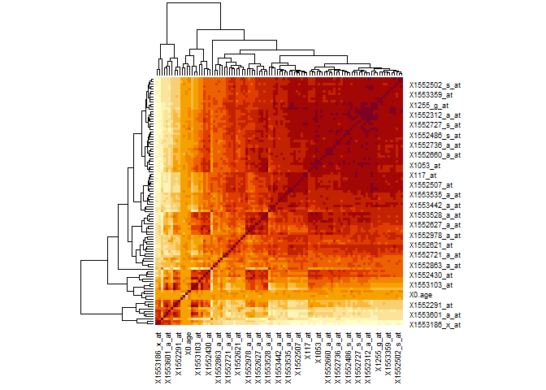
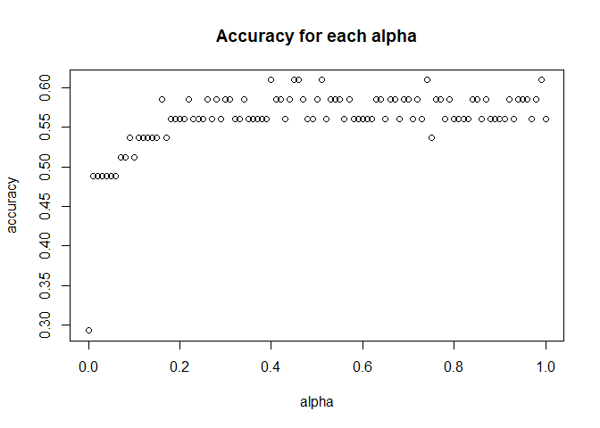

Projet
================
Sara HADOUANI & Alicia WANG
2025-11-10

## I- Data pre-processing

``` r
set.seed(123)
data <- read.table(file = "GSE53987_first1000genes.csv", header = T, sep=",")
dim(data)
```

    ## [1]  205 1041

On va associer des nombres liés au degré de sévérité des maladies: de 0
à 3,0 si le patient n’a pas de trouble psychiatrique et 3 étant le cas
où le patient est atteint du cas le plus grave : la schizophrénie.

``` r
row<- dim(data)[1]
#data$new_title<- numeric(length = row)
for (i in 1:length(data$X7.disease.state)){
  if (data$X7.disease.state[i]=="bipolar disorder") data$X7.disease.state[i]=2
  else if (data$X7.disease.state[i]=="control") data$X7.disease.state[i]=0
  else if (data$X7.disease.state[i]=="major depressive disorder") data$X7.disease.state[i]=1
  else if (data$X7.disease.state[i]=="schizophrenia") data$X7.disease.state[i]=3
}

data$X7.disease.state = as.numeric(data$X7.disease.state)
Y=as.factor(data$X7.disease.state)

data = data[-which(names(data)=="title")]
```

On enlève les colonnes qui contiennent les mêmes données ou qui
contiennent des données inutiles comme la variable “contact_department”.

``` r
data = data[-c(which(names(data)=="Sample"), which(names(data)=="source_name_ch1"), which(names(data)=="geo_accession"),which(names(data)=="status"), which(names(data)=="submission_date"), which(names(data)=="last_update_date"), which(names(data)=="type"), which(names(data)=="channel_count"), which(names(data)=="organism_ch1"), which(names(data)=="taxid_ch1"), 
which(names(data)=="molecule_ch1"),which(names(data)=="extract_protocol_ch1"),which(names(data)=="label_ch1"), which(names(data)=="label_protocol_ch1"), which(names(data)=="hyb_protocol"),which(names(data)=="scan_protocol"), which(names(data)=="   
data_processing"), which(names(data)=="platform_id"), which(names(data)=="contact_name"), which(names(data)=="contact_email"),which(names(data)=="contact_phone"), which(names(data)=="contact_department"), which(names(data)=="contact_institute"), which(names(data)=="contact_address"), which(names(data)=="contact_city"), which(names(data)=="contact_state"), which(names(data)=="contact_zip.postal_code"), which(names(data)=="contact_country"), which(names(data)=="supplementary_file"),which(names(data)=="series_id"),which(names(data)=="data_row_count"), which(names(data)=="data_processing"))]
```

Transformons les variables catégorielles de types chaînes de caractères
en variables catégorielles numériques: on assigne des valeurs 0 et 1 aux
variables qui prennent deux valeurs catégorielles comme pour la colonne
“X2.race”: 0 pour W et 1 pour B. Pour la colonne X1.gender : 0 pour M et
1 pour F. Pour la colonne “X6.tissue” : 0 pour “hippocampus”, 1 pour
“Pre-frontal cortex (BA46)”, et 2 pour “Associative striatum”.

``` r
data$X2.race <- ifelse(data$X2.race == "W", 0,1)
data$X1.gender <- ifelse(data$X1.gender=="M", 0, 1)
for (i in 1:length(data$X6.tissue)){
  if (data$X6.tissue[i]=="hippocampus") data$X6.tissue[i]=0
  else if (data$X6.tissue[i]=="Pre-frontal cortex (BA46)") data$X6.tissue[i]=1
  else if (data$X6.tissue[i]=="Associative striatum") data$X6.tissue[i]=2
}

#On stocke les colonnes data$X2.race, data$X1.gender et data$X6.tissue dans respectivement les variables race, gender et tissue car quand on va #enlever les variables de faible variances, elles vont disparaître du data set ( car R va calculer leur variance vu qu'on les a tranformées en variables numériques) mais en réalité on ne peut pas calculer la variance d'une variable #catégorielle
race = as.factor(data$X2.race)
gender = as.factor(data$X1.gender)
tissue = as.factor(as.numeric(data$X6.tissue)) #car typeof(data$X6.tissue) est "character"
```

### 1- Fonction pour suppression des variables aberrantes, pour gérer les colonnes qui contiennent des Inf et celles qui ont une trop grande variance

``` r
select_var <- function(X,var_name){
  mes=paste0("Variable ",var_name, " ")
  
  
  
  #on gère la cas où une colonne contient des Inf
  nb_inf <- sum(is.infinite(X))
  nb_nan <- sum(is.na(X))
  line<- length(X)
  if ((nb_inf+nb_nan)/line > 0.3){
    cat(mes,"deleted : too many nan/inf values\n")
    return (1)
  }
  
  
  
  #stabilisation de l'échelle: si variable varie beaucoup (entre quantile à 0.99 et mediane), on applique le log
  var <- X[is.finite(X)] #liste des valeurs finies
  q<- quantile(var, c(0.5,0.99), na.rm=T) 
  r<- q[2]/max(q[1], 1e-10)
  if (r>10){
    X<- log10(X+1)
  }
  
  
  
    #détection des outliers en utilisant l'écart interquartile pour améliorer la précision du modèle et les performances               
    #prédictives
    q1 <- quantile(X, 0.25, na.rm = TRUE)
    q3 <- quantile(X, 0.75, na.rm = TRUE)
    iqr<- IQR(X, na.rm = TRUE) 
    low <- q1-1.5*iqr
    up <- q3+1.5*iqr
    
    nb_out<- sum(X<low, na.rm=TRUE) + sum(X>up, na.rm=TRUE)
    #si trop de outliers on supprime sinon on les remplace par la mediane
    if (nb_out>0.4*line) { 
      #data= data[,-X]
      print (mes)
      print("deleted : too many outliers")
      return (1)
    }
    med<- median(X, na.rm=TRUE)
    X[X<low]<- med
    X[X>up]<- med #les inf seront traités
    X[is.na(X)] = med
    X[is.infinite(X)] = med
    return (X)
}


#On applique la fonction select_var à chaque variable du data set
for (var in names(data)){
  if (is.numeric(data[[var]])){
    res<-select_var(data[[var]], var)
    if (identical(res,1L)) {#fct identical car si res=1, on peut avoir res = c(1,2) -> T F, considéré comme T donc la condition if sera vraie alors que non voulue
      data = data[,!(names(data)==var)]
    }else data[[var]]=res
  }
}
```

    ## Variable X1007_s_at  deleted : too many nan/inf values
    ## Variable X1552256_a_at  deleted : too many nan/inf values
    ## Variable X1552426_a_at  deleted : too many nan/inf values
    ## Variable X1552519_at  deleted : too many nan/inf values
    ## Variable X1552619_a_at  deleted : too many nan/inf values
    ## Variable X1552689_at  deleted : too many nan/inf values
    ## Variable X1552767_a_at  deleted : too many nan/inf values
    ## Variable X1553101_a_at  deleted : too many nan/inf values
    ## Variable X1553185_at  deleted : too many nan/inf values
    ## Variable X1553422_s_at  deleted : too many nan/inf values
    ## Variable X1553538_s_at  deleted : too many nan/inf values
    ## Variable X1553551_s_at  deleted : too many nan/inf values
    ## Variable X1553567_s_at  deleted : too many nan/inf values
    ## Variable X1553569_at  deleted : too many nan/inf values
    ## Variable X1553570_x_at  deleted : too many nan/inf values
    ## Variable X1553588_at  deleted : too many nan/inf values

``` r
write.csv(data, "data_with_low_variance_var.csv", row.names = FALSE)
```

S’il y a un trop grand nombre d’outliers, alors on supprime la variable.
La transformation en log peut réduire le nombre d’outliers mais les
outliers qui restent dans les deux cas sont considérées comme des
fausses valeurs.

### 2- Fonction pour suppression des variables à faible variance

``` r
#Calcul la variance de toutes les variables numériques
var_vec <- sapply(data, function(x) {
  if (is.numeric(x)){
    var(x)
  }else NA
})

var_vec <- var_vec[!is.na(var_vec)]
var_vec = sort(var_vec)
plot(var_vec, main = "variance of parameters before")
```

<!-- -->

``` r
boxplot(var_vec)
```

<!-- -->

``` r
cat("Avant suppression : dim(data) =",dim(data),"et la variance minimale est:",min(var_vec),"\n")
```

    ## Avant suppression : dim(data) = 205 1009 et la variance minimale est: 0

``` r
me<- mean(var_vec)*0.5
medvar<- median(var_vec)
suppr <- names(var_vec[var_vec < medvar])
name_of_var_kept <- names(var_vec[var_vec >= medvar])
data_num<- as.matrix(data[,name_of_var_kept]) 

data = data[,!(names(data) %in% (suppr))]
new_var_vec =var_vec[var_vec >= medvar]
par(mfrow=c(1,2))
plot(var_vec, main = "variance of parameters before")
plot(new_var_vec,  main = "variance of parameters after")
```

<!-- -->

``` r
par(mfrow=c(1,2))
boxplot(new_var_vec,  main = "variance of parameters before")
boxplot(var_vec,  main = "variance of parameters after")
```

<!-- -->

``` r
cat("Après suppression : dim(data) =",dim(data), "et la variance minimale est:",min(new_var_vec))
```

    ## Après suppression : dim(data) = 205 505 et la variance minimale est: 46.98396

On remet les variables catégorielles dans le data set au cas où elles
auraient été supprimées lors de la suppression des variables avec une
faible variance.

``` r
data$X2.race = as.factor(race)
data$X1.gender = as.factor(gender)
data$X6.tissue = as.factor(tissue)
```

``` r
write.csv(data, "data_without_low_variance_var.csv", row.names = FALSE)
```

### 3- Suppression des variables corrélées

``` r
data_without_low_var = read.table(file = "data_without_low_variance_var.csv", header = T, sep=",")
data_num_2<- as.matrix(data_without_low_var)
heatmap(cor(data_num, use="pairwise.complete.obs"), scale="none")
```

<!-- -->

Observations du heatmap: variables sont encore très correlées entre
elles. Supprimons les pour effectuer une régression sans pénalisation.

On testera les régressions avec pénalisation sans suppression des
variables corrélées (lasso, ridge et elastic net ) plus tard. On a créé
un nouveau fichier .csv contenant le data set sans les variables de
faibles variance, pour avoir deux data set: le nouveau, duquel on va
supprimer aussi les variables corrélées pour générer un modèle sans
pénalisation, et celui de base, duquel ne vas pas enlever les variables
de faible variance pour l’utiliser afin de générer les modèles avec
pénalisation.

``` r
data_without_low_var = read.table(file = "data_without_low_variance_var.csv", header = T, sep=",")
```

``` r
data_num_names_2 <- colnames(data_num_2)
var_restantes_correlees_a_suppr <- c()
correlation_matrix <- cor(data_num_2, use="pairwise.complete.obs")
# use selectionne uniquement entre celles qui ont des valeurs réelles
for (i in 1:length(data_num_names_2)){
  v1 <- data_num_names_2[i]
  if (v1 %in% var_restantes_correlees_a_suppr) next
  if (i<length(data_num_names_2)){
    for (j in (i+1):length(data_num_names_2)){
      v2<- data_num_names_2[j]
      if (v2 %in% var_restantes_correlees_a_suppr) next
      if (abs(correlation_matrix[i,j]) > 0.9){
      var_restantes_correlees_a_suppr <- c(var_restantes_correlees_a_suppr, v2)
    }
    }
  }
}
```

``` r
data_num_new = data_num_2[,!(data_num_names_2 %in% var_restantes_correlees_a_suppr)]
heatmap(cor(data_num_new, use="pairwise.complete.obs"),  scale="none")
```

<!-- -->

``` r
dim(data_without_low_var)
```

    ## [1] 205 507

``` r
data_without_low_var = data_without_low_var[, !(names(data_without_low_var) %in% var_restantes_correlees_a_suppr)]
head(data_without_low_var,100)
```

    ##      X X0.age X1053_at   X117_at X1255_g_at X1316_at X1494_f_at X1552264_a_at
    ## 1    0     52 15.66259  6.848432   9.449332 48.71267  10.722688      22.88430
    ## 2    1     50 14.48255  6.198208  15.337478 31.93326  10.524009      32.72798
    ## 3    2     28 22.02034  6.752103  12.375343 33.11330  10.499926      59.28184
    ## 4    3     55 22.77593  5.201801   9.672094 37.08087  11.448171      29.92238
    ## 5    4     58 18.61268  7.977295   8.612468 30.90374  10.427679      24.41654
    ## 6    5     28 12.46866  7.251813  16.315826 42.17430  13.621607      12.94730
    ## 7    6     49 18.07384  7.673255  10.403597 44.17013  10.611307      47.10216
    ## 8    7     42 14.02499  5.731612   8.227150 35.88880  10.653452      16.15929
    ## 9    8     43 13.15802  7.540801  13.561401 33.22468  11.336790      27.99278
    ## 10   9     50 23.26661  5.776766  11.514397 33.12233   9.211518      42.65595
    ## 11  10     40 17.26106  6.153053  20.313504 35.17234  10.346401      23.31176
    ## 12  11     39 22.20397  6.619650  17.592193 19.51276   9.961083      57.74959
    ## 13  12     45 25.51530  5.602169  12.447590 40.55777   9.843681      62.35836
    ## 14  13     42 23.80244  6.426991  13.979833 26.53880   8.633540      74.56814
    ## 15  14     65 15.06354  6.667814   8.085666 24.35634  11.041780      35.93395
    ## 16  15     51 21.84575  6.330661  20.587441 39.50116  11.652871      32.80324
    ## 17  16     39 18.33574  6.619650  13.778143 23.38702  10.454772      37.03873
    ## 18  17     48 20.61152  5.972436  12.670353 31.41850  12.188705      47.73734
    ## 19  18     51 19.19066  6.333671   6.782206 24.18475  10.259102      47.86678
    ## 20  19     51 22.57424  6.556433  11.833489 42.01175   9.723269      35.59078
    ## 21  20     36 21.77651  5.653344  12.005076 27.23418  10.081495      74.48385
    ## 22  21     65 21.58987  7.646162   8.097707 26.96025   9.705207      33.15845
    ## 23  22     55 22.15882  7.381256  21.490531 48.82707  10.557122      37.03873
    ## 24  23     47 20.53326  6.417960   9.819598 30.33780   9.801537      48.66150
    ## 25  24     52 19.17260  6.445052   6.637712 25.15407  11.932829      48.11964
    ## 26  25     58 14.68123  6.755113  12.104416 54.06499  11.080914      23.98306
    ## 27  26     40 20.78913  5.803859  11.174233 31.14155   8.675684      65.22116
    ## 28  27     41 21.46946  5.894168  12.733569 31.59009  10.539060      56.90671
    ## 29  28     49 18.68192  5.830952  16.571701 35.92191  10.891265      26.82478
    ## 30  29     48 22.98364  5.060318  11.234439 38.29704   9.943021      37.51436
    ## 31  30     39 21.74942  5.858044  12.697445 38.99844   9.852712      51.98487
    ## 32  31     48 16.44828  6.291527  12.531879 39.38375  12.923218      32.86947
    ## 33  32     43 20.97276  6.267445  14.431378 38.49873  10.042361      72.74089
    ## 34  33     68 12.39642  6.192187   4.386025 42.60176  12.477693      18.67590
    ## 35  34     58 16.54461  6.782206   9.867763 31.60213  10.114608      30.78333
    ## 36  35     43 21.02695  5.662375  13.847380 44.39891  10.156752      70.59153
    ## 37  36     51 18.00761  6.731031  14.157441 36.78587  11.195306      33.14942
    ## 38  37     53 21.17445  5.858044  17.995573 30.08494  11.111017      47.72530
    ## 39  38     26 24.83798  5.776766  12.303096 48.25210  10.331349      66.90693
    ## 40  39     52 17.35438  6.586536  14.925067 32.14097  10.695596      28.19447
    ## 41  40     62 24.85003  6.312599  12.414477 21.39420   9.488465      54.73929
    ## 42  41     29 24.26001  7.236761  16.339908 31.94831  11.083924      44.34774
    ## 43  42     49 15.59937  6.216270  12.206766 40.02796  12.607136      14.36515
    ## 44  43     54 21.81564  5.698499  20.376720 28.56775  11.095966      48.36950
    ## 45  44     28 21.73437  5.830952  14.323007 32.64369  11.445160      64.07122
    ## 46  45     42 21.15639  5.942333  12.462642 33.14340  10.870193      18.32370
    ## 47  46     44 16.18939  7.354163   5.719571 25.88256  11.330769      19.16056
    ## 48  47     40 18.13104  6.372805  10.012258 41.06952  10.207927      53.49002
    ## 49  48     47 22.41469  7.140432  14.079173 41.86123  11.457202      37.98698
    ## 50  49     59 18.22436  5.596149  12.841940 41.92144   9.825619      79.91443
    ## 51  50     47 20.00645  6.363774  14.043049 29.66651  12.065282      65.93159
    ## 52  51     34 17.10753  6.267445  10.867183 38.82685  12.339220      23.20941
    ## 53  52     51 20.37973  6.261424   9.473414 49.25754  10.960502      69.86003
    ## 54  53     49 19.00101  8.862323   9.687145 30.35888  10.195886      26.27390
    ## 55  54     47 15.89739  6.131981  11.366893 47.96913  13.049650      20.40983
    ## 56  55     25 11.63481  7.847852   9.452342 37.76722  14.076163      24.00714
    ## 57  56     62 16.86972  8.299397   6.553423 45.82580  12.035179      32.14097
    ## 58  57     44 21.41828 20.629586   8.088676 33.22468   9.359023      38.08933
    ## 59  58     46 21.58686  6.583526  12.715507 26.86693  11.878644      36.26508
    ## 60  59     50 15.52111  5.996518   6.773175 27.98375  10.539060      30.69302
    ## 61  60     46 13.29047  6.926700  19.335157 42.51447  12.324168      22.53210
    ## 62  61     41 18.29660  5.514871  15.099665 37.19527  11.743180      25.22631
    ## 63  62     47 13.06169  6.619650   9.006817 36.55106  11.496336      21.48150
    ## 64  63     37 14.44944  6.649753   8.338531 57.25289  11.962932      20.06064
    ## 65  64     58 14.31398  6.378826  14.262801 29.42568  12.158602      20.52423
    ## 66  65     44 17.65541 15.099665  13.308536 30.00968  11.135100      34.52212
    ## 67  66     38 16.23756  6.619650  16.737268 48.27919  13.004496      33.96822
    ## 68  67     52 17.91430  6.971855  13.022558 33.82373  12.577033      23.83254
    ## 69  68     52 33.01396  6.083817  10.262113 35.86170   8.573334      23.62784
    ## 70  69     50 36.24702  5.593138   7.604018 34.13379   9.813578      31.03619
    ## 71  70     28 39.83229  5.797838  10.096546 55.68152  11.351841      54.63092
    ## 72  71     55 30.75021  5.578087   9.410198 49.20335   8.055563      23.40508
    ## 73  72     58 37.95687  5.514871   9.943021 40.33501  10.328339      40.75344
    ## 74  73     28 31.97541  5.758705  12.893115 54.21851  10.487885      22.75486
    ## 75  74     49 35.08204  5.719571  10.225989 44.06778   9.587805      36.71061
    ## 76  75     56 30.08795  6.113920   5.927281 37.12603  11.984004      18.41400
    ## 77  76     50 35.11816  6.059734  11.080914 37.52038   8.702777      38.07427
    ## 78  77     40 35.69012  5.626252  12.778723 37.69799   9.404177      35.16933
    ## 79  78     39 38.18565  6.619650   8.151892 49.24249  13.907586      42.96300
    ## 80  79     45 35.82558  5.812890   9.678114 29.98861   8.624509      36.43065
    ## 81  80     42 36.72566  6.059734  10.472834 36.79791   8.958653      52.50565
    ## 82  81     65 35.39210  5.313182   7.896017 58.41788  11.234439      35.29577
    ## 83  82     51 36.21692  5.174709  12.245900 50.62421  10.740750      36.49989
    ## 84  83     39 34.10068  6.098868  10.256092 46.17499  11.014688      44.68489
    ## 85  84     48 41.75888  5.532933  12.399426 48.29725   9.021869      73.52658
    ## 86  85     51 41.65653  6.186167   6.327651 50.13354  11.574603      43.95640
    ## 87  86     51 42.87871  5.812890  23.353907 37.27654   9.997206      42.27966
    ## 88  87     36 38.84491  6.499238  11.279594 34.68468  11.875633      51.30153
    ## 89  88     65 41.03641  5.620231   9.849701 42.63488   9.744341      45.44951
    ## 90  89     55 38.60710  5.864065  10.999636 40.35006   9.768423      37.24343
    ## 91  90     47 41.36453  5.424562  15.015376 41.57525   9.813578      48.59226
    ## 92  91     52 36.62933  5.352315   9.073044 33.22468  12.236869      40.22664
    ## 93  92     58 34.65758  4.675005   9.765413 35.34694   9.997206      28.70020
    ## 94  93     40 43.23694  4.973020  15.536158 35.13923   9.205497      31.86403
    ## 95  94     41 38.73052  6.029631  13.164042 53.44186  10.295226      48.49292
    ## 96  95     49 36.28917  5.000113   8.871354 61.73222  10.397576      48.23103
    ## 97  96     48 41.66857  6.201218   9.807557 39.38676  10.228999      37.13506
    ## 98  97     39 34.99474  5.833962  11.520418 43.57108  12.035179      48.09556
    ## 99  98     48 38.65526  5.418542  10.349411 59.67017  10.906317      46.96369
    ## 100 99     43 38.80879  5.662375  10.508957 34.90443  11.183264      39.54932
    ##     X1552274_at X1552275_s_at X1552283_s_at X1552291_at X1552312_a_at
    ## 1      53.49303      59.77553      68.98403    41.33142      2.917506
    ## 2      65.52821      55.44370      93.28920    45.60002      2.914499
    ## 3      51.32862      57.58403      48.74579    58.05664      5.186750
    ## 4      55.07645      56.38593      56.87059    49.55255      2.986666
    ## 5      60.97664      45.56691      67.35245    58.28543      3.046814
    ## 6      76.31712      38.43551      70.68184    36.61127      3.146074
    ## 7      64.32108      53.16792     107.36837    47.17742      4.909805
    ## 8      61.03383      59.60996      80.79043    36.50892      2.671063
    ## 9      45.31706      26.03608      48.11964    42.22247      2.824313
    ## 10     64.83584      97.44040     127.32064    47.93000      4.662964
    ## 11     41.29529      44.98592     101.01062    44.23937      2.890447
    ## 12     63.84545      85.21858      37.91774    51.02759      6.815319
    ## 13     63.01160      65.48305      59.19454    54.59480      4.072973
    ## 14     62.45770      86.91338      66.95509    36.32830      4.115113
    ## 15     83.56292     105.47188      92.64499    46.39474      4.322811
    ## 16     84.86638      83.83083      99.31883    45.59099      3.534219
    ## 17     83.40337     110.43285     127.78422    38.05320      3.994712
    ## 18     68.11406      61.96100      87.71713    44.49524      3.717804
    ## 19     64.56190      66.57278      63.23135    45.44951      3.808097
    ## 20     75.97696      90.91708     149.48849    47.17140      3.862274
    ## 21     54.10713      64.27291      94.95991    35.18439      6.460104
    ## 22     80.12214      78.13234      57.86700    51.61159      4.732200
    ## 23     61.33787      62.37040      60.08258    40.10924      3.407829
    ## 24     59.75144      63.71601     171.48776    61.39507      3.699745
    ## 25     79.87229      81.12758      98.59033    44.04069      4.286690
    ## 26     67.83711      63.92372      76.15457    43.36337      2.908486
    ## 27     65.01646      59.08617     109.34313    66.60289      3.793048
    ## 28     48.95952      49.25152      69.12251    54.57975      3.835186
    ## 29     67.12367      66.75340      83.40036    39.69382      3.970632
    ## 30     71.60902     102.21172      71.10630    58.46003      6.095858
    ## 31     37.92075      30.42811      76.54290    59.40827      3.140058
    ## 32     64.97732      57.43050      58.57442    53.40272      2.932540
    ## 33     62.60521      73.65903     100.16472    57.43652      5.048277
    ## 34     86.21198      80.42016      57.03013    33.23973      3.275437
    ## 35     95.73356      93.61431     122.70585    50.45564      2.821307
    ## 36     74.29119     103.09073      74.41763    55.10354      4.452249
    ## 37     51.09081      53.61645      76.35024    42.63488      3.019746
    ## 38     51.31357      57.23483      59.59792    49.35989      4.223477
    ## 39     45.24180      48.10459      57.90312    51.62965      4.136184
    ## 40     54.80552      58.10481      91.09770    46.03652      2.956595
    ## 41     50.39844      79.61641      99.29474    49.68500      4.253578
    ## 42     62.65036      64.48063      71.64514    49.67296      4.235517
    ## 43     87.91882      78.95415      93.25006    31.37034      2.508927
    ## 44     42.56865      65.54025      67.86420    45.99136      3.862274
    ## 45     48.83610      59.23367      63.98995    72.25924      3.567323
    ## 46     74.72468      93.11460     171.62924    44.39289      3.022753
    ## 47    106.90779     142.74842      99.32184    34.91948      2.971630
    ## 48     48.61032      71.34712     121.40239    56.80737      3.492088
    ## 49     59.34204      60.04645      76.78673    37.93580      4.310771
    ## 50     47.44233      56.64782      84.56535    62.43362      3.753921
    ## 51     47.92699      56.12704      63.96285    63.08385      3.805087
    ## 52     96.56139      89.99894     156.29778    36.72867      3.224290
    ## 53     55.20589      46.75598      59.30893    65.40178      3.344640
    ## 54     68.64688      75.45919     170.56360    47.43932      3.158107
    ## 55     63.09288      51.29551      74.84509    33.74847      3.275437
    ## 56    102.80174      95.58003     108.29855    25.92771      4.274649
    ## 57     78.82169      90.35114      79.65254    49.09197      3.389775
    ## 58     69.37838      76.28100     123.16943    34.56727      8.239191
    ## 59     73.80051      90.62207      65.39576    35.45832      4.060932
    ## 60     50.68442      64.12541      49.57061    47.61692      3.284463
    ## 61     60.94954      59.85078      61.24756    36.68653      3.714794
    ## 62     71.69631      65.91052      68.49637    44.00758      2.845354
    ## 63    108.09385      97.34407     140.34921    33.73643      3.883344
    ## 64     97.52770      76.35626     136.83921    37.64681      2.797262
    ## 65     50.60916      48.05041     241.34478    43.70956      2.535939
    ## 66     59.48654      66.49151      74.68855    51.68384      4.599749
    ## 67     43.02622      45.14547      52.48458    39.60652      5.349305
    ## 68     61.78340      54.08004      95.15257    49.19733      3.332604
    ## 69     61.02781      57.60811      61.32884    64.11337      6.628681
    ## 70     64.67930      81.18177      93.15072    59.56481      7.393297
    ## 71     51.41291      68.04783      49.70005    83.93017     10.569163
    ## 72    109.60201      65.11580     128.63915    75.10999      5.243945
    ## 73     61.44323      50.44661      61.73824    77.81625     11.092955
    ## 74     56.19327      52.64112      67.72874    75.67292      5.421552
    ## 75     95.53488      80.16128     111.95005    74.09853      6.249383
    ## 76     47.00282      49.56459      49.49234    53.21006      5.933302
    ## 77     84.90852      70.72098     113.25652    54.21249      7.709378
    ## 78     55.81397      52.05110      94.36989    47.92398      7.390286
    ## 79     69.25797      55.53100      37.65885    69.08939      9.103147
    ## 80     65.89547      74.83907      55.07043    78.06009      5.767735
    ## 81     75.15816      71.44947      56.12403    61.12715      8.597417
    ## 82     88.30715      69.48976      51.05469    73.91792      6.722000
    ## 83     60.82612      53.01439      86.89532    66.18747      6.363774
    ## 84     56.93079      52.66520     112.82303    62.35836      7.339111
    ## 85     65.11881      81.81092      92.25064    75.24245      9.151312
    ## 86     74.75177      87.57264      50.22384    54.98012      7.965254
    ## 87     54.04693      64.20970     155.89139    58.84835      7.212679
    ## 88     67.25010      59.56782     108.19319    66.63901     11.189285
    ## 89     59.30893      74.30323      43.32725    73.63796      8.868344
    ## 90     65.29341      69.64028      61.61783    65.20009      8.127810
    ## 91     60.14278      57.72250     146.73406    60.54315     10.722688
    ## 92     67.72272      59.33000      86.59730    69.26399      6.138002
    ## 93     61.81952      54.45934      54.28173    73.81557      7.327070
    ## 94     62.62929      66.84371     156.46937    72.53318      8.428840
    ## 95     69.76370      66.13027      88.13556    71.20564      8.248222
    ## 96     66.39518      50.41951      73.49045    73.07503      6.833381
    ## 97     66.16037      65.21213      51.44001    73.69816      8.501087
    ## 98     52.71637      48.73676      78.60796    65.16998      7.896017
    ## 99     36.47580      39.09477      47.02089    89.38785      7.173545
    ## 100    76.28100      71.70233      85.50757    70.46510     10.111598
    ##     X1552316_a_at X1552329_at X1552365_at X1552367_a_at X1552400_a_at
    ## 1       12.279014   17.047329    6.068765      4.036852      9.798526
    ## 2        8.362613   15.235128    2.421928      2.349978     14.166472
    ## 3       10.785905   17.784852    4.455259      2.767209      9.690156
    ## 4        9.389126   12.351261    2.695096      2.508927     14.870882
    ## 5       11.809407   10.632379    6.541382      3.642562     13.392825
    ## 6        4.187355   11.550521    1.928730      2.230186     15.087623
    ## 7        5.394459   19.615115    1.925755      2.149433     13.898555
    ## 8       13.459051   14.849810    2.137479      2.806279     12.501776
    ## 9        7.372225   10.373494    1.801060      2.809284     18.323696
    ## 10      12.465652   18.420025    6.884556      3.946552     13.413897
    ## 11       7.597997   13.248330    2.215224      2.158401     15.021397
    ## 12       5.779777   29.103580    4.744241      3.206240     10.623349
    ## 13       7.727440   13.161031    1.976357      2.442922     12.426518
    ## 14       9.067023   20.403813    5.379408      5.286089     14.542759
    ## 15      13.395835   16.592773   21.484511      7.369214     13.248330
    ## 16       7.763564   15.000325    2.460920      2.493923     13.031589
    ## 17       4.741230   18.034707    5.144606      3.892373     13.263382
    ## 18       7.640141   12.853981    2.674067      2.317019     12.691425
    ## 19       9.744341   17.128607    3.407829      3.007717     12.336209
    ## 20       7.823770   16.213476    3.471023      3.091930     13.230268
    ## 21       7.134411   12.468662    5.135575      2.983658     15.138798
    ## 22       7.634121   15.075582    7.486616      5.839983     11.971963
    ## 23      11.902726   14.952160    5.812890      3.940532     13.588494
    ## 24       8.031480   12.604126    4.431178      3.811107     12.378353
    ## 25      11.135100   16.041888    7.278905      5.331243     11.448171
    ## 26      13.723958   11.448171    5.337264      3.299507     18.561510
    ## 27       8.729870   16.421186    3.359685      2.887441     13.167052
    ## 28      10.102567   12.149571    3.404820      3.091930     14.521687
    ## 29       8.654612   16.065971    2.481921      2.358969     13.287464
    ## 30      10.773864   20.184061    3.904413      3.449958     11.198316
    ## 31       6.743072   16.041888    2.601986      2.890447     13.522267
    ## 32       7.582946    8.732880    2.146445      2.580968     12.170643
    ## 33       8.540221   20.578411    8.233170      6.532351     15.722797
    ## 34      15.247169   12.826888    9.837660      4.413117     14.545769
    ## 35      11.174233   14.566841    7.384266      3.579361     12.179674
    ## 36      10.388545   17.456729    3.284463      3.290480     12.182684
    ## 37       5.216852   15.129768    4.283679      3.106969     13.540329
    ## 38       7.760553   14.091214    2.713122      2.203258     12.068293
    ## 39       9.783475   15.689683    4.398066      3.112985     12.974393
    ## 40       8.281335   11.938850    3.119001      2.358969     23.925864
    ## 41      11.144130   17.739698    7.140432      4.467300     11.162192
    ## 42      10.216958   12.041200    3.964612      4.241538     11.132089
    ## 43      12.023138   14.139379    2.944567      2.604989     14.771542
    ## 44       6.746082   16.336898    2.290061      2.451921     11.216378
    ## 45       6.318620   12.002066    7.315029      3.904413     12.239880
    ## 46       8.618489   16.791453    5.265017      3.934513     14.401275
    ## 47      26.863917   22.616384    4.139194      4.503422     14.515666
    ## 48       7.134411   16.084033    3.281454      2.430925     16.860690
    ## 49       8.452922   13.082764    4.723169      3.176156     18.850498
    ## 50       9.946031   13.606556    5.039246      2.839342     12.224828
    ## 51       8.925539   19.374291    3.085914      2.565957      9.301827
    ## 52       8.961663   17.468771    3.091930      3.070875     10.033330
    ## 53       7.971274   10.481864    3.109977      3.404820     12.426518
    ## 54       8.124800   21.162409    4.599749      2.761198     12.995465
    ## 55       8.862323    9.464383    2.490923      2.532937     19.714454
    ## 56      10.102567   14.304945    2.644030      2.203258     19.600063
    ## 57      10.975554   17.595203   16.586753      6.183156     14.533728
    ## 58      26.273898   22.038406   81.952406     33.754493     16.625887
    ## 59       8.431850   18.687942   12.297075      6.002539     10.009247
    ## 60      11.008667   15.325437    5.942333      4.355923     12.498765
    ## 61       9.548671   11.499346    2.623007      2.197275     13.958761
    ## 62       9.750362   11.737160    2.481921      2.995687     11.902726
    ## 63      10.596256   14.491584    9.211518      3.558295     14.566841
    ## 64       7.646162    8.570324    2.448921      2.899467     11.878644
    ## 65       6.700928   13.167052    2.164380      2.015095     16.321846
    ## 66       8.799107   15.096654    2.878422      2.905480     11.282604
    ## 67       7.682285   12.685404    2.493923      2.212232     15.015376
    ## 68       7.116349   10.746771    2.454921      2.722135     11.962932
    ## 69       6.405918   22.182900    2.641027      3.284463     19.898083
    ## 70       8.672674   23.004712    2.367961      3.137049     22.083560
    ## 71       9.976134   19.187652    3.332604      3.131033     28.522592
    ## 72       5.268027   20.057629    2.370959      2.731149     22.514033
    ## 73       7.814739   16.908855    2.776224      2.191293     34.275275
    ## 74       5.102462   21.824675    2.556951      2.260118     37.661863
    ## 75       7.330080   18.272521    2.027022      2.352975     24.711552
    ## 76       6.782206   18.194253    2.092671      2.917506     14.593934
    ## 77       9.605867   20.509174    2.529936      2.872409     25.292540
    ## 78       7.631110   19.867980    3.468013      2.908486     27.586389
    ## 79       5.650334   25.786229    2.836336      2.770214     33.516680
    ## 80      10.554112   18.766210    2.502926      2.620004     20.334576
    ## 81       7.507688   24.263018    2.800267      2.595981     33.874905
    ## 82       9.428259   18.037717   14.368162      4.942917     30.482297
    ## 83       5.045267   17.845058    2.394941      2.908486     26.583959
    ## 84       5.520891   19.244848    3.489079      2.824313     25.590560
    ## 85       9.404177   19.193673    3.164123      2.872409     30.518421
    ## 86       9.455352   16.189393    2.314023      2.376954     27.929563
    ## 87       8.546242   17.977511    4.292710      3.100953     29.124652
    ## 88       7.456513   16.065971    2.409933      2.932540     29.482878
    ## 89       5.364356   18.465180    2.526934      2.803273     44.721016
    ## 90       9.632960   20.364679    2.689087      3.013731     29.642424
    ## 91       6.920680   18.513345    6.071775      3.272428     23.531515
    ## 92       8.016429   16.637928    3.070875      3.359685     25.400911
    ## 93       9.027890   17.610255    2.671063      3.449958     26.568907
    ## 94       7.986326   20.813214    3.817127      3.094938     19.118415
    ## 95       9.927969   16.014796    4.069963      3.762950     29.582218
    ## 96       6.378826   14.006926    2.245150      2.553949     25.762147
    ## 97      10.487885   17.556069    2.860384      3.239333     29.040364
    ## 98       7.251813   18.125016    2.875415      2.998695     28.281768
    ## 99       5.469716   11.117038    2.077743      2.478921     30.656895
    ## 100      6.502248   23.462278    4.602759      3.732852     27.345565
    ##     X1552430_at X1552439_s_at X1552455_at X1552486_s_at X1552496_a_at
    ## 1     14.461481     58.688808   18.751158      7.465544      28.52560
    ## 2     15.448859     51.075759   14.705315      6.583526      22.87527
    ## 3      9.961083     37.032710   13.112867     10.319308      28.31187
    ## 4     23.946936     39.416868   16.195414      8.178985      31.42452
    ## 5     14.873892     65.224169   14.503625      6.625670      16.71018
    ## 6      6.935731     27.673688   12.637239      4.313781      22.83614
    ## 7     26.611052     32.794208   16.848649      7.059153      23.31477
    ## 8     14.624037     40.548740   14.494594      5.569056      24.79885
    ## 9     19.521795     38.399386    8.823189      5.731612      24.37139
    ## 10    21.303893     31.009100   24.247966      8.154903      40.99125
    ## 11    21.418284     44.118956    7.796677      5.981466      20.12687
    ## 12    14.419337     57.054215   32.703899     15.713766      38.46260
    ## 13    18.158129     43.754710   22.071519      8.133830      31.51182
    ## 14    15.761931     36.840051   16.577722     11.544500      35.08505
    ## 15    13.558391     31.231862   29.067456      7.305998      33.11029
    ## 16    15.698714     46.807154   32.827321      8.197047      41.88230
    ## 17    15.617436     56.557516   34.341502     10.530029      30.60271
    ## 18    12.974393     44.239368   18.988972      8.218119      27.62853
    ## 19    18.492273     27.845275   17.956439      6.872515      29.89228
    ## 20    11.938850     36.289166   27.586389      5.620231      39.48610
    ## 21    14.061111     30.449184   15.334468     13.687834      21.27981
    ## 22    10.846111     38.501736   30.828482      7.489626      36.20789
    ## 23    13.109856     47.463399   29.341394      7.176555      38.81180
    ## 24    19.208724     48.914364   14.157441      6.851443      20.80117
    ## 25    16.917886     19.413424   22.971599      7.829790      36.51494
    ## 26    12.158602     50.545947   21.595892      6.053714      34.64253
    ## 27    20.999852     43.571082   15.758920      5.972436      22.00830
    ## 28    18.555489     31.839943   10.502937      8.305418      26.59299
    ## 29    23.814483     38.697406   14.151420      9.018859      28.37208
    ## 30    22.044427     45.205674   35.187396      7.805708      30.79537
    ## 31    20.000433     51.969818    7.893006      8.299397      16.04189
    ## 32     7.504678     42.195374   15.644529      5.773756      24.66640
    ## 33    26.936164     38.414438   21.472470     10.819018      37.40298
    ## 34     7.510698     49.862608   27.517152      5.833962      28.94403
    ## 35    17.541018     37.288586   25.665817      7.119359      34.76896
    ## 36    26.361197     41.906386   24.982479     10.228999      39.53126
    ## 37    20.253298     41.171873   18.025676      8.561293      21.95111
    ## 38     9.705207     23.269619   16.138218      7.257833      31.50881
    ## 39    20.114824     38.426479   13.419917     10.909327      19.85293
    ## 40    14.940119     43.465721   16.827577      6.785216      31.44258
    ## 41    25.175139     48.682571   25.178149     11.610727      35.66904
    ## 42    19.410414     56.289599   19.241837      7.465544      26.15951
    ## 43    19.007034     55.988569   18.998003      5.328233      26.19262
    ## 44    17.863120     38.191676   20.162989      9.112178      33.07718
    ## 45    24.570068     39.239260   14.094224     12.158602      21.22261
    ## 46    16.096074     33.941132   27.471997      7.992346      30.02172
    ## 47     9.560713     42.291704   27.908491      5.824931      33.40530
    ## 48    19.217755     28.372077   21.701252      9.431270      32.83635
    ## 49    23.028795     22.679600   17.995573      7.384266      26.66524
    ## 50    22.947517     47.093133   13.633649     11.472253      28.08911
    ## 51    19.855939     42.213436   14.458471     10.524009      24.97947
    ## 52     8.916508     43.474752   24.509862      6.177136      31.24089
    ## 53    16.809515     34.097668   14.907005      9.331930      23.50442
    ## 54    17.170751     27.499090   33.859854      6.875525      36.14166
    ## 55    16.075002     31.608150   13.431958      4.729189      19.35322
    ## 56     7.564884     34.762944   31.794788      4.659954      27.86033
    ## 57    15.397684     29.353435   23.350897      5.846003      22.45985
    ## 58     7.540801     18.751158   15.494014     14.879913      28.67311
    ## 59    12.023138     36.794896   24.166688      9.964093      34.35354
    ## 60    16.866711     37.830440   18.061800      7.564884      27.69777
    ## 61    20.993832     67.972573   16.589763      6.821340      28.60086
    ## 62    10.502937     43.537968   20.415854      5.075369      23.57366
    ## 63    10.563143     66.238640   27.213112      5.731612      34.57932
    ## 64     8.925539     46.436887   32.881506      6.246373      32.46609
    ## 65    20.987811     46.933587   14.946139      5.087410      20.17202
    ## 66    26.400331     41.948530   26.084249      8.895436      21.54773
    ## 67    14.202595     49.883681   21.081131      5.927281      22.18290
    ## 68    18.407984     45.232767   19.064230      6.508269      25.73505
    ## 69    38.661282     17.209885   12.784744     11.083924      40.49154
    ## 70    22.830115     14.834758   16.463330      8.814158      49.38999
    ## 71    17.694543     17.044318   13.504206     10.725699      55.30824
    ## 72    26.319053     15.403705   16.556650      7.444472      35.99717
    ## 73    41.695665     17.513925   13.437979      7.417379      44.03768
    ## 74    31.180687      8.498077   12.643260      7.802697      41.03039
    ## 75    37.080875     24.594151   18.687942      8.034491      48.69762
    ## 76    21.890901     24.491800   14.922057      6.580516      27.66165
    ## 77    20.978780     11.114027   13.118887      8.796096      39.57039
    ## 78    22.851187     20.599483   12.742600     10.006237      39.82928
    ## 79    25.536375     13.311546   22.908383     12.206766      33.60097
    ## 80    24.085410     19.545878   17.044318     12.020128      46.99078
    ## 81    25.671838     10.520998   13.224248     11.098976      45.41941
    ## 82    23.365948     17.501884   14.699295      7.173545      40.47649
    ## 83    30.906750     15.918466   12.354271     10.593246      43.82094
    ## 84    26.755546     18.389922   10.222979      9.903887      44.24539
    ## 85    33.188557     16.258630   12.853981      9.988175      56.49731
    ## 86    23.968008     14.937108   18.239407      9.100137      44.06176
    ## 87    26.418392     14.067132   14.693274     10.009247      51.88553
    ## 88    25.512292     14.458471    9.762403     10.539060      52.49963
    ## 89    29.181848     10.834070   13.946720     11.508377      49.05585
    ## 90    20.990822     13.272413   19.979361     12.104416      46.69276
    ## 91    29.952485     13.519257   12.173653      8.470984      48.80900
    ## 92    34.699728     14.551790   12.992455      7.453503      49.39601
    ## 93    20.915564     14.765521   13.892534      7.733461      43.63430
    ## 94    22.712713     17.817965   10.800956      9.961083      56.42807
    ## 95    26.183589     12.354271   12.643260      9.888835      52.84281
    ## 96    34.416759     11.746190   10.617328      9.365043      43.66139
    ## 97    24.305162     12.754641   13.498185      8.248222      47.48748
    ## 98    24.253987     13.040619    9.533620      7.787646      40.81666
    ## 99    28.068037     15.192984   10.057412      6.845422      46.88542
    ## 100   17.522956     15.159871   14.587914     10.283185      41.78597
    ##     X1552502_s_at X1552504_a_at X1552507_at X1552508_at X1552510_at X1552520_at
    ## 1        5.590128     124.87928    5.858044    5.849013    55.92234    30.19331
    ## 2        3.486069     119.53299    7.832800    4.957969    74.63437    30.23244
    ## 3        4.112103     129.61750    6.436021    7.886986    70.88353    36.80393
    ## 4        6.231321     136.67665    5.788808    4.738220    65.34458    32.56241
    ## 5        4.214446     128.86191    5.894168    4.795415    68.47228    29.29624
    ## 6        4.551586     179.72394    8.353582    8.856302    70.89557    19.34118
    ## 7        5.424562     130.69518    5.659365    7.327070    59.83874    33.77858
    ## 8        8.687726     171.06331    7.880965    4.581688    68.74020    25.77720
    ## 9        3.540238     171.00611    5.490789    5.249966    71.11232    35.46133
    ## 10       9.383105     124.25013    5.861055    4.401076    64.85992    42.68003
    ## 11       4.039862     141.02954    6.908638    5.246955    59.08918    38.11943
    ## 12       6.517300      88.87008    6.839402    8.750942    71.94617    37.83345
    ## 13       4.250568     123.10020    5.722581    4.482351    58.60151    45.11236
    ## 14       7.188596     126.51388    5.364356    5.325223    70.70894    48.97156
    ## 15       4.259598     119.45773    6.360764    5.289099    70.01356    29.83508
    ## 16       6.171115     126.33326    7.947192    6.089837    60.96158    38.39638
    ## 17       9.590816     144.00372   10.232010    6.165095    60.26922    44.67586
    ## 18       5.228894     135.95117    6.944762    4.644903    76.09737    34.23915
    ## 19       4.786384     115.89053    9.735310    6.339692    59.74843    37.34277
    ## 20       7.691316     139.56052    5.538953    4.834548    59.54373    34.40171
    ## 21       6.291527     120.90870    6.153053    5.439614    76.49172    39.75402
    ## 22       4.253578     136.40873    6.384846    6.047693    62.81593    29.51900
    ## 23       6.023611     125.33986    6.989917    4.088023    73.07804    35.22954
    ## 24       4.094043     165.00056    6.089837    5.481758    65.75398    39.55835
    ## 25       5.484768     110.55026    6.014580    5.975446    78.57786    34.73585
    ## 26       4.274649     151.18328    8.037501    6.399898    65.94363    33.71536
    ## 27       6.803278     124.01232    7.447482    5.508850    66.57880    43.21286
    ## 28       4.659954     104.59287    5.252976    4.467300    61.01276    40.53068
    ## 29       7.549832     148.23620    7.176555    4.903784    73.26769    36.59923
    ## 30      11.180254     123.31393    5.475737    5.421552    54.40515    39.27839
    ## 31       3.188189     115.95073    7.140432    4.569647    74.56513    36.46677
    ## 32       4.825517     162.81508    6.186167    4.229497    75.33276    28.90189
    ## 33       5.514871     110.45092    5.054297    4.271639    65.84730    46.08769
    ## 34       5.809880     169.12166    7.032061    4.593729    78.77955    22.98665
    ## 35       7.673255     141.88447    6.845422    4.395055    65.91052    34.05853
    ## 36       5.526912     101.84748    6.806288    4.334852    55.75377    33.78761
    ## 37       5.126544     127.48620    8.600427   11.111017    72.46695    31.70147
    ## 38       5.827941     135.55080    4.973020    4.572657    75.34179    36.54504
    ## 39       4.985061     113.21437    7.020020    5.286089    70.23331    44.79025
    ## 40       5.493799     138.39252    4.768323    4.783374    69.49277    32.50522
    ## 41       7.026040     104.47246    5.487778    5.376398    61.00975    44.47116
    ## 42       6.917669     111.45034    6.225301    4.181335    65.37769    41.68362
    ## 43       5.189760     130.07205    7.709378    5.436603    62.61424    29.21195
    ## 44       6.032642     116.72739    6.285507    4.232507    84.34559    42.61983
    ## 45       4.367964     104.95712    6.905628    5.201801    73.15330    46.60847
    ## 46       6.029631     149.74436    5.716560    3.603437    64.70941    29.30828
    ## 47      11.571593     111.19446    8.660633    4.181335    66.03394    27.14387
    ## 48       5.213842     124.54815    5.415531    5.520891    63.84244    33.13738
    ## 49       5.858044     134.23831    7.673255    6.306579    73.31586    38.81782
    ## 50       3.374730      99.16831    6.204228    5.117513    65.16095    37.26751
    ## 51       4.280669     130.78549    6.354743    5.412521    69.62523    42.46028
    ## 52       7.251813     134.69888    8.567314    4.915825    80.34491    34.36257
    ## 53       4.924856     132.99204    4.118123    4.352913    70.47413    32.24934
    ## 54       5.493799     131.40260   38.817818   22.742816    65.72087    25.74710
    ## 55       3.260393     151.96897    6.059734    4.967000    76.69040    29.93743
    ## 56       5.204811     129.61750    7.748512    6.893587    79.01134    30.12106
    ## 57       7.029050      96.35067    7.977295    6.577506    84.40881    37.87258
    ## 58       3.567323     106.60074   20.521215   15.999744    58.67677    28.02589
    ## 59       5.210832     126.96843    6.011569    5.409511    75.22740    31.54192
    ## 60       3.531210     130.00582    4.819497    5.451655    66.08511    32.97784
    ## 61       4.780364     135.81570    8.591396    6.369795    66.39518    23.88071
    ## 62       3.820136     130.49048    5.292110    5.587118    77.72594    34.76294
    ## 63      10.683555     127.46513   12.483714    8.522159    67.59026    23.67902
    ## 64       6.460104     154.06414    8.621499    5.677427    78.68924    37.02067
    ## 65       3.362693     158.36887    9.617908    6.598578    64.96528    28.96210
    ## 66       4.304750     115.58950    7.655193    5.951364    65.22718    34.42579
    ## 67       2.926526     162.42675   29.175827   11.150151    72.22914    27.54123
    ## 68       4.855620     157.38751    4.596739    5.547984    70.23030    33.65214
    ## 69       3.799068     148.90750    3.651591    3.711784    51.24434    18.17619
    ## 70       5.502830     139.64179    3.762950    5.177719    70.81430    22.40566
    ## 71       2.974637     134.33765    3.925483    4.927866    70.71496    21.42129
    ## 72       4.232507     159.57600    4.834548    3.501116    49.95894    19.13648
    ## 73       3.410839     156.06900    4.346893    4.241538    69.95937    20.59346
    ## 74       4.521484     133.68742    9.687145    8.163933    73.52357    20.12084
    ## 75       4.569647     138.46477    5.695488    4.587708    58.83631    18.10695
    ## 76       4.145214     129.61750    8.582365    7.399317    65.21815    19.24184
    ## 77       4.491382     119.02726    3.817127    3.931503    55.25105    17.88720
    ## 78       3.865284     124.79801    3.636543    3.696736    59.65210    23.26661
    ## 79       3.934513     111.14629    5.472727    5.882127    97.56984    27.11678
    ## 80       3.669649     152.05025    2.842348    4.256588    58.47508    23.36896
    ## 81       3.964612     115.28546    4.497402    4.684036    64.39935    25.31361
    ## 82       5.246955     120.94181    5.222873    5.499819    73.22254    20.26233
    ## 83       3.636543     166.37627    4.449239    4.437198    57.92118    21.90896
    ## 84       3.753921     139.98196    5.710540    6.077796    69.36634    19.86196
    ## 85       4.103073     132.91979    3.684697    3.961602    71.25982    20.01548
    ## 86       5.569056     132.94388    4.202406    4.732200    76.44356    25.53035
    ## 87       3.799068     151.38497    3.913443    5.433593    67.50899    21.74942
    ## 88       4.933887     125.44221    3.985682    4.744241    83.52378    22.26418
    ## 89       4.783374     124.39764    3.672658    4.256588    69.28506    22.81506
    ## 90       3.284463     144.06091    3.777999    3.901403    61.83758    20.50616
    ## 91       3.952572     141.82727    3.558295    3.708774    64.71242    27.11678
    ## 92       5.138585     126.63730    5.367367    5.587118    85.97718    19.63017
    ## 93       3.759940     132.47126    4.675005    4.705107    69.13455    19.17862
    ## 94       3.546257     148.67269    3.799068    4.178325    62.96042    23.10706
    ## 95       5.472727     118.66301    4.187355    4.464290    81.35035    22.95053
    ## 96       4.075983     112.82303    4.283679    4.021802    84.38473    19.02209
    ## 97       3.654600     158.10396    3.371721    4.154244    67.66251    19.16056
    ## 98       2.761198     143.37156    3.672658    4.386025    88.17771    26.44247
    ## 99       2.959602     149.10317    4.145214    4.530514    82.51232    21.88789
    ## 100      6.029631     132.56759    4.434188    4.325822    76.45861    22.41770
    ##     X1552575_a_at X1552611_a_at X1552612_at X1552613_s_at X1552621_at
    ## 1        3.242342      68.83051    27.42985      19.24786   126.11351
    ## 2        3.227299      36.68352    27.84828      16.85467    91.64557
    ## 3        2.842348      28.20651    45.63013      49.91679    70.15203
    ## 4        2.881428      62.15968    42.66799      28.81459   176.91834
    ## 5        2.613998      59.32398    43.90221      31.77974   102.06121
    ## 6        3.299507      33.44443    21.52665      16.25261    79.21905
    ## 7        3.407829      74.74274    37.66487      21.77049   149.16337
    ## 8        2.526934      31.17768    16.50547      10.54207   146.25542
    ## 9        3.374730      50.46467    15.50606      11.03576   119.34936
    ## 10       2.472920      50.12751    45.03108      28.42626   156.84566
    ## 11       3.919463      36.14768    24.44063      13.52227   124.62341
    ## 12       3.380748      32.34567    61.56364      41.83715    75.23342
    ## 13       2.427926      57.73755    66.82264      42.43018   145.43361
    ## 14       2.677071      37.59865    84.79413      43.27607   129.03952
    ## 15       3.140058      33.11029    35.45230      19.76563   158.37188
    ## 16       2.514929      60.85321    45.26287      34.15787   161.48754
    ## 17       3.055837      33.06212    44.61265      28.88383   157.65543
    ## 18       3.064860      35.84364    52.37621      34.28130   103.37069
    ## 19       2.986666      46.76802    55.88923      35.34092   158.04376
    ## 20       2.842348      52.43641    44.76918      25.04871   127.07379
    ## 21       3.341631      46.72287    74.09853      47.68917   101.88661
    ## 22       3.170139      35.00377    46.20509      26.62911    63.24038
    ## 23       3.112985      67.56317    38.87802      21.83371   114.51783
    ## 24       2.965616      38.24586    55.04333      35.31383    89.49020
    ## 25       2.845354      32.91462    62.35836      34.48299   152.61318
    ## 26       2.680075      54.67909    26.12338      13.85340   133.10944
    ## 27       2.821307      49.75424    69.44160      42.84861   119.63233
    ## 28       3.416857      35.02183    52.16549      37.18323    85.01087
    ## 29       3.109977      29.83809    38.70042      23.60677    69.70049
    ## 30       2.911493      51.38281    58.70687      41.10264   175.06700
    ## 31       2.968623      59.08015    49.79939      28.40218   106.76029
    ## 32       3.585380      35.02484    39.00747      22.21300    77.19914
    ## 33       2.986666      60.76893    65.67270      38.99543   140.59606
    ## 34       2.959602      48.62839    23.76933      17.66143   177.64683
    ## 35       3.013731      32.90860    41.82812      28.46540   111.25467
    ## 36       2.508927      54.12820    68.59872      43.28811    94.13509
    ## 37       3.206240      33.95317    34.48901      26.35518    67.80099
    ## 38       3.137049      27.27633    46.64460      32.08679   100.38447
    ## 39       2.562955      88.63828    68.29166      50.01914    95.19171
    ## 40       3.597418      34.36257    24.89819      17.86613   145.79485
    ## 41       2.740164      29.27818    54.50148      39.16701   212.27732
    ## 42       2.932540      57.36428    43.11051      29.48589   237.62405
    ## 43       2.944567      40.06107    22.60434      14.04305   114.77973
    ## 44       3.443939      35.00377    45.41037      25.40693   118.40112
    ## 45       2.905480      42.90581    64.34817      42.84259    86.88629
    ## 46       2.740164      33.13738    28.00783      25.17514    96.16403
    ## 47       3.272428      29.87422    28.49851      12.82990   111.92596
    ## 48       2.659048      52.62004    50.37135      26.05114   158.63679
    ## 49       2.854372      40.16041    37.60166      23.98005    95.84494
    ## 50       2.629013      70.69990    58.14695      42.84861   214.61030
    ## 51       2.998695      44.55545    66.53666      43.48077   153.66979
    ## 52       3.007717      29.14572    34.66059      19.88604    86.70868
    ## 53       3.173148      75.45016    82.69896      54.24561   119.05134
    ## 54       3.004709      38.72149    30.92782      23.97704   110.25224
    ## 55       2.629013      50.42553    23.73622      15.90341   150.75883
    ## 56       2.671063      33.50464    20.50315      13.48313   130.96310
    ## 57       2.938553      58.88448    32.25837      18.67590    97.96419
    ## 58       3.061852      39.77810    45.89202      28.37208    68.55055
    ## 59       3.257385      31.66535    50.84698      35.74430   100.78484
    ## 60       3.534219      35.86772    34.32946      20.72592   143.67560
    ## 61       3.034783      54.04090    26.79468      18.81136   149.14832
    ## 62       2.773219      37.63477    37.28859      23.71514    99.21949
    ## 63       3.010724      42.76131    28.59183      17.93236   133.07332
    ## 64       2.716126      67.00627    20.78612      16.77339   194.76340
    ## 65       3.085914      30.56057    18.71805      13.93769    86.47388
    ## 66       2.956595      31.93025    37.20731      26.60503    78.86384
    ## 67       3.082906      62.03024    34.00435      20.53025   105.37856
    ## 68       3.022753      29.22700    33.80868      20.54831   148.16094
    ## 69       5.382418      33.57087    46.15693      38.02310   108.26243
    ## 70       5.999528      23.78438    44.27549      40.66313    82.16313
    ## 71       6.156064      32.20118    76.18768      73.90888    88.96038
    ## 72       5.626252      42.13517    44.17013      37.32471   124.18089
    ## 73       5.948353      33.74546   100.77280      72.41879   136.09566
    ## 74       8.109748      43.76675    43.10750      40.30190   120.05678
    ## 75       5.514871      36.89424    48.07148      37.13205   139.04575
    ## 76       4.843579      26.73447    29.05843      25.99996   137.96807
    ## 77       5.550994      41.83715    71.00696      53.89340   138.97652
    ## 78       4.524494      26.10231    68.61979      51.54537   100.16472
    ## 79       7.203648      50.30211    84.23120      67.61134    74.06241
    ## 80       5.120524      26.60202    75.66088      59.23668   131.04739
    ## 81       5.328233      34.00435   108.54239      74.87218   112.96452
    ## 82       4.641892      56.17822    65.46800      47.18344   160.85839
    ## 83       4.491382      30.87665    72.10873      58.77912   132.68499
    ## 84       5.457675      31.01512    74.78488      54.43826   113.19330
    ## 85       5.824931      45.04312   110.97170      82.45513   127.33870
    ## 86       5.328233      52.61101    85.72130      61.89779   139.67491
    ## 87       5.839983      24.07036    83.02407      63.98995   127.86851
    ## 88       7.369214      26.17155    95.04420      66.86779    89.55642
    ## 89       5.090421      43.62527    94.82746      68.87867   113.05181
    ## 90       7.044102      33.89297    67.68057      49.82648   103.83127
    ## 91       7.468554      29.78391    84.76704      55.06742    74.14068
    ## 92       6.056724      51.78318    77.10582      56.84048   192.46052
    ## 93       4.991082      24.71155    60.29631      47.92398   105.56219
    ## 94       5.557015      29.53104    74.17981      61.55762   111.83866
    ## 95       5.761715      46.09371    85.98922      60.16084   102.12142
    ## 96       6.180146      48.74880    86.49796      65.00141    88.31317
    ## 97       5.930291      39.56437    78.22565      53.78503   143.19997
    ## 98       6.749093      33.89899    79.99270      56.32572   102.49168
    ## 99       5.912230      39.53728    62.99053      45.82881   137.78444
    ## 100      5.304151      28.98919    86.05544      61.13016    93.83707
    ##     X1552622_s_at X1552625_a_at X1552627_a_at X1552628_a_at X1552658_a_at
    ## 1        75.56756      18.93780      21.27680      87.80443      42.37599
    ## 2        51.65374      18.30864      28.51055      96.46205      62.26504
    ## 3        45.26287      28.28779      35.94900      70.32061      89.39688
    ## 4       102.52480      21.71931      21.41527      69.54997      61.09404
    ## 5        59.13132      24.46170      22.74884      71.93413      52.64112
    ## 6        36.90026      12.43555      16.81855      54.97410      38.04116
    ## 7        93.88825      23.11910      22.19494      80.19439      75.35684
    ## 8        94.72511      13.22124      19.32914      84.59244      30.89772
    ## 9        69.26399      16.53558      14.45546      67.64445      30.05483
    ## 10      106.65794      26.36722      25.36178      92.66004      75.89568
    ## 11       66.34400      18.95586      18.22135      84.11681      55.99158
    ## 12       39.41386      35.84063      32.42394      80.85666      71.93714
    ## 13       84.43891      32.47512      22.80001      77.71390      82.14808
    ## 14       84.37871      32.89656      43.91727      88.75568      93.91233
    ## 15       97.77454      18.77825      25.77419      77.16904      60.42575
    ## 16      104.22863      26.43645      18.80835      80.32082      65.73893
    ## 17       85.66411      30.08193      21.96014      92.45534      73.57775
    ## 18       57.36428      20.59948      16.13220      61.22950      65.30545
    ## 19       77.78314      24.86809      36.97852      65.59444      72.56328
    ## 20       81.43463      20.96072      17.20386      76.78372      60.54315
    ## 21       59.28485      28.47744      31.34625      72.41277      89.29754
    ## 22       34.54921      24.09444      33.69730      65.88342      63.30360
    ## 23       73.59280      20.24126      14.52771      96.53129      53.40573
    ## 24       50.33523      22.82108      24.67844      61.14822      80.63690
    ## 25       85.93804      23.04686      24.68145      63.12599      67.41868
    ## 26       84.46601      18.55248      14.65414      80.26965      41.41571
    ## 27       66.58181      27.19204      30.50036      68.58968      83.93619
    ## 28       49.14014      28.26371      30.12407      66.99423      75.28459
    ## 29       39.23324      20.40983      17.07141      57.48469      58.70386
    ## 30      100.95041      27.52919      23.32681      97.57586      84.28238
    ## 31       63.10191      25.08483      26.18359      75.17020      69.50783
    ## 32       36.03028      22.64950      19.64823      58.51421      63.11696
    ## 33       86.67557      26.43344      44.73306      93.68957      78.87287
    ## 34      116.37218      13.55237      17.39953      74.70360      38.76363
    ## 35       57.77669      20.65969      19.54287      59.72435      62.19581
    ## 36       73.96608      25.02161      33.33305      92.27472      97.23269
    ## 37       48.97457      16.38506      20.13289      72.87033      78.14438
    ## 38       55.10053      24.19980      17.48081      57.59908      79.59233
    ## 39       65.74194      32.10786      32.85140      80.65497      99.86068
    ## 40       88.84298      16.06898      21.80059      92.16635      63.12599
    ## 41      117.86227      26.34916      28.36606      79.83617     100.72464
    ## 42      162.16486      25.85246      17.64036     102.39535      66.15736
    ## 43       77.17205      18.76019      16.44828      84.74596      44.91067
    ## 44       69.35731      21.89993      20.44596      71.92510      78.43036
    ## 45       60.57627      27.79109      33.85985      83.01805      86.51301
    ## 46       60.16988      19.82283      15.19298      69.21884      56.35282
    ## 47       67.86119      19.26592      36.64739      79.34549      42.17731
    ## 48      105.02334      24.80186      28.95306      84.04456      78.30091
    ## 49       53.74590      22.12570      28.88082      67.99666      66.98820
    ## 50      123.54572      31.83693      37.07786      86.17285      84.05661
    ## 51      101.57655      26.99035      27.79109      76.84694      93.26511
    ## 52       45.99738      14.64511      17.38448      53.14986      49.02876
    ## 53       80.72721      28.56474      21.16843      70.32663      85.31190
    ## 54       63.43605      18.63075      18.70299      63.98092      51.06974
    ## 55       93.60829      15.47896      13.93468      87.85861      42.15022
    ## 56       92.09110      11.80038      16.05694      85.30287      26.24380
    ## 57       64.21873      16.82457      22.62240      91.79910      47.79453
    ## 58       35.17535      23.49840      39.50417      84.70683      45.29297
    ## 59       57.12044      21.26777      19.44654      60.72377      66.89790
    ## 60       68.22544      20.53025      27.78808      57.52382      56.26853
    ## 61       95.14053      17.27009      17.40254      91.35056      58.64666
    ## 62       63.70096      24.37139      25.42499      55.13364      60.46488
    ## 63       66.42227      16.57471      28.69719      79.24314      32.26741
    ## 64      136.23715      11.37893      15.74989     105.25213      43.86007
    ## 65       61.58472      16.09306      14.34107      80.47736      45.11537
    ## 66       44.15809      27.29740      20.63260      66.75942      70.76613
    ## 67       68.51142      21.35206      16.30679      72.10571      50.29910
    ## 68      108.64173      20.21416      17.76679      74.27614      47.60789
    ## 69       60.53412      34.62447      34.69672     113.87363      99.56266
    ## 70       48.40562      29.97958      27.60445      96.58246      90.51069
    ## 71       48.80298      37.22537      34.33247      98.68365     116.96219
    ## 72       76.45560      29.92238      43.08943     127.36579      87.29569
    ## 73       76.25391      32.28246      30.28061     104.97819     102.19366
    ## 74       68.78234      25.08784      24.31419     111.96811      95.16762
    ## 75       77.40384      29.64242      25.48821     110.76399      92.40417
    ## 76       69.57104      22.51704      32.82431     123.21760      56.31368
    ## 77       79.31839      41.23810      37.50533     110.67067     103.43993
    ## 78       57.62617      30.62378      29.79896      98.35553     115.85139
    ## 79       47.04798      33.66418      28.67311     122.51018      83.95125
    ## 80       78.80965      38.43250      29.10057     106.50140     111.62493
    ## 81       63.61667      40.95513      41.79500     121.97434     100.30319
    ## 82       94.12606      29.23001      30.44015     113.51540      77.08174
    ## 83       73.68010      35.43123      26.05716     107.09744     109.47859
    ## 84       64.95625      34.47094      35.80451     100.13161     104.56879
    ## 85       80.23654      38.17060      36.23799     110.70378     117.97366
    ## 86       82.13603      31.85499      31.12048     103.01547      96.02556
    ## 87       73.61990      33.12835      31.13553      97.16646     115.00851
    ## 88       51.96681      34.25420      33.90501      93.60227     113.50336
    ## 89       74.66748      34.02843      44.93475     114.35829     111.43227
    ## 90       62.31020      31.09339      26.43043     106.18532      98.50906
    ## 91       43.85405      33.52270      19.32613      90.53176     137.51652
    ## 92      108.68086      28.85674      31.74361     105.60433      93.41864
    ## 93       58.59248      29.16379      29.41364     105.41468      87.46125
    ## 94       71.58192      35.84665      27.56833     100.88719     131.23102
    ## 95       62.82797      30.75021      28.55872     106.29369      98.54518
    ## 96       60.05849      30.57261      35.92191     111.69417      89.39989
    ## 97       73.47841      31.07834      26.56891     101.45012      87.22946
    ## 98       53.17695      30.78634      21.62298      97.84077     103.32253
    ## 99       79.23712      27.97773      22.71271      93.49089     112.43470
    ## 100      63.63172      39.17604      37.08087     116.47754     112.81701
    ##     X1552660_a_at X1552664_at X1552666_a_at X1552695_a_at X1552705_at
    ## 1        4.976030    36.83102      16.21950     10.764833   17.233967
    ## 2        8.883395    70.31459      31.59912     16.893803   19.807774
    ## 3       18.377881    56.23541      45.52778     19.780681   14.894964
    ## 4       11.926808    60.76893      34.00736     16.225517   17.905264
    ## 5        5.909219    61.72018      16.82156     19.569960   16.472361
    ## 6        4.735210    40.29889      28.44733     15.999744   18.031697
    ## 7       14.055090    63.67989      37.07485     24.256997   16.023827
    ## 8        4.479341    75.64282      15.44886     22.652507   20.798162
    ## 9        5.126544    85.00786      39.03155     15.963621   19.100353
    ## 10      14.873892    74.59222      32.97483     12.272993   16.162300
    ## 11       7.143442    73.82460      36.93036     14.341069   20.286411
    ## 12      19.205714    50.21782      31.59009     14.386223   15.632488
    ## 13      16.812525    61.34690      54.91690     16.496444   16.306795
    ## 14      21.105213    61.34088      46.24423     10.003227   15.647539
    ## 15       8.555272    83.76461      25.59357     10.147721   19.028106
    ## 16      11.291635    73.06901      42.73422     14.557811   15.132778
    ## 17      12.968372    64.16454      49.79939     16.692113   18.880601
    ## 18      12.432539    67.34944      37.38190     13.519257   13.040619
    ## 19      13.498185    62.60521      43.29112     16.854669   19.672310
    ## 20       9.681125    60.83515      35.62389     19.253879   12.519838
    ## 21      22.881290    65.05860      42.80647     20.671730   17.944398
    ## 22      10.520998    63.70096      20.92459     19.419445   15.494014
    ## 23       9.810568    52.83377      31.85800     10.662482   12.257941
    ## 24      15.424777    73.82460      50.83494     16.517516   17.583162
    ## 25      16.950999    93.79493      32.71293     16.213476   13.976823
    ## 26       5.581097    92.14227      40.21159     15.885353   17.393513
    ## 27      16.821556    63.49927      55.71463     19.591032   15.629477
    ## 28      17.104524    93.32231      46.10575     28.968116   13.913606
    ## 29      10.822028    48.56818      30.38597     20.165999   15.770961
    ## 30      14.618017    62.99655      41.93047     22.938486   16.183373
    ## 31      12.450601    58.41487      42.28568     24.088420   18.459159
    ## 32       9.750362    50.79580      26.37023     25.662807   16.409145
    ## 33      16.406135    57.39739      40.84977     18.257469   18.928766
    ## 34       5.114503    75.78129      17.39652     18.892643   15.463911
    ## 35       8.850282    64.84487      30.39199     11.950891   16.117146
    ## 36      17.161720    57.78873      45.23879     16.659000   17.369431
    ## 37       8.690736    52.89699      34.56426     23.850607   21.824675
    ## 38      14.103255    52.10227      39.32054     16.276692   17.544028
    ## 39      18.895653    50.11246      50.78677     18.022666   19.100353
    ## 40       7.272885    64.64017      32.06572     29.907330   15.653560
    ## 41      19.199693    62.37342      48.33940     10.165783   15.129768
    ## 42      16.333888    49.43816      59.18852     11.210357   15.912446
    ## 43       3.964612    71.60902      27.39072     16.093064   18.925756
    ## 44      15.581313    55.42564      32.19817     13.531298   18.543448
    ## 45      20.000433    69.75768      45.25685     22.688631   16.701144
    ## 46       8.618489    49.38999      28.76342     14.910016   15.575292
    ## 47       6.508269    44.90163      12.78775      8.991766    8.278325
    ## 48      16.056940    64.68232      49.52545     24.503842   15.698714
    ## 49      10.900296    63.47217      35.29577     14.100245   15.879332
    ## 50      17.935367    73.10814      56.98197     24.022194   19.383321
    ## 51      20.927605    64.73650      47.32493     15.217066   17.577141
    ## 52       7.920099    91.48001      24.88013     15.930507   16.791453
    ## 53      24.558027    53.13480      53.88738     20.948677   15.879332
    ## 54       8.714818    92.62091      32.36373     17.643368   15.123747
    ## 55       7.850862    67.64144      46.89144     22.715723   17.261060
    ## 56       5.198791    67.49093      18.22436     16.872731   17.429637
    ## 57       6.505258    84.62254      18.17017     12.044210   16.081022
    ## 58       9.076054    55.96750      18.42003     16.333888   17.848068
    ## 59      15.629477    43.70655      21.73437     14.395254   11.607717
    ## 60       7.877955    63.00257      29.37150     17.095493   17.483822
    ## 61       7.959233    48.29123      34.42579     21.686201   19.822825
    ## 62       8.359603    67.00326      39.89852     19.256889   17.498874
    ## 63       5.454665    79.52610      10.71968     12.616167   17.989553
    ## 64       2.992680    46.65664      23.77234      9.184425   23.513453
    ## 65       4.792405    71.41335      34.85325     24.449656   18.236397
    ## 66      13.907586    72.27429      47.76142     19.380311   15.713766
    ## 67       6.827360    73.87276      36.17477     14.759501   23.101042
    ## 68       8.841251    76.10038      40.10623     19.997423   17.908274
    ## 69      12.772703    44.44106      26.91509     32.315570   12.351261
    ## 70      18.651819    45.19965      18.35380     20.602493   11.062852
    ## 71      24.416543    64.21572      24.74467     44.019616   11.451181
    ## 72      13.353691    57.02411      24.71757     39.678764   11.803386
    ## 73      18.706004    57.55694      26.39130     29.118631   13.311546
    ## 74      13.585484    49.80240      26.20767     34.606408   13.275423
    ## 75      18.892643    57.29805      24.13357     32.667775   12.736579
    ## 76       9.325909    47.80356      15.86729     20.993832   13.022558
    ## 77      20.482081    82.25043      23.28166     35.437251   12.011097
    ## 78      16.090053    56.34679      27.34858     28.022882   11.685984
    ## 79      23.567638    52.78260      22.08055     36.412588   11.953901
    ## 80      22.477910    71.51269      28.28478     31.487738   13.275423
    ## 81      28.450345    56.81941      32.54134     44.468151   11.032749
    ## 82      13.266392    85.67013      19.83487     31.397429   12.125488
    ## 83      20.810204    75.72109      32.09281     43.267041   11.135100
    ## 84      22.583270    67.35245      29.58523     40.154391   12.784744
    ## 85      29.801970    66.50656      29.56115     40.741400   13.167052
    ## 86      22.348467    58.45400      28.38713     36.548052   11.348831
    ## 87      23.877699    57.22279      27.57435     28.194469   10.800956
    ## 88      28.426262    65.69378      23.88071     35.328880   13.142970
    ## 89      25.584539    67.18990      29.18185     30.994048   14.003915
    ## 90      19.949258    67.59629      25.43101     35.930940   12.218808
    ## 91      25.930724    50.24793      32.71594     36.812958   11.065863
    ## 92      19.133467    71.56386      28.92296     38.297036   12.254931
    ## 93      16.529557    78.40928      21.76748     31.292068   11.424088
    ## 94      23.043846    61.51247      25.16310     30.620771    9.575764
    ## 95      21.505583    66.05501      30.33780     42.213436   11.442150
    ## 96      21.315934    77.23828      25.55745     46.322496   12.736579
    ## 97      18.185222    82.43104      24.83497     33.450453   11.285615
    ## 98      24.792830    56.47022      27.26429     32.405879   11.114027
    ## 99      22.790981    55.01925      28.70020     32.818290   12.902146
    ## 100     20.759029    65.73592      27.15291     32.405879   13.510226
    ##     X1552712_a_at X1552714_at X1552715_a_at X1552721_a_at X1552722_at
    ## 1        81.13059   127.36278      2.194284     163.58572    2.167370
    ## 2        72.33751   132.01971      2.484922     145.20182    2.320015
    ## 3        64.18863   245.91742      2.908486     121.85694    3.236325
    ## 4        93.94845   247.82896      2.601986     104.08413    3.597418
    ## 5        71.44947   206.48249      2.848360     131.12867    1.712335
    ## 6        72.22914   128.84084      2.233178     133.78977    1.970400
    ## 7        88.56001   306.83084      2.559953     104.33700    2.884434
    ## 8        69.92024    94.45719      2.355972     144.41914    1.724146
    ## 9       101.09791   200.15484      1.925755     103.61151    2.388945
    ## 10       69.40849   178.11042      2.517931     130.61390    2.761198
    ## 11       80.61583   227.03983      2.550947      84.85735    2.089685
    ## 12       50.57605   138.36543      2.854372     131.61031    4.021802
    ## 13       91.64256   185.48565      2.508927      87.61478    3.832176
    ## 14       55.19686   234.66793      2.442922     109.22873    4.268629
    ## 15       49.64888   171.67139      2.185311     146.48120    2.836336
    ## 16      109.37323   230.32708      3.227299     112.26613    3.335613
    ## 17       70.35974   184.60966      2.260118     131.11060    1.979335
    ## 18       78.15943   245.47491      2.400938      88.92125    3.440930
    ## 19       60.36856   250.95065      2.269099     146.05072    3.666639
    ## 20       80.41715   245.98666      2.559953     132.04681    2.143456
    ## 21       57.04819   236.71795      2.340988     103.44294    4.813476
    ## 22       46.20509   244.75846      2.412932     147.95925    3.663629
    ## 23       96.92263   208.71012      4.337862     128.50067    2.893454
    ## 24       53.73686   272.09800      2.794256     113.30769    3.082906
    ## 25       45.40435   225.71530      2.391943     160.26536    5.174709
    ## 26       80.48639   242.81983      2.038951     115.25535    3.085914
    ## 27       71.27487   283.28127      2.559953      87.52447    3.738872
    ## 28       69.50482   185.48565      2.773219     109.62308    4.678015
    ## 29       52.54178   273.69045      2.830324      81.56709    3.531210
    ## 30       83.46057   190.95236      2.308032     130.46941    2.854372
    ## 31       73.94200   278.30825      2.695096      82.78626   10.809987
    ## 32       60.62443   247.40451      2.140467     120.40899    1.922780
    ## 33       87.98204   292.58911      2.574964     142.10723    7.050123
    ## 34       61.03082   115.81527      2.623007     154.00996    1.656323
    ## 35       59.33602   224.38475      2.704109     168.79354    2.212232
    ## 36       75.78731   250.84529      3.152090     161.26177    5.018174
    ## 37       77.55135   235.06529      2.239164      81.31121    2.860384
    ## 38       62.95741   185.48565      2.388945      76.88005    3.913443
    ## 39      106.57365   305.52437      2.406935      97.99429    6.420970
    ## 40       76.96434   163.48337      2.293056     124.20498    2.101630
    ## 41       51.72297   220.04992      2.460920     104.84574    3.970632
    ## 42       98.95759   200.65154      2.460920     117.68166    3.468013
    ## 43       82.81335   125.77033      2.185311     111.87178    1.756657
    ## 44       64.61007   185.48565      2.143456      85.06506    3.549266
    ## 45       66.64202   231.22716      2.511928     101.23037    3.702755
    ## 46       62.29214   194.44431      2.662052     105.02636    2.059835
    ## 47       23.97403    47.29783      2.074758     268.88902    1.486442
    ## 48       79.85122   202.15970      2.448921     128.62711    4.572657
    ## 49       50.28405   243.95471      2.689087     137.53458    3.248359
    ## 50       96.01954   185.48565      2.128514     106.33885    6.959814
    ## 51       70.76312   266.86008      2.442922     111.90489    5.222873
    ## 52       64.05015   186.42487      2.134490     124.03941    1.671048
    ## 53      121.18866   185.48565      2.400938      83.75859    2.821307
    ## 54       69.36935   213.30383      2.197275     160.81624    4.006752
    ## 55      106.65493   241.54647      2.221209      87.06691    2.110590
    ## 56       73.05396    47.27375      2.227193     156.51453    1.691682
    ## 57       73.26769   158.59464      2.077743     182.25259    2.571961
    ## 58       49.72413   160.90956      2.251137     122.71789    4.539545
    ## 59       55.56111   157.38149      2.424927     143.66657    2.914499
    ## 60       60.58530   234.62880      2.077743     144.16326    3.245350
    ## 61      106.95596   225.24268      1.964444      82.87356    2.009133
    ## 62       70.75409   277.16434      2.508927     127.98892    2.454921
    ## 63       74.66146   109.44548      2.062820     172.18916    1.647494
    ## 64      105.76388   165.31664      1.798097     139.21132    1.644552
    ## 65       79.94755   167.95969      1.925755      60.38361    2.182321
    ## 66       75.01667   267.84445      2.379951      72.61145    2.947574
    ## 67      117.85625   226.71171      2.110590      61.49742    1.988273
    ## 68       73.39412   148.60948      2.388945     105.95052    2.245150
    ## 69      110.09269   204.59805     48.312304      59.98324   15.689683
    ## 70       78.88491   218.10526     48.956508      67.87925   20.915564
    ## 71       90.21267   219.43883     63.517329      68.50239   36.123599
    ## 72      114.83391   198.11085     36.716629      66.22359   16.716196
    ## 73      110.86935   231.81718     69.378383      67.28923   33.811689
    ## 74      114.73457   279.81039     34.835191      58.49013   18.534417
    ## 75       99.58072   218.32802     47.330946      59.08015   22.697662
    ## 76      115.08076   173.91707     25.704951      60.92546    6.168105
    ## 77       99.41516   226.90738     52.222684      66.65406   23.332835
    ## 78       93.56614   305.12099     48.956508      54.55567   23.365948
    ## 79      135.40028   240.81798     46.256269      71.27487   26.592990
    ## 80       91.53118   184.96788     61.641912      64.27291   24.253987
    ## 81      109.49364   185.48565     73.306825      53.86631   38.113408
    ## 82      138.51895   204.97734     28.344984      60.11569   10.900296
    ## 83      109.46956   282.62502     61.632881      43.20684   32.276436
    ## 84      114.28002   185.48565     51.710933      61.72319   31.734582
    ## 85      152.76369   231.19405     74.712635      74.97453   42.421147
    ## 86      123.37413   190.51586     49.116054      80.41113   23.504422
    ## 87       86.29928   237.07918     68.008697      77.92763   26.583959
    ## 88       87.72315   249.44550     64.014029      65.11580   32.032602
    ## 89      125.58971   154.94616     64.113368      83.34919   26.918102
    ## 90       88.29812   173.91105     55.585189      62.81894   29.103580
    ## 91      109.43644   185.48565     87.413090      45.45553   27.550265
    ## 92      162.99570   202.52094     53.559257      66.27175   14.247750
    ## 93       92.51856   151.58064     39.341610      57.36428   21.129295
    ## 94       84.96873   269.79211     65.296416      46.27132   31.520851
    ## 95      137.43524   206.79256     50.889121      66.37711   24.016173
    ## 96      135.92407   305.52437     47.267730      54.54664   29.949474
    ## 97      102.56694   207.53309     37.110978      46.93660   35.091067
    ## 98      104.50858   300.60855     49.486321      51.29852   35.879765
    ## 99      119.87014   178.47165     52.273859      60.50101   31.680397
    ## 100      97.52469   244.27380     62.075395      68.87265   26.243795
    ##     X1552727_s_at X1552729_at X1552736_a_at X1552742_at X1552754_a_at
    ## 1       10.987595    19.47965      35.15428   21.632015     115.35770
    ## 2        7.152473    21.62298      23.91984   20.918574     136.22510
    ## 3        9.909907    14.49760      45.09730   16.062961     167.30344
    ## 4        6.604598    16.28873      39.23625   20.939646     161.93608
    ## 5        7.450492    16.96906      65.51617   16.758340     111.42926
    ## 6       11.655881    20.82827      24.26302   37.047762     116.53473
    ## 7        6.125961    18.62774      48.48389   16.123167     213.46338
    ## 8       17.351369    19.25388      21.96616   29.163786     154.04307
    ## 9        9.145291    21.60492      26.56590    8.853292     156.99918
    ## 10       8.218119    18.33875      36.50290   36.695556     184.30561
    ## 11       8.621499    20.24126      20.31651   14.130348     140.26794
    ## 12       7.414369    16.66803      32.18914   21.120264     137.98914
    ## 13       8.100717    12.70046      41.50602   21.731355     177.04778
    ## 14       7.540801    14.81369      38.65225   31.587077     180.93709
    ## 15       7.324060    17.18881      24.56104   38.835880     166.65322
    ## 16       7.182576    13.80825      37.09292   36.578155     154.98228
    ## 17       9.768423    16.74630      35.91589   33.426371     164.60019
    ## 18       7.862903    19.77466      35.11214   20.515194     143.23609
    ## 19       8.802117    16.77640      38.07728   18.329716     178.64023
    ## 20      10.572173    16.89982      33.11029   40.693235     153.44703
    ## 21       7.709378    14.00392      42.69809   16.186383     196.42508
    ## 22       6.300558    13.50722      29.48890   29.708650     150.38555
    ## 23       6.863484    17.03228      29.85314   25.689900      95.93525
    ## 24       7.402328    16.88477      42.15624   14.813686     198.37877
    ## 25       8.591396    18.16716      31.50279   26.764577     175.94300
    ## 26      11.132089    19.35924      19.91915   19.305054     163.66098
    ## 27       8.007398    13.97381      58.89652   15.295334     195.00121
    ## 28       8.266284    17.31224      45.38027   11.068873     173.33909
    ## 29       9.566733    15.28329      34.26022   24.648336     131.47485
    ## 30       6.174126    15.49702      54.48342   32.101839     199.37217
    ## 31       6.246373    14.23571      42.19838    7.384266     145.87613
    ## 32       6.637712    16.05393      47.75841   16.532567     154.14241
    ## 33       9.142281    17.26708      35.69012   21.162409     168.88084
    ## 34       8.046532    19.40138      29.82003   20.382741     121.13447
    ## 35       9.726279    21.80661      42.06292   41.725768     172.95678
    ## 36       7.802697    18.07685      40.23266   29.826052     187.58082
    ## 37       8.612468    16.86671      36.65642   26.270888     211.38627
    ## 38       7.092267    15.62948      41.14779   18.031697     151.43314
    ## 39       7.128390    19.04918      59.98023   14.166472     188.52907
    ## 40      11.041780    24.72961      27.29740   29.208940     145.73163
    ## 41      10.460792    15.17191      38.74256   30.963945     186.80717
    ## 42       6.700928    18.62774      25.67184   19.371280     201.90985
    ## 43      11.905736    19.31408      23.35391   31.316150     141.50216
    ## 44       8.847272    15.47294      39.08272   24.630274     166.85792
    ## 45       6.508269    16.86671      51.99691   18.203284     178.12547
    ## 46       7.628100    17.77281      33.40831   38.917158     167.81519
    ## 47      19.813794    15.95459      12.38738   42.746259     150.75883
    ## 48       6.186167    18.54044      36.53300   23.010733     176.30424
    ## 49       7.345132    16.97809      33.75449   16.451289     152.01413
    ## 50       5.554005    16.53558      40.31996   12.188705     216.25694
    ## 51       8.985745    16.55063      67.80701   18.125016     180.96418
    ## 52       9.136260    19.55190      28.02288   31.385387     138.85310
    ## 53       6.264434    16.55966      51.48817   15.415746     204.52881
    ## 54       6.806288    21.94810      37.95386   40.690225     173.31200
    ## 55       8.997787    22.62240      23.48937   19.810784     118.63291
    ## 56       8.103727    22.36653      20.38575   18.423036     120.76119
    ## 57       6.411939    19.50373      15.59034   37.649822     151.21339
    ## 58       6.044683    20.50917      36.34034    8.239191     111.87780
    ## 59       6.430001    18.26951      29.71467   42.815496     145.17473
    ## 60       5.990497    16.16531      31.61718   23.155227     185.39534
    ## 61       7.643152    18.36885      31.58106   24.515883     122.03756
    ## 62      10.415638    16.89079      34.10369   12.179674     159.62116
    ## 63       7.453503    21.06608      22.29729   33.209629     118.95501
    ## 64      10.656462    19.45557      27.89043   27.851295     139.31969
    ## 65       7.411359    22.27020      24.05832   17.902254     165.20225
    ## 66       5.394459    23.63688      53.19501   10.412628     172.82734
    ## 67       5.963405    33.36616      37.27052    6.812309     116.85382
    ## 68       7.492637    19.93722      30.87063   21.875850     157.73370
    ## 69      15.250180    14.30495      41.07855   18.666870     206.97016
    ## 70      10.060422    13.80524      32.44200   31.851984     196.31069
    ## 71      11.544500    11.40603      41.74383   21.075110     212.90647
    ## 72      12.884084    13.55538      36.43968   23.269619     204.19467
    ## 73      10.975554    13.86845      42.80647   17.697553     196.71106
    ## 74      10.924379    14.16948      27.34556   31.144563     212.98775
    ## 75      13.609566    14.10326      42.00573   26.346145     221.78084
    ## 76      14.031008    18.23640      35.62991   15.939538     181.26521
    ## 77      10.328339    13.11588      33.80567   24.886150     221.63032
    ## 78      18.579571    12.21279      30.85557   16.499454     186.99080
    ## 79      11.041780    15.64152      48.00826   15.581313     208.13214
    ## 80      13.784164    13.55839      42.33084   27.189029     195.78991
    ## 81      10.527019    10.14471      33.85383   23.832545     212.88540
    ## 82       9.112178    14.63006      27.09571   26.331094     200.61241
    ## 83       6.755113    12.55596      34.38064   15.364571     204.85693
    ## 84      14.867871    14.23571      39.31151    8.645581     209.01416
    ## 85       7.986326    12.61316      45.36221   21.309913     250.37267
    ## 86      11.454191    15.64152      40.62400   24.205822     212.13584
    ## 87      11.291635    13.79620      39.63361   25.349736     206.89491
    ## 88      11.282604    11.05683      32.30654   15.500034     186.22619
    ## 89      10.915348    11.72512      42.39104   22.953537     218.20460
    ## 90      10.596256    13.32961      36.87015   22.258158     194.66105
    ## 91      10.144711    13.43196      38.84190   19.175611     186.36767
    ## 92      10.454772    15.09966      36.50892   15.855250     214.92639
    ## 93      12.561982    14.26581      32.84237   15.563251     207.22303
    ## 94      14.401275    11.44817      38.84190   20.385751     185.53081
    ## 95      10.087515    14.41031      42.43921   17.676481     214.76985
    ## 96      10.927389    14.19958      38.26994   15.445849     224.35465
    ## 97       8.943601    12.61918      36.85811   12.820868     186.32252
    ## 98      11.911757    16.11414      36.51494   11.667923     181.03643
    ## 99       9.882815    18.61871      38.66429    9.313868     203.39995
    ## 100      9.491476    13.47410      42.12915   25.629694     200.15785
    ##     X1552760_at X1552766_at X1552789_at X1552790_a_at X1552863_a_at
    ## 1      3.768969    2.463920   19.762619     114.48472      29.14271
    ## 2      3.591399    5.496809   26.297980     135.92708      42.71315
    ## 3      3.988692    6.261424   40.506596     151.11405      31.94229
    ## 4      6.342702    4.813476   31.701469     150.65949      33.29091
    ## 5      5.328233    2.427926   22.336426     114.25895      31.86101
    ## 6      3.648581    2.803273   16.436238     126.55903      37.05378
    ## 7      4.855620    5.746663   27.255256     124.02737      26.71641
    ## 8      3.443939    2.062820   22.017334     159.69942      28.03793
    ## 9      3.236325    3.146074   18.386912     130.05700      40.21460
    ## 10     7.215689    7.920099   27.414802     126.76975      27.63154
    ## 11     3.495097    4.988071   22.194942     124.52708      39.20916
    ## 12     7.041092   12.799795   38.014068     138.06139      31.58407
    ## 13     7.456513    7.829790   35.834611     140.49672      28.73632
    ## 14     5.593138   10.626359   29.979577     146.21027      28.23962
    ## 15     6.050703    4.783374   28.239624     140.45458      36.89725
    ## 16     7.643152    6.836391   24.329244     125.10205      29.22700
    ## 17     3.862274    3.672658   24.404502     140.74055      30.31372
    ## 18     5.249966    5.803859   27.444905     129.53321      43.91125
    ## 19     5.135575    4.696077   28.962096     142.06509      30.63582
    ## 20     4.458269    5.391449   28.615911     120.95686      30.64786
    ## 21     5.421552    6.375815   29.573187     121.40540      27.80313
    ## 22     7.299977    3.982672   34.600388     162.06853      34.26624
    ## 23     4.783374    6.712969   20.153958     100.11355      34.11272
    ## 24     5.526912    4.852610   31.912190     147.93517      33.26381
    ## 25     4.497402    5.265017   26.632124     125.30073      38.75159
    ## 26     3.856255    3.483060   18.389922     115.44801      36.15972
    ## 27     4.951948    6.890577   31.168646     131.40862      35.82859
    ## 28     5.123534    8.055563   34.106699     130.13527      33.67021
    ## 29     5.289099    5.626252   28.727292     135.55983      43.24296
    ## 30     4.918835    6.544392   36.674484     130.13828      28.07707
    ## 31     7.432431    5.268027   33.140392     137.17636      34.29334
    ## 32     3.747901    4.783374   30.593678     142.47750      41.15080
    ## 33     7.856883    9.079065   29.729722     126.44163      30.13009
    ## 34     3.471023    3.251367   16.297764     110.20106      36.64438
    ## 35     4.641892    3.534219   25.205242     114.95432      35.12719
    ## 36     7.588966    7.020020   31.599119     136.89640      24.94937
    ## 37     4.328832    5.051287   33.543772     167.44492      33.12233
    ## 38     5.367367   10.159762   26.930143     129.51515      36.21090
    ## 39     5.635283    6.363774   31.617180     134.28346      32.50522
    ## 40     4.367964    6.110909   23.588710     144.56363      29.35946
    ## 41     8.570324    8.817169   37.869573     158.91976      29.93743
    ## 42     4.479341    4.756282   26.794680     136.84222      32.58048
    ## 43     3.398802    2.056851   17.384482     125.31578      36.58719
    ## 44     6.637712   10.219968   28.302840     131.80297      43.40552
    ## 45     5.520891    7.432431   37.938810     130.31890      30.85256
    ## 46     5.051287    3.678678   24.693491     142.12830      30.94889
    ## 47     3.290480    2.956595   18.212315     107.55501      35.00076
    ## 48     6.008559    7.281916   27.688739     128.05816      32.83635
    ## 49     4.985061    4.343883   26.090270     127.82035      35.16933
    ## 50     5.213842    9.407187   32.393838     134.44602      29.67253
    ## 51     6.144023    8.133830   32.216230     143.47391      28.68515
    ## 52     4.106083    3.576352   22.477910     124.98765      38.05922
    ## 53     4.503422    4.900774   31.891118     128.71742      30.63281
    ## 54     5.809880    4.596739   21.999272     124.93347      31.60514
    ## 55     3.675668    2.854372   18.751158      98.96361      40.43435
    ## 56     3.458986    2.520932    9.593826      70.29652      37.71906
    ## 57     3.612466    2.559953   23.353907     113.41305      39.78111
    ## 58     5.427572    3.458986   21.981210      91.73287      28.05299
    ## 59     3.985682    5.036236   26.611052     132.98903      39.91658
    ## 60     4.846589    3.468013   24.025204     142.41428      35.96405
    ## 61     3.167131    4.647913   19.296023     107.24796      32.59553
    ## 62     4.106083    6.848432   26.671258     108.37682      38.27295
    ## 63     3.022753    1.997212   17.622296     107.44965      35.23857
    ## 64     3.395793    2.074758   18.468190      97.25075      32.07174
    ## 65     3.862274    3.088922   22.772919     146.16511      41.03942
    ## 66     5.376398    6.309589   32.827321     134.93067      36.71061
    ## 67     3.013731    3.823146   16.502464     118.16631      39.42590
    ## 68     5.280068    3.621495   28.480448     137.13421      34.48299
    ## 69    20.211154    6.261424   52.975259     185.63918      28.10115
    ## 70    19.290002    5.740643   54.618882     185.53683      32.47813
    ## 71    32.755074    8.263273   60.004309     198.06269      36.89123
    ## 72    16.442258    4.605770   44.991943     185.80775      31.15660
    ## 73    31.903159    7.143442   49.952917     169.60632      39.69080
    ## 74    38.372294    3.621495   41.963581     192.57190      39.97377
    ## 75    30.762255    5.731612   59.245713     186.21415      29.36548
    ## 76    12.020128    3.170139   38.902106     205.98881      38.54087
    ## 77    34.943562    7.092267   52.571878     182.64694      29.87723
    ## 78     7.588966    7.318039   45.347159     182.04789      31.15058
    ## 79    31.526871    7.266864   47.180431     176.13566      44.46815
    ## 80    39.708867    8.061583   65.793116     221.21791      28.75740
    ## 81    23.417123    6.514289   61.428181     209.45667      28.63999
    ## 82    14.973232    4.175315   38.763633     176.97553      39.31452
    ## 83    29.233023    8.284345   51.563428     174.54622      31.59009
    ## 84    35.307808    6.884556   51.551387     185.86194      37.41803
    ## 85    24.422564    9.295806   53.149856     197.23485      34.45288
    ## 86    20.403813    5.018174   45.702374     178.01108      40.59992
    ## 87    32.186127    8.007398   48.378531     188.92040      35.87073
    ## 88    31.572026    6.905628   47.421255     159.75361      51.87048
    ## 89    21.472470    7.170535   58.950704     200.29031      34.78402
    ## 90    27.836244    8.073624   47.153339     169.01630      32.86344
    ## 91    40.088165    6.128971   48.194902     176.56011      34.07961
    ## 92    20.036557    5.448644   44.296564     173.57089      43.13760
    ## 93    21.686201    7.131401   57.234833     180.46447      35.71119
    ## 94     7.588966    9.006817   56.816401     187.36107      29.53706
    ## 95    37.062813    7.013999   42.565641     174.02243      38.33316
    ## 96    23.079970    8.428840   46.181012     180.64208      48.32435
    ## 97    27.288369    6.472145   47.102163     193.99577      30.74720
    ## 98    43.790833    7.363194   45.976311     170.48834      44.96786
    ## 99    22.041416    5.442624   52.987300     178.00807      44.11294
    ## 100   36.529990    7.932140   45.684312     193.76699      35.78043
    ##     X1552879_a_at X1552930_at X1552943_at X1552953_a_at X1552978_a_at
    ## 1       23.402072    16.37302    7.832800     125.92988      28.52560
    ## 2       24.479759    19.53986   13.200165      59.45643      45.77462
    ## 3       17.333307    12.91720   23.612793      85.07409      94.57158
    ## 4       35.166324    14.87088    4.858630     101.02266      67.98160
    ## 5       27.797110    14.57587   11.716087      78.02095      44.15809
    ## 6       19.010044    11.55353    6.992927     106.51043      20.97276
    ## 7       23.453247    18.47722    8.230160      74.99259      76.92219
    ## 8       13.844370    13.68482    7.035071     108.80127      25.78924
    ## 9       16.448279    12.38738    5.367367      44.47116      28.18845
    ## 10      16.899824    10.17180   11.740170      80.28470      90.46854
    ## 11      21.445377    18.19124    9.045951      72.31644      47.17441
    ## 12      29.223992    13.63365   16.890793      47.46942     117.48900
    ## 13      26.954226    12.64025    7.874945      81.39550     107.54297
    ## 14      23.119104    17.18881   16.270671      55.98255     119.47881
    ## 15      14.157441    16.72523    7.862903      81.79888      66.74136
    ## 16      43.540979    12.47468    7.110329      73.54464      77.80120
    ## 17      17.215905    15.06053    8.576345     107.26000      59.55577
    ## 18      18.675901    14.66618    3.880334      77.13292      68.97199
    ## 19      16.571701    12.11345   12.860001      73.77041      96.19715
    ## 20      27.378678    11.60471    7.062164     102.57898      61.07598
    ## 21      34.534161    13.00450   15.247169      61.28670     119.54202
    ## 22      21.598902    11.77930   14.012946      66.06404      68.80643
    ## 23      36.644381    11.53547    5.894168      53.44487      58.52926
    ## 24      20.135896    17.95042    8.365624     102.92818     111.68213
    ## 25      21.659108    13.19113   11.523428      82.37385     107.42857
    ## 26      15.695704    14.78659    5.129554     112.81400      34.55824
    ## 27      23.847596    17.90827   10.731719      77.61456     115.09280
    ## 28      26.833814    17.86613    9.109168      72.35858     118.06697
    ## 29      27.649605    16.52354    6.074786     101.13404      71.11533
    ## 30      16.183373    14.84078    7.188596     100.34233     101.70298
    ## 31      62.653373    20.11482   10.418648      64.68533     105.77592
    ## 32      24.877119    19.11239    4.951948     128.35016      56.58160
    ## 33      27.342555    13.44099   25.409942      53.81814      97.64209
    ## 34      14.648120    17.30320    7.089256      44.47116      41.83113
    ## 35      15.310386    16.43022    6.104889      99.56266      76.21778
    ## 36      20.843317    13.90759   13.811256      84.05661     103.07267
    ## 37      16.511495    13.23027    7.089256      69.71554      63.17415
    ## 38      48.863189    15.42478    7.200638      82.96688      91.10372
    ## 39      26.108332    13.76911   12.456621      68.78234      98.73483
    ## 40      23.651927    15.53315    5.599159      72.53619      42.38201
    ## 41      23.019764    10.84310   13.377773     102.87098      94.54148
    ## 42      18.386912    13.57645    6.433011      77.98784      77.07271
    ## 43      14.277853    16.64094    5.755694     102.27795      24.14863
    ## 44      43.116526    13.08276    7.351153      85.92299      71.88897
    ## 45      31.848974    14.95216   15.770961      72.17194      97.90098
    ## 46      24.862067    13.17909    4.470310      70.31760      59.26076
    ## 47       6.806288    13.08878   23.275639      38.18565      49.15820
    ## 48      17.881182    13.38680    9.762403      82.84044      95.48671
    ## 49      20.027526    14.84981   11.598686      88.30414      81.16973
    ## 50      25.331674    12.69142   11.120048      88.37037      86.96757
    ## 51      26.093280    15.82816    7.351153     100.88117     112.15174
    ## 52      14.283873    13.45905    8.699767     129.96368      44.19722
    ## 53      22.441786    15.05752    4.078993      98.50002     111.15533
    ## 54      22.309333    16.93896    4.807456      95.28803      65.57035
    ## 55      12.568002    15.07859    6.728020      44.47116      33.00493
    ## 56      12.531879    11.76124    6.159074      44.47116      19.37429
    ## 57      15.283293    14.72940   13.416907      51.01254      51.38883
    ## 58      14.840779    12.55295   15.189974      53.88136      56.34980
    ## 59      16.294754    13.20318   12.303096      80.33587      65.07365
    ## 60      17.613265    15.49100   12.432539     125.72518      70.95277
    ## 61      18.025676    15.07859    6.213259     123.58184      34.91346
    ## 62      21.668139    16.45430    7.035071      76.17865      62.08142
    ## 63      10.816008    13.58247   15.879332     130.65304      31.46968
    ## 64      15.879332    16.50848    6.303568     128.65721      20.83128
    ## 65      25.406932    13.35068    2.899467     109.97830      24.89819
    ## 66      18.308644    13.85340    5.960394      92.72326     104.04199
    ## 67      17.553059    16.17434    4.313781      93.96350      36.40958
    ## 68      20.144927    15.05451    5.560025     127.10390      45.70538
    ## 69      37.273534    12.77571   16.201434      49.75123     128.98232
    ## 70      38.372294    12.03518   18.061800      47.60488     120.92074
    ## 71      44.203245    14.50664   25.975878      41.60235     201.11212
    ## 72      32.712930    15.56325   20.208144      44.37182      95.58605
    ## 73      41.253151    14.51266   10.481864      46.61148     138.90728
    ## 74      33.628061    14.00994   18.131037      46.60847      90.71840
    ## 75      28.209521    16.48440   12.757651      40.80462     138.61528
    ## 76      26.514722    12.46866   29.347414      78.36714      66.38614
    ## 77      39.723918    12.83291   15.912446      33.99532     144.09403
    ## 78      44.407945    11.40603   22.240096      41.88531     143.07956
    ## 79      26.204661    17.72164   18.817385      34.51008     129.83123
    ## 80      44.103905    12.99245   12.158602      44.47116     126.23392
    ## 81      37.098937    14.80164   20.247278      37.90871     158.78429
    ## 82      30.690008    17.06840   20.518205      39.81423     101.65783
    ## 83      47.008844    13.72697    7.378245      45.27792     136.58935
    ## 84      34.669625    13.13394   23.191351      48.95350     158.09493
    ## 85      43.450670    15.18696   12.667342      44.05574     166.47260
    ## 86      39.853361    18.61871   21.686201      44.39590     126.26101
    ## 87      42.141189    12.48672   14.593934      37.09894     142.18249
    ## 88      44.416976    16.12317   18.242418      41.05748     177.47524
    ## 89      37.132050    12.58606   24.079389      43.86308     130.81559
    ## 90      39.772083    16.10209    7.814739      40.49757     152.38138
    ## 91      44.037678    11.72211    7.694327      52.79765     162.11368
    ## 92      42.658961    15.26824   12.676373      44.80229     128.84686
    ## 93      37.156132    15.67463   16.255620      39.24227     111.98015
    ## 94      34.793047    12.18268   11.445160      43.16469     164.29013
    ## 95      34.793047    17.81797   15.150840      42.36696     138.26007
    ## 96      37.625739    19.29903   13.142970      39.36569     127.92270
    ## 97      37.523389    13.91963    8.898447      36.80092     137.72423
    ## 98      41.680613    14.81068   10.758812      42.61983     147.10132
    ## 99      39.835299    18.95887   11.077904      46.10274     159.99443
    ## 100     35.952012    17.02325   16.282712      32.24633     138.15170
    ##     X1553013_at X1553037_a_at X1553103_at X1553107_s_at X1553108_at
    ## 1      15.66560     16.102094    65.79011      52.93914    6.764144
    ## 2      20.35866     11.490315    56.69900      25.44607    7.944182
    ## 3      22.69164     26.102311    63.67687      26.04210    9.241621
    ## 4      35.95803     25.114933    63.61968      46.10274    7.465544
    ## 5      17.15269     26.454516    57.50275      39.76907    5.481758
    ## 6      20.35866      9.798526    55.26309      41.17187    5.430583
    ## 7      29.46181     25.268458    61.66298      43.58613   10.650441
    ## 8      13.04965      7.613049    67.59026      46.26831    6.460104
    ## 9      44.60662     10.090525    58.39079      60.79903    6.300558
    ## 10     35.75935     25.334684    70.32362      39.00145    8.040511
    ## 11     36.60525      8.263273    61.85263      47.72530    7.465544
    ## 12     20.07569     14.295914    59.80262      20.21115    8.573334
    ## 13     51.88553     22.772919    67.15678      39.81423    8.847272
    ## 14     27.63455     27.770017    73.82460      21.31593    9.142281
    ## 15     12.79679     11.005657    68.95393      25.51831    6.411939
    ## 16     46.30142     15.629477    60.69969      43.47475    8.901457
    ## 17     38.14050      8.458943    59.01392      27.75196    6.670825
    ## 18     34.45288     29.037353    57.53285      32.76712    8.230160
    ## 19     21.08414     25.042685    72.21409      28.37810    8.203067
    ## 20     47.86377     14.253770    67.14775      44.45912    7.429420
    ## 21     25.87353     26.319053    67.81604      23.21242    7.260844
    ## 22     24.29312     18.486252    66.41023      32.18011    7.588966
    ## 23     44.26947     20.129876    61.37701      51.33163    5.891158
    ## 24     21.76748     22.468879    69.36935      29.65446    5.665385
    ## 25     19.26893     24.491800    65.58541      26.05114    9.581785
    ## 26     40.62400      8.380675    56.81640      52.25580    7.483606
    ## 27     33.64010     23.742236    61.13317      27.08668    7.757543
    ## 28     34.76595     30.112030    61.81049      30.31071    8.495066
    ## 29     29.46181     21.337006    57.69541      35.61787    8.480015
    ## 30     37.72809     20.581421    62.00917      46.14489    7.357173
    ## 31     27.22214     30.563575    70.01356      27.97773    7.438451
    ## 32     25.35576     26.972288    64.19164      34.72080    5.593138
    ## 33     28.33896     24.937325    63.63473      30.24147   12.814847
    ## 34     15.65958      9.750362    56.44312      34.44987    6.104889
    ## 35     22.43577     23.079970    69.34828      35.50649    5.891158
    ## 36     31.41850     21.779520    67.74379      35.14224    8.735890
    ## 37     32.45103     18.233387    59.37516      30.48230    6.667814
    ## 38     35.82859     31.454624    58.91157      30.59067    7.489626
    ## 39     32.34567     39.380744    58.87545      42.92086    9.596836
    ## 40     28.79653     12.850971    68.48432      35.31383    6.583526
    ## 41     26.18058     30.217391    62.22290      23.74826    8.817169
    ## 42     56.04275     11.023718    61.29874      38.65225   10.036340
    ## 43     28.10416      5.999528    65.35963      41.16585    5.015164
    ## 44     29.58222     43.134588    54.54965      27.84226    7.917089
    ## 45     29.52803     36.891226    64.69436      25.95180    8.010408
    ## 46     21.57783     14.244739    67.64746      38.35423    5.015164
    ## 47     13.41992      6.878535    64.92013      25.00054    6.174126
    ## 48     38.56495     16.460320    73.34897      37.32170    9.765413
    ## 49     20.75903     23.666978    64.97130      33.52872    7.137421
    ## 50     38.81180     28.447335    64.62211      32.70390    9.166363
    ## 51     28.95005     26.310022    70.94976      23.09803    7.152473
    ## 52     18.57054     10.349411    60.35651      48.83610    6.968844
    ## 53     42.79442     33.411319    61.95197      37.11098    9.235600
    ## 54     19.53986     16.755330    67.93946      41.82812    5.725591
    ## 55     37.45716      8.278325    68.97500      64.01102    7.269874
    ## 56     15.32243     10.987595    45.03108      44.54943    7.053133
    ## 57     15.67764      9.744341    68.04181      40.92202    7.631110
    ## 58     10.72871     19.777671    73.83965      23.98306    6.571485
    ## 59     20.03656     19.329136    64.03209      25.48219    6.384846
    ## 60     18.31466     19.880021    65.68173      38.03815    6.556433
    ## 61     46.91854      7.754533    52.92408      51.10285    7.841831
    ## 62     25.62969      9.557702    62.29515      29.69059    7.408348
    ## 63     13.04965     10.647431    59.23066      49.21238    7.396307
    ## 64     24.22990     10.831059    60.02839      47.23462    7.956223
    ## 65     30.79838      9.732300    53.24619      31.18671    6.101878
    ## 66     41.71373     16.382052    57.77669      35.17837    8.067604
    ## 67     48.92641     17.826996    43.03826      53.45992    7.694327
    ## 68     26.78866     10.286195    63.54141      32.46307    5.180729
    ## 69     33.77557     23.826524   101.48624      37.03271    9.353002
    ## 70     24.68747     35.611848   104.26776      25.68689    9.723269
    ## 71     32.76410     29.233023    94.47525      28.80556   16.427207
    ## 72     32.51726     18.085882   106.21843      54.95002    8.871354
    ## 73     33.09223     25.394890   109.13240      33.07116   12.923218
    ## 74     35.20546     16.144239    89.03263      53.95963    9.678114
    ## 75     39.67876     22.101622   106.86866      40.56680    9.112178
    ## 76     16.02082     18.486252    85.05000      49.55255    7.531771
    ## 77     28.29983     27.462967   106.46829      26.57192   10.524009
    ## 78     33.08922     25.117943   107.22387      36.60826   12.453611
    ## 79     35.27469     19.265920    85.12827      39.68177   15.539168
    ## 80     27.17699     29.109601   116.75749      33.18555    9.831640
    ## 81     27.40577     24.570068   108.68688      29.17884   12.631219
    ## 82     38.52281     20.066660    95.86300      56.00964   13.431958
    ## 83     36.50290     30.951904   100.81495      41.78597   10.650441
    ## 84     31.64126     25.412952    89.15304      32.68885   12.580044
    ## 85     39.61254     30.882667   103.80116      36.38249   16.803494
    ## 86     41.78597     26.568907    89.28249      40.94610   15.572282
    ## 87     20.50917     27.745935   109.47558      23.35391   11.032749
    ## 88     26.50569     26.502681    94.82746      28.04395   12.766682
    ## 89     41.43377     28.868777    90.86289      39.72994   15.114716
    ## 90     27.75497     27.577358   107.26301      25.14504   10.322319
    ## 91     33.07417     31.153594    86.23907      36.43667   10.855142
    ## 92     44.34473     23.883720    78.26178      55.81397   13.434969
    ## 93     28.59484     20.759029   104.30689      27.65262    9.729289
    ## 94     33.18254     28.188449   108.22630      33.74847   14.723377
    ## 95     43.43261     25.686890    87.05185      37.40298   12.923218
    ## 96     34.00134     27.447915    86.27520      36.39453   17.146669
    ## 97     33.27586     24.555017   103.49712      33.59495    9.148302
    ## 98     30.10902     31.270996    89.32764      35.39210   14.395254
    ## 99     49.23647     28.122222    92.53963      37.43308   11.601696
    ## 100    26.72243     26.376248    95.69443      20.79214   10.933409
    ##     X1553111_a_at X1553112_s_at X1553126_a_at X1553129_at X1553133_at
    ## 1        74.50191      20.47907      47.60488    4.596739   12.209777
    ## 2        85.80258      14.51266      70.84741    2.308032    9.626939
    ## 3        90.83279      35.53057      86.48592    2.797262    8.169954
    ## 4        91.34755      23.74224      40.52466    2.908486    9.849701
    ## 5        82.18119      17.50790      70.84741    2.406935   10.135680
    ## 6        90.00496      13.91060      67.31633    2.496924   10.030319
    ## 7        91.63052      25.05172      62.54199    2.239164    6.866494
    ## 8        71.26283      20.19610      90.07420    3.449958   10.608297
    ## 9        73.46637      14.26882      39.72392    2.334995    6.309589
    ## 10       89.10488      30.75924      65.90751    3.034783   14.368162
    ## 11       88.49078      13.37175      42.15624    2.592978    7.137421
    ## 12       70.13096      28.77245      70.84741    2.367961   22.577250
    ## 13       98.17792      30.81644      70.84741    3.296498   11.595675
    ## 14       98.72279      35.04591      67.38556    3.094938   17.017226
    ## 15       80.06796      23.30875      88.41552    2.317019    8.446902
    ## 16       76.30508      25.60862      42.80647    3.744891   14.163461
    ## 17       87.91280      22.28224      63.28554    3.567323   15.289313
    ## 18       79.11971      26.95122      39.41988    2.668059    6.866494
    ## 19       85.11623      26.59299      94.78833    2.433924   12.420498
    ## 20       78.23770      28.40519      58.59248    3.179164   11.378934
    ## 21       87.09099      38.86598      66.82866    2.508927   14.199585
    ## 22       67.74379      22.88129      98.55120    2.520932   17.212895
    ## 23       60.31437      22.33342      42.46931    3.016739   14.335048
    ## 24      103.21415      32.79120      51.82833    2.782235   11.204336
    ## 25       85.70625      27.13484     114.34624    2.656044   11.824458
    ## 26       64.82380      17.39953      66.28379    2.692092    8.464963
    ## 27      104.64706      29.88927      65.39877    2.641027   13.480123
    ## 28       94.48730      37.07184      58.02052    2.272093    9.244631
    ## 29       81.31723      19.22980      37.42706    2.260118   14.618017
    ## 30      102.01304      29.53104      36.54504    2.716126   14.091214
    ## 31       90.00496      19.64823      64.87497    2.842348    7.342122
    ## 32       68.32478      27.60445      42.02680    2.041934   11.342810
    ## 33       85.20353      29.62436      86.51301    3.218273    6.803278
    ## 34       69.49578      20.26534      57.19871    2.544944    6.243362
    ## 35       85.58283      28.06202      64.55889    2.511928   12.288044
    ## 36      105.91740      27.55629      70.19718    2.553949   15.481973
    ## 37       90.04108      26.01200      35.96706    2.905480   19.271940
    ## 38       85.70324      25.99695      51.74405    2.653041   11.047801
    ## 39       93.89427      32.26138      55.57014    2.490923    9.334940
    ## 40       82.72304      20.63561      47.57779    3.049821   15.006345
    ## 41       94.49332      32.84237      85.18547    3.100953   12.760662
    ## 42       80.43823      23.94995      43.04127    3.049821   15.042469
    ## 43       75.65787      12.41749      57.67133    2.329003   10.990605
    ## 44       87.19334      30.38296      55.88622    2.650037   10.162773
    ## 45       90.00496      29.09455      59.34204    2.209241   12.035179
    ## 46       81.66643      24.08541     168.33597    3.025761   10.225989
    ## 47       90.00496      14.43439     158.09192    2.650037   10.662482
    ## 48       84.61050      27.45996      85.17644    3.094938   10.545081
    ## 49       94.58362      26.93315      77.55737    2.541942   10.704627
    ## 50      107.53996      26.93315      65.09774    2.320015    9.632960
    ## 51      108.75612      39.50718      70.84741    2.713122   11.198316
    ## 52       71.54881      19.92217      77.47910    2.827318   13.326598
    ## 53      112.81400      39.35064      10.15073    2.299046   13.739009
    ## 54       86.95251      21.22562      43.47174    2.457920   15.716776
    ## 55       81.89822      18.26951      57.95731    3.188189    6.538372
    ## 56       89.70995      15.24115      47.32192    2.484922    5.132565
    ## 57       90.00496      15.93653      70.84741    2.893454   10.963512
    ## 58       70.79623      24.34430      70.84741    2.935547    9.623929
    ## 59       60.77495      25.09988      86.89833    6.168105   15.852240
    ## 60       76.28100      26.17456     102.50673    2.284071    9.985165
    ## 61       67.76787      18.69697      45.07623    3.567323    8.480015
    ## 62       84.02349      24.34731      64.55889    2.152422    8.085666
    ## 63       65.19407      14.21163      72.60241    2.293056    7.646162
    ## 64       76.10038      16.96003      80.37802    2.968623   13.534309
    ## 65       99.28571      15.51509      41.91843    3.913443    8.841251
    ## 66      102.22377      26.18359      46.56332    2.403936    8.802117
    ## 67       83.40337      20.48810      27.86033    2.101630    4.792405
    ## 68       90.77861      23.03180      62.77378    3.037791   11.261532
    ## 69       81.47076      32.09281      90.31201    3.654600   42.619827
    ## 70       92.87979      26.01802     109.40032    2.629013   31.072316
    ## 71       88.73461      33.11631     110.68572    2.287066   25.951796
    ## 72       94.13208      24.03725     155.54220    2.974637   31.280027
    ## 73       97.16646      26.72845      39.02553    3.392784   33.047073
    ## 74       77.95774      26.06318     114.58406    2.511928   28.980158
    ## 75      103.80718      27.05357      65.88342    2.331999   20.915564
    ## 76       90.00496      22.05045      70.84741    3.128025   24.172709
    ## 77       98.19899      26.95724      81.43764    2.632017   28.715251
    ## 78       93.94544      32.47512      83.03009    2.059835   29.344404
    ## 79       93.54507      23.58269      80.78742    2.469920   34.588347
    ## 80       89.12595      30.51842      70.33566    2.908486   34.227111
    ## 81       96.55236      31.61417      97.73842    2.917506   33.119320
    ## 82       87.65391      23.95898     118.96705    2.707113   29.124652
    ## 83      101.91973      31.32217      50.84397    2.346982   28.639994
    ## 84       98.87330      29.00424      93.60829    3.055837   29.326342
    ## 85      100.16773      31.74361      62.50587    3.338622   25.732044
    ## 86       78.94211      28.53463      85.02893    3.477041   26.568907
    ## 87       97.45244      26.58396      98.33145    2.917506   28.543664
    ## 88       92.14227      30.13009      82.43104    2.662052   32.092808
    ## 89       95.71550      31.83693     122.75702    2.902473   47.535647
    ## 90      106.68202      28.91393      24.85605    4.367964   34.160884
    ## 91       89.50826      36.34034      15.87632    2.433924   27.538224
    ## 92       85.57681      23.01374      49.77832    2.680075   33.438412
    ## 93       88.85803      27.44490     124.81607    2.397939   37.785285
    ## 94       92.49749      32.81528      68.86362    2.704109   42.845599
    ## 95       94.39097      25.63872      66.34099    2.424927   25.632704
    ## 96      100.59218      28.36305      58.53829    2.710117   32.655734
    ## 97       99.45730      31.23487      41.54816    2.725140   32.634662
    ## 98       88.50282      23.07094      58.86943    2.245150   21.219604
    ## 99       81.59117      24.53093      55.47381    2.460920   31.219821
    ## 100      80.62787      32.05367      78.06009    3.495097   23.450237
    ##     X1553141_at X1553148_a_at X1553186_x_at X1553194_at X1553202_at X1553254_at
    ## 1      5.839983      20.50917      227.7894   12.107426   14.813686    9.614898
    ## 2      3.979662      26.26186      227.7894   10.171804   15.683663   10.030319
    ## 3      4.003742      36.79791      227.7653   22.727765   17.495863    8.720839
    ## 4      4.364954      24.93130      227.7894   20.840307   10.358442    8.148882
    ## 5      5.439614      22.89935      299.0071   11.282604   14.043049    8.808138
    ## 6      4.711128      13.56742      227.7894    8.865333   12.119468    8.967684
    ## 7      4.097053      26.32808      227.7894   22.598322   17.360400    8.808138
    ## 8      3.115993      20.00344      227.7894    5.945343   12.423508    6.318620
    ## 9      5.141595      14.45546      227.7894   19.560929   11.035760    8.037501
    ## 10     3.224290      33.17953      227.7894   30.084938   14.506635    9.497496
    ## 11     5.605180      20.94567      227.7894   14.590924   14.557811    9.386115
    ## 12     7.393297      25.95782      169.9645   17.556069   14.371172    8.338531
    ## 13     3.964612      42.01777      227.7894   47.291812   11.812417    7.760553
    ## 14     6.125961      33.34208      227.7894   27.204081   15.789023    8.967684
    ## 15     4.262608      27.25526      227.7894   12.369323   13.091795    8.811148
    ## 16     6.508269      29.11562      227.7894   26.869937   12.778723    7.980305
    ## 17     7.465544      33.11932      227.7894   10.791925   14.329028    9.229580
    ## 18     5.584108      19.02209      280.6864   18.916725    8.197047    9.855722
    ## 19     4.295720      27.24321      278.7658   18.699983   14.428368   11.737160
    ## 20     4.675005      25.52132      227.7894   18.639777   10.340380    8.013418
    ## 21     3.892373      35.18138      290.0183   27.173978   11.541490   11.490315
    ## 22     3.483060      26.50268      298.9348   10.238030   12.920207    7.405338
    ## 23     4.807456      22.83011      227.7894   23.212423   11.074894    9.440301
    ## 24     3.585380      26.68631      227.7894   25.707962   10.746771    5.060318
    ## 25     6.508269      24.55803      293.0286   18.441098   11.589655   10.054402
    ## 26     4.798425      20.35264      227.7894   20.888471   10.644421    6.989917
    ## 27     4.641892      29.98560      273.3473   34.771975   10.051392    8.889416
    ## 28     3.931503      30.55153      265.0238   19.952268   12.170643   10.641410
    ## 29     7.068184      19.68435      266.6584   12.583054   11.761242    9.172384
    ## 30     5.096441      41.99970      302.0685   46.473011   11.899716   12.047220
    ## 31     4.906794      24.56104      227.7894   25.536375   11.764252    9.991186
    ## 32     4.912815      20.43392      227.7894   13.510226   11.351841    8.817169
    ## 33     4.476331      42.41513      293.4711   36.776835   16.854669    9.238611
    ## 34     4.927866      19.12745      227.7894    8.314448   11.297656    5.454665
    ## 35     4.569647      19.67231      227.7894   12.835919   11.198316    7.155483
    ## 36     5.472727      33.39627      227.7894   25.148046   19.539857   11.547511
    ## 37     4.386025      25.22631      292.3302   14.452450   11.219388   12.309117
    ## 38     6.743072      26.62008      277.7212   16.978092   10.933409   11.984004
    ## 39     5.237924      35.40414      283.1398   44.212275   16.102094   11.664912
    ## 40     5.680437      23.27263      227.7894   12.866022   10.012258    9.551682
    ## 41     7.453503      36.53902      234.6228   19.804763   13.820287    9.554692
    ## 42     4.054912      34.47697      279.6629   30.819451   11.360872    6.947772
    ## 43     5.981466      16.19842      227.7894   10.259102   15.102675    6.487197
    ## 44     4.398066      32.10485      182.8637   14.497605   10.728709   10.039350
    ## 45     3.236325      43.98349      258.8437   27.613482   16.824566    7.947192
    ## 46     4.244548      22.42974      227.7894   13.594515    9.810568   10.439720
    ## 47     8.862323      19.27796      301.7766    7.853873   20.861379    5.379408
    ## 48     4.557606      28.43830      227.7894   30.196319   15.427787    7.826780
    ## 49     5.575077      23.16727      297.1286   16.662010   16.628897   10.469823
    ## 50     5.535943      34.86228      227.7894   36.487846   14.726387   10.505947
    ## 51     5.240935      34.28431      287.5890   20.963729   12.715507   12.902146
    ## 52     5.427572      23.31477      227.7894    9.891846   10.316298    8.308428
    ## 53     6.493217      30.97900      227.7894   56.825432    6.700928    8.013418
    ## 54     5.201801      19.81680      227.7894    9.900877   11.716087    8.835230
    ## 55     3.561304      13.22124      227.7894   15.930507    9.690156    8.787066
    ## 56     5.770746      16.75834      227.7894    6.116930   12.658311    6.457094
    ## 57     4.100063      24.32924      227.7894   11.348831   13.112867    6.902618
    ## 58     3.248359      24.01918      276.3636   12.257941   22.228055   17.224936
    ## 59     3.642562      27.26128      269.7470   13.693855   18.910704    6.950783
    ## 60     4.205416      21.75544      227.7894   11.418068   15.755910    8.522159
    ## 61     5.081390      17.76679      227.7894   18.850498   11.875633    7.619069
    ## 62     4.223477      26.13241      227.7894   13.374763   10.984585    5.367367
    ## 63     6.080806      18.50130      227.7894    7.567894   18.299613    6.959814
    ## 64     4.876692      13.30252      227.7894    7.221710   15.352530    6.153053
    ## 65     4.208426      18.28757      227.7894    6.845422    9.937000   11.403016
    ## 66     3.808097      27.81216      301.1895   17.908274   10.042361   12.444580
    ## 67     5.072359      20.24126      227.7894   20.081711   10.508957   10.653452
    ## 68     3.137049      21.90595      227.7894   11.655881   13.943709    8.729870
    ## 69     6.186167      32.91161      271.5411   28.134263   18.224356   18.573551
    ## 70     3.359685      39.89551      198.0085   26.993360   17.890213   21.710283
    ## 71     4.416127      52.99633      197.5931   78.520664   17.634337   13.410886
    ## 72     3.856255      30.74419      227.7894   25.289530   21.505583   12.363302
    ## 73     4.027822      40.40726      282.2096   50.097412   13.416907   17.083452
    ## 74     3.254376      24.72359      292.4567   42.297725   14.205605   16.249599
    ## 75     3.510144      41.54515      243.5303   35.967064   16.177352   18.426046
    ## 76     4.229497      33.98027      227.7894    9.560713   24.648336   17.568111
    ## 77     4.708118      41.60536      220.7784   45.681302   15.454880   20.843317
    ## 78     4.671995      38.37530      274.6327   33.119320   15.469931   16.451289
    ## 79     5.776766      32.53833      182.2375   56.759206   13.118887   14.250760
    ## 80     3.711784      41.82812      215.6489   43.233928   19.654248   16.246589
    ## 81     4.735210      55.10655      235.0773   57.809800   17.498874   21.005873
    ## 82     4.000732      36.63535      227.7894   43.929307   18.501304   16.842628
    ## 83     3.991702      37.34879      227.7894   39.648661   11.508377   10.930399
    ## 84     6.481176      51.16908      237.1183   47.758409   16.577722   16.011785
    ## 85     7.420389      47.32493      208.2706   74.745748    9.422239   17.592193
    ## 86     6.014580      42.94193      222.6267   67.942470   15.373602   13.714927
    ## 87     4.545565      40.07913      169.0344   45.563900   13.152001   16.186383
    ## 88     4.530514      45.50971      185.4586   48.327356   11.827469   16.354960
    ## 89     5.939322      45.70237      261.2970   68.415087   15.117726   15.888363
    ## 90     3.799068      40.22062      248.6267   47.939027   13.049650   14.636078
    ## 91     3.269419      48.18587      199.8237   48.474860   11.014688   10.003227
    ## 92     4.644903      30.57863      227.7894   56.268527   10.620338   13.796205
    ## 93     4.596739      39.52524      214.5922   31.791778   18.699983   15.412736
    ## 94     3.645571      39.98581      185.3532   41.855211   14.584903   16.370011
    ## 95     4.963989      36.61127      208.5897   56.951865   14.326017   13.284454
    ## 96     5.653344      36.92434      219.5321   57.505760   12.116457   17.209885
    ## 97     4.699087      33.92307      242.9583   40.557771   11.701036   18.850498
    ## 98     4.518473      36.55708      171.3704   50.067309   13.946720   16.460320
    ## 99     4.199396      35.48843      251.8266   73.288763   12.528868   10.487885
    ## 100    4.202406      33.24274      216.0522   47.258699   14.855830   12.944290
    ##     X1553264_a_at X1553288_a_at X1553292_s_at X1553357_at X1553359_at
    ## 1        61.11812     14.485563      37.29461    57.46061    49.46826
    ## 2        68.98403     20.461009      29.04638    97.34407    65.30244
    ## 3       117.69069     43.095454      23.09502   147.18260    57.26494
    ## 4        81.14565     21.177460      30.99706   137.01982    56.96993
    ## 5        89.47515     23.432175      26.69534    71.91306    56.60869
    ## 6        65.61551     40.052041      27.34556   149.12725    71.52774
    ## 7       100.99255     23.799431      27.46297    99.81553    54.74230
    ## 8        33.57388     16.108115      36.53300    84.00844    56.69298
    ## 9        52.91204     24.317203      32.86645    99.26163    65.62755
    ## 10       71.24778     14.946139      30.50939   117.82615    46.29239
    ## 11       51.06974     22.812053      26.42742   149.62395    56.84349
    ## 12       88.17470     19.010044      23.54657    87.53049    47.11119
    ## 13      110.78807     28.649025      26.21369   120.27653    54.22453
    ## 14      118.02182     19.792722      34.09466    91.94058    52.13237
    ## 15       68.62882     21.045007      38.81180   105.47489    66.49753
    ## 16       82.53339     23.712133      32.02357   129.47902    47.76744
    ## 17       72.78604     24.275059      30.72312   139.45215    53.29134
    ## 18      110.84225     40.199546      21.18950   171.08739    77.25333
    ## 19       89.58352     19.883031      28.67913   113.30769    52.22268
    ## 20       84.46601     18.332727      29.23603   108.57249    62.04830
    ## 21      102.21172     21.183481      32.87850    94.62878    48.58022
    ## 22       87.46728     29.058425      25.49724   116.52269    64.14949
    ## 23       69.03521     20.975770      29.54609    89.65275    65.03753
    ## 24      128.18158     18.754169      23.55861   151.51141    51.83737
    ## 25       99.32485     26.734474      28.51055    87.60274    53.86631
    ## 26       56.68696     29.404610      32.20419   122.42288    63.72203
    ## 27      103.90652     28.919952      19.10035   124.72576    62.47878
    ## 28      107.16367     39.663712      23.11308   124.85520    63.96586
    ## 29       74.77284     25.882559      28.22457   125.21945    65.11881
    ## 30       76.02513     18.585592      31.34324   136.97166    44.14003
    ## 31      124.45182     21.954118      29.83508   111.40518    60.32039
    ## 32       96.81727     34.419770      21.09919   161.78556    65.27534
    ## 33       91.54322     24.494811      36.41861    95.30309    57.10238
    ## 34       49.42913     17.468771      34.50406    64.22174    69.07735
    ## 35       88.83997     29.398589      31.67137   129.67469    55.22395
    ## 36       98.34951     18.994993      33.71837   123.32898    45.83483
    ## 37       79.11068     26.490640      23.73019   141.54430    59.67318
    ## 38      105.11365     30.084938      26.60202   121.95327    59.94711
    ## 39      112.32633     24.642315      25.14504   127.08583    55.79591
    ## 40       74.60125     18.693963      32.22827    91.40475    54.36000
    ## 41      109.55987     26.412372      35.91288   140.60810    54.70016
    ## 42       87.84055     34.913459      18.09792   130.21052    57.80077
    ## 43       48.86620     18.633757      36.03028   115.87247    51.88854
    ## 44      106.80845     24.657367      25.28351   104.34904    58.86341
    ## 45      119.68953     25.942765      23.45927   114.93927    58.36069
    ## 46       47.06303     10.388545      32.87549   127.12798    53.05955
    ## 47       37.27955      5.975446      26.24982    36.67448    58.08374
    ## 48       94.89068     24.762727      31.91821   121.15253    56.64481
    ## 49       79.68866     16.978092      28.62193   107.41954    52.01196
    ## 50      128.44950     24.088420      35.25362   112.35644    54.02886
    ## 51      143.48294     17.857099      29.93743   114.84294    51.75910
    ## 52       55.21793     31.051244      30.93384    90.55885    66.07307
    ## 53      158.70602     32.664765      25.19922   130.89687    61.58773
    ## 54       88.44562     22.360508      53.47798   117.23011    51.97283
    ## 55       55.56713     22.381580      38.27295   117.15786    70.29652
    ## 56       27.31546     18.407984      52.90903    85.38415    61.81350
    ## 57       45.77161     16.788443      31.91520    51.10586    67.62037
    ## 58       73.42122     11.288625     106.17027   129.93057    49.11003
    ## 59       83.53281     41.831128      22.72475   106.47732    59.05606
    ## 60       82.72003     26.996370      29.07649   104.86681    56.68395
    ## 61       61.80748     25.087840      43.97145   129.99679    64.54986
    ## 62       60.08258     33.558824      33.31198   132.40804    63.75815
    ## 63       40.95814     21.927025      35.10010    48.61935    54.30882
    ## 64       48.94447     22.977620      30.60873   101.13404    63.86351
    ## 65       58.78514     27.318472      38.92318   149.39216    67.41266
    ## 66       85.20052     27.730883      36.96648   151.81244    62.30117
    ## 67       77.07271     22.920424      63.79428   155.74088    60.22105
    ## 68       75.34480     28.074057      33.15845   147.76659    65.67571
    ## 69       74.21594     17.113555      55.10053    78.97522    45.59400
    ## 70       66.66911     17.393513      62.92731    61.71717    41.25616
    ## 71      114.01210     29.753805      39.64866    73.53260    47.07206
    ## 72       78.11126     19.482661      62.25601    67.69563    47.41523
    ## 73      109.76156     22.231065      65.48004    60.14278    48.80298
    ## 74       73.17136     20.756018      45.03108    68.29769    51.89757
    ## 75       85.49854     20.464019      62.93032    61.94896    45.55487
    ## 76       74.71263     16.773391      63.40896    56.72007    43.05933
    ## 77       85.43532     26.752536      55.86515    59.13734    49.70607
    ## 78       83.77966     41.632448      47.19247    73.51454    41.99669
    ## 79       87.70208     25.677859      40.17546    43.01117    63.37283
    ## 80       82.60865     18.910704      55.04635    75.22740    44.52234
    ## 81       96.95273     25.599591      65.02549    55.49187    36.70760
    ## 82       81.37744     31.370336      53.03546    53.70375    62.06034
    ## 83      101.25445     15.885353      48.48389    66.07006    45.16353
    ## 84      109.89702     17.995573      45.89202    63.20125    53.10771
    ## 85      134.54837     22.456838      48.75181    64.02607    50.44962
    ## 86      101.96789     24.696501      46.05759    49.84756    56.76222
    ## 87       88.00913     18.371861      54.58577    56.54246    54.39010
    ## 88      120.02367     36.084466      43.52292    53.15588    63.09890
    ## 89      102.67531     19.958289      49.86863    59.89594    54.55266
    ## 90       93.09353     21.785541      53.12577    64.23378    45.72345
    ## 91      108.18416     27.297400      42.19537    82.88861    48.68859
    ## 92       93.95146     26.565897      50.92223    61.56665    58.65268
    ## 93       85.98922     22.426735      59.26980    62.84904    52.10829
    ## 94       93.18384     38.369283      53.51410    71.74147    45.77462
    ## 95      100.37845     24.696501      43.17372    55.14267    45.79870
    ## 96       99.53256     27.655626      48.27618    55.27212    64.83584
    ## 97      101.40496     29.811000      50.84096    81.50989    49.37795
    ## 98      114.80381     36.508918      48.61333    64.02607    56.59364
    ## 99      111.56172     17.589183      39.69683    61.61783    68.58366
    ## 100     100.69152     18.483242      57.73454    53.27930    48.79094
    ##     X1553400_a_at X1553407_at X1553420_at X1553426_at X1553428_at X1553442_a_at
    ## 1        26.77662   23.341866    1.875224   14.190554    5.906209     11.111017
    ## 2        17.11356   13.913606    2.451921   18.395943    5.421552      6.815319
    ## 3        27.30944    9.774444    2.074758   13.826308   22.724754      9.590816
    ## 4        29.80197   14.840779    2.364964   16.291743   27.502100      8.853292
    ## 5        28.43830   19.073261    2.337992   16.740278    5.213842      7.158493
    ## 6        22.62842   19.001013    2.604989   20.328556    7.260844      6.562454
    ## 7        25.40091   18.898663    2.188302   14.437399   16.978092      8.669664
    ## 8        27.64659   21.993251    2.140467   13.209196    6.321630      5.433593
    ## 9        22.72475   18.438087    2.487922   10.858152   11.987014      6.011569
    ## 10       20.09074   11.607717    2.439923   15.289313   18.398953     10.641410
    ## 11       24.09745   16.634918    2.215224   11.984004    5.379408      4.578678
    ## 12       14.88593    7.799687    2.212232    8.624509    8.492056     13.281443
    ## 13       25.16310   10.906317    2.269099   12.149571   16.035868     10.195886
    ## 14       23.32380   15.078592    2.143456   14.524697   17.550049     18.790292
    ## 15       17.81797   17.137638    2.053868   16.255620   20.385751      7.483606
    ## 16       24.18174   14.720367    1.931704    8.064594   11.369903     11.839510
    ## 17       26.56289   19.976351    2.644030   14.247750   10.241040     11.499346
    ## 18       22.82108    9.780465    2.065804   16.165311   20.135896     10.334360
    ## 19       23.62182   12.673363    2.116564   13.311546   29.829062      7.989336
    ## 20       19.77165   12.568002    2.215224   23.082980   14.205605     10.551101
    ## 21       28.70321   14.596944    2.308032   13.844370   17.164730     10.906317
    ## 22       20.09074   12.363302    2.245150    9.392136   14.009936      8.645581
    ## 23       14.83777   16.394094    2.773219   19.708434    7.387276      9.130240
    ## 24       25.56949   11.095966    2.170360   11.761242   15.524117     10.108587
    ## 25       25.26244   11.123058    2.021058   13.964781   11.752211     16.767371
    ## 26       22.88430   15.710755    2.281077   13.197155    7.293957      5.024195
    ## 27       25.48219    8.157913    2.586973    8.820179   15.930507      9.359023
    ## 28       27.82420    9.638980    2.263111   13.389814   18.085882      8.615478
    ## 29       27.95365   10.752791    2.038951   14.720367   16.213476      8.181995
    ## 30       31.04823   13.070722    1.777369   11.971963   12.766682     15.271252
    ## 31       29.61834   12.733569    1.851471   10.364463   13.802225      6.228311
    ## 32       29.57319    8.434860    2.260118   10.927389   10.897286      9.741331
    ## 33       20.66872   15.740858    2.006153   11.987014   10.963512     17.808935
    ## 34       18.84448   16.339908    2.206249   15.843209   11.267553      6.926700
    ## 35       26.21971    9.888835    2.230186   11.246481   11.752211      9.849701
    ## 36       23.70912   17.056360    1.706432   10.382525   22.646487     18.173181
    ## 37       23.32380   16.279702    2.340988   12.297075   16.397104      7.658203
    ## 38       35.43424   12.378353    2.056851   12.140540   18.736107     10.039350
    ## 39       21.75544   14.958180    1.979335    9.735310   25.518313      9.057993
    ## 40       21.88789   19.705424    2.275088   12.866022    5.466706      7.883976
    ## 41       25.04269   11.255512    2.260118   10.460792   21.198532     10.749781
    ## 42       20.63260   11.827469    2.329003   11.713077    5.803859     11.372913
    ## 43       30.16923   20.232226    2.538940    9.780465    5.499819      6.974865
    ## 44       26.51472    9.641991    2.056851   10.912337   23.998111      6.577506
    ## 45       27.06561   13.877483    1.845536    8.778035   13.314557      8.287356
    ## 46       28.80255   19.479651    2.340988   14.569852   17.264070      9.554692
    ## 47       14.81369   19.359239    2.200266    9.955062    7.017009     11.571593
    ## 48       20.11482   12.613157    2.158401   11.315718   31.668356     11.782314
    ## 49       24.89217   16.177352    2.146445   12.474683   11.752211      9.220549
    ## 50       23.43820   15.391664    2.194284   11.384954   29.380528      8.034491
    ## 51       26.59600   15.391664    2.119551   10.313288   17.757759      9.256672
    ## 52       28.14931   11.878644    2.221209   22.932465    9.359023      9.572754
    ## 53       20.18406   12.008087    1.955513    8.546242   18.134047     14.018967
    ## 54       24.33526   25.807302    1.943607   12.474683   21.448387      8.799107
    ## 55       21.81865   17.507905    2.248143   15.475952   12.574023      7.239771
    ## 56       22.74884   26.108332    2.131502   13.179093    6.231321     10.665493
    ## 57       13.74202   16.023827    2.337992   11.643840    6.433011     10.400586
    ## 58       32.01153   20.436926    1.955513    9.365043    9.566733      4.551586
    ## 59       22.97160   12.555961    2.137479   18.368850   12.047220     10.788915
    ## 60       22.48694   11.716087    2.080728   14.903995   26.334104      4.939907
    ## 61       16.34292   17.426626    2.352975   14.581893    6.845422      4.431178
    ## 62       26.77060   10.048381    2.358969   22.426735   13.456041      6.887566
    ## 63       17.09549   21.207563    2.589976   19.813794    4.358933      7.956223
    ## 64       19.48266   21.048017    2.221209   19.994412    4.253578      8.964673
    ## 65       28.42325   17.026257    2.248143   10.283185    9.536630      5.397470
    ## 66       27.98977   12.236869    2.343985   10.072464   11.375924      4.370974
    ## 67       25.20223   18.991982    2.478921   10.611307    9.253662      5.815900
    ## 68       25.51530   14.843789    2.272093    9.214528   12.363302      8.157913
    ## 69       36.36141   21.656098   24.934315    6.592557   14.738429      4.063942
    ## 70       30.81042   14.356120   23.546566   11.848541   19.759609      4.991082
    ## 71       28.48045    9.428259   22.435766    6.595567   31.295078      8.681705
    ## 72       29.02531   20.873420    6.694907    6.893587   22.498982      5.024195
    ## 73       29.94044   14.289894   14.530718    6.405918   14.413316      7.715399
    ## 74       23.79040   16.454300   20.451978    8.501087   13.085774      5.951364
    ## 75       29.41364   14.723377    8.007398    7.938161   12.483714      7.342122
    ## 76       32.74303   24.208832   15.837188    7.622080   12.619177      3.687707
    ## 77       32.88151   16.571701   14.753480    6.270455   18.618705      7.179565
    ## 78       31.58106   13.085774   20.027526    6.619650   14.937108      6.893587
    ## 79       23.12512    9.789495   15.472942    5.969425   17.929347      9.121209
    ## 80       35.11515   13.224248   26.153486    7.257833   26.535794      5.502830
    ## 81       29.46783   12.498765   13.422928    6.174126   18.483242      9.506527
    ## 82       28.95306   19.503733   11.698026    7.242782   16.339908      7.155483
    ## 83       28.10717   16.646959   10.963512    5.412521   24.886150      5.246955
    ## 84       26.86693   13.880493   17.468771    8.802117   19.383321      7.703358
    ## 85       23.77234   15.746879   12.233859    6.622660   21.150367     15.141809
    ## 86       21.91799   13.811256   19.022085    7.266864   14.196575     10.852131
    ## 87       28.36907   13.874473   12.965362   10.105577   21.472470      9.509538
    ## 88       27.59542    8.880385   20.587441    7.944182   20.909543     10.689575
    ## 89       28.78449   12.017117   21.707273    5.286089   13.380783      9.286775
    ## 90       24.96743   15.454880   26.409362    9.410198   17.050339      7.790656
    ## 91       31.08135   12.799795   20.906533    6.213259   27.736904      6.718990
    ## 92       25.59056   14.976242   15.497024    7.570904   19.542867      9.154322
    ## 93       27.55629   16.893803   13.880493    7.191607   22.565208      4.295720
    ## 94       40.30190   12.920207   26.264867    5.578087   30.340813      8.281335
    ## 95       33.73643   12.528868   20.608514    5.836972   11.812417      9.479435
    ## 96       26.52074   12.134519   15.403705    7.281916    9.669083      9.220549
    ## 97       28.94704   13.961771   10.605287    5.587118   14.202595      6.664804
    ## 98       33.73041   11.192295    9.964093    7.059153   19.208724      7.643152
    ## 99       20.47907   10.584215   21.267769    6.749093   20.120845      7.438451
    ## 100      30.40403   14.307956   14.822717    6.935731   14.747459     10.945451
    ##     X1553507_a_at X1553528_a_at X1553535_a_at X1553575_at X1553601_a_at
    ## 1        9.205497     10.511967      33.63709    55.21793      17.95343
    ## 2       13.218227      9.991186      44.86551   147.63113      13.24532
    ## 3       12.595095     10.909327      58.91458    70.22127      11.94788
    ## 4       11.035760     12.872043      53.82416    63.11997      13.88952
    ## 5        9.208508      9.319889      40.57583    86.70266      17.64036
    ## 6       11.237450      6.583526      34.93152    40.98222      16.44527
    ## 7        8.982735     10.797946      49.17626    78.99027      12.36932
    ## 8       13.711916      9.967103      30.89772    74.81800      16.05092
    ## 9       11.538480     11.086935      28.48346    45.18761      15.33748
    ## 10       8.609458     12.206766      52.78561    52.03605      13.68181
    ## 11      12.005076     10.686565      29.78090    78.99027      12.95031
    ## 12      12.564992      8.877375      55.39855    69.92325      13.70289
    ## 13      12.191715     10.460792      64.12541    59.76349      11.45720
    ## 14      10.746771      8.982735      62.48781   127.88356      11.01469
    ## 15      11.547511      9.982155      45.11537    56.29562      11.51741
    ## 16       9.121209     11.123058      53.98070    41.59934      17.33030
    ## 17      11.171223      9.801537      54.85068   128.80170      10.55712
    ## 18      11.704046     12.272993      69.04123    71.34110      12.42351
    ## 19      10.388545     10.963512      51.08780    70.95879      14.56383
    ## 20       9.909907     13.588494      53.86330    66.13027      13.04965
    ## 21      10.704627      9.422239      58.90856   161.43637      11.88466
    ## 22      10.822028     11.523428      51.34368    75.55853      16.18939
    ## 23      10.605287     12.390395      51.05770    72.75594      17.22795
    ## 24      12.173653      9.985165      57.73153   170.25052      13.72697
    ## 25      10.954482      9.900877      63.41498    62.16570      16.59277
    ## 26       8.952632      9.976134      35.40715    42.26461      10.91535
    ## 27      11.673943     10.222979      53.37262   140.74657      11.91778
    ## 28      12.146560      9.057993      54.78144    57.54489      16.59578
    ## 29      13.585484     12.194725      47.18043    35.94298      16.73125
    ## 30       9.632960     13.459051      63.07783    79.38462      10.60228
    ## 31       9.918938      9.389126      59.19454   126.05330      13.82932
    ## 32      13.778143      8.684715      44.94679    61.36195      14.69929
    ## 33       8.597417     14.401275      54.91991    97.79862      11.93584
    ## 34       8.717829      7.453503      35.33791    72.95161      12.02615
    ## 35      13.245320     10.186855      52.24677    52.45448      14.59995
    ## 36       8.949622     13.823297      57.67133    62.85807      13.20619
    ## 37      10.707637      6.953793      49.98603   116.76050      12.73658
    ## 38      14.964201     10.487885      59.82971    56.82242      17.16473
    ## 39       9.088096     10.484875      55.38049   108.22329      15.84622
    ## 40       8.248222      7.917089      50.76570   119.89423      19.13347
    ## 41      10.816008     13.206186      70.70593    71.65417      12.99546
    ## 42       9.858732     10.987595      61.65997    96.30853      11.30368
    ## 43      10.960502      9.744341      34.44385   118.02784      12.31815
    ## 44      14.106266     10.156752      64.05316    60.92245      14.56383
    ## 45      11.336790      8.723849      67.76787   159.93122      13.94973
    ## 46      11.881654     12.122478      37.35481    61.78942      14.28387
    ## 47       8.868344      8.865333      33.27887    44.60964      14.05810
    ## 48       9.645001      9.678114      58.94468    84.88143      10.60529
    ## 49       9.611888     10.409617      49.14917    65.78408      17.06539
    ## 50      10.111598     10.484875      60.88332    74.69156      10.49391
    ## 51      13.534309      9.094116      70.63970   136.25521      15.89137
    ## 52      12.002066     11.011677      34.67565    46.09371      19.76864
    ## 53      10.816008     11.219388      68.44218    76.15457      11.86058
    ## 54       9.735310      9.196466      41.75587    59.95313      14.78659
    ## 55      11.872623      8.371644      38.75761   110.32749      15.73484
    ## 56      11.574603      9.407187      36.89424    45.63314      16.03888
    ## 57      11.797366      8.787066      36.92434    97.06411      13.83233
    ## 58      10.514978     11.403016      51.48215    53.35155      13.82932
    ## 59      11.369903      9.488465      58.70085    54.90787      11.97196
    ## 60      10.915348      9.825619      39.03155    58.77912      14.39525
    ## 61       9.626939     10.066443      32.61961    88.14158      11.78231
    ## 62      10.629369      9.163353      43.54399    96.16704      17.76980
    ## 63       9.316878      9.864753      27.72787    35.04591      22.77593
    ## 64       9.148302      7.992346      45.80171    33.50163      13.02256
    ## 65       9.855722      9.560713      40.54272    83.47863      11.19230
    ## 66      10.900296     12.342230      53.44788    64.53180      12.17967
    ## 67      10.933409     12.649280      53.28532    43.30316      12.62821
    ## 68      10.400586      9.798526      52.57790   104.02393      13.04062
    ## 69      10.653452     22.583270      61.65395    79.97163      22.42071
    ## 70      14.891954     27.842264      59.77553    63.21028      27.90548
    ## 71      13.365732     26.577938      71.76254   118.43122      26.08726
    ## 72      11.324748     19.901093      57.28300   119.40957      27.30944
    ## 73      12.817857     25.437035      91.23316   132.29967      28.76944
    ## 74      14.175502     18.043738      58.58345    93.91835      27.07163
    ## 75      12.832909     20.488102      77.02454   178.35425      32.39986
    ## 76      11.637820     18.525386      48.63441    60.83515      26.14747
    ## 77      10.225989     21.285831      61.58773   148.26028      29.35343
    ## 78      10.415638     30.404030      62.43964   145.77679      29.26915
    ## 79      13.082764     16.126177      71.00395   133.50379      26.39431
    ## 80      12.227838     28.059006      75.10397   118.22050      33.20963
    ## 81      12.679383     26.349156      69.59512   137.90485      20.43091
    ## 82      13.170062     21.123275      54.98915   178.54992      26.44850
    ## 83      14.154430     23.606772      89.99292   177.27355      32.89054
    ## 84      13.525278     20.566369      73.22856    96.85038      32.30955
    ## 85      13.669772     24.479759      93.21996   152.28505      25.39489
    ## 86      15.126757     23.983060      68.49637   119.65641      28.33896
    ## 87      15.487993     20.671730      72.25021   175.56370      32.90258
    ## 88      16.779412     22.526075      83.78869   124.71974      27.42985
    ## 89      13.591504     24.567058      81.91026   114.17767      23.95296
    ## 90      12.965362     23.272629      82.59661   173.74849      36.09952
    ## 91      15.084613     20.569380      83.46960    81.51892      37.26149
    ## 92      16.249599     17.504894      71.46753   127.10992      27.82420
    ## 93      11.387965     20.319525      67.55715    94.89971      24.78982
    ## 94       9.614898     24.178729      75.27255   131.78491      28.11319
    ## 95      16.330877     17.008195      81.40453   131.54409      35.54261
    ## 96      13.916617     20.990822      72.84625   127.47717      24.58813
    ## 97      13.425938     23.519474      84.79714    78.99027      35.44327
    ## 98      15.123747     16.848649      88.40348    96.93166      33.48959
    ## 99      13.654721     21.159398      80.00173    95.63121      29.96754
    ## 100     13.170062     25.575508      72.48802   200.78701      25.94578
    ##     X1553613_s_at X2.race X1.gender
    ## 1        45.44951       0         0
    ## 2        39.38977       0         1
    ## 3        39.24829       0         1
    ## 4        36.91832       0         1
    ## 5        45.44951       0         0
    ## 6        36.47580       0         0
    ## 7        28.41422       0         1
    ## 8        40.93105       0         1
    ## 9        47.77647       0         1
    ## 10       64.42343       0         0
    ## 11       55.90428       0         0
    ## 12       25.93072       0         1
    ## 13       42.33084       0         0
    ## 14       31.96336       0         0
    ## 15       52.43641       0         0
    ## 16       43.19479       0         1
    ## 17       30.31974       0         0
    ## 18       35.45531       0         0
    ## 19       40.04602       0         0
    ## 20       42.59273       0         1
    ## 21       30.22040       0         1
    ## 22       35.13622       0         1
    ## 23       54.83863       0         0
    ## 24       29.33838       0         0
    ## 25       53.45992       0         1
    ## 26       45.44951       0         1
    ## 27       38.64322       1         1
    ## 28       36.36442       0         1
    ## 29       32.49318       0         0
    ## 30       57.01508       0         0
    ## 31       29.34440       0         1
    ## 32       26.21670       0         0
    ## 33       40.36210       0         0
    ## 34       75.46822       0         0
    ## 35       54.26367       0         1
    ## 36       44.10691       0         0
    ## 37       21.00286       0         0
    ## 38       31.78576       0         1
    ## 39       39.84132       0         1
    ## 40       50.22987       0         1
    ## 41       36.26207       0         0
    ## 42       49.18529       0         0
    ## 43       62.80991       0         1
    ## 44       32.19215       0         1
    ## 45       30.72914       1         1
    ## 46       44.10691       0         0
    ## 47       45.44951       0         0
    ## 48       46.93660       0         1
    ## 49       29.13067       0         0
    ## 50       35.79247       0         0
    ## 51       31.67137       0         1
    ## 52       40.57282       0         0
    ## 53       44.14906       0         0
    ## 54       56.30465       0         0
    ## 55       64.82079       0         1
    ## 56       45.44951       1         1
    ## 57       72.77701       0         0
    ## 58       58.73697       0         1
    ## 59       35.73226       0         1
    ## 60       30.16321       0         0
    ## 61       52.84883       0         0
    ## 62       36.62331       0         1
    ## 63       73.48443       0         0
    ## 64       48.60430       1         0
    ## 65       33.46249       0         0
    ## 66       35.50950       1         1
    ## 67       58.26737       0         0
    ## 68       29.54308       1         0
    ## 69       44.92873       0         0
    ## 70       53.30940       0         1
    ## 71       51.58450       0         1
    ## 72       58.40283       0         1
    ## 73       46.86435       0         0
    ## 74       41.46989       0         0
    ## 75       30.04279       0         1
    ## 76       39.67575       0         1
    ## 77       56.19929       0         0
    ## 78       52.09926       0         0
    ## 79       29.54308       0         1
    ## 80       37.14409       0         0
    ## 81       42.10206       0         0
    ## 82       49.17325       0         0
    ## 83       39.19712       0         1
    ## 84       44.93174       0         0
    ## 85       43.06535       0         0
    ## 86       45.88600       0         0
    ## 87       26.87897       0         1
    ## 88       36.95745       0         1
    ## 89       25.87654       0         1
    ## 90       64.70941       0         0
    ## 91       38.79374       0         0
    ## 92       48.77589       0         1
    ## 93       52.12635       0         1
    ## 94       49.17927       1         1
    ## 95       60.91944       0         1
    ## 96       30.72011       0         0
    ## 97       42.89978       0         0
    ## 98       41.71072       0         1
    ## 99       28.68816       0         0
    ## 100      31.30411       0         0

On observe que maintenant il y a beaucoup moins de variables corrélées
dans le data set.

On remet les variables catégorielles dans le data set au cas où elles
auraient été supprimées lors de la suppression des variables très
corrélées.

``` r
data$X2.race = as.factor(race) 
data$X1.gender = as.factor(gender)  
data$X6.tissue = as.factor(tissue)  
data$Y=as.factor(Y)
dim(data_without_low_var)
```

    ## [1] 205  99

En supprimant les variables de faible variance et les variables avec une
corrélation supérieure à 0.9, on obtient un data set contenant 104
variables.  

``` r
write.csv(data_without_low_var, "data_without_correlated_var_90_without_low_variance.csv", row.names = FALSE)
```

## II - Modèle de régression

### 1- Sans pénalisation

Maintenant que nous avons supprimé les variables fortement corrélées,
voyons ce que nous donne le modèle de régression sans pénalisation. On a
converti préalablement la colonne Y en variable catégorielle.

``` r
set.seed(123)
data_sans_cor <- read.table(file = "data_without_correlated_var_90_without_low_variance.csv", header = T, sep=",")
```

On va séparer notre data set en deux: 80% des données pour
l’entraînement et 20% pour le test. On va entraîner notre modèle sur les
données d’entraînement et calculer les performances sur les données de
test.

``` r
library(nnet)

data_sans_cor$Y = as.factor(Y)

l<- 1:nrow(data_sans_cor)
#On prépare la liste (de taille : 20% des observations) d'indices des observations du dataset pour les données de test à prédire
test_sz = floor(0.2*nrow(data_sans_cor))
data_sans_cor_test_idx = sample(l, size = test_sz)
data_sans_cor_train_idx = setdiff(l, data_sans_cor_test_idx)
data_sans_cor_test = data_sans_cor[data_sans_cor_test_idx,]
data_sans_cor_train = data_sans_cor[data_sans_cor_train_idx,]
X_train= data_sans_cor_train[, -which(names(data_sans_cor) == "Y")]
X_train= scale(X_train)
X_test= data_sans_cor_test[, -which(names(data_sans_cor) == "Y")]
X_test= scale(X_test)
Y_train= data_sans_cor_train$Y
Y_test=data_sans_cor_test$Y

#Génération du modèle de régression
modele_multinom <- multinom(Y ~., data= data_sans_cor_train)
```

    ## # weights:  404 (300 variable)
    ## initial  value 227.352275 
    ## iter  10 value 148.845366
    ## iter  20 value 102.713581
    ## iter  30 value 82.756169
    ## iter  40 value 72.721683
    ## iter  50 value 66.799325
    ## iter  60 value 63.922970
    ## iter  70 value 61.434476
    ## iter  80 value 58.248365
    ## iter  90 value 54.307700
    ## iter 100 value 49.014805
    ## final  value 49.014805 
    ## stopped after 100 iterations

``` r
predictions_classes <- predict(modele_multinom, data_sans_cor_test, type = "class")

#Calcul de la matrice de confusion et de l'accuracy
cm <- table(Réel = Y_test , Prédit = predictions_classes)
cm
```

    ##     Prédit
    ## Réel 0 1 2 3
    ##    0 6 1 2 4
    ##    1 2 1 3 3
    ##    2 4 3 2 1
    ##    3 0 4 0 5

``` r
accuracy=sum(diag(cm))/sum(cm)
cat("l'accuracy pour le modèle sans pénalisation vaut: ", accuracy)
```

    ## l'accuracy pour le modèle sans pénalisation vaut:  0.3414634

L’accuracy de ce modèle vaur 0.39, ce qui signifie qu’il a détecté la
bonne catégorie dans 39% des cas. Maintenant on va créer des modèles de
régression avec pénalisation pour voir si on peut avoir une meilleure
performance.

### 2- Avec pénalisation

### a- Modèle de Ridge à 10 folds

Mise en place de la donnée d’entraînement et celle de test (division des
données : 20% pour le test/80% pour l’entraînement) à savoir que Y est
déjà de type factor.

``` r
l<- 1:nrow(data)
#On prépare la liste (de taille : 20% des observations) d'indices des observations du dataset pour les données de test à prédire
test_sz = floor(0.2*nrow(data))
data_test_idx = sample(l, size = test_sz)
data_train_idx = setdiff(l, data_test_idx)#on prend les 80% des observations restantes 

#Nouveaux dataset 
data_test = data[data_test_idx,]
data_train = data[data_train_idx,]
#Variables Y et X sans l'intercept et X scalé pour les deux datasets 
Y_train<- as.factor(Y[data_train_idx])
data_train$Y = Y_train
X_train<- model.matrix(Y ~. -1, data= data_train)
Y_test<- as.factor(Y[data_test_idx])
data_test$Y = Y_test
X_test =  model.matrix(Y~.-1, data = data_test)
X_train = scale(X_train)
X_test_scaled = scale(X_test)
```

On veut trouver un modèle avec penalisation l1 et trouver le meilleur
lambda pour Ridge. On utilisera méthode avec k-fold qui choisit le
$\lambda$ minimisant l’erreur de prédiction. Pour que glmnet puisse
créer un modèle multinomial et pas un simple modèle multilinéaire, on a
converti préalablement la colonne Y en variable catégorielle et on a
standardisé les variables non catégorielles.

``` r
library(glmnet)
```

    ## Le chargement a nécessité le package : Matrix

    ## Loaded glmnet 4.1-10

``` r
cv_ridge_pred = cv.glmnet(X_train,Y_train, family="multinomial", nfolds=10, alpha=0)#0 ridge

plot(cv_ridge_pred, main="Ridge cross validation")
```

<!-- -->

``` r
cv_ridge_pred
```

    ## 
    ## Call:  cv.glmnet(x = X_train, y = Y_train, nfolds = 10, family = "multinomial",      alpha = 0) 
    ## 
    ## Measure: Multinomial Deviance 
    ## 
    ##     Lambda Index Measure      SE Nonzero
    ## min  1.514   100   2.755 0.03827     509
    ## 1se  3.498    82   2.792 0.03347     509

Le graphique montre que la déviance, le pt qui minimise l’erreur
moyenne.

Modèle prédictif sur notre dataset de test:

``` r
predicted_probs_with_split<- predict(cv_ridge_pred, newx = X_test_scaled, s="lambda.min")
predicted_classes_with_split <- colnames(predicted_probs_with_split)[apply(predicted_probs_with_split, 1, which.max)]
length(predicted_classes_with_split)
```

    ## [1] 41

Mesure de performance : On affiche un tableau montrant les valeurs
réelles et celles prédites.

``` r
conf<- table(Réel = Y_test, Prédit = predicted_classes_with_split)
predicted_classes_with_split
```

    ##  [1] "1" "3" "2" "2" "3" "3" "0" "1" "1" "3" "0" "2" "2" "1" "1" "3" "0" "1" "1"
    ## [20] "3" "0" "1" "2" "2" "2" "2" "3" "2" "2" "0" "3" "1" "3" "2" "2" "3" "2" "3"
    ## [39] "3" "2" "0"

``` r
conf
```

    ##     Prédit
    ## Réel 0 1 2 3
    ##    0 1 5 6 3
    ##    1 1 3 4 2
    ##    2 3 0 4 3
    ##    3 1 1 0 4

On calcule les performances du modèle généré à partir des données
d’entraînement:

``` r
# Pour le cas 0: "control" : 
T0 <- conf[1,1]
F123 <- sum(conf[1,-1])
F0 <- sum(conf[-1,1])
T123 <- sum(diag(conf)) - T0

Accuracy <-sum(diag(conf))/sum(conf)
cat("L'accuracy pour Ridge est :",Accuracy,"\n")
```

    ## L'accuracy pour Ridge est : 0.2926829

``` r
Precision=T0/T0+F0
cat("La précision de prédiction de control est ",Precision,"/n") 
```

    ## La précision de prédiction de control est  6 /n

``` r
#Pour le cas 1 : "major depressive disorder"
T1 <- conf[2,2]
F023 <- sum(conf[2,-2])
F1 <- sum(conf[-2,2])
T023 <- sum(diag(conf)) - T1

Precision1 <- T1/sum(conf[,2])
cat("La précision de prédiction de major depressive disorder est ",Precision1,"\n") 
```

    ## La précision de prédiction de major depressive disorder est  0.3333333

``` r
#Pour le cas 2 : "bipolar disorder"
T2 <- conf[3,3]
F013 <- sum(conf[3,-3])
F2 <- sum(conf[-3,3])
T013 <- sum(diag(conf)) - T2


Precision2 <- T2/sum(conf[,3])
cat("La précision de prédiction de bipolar disorder est ",Precision2,"\n") 
```

    ## La précision de prédiction de bipolar disorder est  0.2857143

``` r
#Pour le cas 3 : "schizonphrenia"
T3 <- conf[4,4]
F012 <- sum(conf[4,-4])
F3 <- sum(conf[-4,4])
T012 <- sum(diag(conf)) - T3


Precision3 <- T3/sum(conf[,4])
cat("La précision de prédiction de schizonphrenia est ",Precision3,"\n") 
```

    ## La précision de prédiction de schizonphrenia est  0.3333333

``` r
Precision_moyenne_ridge = mean(c(Precision, Precision1, Precision2, Precision3)) 
cat("La précision moyenne vaut ", Precision_moyenne_ridge, "\n") 
```

    ## La précision moyenne vaut  1.738095

### b- Lasso

On détermine à nouveau avec avec k-fold qui le $\lambda$ minimisant
l’erreur de prédiction.

``` r
cv_lasso <- cv.glmnet(X_train,Y_train, family="multinomial", nfolds=10, alpha=1)
plot(cv_lasso, main = "Lasso cross validation")
```

<!-- -->

``` r
cv_lasso
```

    ## 
    ## Call:  cv.glmnet(x = X_train, y = Y_train, nfolds = 10, family = "multinomial",      alpha = 1) 
    ## 
    ## Measure: Multinomial Deviance 
    ## 
    ##       Lambda Index Measure      SE Nonzero
    ## min 0.006404    69   1.869 0.13962      28
    ## 1se 0.018668    46   2.007 0.06703      18

On remarque d’emblée que la déviance prend des valeurs plus petites.

``` r
predicted_classes_l <- predict(cv_lasso, newx = X_test_scaled, s="lambda.min", type = "class")
```

Le tableau de confiance est:

``` r
conf_lasso<- table( true = Y_test, pred = predicted_classes_l )
conf_lasso
```

    ##     pred
    ## true 0 1 2 3
    ##    0 7 5 2 1
    ##    1 1 5 0 4
    ##    2 2 1 7 0
    ##    3 0 1 0 5

Les mesures de performances sont :

``` r
# Pour le cas 0: "control" : 
T0 <- conf_lasso[1,1]
F123 <- sum(conf_lasso[1,-1])
F0 <- sum(conf_lasso[-1,1])
T123 <- sum(diag(conf_lasso)) - T0

Accuracy_lasso <-sum(diag(conf_lasso))/sum(conf_lasso)
cat("L'accuracy pour Lasso est :",Accuracy_lasso,"\n")
```

    ## L'accuracy pour Lasso est : 0.5853659

``` r
Precision <- T0/sum(conf_lasso[,1])
cat("La précision de prédiction de control est ",Precision,"\n") 
```

    ## La précision de prédiction de control est  0.7

``` r
#Pour le cas 1 : "major depressive disorder"
T1 <- conf_lasso[2,2]
F023 <- sum(conf_lasso[2,-2])
F1 <- sum(conf_lasso[-2,2])
T023 <- sum(diag(conf_lasso)) - T1


Precision1 <- T1/sum(conf_lasso[,2])
cat("La précision de prédiction de major depressive disorder est ",Precision1,"\n") 
```

    ## La précision de prédiction de major depressive disorder est  0.4166667

``` r
#Pour le cas 2 : "bipolar disorder"
T2 <- conf_lasso[3,3]
F013 <- sum(conf_lasso[3,-3])
F2 <- sum(conf_lasso[-3,3])
T013 <- sum(diag(conf_lasso)) - T2


Precision2 <- T2/sum(conf_lasso[,3])
cat("La précision de prédiction de bipolar disorder est ",Precision2,"\n") 
```

    ## La précision de prédiction de bipolar disorder est  0.7777778

``` r
#Pour le cas 3 : "schizonphrenia"
T3 <- conf_lasso[4,4]
F012 <- sum(conf_lasso[4,-4])
F3 <- sum(conf_lasso[-4,4])
T012 <- sum(diag(conf_lasso)) - T3


Precision3 <- T3/sum(conf_lasso[,4])
cat("La précision de prédiction de schizonphrenia est ",Precision3,"\n") 
```

    ## La précision de prédiction de schizonphrenia est  0.5

``` r
Precision_moyenne_lasso = mean(c(Precision, Precision1, Precision2, Precision3))
cat("La précision moyenne vaut ", Precision_moyenne_lasso, "\n") 
```

    ## La précision moyenne vaut  0.5986111

Ci-dessous, on affiche un tableau renseignant la précision et la moyenne
des f-score de chaque maladie pour Ridge(alpha=0) et Lasso(alpha=1).

``` r
mean_prec_lasso<- mean(c(Precision, Precision1, Precision2, Precision3))
tab_ridge_lasso <- matrix(c(Precision_moyenne_ridge, Precision_moyenne_lasso, Accuracy, Accuracy_lasso), ncol=2, nrow=2)
colnames(tab_ridge_lasso)<- c("Ridge", "Lasso")
rownames(tab_ridge_lasso)<- c("Accuracy for each alpha","Average precision across the four diseases")
as.table(tab_ridge_lasso)
```

    ##                                                Ridge     Lasso
    ## Accuracy for each alpha                    1.7380952 0.2926829
    ## Average precision across the four diseases 0.5986111 0.5853659

### c- Elastic Net

On peut aller plus loin en faisant varier les valeurs de $\alpha$.
Elastic net appliqué à des valeurs $\alpha$ situées entre 0 et 1 avec un
pas de 0.01:

``` r
library(glmnet)

#PREND DU TEMPS A COMPILER

alphas = seq(from=0,to=1,by=0.01)
acc_tab<- vector("list", length(alphas))# pour stocker les accuracy de chaque modèle, associé à un alpha donné


precision_tab <- vector("list", length(alphas)) #pour stocker les moyennes du niveau de précision des prédictions de chacune des maladies pour chaque modèle, associé à un alpha donné

cv_en_list<- vector("list", length(alphas)) #pour stocker les modèles et pouvoir prendre à la fin le meilleur modèle avec la plus grande précision et déterminer le nombre de variables considérés

for (i in 1:length(alphas)){
  alpha=alphas[i]
  cv_en<- cv.glmnet(X_train,Y_train, family="multinomial", nfolds=10, alpha=alpha)
  cv_en_list[[i]] <- cv_en
  
  
  predicted_probs_en <- predict(cv_en, newx = X_test_scaled, s="lambda.min")
  predicted_classes_en <- colnames(predicted_probs_en)[apply(predicted_probs_en, 1, which.max)]
  
  
  #Le tableau de confiance est :
  conf_en<- table(Réel = Y_test, Prédit = predicted_classes_en)
  
  
  
  #Calcul de l'accuracy et de la précision de chaque catégorie
  
  # Pour le cas 0: "control" : 
  T0 <- conf_en[1,1] #T0 pour "true 0", le nombre d'observations bien prédites à 0
  F123 <- sum(conf_en[1,-1]) #F123 pour"false 123", le nombre d'observations prédites à 1, 2 ou 3 alors qu'elles font parties de la classe 0 
  F0 <- sum(conf_en[-1,1])#F0 pour "false 0", nb d'observations prédites à 0 alors qu'elles font parties d'une des autres classes  
  T123 <- sum(diag(conf_en)) - T0 #T123 pou "true 123", nb d'observations des classes 1,2 et 3 bien prédites parmi ces classes

  #Calcul de l'accuracy et du F-score 
  Accuracy_en <-sum(diag(conf_en))/sum(conf_en)#accuracy: on fait la somme de la diagonale 
  Precision_en0 <- T0/sum(conf_en[,1])


  #Pour le cas 1 : "major depressive disorder"
  T1 <- conf_en[2,2]
  F023 <- sum(conf_en[2,-2])
  F1 <- sum(conf_en[-2,2])
  T023 <- sum(diag(conf_en)) - T1


  Precision_en1 <- T1/sum(conf_en[,2])

  #Pour le cas 2 : "bipolar disorder"
  T2 <- conf_en[3,3]
  F013 <- sum(conf_en[3,-3])
  F2 <- sum(conf_en[3,-3])
  T013 <- sum(diag(conf_en)) - T2


  Precision_en2 <- T2/sum(conf_en[,3])


  #Pour le cas 3 : "schizophrenia"
  T3 <- conf_en[4,4]
  F012 <- sum(conf_en[4,-4])
  F3 <- sum(conf_en[-4,4])
  T012 <- sum(diag(conf_en)) - T3


  Precision_en3 <- T3/sum(conf_en[,4])
  
  #Calcul et ajout de la moyenne du niveau de précision de chaque maladie et de l'accuracy du modèle
  precision_vect<- c(Precision_en0, Precision_en1,Precision_en2,Precision_en3)
  precision_mean <- mean(precision_vect) 
  acc_tab[[i]]<-Accuracy_en
  precision_tab[[i]]<-precision_mean
}
```

Avec les valeurs d’accuracy et de moyenne des précisions des modèles
pour différentes valeurs $\alpha$, on affiche le tableau résultant:

``` r
tab<- matrix(c(acc_tab, precision_tab), ncol=length(alphas), nrow=2, byrow = TRUE)
colnames(tab)<- c(alphas)
rownames(tab)<- c("Accuracy","Average precision across the four diseases")
tab<- as.table(tab)
tab #on pourra voir plus clairement le tableau tab dans la section Global Environment
```

    ##   [1] 0.2926829 0.2797619 0.4878049 0.4955808 0.4878049 0.5003746 0.4878049
    ##   [8] 0.5003746 0.4878049 0.5003746 0.4878049 0.5003746 0.4878049 0.5003746
    ##  [15] 0.5121951 0.5276564 0.5121951 0.5276564 0.5365854 0.5430556 0.5121951
    ##  [22] 0.5183081 0.5365854 0.5451389 0.5365854 0.5451389 0.5365854 0.5451389
    ##  [29] 0.5365854 0.5430556 0.5365854 0.5430556 0.5853659 0.5907197 0.5365854
    ##  [36] 0.5430556 0.5609756 0.5653409 0.5609756 0.5688131 0.5609756 0.5688131
    ##  [43] 0.5609756 0.5762987 0.5853659 0.5907197 0.5609756 0.5762987 0.5609756
    ##  [50] 0.5653409 0.5609756 0.5762987 0.5853659 0.6018232 0.5609756 0.5762987
    ##  [57] 0.5853659 0.586553  0.5609756 0.5762987 0.5853659 0.6018232 0.5853659
    ##  [64] 0.586553  0.5609756 0.5762987 0.5609756 0.5653409 0.5853659 0.6018232
    ##  [71] 0.5609756 0.5762987 0.5609756 0.5762987 0.5609756 0.5827381 0.5609756
    ##  [78] 0.5762987 0.5609756 0.5762987 0.6097561 0.6221154 0.5853659 0.5965909
    ##  [85] 0.5853659 0.5965909 0.5609756 0.5827381 0.5853659 0.5965909 0.6097561
    ##  [92] 0.6221154 0.6097561 0.6221154 0.5853659 0.5965909 0.5609756 0.5831876
    ##  [99] 0.5609756 0.5831876 0.5853659 0.5965909 0.6097561 0.6221154 0.5609756
    ## [106] 0.5831876 0.5853659 0.6011364 0.5853659 0.6011364 0.5853659 0.6011364
    ## [113] 0.5609756 0.5831876 0.5853659 0.6011364 0.5609756 0.5831876 0.5609756
    ## [120] 0.5831876 0.5609756 0.5831876 0.5609756 0.5831876 0.5609756 0.5831876
    ## [127] 0.5853659 0.6011364 0.5853659 0.6011364 0.5609756 0.5831876 0.5853659
    ## [134] 0.6011364 0.5853659 0.6011364 0.5609756 0.5831876 0.5853659 0.6011364
    ## [141] 0.5853659 0.6011364 0.5609756 0.5831876 0.5853659 0.6011364 0.5609756
    ## [148] 0.5831876 0.6097561 0.6194444 0.5365854 0.5625    0.5853659 0.5967172
    ## [155] 0.5853659 0.5967172 0.5609756 0.5789141 0.5853659 0.5921717 0.5609756
    ## [162] 0.5789141 0.5609756 0.5789141 0.5609756 0.5789141 0.5609756 0.5789141
    ## [169] 0.5853659 0.5921717 0.5853659 0.5967172 0.5609756 0.5789141 0.5853659
    ## [176] 0.5921717 0.5609756 0.5789141 0.5609756 0.5789141 0.5609756 0.5789141
    ## [183] 0.5609756 0.5789141 0.5853659 0.5967172 0.5609756 0.5789141 0.5853659
    ## [190] 0.5986111 0.5853659 0.5986111 0.5853659 0.5986111 0.5609756 0.582265 
    ## [197] 0.5853659 0.5986111 0.6097561 0.6292735 0.5609756 0.582265

On trace la précision pour chaque valeur de alphas et on cherche à
déterminer la valeur de $\alpha$ qui correspond à la plus grande
précision.

``` r
plot(x = alphas, y= acc_tab, ylab="accuracy", xlab="alpha", main="Accuracy for each alpha", type="p")
```

<!-- -->

``` r
plot(x = alphas, y= precision_tab, ylab="precision", xlab="alpha", main="Average precision across the four diseases for each α", type="p")
```

<!-- -->

``` r
idx_of_best_alpha<- which.max(acc_tab)
best_alpha<- alphas[idx_of_best_alpha]

vecteur_accuracies <- unlist(acc_tab) 
vecteur_precision <- unlist(precision_tab)

cat("Meilleure accuracy vaut: ", max(vecteur_accuracies), "\n")
```

    ## Meilleure accuracy vaut:  0.6097561

``` r
cat("Meilleure accuracy pour alpha = ",alphas[idx_of_best_alpha], "\n")
```

    ## Meilleure accuracy pour alpha =  0.4

``` r
cat("Précision pour ce alpha = ", vecteur_precision[idx_of_best_alpha])
```

    ## Précision pour ce alpha =  0.6221154

#### Nombre de variables considérées pour le modèle associé à best_alpha :

#### Coefficients du modèle:

On calcule le nombre de variables restantes pour le modèle obtenu avec
Elastic Net en choisissant le $\alpha$ qui donne la meilleure accuracy,
et pour le modèle de Lasso.

``` r
coef_list<- coef(cv_en_list[[idx_of_best_alpha]], s= "lambda.min") #liste des valeurs des coefficients pour chaque maladie
#coef_list #les variables considérées ont un coefficient non nul
vars<- rownames(coef_list[[1]])
vars_kept <- c()
totalvar_list <- rownames(coef_list[[1]])

for (i in 1:length(vars)) {
  to_add <- FALSE
  for (k in 1:length(coef_list)) {
    if (coef_list[[k]][i] != 0) { #si coefficient non nul pour au moins une des quatre classes, on considère la variable 
      to_add <- TRUE
    }
  }
  
    if (to_add == TRUE && vars[i] != "(Intercept)") {
      vars_kept <- append(vars_kept, vars[i])
  }
}
cat("Le nombre de variables considérées est", length(vars_kept), "contre",ncol(data)-1, "avant.\n")
```

    ## Le nombre de variables considérées est 146 contre 507 avant.

``` r
vars_kept
```

    ##   [1] "X"             "X0.age"        "X6.tissue0"    "X6.tissue1"   
    ##   [5] "X1294_at"      "X1316_at"      "X1438_at"      "X1487_at"     
    ##   [9] "X1552257_a_at" "X1552264_a_at" "X1552274_at"   "X1552275_s_at"
    ##  [13] "X1552277_a_at" "X1552283_s_at" "X1552286_at"   "X1552291_at"  
    ##  [17] "X1552299_at"   "X1552309_a_at" "X1552310_at"   "X1552316_a_at"
    ##  [21] "X1552327_at"   "X1552347_at"   "X1552362_a_at" "X1552365_at"  
    ##  [25] "X1552370_at"   "X1552388_at"   "X1552400_a_at" "X1552430_at"  
    ##  [29] "X1552439_s_at" "X1552450_a_at" "X1552455_at"   "X1552474_a_at"
    ##  [33] "X1552485_at"   "X1552486_s_at" "X1552496_a_at" "X1552502_s_at"
    ##  [37] "X1552504_a_at" "X1552507_at"   "X1552510_at"   "X1552514_at"  
    ##  [41] "X1552520_at"   "X1552528_at"   "X1552538_a_at" "X1552541_at"  
    ##  [45] "X1552566_at"   "X1552575_a_at" "X1552579_a_at" "X1552611_a_at"
    ##  [49] "X1552612_at"   "X1552613_s_at" "X1552620_at"   "X1552622_s_at"
    ##  [53] "X1552625_a_at" "X1552627_a_at" "X1552628_a_at" "X1552632_a_at"
    ##  [57] "X1552658_a_at" "X1552660_a_at" "X1552664_at"   "X1552666_a_at"
    ##  [61] "X1552695_a_at" "X1552696_at"   "X1552701_a_at" "X1552705_at"  
    ##  [65] "X1552712_a_at" "X1552714_at"   "X1552715_a_at" "X1552721_a_at"
    ##  [69] "X1552722_at"   "X1552724_at"   "X1552727_s_at" "X1552729_at"  
    ##  [73] "X1552733_at"   "X1552736_a_at" "X1552742_at"   "X1552754_a_at"
    ##  [77] "X1552760_at"   "X1552766_at"   "X1552774_a_at" "X1552789_at"  
    ##  [81] "X1552790_a_at" "X1552807_a_at" "X1552846_s_at" "X1552863_a_at"
    ##  [85] "X1552878_at"   "X1552879_a_at" "X1552943_at"   "X1552953_a_at"
    ##  [89] "X1552964_at"   "X1552978_a_at" "X1552997_a_at" "X1553013_at"  
    ##  [93] "X1553027_a_at" "X1553037_a_at" "X1553042_a_at" "X1553044_at"  
    ##  [97] "X1553099_at"   "X1553103_at"   "X1553107_s_at" "X1553111_a_at"
    ## [101] "X1553115_at"   "X1553118_at"   "X1553126_a_at" "X1553129_at"  
    ## [105] "X1553133_at"   "X1553148_a_at" "X1553158_at"   "X1553186_x_at"
    ## [109] "X1553194_at"   "X1553202_at"   "X1553211_at"   "X1553221_at"  
    ## [113] "X1553225_s_at" "X1553234_at"   "X1553254_at"   "X1553262_a_at"
    ## [117] "X1553268_at"   "X1553271_at"   "X1553288_a_at" "X1553292_s_at"
    ## [121] "X1553347_s_at" "X1553348_a_at" "X1553349_at"   "X1553354_a_at"
    ## [125] "X1553359_at"   "X1553396_a_at" "X1553400_a_at" "X1553411_s_at"
    ## [129] "X1553420_at"   "X1553426_at"   "X1553428_at"   "X1553451_at"  
    ## [133] "X1553483_at"   "X1553488_at"   "X1553507_a_at" "X1553528_a_at"
    ## [137] "X1553535_a_at" "X1553542_at"   "X1553559_at"   "X1553564_at"  
    ## [141] "X1553575_at"   "X1553603_s_at" "X1553612_at"   "X1553613_s_at"
    ## [145] "X2.race1"      "X1.gender1"

``` r
plot(cv_en_list[[idx_of_best_alpha]], main="Cross-validation curve for the optimal elastic net model (best accuracy)")
```

<!-- -->

### c- PCA suivi d’une régression sans pénalisation

On applique PCA sur la date set duquel on a enlevé les variables de
faible variances ( car pour ces variables on a un écart type proche de 0
donc R n’arrive pas à diviser par l’écart type pour standardiser avant
d’effectuer le PCA ) mais qui contient toujours les variables corrélées.

On enlève d’abord les variables catégorielles du data set pour pouvoir
effectuer le PCA.

``` r
data_for_pca=read.table(file = "data_without_low_variance_var.csv", header = T, sep=",")

cat("Il y a ", ncol(data_for_pca), "variables avant d'effectuer le PCA.")
```

    ## Il y a  507 variables avant d'effectuer le PCA.

``` r
if ("X2.race" %in% names(data_for_pca)) {
  data_for_pca=data_for_pca[, -which(names(data_for_pca) %in% c("X2.race"))]
}

if ("X7.disease.state" %in% names(data_for_pca)) {
  data_for_pca=data_for_pca[, -which(names(data_for_pca) %in% c("X7.disease.state"))]
}

if ("X1.gender" %in% names(data_for_pca)) {
  data_for_pca=data_for_pca[, -which(names(data_for_pca) %in% c("X1.gender"))]
}

if ("X6.tissue" %in% names(data_for_pca)) {
  data_for_pca=data_for_pca[, -which(names(data_for_pca) %in% c("X6.tissue"))]
}
```

Ensuite on utlise la méthode PCA pour réduire la dimension de notre jeu
de données.

``` r
res_pca <- prcomp(data_for_pca, scale. = TRUE)

scores_pca <- res_pca$x

ecarts_types <- res_pca$sdev
vals_propres <- (ecarts_types)^2
var_totale = sum(vals_propres)
prop_var_explique = vals_propres/var_totale
variance_explique_cumulative <- cumsum(prop_var_explique)
plot(variance_explique_cumulative)
```

<!-- -->

``` r
scores_pca_gardes = as.data.frame(scores_pca[, 1:50]) #on tranforme en data frame et pas en matrice pour pouvoir ajouter ensuite les variables Y, race.. et aussi pour utiliser le modèle de regression
```

On peut observer sur le plot le graphique ci-dessus que les 50 premières
composantes principales du PCA expliquent 98% de la variance totale. On
décide donc de garder ces 50 premières composantes, ce qui est une
réduction considérable du nombre de variables du data set puisqu’il
contenait avant 507 variables.

Avant d’effectuer la régression sans pénalisation, on remet dans le data
set les variables catégorielles.

``` r
scores_pca_gardes$X2.race = as.factor(race) 
scores_pca_gardes$X1.gender = as.factor(gender)  
scores_pca_gardes$X6.tissue = as.factor(tissue) 
scores_pca_gardes$Y=as.factor(Y)
```

On sépare notre data set obtenu avec PCA en deux: 20% pour le test et
80% pour l’entraînement.

``` r
library(nnet)
l<- 1:nrow(scores_pca_gardes)
#On prépare la liste (de taille : 20% des observations) d'indices des observations du dataset pour les données de test à prédire
test_sz = floor(0.2*nrow(scores_pca_gardes))
data_test_idx = sample(l, size = test_sz)
data_train_idx = setdiff(l, data_test_idx)
data_test = scores_pca_gardes[data_test_idx,]
data_train = scores_pca_gardes[data_train_idx,]
X_train= data_train[, -which(names(scores_pca_gardes) == "Y")]
X_test= data_test[, -which(names(scores_pca_gardes) == "Y")]
Y_train= data_train$Y
Y_test=data_test$Y
```

Ensuite on génère le modèle et on calcule l’accuracy.

``` r
modele_multinom <- multinom(Y ~., data = data_train)
```

    ## # weights:  224 (165 variable)
    ## initial  value 227.352275 
    ## iter  10 value 139.074761
    ## iter  20 value 95.089708
    ## iter  30 value 73.226990
    ## iter  40 value 47.920425
    ## iter  50 value 23.576406
    ## iter  60 value 0.473775
    ## iter  70 value 0.006507
    ## final  value 0.000061 
    ## converged

``` r
predictions_classes <- predict(modele_multinom, data_test, type = "class")
cm <- table(Réel = Y_test , Prédit = predictions_classes)
cat("matrice de confusion: \n")
```

    ## matrice de confusion:

``` r
cm
```

    ##     Prédit
    ## Réel 0 1 2 3
    ##    0 5 2 3 1
    ##    1 4 3 2 2
    ##    2 2 3 5 2
    ##    3 0 1 2 4

``` r
accuracy=sum(diag(cm))/sum(cm)
cat("l'accuracy pour le modèle après avoir effectué PCA sur le data set vaut: ", accuracy)
```

    ## l'accuracy pour le modèle après avoir effectué PCA sur le data set vaut:  0.4146341

### d- Elastic Net en divisant le data set en fonction des parties du cerveau

Pour améliorer l’accuracy de nos prédictions, on sépare le data set en
fonction des parties du cerveau avant de générer le modèle avec Elastic
Net.

``` r
d = read.table(file = "data_without_low_variance_var.csv", header = T, sep=",")
dim(d)
```

    ## [1] 205 507

``` r
d$X2.race = as.factor(d$X2.race)
d$X1.gender = as.factor(d$X1.gender)

data_hypp <- subset(d, X6.tissue == 0)
#data_hypp$Y = Y[which(d$X6.tissue == 0)]
idx_h<- which(d$X6.tissue == 0)
data_front <- subset(d, X6.tissue == 1)
idx_f<- which(d$X6.tissue == 1)
#data_front$Y = Y[which(d$X6.tissue == 1)]
data_striat <- subset(d, X6.tissue == 2)
idx_s<- which(d$X6.tissue == 2)
#data_striat$Y = Y[which(d$X6.tissue == 2)]
```

``` r
data_hypp<- data_hypp[, -which(names(data_hypp) == "X6.tissue")]
data_front<- data_front[, -which(names(data_front) == "X6.tissue")]
data_striat<- data_striat[, -which(names(data_striat) == "X6.tissue")]
```

Maintenant on génère un modèle avec Elastic Net pour chaque nouveau data
set créé. On commence avec data_hyp pour lequel on consacre 20% des
données pour le test et 80% pour l’entraînement.

``` r
l<- 1:nrow(data_hypp)
#On prépare la liste (de taille : 20% des observations) d'indices des observations du dataset pour les données de test à prédire
test_sz_hypp = floor(0.2*nrow(data_hypp))
data_test_idx_hypp = sample(l, size = test_sz_hypp)
data_train_idx_hypp = setdiff(l, data_test_idx_hypp)#on prend les 80% des observations restantes 


#Variables Y et X sans l'intercept et X standardisé pour les deux datasets 
data_hypp$Y<- factor(Y[idx_h],  levels = c("0","1","2","3"))
Y_train_hypp<- data_hypp$Y[data_train_idx_hypp]
Y_train_hypp<- factor(Y_train_hypp, levels = c("0","1","2","3"))

Y_test_hypp = data_hypp$Y[data_test_idx_hypp]
Y_test_hypp <- factor(Y_test_hypp, levels = c("0","1","2","3"))

#Nouveaux dataset 
data_train_hypp<- data_hypp[data_train_idx_hypp, , drop = FALSE]
data_train_hypp$Y = Y_train_hypp

data_test_hypp  <- data_hypp[data_test_idx_hypp,  , drop = FALSE]
data_test_hypp$Y = Y_test_hypp

X_hypp <- model.matrix(Y~.-1, data = data_hypp)
X_train_hypp<- X_hypp[data_train_idx_hypp,]
X_test_hypp  <- X_hypp[data_test_idx_hypp,  ]

X_train_hypp <- scale(X_train_hypp)
X_test_hypp <- scale(X_test_hypp)
```

On applique Elastic net à des valeurs $\alpha$ situées entre 0 et 1 avec
un pas de 0.01:

``` r
alphas = seq(from=0,to=1,by=0.01)
acc_tab_hypp<- vector("list", length(alphas))# pour stocker les accuracy de chaque modèle, associé à un alpha donné


cv_en_list_hypp<- vector("list", length(alphas)) #pour stocker les modèles et pouvoir prendre à la fin le meilleur modèle avec la plus grande précision et déterminer le nombre de variables considérés

for (i in 1:length(alphas)){
  alpha=alphas[i]
  cv_en_hypp<- cv.glmnet(X_train_hypp,Y_train_hypp, family="multinomial", nfolds=10, alpha=alpha)
  cv_en_list_hypp[[i]] <- cv_en_hypp
  
  
  predicted_probs_en_hypp <- predict(cv_en_hypp, newx = X_test_hypp, s="lambda.min")
  predicted_classes_en_hypp <- colnames(predicted_probs_en_hypp)[apply(predicted_probs_en_hypp, 1, which.max)]
  #predicted_classes_en_hypp <- factor(predicted_classes_en_hypp, levels = c("0","1","2","3"))
  
  #Le tableau de confiance est :
  conf_en_hypp<- table(Réel = Y_test_hypp, Prédit = predicted_classes_en_hypp)
  
  #Calcul de l'accuracy 
  Accuracy_en_hypp <-sum(diag(conf_en_hypp))/sum(conf_en_hypp)#accuracy: on fait la somme de la diagonale 
  acc_tab_hypp[[i]]<-Accuracy_en_hypp
}
```

On cherche la valeur de $\alpha$ qui donne le meilleur accuracy et on
calcule la précision associée.

``` r
idx_of_best_alpha_hyp<- which.max(acc_tab_hypp)
best_alpha_hypp<- alphas[idx_of_best_alpha_hyp]

vecteur_accuracies_hypp <- unlist(acc_tab_hypp) 

cat("Meilleure accuracy vaut: ", max(vecteur_accuracies_hypp), "\n")
```

    ## Meilleure accuracy vaut:  0.6923077

``` r
cat("Meilleure accuracy pour un alpha de ",alphas[idx_of_best_alpha_hyp], "\n")
```

    ## Meilleure accuracy pour un alpha de  0.1

``` r
get_vars_kept <- function(cv_list, idx) {
coef_list<- coef(cv_list[[idx]], s= "lambda.min") #liste des valeurs des coefficients pour chaque maladie
#coef_list #les variables considérées ont un coefficient non nul
vars<- rownames(coef_list[[1]])
vars_kept <- c()


for (i in 1:length(vars)) {
  to_add <- FALSE
  for (k in 1:length(coef_list)) {
    if (coef_list[[k]][i] != 0) { #si coefficient non nul pour au moins une des quatre classes, on considère la variable 
      to_add <- TRUE
    }
  }
  
    if (to_add == TRUE && vars[i] != "(Intercept)") {
      vars_kept <- c(vars_kept, vars[i])
  }
}
cat("Le nombre de variables considérées est", length(vars_kept),"\n")
return (vars_kept)
}

#vars_kept_en <- get_vars_kept(cv_en_list, idx_best_alpha)
```

On fait la même chose pour les deux autres data set.

Pour data_front: On sépare le data set:

``` r
l<- 1:nrow(data_front)
#On prépare la liste (de taille : 20% des observations) d'indices des observations du dataset pour les données de test à prédire
test_sz_front = floor(0.2*nrow(data_front))
data_test_idx_front = sample(l, size = test_sz_front)
data_train_idx_front = setdiff(l, data_test_idx_front)#on prend les 80% des observations restantes 


#Variables Y et X sans l'intercept et X standardisé pour les deux datasets 
data_front$Y<- factor(Y[idx_f],  levels = c("0","1","2","3"))
Y_train_front<- data_front$Y[data_train_idx_front]
Y_train_front<- factor(Y_train_front, levels = c("0","1","2","3"))

Y_test_front = data_front$Y[data_test_idx_front]
Y_test_front <- factor(Y_test_front, levels = c("0","1","2","3"))

#Nouveaux dataset 
data_train_front<- data_front[data_train_idx_front, , drop = FALSE]
data_train_front$Y = Y_train_front

data_test_front  <- data_front[data_test_idx_front,  , drop = FALSE]
data_test_front$Y = Y_test_front

X_front <- model.matrix(Y~.-1, data = data_front)
X_train_front<- X_front[data_train_idx_front,]
X_test_front  <- X_front[data_test_idx_front,  ]

X_train_front <- scale(X_train_front)
X_test_front<- scale(X_test_front)
```

On génère Elastic Net:

``` r
alphas = seq(from=0,to=1,by=0.01)
acc_tab_front<- vector("list", length(alphas))# pour stocker les accuracy de chaque modèle, associé à un alpha donné


precision_tab_front <- vector("list", length(alphas)) #pour stocker les moyennes du niveau de précision des prédictions de chacune des maladies pour chaque modèle, associé à un alpha donné

cv_en_list_front<- vector("list", length(alphas)) #pour stocker les modèles et pouvoir prendre à la fin le meilleur modèle avec la plus grande précision et déterminer le nombre de variables considérés

for (i in 1:length(alphas)){
  alpha=alphas[i]
  cv_en_front<- cv.glmnet(X_train_front,Y_train_front, family="multinomial", nfolds=10, alpha=alpha)
  cv_en_list_front[[i]] <- cv_en_front
  
  
  predicted_probs_en_front <- predict(cv_en_front, newx = X_test_front, s="lambda.min")
  predicted_classes_en_front <- colnames(predicted_probs_en_front)[apply(predicted_probs_en_front, 1, which.max)]
  #predicted_classes_en_front <- factor(predicted_classes_en_front, levels = c("0","1","2","3"))
  
  #Le tableau de confiance est :
  conf_en_front<- table(Réel = Y_test_front, Prédit = predicted_classes_en_front)

  #Calcul de l'accuracy 
  Accuracy_en_front <-sum(diag(conf_en_front))/sum(conf_en_front)#accuracy: on fait la somme de la diagonale 
  acc_tab_front[[i]]<-Accuracy_en_front
}
```

    ## Warning in lognet(x, is.sparse, y, weights, offset, alpha, nobs, nvars, : one
    ## multinomial or binomial class has fewer than 8 observations; dangerous ground
    ## Warning in lognet(x, is.sparse, y, weights, offset, alpha, nobs, nvars, : one
    ## multinomial or binomial class has fewer than 8 observations; dangerous ground
    ## Warning in lognet(x, is.sparse, y, weights, offset, alpha, nobs, nvars, : one
    ## multinomial or binomial class has fewer than 8 observations; dangerous ground

On cherche la valeur de $\alpha$ qui donne le meilleur accuracy et on
calcule la précision associée.

``` r
idx_of_best_alpha_front<- which.max(acc_tab_front)
best_alpha_front<- alphas[idx_of_best_alpha_front]

vecteur_accuracies_front <- unlist(acc_tab_front) 

cat("Meilleure accuracy vaut: ", max(vecteur_accuracies_front), "\n")
```

    ## Meilleure accuracy vaut:  0.7692308

``` r
cat("Meilleure accuracy pour alpha = ",alphas[idx_of_best_alpha_front], "\n")
```

    ## Meilleure accuracy pour alpha =  0.89

Pour data_striat: On sépare le data set:

``` r
l<- 1:nrow(data_striat)
#On prépare la liste (de taille : 20% des observations) d'indices des observations du dataset pour les données de test à prédire
test_sz_striat = floor(0.2*nrow(data_striat))
data_test_idx_striat = sample(l, size = test_sz_striat)
data_train_idx_striat = setdiff(l, data_test_idx_striat)#on prend les 80% des observations restantes 


#Variables Y et X sans l'intercept et X standardisé pour les deux datasets 
data_striat$Y<- factor(Y[idx_s],  levels = c("0","1","2","3"))
Y_train_striat<- data_striat$Y[data_train_idx_striat]
Y_train_striat<- factor(Y_train_striat, levels = c("0","1","2","3"))

Y_test_striat = data_striat$Y[data_test_idx_striat]
Y_test_striat <- factor(Y_test_striat, levels = c("0","1","2","3"))

#Nouveaux dataset 
data_train_striat<- data_striat[data_train_idx_striat, , drop = FALSE]
data_train_striat$Y = Y_train_striat

data_test_striat  <- data_striat[data_test_idx_striat,  , drop = FALSE]
data_test_striat$Y = Y_test_striat

X_striat <- model.matrix(Y~.-1, data = data_striat)
X_train_striat<- X_striat[data_train_idx_striat,]
X_test_striat  <- X_striat[data_test_idx_striat,  ]

X_train_striat <- scale(X_train_striat)
X_test_striat <- scale(X_test_striat)
```

On génère Elastic Net:

``` r
alphas = seq(from=0,to=1,by=0.01)
acc_tab_striat<- vector("list", length(alphas))# pour stocker les accuracy de chaque modèle, associé à un alpha donné


precision_tab_striat <- vector("list", length(alphas)) #pour stocker les moyennes du niveau de précision des prédictions de chacune des maladies pour chaque modèle, associé à un alpha donné

cv_en_list_striat<- vector("list", length(alphas)) #pour stocker les modèles et pouvoir prendre à la fin le meilleur modèle avec la plus grande précision et déterminer le nombre de variables considérés

for (i in 1:length(alphas)){
  alpha=alphas[i]
  cv_en_striat<- cv.glmnet(X_train_striat,Y_train_striat, family="multinomial", nfolds=10, alpha=alpha)
  cv_en_list_striat[[i]] <- cv_en_striat
  
  
  predicted_probs_en_striat <- predict(cv_en_striat, newx = X_test_striat, s="lambda.min")
  predicted_classes_en_striat <- colnames(predicted_probs_en_striat)[apply(predicted_probs_en_striat, 1, which.max)]
  #predicted_classes_en_striat <- factor(predicted_classes_en_striat, levels = c("0","1","2","3"))
  
  #Le tableau de confiance est :
  conf_en_striat<- table(Réel = Y_test_striat, Prédit = predicted_classes_en_striat)

  #Calcul de l'accuracy 
  Accuracy_en_striat <-sum(diag(conf_en_striat))/sum(conf_en_striat)#accuracy: on fait la somme de la diagonale 
  acc_tab_striat[[i]]<-Accuracy_en_striat
}
```

    ## Warning in lognet(x, is.sparse, y, weights, offset, alpha, nobs, nvars, : one
    ## multinomial or binomial class has fewer than 8 observations; dangerous ground
    ## Warning in lognet(x, is.sparse, y, weights, offset, alpha, nobs, nvars, : one
    ## multinomial or binomial class has fewer than 8 observations; dangerous ground
    ## Warning in lognet(x, is.sparse, y, weights, offset, alpha, nobs, nvars, : one
    ## multinomial or binomial class has fewer than 8 observations; dangerous ground
    ## Warning in lognet(x, is.sparse, y, weights, offset, alpha, nobs, nvars, : one
    ## multinomial or binomial class has fewer than 8 observations; dangerous ground
    ## Warning in lognet(x, is.sparse, y, weights, offset, alpha, nobs, nvars, : one
    ## multinomial or binomial class has fewer than 8 observations; dangerous ground
    ## Warning in lognet(x, is.sparse, y, weights, offset, alpha, nobs, nvars, : one
    ## multinomial or binomial class has fewer than 8 observations; dangerous ground

On cherche la valeur de $\alpha$ qui donne le meilleur accuracy et on
calcule la précision associée.

``` r
idx_of_best_alpha_striat<- which.max(acc_tab_striat)
best_alpha_striat<- alphas[idx_of_best_alpha_striat]

vecteur_accuracies_striat <- unlist(acc_tab_striat) 

cat("Meilleure accuracy vaut: ", max(vecteur_accuracies_striat), "\n")
```

    ## Meilleure accuracy vaut:  0.4615385

``` r
cat("Meilleure accuracy pour alpha = ",alphas[idx_of_best_alpha_striat], "\n")
```

    ## Meilleure accuracy pour alpha =  0.1

Maintenant on calcule la moyenne des accuracies trouvées pondéré par le
nombre d’observations de chaque data set et on la compare à l’accuracy
trouvée avec le premier modèle obtenu avec Elastic Net.

``` r
tailles_datas <- c(nrow(data_hypp), nrow(data_front), nrow(data_striat))
poids_datas <- tailles_datas / nrow(data)
accuracies = c(max(vecteur_accuracies_hypp), max(vecteur_accuracies_front), max(vecteur_accuracies_striat))
accuracy_moyenne_ponderee <- sum(poids_datas * accuracies)
cat("l'accuracy moyenne ponderée vaut: ", accuracy_moyenne_ponderee, "alors que l'accuracy du premier Elasic Net (sans division du data set) vaut: ", max(vecteur_accuracies), "\n")
```

    ## l'accuracy moyenne ponderée vaut:  0.6401501 alors que l'accuracy du premier Elasic Net (sans division du data set) vaut:  0.6097561

``` r
vars_kept_hyp   <- get_vars_kept(cv_en_list_hypp,   idx_of_best_alpha_hyp)
```

    ## Le nombre de variables considérées est 199

``` r
vars_kept_front <- get_vars_kept(cv_en_list_front, idx_of_best_alpha_front)
```

    ## Le nombre de variables considérées est 36

``` r
vars_kept_striat<- get_vars_kept(cv_en_list_striat,idx_of_best_alpha_striat)
```

    ## Le nombre de variables considérées est 217

``` r
cat("Hyp:",   length(vars_kept_hyp),   "variables retenues\n")
```

    ## Hyp: 199 variables retenues

``` r
cat("Front:", length(vars_kept_front), "variables retenues\n")
```

    ## Front: 36 variables retenues

``` r
cat("Striat:",length(vars_kept_striat),"variables retenues\n")
```

    ## Striat: 217 variables retenues

### e- SVM après avoir divisé le data set en fonction des parties du cerveau et appliqué SVM à chaque partie

``` r
run_svm <- function(X_train, X_test, x_kept, Y_train, Y_test) {
  
  # On construit X_train et X_test avec les variables sélectionnées
  X_train_sel <- X_train[, x_kept]
  X_test_sel  <- X_test[, x_kept]
  
 
  X_train_scaled <- scale(X_train_sel)
  
  X_test_scaled <- scale(
    X_test_sel,
    center = attr(X_train_scaled, "scaled:center"),
    scale  = attr(X_train_scaled, "scaled:scale")
  )
  
  # SVM
  library(e1071)
  svm_model <- svm(X_train_scaled, Y_train, kernel = "linear")
  
  pred <- predict(svm_model, X_test_scaled)
  
  #Matrice de confusion + accuracy
  Y_test <- factor(Y_test, levels = levels(Y_train))
  pred   <- factor(pred,   levels = levels(Y_train))
  
  conf <- table(Réel = Y_test, Prédit = pred)
  acc  <- sum(diag(conf)) / sum(conf)
  
  return(list(accuracy = acc, conf = conf, model = svm_model))
}
```

``` r
res_hyp <- run_svm(
  X_train_hypp,
  X_test_hypp,
  vars_kept_hyp,
  Y_train_hypp,
  Y_test_hypp
)
res_front <- run_svm(
  X_train_front,
  X_test_front,
  vars_kept_hyp,
  Y_train_front,
  Y_test_front
)
res_striat <- run_svm(
  X_train_striat,
  X_test_striat,
  vars_kept_striat,
  Y_train_striat,
  Y_test_striat
)
cat("Accuracy HYP :", res_hyp$accuracy, "\n")
```

    ## Accuracy HYP : 0.3846154

``` r
res_hyp$conf
```

    ##     Prédit
    ## Réel 0 1 2 3
    ##    0 0 1 2 0
    ##    1 1 2 0 0
    ##    2 1 1 1 1
    ##    3 1 0 0 2

``` r
cat("Accuracy FRONT :", res_front$accuracy, "\n")
```

    ## Accuracy FRONT : 0.3846154

``` r
res_front$conf 
```

    ##     Prédit
    ## Réel 0 1 2 3
    ##    0 1 0 1 0
    ##    1 0 2 1 0
    ##    2 2 1 1 1
    ##    3 0 1 1 1

``` r
cat("Accuracy STRIAT :", res_striat$accuracy, "\n")
```

    ## Accuracy STRIAT : 0.1538462

``` r
res_striat$conf
```

    ##     Prédit
    ## Réel 0 1 2 3
    ##    0 1 0 3 0
    ##    1 1 1 2 1
    ##    2 0 0 0 0
    ##    3 0 1 3 0

``` r
n_hyp    <- length(Y_test_hypp)
n_front  <- length(Y_test_front)
n_striat <- length(Y_test_striat)

acc_hyp    <- res_hyp$accuracy
acc_front  <- res_front$accuracy
acc_striat <- res_striat$accuracy

acc_global <- (
  n_hyp*acc_hyp +
  n_front*acc_front +
  n_striat*acc_striat
) / (n_hyp + n_front + n_striat)

cat("Accuracy globale pondérée après avoir effectué SVM:", acc_global, "\n")
```

    ## Accuracy globale pondérée après avoir effectué SVM: 0.3076923
